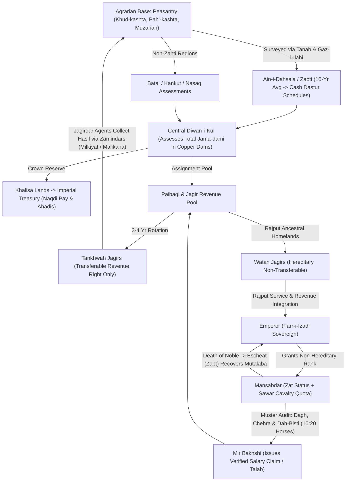

# Chapter 21 - The Mughal Imperium I - Gunpowder Statecraft, Sur Precedents, Mansabdari & Akbari Synthesis (1526–1605)

Between 1526 and 1605, North India underwent a structural metamorphosis from a fractured Afghan confederacy into an early modern Eurasian superpower. This transformation was neither an accidental military windfall nor a purely Central Asian transplant.

Instead, the early Mughal state fused three distinct engines: **Timurid gunpowder warfare**, **Sher Shah Suri's standardized agrarian-monetary infrastructure**, and **Akbar's bureaucratic-pluralist synthesis**. Together, they solved the perennial structural dilemma of Indian empires—converting agrarian surplus across ecological and ethnic frontiers into centralized military capacity without losing control to hereditary warlords.

---

## 1. Timurid Gunpowder Entry and the Fragile Foundation (1526–1556)

### Geopolitical Push and Babur's Tactical Revolution

Zahir-ud-din Muhammad Babur—descended patrilineally from Timur and matrilineally from Chinggis Khan—did not enter Hindustan out of idle ambition. Expelled from his ancestral principality of Fergana and repeatedly blocked from recovering Samarkand by **Shaibani Khan's Uzbeks**, Babur consolidated Kabul (1504) and pivoted southeast toward the fertile, resource-rich Indo-Gangetic basin.

North India in 1526 offered a classic strategic vacuum. Sultan Ibrahim Lodi's bid to centralize an Afghan tribal monarchy alienated powerful nobles like **Daulat Khan Lodi** (Governor of Punjab) and **Alam Khan**, while **Rana Sanga of Mewar** miscalculated that Babur would raid Delhi like Timur in 1398 and retreat, leaving the Doab open to Rajput expansion.

At the **First Battle of Panipat (April 21, 1526)**, Babur defeated Ibrahim Lodi's numerically superior army not by introducing gunpowder to India—pyrotechnics and firearms already operated in the Deccan, Gujarat, and Malwa—but by deploying **integrated field artillery and wagon-fortress tactics** on an open North Indian battlefield. Supervised by Ottoman-trained master gunners **Ustad Ali Quli** (heavy artillery) and **Mustafa Rumi** (matchlocks), Babur combined two tactical mechanisms:

- **The *Rumi* (Ottoman) *Araba* Device:** Seven hundred wheeled carts (*araba*) were lashed together with rawhide ropes across the front line, interspersed with earthen breastworks (*tura*) shielding matchlockmen (*tufangchis*) and swivel-mounted field cannons (*zarb-zan* and *farangi*). This created a mobile fortified killing zone that shattered heavy Afghan elephant and cavalry charges.
- **The *Tulghuma* Flanking Maneuver:** While Lodi's center stalled against artillery fire, high-mobility Turco-Mongol horse-archers swept around both flanks to execute a double envelopment (*tulghuma*), compressing the opposing army into a trapped mass.

Babur repeated this tactical architecture at the **Battle of Khanwa (March 1527)** near Fatehpur Sikri against **Rana Sanga's** formidable Rajput–Afghan coalition (which included Hasan Khan Mewati and Mahmud Lodi). Recognizing the existential stakes, Babur abolished the *tamgha* (stamp/commercial tax) for Muslim soldiers, dramatically renounced wine, framed the campaign as a *jihad*, and assumed the title ***Ghazi*** upon victory.

Subsequent victories over **Medini Rai** at **Chanderi (1528)** and the combined Afghan-Bengal forces under **Mahmud Lodi** and **Nusrat Shah** at the **Battle of Ghaghra (1529)**—a rare riverine engagement—secured the core corridor from the Kabul Valley to Bihar. Strategically, Babur shifted the geopolitical axis of North India back into the trans-regional Central Asian and Persianate sphere, breaking the political isolation of the late Delhi Sultanate.

### Babur's Cultural World and Ecological Geometry

Babur died in December 1530 before converting military conquest into durable administrative institutions, retaining Lodi-era *iqta* (now termed *wajhdari*) revenue assignments. Yet his intellectual and aesthetic footprint established enduring imperial standards.

His autobiography, the ***Tuzuk-i-Baburi*** (*Baburnama*), composed in **Chagatai Turkish** (and later translated into Persian by **Abdur Rahim Khan-i-Khanan** under Akbar), stands as one of world literature's most candid royal memoirs. Free of courtly hagiography, it catalogs Indian monsoon hydrology, flora, fauna, agrarian craft guilds, and urban irrigation devices—including the wooden Persian wheel (*rahat/saqiya*)—while famously lamenting Hindustan's heat, dust, and lack of running-water gardens.

To impose Timurid order onto the Indo-Gangetic plain's flat, dusty topography, Babur introduced the formal Persian ***Charbagh*** (four-fold symmetrical garden quartered by axial water channels and stone walkways symbolizing Quranic paradise). Early prototypes survive in the **Ram Bagh (*Aram Bagh*)** at Agra and the rock-cut **Bagh-i-Nilufar (Lotus Garden)** at Dholpur. A versatile litterateur, Babur also invented a poetic verse form called ***Mubaiyan*** and devised a calligraphic script known as ***Khatt-i-Baburi***.

### Humayun's Structural Fragility and Safavid Cultural Dividends (1530–1556)

Nasir-ud-din Muhammad **Humayun** inherited a conquest state lacking both a unified fiscal spine and a settled law of primogeniture. Adhering to the Timurid **appanage tradition** of dividing patrimonial lands among royal brothers, Humayun granted Kabul and Qandahar to **Kamran** (who soon annexed Punjab), Sambhal to **Askari**, and Alwar–Mewat to **Hindal**.

This territorial partition proved fatal. Deprived of the Central Asian cavalry recruitment pool in Afghanistan and Punjab, Humayun faced simultaneous pincers: **Bahadur Shah of Gujarat** (bolstered by Ottoman gunners under Rumi Khan and Portuguese coastal alliances) in the west, and **Sher Khan Sur** consolidating Bihar's Afghan diaspora in the east.

Humayun's strategic dithering compounded these structural weaknesses. After besieging Chunar (1532), he accepted Sher Khan's nominal submission instead of neutralizing him, then spent 1535–36 overrunning Malwa and Gujarat only to lose both provinces within a year due to Askari's mismanagement. When Humayun marched into Bengal (1538), Sher Khan severed his western communications along the Ganga.

Cut off during the monsoon, Humayun suffered catastrophic defeats at the **Battle of Chausa (1539)**—escaping drowning in the Ganga with the aid of a water-carrier named Nizam—and the **Battle of Bilgram / Kannauj (1540)**. Driven into a fifteen-year exile, Humayun traversed Sindh (where **Akbar** was born at Amarkot in 1542) before finding sanctuary at the Safavid court of **Shah Tahmasp** in Persia.

With Safavid military backing (contingent on nominal Shia accommodation and surrendering Qandahar), Humayun eliminated his rebellious brothers, exploited the post-Sher Shah Sur civil war, and reclaimed Delhi after victories at **Machhiwara** and **Sirhind (1555)**. Though he died six months later (January 1556) after tripping down the stone stairs of his library (*Sher Mandal*) in Delhi's Purana Qila, his Persian exile reshaped Mughal civilization:

- **Imperial Painting Atelier:** Returning to India, Humayun brought two Safavid master painters from Tabriz—**Mir Sayyid Ali** and **Abd us-Samad**—commissioning the foundational illustrations of the *Dastan-i-Amir Hamza* (*Hamzanama*) and seeding the imperial Mughal atelier.
- **Urban & Literary Heritage:** Before his exile, Humayun founded the citadel of ***Dinpanah*** (1533) on Delhi's Indraprastha mound. His half-sister **Gulbadan Begum** later authored the ***Humayun-nama*** under Akbar—a rare, intimate insider chronicle of Timurid court politics and imperial household dynamics.

---

## 2. The Sur Interregnum - Administrative, Fiscal and Logistical Precedents (1540–1555)

### Institutional Genius of Sher Shah Suri (1540–1545)

Farid Khan—the son of a minor Afghan *jagirdar* of Sasaram in Bihar who earned the title **Sher Khan** and ascended Delhi's throne as **Sher Shah Suri**—governed North India for barely five years before dying in a gunpowder magazine explosion during the siege of **Kalinjar Fort (1545)**. Yet his administrative overhaul, meticulously documented decades later in **Abbas Khan Sarwani's *Tarikh-i-Sher Shahi*** (commissioned by Akbar), constructed the institutional chassis upon which the Mughal Empire operated for two centuries.

Recognizing that tribal Afghan anarchy had destroyed the Lodi dynasty, Sher Shah centralized state authority without triggering ethnic alienation. He erected massive strategic bastions—**Rohtasgarh** in Bihar and **Rohtas Fort** in Punjab (to check the Gakkhars and block Humayun's return)—and annexed Malwa and Marwar (defeating Maldeo Rathore at the Battle of Sammel, 1544).

### Territorial Grid and Localized Accountability

Sher Shah abandoned haphazard military fiefs in favor of a tight, layered territorial hierarchy designed to separate coercive force from fiscal bookkeeping:

- **The *Sarkar* (District):** Dividing the empire into roughly 47 *sarkars* (with Bengal uniquely split into smaller *sarkars* under a non-military overseer, **Qazi Fazilat**, to prevent provincial rebellion), Sher Shah installed two co-equal officers to check each other—the ***Shiqdar-i-Shiqdaran*** (chief executive and law-and-order officer) and the ***Munsif-i-Munsifan*** (chief civil judge and supervisor of revenue assessment).
- **The *Pargana* (Sub-District):** Each *sarkar* subdivided into *parganas* administered by a ***Shiqdar*** (military/policing official), an ***Amin*** or ***Munsif*** (revenue assessor), a ***Fotedar*** (treasurer), and two ***Karkuns*** (clerks maintaining duplicate records in Persian and *Hindavi* to curb fraud).
- **Village Collective Liability:** At the *mauza* (village) base, the hereditary headman (***Muqaddam***) and village accountant (***Patwari***) were held strictly liable for crimes committed within their jurisdiction. If a traveler was robbed or murdered, the local *muqaddam* had to produce the culprit or compensate the victim—a harsh deterrent that made imperial highways remarkably safe.

### Agrarian Measurement, Monetary Unification and Commercial Arteries

Having personally managed his father's Sasaram *jagir*, Sher Shah understood that unmeasured revenue farming bled the peasantry while enriching intermediaries. He pioneered direct peasant-state assessment (*Rayatwari* in spirit) built on three pillars:

1. **Standardized Measurement and *Ray* Schedules:** Cultivated land was surveyed annually using a hemp rope (***Jarib***) calibrated to the ***Gaz-i-Sikandari*** (32 digits). Soil productivity was classified into **Good, Middling, and Bad**; the average yield per *bigha* across these three grades determined the state's standard crop-rate schedule (***Ray*** or ***Rai***), fixing the state demand at **one-third of the average produce**, payable in cash or kind.
2. **Contractual Clarity (*Patta* and *Qabuliyat*):** To eliminate arbitrary extraction, every cultivator received a ***Patta*** (written title deed specifying measured area and revenue demand) and signed a ***Qabuliyat*** (written deed of acceptance). Peasants paid modest supplementary fees—***Jaribana*** (surveyor's fee, ~2.5%) and ***Muhasilana*** (tax-collector's fee, ~5%)—while soldiers were severely punished for damaging standing crops on campaign.
3. **Tri-Metallic Monetary Revolution:** Eliminating the Sultanate's debased mixed-metal (*billon*) coins, Sher Shah instituted a high-purity **tri-metallic currency system** that stabilized commercial exchange across North India:
   - The **Silver *Rupiya***: Standardized at **178 grains** of pure silver—the direct numismatic ancestor of the modern Indian rupee, surviving virtually unchanged in weight into the 20th century.
   - The **Copper *Dam***: A heavy copper coin (~320–330 grains) serving everyday retail transactions and wage payments.
   - The **Gold *Mohur* (*Ashrafi*)**: Standardized at **169 grains** for high-value bullion settlement and sovereign prestige.

Simultaneously, Sher Shah dismantled internal trade bottlenecks by abolishing countless provincial transit tolls (*rahdari*), restricting customs duties strictly to **two points**: the empire's entry frontier and the final point of sale.

To physically bind this unified market, he built or rebuilt four major trunk highways anchored by the ***Sadak-e-Azam*** (later the Grand Trunk Road), stretching roughly 1,500 *kos* from **Sonargaon (East Bengal)** through Agra, Delhi, and Lahore to the **Indus/Peshawar**. Three secondary arteries linked Agra–Burhanpur, Agra–Jodhpur–Chittor, and Lahore–Multan.

Along these roads, Sher Shah constructed approximately **1,700 fortified *Sarais*** (caravanserais) spaced every two *kos* (~8 km). Far more than roadside inns, each *sarai* featured separate lodgings and kitchens for Hindus and Muslims, a well, a mosque, a custodian (*Shahna*), and two relay horses for the ***Dak Chauki*** (imperial postal and intelligence network). Market towns (*qasbas*) crystallized organically around these fortified rest-houses, monetizing rural hinterlands.

Militarily, Sher Shah revived Alauddin Khalji's ***Dagh*** (branding horses to prevent substitution of inferior mounts) and ***Chehra/Huliya*** (descriptive soldier rolls), insisting on direct cash remuneration for troops rather than feudal retainers. His successor **Islam Shah (1545–53)** further codified state laws, removing judicial discretion from local nobles before factional Sur infighting reopened the door to Humayun.

### Transitional Sur Architecture

Sur patronage bridged the austere stonework of the Lodis and the imperial grandeur of Akbar. At Delhi, Sher Shah transformed Humayun's *Dinpanah* into ***Shergarh*** (**Purana Qila**), adding the ***Qila-i-Kuhna Mosque*** (1541)—a five-bay, single-aisle sanctuary where red sandstone, white marble, and black slate inlay articulate soaring pointed arches, recessed *pishtaqs*, and refined *mihrabs*. Adjacent stands the octagonal two-storey ***Sher Mandal*** pavilion.

The climax of Indo-Afghan funerary engineering is **Sher Shah's Mausoleum at Sasaram (Bihar, completed 1545)**, designed by architect **Mir Muhammad Aliwal Khan**. Rising from a monumental square plinth anchored in the center of an artificial lake and approached via a stone causeway, this three-tiered octagonal mausoleum expands the Lodi octagonal archetype to colossal proportions—its grey Chunar sandstone dome spans a wider diameter than the Taj Mahal's, crowned with a lotus finial and ringed by rhythmic kiosk *chhatris*.

---

## 3. Akbar's Imperial Apparatus - Bureaucratic Checks and the Agrarian Machine (1556–1605)

### Consolidation, Expansion and Competing Archival Mirrors

Crowned at Kalanaur in Punjab at age thirteen (February 1556), Jalal-ud-din Muhammad **Akbar** survived the initial existential crisis through his regent **Bairam Khan** (*Khan-i-Khanan*), whose forces defeated **Hemu** (Vikramaditya, brilliant Hindu general and *wazir* of Adil Shah Sur) at the **Second Battle of Panipat (November 1556)**. Dismissing Bairam Khan in 1560 and outgrowing the brief court influence of his foster-mother Maham Anga and her son Adham Khan by 1562, Akbar crushed the rebellious **Turani–Uzbek nobility** (1564–67) who sought to reduce him to a *primus inter pares* tribal chief.

Over the next four decades, Akbar welded an empire spanning Kabul, Qandahar, Kashmir, Sindh, and Balochistan in the northwest; Gujarat (1572–73) and Bengal (1576) anchoring the oceanic trade coasts; Malwa, Gondwana, and Rajputana across the central spine; and Berar, Khandesh, and northern Ahmadnagar in the Deccan.

Reconstructing this institutional revolution requires triangulating two diametrically opposed Persian chronicles:

- **Abul Fazl (*Akbarnama* and *Ain-i-Akbari*):** Akbar's chief ideologue and secretary composed the official history (*Akbarnama*) and its monumental third volume, the ***Ain-i-Akbari*** (completed 1598)—an unmatched statistical gazetteer detailing imperial regulations, *mansab* rosters, crop schedules, mint assays, prices, and ethnography. While ideologically framing Akbar through the lens of ***Farr-i-Izadi*** (divine effulgence), its institutional data remains foundational.
- **Abdul Qadir Badauni (*Muntakhab-ut-Tawarikh*):** An orthodox Sunni scholar employed in Akbar's translation bureau who secretly composed a scathing critique of Akbar's religious policies, administrative experiments, and revenue collectors. Reading Badauni alongside Abul Fazl—and **Nizamuddin Ahmad's** drier, balanced ***Tabaqat-i-Akbari***—strips away courtly panegyric to expose ground-level friction.

### Central and Provincial Separation of Powers

To prevent any single minister or governor from accumulating the combined fiscal and military leverage needed to usurp the throne, Akbar engineered a deliberate **architecture of vertical checks and balances**.

At the **Center**, Akbar stripped the prime ministerial office of the ***Vakil*** (which Bairam Khan had wielded with near-sovereign autonomy) of executive power, reducing it to an honorific dignity. Real administration was partitioned across four functionally insulated ministries:

- ***Wazir / Diwan-i-Kul*** (Revenue and Finance): Controlled the imperial treasury, assessed *jama* (revenue estimates), audited *jagir* transfers, and supervised provincial *diwans*. Stalwarts like **Muzaffar Khan Turbati** and **Raja Todar Mal** transformed this desk into the fiscal brain of the empire.
- ***Mir Bakhshi*** (Military Administration and Intelligence): Headed the military establishment—NOT as commander-in-chief (the Emperor remained supreme commander), but as paymaster-general and muster inspector. He processed *mansab* appointments, enforced horse-branding (*dagh*), signed salary certificates (*sarkhat*) only after troop inspection, and oversaw the empire-wide intelligence network of ***Barids*** (intelligence officers) and ***Waqia-navis*** (court news-writers).
- ***Mir Saman / Khan-i-Saman*** (Imperial Household and Factories): Managed the royal household, provisions, palace supplies, and the vast state manufacturing workshops (***Karkhanas***) producing textiles, armor, and luxury court regalia.
- ***Sadr-us-Sudur*** (Ecclesiastical Affairs and Patronage): Guarded Islamic law, recommended *Qazis*, and distributed tax-free charitable land grants (***Madad-i-Maash*** or ***Suyurghal***) to scholars and saints. After uncovering rampant corruption under Abdun Nabi, Akbar clipped the *Sadr's* wings (1579–81), separating the office of chief judge (***Qazi-ul-Quzat***) and dispersing grant verification across six regional *Sadrs*.

In **1580**, Akbar standardized provincial governance into **12 *Subas*** (expanded to **15 *Subas*** by 1605 after adding Berar, Khandesh, and Ahmadnagar), replicating the center's separation of powers downward:

- **Provincial (*Suba*) Tier:** The governor (***Subahdar***, ***Sipahsalar***, or ***Nazim***) commanded executive authority and military force, while the provincial ***Diwan*** managed all revenue and fiscal accounts. Crucially, the provincial *Diwan* was appointed by and reported **directly to the Central *Diwan-i-Kul***, never to the *Subahdar*. A provincial ***Bakhshi***, ***Sadr***, ***Qazi***, and independent ***Waqia-navis*** completed the mutual surveillance web, while the urban ***Kotwal*** policed cities, checked weights and measures, and regulated guilds.
- **District (*Sarkar*) and Sub-District (*Pargana*) Tiers:** Retaining Sher Shah's administrative hierarchy (*Pargana → Sarkar → Suba*), Akbar placed each *Sarkar* under a ***Faujdar*** (law, order, and suppressing recalcitrant *zamindars*) balanced by an ***Amalguzar / Amil*** (chief revenue collector). At the *Pargana* level, the ***Shiqdar*** (executive) and ***Amil*** worked alongside hereditary local record-keepers—the ***Qanungo*** (keeper of historical land-revenue records) and ***Chaudhari*** (revenue intermediary)—bridging imperial bureaucracy with village society.

### Raja Todar Mal's *Ain-i-Dahsala* (*Zabti*) and Agrarian Stratification

Early in his reign, Akbar adopted Sher Shah's *Ray* schedule, but converting crop rates into cash using a single centralized price list from Delhi caused severe regional distortions: when local harvest prices diverged from capital prices, peasants in surplus regions faced ruinous cash demands, while annual royal price approvals delayed collections.

To resolve this information asymmetry, Akbar launched the ***Karori* Experiment (1573–74)** across the northern *khalisa* lands. Officials designated *Amils* (popularly ***Karoris***) were assigned tracts estimated to yield one *crore* (10 million) *dams* (~₹2.5 lakh) with strict instructions to expand cultivation, enforce standardized land measurement, and compile empirical ten-year records of local crop yields and market prices.

Armed with a decade of granular fiscal telemetry (1570–80), **Raja Todar Mal** and **Khwaja Shah Mansur** promulgated the ***Ain-i-Dahsala*** (also known as the ***Zabti*** or *Todar Mal's Bandobast*) in **1580** across the core alluvial provinces from Lahore and Multan through Delhi, Agra, Awadh, Allahabad, Bihar, and Malwa.

First, the state eliminated measurement fraud by replacing Sher Shah's hygroscopic hemp rope (*jarib*)—which shrank when wet and stretched when dry—with **iron-ringed bamboo rods (***Tanab***)** calibrated to the standardized ***Gaz-i-Ilahi*** (41 *angusts*, ~32–33 inches), establishing 1 imperial ***Bigha*** as 60 × 60 *Gaz-i-Ilahi*.

Second, the *Dahsala* was **NOT** a ten-year fixed revenue settlement. Rather, it calculated the trailing **ten-year average (1570–80)** of actual crop yields and local harvest prices for every crop within ecologically homogeneous revenue zones called ***Dastur*** circles. One-third of that average produce value was converted into fixed **cash revenue rates per *bigha*** (***Dastur-ul-Amal***), updated locally and reckoned in copper *dams* (40 *dams* = 1 silver *rupiya*).

Third, to reward agricultural expansion and prevent ecological exhaustion, assessment differentiated land by **continuity of cultivation** rather than static soil geology alone: ***Polaj*** (annually cultivated, paying full standard rate), ***Parauti*** (left fallow 1–2 years to recover fertility, paying full rate only when sown), ***Chachar*** (fallow 3–4 years, paying concessional escalating fractions reaching full rate by year five), and ***Banjar*** (uncultivated for 5+ years, taxed at heavily discounted sliding rates to incentivize reclamation). State loans (***Taqavi***) financed wells, seeds, and bullocks during distress.

Where terrain, ecology, or political integration made annual cadastral measurement impracticable, the Mughal state pragmatically retained non-*Zabti* modes: ***Batai / Ghalla-bakhshi*** (physical crop-sharing via standing crop [*khet-batai*], harvested sheaves [*lang-batai*], or threshed grain [*rasi-batai*], common in Sindh, Kabul, Qandahar, and arid Rajasthan), ***Kankut*** (grain estimation by visual inspection and sample cutting), and ***Nasaq*** (summary lump-sum village assessment based on past records, dominant in Bengal, Gujarat, and Berar).

Beneath these fiscal templates lay a sharply stratified rural society mapped by historian Irfan Habib. Peasant cultivators (*raiyat*) were neither an undifferentiated mass nor landless serfs. ***Khud-kashta*** (resident proprietors) possessed hereditary occupancy rights, ploughs, and homesteads in their own villages; ***Pahi-kashta*** (non-resident/migrant cultivators) tilled vacant lands in neighboring villages, often negotiating lower concessional tax rates because land remained abundant relative to labor; and ***Muzarian*** (sharecroppers/tenants) leased plots from wealthier peasants or *zamindars*, supplemented by landless village service castes (*kamins*).

Mediating between this peasantry and the imperial apparatus stood the ***Zamindars***—ranging from autonomous tribute-paying Rajput chieftains (*Peshkashi*) to intermediary fiscal magnates and primary village dominant-caste lineages. Holding hereditary proprietary claims (***Milkiyat***) over a customary share of agrarian surplus (often 10% to 25%), *zamindars* were armed rural stakeholders essential for maintaining cultivation and collecting taxes; whenever the state bypassed a *zamindar* to deal directly with peasants, it typically paid him a compensatory hereditary allowance called ***Malikana*** (or granted tax-free *Nankar* plots).

### Revenue Terms Table

| Term | Domain & Era | Exact Institutional Function | UPSC Precision Anchor |
| :--- | :--- | :--- | :--- |
| ***Jarib*** vs. ***Tanab*** | Measurement (Sur vs. Akbar) | *Jarib* was Sher Shah's hemp rope; *Tanab* was Akbar's bamboo rod joined with iron rings | Eliminated seasonal stretching/shrinking fraud during cadastral survey |
| ***Gaz-i-Sikandari*** vs. ***Gaz-i-Ilahi*** | Linear Standard (Lodi–Sur vs. Akbar) | *Gaz-i-Sikandari* = 32 digits; Akbar's *Gaz-i-Ilahi* = 41 *angusts* (~32–33 in; 1 *Bigha* = 3,600 sq *gaz*) | Unified imperial land measurement across core *Zabti* provinces |
| ***Ray / Rai*** | Assessment Schedule (Sher Shah) | Standardized crop-rate schedule averaging Good, Middling, and Bad soil yields (state share = 1/3rd) | Precursor to Akbar's *Dastur*; failed under Akbar when tied to single Delhi prices |
| ***Patta*** & ***Qabuliyat*** | Peasant Contract (Sher Shah → Akbar) | *Patta* = title deed specifying plot & tax demand; *Qabuliyat* = peasant's written acceptance | Protected cultivators from arbitrary intermediary exactions |
| ***Karori*** | Fiscal Survey Officer (Akbar, 1573–74) | *Amil* appointed over a tract yielding 1 *crore dams* to measure land and log 10-yr crop/price data | Empirical data-gathering engine that made the 1580 *Dahsala* possible |
| ***Ain-i-Dahsala*** (*Zabti*) | Core Revenue System (Akbar/Todar Mal, 1580) | Cash rates per *bigha* derived from trailing 10-year (1570–80) yield & local price averages | **NOT** a 10-year fixed settlement; operated primarily from Punjab to Awadh/Bihar |
| ***Dastur-ul-Amal*** | Cash Schedule (Akbar) | Regionally calibrated cash-rate table issued for each homogeneous *Dastur* revenue circle | Solved the price-distortion crisis of central Delhi pricing |
| ***Polaj / Parauti / Chachar / Banjar*** | Land Continuity Tiers (Akbar) | Annually sown (*Polaj*); 1–2 yr fallow (*Parauti*); 3–4 yr fallow (*Chachar*); 5+ yr uncultivated (*Banjar*) | Concessional sliding rates on *Chachar/Banjar* incentivized agrarian expansion |
| ***Batai*** (*Ghalla-bakhshi*) | Non-*Zabti* Assessment (Mughal) | Physical division of crop (*Khet-batai*, *Lang-batai*, *Rasi-batai*); shared harvest risk | Prevalent in arid/frontier zones (Sindh, Kabul, Qandahar, parts of Rajasthan) |
| ***Kankut*** | Non-*Zabti* Assessment (Mughal) | Visual appraisal (*kan* = grain, *kut* = estimate) of standing crop via sample cutting | Faster than *Batai* but vulnerable to appraiser collusion |
| ***Nasaq*** | Non-*Zabti* Assessment (Mughal) | Summary lump-sum assessment negotiated with village/intermediaries using past tax accounts | Dominant mode in Bengal, Gujarat, and Berar where *Zabti* surveys lagged |
| ***Khud-kashta*** | Agrarian Class (Mughal) | Resident peasant proprietors with hereditary occupancy rights, ploughs, and village homesteads | Formed the upper/middle tax-paying core of the *raiyat* |
| ***Pahi-kashta*** | Agrarian Class (Mughal) | Non-resident/migrant cultivators leasing vacant land in other villages | Often paid *lower* concessional rates due to labor scarcity relative to arable land |
| ***Muzarian*** | Agrarian Class (Mughal) | Tenant farmers / sharecroppers cultivating plots owned by *Khud-kashta* or *Zamindars* | Occupied the dependent tier below resident proprietors |
| ***Milkiyat*** & ***Malikana*** | *Zamindar* Rights (Mughal) | *Milkiyat* = hereditary proprietary right over revenue share/land; *Malikana* = compensation (~10%) when bypassed | Proves *Zamindars* held hereditary local rights, unlike transferable *Jagirdars* |
| ***Jama-dami*** vs. ***Hasil*** | Fiscal Accounting (Mughal) | *Jama* = official estimated revenue in copper *dams* (40 *dams* = ₹1); *Hasil* = actual revenue realized | Gap between *Jama* and *Hasil* later fueled the 17th-century Jagirdari Crisis |
| ***Khalisa*** vs. ***Jagir*** | Territory Allocation (Mughal) | *Khalisa* = crown lands paying directly into imperial treasury; *Jagir* = revenue assigned to *Mansabdars* | *Paibaqi* denoted unassigned revenue tracts waiting in reserve for *Jagir* allotment |
| ***Madad-i-Maash*** (*Suyurghal*) | Charitable Tenure (Mughal) | Tax-free revenue grants awarded to scholars, Sufi shrines, temples, and religious lineages | Supervised by *Sadr-us-Sudur*; technically non-hereditary under Akbar |

---

## 4. The Mansabdari–Jagirdari Grid - Monetizing the Military Aristocracy

### Architecture of the Unified Decimal Bureaucracy

Pre-Mughal polities routinely fractured because military aristocracies developed hereditary territorial roots (as in Afghan *wajahdari* or Rajput clan appanages). Drawing conceptual inspiration from the Chinggisid decimal military hierarchy and refining Sultanate *iqta* experiments, Akbar instituted the ***Mansabdari*** system (evolving in the early 1570s and perfected with dual ranks by 1595–96).

The system abolished the rigid divide between civil and military officers. Every imperial servant—whether general, provincial governor, financial secretary, or court chronicler (Abul Fazl held a high *mansab*)—received a numerical rank (***Mansab***, meaning "position" or "office") ranging from **10 to 5,000** (extended late in Akbar's reign to **7,000** for premier non-royal nobles **Mirza Aziz Koka** and **Raja Man Singh**, and higher for royal princes). Those ranked 1,000 and above constituted the upper elite (*Umara* or *Amirs*).

### Dual Numerical Precision (*Zat*, *Sawar* and *Dah-Bisti*)

Initially a single numerical rank, *mansab* split in the 1590s into a sophisticated two-variable control vector:

- ***Zat* (Personal Rank):** Determined the noble's exact precedence in court protocol and fixed his **personal salary** (*talab-i-khassa*) alongside obligations to maintain transport carts, elephants, and pack animals.
- ***Sawar* (Cavalry Rank):** Specified the exact number of **armed cavalry troopers** the *mansabdar* was contractually required to recruit, pay, and muster for imperial service.

Based on the ratio of *Sawar* to *Zat*, *mansabdars* were subdivided into **three grades**: First Class (*Sawar* equal to *Zat*), Second Class (*Sawar* equal to or greater than half of *Zat*), and Third Class (*Sawar* less than half of *Zat*—or zero for purely civil functionaries). Crucially, *Sawar* could never exceed *Zat* under Akbar's baseline rule.

To guarantee battlefield endurance across vast subcontinental distances, Akbar enforced the ***Dah-Bisti* (10–20) rule**: for every **10 cavalrymen**, a *mansabdar* had to maintain **20 horses** (distributed as three three-horse troopers [*sih-aspa*], four two-horse troopers [*du-aspa*], and three one-horse troopers [*yak-aspa*]). Fresh remounts kept Mughal cavalry operating at blistering operational tempos.

Fraud was policed through mandatory ***Dagh-o-Mahalli*** (double-branding horses with both the imperial mark and the *mansabdar's* mark) and ***Chehra*** (descriptive muster rolls verified by the *Mir Bakhshi*). Furthermore, Akbar broke clan solidarity inside noble armies by mandating **ethnically mixed contingents** (blending Turanis, Iranis, Rajputs, Afghans, and Indian Muslims [*Shaikhzadas*])—only Rajput nobles retained temporary exemptions to field homogeneous kin cavalry. Alongside *mansabdari* troops, Akbar maintained a direct imperial elite bodyguard of gentlemen-troopers called ***Ahadis***, paid directly from the royal treasury.

### Transferable *Jagirs*, *Watan Jagirs* and Escheat (*Zabt*)

While a minority of officers received cash salaries directly from the imperial treasury (***Naqdi***), the majority were remunerated via ***Jagirs***—territorial assignments of state revenue equal to their *Zat* and *Sawar* pay claims (*Talab*).

A foundational misconception must be eliminated: a *Jagirdar* did **NOT** own the land, nor did he automatically hold judicial or policing authority over his *jagir*. He held solely a **revocable, transferable right to collect state-assessed land revenue** (*Jama-dami*) through his private agents (*amils/gumashtas*), subject to imperial audit. To prevent territorial entrenchment, standard salary assignments—***Tankhwah Jagirs***—were systematically **transferred every three to four years**, while conditional postings carried temporary ***Mashrut Jagirs***.

Akbar paired this centralization with pragmatic federal accommodation for incorporated Indian rulers. When Rajput chiefs submitted to Mughal suzerainty, their ancestral homelands were confirmed as hereditary, non-transferable ***Watan Jagirs***, whose assessed revenue was deducted from their total *mansab* pay—while the remaining balance was awarded as transferable *Tankhwah Jagirs* in distant provinces like Bengal, Bihar, or Kabul. This simultaneously respected ancestral honor and locked Rajput princes into pan-imperial stakes.

Finally, the *Mansabdari* grid remained strictly **non-hereditary**. Upon a *mansabdar's* death, his rank lapsed entirely, and imperial auditors invoked the law of **Escheat (***Zabt*** / *Bait-ul-Mal*)**—sealing his movable wealth to settle unpaid state advances (***Mutalaba***) before the Emperor distributed the remainder at his discretion. While this curbed entrenched feudal dynasties, European observers later noted it also encouraged conspicuous noble consumption over long-term productive capital investment.

### Mansabdari–Zabti System Diagram

---

## 5. Imperial Pluralism, Sulh-i-Kul and the Akbari Cultural Synthesis

### Strategic Architecture of the Rajput Alliance

Akbar's integration of the Rajput clans was neither sentimental romanticism nor one-sided coercion; it was a masterstroke of **imperial coalition-building**. Facing repeated rebellions from Central Asian Turani and Uzbek amirs in the 1560s, Akbar recognized that a stable subcontinental empire required an indigenous martial counterweight rooted in Indian soil.

The watershed arrived in **1562**, when **Raja Bharmal of Amber (Kachwaha)** offered political submission and his daughter (**Harkha Bai**, later entitled *Mariam-uz-Zamani* and mother of Jahangir) in marriage. Breaking with earlier Sultanate norms of asymmetric matrimonial tributes, Akbar accorded Rajput queens full religious freedom inside the imperial *haram*, never demanded conversion, and elevated Bharmal's son **Bhagwan Das** and grandson **Raja Man Singh** to the empire's highest military and gubernatorial commands.

Following the brutal military demonstrations at **Chittor (1568)** and **Ranthambore (1569)**, almost every major Rajput polity—Bikaner, Jaisalmer, Marwar (Jodhpur), and Bundi—entered the Mughal orbit through a durable three-point compact: acceptance of Mughal suzerainty, full domestic autonomy via *Watan Jagirs*, and lucrative pan-Indian imperial careers via high *Mansabs* and *Tankhwah Jagirs*. Only the Sisodias of **Mewar**—first Rana Udai Singh and then **Maharana Pratap** (who fought Raja Man Singh's Mughal vanguard at the **Battle of Haldighati, 1576** and waged protracted guerrilla resistance from the Aravalli hills)—refused formal submission during Akbar's lifetime.

### Ideological Evolution Toward *Sulh-i-Kul*

Akbar's religious trajectory unfolded across three calibrated phases, shifting the Mughal state from an orthodox Sunni conquest polity to a universalist empire grounded in ***Sulh-i-Kul*** ("Universal Peace" or "Absolute Peace"):

1. **Early Civic Emancipation (1562–1574):** In **1562**, Akbar banned the customary enslavement and forcible conversion of war captives and their families. In **1563**, during a pilgrimage visit near Mathura, he abolished the **Pilgrimage Tax** levied on Hindu devotees. In **1564**, he abolished ***Jizya***—the discriminatory poll tax on non-Muslim subjects (*zimmis*)—erasing the fiscal marker of second-class citizenship. *(Precision nuance: under temporary orthodox clerical influence, Jizya was briefly reimposed around 1575 before being permanently abolished in 1579–80.)*
2. **Epistemological Inquiry and Breaking Clerical Monopoly (1575–1580):** In **1575**, Akbar erected the ***Ibadat Khana*** (House of Worship) at Fatehpur Sikri to host Thursday-night theological debates. Initially restricted to Sunni *Ulama* (such as Shaikh Abdun Nabi and Makhdum-ul-Mulk), their bitter sectarian bickering disillusioned Akbar. By **1578**, he threw open the doors to Shia jurists, Hindu philosophers (**Purushottam** and **Devi**), Jain *acharyas* (**Hiravijaya Suri**—whom Akbar honored as *Jagatguru* and for whom he curtailed animal slaughter on Jain holy days—and Vijayasena Suri), Zoroastrian priest (**Dastur Meherji Rana** of Navsari), and three **Jesuit missions** from Goa (first led in 1580 by **Father Rudolf Aquaviva** and **Antonio Monserrate**).
   To break the *Ulama's* political veto over state legislation, Akbar issued the ***Mahzar*** in **September 1579**—a legal declaration drafted by scholar **Shaikh Mubarak** (father of Abul Fazl and Faizi) and reluctantly signed by senior theologians. Often mischaracterized by colonial historian Vincent Smith as an "Infallibility Decree," the *Mahzar* operated strictly inside Islamic jurisprudence (*Fiqh*): it declared Akbar *Sultan-i-Adil* (Just Sovereign), empowering him to select whichever opinion among conflicting *Mujtahids* (jurists) best served public welfare—provided it did not contradict an explicit Quranic injunction.
3. ***Sulh-i-Kul* and *Tauhid-i-Ilahi* (1581–1605):** Drawing intellectually on **Ibn Arabi's *Wahdat-ul-Wujud*** (Unity of Being) and **Shihabuddin Suhrawardi's *Ishraqi*** (Illuminationist) mysticism, Abul Fazl articulated a new political theology: sovereignty flowed directly from God as ***Farr-i-Izadi*** (Divine Light), bypassing clerical mediation. Under ***Sulh-i-Kul***, the emperor acted as an impartial spiritual-temporal father mediating justice (*Adl*) across all creeds, banning religious compulsion while suppressing socially oppressive customs (discouraging child marriage and coerced *sati*, while permitting widow remarriage).
   In **1582**, Akbar formalized an intimate Sufi-style spiritual brotherhood called ***Tauhid-i-Ilahi*** ("Divine Monotheism"; called *A'in-i-Iradat-Gazinan* by Abul Fazl and only later dubbed ***Din-i-Ilahi*** in the 17th-century *Dabistan-i-Mazahib* and colonial historiography). It was **never** a mass proselytizing religion: it possessed no scripture, no priesthood, no mosques or temples, and no coercive enrollment. Only roughly **18 to 19 elite courtiers**—including **Birbal (Mahesh Das)**, Abul Fazl, and Faizi—took initiation (*muridi*) on Sundays, while top Hindu generals like **Raja Man Singh** and **Bhagwan Das** politely declined without suffering the slightest drop in imperial favor.

### The *Maktab Khana*, Vernacular Cosmopolis and Musical Synthesis

Akbar institutionalized civilizational dialogue through the ***Maktab Khana*** (House of Translation) at Fatehpur Sikri, pairing Sanskrit pandits with Persian stylists to render classical Indian knowledge accessible to the Persianate aristocracy and dispel mutual caricature:

- ***Razmnama* ("Book of Wars"):** A lavishly illustrated Persian translation of the *Mahabharata*, collaboratively rendered by **Naqib Khan**, **Abdul Qadir Badauni**, **Abul Fazl** (who authored its philosophical preface), and **Faizi**.
- **Classical Philosophical, Literary & Scientific Corpus:** Badauni translated the ***Ramayana*** (under imperial command despite personal reluctance); **Nizamuddin Panipati** translated the philosophical ***Yogavasistha***; **Haji Ibrahim Sirhindi** translated the ***Atharvaveda***; **Faizi** rendered Bhaskara II's mathematical treatise ***Lilavati*** and the tale of *Nal-Daman*; **Shah Muhammad Shahabadi** translated Kalhana's ***Rajatarangini***; **Abul Fazl** produced a fresh Persian version of the *Panchatantra* (*Iyar-i-Danish*); and **Abdur Rahim Khan-i-Khanan** translated Babur's Chagatai ***Baburnama*** into Persian.

Concurrently, the peace and urban patronage of Akbar's reign coincided with the golden zenith of vernacular *Braj Bhasha* and *Awadhi* literature—producing **Tulsidas's *Ramcharitmanas*** (composed independently at Ayodhya/Varanasi, 1574), **Surdas's** devotional Krishna *padas*, and **Abdur Rahim Khan-i-Khanan's** celebrated *Hindi Dohas*.

In courtly music, Akbar's patronage transformed **Gwalior *Dhrupad*** into the premier imperial classical idiom. Foremost among the legendary *Navaratnas* (Nine Jewels) was **Miyan Tansen** (born Ramtanu Pandey, disciple of **Swami Haridas** and influenced by the Shattari Sufi master **Muhammad Ghaus** of Gwalior). Crucially, the honorific **"Tansen"** was bestowed by **Raja Vikramjit of Gwalior** (and he served Raja Ramchandra of Rewa/Bandhavgarh before Akbar summoned him in 1562); Akbar conferred the title ***"Mian"***. Tansen composed *Dhrupads* praising both Hindu deities and royal patrons, mastered the *Rudra Veena* and *Rabab*, and systematized iconic *ragas* including ***Miyan ki Malhar***, ***Miyan ki Todi***, and ***Darbari Kanada***.

### The Imperial *Tasvir Khana* (Painting Atelier)

Building directly upon the studio seeded by Humayun's Safavid masters **Mir Sayyid Ali** and **Abd us-Samad**, Akbar expanded the ***Tasvir Khana*** (imperial painting workshop) into a dynamic engine employing over a hundred artists—the overwhelming majority recruited from indigenous Indian guilds across Gujarat, Rajasthan, Gwalior, and Kashmir.

Rather than imitating Persian flat two-dimensional elegance passively, the Akbari atelier forged a kinetic **Indo-Persian-European visual synthesis**:

- **Collective Assembly-Line Mastery:** Large manuscript folios were executed collaboratively—senior masters sketched the structural outline and composition (***Tarrah***), specialists painted expressive faces (***Chihranami***), and junior artists applied mineral pigments (***Rangamezi***).
- **Stylistic Breakthrough:** Persian calligraphic precision and architectural framing fused with Indian **volumetric modeling**, vibrant warm earth palettes, dynamic crowd choreography, and naturalistic landscape observation. From the 1580s onward, **Jesuit engravings** (such as Christophe Plantin's Antwerp *Royal Polyglot Bible*) introduced European Renaissance **linear perspective**, **foreshortening**, and **chiaroscuro** (light-and-shadow modeling), which Indian masters swiftly assimilated.
- **Landmark Illustrated Manuscripts:** The gigantic ***Hamzanama*** (~1,400 oversized paintings on cotton cloth brimming with explosive narrative energy), the ***Tutinama*** ("Tales of a Parrot"), the imperial ***Razmnama***, and the richly documented ***Akbarnama*** (capturing Akbar's hunts, sieges, bridge-building, and Fatehpur Sikri's construction).
- **Leading Indian Masters:** **Daswanth** (a kahar/palanquin-bearer's son discovered by Akbar and trained by Abd us-Samad, celebrated for haunting psychological intensity in the *Razmnama* before his tragic suicide) and **Basawan** (the supreme genius of spatial depth, three-dimensional shading, European visual assimilation, and expressive portraiture), alongside **Kesu Das**, **Lal**, **Miskin**, **Mukund**, and **Farrukh Beg**.

### Akbari Architecture - Red Sandstone Engineering and Trabeate–Arcuate Synthesis

Akbari architecture materialized *Sulh-i-Kul* in stone. Moving decisively beyond the regional brick-and-rubble idioms of the late Sultanate, imperial builders adopted **red and buff sandstone** accented with crisp **white marble inlay**, structurally marrying **Timurid-Persian arcuate geometry** (true domes, soaring *pishtaqs*, symmetrical *charbagh* grids) with **indigenous Gujarati–Rajput trabeate engineering** (post-and-lintel beams, sculpted corbelled brackets, cantilevered *chhajjas*, *jharokhas*, and domed roof *chhatris*).

#### Humayun's Tomb (Delhi, 1565–72 — UNESCO WHS 1993)
Located adjacent to the *dargah* of Hazrat Nizamuddin Auliya and near the earlier Lodi-Sur octagonal tomb of Isa Khan Niazi (1547), Humayun's Tomb represents the foundational prototype of the imperial Mughal garden-mausoleum. Commissioned and supervised by Humayun's senior widow **Bega Begum (*Haji Begum*)** (frequently conflated in secondary texts with Akbar's mother Hamida Banu Begum) and designed by Persian architect **Mirak Mirza Ghiyas** and his son **Sayyid Muhammad**, it introduced four defining architectural canons to India:

- **Monumental *Charbagh* Integration:** Set at the geometric center of a 10-hectare walled garden quartered by water channels and subdivided into **36 geometric parterres**, fusing funerary architecture with paradise-garden hydraulics.
- **The *Hasht-Bihisht* Plan:** The elevated arcaded red-sandstone plinth supports an irregular octagonal tomb chamber ringed by eight interconnected corner chambers ("Eight Paradises"), maximizing cross-ventilation, visual depth, and spatial hierarchy.
- **True Persian Double Dome:** Surmounting a tall cylindrical drum, an outer bulbous white-marble dome creates a commanding external skyline while a lower inner vaulted dome preserves harmonious human proportions inside the burial chamber.
- **Polychrome Surface Discipline:** Expansive **red sandstone** facades framed by high arched ***pishtaqs*** (monumental portals) are crisply outlined with **white marble** geometric borders, star medallions, and indigenous sandstone roof ***chhatris***.

#### Agra Fort (1565–73 — UNESCO WHS 1983)
Replacing the dilapidated Lodi brick citadel on the Yamuna's right bank, Akbar commissioned superintendent **Qasim Khan** to build an immense semicircular military-palatial complex in massive red sandstone, enclosed by 21-meter double curtain walls and monumental entrances (**Delhi Gate** and **Amar Singh / Lahore Gate**). Although Shah Jahan later replaced most interior Akbari sandstone halls with white marble pavilions, the surviving **Jahangiri Mahal** preserves Akbar's signature domestic idiom—a symmetrical courtyard palace whose recessed red-sandstone facades bristle with **Gujarati Hindu–Jain carved stone brackets**, lotus pendants, drooping eaves (*chhajjas*), and richly carved pillar shafts. Simultaneous strategic citadels rose at **Lahore**, **Allahabad** (at the Ganga–Yamuna *Sangam*), and **Ajmer**.

#### Fatehpur Sikri (1571–85 — UNESCO WHS 1986)
Constructed on an arid sandstone ridge 37 km west of Agra to honor Chishti Sufi saint **Shaikh Salim Chishti** (who foretold Prince Salim's birth in 1569), **Fatehpur Sikri** (*Fathabad*) served as Akbar's planned imperial capital for fourteen years before strategic imperatives on the northwestern Uzbek frontier shifted the court to **Lahore (1585)**—compounded by the ridge's chronic water constraints. Left virtually untouched by later imperial demolitions, it survives as an intact architectural blueprint split into two distinct spatial vocabularies:

- **The Arcuate Religious Precinct:** Dominated by the vast **Jama Masjid** (fusing trabeate cloisters with grand arched sanctuary bays) and entered via the south portal, the **54-meter-tall *Buland Darwaza*** (raised to commemorate the 1573 Gujarat conquest). Constructed in **red and buff sandstone** accented with white and black marble *inlay* (NOT solid white marble), its recessed half-dome *pishtaq* carries an iconic Persian inscription attributed to Jesus (*Isa*): *"The world is a bridge; pass over it, but build no houses upon it"*. Inside the masjid quadrangle rests the **Tomb of Shaikh Salim Chishti**—originally built in red sandstone by Akbar (1580–81) and subsequently **re-clad in luminous white Makrana marble under Jahangir (1605–07)**, famed for its gossamer carved marble ***jali*** lattice screens and undulating Gujarati **serpentine brackets** supporting wide overhanging eaves.
- **The Trabeate Secular & Ceremonial Precinct:** Arranged along staggered interlocking terraced courtyards oriented for thermal cooling, the palaces rely predominantly on **post-and-beam (trabeate)** red-sandstone construction:
  - ***Diwan-i-Khas* (Hall of Private Audience):** Externally styled like a two-storey red-sandstone pavilion, its single vaulted interior conceals an astonishing **central carved column** flaring into **36 stacked Gujarati brackets** supporting a circular royal throne platform linked to the corners by four diagonal aerial walkways—spatially staging the Emperor as the *axis mundi* mediating the four quarters of the realm.
  - ***Panch Mahal*:** A five-tiered receding open-pillared trabeate pavilion supported by **176 uniquely carved columns**, inspired by Buddhist *viharas* and Gujarati terraced structures to function as a breeze-catching summer pavilion (*badgir*) for royal women.
  - **Imperial Domestic & Court Pavilions:** ***Jodha Bai's Palace*** (large inward-looking residential quadrangle blending Rajput *jharokhas*, Gujarati corbelled temple brackets, and blue Multani roof tiles), ***Birbal's House*** (exquisitely incised floral/geometric stone relief), the ***Turkish Sultana's House*** (sandstone panels carved to mimic Central Asian timber latticework), and the square red-sandstone reservoir ***Anup Talao***, where a central island dais bridged by four walkways hosted musical assemblies.

---

> [!warning] Prelims Traps & Atomic Distinctions
> - **Gunpowder & True Arch Attribution:** Babur did **NOT** introduce gunpowder or the true arch-and-dome into India—both arrived during the Delhi Sultanate and regional Deccan/Gujarat sultanates. Babur introduced **organized field artillery**, the **Ottoman *Rumi/Araba* wagon barricade**, and the ***Tulghuma* flanking maneuver** to North Indian warfare.
> - ***Ain-i-Dahsala* Is NOT a 10-Year Settlement:** *Dahsala* (1580) did not fix land tax rigidly for ten years; it computed a **trailing ten-year average (1570–80)** of crop yields and regional prices to generate localized annual cash schedules (*Dastur-ul-Amal*). Nor did *Zabti* cover the entire empire—Bengal, Gujarat, Sindh, and Berar largely ran on *Nasaq*, *Batai*, or *Kankut*.
> - ***Jagirdar* vs. *Zamindar* Inversion (Classic UPSC Trap):** *Jagirdars* held **non-hereditary, transferable revenue assignments** without owning land or automatically holding judicial/policing powers; *Zamindars* held **hereditary proprietary rights (*Milkiyat*)** over a share of rural produce and maintained local coercive/administrative duties.
> - ***Dah-Bisti* vs. *Du-aspa Sih-aspa*:** Akbar instituted the ***Dah-Bisti*** ratio (10 troopers : 20 horses across all cavalry contingents to ensure remounts). The special rank modifier ***Du-aspa Sih-aspa*** (doubling a noble's *Sawar* obligation and pay without raising his *Zat*) was introduced later by **Jahangir**, not Akbar.
> - **Mian Tansen's Titles:** The title ***"Tansen"*** was bestowed by **Raja Vikramjit of Gwalior** (before Tansen joined Raja Ramchandra of Rewa and later Akbar's court); Emperor Akbar conferred the title ***"Mian"***.
> - **Fatehpur Sikri Stone Fabric:** **Buland Darwaza** and the royal palaces/khankah at Fatehpur Sikri are constructed primarily of **red and buff sandstone** (with white/black marble used strictly as decorative inlay)—**NOT** solid white marble. Solid white marble at Fatehpur Sikri appears on the **Tomb of Shaikh Salim Chishti**, re-clad under **Jahangir** (1605–07).
> - **Humayun's Tomb Patronage:** While coaching summaries occasionally credit Akbar's mother Hamida Banu Begum (*Mariam Makani*), primary chronicles and ASI/UNESCO records identify Humayun's senior wife **Bega Begum (*Haji Begum*)** as the chief patron and supervisor who brought Persian architect **Mirak Mirza Ghiyas** to Delhi.
> - ***Mahzar* (1579) & *Tauhid-i-Ilahi* (1582):** The *Mahzar* did **NOT** declare Akbar a prophet or abolish Islamic law; it made him supreme legal arbiter among conflicting *Mujtahids* within Quranic boundaries. *Tauhid-i-Ilahi* was an elite *murid* discipleship of ~18–19 nobles, not a mass proselytizing religion.

---

> [!tip] Whole-UPSC Spillover
> - **GS2 (Governance & Federal Architecture):** Akbar's separation of the provincial *Subahdar* (executive/coercion) from the provincial *Diwan* (finance reporting directly to the Central *Diwan-i-Kul*), combined with autonomous intelligence officers (*Waqia-navis*), offers a vivid historical parallel for **horizontal checks-and-balances and institutional audit** in multi-tier governance. Equally, the pairing of **hereditary *Watan Jagirs*** with pan-imperial *Mansabs* demonstrates **asymmetric federalism**—granting cultural-regional autonomy to local stakeholders while binding their material incentives to the center.
> - **GS3 (Fiscal Policy, Monetary Unification & Infrastructure):** Sher Shah's **178-grain silver *Rupiya***, elimination of internal transit tolls in favor of two-point customs, and construction of the ***Sadak-e-Azam* + 1,700 *Sarais*** network illustrate how **monetary standardization and logistics corridors** integrate fragmented agrarian economies into unified national markets—directly analogous to GST and PM Gati Shakti. Todar Mal's *Karori* experiment underscores a timeless fiscal truth: **data-backed cadastral telemetry** must precede rational tax reform.
> - **GS4 (Ethics in Public Administration) & Essay:** Akbar's transition from *Jizya* to ***Sulh-i-Kul*** illustrates that pluralism in diverse civilizations is not merely soft sentimentality—it is **structural statecraft** that minimizes the coercive transaction costs of rule. The ***Maktab Khana*** demonstrates how state-sponsored intellectual translation converts cultural fear into shared civilizational literacy, offering a nuanced, historically grounded anchor for essays on secularism, institutional trust, and soft power.

---

## UPSC Interrogation Lens

### Verified UPSC Mains PYQs (2014–2026) & Prelims Anchors

- **Mains GS1 (2025, 10 Marks):** *"Examine the main aspects of Akbar's religious syncretism."* (150 words)
- **Mains GS1 (2020, 10 Marks):** *"Persian literary sources of medieval India reflect the spirit of the age. Comment."* (150 words) *(Directly tests Abul Fazl's Akbarnama/Ain-i-Akbari, Badauni's Muntakhab-ut-Tawarikh, and the Maktab Khana translation movement.)*
- **Verified Prelims PYQ Focal Points (2014–2026):** Because GS1 Mains has tested Akbar's cultural-religious architecture more frequently than early Mughal military/fiscal minutiae (while History Optional has repeatedly examined *Mansabdari*, Todar Mal's revenue system, and Rajput diplomacy), UPSC Prelims interrogates this chapter relentlessly across exact institutional and cultural vectors:
  - **2022 (Prelims):** Translation of ***Yogavasistha*** into Persian by **Nizamuddin Panipati** during Akbar's reign.
  - **2021 (Prelims):** Ascending territorial hierarchy of Mughal administration (***Pargana – Sarkar – Suba***).
  - **2019 (Prelims — Three distinct items):** (i) Structural contrast between ***Jagirdars*** and ***Zamindars*** regarding hereditary tenure and judicial/police obligations; (ii) Attribution of the office of ***Mir Bakhshi*** (Mughal military-payroll department, misattributed to Khalji Sultans as a trap); (iii) ***Mian Tansen*** (origin of the title "Tansen", *Dhrupad* compositions on Hindu deities and patrons, and creation of *ragas*).
  - **2018 (Prelims):** Architectural material fabric of ***Buland Darwaza*** and ***Khankah*** at Fatehpur Sikri versus Lucknow's Awadhi brick-and-stucco monuments.
  - **2015 (Prelims):** Structural consequences of **Babur's arrival in India** (Timurid dynastic foundation versus false claims regarding gunpowder and arch-and-dome introduction).
  - **2014 (Prelims):** Exact function of the ***Ibadat Khana*** at Fatehpur Sikri as Akbar's inter-religious debating chamber.

### Prelims Trap Signature

- **Institution–Dynasty Swap:** Attributing Sultanate innovations (*Iqta*, gunpowder, true arch, *Dagh/Chehra* origin) to Babur or Akbar, or conversely pushing Mughal offices (*Mir Bakhshi*, *Ain-i-Dahsala*, *Suba*) back onto the Khaljis or Sher Shah Suri.
- **Fiscal & Agrarian Inversions:** Conflating *Jagirdar* (transferable revenue collector) with *Zamindar* (hereditary *milkiyat* holder), misreading *Dahsala* as a "10-year fixed settlement", or equating *Pahi-kashta* (migrant peasants often granted concessional rates) with landless slaves.
- **Material & Patron Misattribution:** Confusing red-sandstone-with-marble-inlay monuments (Buland Darwaza, Humayun's Tomb) with all-marble architecture (Salim Chishti's Jahangir-era cladding or Shah Jahan's monuments), or swapping the patronage/titles of Humayun's Tomb and Tansen.
- **Chronological Compression of Akbar's Religious Policy:** Treating *Ibadat Khana* (1575), *Mahzar* (1579), and *Tauhid-i-Ilahi* (1582) as a single anti-Islamic decree rather than a staged political-theological evolution toward *Sulh-i-Kul*.

### Cross-Hub AIR-1 Provocations

1. *"Sher Shah Suri built the fiscal-logistical skeleton, while Akbar engineered the pluralist software."* Evaluate whether institutional durability in multi-ethnic Indian empires depends more on standardized administrative-monetary grids or on ideological accommodation of regional elites.
2. Contrast the Akbari ***Mansabdari–Watan Jagir*** equilibrium with modern India's constitutional **cooperative-asymmetric federalism**: how do large subcontinental states resolve the tension between centralized fiscal audit and entrenched regional power centers without triggering centrifugal collapse?

<!-- OBSIDIAN-WEB-START -->
---
### 🕸️ Neural Graph Connections
← [[20. The Vijayanagara Empire & the Deccan Sultanates — Nayankara Militarism, Hampi & Syncretism (1336–1687)|Ch 20]] | 🧭 [[Indian History and Culture]] | [[22. The Mughal Imperium II — Karkhanas, Naturalist Portraiture, Marble Art & the Jagirdari Crisis (1605–1707)|Ch 22]] →
<!-- OBSIDIAN-WEB-END -->
