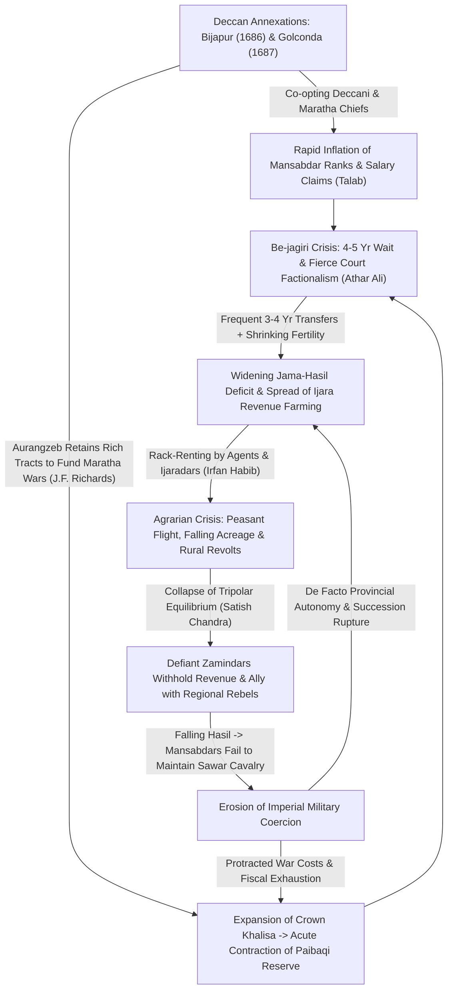

# Chapter 22 - The Mughal Imperium II — Karkhanas, Naturalist Portraiture, Marble Art & the Jagirdari Crisis (1605–1707)

The century spanning 1605 to 1707 captures the paradox of early modern imperial zenith and structural exhaustion. Under Jahangir and Shah Jahan, the Mughal Empire operated as the world's premier manufacturing engine and silver bullion magnet, channeling unprecedented commercial surpluses into naturalistic miniature ateliers and luminous marble geometry.

Yet the very fiscal-military apparatus that monetized the subcontinent contained an internal thermodynamic limit. Once territorial expansion outpaced assignable agrarian surplus under Aurangzeb, Akbar's self-stabilizing *Mansabdari–Jagirdari* equilibrium tipped into a runaway feedback collapse—hollowing out imperial authority long before 1707.

---

## 1. Jahangir - Institutional Refinement, Nur Jahan's Junta and Naturalist Aesthetics (1605–1627)

### Political Consolidation, *Tuzuk-i-Jahangiri* and *Du-Aspa Sih-Aspa*

Ascending the throne in October 1605 as Nur-ud-din Muhammad **Jahangir** ("World Seizer"), Prince Salim preserved the broad framework of Akbari *Sulh-i-Kul* while signaling royal accessibility through twelve imperial ordinances (*Dastur-ul-Amal*) and the ceremonial golden **Chain of Justice (***Zanjir-i-Adl***)** hung from Agra Fort's Shah Burj.

His early reign survived a dangerous rebellion by his eldest son **Prince Khusrau (1606)**—a crisis whose fallout tragically led to the execution of the fifth Sikh Guru, **Guru Arjan Dev**, for offering shelter and blessings to the fugitive prince, sowing the first bitter rift between the Mughal state and the Sikh community. On the western frontier, however, Jahangir achieved a diplomatic breakthrough Akbar never secured: in **1615**, following Prince Khurram's sustained campaigns, **Rana Amar Singh of Mewar** accepted Mughal suzerainty on remarkably honorable terms—exempted from personal court attendance and matrimonial obligations, while his son Prince Karan Singh received a 5,000 *mansab*. Elsewhere, the empire annexed **Kangra Fort (1620)** but remained locked in a grinding Deccan stalemate against Ahmadnagar's brilliant Abyssinian strategist **Malik Ambar** and lost **Qandahar (1622)** to Safavid Shah Abbas I.

Unlike Babur's Chagatai Turkish memoirs, Jahangir composed his candid autobiography, the ***Tuzuk-i-Jahangiri*** (*Jahangirnama*), directly in **Persian** (later continued by courtier Mutamad Khan and completed by Muhammad Hadi). Blending imperial diary with sharp scientific curiosity, it records weights of rare game, botanical hybridization experiments, meteorological anomalies, and acute connoisseurship—with Jahangir boasting he could identify the individual artist behind the eyebrows and eyes in any composite court painting.

Administratively, Jahangir introduced a pivotal tweak to Akbar's *Mansabdari* architecture: the ***Du-Aspa Sih-Aspa*** ("two-horse, three-horse") rank modifier, first bestowed upon general Mahabat Khan. Under Akbar, *Sawar* could not exceed *Zat*, and every noble maintained the baseline *Dah-Bisti* (10 troopers : 20 horses) ratio. Under Jahangir's innovation, a specified fraction (or the entirety) of a trusted commander's *Sawar* rank was designated *Du-Aspa Sih-Aspa*, obligating him to maintain **double** the standard number of troopers and horses for **double** the *Sawar* salary—**without inflating his personal *Zat* rank**. This let the throne concentrate military striking power in proven frontier generals without triggering seniority jealousies or ballooning personal *Zat* stipends. Concurrently, Jahangir introduced a fourth *Jagir* category—the ***Altamgha Jagir*** (from Turkish *Al-Tamgha*, "red royal seal")—extending hereditary, non-transferable *Watan*-like homeland revenue assignments to favored Muslim/non-Rajput *mansabdars* over their native birthplace or family hometown.

### Nur Jahan's Junta and Early English East India Company Envoys

In 1611, Jahangir married **Mehrunnisa**—widow of Bengal *jagirdar* Sher Afghan and daughter of Persian émigré **Mirza Ghiyas Beg**—conferring upon her the titles *Nur Mahal* ("Light of the Palace") and later **Nur Jahan** ("Light of the World"). As Jahangir's health declined from asthma and heavy opium-wine consumption, Nur Jahan emerged as the empire's de facto co-sovereign, operating alongside a tightly knit Persian court faction—the **"Nur Jahan Junta"**—comprising her father **Itimad-ud-Daulah** (Prime Minister/*Diwan*), her brother **Asaf Khan** (*Mir Saman* and father of Mumtaz Mahal), and initially **Prince Khurram (Shah Jahan)**.

Nur Jahan exercised formal attributes of sovereignty unprecedented for a Mughal consort: appearing alongside the emperor at ***Jharokha-i-Darshan***, issuing royal edicts (*farmans* and *nishans*), holding high *jagirs*, trading commercially in indigo and luxury textiles via Surat, and having imperial gold and silver coins struck bearing her name alongside Jahangir's. After Itimad-ud-Daulah's death (1622) and Nur Jahan's decision to back her son-in-law **Prince Shahryar** (married to her daughter Ladli Begum) for succession, the junta ruptured—triggering Khurram's revolt (1622–26) and general **Mahabat Khan's** audacious 1626 abduction of Jahangir on the Jhelum riverbank, which Nur Jahan outmaneuvered with cool tactical daring.

Simultaneously, Jahangir's court became the inaugural diplomatic arena for the **English East India Company (EIC)**:

- **Captain William Hawkins (1608–1611):** Arriving at Surat aboard the *Hector* with a letter from King James I, Hawkins charmed Jahangir in fluent Turkish, earning the title *"English Khan"* and a 400 *Zat* *mansab*. Yet intense Portuguese Jesuit lobbying at Agra blocked his bid for a permanent English trading factory at Surat.
- **Sir Thomas Roe (1615–1619):** Arriving after the EIC's naval victory over the Portuguese off **Swally (1612)** shifted Mughal coastal calculations, Roe came as the accredited royal ambassador of King James I. Though Jahangir declined a formal bilateral commercial treaty (deeming merchants beneath sovereign diplomatic parity), Roe outmaneuvered court factions to secure imperial *farmans* via Prince Khurram (Governor of Gujarat), guaranteeing protection for the **Surat factory** and inland trade rights across Agra, Ahmedabad, and Broach.

### Zenith of Mughal Miniature Naturalism

Mughal painting reached its aesthetic and technical climax under Jahangir. Abandoning Akbar's assembly-line production of sprawling illustrated historical manuscripts, Jahangir shifted imperial patronage sharply toward **individual psychological portraits, empirical flora-and-fauna naturalism, allegorical imperial propaganda, and collector's albums (***Muraqqa***)**.

Inside a *Muraqqa*, single miniature paintings alternated with panels of exquisite Persian calligraphy, framed by lavishly illuminated wide margins (***Hashiya***) painted in liquid gold with botanical scrollwork, hunting vignettes, and tiny genre figures. Direct exposure to European Renaissance engravings and oil paintings—gifted by Jesuit missionaries and Sir Thomas Roe—accelerated the assimilation of **single-point linear perspective**, subtle tonal modeling (***chiaroscuro***), softened muted backgrounds, and the luminous solar **Halo / Nimbus** behind the Emperor's head visualizing *Farr-i-Izadi* divine kingship.

Jahangir dismantled collective authorship in favor of specialized individual virtuosos:

- **Ustad Mansur (*Nadir-ul-Asr* — "Wonder of the Age"):** Unrivaled master of scientific natural history, painting hyper-precise studies of exotic specimens brought to court—including the *North American Turkey Cock*, *Abyssinian Zebra*, *Siberian Crane*, *Mauritian Dodo*, and *Kashmir Red Tulips/Blossoms*.
- **Abul Hasan (*Nadir-uz-Zaman* — "Wonder of the Era"):** Jahangir's favored visual ideologue, fusing European allegory with Timurid symbolism in iconic works like *Jahangir Embracing Shah Abbas* (standing atop a terrestrial globe with a lion and lamb lying peacefully beneath), *Squirrels in a Plane Tree*, and *Jahangir's Accession*.
- **Bishandas:** Acclaimed as the court's supreme physiognomic portraitist—dispatched with a Mughal embassy to Persia (1613–19) specifically to paint authentic likenesses of Safavid Shah Abbas I and his ministers.
- **Manohar, Bichitr & Govardhan:** **Manohar** excelled in crisp hunting and court assemblies; **Bichitr** authored the celebrated *Jahangir Preferring a Sufi Shaikh to Kings* (where King James I and an Ottoman Sultan stand subordinate to Shaikh Husain of Ajmer, with Bichitr signing his own self-portrait in the lower corner); **Govardhan** captured soulful, shaded portraits of Hindu ascetics and village musicians.

### Transitional Marble Architecture and Itimad-ud-Daulah

Jahangir favored painting and terraced landscape gardens—laying out the water-cascading **Shalimar Bagh (1619)** in Kashmir (complemented by Asaf Khan's Nishat Bagh)—over colossal sandstone citadels. He completed **Akbar's Mausoleum at Sikandra (1605–13)**, capping its red-sandstone terraced pyramid with an airy white-marble open cloister devoid of a dome.

The decisive architectural turning point of the reign was **Nur Jahan's Tomb of Itimad-ud-Daulah at Agra (1622–28)**, built on the Yamuna's left bank for her father Mirza Ghiyas Beg. Eschewing Akbar's heavy red sandstone completely, this delicate two-storey pavilion within a *charbagh* became the **first major Mughal mausoleum faced entirely in white Makrana marble**. Its surfaces introduced the first comprehensive architectural deployment in India of ***Pietra Dura* (*Parchin Kari*)**—precision-cut semi-precious stones (jasper, lapis lazuli, carnelian, onyx, topaz) inlaid seamlessly into hollowed marble matrices depicting Persian cypresses, wine flasks, fruit vases, and floral arabesques. Topped by a curved Bengali *bangla* vaulted roof pavilion flanked by squat corner towers, Itimad-ud-Daulah served directly as the stylistic "jewel box" and laboratory draft for the Taj Mahal.

---

## 2. Shah Jahan - Commercial Supremacy, Frontier Overreach and Marble Perfection (1628–1658)

### Imperial Consolidation, North-Western Debacles and the Month-Scale (*Mahwar*)

Securing the throne in 1628 with father-in-law Asaf Khan's backing, Prince Khurram assumed the grandiloquent Timurid title **Shah Jahan** (*Abul Muzaffar Shihab-ud-din Muhammad Sahib-i-Qiran-i-Sani* — "Second Lord of the Auspicious Conjunction"). His reign—chronicled in **Abdul Hamid Lahori's** official ***Padshahnama*** and **Inayat Khan's *Shah Jahan-nama***—opened with stern rebellions by Afghan noble **Khan Jahan Lodi** and **Jujhar Singh Bundela**, alongside the **1630–32 Gujarat–Deccan Famine** (a catastrophic monsoon failure vividly documented by Lahori and English factor Peter Mundy).

On the eastern maritime fringe, Shah Jahan expelled the **Portuguese from Hooghly (1632)** for piracy, customs evasion, and slave-raiding. In the Deccan, he achieved decisive strategic stabilization: completely annexing **Ahmadnagar (1636)** and compelling **Bijapur and Golconda** into formal treaties accepting Mughal suzerainty and annual tribute.

By contrast, Shah Jahan's northwestern obsession proved fiscally ruinous. Seeking to reclaim Timur's ancestral homeland in Transoxiana from Uzbek factional strife, he launched the **Balkh–Badakhshan campaign (1646–47)** under Princes Murad and Aurangzeb. Though Mughal arms briefly occupied Balkh, harsh winters, supply-line vulnerability across the Hindu Kush, and relentless Uzbek guerrilla pressure forced a humiliating withdrawal after burning roughly 4 crore rupees for zero territorial gain. Worse followed when Safavid Shah Abbas II recaptured **Qandahar (1649)**; three massive imperial sieges (1649, 1652, 1653) under Aurangzeb and Dara Shikoh failed completely, exposing Mughal inferiority in heavy breaching artillery and permanently surrendering the empire's northwestern strategic gate.

Fiscally, Shah Jahan confronted the first visible strain inside Akbar's *Mansabdari* engine: as noble numbers climbed and paper revenue estimates (*Jama-dami*) outpaced actual rural collections (*Hasil*), *mansabdars* struggled to fund full *Sawar* quotas. Rather than slashing formal ranks (which bruised aristocratic prestige), Shah Jahan institutionalized two pragmatic buffers:

- **The Month-Scale (*Mahwar*) System:** *Jagirs* were calibrated in fractional months (10-month, 8-month, 6-month [*shash-maha*], down to 4-month) reflecting their actual *Hasil*-to-*Jama* ratio. If a *jagir* realized only half its official *Jama* (a 6-month *jagir*), the noble's cash pay claim and mandatory horse-to-trooper (*Dah-Bisti*) remount obligations were discounted proportionally.
- **The 1/3rd, 1/4th, and 1/5th Rule:** To align field deployment with fiscal reality, a *mansabdar* was required to muster only **1/3rd** of his *Sawar* rank if serving inside the province of his *jagir*, **1/4th** if deployed outside his province, and **1/5th** on grueling Central Asian frontier expeditions. Concurrently, Shah Jahan appointed the ***Amin*** as a dedicated revenue assessor in every *pargana* to separate land-tax assessment from the *Karori's* collection duties.

### The 17th-Century Commercial Engine - *Karkhanas*, Bullion Sink, *Dadni* and *Sarraf Hundi* Banking

Mid-17th-century Mughal India stood at the center of early modern global commerce—accounting for roughly a quarter of global manufacturing output—powered by an integrated web of imperial workshops, peasant-artisan putting-out networks, and sophisticated indigenous finance:

- **Imperial *Karkhanas* (State Manufactories):** Administered under the ***Mir Saman*** (*Buyutat* department), vast royal workshops in Delhi, Agra, Lahore, Burhanpur, and Ahmedabad housed salaried master artisans producing silk brocades, Kashmir shawls, gold-embroidered muslins, fine carpets, cannons, and ceremonial robes (*khilats*) for court consumption. French physician **François Bernier** documented these bustling halls closely, though his Eurocentric critique—claiming aristocratic coercion starved private enterprise—overlooked the thriving private commercial manufacturing centers flourishing independently in Surat, Broach, Ahmedabad, Masulipatnam, and Dhaka.
- **India as the Global Silver Bullion Sink:** Because Indian cotton textiles (calicoes, printed chintz, fine muslin), Bengal raw silk, Bayana and Sarkhej indigo, Bihar saltpetre (vital for European gunpowder), Malabar pepper, and Golconda diamonds commanded insatiable global demand—while India needed almost no European manufactured imports—the European chartered companies (EIC, Dutch VOC, and later French) paid for Indian exports overwhelmingly in **New World (Potosí and Mexican) silver bullion** and Japanese silver/copper. Carried to India's open imperial mints (*Taksals*) and struck into high-purity silver *rupiyas*, this continuous bullion inflow lubricated domestic monetization, allowed cash land-revenue assessment to expand, and integrated interior peasant markets with Indian Ocean trade.
- **The *Dadni* System (Putting-Out Advances):** Because rural weavers lacked working capital to purchase yarn or survive harvest-to-market lags, indigenous merchant-brokers (*dallals* / *paikars*) and European factories deployed the ***Dadni*** system—disbursing advance cash (or raw yarn) locking weavers into fixed delivery dates, standardized cloth dimensions, and pre-set prices. While expanding export output massively, *dadni* subordinated artisan autonomy to merchant capital.
- ***Sarraf* Banking, *Hundi* Networks and Merchant Princes:** Supporting long-distance commerce was an unmatched indigenous financial grid run by ***Sarrafs*** (specialist bankers and money-changers). *Sarrafs* assayed coin purity (charging fractional *batta* discounts on worn or provincial issues), accepted commercial deposits, underwrote transit insurance (***Bima***), and cleared pan-Indian payments via the ***Hundi***—an unconditional written **bill of exchange** (*Darshani* payable on sight; *Muddati* payable after a stipulated maturity period) transferring vast sums across Surat, Agra, Patna, and Dhaka without risking bullion caravans to highway robbery. At the apex stood formidable mercantile magnates—foremost **Virji Vora of Surat** (a Sthanakvasi Jain wholesale monopolist worth an estimated 8 million rupees who controlled spices, bullion, and coral imports while repeatedly serving as primary creditor to the English and Dutch East India Companies) and **Shantidas Zaveri of Ahmedabad** (wealthy Jain court jeweler and financier across three reigns).

### European Travelers Matrix

| Traveler & Nationality | Period & Reign(s) | Primary Text / Role | Signature Historical Observations & UPSC Focal Anchor |
| :--- | :--- | :--- | :--- |
| **William Hawkins** (English) | 1608–1611 (Jahangir) | EIC Captain (*Hector*); King James I's envoy | Spoke Turkish; earned *mansab* of 400 & title *"English Khan"*; failed to get Surat factory due to Portuguese Jesuit opposition |
| **Sir Thomas Roe** (English) | 1615–1619 (Jahangir) | Formal Ambassador of King James I; *Journal of the Mission* | Secured Surat factory protection & trading *farmans* via Prince Khurram; vivid record of court factions, Nur Jahan's power, and Jahangir's painting connoisseurship |
| **Francisco Pelsaert** (Dutch) | 1620–1627 (Jahangir) | Dutch VOC Senior Factor at Agra; *Remonstrantie* (*Jahangir's India*) | Detailed indigo manufacturing at Bayana, Agra–Surat–Multan commerce, and stark contrast between elite luxury and artisan poverty |
| **Peter Mundy** (English — Cornish) | 1628–1634 (Shah Jahan) | EIC Merchant-Factor from Penryn, Cornwall; *Itinerarium Mundii* | Eyewitness "famine chorography" of the devastating **1630–32 Gujarat–Deccan Famine**; early eyewitness note of Taj Mahal construction in Agra |
| **Jean-Baptiste Tavernier** (French) | 1638–1668 (6 voyages; Shah Jahan & Aurangzeb) | Master Gem Merchant; *Six Voyages* | Elaborate treatise on **Indian diamonds & Golconda (Kollur) diamond mines**, the *Koh-i-Noor* / Great Mughal diamond, Shah Jahan's Peacock Throne (1665), and *Sarraf* coin assaying |
| **François Bernier** (French) | 1656–1668 (Shah Jahan & Aurangzeb) | Physician to Dara Shikoh & patronized by noble Danishmand Khan; *Travels in the Mughal Empire* | Eyewitness to the 1657–58 Succession War & imperial *Karkhanas*; formulated the influential (yet Eurocentric) **"Crown ownership of all land"** thesis later cited by Montesquieu & Karl Marx ("Oriental Despotism") |
| **Niccolao Manucci** (Italian — Venetian) | 1653–1708 (Shah Jahan & Aurangzeb) | Artilleryman under Dara Shikoh, physician & court insider; *Storia do Mogor* | Encyclopedic, gossipy insider chronicle of Mughal *haram* politics, army logistics, Aurangzeb's Deccan wars, and social customs; settled permanently in India (Madras/Pondicherry) |

### Classical Marble Architecture - Symmetry (*Qarina*), Taj Mahal and Shahjahanabad

If Akbar was the empire's master builder in red sandstone, **Shah Jahan** perfected the imperial **white Makrana marble idiom**—shifting architectural taste from muscular strength to lyrical precision, calligraphic purity, and luminous polish. Five technical signatures define the Shahjahani canon:

1. **Strict Bilateral Symmetry (***Qarina***):** Identical flanking elements mirror each other across a central ceremonial axis, establishing absolute visual equilibrium.
2. **Multifoil (Cusped) Arches:** Plain pointed Sultanate–Akbari arches gave way to graceful **nine-foil engrailed (cusped) arches** supported by faceted shafts or tapered **baluster columns** with naturalistic lotus and European-inspired acanthus bases.
3. **Bulbous Double Domes:** Elevated on tall constricted necks, the true double dome swelled into a sensuous onion-bulb silhouette crowned by an inverted lotus (*padmakosha*) and gilded finial (*kalasha*).
4. **Botanical *Pietra Dura* (*Parchin Kari*):** Moving beyond Itimad-ud-Daulah's geometric patterns, lapidaries inlaid razor-thin slices of carnelian, jasper, malachite, bloodstone, and lapis lazuli into recessed marble panels as lifelike lilies, irises, and poppy sprays—paired with soft low-relief marble *dado* carvings.
5. **Polished Architectural Painting:** In miniature painting, Shah Jahan pivoted away from Jahangir's intimate naturalism toward formal, jewel-toned **imperial durbar scenes** (as in the Windsor Castle *Padshahnama* folios), idealized profile royal portraits encrusted with gold, and strict court hierarchy—visually synchronizing painting with architecture.

#### The Taj Mahal (Agra, 1632–1648; outer complex 1653 — UNESCO WHS 1983)
Commissioned on the Yamuna's right bank as the mausoleum of Empress **Mumtaz Mahal** (*Arjumand Banu Begum*, who died in childbirth at Burhanpur in June 1631), the Taj Mahal was designed primarily by master architect **Ustad Ahmad Lahori** (assisted by **Mir Abdul Karim** and supervised structurally as brick-in-lime mortar veneered in white marble and red sandstone). Calligrapher **Amanat Khan Shirazi** engineered an optical triumph across the soaring main *pishtaq*: scaling inlaid black-marble *Thuluth* Quranic lettering progressively larger as it ascends so every verse reads at uniform visual height from ground level.

Spatially, Shah Jahan revolutionized the traditional *charbagh* garden-tomb layout inherited from Humayun's Tomb. Instead of placing the mausoleum at the dead center of the garden, he pushed the *Hasht-Bihisht* (nine-bay) marble tomb onto the **northern riverfront terrace**, allowing the Yamuna sky to illuminate the translucent Makrana marble across shifting daylight hues. Perfect *qarina* symmetry governs the ensemble: identical red-sandstone buildings—a functional **Mosque** on the west and its exact architectural mirror, the ***Jawab*** ("Answer"), on the east—frame the marble plinth, while four detached circular corner minarets tilt fractionally outward so no earthquake collapse could strike the central cenotaph.

Simultaneously, Shah Jahan transformed the interior of **Agra Fort** with glistening white-marble pavilions—the ***Moti Masjid*** (Pearl Mosque, 1647–53, the largest of the three imperial white-marble Pearl Mosques, following his earlier *Moti Masjid* at Lahore Fort [c. 1630–35]), ***Diwan-i-Khas***, ***Khas Mahal***, ***Sheesh Mahal***, and the octagonal ***Musamman Burj*** overlooking the Taj.

#### Shahjahanabad - Red Fort Complex (UNESCO WHS 2007) and Jama Masjid
In 1638–39, seeking a spacious ceremonial capital beyond congested Agra, Shah Jahan commissioned **Ustad Ahmad Lahori** to build **Shahjahanabad** (Old Delhi), formally inaugurated in **1648**. Organized around a planned radial street spine, the city centered on two grand commercial axes—Faiz Bazaar and **Chandni Chowk** (commissioned by Princess **Jahanara Begum**), bisected by a tree-lined canal channel fed by engineer **Ali Mardan Khan's** revived Western Yamuna Canal (*Nahr-i-Bihisht*).

- **The Red Fort (*Lal Qila*, 1639–48):** Enclosing 103 hectares in an irregular octagonal red-sandstone curtain wall (incorporating the older Salimgarh Fort), the palace unfolds along a strict ceremonial axis from the **Lahori Gate** through the vaulted bazaar (**Chhatta Chowk**) and music pavilion (**Naubat Khana**) to the pillared ***Diwan-i-Am*** (whose elevated marble throne canopy displays genuine Florentine *pietra dura* panels, including a plaque of Orpheus charming beasts). Along the Yamuna breeze-front stood the luminous marble imperial pavilions linked by the continuous cooling marble channel ***Nahr-i-Bihisht*** ("Stream of Paradise"): ***Rang Mahal***, ***Khas Mahal***, and the ***Diwan-i-Khas***—inscribed with Amir Khusrau's couplet (*"If there is a paradise on earth, it is this..."*) and originally housing the famed jewel-studded **Peacock Throne (***Takht-i-Taus***)** (later looted by Nadir Shah in 1739).
- **Jama Masjid, Delhi (1650–56):** Raised atop the elevated rocky ridge of *Bhojla Pahari* directly opposite the Red Fort's ceremonial axis, this colossal congregational mosque pairs dramatic vertical stripes of red sandstone and white marble across three swelling domes, twin towering minarets, and a vast arcaded courtyard built for tens of thousands of worshippers.

---

## 3. Aurangzeb - Ideological Rigidity, Regional Revolts and Deccan Overextension (1658–1707)

### The War of Succession (1657–1658) and Consolidation as *Alamgir*

Shah Jahan's sudden illness in September 1657 triggered the bloodiest **Timurid war of succession** among his four adult provincial viceroys: **Dara Shikoh** (syncretic eldest son favored at court—a Qadiri Sufi scholar who authored ***Majma-ul-Bahrain*** ["The Mingling of the Two Oceans," 1655] comparing Vedanta and Sufism, translated 52 Upanishads into Persian with Banaras pandits as ***Sirr-i-Akbar*** ["The Greatest Mystery," 1657], and commissioned a fresh 1656 Persian re-translation of the ***Yogavasistha***, distinct from Nizamuddin Panipati's earlier Akbar-era translation), **Shah Shuja** (Bengal), **Murad Bakhsh** (Gujarat), and **Aurangzeb** (Deccan). Although historians once framed the war solely as an ideological duel between Dara's liberal *Wahdat-ul-Wujud* pluralism and Aurangzeb's Sunni orthodoxy, actual faction alignments cut cleanly across religious lines—leading Rajput chiefs like Mirza Raja Jai Singh and Rana Raj Singh eventually accommodated Aurangzeb, while prominent Muslim generals fought for Dara.

Superior generalship, disciplined field artillery, and tactical opportunism handed Aurangzeb decisive victories over imperial armies at **Dharmat (April 1658)** and the climactic **Battle of Samugarh (May 1658)** near Agra. Outmaneuvering and imprisoning his ally Murad, confining an ailing Shah Jahan inside Agra Fort until his death in 1666, defeating Shuja at **Khajwa (1659)**, and crushing Dara finally at **Deorai (1659)** (executing him on charges of apostasy), Aurangzeb ascended the throne as **Muhy-ud-din Muhammad Aurangzeb *Alamgir*** ("World Conqueror").

### Orthodox Governance, *Fatawa-i-Alamgiri*, *Jizya* and the Temple Policy Debate

Austere, tireless, and devoutly anchored in Naqshbandi-influenced Sunni Hanafi orthodoxy (earning the popular sobriquet ***Zinda Pir*** — "Living Saint" among orthodox followers), Aurangzeb systematically rolled back the charismatic, eclectic symbolism of Akbari kingship in favor of an Islamic juristic state:

- **Moral Censorship & *Muhtasibs*:** He removed the Islamic *Kalima* from coins (to prevent defilement), abolished the solar Persian festival of ***Nauroz***, discontinued ***Jharokha-i-Darshan*** (1669) and royal weighing (*Tuladan*), disbanded court vocal musicians and official imperial chroniclers after his tenth regnal year (retaining martial *naubat* drums and privately remaining an accomplished *Veena* player), and appointed ***Muhtasibs*** (censors of public morals) to police Sharia bans on alcohol, gambling, and narcotics alongside commercial weights and measures.
- ***Fatawa-i-Alamgiri* (*Al-Fatawa al-Hindiyya*, c. 1667–72):** Commissioning a syndicate of roughly 500 jurists from South Asia, Iraq, and the Hejaz under **Shaikh Nizam Burhanpuri**, Aurangzeb produced a monumental 30-volume Arabic digest of **Sunni Hanafi jurisprudence**. Covering civil, criminal, revenue, family, and commercial cases, it standardized imperial *Qazi* rulings—paradoxically restricting individual judges' discretionary *fatwas* while embedding rigid religious and social stratification inside state law.
- **Reimposition of *Jizya* (1679):** After twenty-one years on the throne, Aurangzeb reversed Akbar's landmark abolition and reimposed the graduated poll tax (***Jizya***) on non-Muslim adult males (exempting women, children, indigent persons, and state-serving Hindu *mansabdars*). Historiography splits over its trigger: **Jadunath Sarkar** interpreted it as long-nurtured religious puritanism, whereas **Satish Chandra** highlighted its acute **1679 political-fiscal context**—coinciding with the Marwar–Mewar rupture and mounting Deccan war deficits, serving simultaneously as an emergency revenue lever and an ideological bid to rally orthodox Sunni *Ulama* and Muslim elites behind an overstretched throne.
- **The Temple Policy Debate (Balanced Primary-Source Synthesis):** Modern scholarship rejects reductive caricatures. Indisputably, following rigid Hanafi precedent prohibiting *new* non-Muslim places of worship and retaliating against political defiance, Aurangzeb ordered the demolition of several major revered shrines—including **Kashi Vishwanath (Varanasi, 1669)**, **Keshava Rai (Mathura, 1670)**, and prominent temples across rebellious Marwar and Mewar—inflicting enduring socio-political alienation. Yet archival examination of imperial *farmans* by historians **Richard Eaton**, **Satish Chandra**, and **M. Athar Ali** shows that Aurangzeb did **not** pursue a blanket eradication of Hindu temples: his 1659 Benares *farman* explicitly forbade harassment of ancient temples and Brahmins, and he issued or renewed tax-free *madad-i-maash* land grants to temples at Ujjain (Mahakaleshwar), Vrindavan, Chitrakoot, and Guwahati (Umananda). Temple destruction operated predominantly as **selective coercive statecraft** targeting sacred symbols of rebellious *zamindars* and defectors—underscored by M. Athar Ali's quantitative finding that **Hindu *mansabdars*** (Rajputs and assimilated Marathas) actually rose to their highest historical proportion (**31.6%** of the upper nobility by 1679–1707) under Aurangzeb himself.

### Architectural Contraction and Late Imperial Landmarks

Fiscal strain and personal puritanism ended the marble extravaganza of Shah Jahan. Imperial construction contracted sharply, substituting cheaper brick-and-rubble cores finished in white lime stucco (*chunam*) for solid carved stone, while migrating imperial painters seeded vibrant regional miniature schools in Rajasthan and the Himalayan Pahari states. Three architectural landmarks nevertheless punctuate his half-century reign:

- ***Moti Masjid* inside Delhi's Red Fort (1659–60):** A jewel-like, private three-domed all-marble royal mosque erected strictly for Aurangzeb's personal prayers—characterized by more pronounced bulbous domes and ornate surface carving than Shah Jahan's austerely classical Agra Fort *Moti Masjid*.
- ***Bibi-ka-Maqbara* at Aurangabad / Chhatrapati Sambhajinagar (c. 1668):** Built by Aurangzeb's son **Prince Azam Shah** during Aurangzeb's reign as the mausoleum for his mother **Dilras Banu Begum** (*Rabia-ud-Daurani*), and designed by **Ata-ullah Rashidi** (son of Taj Mahal architect Ustad Ahmad Lahori) alongside engineer **Hanspat Rai**. Popularly dubbed the *"Dakkhani Taj,"* its compressed vertical proportions and cost-conscious materials—marble veneer limited strictly to the lower dado and main dome, with lime-plaster stucco cladding the remainder—visibly register the empire's tightening fiscal constraints.
- ***Badshahi Mosque* at Lahore (1671–73):** Commissioned by Aurangzeb and built rapidly under his foster-brother and Lahore governor **Fidai Khan Koka**, directly facing Lahore Fort's Alamgiri Gate across Hazuri Bagh. Expanding Shah Jahan's Delhi Jama Masjid template in dramatic red sandstone inlaid with white marble, three bulbous marble domes, and four 50+-meter octagonal corner minarets, it remained the **world's largest mosque for 313 years (until 1986)**.

### Multi-Front Regional, Agrarian and Rajput Insurgencies

Between 1669 and 1707, centrifugal revolts erupted simultaneously across the empire's agrarian core and strategic flanks—exposing the limits of centralized coercion:

- **Jat Uprisings (Mathura–Agra Doab):** Triggered by oppressive revenue demands and harsh policing under *faujdar* Abdun Nabi, armed Jat peasant-zamindars rebelled sequentially under **Gokula (1669)**, **Rajaram (1685–88)** (who raided Sikandra and desecrated Akbar's mausoleum), and **Churaman**, who fortified Bharatpur into a durable autonomous Jat polity.
- **Satnami Revolt (1672, Narnaul / Haryana):** Members of the egalitarian *Nirguna* peasant-artisan sect (*Mundiyas*—shaven heads) rose spontaneously after a clash with a Mughal foot-soldier; swelling into an armed agrarian insurgency that captured Narnaul, they were crushed only when Aurangzeb deployed elite artillery units directly from Delhi.
- **Bundela Resistance:** **Chhatrasal Bundela**, inspired by Shivaji, waged prolonged guerrilla warfare across Bundelkhand and eastern Malwa, forcing Mughal accommodation by the early 1700s.
- **The Rajput Rupture (1679–1681):** Following Maharaja Jaswant Singh of Marwar's death in imperial service at Jamrud (1678), Aurangzeb placed Jodhpur under direct imperial *Khalisa* administration and moved to dictate the succession of Jaswant Singh's posthumous infant son **Ajit Singh**. This blunder sparked an intense Rathore–Sisodia alliance led by **Durgadas Rathore** and **Rana Raj Singh of Mewar**—joined briefly in 1681 by Aurangzeb's own rebellious son **Prince Akbar**—permanently eroding the century-old Rajput trust that had anchored Mughal North India.
- **Sikh Militarization:** The public execution of the ninth Guru, **Guru Tegh Bahadur (1675)** in Delhi (standing for religious conscience and Kashmiri Pandits), catalyzed the Panth's political transformation. In **1699**, **Guru Gobind Singh** inaugurated the egalitarian martial brotherhood of the ***Khalsa Panth*** at Anandpur Sahib, locking Punjab into sustained armed resistance.
- **The Deccan Quagmire (1681–1707):** Pursuing his rebellious son Akbar south in 1681, Aurangzeb relocated the entire imperial court and field army to the Deccan for his final twenty-six years. While imperial forces finally extinguished the last two Deccan Sultanates—annexing **Bijapur (1686)** and **Golconda (1687)**—and captured and executed **Chhatrapati Sambhaji (1689)**, total conquest backfired catastrophically. Eliminating Bijapur and Golconda removed the regional counterweights that had policed the western Deccan, unleashing decentralized, leader-resilient Maratha *Ganimi Kava* warfare under Rajaram, Tarabai, Santaji Ghorpade, and Dhanaji Jadhav—bleeding the imperial treasury dry in what historians term the **"Deccan Ulcer."**

---

## 4. The Jagirdari Crisis - Anatomy of Systemic Collapse

The Mughal Empire did not collapse simply because Aurangzeb grew old or made ideological errors; it collapsed because the **structural mathematics of Akbar's *Mansabdari–Jagirdari* engine broke down** under late-17th-century expansion. Four foundational historians unpack distinct layers of this systemic crisis:

- **M. Athar Ali — *Be-jagiri* and Aristocratic Inflation (*The Mughal Nobility under Aurangzeb*, 1966):** Coining the phrase **"Jagirdari Crisis,"** Athar Ali demonstrated quantitatively that the annexation of Bijapur (1686) and Golconda (1687) compelled Aurangzeb to absorb scores of Deccani, Afghan, and Maratha chieftains into high *mansabs* to win their loyalty. Aggregate *Talab* (salary claims of the nobility) outpaced available assignable revenue land (***Paibaqi***), triggering acute ***Be-jagiri***—new appointees waited four to five years for a *jagir*, intensifying bitter factional warfare between hereditary court lineages (*Khanazadas*) and Deccani newcomers. Contemporary chronicler **Khafi Khan** captured the despair starkly: *"One pomegranate for a hundred sick men"* (*Yek anar, sad bimar*).
- **Satish Chandra — Structural Non-Functionality (*The Jagirdari Crisis*, 1981–82):** Challenging purely numerical explanations of *Be-jagiri*, Satish Chandra argued that the crisis reflected the **institutional breakdown of the tripolar equilibrium** binding *Mansabdars*, *Zamindars*, and *Peasants*. As actual collections (*Hasil*) plunged far below paper assessments (*Jama*), *mansabdars* stopped maintaining required *Sawar* cavalry quotas—forfeiting the military muscle needed to discipline armed local *zamindars*, who increasingly pocketed land revenue and allied with regional rebels.
- **Irfan Habib — The Agrarian Crisis (*The Agrarian System of Mughal India*, 1963):** Digging beneath court politics, Irfan Habib located the root cause in an **endogenous contradiction of the transferable *Jagir***. Because *jagirdars* rotated every three to four years, they possessed zero incentive to invest in wells, tanks, or long-term agrarian resilience and maximum incentive to rack-rent peasants ruthlessly before transfer. As the *Jama–Hasil* deficit widened, escalating fiscal extraction triggered mass **peasant flight**, abandoned acreage, and organized rural revolts (Jats, Satnamis, Sikhs, Marathas) led by disaffected *zamindars*.
- **J.F. Richards — Deliberate *Khalisa* Expansion (*Mughal Administration in Golconda*, 1975):** Revising the thesis that the Deccan was inherently an impoverished "deficit" zone, Richards proved from Hyderabad archival records that conquered Golconda and Bijapur yielded substantial revenue. The *Paibaqi* famine was **administratively self-inflicted**: Aurangzeb deliberately sequestered the richest conquered Deccan tracts into imperial ***Khalisa*** (crown land) to pay cash wages for ongoing Karnataka and Maratha sieges—starving his own *mansabdars* of viable *jagirs*.

Caught between falling *Hasil*, war devastation, and acute cash starvation, the imperial system succumbed to ***Ijara* (Revenue Farming)**. Abandoning Todar Mal's *Zabti* surveys, absentee *jagirdars*—and eventually even crown *Khalisa* administrators—auctioned tax-collection rights to highest-bidding financial speculators (***Ijaradars*** / *mustajirs*) for upfront cash advances. *Ijaradars* extracted merciless surcharges from cultivators, converting commercial bankers and local *zamindars* into entrenched territorial magnates while severing the peasant's direct institutional link to the Mughal throne.

### Jagirdari Crisis Causal Loop

### Imperial Threshold - Toward Post-1707 Fragmentation

When Aurangzeb died at Ahmadnagar in **March 1707** at age eighty-eight, the Mughal Empire stood at its widest geographical expanse—stretching from Kabul to the Kaveri—yet its fiscal core and aristocratic consensus were irreparably fractured. Almost immediately, recurring succession wars among his sons and grandsons eroded central prestige, empowering ambitious provincial *subahdars* and hereditary nobles to convert transferable offices into autonomous dynastic states across Hyderabad, Bengal, and Awadh, while Maratha armies pushed aggressively across the Narmada into the imperial heartland.

For the full structural mechanics of the post-1707 imperial uncoupling, succession crises, Nadir Shah and Abdali's invasions, and the rise of successor, rebel, and independent regional polities alongside European mercantilist penetration, transition directly to [[1. 18th-Century Fragmentation, Regional Polities & Mercantilism#Post-Aurangzeb Fragmentation and Regional Polities|Post-1707 Mughal Fragmentation]].

---

> [!warning] Prelims Traps & Atomic Distinctions
> - ***Baburnama* vs. *Tuzuk-i-Jahangiri* Language Trap:** Babur wrote the *Baburnama* in **Chagatai Turkish** (later translated into Persian under Akbar by Abdur Rahim Khan-i-Khanan); Jahangir wrote the ***Tuzuk-i-Jahangiri*** directly in **Persian**.
> - **Peter Mundy's Nationality (Coaching Myth Alert):** Multiple coaching compilations erroneously label **Peter Mundy** as "Italian." Primary archives confirm he was an **English East India Company factor** from Penryn, Cornwall, who visited India under **Shah Jahan (1628–34)** and documented the 1630–32 Gujarat–Deccan famine. **Niccolao Manucci** (Venetian) was the Italian traveler.
> - **William Hawkins vs. Sir Thomas Roe:** Both visited **Jahangir** (never Akbar!). Hawkins (1608–11) received a *mansab* of 400 but **failed** to secure a Surat factory; **Thomas Roe (1615–19)** secured EIC factory protection and *farmans* via Prince Khurram.
> - **The Three Imperial *Moti Masjids* (Exact Attribution Split):**
>   - **Moti Masjid, Lahore Fort (c. 1630–35):** Attributed by modern architectural historians (Ebba Koch, Catherine Asher) to **Shah Jahan** as the **earliest** of the three white-marble Pearl Mosques (later used by Maharaja Ranjit Singh as the Sikh state treasury, ***Moti Mandir***; note that older colonial gazetteers and some Indian MCQ keys occasionally attribute its foundation to **Jahangir**).
>   - **Moti Masjid, Agra Fort (1647–53):** Built by **Shah Jahan** (largest of the three).
>   - **Moti Masjid, Red Fort, Delhi (1659–60):** Built by **Aurangzeb**.
> - **Dara Shikoh vs. Nizamuddin Panipati on the *Yogavasistha* (Prelims 2022 Rule):** The *Yogavasistha* was translated into Persian **twice**—first under **Akbar** by **Nizamuddin Panipati** (tested directly in **UPSC Prelims 2022**), and re-translated under **Shah Jahan** in **1656** at **Dara Shikoh's** behest (alongside Dara's own ***Sirr-i-Akbar*** [52 Upanishads, 1657] and ***Majma-ul-Bahrain*** [1655]). If asked *"During whose reign did Nizamuddin Panipati translate the Yogavasistha?"*, the answer is strictly **Akbar**.
> - **First All-Marble Monument & *Pietra Dura*:** The **Taj Mahal** was *not* the first all-white marble Mughal mausoleum inlaid with *Pietra Dura*; **Nur Jahan's Tomb of Itimad-ud-Daulah (1622–28)** pioneered both conventions under Jahangir.
> - ***Du-Aspa Sih-Aspa*, *Altamgha Jagir* vs. *Month-Scale (Mahwar)*:** Both ***Du-Aspa Sih-Aspa*** (doubling *Sawar* obligation and pay without raising *Zat*) and ***Altamgha Jagir*** (hereditary red-seal homeland grant to favored Muslim/non-Rajput nobles) were introduced by **Jahangir**; the ***Month-Scale (Mahwar)*** and **1/3rd–1/4th–1/5th** contingency adjustments were introduced by **Shah Jahan**.
> - **Tavernier vs. Bernier Inversion:** **Jean-Baptiste Tavernier** (French **jeweler**, 6 voyages) is the primary source on **Indian diamonds, Golconda mines, and the Peacock Throne**; **François Bernier** (French **physician** to Dara Shikoh) authored *Travels in the Mughal Empire* critiquing *Karkhanas* and asserting **Crown ownership of all land**.
> - ***Bibi-ka-Maqbara* Patron & Architect:** Built at Aurangabad (Chhatrapati Sambhajinagar) for Aurangzeb's wife **Dilras Banu Begum** by his son **Prince Azam Shah** (under Aurangzeb's reign, c. 1668) and designed by **Ata-ullah** (son of Taj architect **Ustad Ahmad Lahori**).

---

> [!tip] Whole-UPSC Spillover
> - **GS2 & Institutional Economics (Property Rights & State Capacity):** **François Bernier's** 17th-century critique—linking insecure tenure and frequent *Jagir* rotation to short-term extraction and zero capital investment—anticipated modern institutional economics (North/Acemoglu) and later shaped Karl Marx's "Asiatic Mode of Production." Paired with **J.F. Richards's** *Khalisa*-overreach analysis, the **Jagirdari Crisis** offers an incisive analogy for how **unfunded fiscal commitments and misaligned administrative incentives** can unravel high-capacity states from within.
> - **GS3 (Global Value Chains, Trade Surplus & Indigenous Finance):** 17th-century Mughal India's status as the **global silver bullion sink**—backed by *Sarraf* credit assaying, pan-subcontinental ***Hundi*** bills of exchange, *Bima* transit insurance, and merchant-financiers like **Virji Vora**—proves that sophisticated financial intermediation and export-oriented manufacturing thrived natively in India long before colonial banking, offering high-altitude depth for GS3 answers on India's manufacturing revival and trade balances.
> - **GS1 / Essay (Cultural Power vs. Coercive Overreach):** Contrasting Jahangir–Shah Jahan's visual/architectural soft power (*Muraqqa* naturalism, *Qarina* marble harmony) with Aurangzeb's 26-year Deccan military overstretch illustrates a recurring geopolitical law for Essay papers: **territorial maximum frequently masks institutional exhaustion**, and ideological rigidity raises the fiscal cost of governing plural civilizations.

---

## UPSC Interrogation Lens

### Verified UPSC Mains PYQs (2014–2026) & Prelims Anchors

- **Mains GS1 (2020, 10 Marks):** *"Persian literary sources of medieval India reflect the spirit of the age. Comment."* (150 words) *(Directly integrates Jahangir's Persian Tuzuk-i-Jahangiri, Abdul Hamid Lahori's Padshahnama, Dara Shikoh's Sirr-i-Akbar and Majma-ul-Bahrain, and late-17th-century juridical/historical works like Fatawa-i-Alamgiri and Khafi Khan's Muntakhab-ul-Lubab.)*
- **Note on Mains–Prelims Distribution:** Between 2014 and 2026, direct GS1 Mains prompts on single 17th-century Mughal rulers have been sparse (with History Optional repeatedly testing Mughal painting, Shah Jahan's architecture, Aurangzeb's Deccan/religious policies, and the Jagirdari Crisis). By contrast, **UPSC Prelims** has heavily interrogated Chapter 22's exact artistic, financial, and foreign-traveler touchpoints:
  - **2022 (Prelims — Cross-Reign Trap):** Persian translation of the ***Yogavasistha*** by **Nizamuddin Panipati** (testing **Akbar's reign**, eliminating **Dara Shikoh / Shah Jahan** who commissioned a separate 1656 translation).
  - **2020 (Prelims):** Exact functional definition of ***Hundi*** in post-Harsha / medieval sources (**"A bill of exchange"**).
  - **2019 (Prelims):** Which Mughal Emperor shifted artistic emphasis from **illustrated manuscripts to albums (*Muraqqa*) and individual portraits** (**Jahangir**).
  - **2018 (Prelims):** Which foreign traveler elaborately discussed **diamonds and diamond mines of India** (**Jean-Baptiste Tavernier**).
  - *(Verified classic Prelims anchors demonstrating recurring UPSC examiner preferences: identifying **Abdul Hamid Lahori** as Shah Jahan's official historian [2006], matching **Jahangir–Hawkins/Roe, Shah Jahan–Tavernier, Aurangzeb–Manucci** [1999], and Mughal painting peaking under **Jahangir** [1996].)*

### Prelims Trap Signature

- **Traveler–Reign–Observation Mix-Ups:** Swapping **Tavernier** (diamonds/Golconda) with **Bernier** (physician/Crown land thesis/*Karkhanas*), assigning **Thomas Roe** to Akbar instead of Jahangir, or misidentifying **Peter Mundy** as Italian rather than an English EIC merchant.
- **Architectural Attribution Swaps:** Confusing the **Agra Fort *Moti Masjid*** (Shah Jahan, 1647–53) and **Lahore Fort *Moti Masjid*** (Shah Jahan, c. 1630–35; *Moti Mandir* under Ranjit Singh) with the **Delhi Red Fort *Moti Masjid*** (Aurangzeb, 1659–60), attributing *Pietra Dura* debut to the Taj Mahal instead of Itimad-ud-Daulah, or crediting Shah Jahan rather than Nur Jahan for Itimad-ud-Daulah.
- **Mansabdari Modification Chronology:** Attributing **Jahangir's *Du-Aspa Sih-Aspa*** or ***Altamgha Jagir***, or **Shah Jahan's *Month-Scale (Mahwar)*** back to Akbar, or equating *Be-jagiri* with total collapse of agricultural production everywhere (ignoring J.F. Richards's *Khalisa* expansion thesis).
- **Painting Evolution Erasure:** Merging Akbar's collaborative narrative manuscripts (*Hamzanama, Akbarnama*) with Jahangir's individualized *Muraqqa* albums and natural-history miniatures (*Ustad Mansur, Abul Hasan*) or Shah Jahan's stiff, jewel-toned formal durbar scenes.

### Cross-Hub AIR-1 Provocations

1. *"The 17th-century Mughal Empire was simultaneously the world's greatest bullion magnet and an agrarian state sliding into structural bankruptcy."* Reconcile India's booming commercial-financial ecosystem (*Dadni*, *Sarrafs*, *Hundis*) with the **Jagirdari–Agrarian Crisis**: why did commercial dynamism fail to rescue the Mughal fiscal state?
2. Compare **François Bernier's** Eurocentric thesis of "Oriental Despotism" (absence of private landed property) against indigenous Mughal archival evidence (*Khud-kashta* occupancy rights, hereditary *Zamindar Milkiyat*, and *Sarraf* credit networks): how did 17th-century European travelogues subtly lay the intellectual foundation for 19th-century colonial land-revenue ideologies?

<!-- OBSIDIAN-WEB-START -->
---
### 🕸️ Neural Graph Connections
← [[21. The Mughal Imperium I — Gunpowder Statecraft, Sur Precedents, Mansabdari & Akbari Synthesis (1526–1605)|Ch 21]] | 🧭 [[Indian History and Culture]] | [[23. Regional Statecraft & Resistance — The Maratha Swarajya and the Ahom Paik Kingdom (1630–1761)|Ch 23]] →
<!-- OBSIDIAN-WEB-END -->
