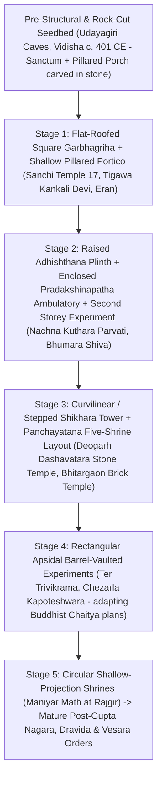

# Chapter 9 - The Gupta–Vakataka Classical Age — Feudalization, Sanskrit Zenith & Temple Genesis (300–550 CE)

Nationalist historiography crowned the Gupta–Vakataka era (c. 300–550 CE) India's undisputed "Golden Age"—a vision of tranquil prosperity, classical Sanskrit poetry, scientific genius, and transcendent sculpture. Post-independence Marxist and processual scholarship dismantled that unqualified halo without denying its aesthetic brilliance. The same centuries that gave India Kalidasa, Aryabhata, the Sarnath Buddha, the Ajanta murals, and the first stone structural temples also witnessed the hardening of untouchability, the earliest epigraphic record of *Sati*, the spread of unpaid forced labor (*Vishti*), and the gradual parceling of royal sovereignty through tax-free land grants.

Understanding this classical paradox requires looking beyond courtly panegyrics to structural mechanics. Unlike the centrally salaried bureaucracy of the Mauryas, the Gupta–Vakataka order operated as a **hegemonic alliance of tributary kingdoms (*Samantas*)** bound together by matrimonial diplomacy, Sanskrit cultural prestige, and institutional temple-*Agrahara* networks. That decentralized bargain lowered military friction and financed an artistic renaissance across northern India and the Deccan—while quietly constructing the socio-economic blueprint of early medieval India.

---

## 1. Gupta Imperial Expansion and the Vakataka Strategic Axis

After the disintegration of the Kushana empire in the north and the Satavahana state in the Deccan during the 3rd century CE, northern India fractured into energetic regional polities—the Nagas of Padmavati, the Yaudheya republics of Haryana–Punjab, and the Murundas of the middle Ganga. Emerging out of this vacuum as modest subordinate chiefs (*Maharajas*) under **Sri Gupta** and **Ghatotkacha**, the Guptas leveraged a lethal material trifecta: fertile Gangetic alluvial soils around **Prayaga–Saketa–Magadha**, proximity to Chotanagpur iron ores, and control over riverine and silk-trade corridors.

### The Imperial Gupta Sequence

- **Chandragupta I (c. 319–335 CE):** Breaking from feudatory status to assume the sovereign title ***Maharajadhiraja*** ("King of Kings"), Chandragupta I inaugurated the **Gupta Era (319–320 CE)**. His decisive geopolitical coup was a matrimonial alliance with the prestigious **Lichchhavi** oligarchy of Vaishali via Princess **Kumaradevi**—commemorated on the famous **Chandragupta–Kumaradevi gold *dinar*** showing the royal couple on the obverse and Durga/Lakshmi with the proud legend *Lichchhavayah* on the reverse.
- **Samudragupta (c. 335–375 CE):** The military architect of Gupta supremacy, Samudragupta's realistic imperial calculus is engraved on the **Prayagraj (Allahabad) Pillar *Prashasti***—a 33-line Sanskrit *champu* (ornate prose and verse) composed by his minister of peace and war (*Sandhivigrahika*) and court poet **Harishena**. Incised directly beneath Ashoka's Pillar Edicts on the very same Mauryan monolith, the inscription creates a vivid palimpsest contrasting Ashokan *Dhamma* with Gupta ***Digvijaya*** ("conquest of the four quarters") across **five distinct geopolitical tiers**:
  - ***Aryavarta* (Gangetic Heartland):** Policy of ***Prasabhoddharana***—violent, total uprooting and direct annexation of nine northern rulers (including *Achyuta, Nagasena*, and *Ganapatinaga*) to create a tightly controlled fiscal core.
  - ***Dakshinapatha* (Peninsular South):** Policy of ***Grahana–Moksha–Anugraha***—capturing twelve southern kings (from Mahendra of Kosala down to **Vishnugopa of Kanchi**), then liberating and reinstating them as tributary allies. Rather than overstretching logistics across the Vindhyas, Samudragupta converted military victory into diplomatic prestige.
  - ***Atavika Rajyas* (Central Indian Forest Chiefdoms):** Policy of ***Paricharakikrita***—reducing Vindhyan forest polities to tributary servitude, securing overland strategic corridors into the Deccan.
  - ***Pratyanta Rajyas* (Frontier Kingdoms & Western *Ganas*):** Policy of ***Sarva-karadana–Ajnakarana–Pranamagamana*** (paying tribute, obeying edicts, and rendering personal court homage) applied to five frontier monarchies (**Samatata, Davaka, Kamarupa, Nepala, Kartripura**) and nine northwestern autonomous tribal republics (**Malavas, Arjunayanas, Yaudheyas, Madrakas, Abhiras**, etc.).
  - **Foreign Sovereigns (*Daivaputra-Shahi-Shahanushahi*, Shaka-Murundas, and *Simhala*):** Diplomatic submission via personal attendance, matrimonial alliances (*Kanyopayana-dana*), and charters stamped with the Gupta **Garuda seal** (*Garutmad-anka*). Chinese records confirm Sri Lankan King **Meghavarna** dispatched envoys bearing gems to Samudragupta seeking permission to erect a monastery for Sinhalese pilgrims at **Bodh Gaya**.
  - *Numismatic Zenith:* Styling himself ***Kaviraja*** (King of Poets) and ***Parakramanka***, Samudragupta struck seven iconic gold *dinar* types—including the *Ashvamedha* (celebrating his revival of the horse sacrifice), *Archer*, *Battle-Axe*, *Tiger-Slayer*, and the celebrated ***Lyrist (Veena-playing)*** coin depicting an armored conqueror immersed in classical music.
- **Chandragupta II *Vikramaditya* (c. 375–415 CE):** Following a brief, controversial succession crisis involving his elder brother **Ramagupta** (preserved in Vishakhadatta's fragmentary play *Devichandraguptam*, Vidisha/Durjanpur Jain inscriptions, and Malwa copper coins), Chandragupta II lifted the empire to its territorial and cultural crest through surgical **matrimonial geopolitics**:
  - Securing the Gangetic Doab by marrying Naga princess **Kuberanaga**, he then wed their daughter **Prabhavatigupta** to Vakataka King **Rudrasena II**—effectively neutralizing his southern Deccan flank before striking west.
  - Between c. 395 and 409 CE, he annihilated the last Western Kshatrapa monarch **Rudrasimha III**, earning the celebrated title ***Sakari*** ("Destroyer of the Shakas"). Absorbing Gujarat, Kathiawar, and Malwa handed the Guptas western maritime emporia (**Bharuch, Sopara, Cambay**) and a glittering second capital at **Ujjain**, prompting Chandragupta II to strike the **earliest Gupta silver coins (*Rupaka*)** modeled directly on Kshatrapa *drachms*.
  - Contemporary epigraphy includes the **Mehrauli Iron Pillar Inscription** (Delhi)—eulogizing a Vaishnava "King Chandra" who crushed a Bengal (*Vanga*) confederacy and crossed the seven mouths of the Indus to defeat the *Vahlikas* (Bactrians), overwhelmingly identified with Chandragupta II—and **Udayagiri cave inscriptions** by his Shaiva minister **Virasena Shaba** and Sanakanika feudatory. Tradition clusters the legendary ***Navaratnas*** (Nine Gems—Kalidasa, Amarasimha, Varahamihira, Dhanvantari, etc., though several actually spanned later Gupta centuries) around his Ujjain court.
- **Faxian's Eyewitness Account (399–414 CE):** Traveling overland across the Taklamakan Desert from China to retrieve authentic Buddhist *Vinaya* texts and sailing home from **Tamralipti** via Sri Lanka and Java, the Chinese monk **Faxian (Fa-Hien)** authored ***Foguo Ji*** (*Record of Buddhist Kingdoms*) during **Chandragupta II's reign** (directly tested in **UPSC Prelims 2025**). Astonishingly, Faxian **never mentions Chandragupta II by name**, reflecting a Buddhist pilgrim's focus on *Sangha* life over royal courts. Yet his depiction of *Madhyadesha* (the Middle Country) supplies priceless socio-economic cross-checks: mild criminal justice (fines rather than mutilation or execution except repeated rebellion), unrestricted travel without passports, salaried royal officers, vegetarian elite diets free of wine, garlic, and onions, prosperous free charitable hospitals (*arogyashalas*) at Pataliputra, everyday market exchange conducted via **cowrie shells (*kapardakas*)** rather than copper coins, and harsh residential segregation of ***Chandalas*** forced to strike wooden clappers when entering towns.
- **Kumaragupta I *Mahendraditya* (c. 415–455 CE):** Enjoying four decades of imperial stability, Kumaragupta I issued the widest iconographic diversity of Gupta gold coins (*Karttikeya/Peacock*, *Rhinoceros-Slayer*, *Elephant-Rider*, *Ashvamedha*) and **founded the *Nalanda Mahavihara*** (remembered by Xuanzang as *Shakraditya* and corroborated by archaeological seals). Two benchmark epigraphs illuminate his reign: the **Mandsaur (Dashapura) Inscription** composed by **Vatsabhatti** (recording two *Malava Samvat* / Vikrama Era dates: an immigrant silk-weavers' guild [*Pattavaya-shreni*] from Lata/Gujarat diversifying into archery, astronomy, and astrology built a Sun Temple at Dashapura in **436 CE [Malava year 493]** under emperor **Kumaragupta I** and local ruler **Bandhuvarman**, and later renovated it in **473 CE [Malava year 529]** under Kumaragupta II) and Bengal's **Damodarpur Copper Plates** (detailing district urban councils and land measurements like ***kulyavapa*** and ***dronavapa***). His twilight years were shaken by a fierce rebellion of the **Pushyamitras** along the Narmada.
- **Skandagupta *Kramaditya* (c. 455–467 CE):** Immortally commemorated in the **Bhitari Stone Pillar Inscription** (Ghazipur, UP), Crown Prince Skandagupta spent a grim night sleeping on the bare earth to restore his shaken dynastic fortune, crushing the Pushyamitras before decisively repelling the first wave of fierce **Alchon/Hephthalite *Hunas*** (*"by whose two arms the earth was shaken"*). Equally remarkable is his **Junagadh Rock Inscription (455–457 CE)**, recording that his Saurashtra governor **Parnadatta** and municipal officer **Chakrapalita** reconstructed the storm-breached embankment of **Sudarshana Lake** for the third historic time (after Chandragupta Maurya and Shaka Rudradaman). Yet protracted frontier warfare strained imperial liquidity: Skandagupta shifted gold coinage to the heavier indigenous ***Suvarna* standard (~144 grains)** while subtly lowering gold fineness.
- **Fragmentation and Imperial Collapse (c. 467–550 CE):** After **Budhagupta** (r. c. 477–495 CE) held a flickering pan-northern supremacy, renewed **Huna invasions** under **Toramana** (who seized Malwa, leaving his inscription on the colossal Boar statue at Eran) and his ruthless son **Mihirakula** shattered imperial cohesion. Even though Gupta king **Narasimhagupta Baladitya** and Malwa's independent warlord **Yashodharman** (Mandsaur Pillar) eventually broke Mihirakula around 528–532 CE, central authority never recovered. Following **Bhanugupta** (510 CE Eran battle) and the shadowy **Vishnugupta**, former feudatories—the **Maitrakas of Valabhi**, **Maukharis of Kannauj**, **Pushyabhutis of Thanesar**, and **Later Guptas**—carved up northern India (examined in Chapter 10).

### The Vakatakas - Co-Architects of the Classical Deccan

Far from mere southern satellites of Pataliputra, the **Vakatakas** (c. 250–500 CE) were a formidable Brahmana dynasty (*Vishnuvriddha gotra*) founded by **Vindhyashakti** that inherited Satavahana political mantle across Vidarbha, Berar, and northern Deccan. Under **Pravarasena I**—the only Vakataka ruler to assume the imperial title ***Samrat*** and perform four *Ashvamedhas*—the realm expanded dramatically before bifurcating into two autonomous lineages:

- **Nandivardhana–Pravarapura (Main/Eastern) Branch (Nagpur/Vidarbha):** Tied intimately to Gupta grand strategy via the marriage of **Rudrasena II** to Chandragupta II's daughter **Prabhavatigupta**. Following Rudrasena II's untimely death around 390 CE, **Prabhavatigupta ruled vigorously as Regent (~390–410 CE)** for her minor sons (Divakarasena, Damodarasena, and Pravarasena II). Her **Poona and Riddhapur Copper Plates** boldly retain her natal **Gupta *gotra* (*Dharana*)** and recite Gupta ancestry first—signaling Vidarbha's virtual integration into the Gupta diplomatic orbit during the Gujarat campaign. Her son **Pravarasena II** relocated the capital to Pravarapura (Mansar), issued the largest corpus of surviving Vakataka land grants, and authored the classical Maharashtri Prakrit epic ***Setubandha*** (*Ravanavaho*), celebrating Rama's bridge to Lanka.
- **Vatsagulma (Western/Washim) Branch:** Founded by **Sarvasena** (author of the Prakrit *kavya* *Harivijaya*), this lineage achieved spectacular twilight brilliance under **Harishena** (conventional reign c. 475–500 CE; recalibrated tightly by art historian **Walter Spink** to **c. 460–477 CE**). His prime minister **Varahadeva's Ajanta Cave 16 inscription** boasts that Harishena's sway reached Kuntala, Avanti, Kalinga, Kosala, Trikuta, Lata, and Andhra. Although himself a Hindu sovereign, Harishena—together with Varahadeva and local Rishika feudatory **Upendragupta**—bankrolled the blazing 20-year creation of **Ajanta's Mahayana caves and murals**, before his sudden death triggered a devastating feudatory rebellion (narrated in Dandin's later *Dashakumaracharita*) that abruptly froze chisels mid-stroke across Ajanta's cliffs.

---

## 2. Agrarian Feudalization, Administrative Decentralization, and Historiographical Debates

### The Decentralized Administrative Architecture

Whereas Kautilya's *Arthashastra* envisioned an intrusive central state auditing mines, looms, and peasants via salaried officials, Gupta monarchs governed directly only within the Gangetic core (*Madhyadesha*), relying outside it on tributary kings and local corporate self-governance:
- **Territorial Hierarchy:** The empire divided into provinces called ***Bhuktis*** (or *Deshas*, such as *Pundravardhana-bhukti* in northern Bengal) governed by royal princes or viceroys titled ***Uparikas***. Provinces subdivided into districts called ***Vishayas*** managed by ***Vishayapatis***, further broken into sub-districts (***Vithis***) and villages (***Gramas***) led by village headmen titled ***Gramika***, ***Mahattara***, or ***Pattakila*** (tested in **UPSC Prelims 2014**).
- **Urban Corporate Participation:** Bengal's **Damodarpur and Paharpur Copper Plates** reveal a remarkably participatory district administrative board (***Adhishthanadhikarana***) assisting the *Vishayapati*, comprising four civic representatives: the ***Nagarashreshthi*** (chief urban guild-banker), ***Sarthavaha*** (caravan merchant leader), ***Prathamakulika*** (chief artisan), and ***Prathamakayastha*** (chief scribe/record-keeper). Before selling crown fallow land for charitable grants, state officials had to consult this civic board and local record-keepers (***Pustapalas***), measuring plots in seed-sowing units such as ***Kulyavapa*** (land requiring one *kulya* of seed) and ***Dronavapa*** (tested in **UPSC Prelims 2020**).
- **Hereditary Office-Holding:** Senior cadres such as ***Kumaramatyas*** (elite bureaucratic pool), ***Mahadandanayakas*** (chief judicial/military commanders), and ***Sandhivigrahikas*** (foreign/war ministers) increasingly held **multiple portfolios simultaneously** and passed offices **hereditarily** across generations (e.g., Harishena was simultaneously *Kumaramatya, Mahadandanayaka*, and *Sandhivigrahika*, inheriting rank from his father Dhruvabhuti)—progressively weakening crown leverage over its own bureaucracy.

### Land Grants, *Vishti*, *Samantas*, and the Monetary Paradox

Four interlocking fiscal mechanisms transformed early historic polity into early medieval agrarian order:
- **Perpetual Land Grants (*Agrahara, Brahmadeya, Devadana*):** Expanding dramatically on Satavahana precedents, Gupta and Vakataka rulers issued hundreds of copper-plate charters (*Tamrashasanas*) alienating cultivated estates and virgin forest tracts (*Bhumichhidranyaya* — perpetual fallow-land tenure, "as long as the sun and moon endure") to Brahmana communities (***Brahmadeya / Agrahara***) and temples/monasteries (***Devadana***). Crucially, these charters increasingly transferred not merely agrarian taxes—standard 1/6th crop share (*Bhaga*), fixed land tax (*Udranga*), supplementary levies (*Uparikara*), and periodic offerings (*Bhoga*)—but also **administrative and judicial sovereignty**: banning royal soldiers and district police from entering donated villages (*achata-bhata-praveshya*), conferring rights to try minor offenses and collect judicial fines (*dashaparadha*), and relinquishing crown rights over salt and subterranean minerals.
- **Forced Labor (*Vishti*):** Epigraphic charters (especially prolific across **Madhya Pradesh and Kathiawar/Gujarat**—directly tested in **UPSC Prelims 2019**) list ***Vishti*** alongside standard taxes, establishing that unpaid compulsory labor was viewed as a legitimate **source of state income paid in kind by subjects**. When kings alienated villages *sa-vishtika* ("with forced labor rights") to private donees, peasants who once owed occasional corvée to the crown became personally bound to render unpaid labor to local landlords.
- **Rise of the *Samanta* Hierarchy:** Originally denoting an independent "neighboring ruler" in Kautilya's *Arthashastra*, ***Samanta*** shifted in Gupta–post-Gupta epigraphy to signify a **subjugated tributary vassal** retaining autonomous internal governance in exchange for annual tribute, military contingents during royal campaigns, attendance at the imperial court, and marriage alliances.
- **The Monetary Paradox:** Early and middle Guptas minted the **largest quantity of gold coins (*Dinars*) in ancient Indian history**, reaching an artistic plateau in die-cutting, Sanskrit metrical legends, and naturalistic royal iconography never matched in medieval India (tested in **UPSC Mains 2017**). Yet **copper coinage was astonishingly scarce** compared to Kushana bulk issues—corroborating Faxian's observation that ordinary subjects used **cowrie shells** for retail transactions. Post-Skandagupta gold coinage suffered stark **debasement** (gold purity dropping from ~85–90% under Chandragupta II down to ~50–60% under late Guptas like Narasimhagupta and Vishnugupta), coinciding with declining western silk demand (accelerated once Byzantines mastered domestic silkworm breeding c. 550 CE) and stratigraphic urban contraction across several northern post-Mauryan towns (Kaushambi, Vaishali, Hastinapur, Mathura)—even though coastal maritime commerce persisted along **Tamralipti** (Bengal) and peninsular ports such as **Ghantasala, Kadura, and Chaul** (tested in **UPSC Prelims 2020**).

### Historiographical Debate - "Indian Feudalism" vs. Integrative State Formation

| Analytical Dimension | R.S. Sharma — "Indian Feudalism" Model *(D.N. Jha, B.N.S. Yadava)* | D.C. Sircar & Harbans Mukhia — Empirical / Free-Peasantry Critique | B.D. Chattopadhyaya & Hermann Kulke — Integrative / Processual Model |
| :--- | :--- | :--- | :--- |
| **Core Causal Thesis** | Systemic socio-economic crisis (*Kali Age* tax refusal & *varna* upheaval in *Puranas*) + collapsing long-distance Indo-Roman/silk trade forced cash-strapped kings to pay religious/secular intermediaries via **land grants**, fragmenting central sovereignty. | Rejects European feudal analogy: ancient Indian grants were overwhelmingly **religious (*Brahmadeya*)**, not military fiefs (*fief-vassalage*); India lacked European-style manorial demesne agriculture and full legal serfdom. | Land grants were **not symptoms of imperial decay**, but proactive state-building tools driving **agrarian expansion**, forest reclamation, tribal-to-peasant acculturation, and the birth of vibrant **regional/secondary states**. |
| **View of Economy & Monetization** | Sharp **de-urbanization**, artisan migration to villages, commercial contraction, gold debasement, and **paucity of copper coins** (cowries) creating closed, self-sufficient rural village economies. | Points to continuing coastal maritime trade (Southeast Asia, China, ports like Tamralipti, Chaul), guild resilience (Mandsaur), and active land-sale cash markets in Bengal's Damodarpur plates. | Re-interprets urban change as **spatial shift rather than total collapse**—old northern towns declined while new nodal regional markets (*Mandapikas*, temple towns, *Nagarams*) and maritime Bengal/Deccan networks expanded. |
| **Status of Peasantry** | Progressive **enserfment and subjection**: sub-infeudation, forced labor (*Vishti*), immobility clauses, and arbitrary rent extraction reduced independent tax-paying peasants into dependent tenants. | Mukhia emphasizes **high Indian soil fertility and low labor-to-land ratios** sustaining a **structurally free peasantry** controlling its own production tools/processes—calling it *landlordism*, not feudal serfdom. | Acknowledges growing agrarian stratification and landed elites, yet stresses that **temple–*Agrahara* hubs integrated pastoralists and forest tribes** into plow-based wet-rice cultivation and regional cultural networks. |
| **View of the State & *Samantas*** | Centrifugal **political fragmentation**: transfer of fiscal, policing, and judicial immunities (*pariharas*) hollowed out the center, turning the emperor into a weak overlord over autonomous *Samantas*. | D.C. Sircar notes kings explicitly reserved ultimate sovereign rights (treason jurisdiction, confiscatory clauses) and *Samanta* subordination remained fluid rather than strictly contractual vassalage. | Frames *Samantization* as an **integrative concentric hierarchy** (nuclear core → peripheral chiefdoms → royal legitimation via *Puranic* temples), structurally generating India's classical regional polities (Pallavas, Chalukyas, Palas, Pratiharas). |

---

## 3. Legal Codification, *Jati* Proliferation, and Social Stratification

The Gupta–Vakataka centuries witnessed the most comprehensive legal systematization of early Indian society. As agrarian landholdings, guild contracts, and inter-regional property disputes grew denser, jurists compiled the major **classical *Smritis***—shifting legal discourse away from archaic priestly ritual toward sophisticated civil, commercial, and evidentiary jurisprudence.

### The Classical *Smriti* Architecture

- ***Yajnavalkya Smriti* (c. 3rd–5th century CE):** More systematic and progressive than the older *Manusmriti*, organizing law cleanly into three spheres: ***Achara*** (social/ritual conduct), ***Vyavahara*** (civil/criminal litigation and judicial procedure), and ***Prayashchitta*** (penance). It formalized written documentary evidence (*lekhya*) alongside witnesses and possession, recognized corporate guild tribunals (*puga, shreni, kula*), and broke with Manu by **granting a sonless widow first priority to inherit her deceased husband's estate** (later becoming the bedrock of Vijnaneshwara's pan-Indian *Mitakshara* school).
- ***Narada Smriti* (c. 4th–5th century CE):** Unique among *Dharmashastras* for devoting itself exclusively to ***Vyavahara* (secular positive law)**. Remarkably pragmatic, Narada elevated **royal decree (*Rajasasana*)** above custom and even *Smriti* texts in courtroom disputes, catalogued **15 distinct categories of slaves** alongside procedures for emancipation, regulated craft apprenticeships and commercial partnerships, and—unlike Manu—**explicitly permitted widow remarriage and divorce** under five specified calamities (*nashte, mrite, pravrajite*, etc.).
- ***Brihaspati Smriti* (c. 4th–5th century CE):** First jurist to draw a sharp analytical distinction between **civil and criminal law** (*Dhanamula* property disputes vs. *Himsamula* violent crimes), elaborated trial by ordeal (*Divya*), and defended the widow's full right to inherit her husband's landed property.
- ***Katyayana Smriti* (c. 5th–6th century CE):** Delivered ancient India's most elaborate legal codification of ***Stridhana*** ("women's exclusive property"), classifying six categories—including gifts received before the nuptial fire (*adhyagni*), during bridal procession (*adhyavahanika*), out of affection (*pritidatta*), and from natal kin—asserting unequivocally that neither husband, son, nor brother possessed legal authority to alienate a woman's *Stridhana* against her will.

### Social Restructuring - *Jatis*, *Kayasthas*, *Chandalas*, and Gender Paradoxes

Beneath the pristine fourfold *Varna* theory, lived Gupta society underwent four deep structural realignments:
- **Proliferation of *Jatis* and Assimilation of Outsiders:** Clearing forested frontiers via *Brahmadeya* grants pulled tribal groups into settled agriculture as distinct sub-castes (*Jatis*), while militarized foreign elites (*Shakas, Kushanas, Hunas*) were absorbed as **"degraded/fallen Kshatriyas" (*Vratya Kshatriyas*)**. Orthodox *Smriti* writers rationalized this explosive proliferation of occupational and regional *jatis* through elaborate, fictitious genealogies of inter-varna marriage (***Varnasankara***).
- **Emergence of the *Kayasthas*:** The dramatic surge in royal copper-plate land charters, revenue audits, and judicial deeds generated high demand for professional scribes and accountants. Termed ***Kayasthas*** (appearing as state officials in the *Yajnavalkya Smriti* and Bengal's Damodarpur boards as *Prathamakayastha*), they functioned initially as a **multi-varna literate occupational class** before solidifying into a distinct endogamous *jati* by the early medieval centuries.
- **Divergent Trajectories of *Shudras* and *Chandalas*:** Because expanding land grants required settled cultivators rather than domestic slaves, ***Shudras*** experienced noticeable economic and ritual uplift—transitioning into peasant farmers permitted to listen to the *Ramayana, Mahabharata*, and *Puranas*, and to worship Vaishnava–Shaiva deities through devotional *Puja*. In brutal contrast, ***Chandalas*** (untouchables) endured unprecedented social exclusion: *Smritis* codified bodily and visual pollution taboos, corroborated directly by Faxian's eyewitness report of *Chandalas* segregated outside town walls and forced to strike wooden clappers to warn upper castes of their approach.
- **Patriarchal Tightening and the Eran *Sati* Epigraph (510 CE):** Even as *Yajnavalkya* and *Katyayana* widened women's proprietary rights (*Stridhana* and widow inheritance) to stabilize nuclear landed property, elite female public autonomy narrowed sharply. Upper-caste girls lost access to Vedic *Upanayana* education, pre-puberty marriage hardened into norm, and classical Sanskrit dramas enforced a striking **sociolinguistic hierarchy**—aristocratic men spoke **Sanskrit**, while women (even queens!) and *Shudras* spoke **Prakrit**. The starkest marker of elite warrior patriarchy appears on the **Eran Stone Pillar Inscription of 510 CE (Gupta Era 191)** in Sagar district, Madhya Pradesh: commemorating feudatory general **Goparaja** who died fighting alongside late Gupta ruler **Bhanugupta** (widely inferred against Huna forces under Toramana), the verse records that Goparaja's devoted wife clung to him and entered his funeral fire—providing India's **earliest dated epigraphic evidence of *Sati***.

---

## 4. The Classical Sanskrit Literary Zenith and Puranic Synthesis

If Mauryan diplomacy spoke Prakrit and post-Mauryan courts oscillated between Prakrit and Hybrid Sanskrit, the Gupta–Vakataka age crowned **Classical Paninian Sanskrit** as India's supreme trans-regional medium of royal power, courtly theatre, aesthetics, and sacred redaction.

### Dramatic, Poetic, and Lexicographical Masterpieces

- **Kalidasa (c. late 4th–early 5th century CE, Chandragupta II's milieu):** Blending luminous sensory observation with disciplined classical restraint (*vaidarbhi* style), Kalidasa perfected three distinct Sanskrit genres:
  - *Three Dramas:* ***Abhijnanashakuntalam*** (immortalizing the love, curse-induced amnesia, and reunion of King Dushyanta and hermitage maiden Shakuntala—translated into English by Sir William Jones in 1789, electrifying European Romanticism including Goethe), ***Malavikagnimitram*** (witty palace romance centering on Shunga king Agnimitra), and ***Vikramorvashiyam*** (mortal king Pururavas and celestial nymph Urvashi).
  - *Two Mahakavyas (Court Epics):* ***Raghuvamsham*** (spanning the solar Raghu lineage from Dilipa to Rama and Agnivarna, subtly mirroring Samudragupta's pan-Indian *digvijaya* geography) and ***Kumarasambhavam*** (ascetic Shiva's union with Parvati to birth war-god Karttikeya/Kumara).
  - *Two Khandakavyas (Lyric Poems):* ***Meghadutam*** ("The Cloud Messenger"—an exiled *Yaksha* at Ramagiri dispatching a monsoon cloud northward over Ujjain's temples and rivers to his pining wife in Alaka) and ***Ritusamhara*** (sensuous cycle of India's six seasons).
- **Shudraka — *Mrichchhakatika* ("The Little Clay Cart"):** Expanding Bhasa's fragmentary *Charudatta* into a sprawling 10-act *Prakarana* set in Ujjain, Shudraka shattered aristocratic theatrical conventions. Centering on the devotion between an impoverished, generous Brahmana merchant (**Charudatta**) and a compassionate, wealthy courtesan (**Vasantasena**), the play braids urban realism—burglars quoting technical manuals on wall-breaching, rogue gamblers, corrupt judges, and a grassroots political coup by herdsman Aryaka toppling tyrant Palaka—into ancient India's sharpest socio-political comedy.
- **Vishakhadatta:** Master of stark political realism who stripped Sanskrit theatre of sentimental love subplots. His ***Mudrarakshasa*** ("Signet Ring of Rakshasa") unfolds as an ice-cold espionage duel in which Kautilya/Chanakya outmaneuvers loyal Nanda minister Rakshasa into serving Chandragupta Maurya; his fragmentary ***Devichandraguptam*** (reconstructed from medieval quotations) dramatizes Prince Chandragupta II rescuing Queen Dhruvadevi from a humiliating Shaka siege after Ramagupta's capitulation.
- **Bharavi (6th century CE):** Bridging late Gupta aesthetics into early medieval southern courts (linked later to Western Ganga Durvinita and Pallava Simhavishnu), Bharavi authored the 18-canto *Mahakavya* ***Kiratarjuniya***—depicting Arjuna's austere Himalayan penance and fierce combat with Shiva disguised as a tribal *Kirata* hunter to win the *Pashupata* weapon. Celebrated in Indian criticism for ***artha-gaurava*** (profundity and density of meaning), Bharavi also pioneered intricate verbal gymnastics (*chitrakavya*).
- **Amarasimha — *Amarakosha* (*Namalinganushasana*):** A celebrated Buddhist Sanskrit scholar traditionally counted among Chandragupta II's *Navaratnas*, Amarasimha authored India's foundational **metrical Sanskrit thesaurus**. Grouped semantically across three books (heaven/gods, earth/society, miscellaneous), the *Amarakosha* doubles as a socioeconomic goldmine—classifying twelve distinct agricultural land types (*urvara, ushara, maru, aprahata, shadvala*, etc.), urban guilds, crafts, and administrative terms.
- **Vatsyayana — *Kamasutra* (and *Panchatantra*):** Far narrower in popular caricature than in reality, Vatsyayana's prose manual ***Kamasutra*** codifies the aesthetic lifestyle of the refined Gupta urbanite (***Nagaraka***)—detailing domestic architecture, garden culture, literary salons (*goshthis*), sixty-four refined arts (*Chatushashti-kala*), courtship etiquette, and erotic psychology alongside practical ethics. In the same milieu, **Vishnu Sharma's *Panchatantra*** distilled shrewd *Niti* (statecraft and pragmatic survival) into interlocking animal fables that traveled via Middle Persian (*Kalila wa Dimna*) into world literature.

### Canonical Redaction of the Epics and *Mahapuranas*

Culturally, the Gupta era's most enduring institutional legacy was the **Brahmanical-Puranic synthesis** that shaped modern Hinduism. Both great epics—the ***Mahabharata*** (expanded to its canonical 100,000-verse ***Shatasahasri Samhita***) and the ***Ramayana***—received their final Gupta-era classical Sanskrit redactions, embedding didactic ethical tracts like the *Bhagavad Gita* and *Shanti Parva*. Simultaneously, priestly redactors compiled the foundational cores of the **18 *Mahapuranas*** (*Vayu, Vishnu, Matsya, Markandeya, Bhagavata* precursors).

This Puranic revolution solved a strategic challenge posed centuries earlier by Buddhism and Jainism: how to democratize Brahmanism beyond exclusive, expensive Vedic *Yajna* fire sacrifices. By elevating devotional ***Bhakti***, Vishnu's ten cosmic incarnations (***Dashavatara***—assimilating local cults like Krishna, Narasimha, Varaha, and even the Buddha), sacred pilgrimage networks (***Tirthas***), public festivals (*Vratas*), and accessible idol worship (***Puja***) open to women and *Shudras*, Puranic religion required a brand-new architectural vessel—giving birth directly to the structural Hindu temple.

---

## 5. Morphological Birth of the Structural Hindu Temple, Sarnath Sculpture, and Classical Murals

Before the 4th century CE, Hindu worship centered largely on temporary open-air Vedic altars, modest timber/brick elliptical shrines (like Vidisha or Nagari), or folk *Yaksha* platforms, while monumental permanence belonged overwhelmingly to Buddhist stupas and rock-cut caves. Under the Guptas—who styled themselves ***Parama-Bhagavatas*** (supreme Vaishnavas) while patronizing Shaiva, Buddhist, and Jain shrines alike—Indian architects solved the engineering challenge of building permanent **free-standing masonry homes for gods (*Devalayas*)**.

### Five-Stage Morphological Evolution of Gupta Temple Architecture

### Benchmark Gupta Rock-Cut and Structural Monuments

*(Heritage Anchor: Twenty flagship shrines spanning MP, UP, Bihar, and Rajasthan—including Sanchi Temple 17, Udayagiri Cave 1, Tigawa, Nachna Kuthara, Bhumara, Deogarh Dashavatara, Bhitargaon, and Maniyar Math—were added collectively to India's **UNESCO World Heritage Tentative List in February 2025** as the **"Serial nomination of Gupta Temples in North India"**.)*

- **Udayagiri Caves (Vidisha, MP; c. 401–402 CE — Newly added to India's UNESCO World Heritage Tentative List, July 2026):** Comprising **20 rock-cut shrines** (19 Hindu, 1 Jain — Cave 20 dated to Kumaragupta I) excavated into a sandstone ridge near Besnagar under **Chandragupta II** (attested by inscriptions of his minister **Virasena Shaba** and a Sanakanika feudatory), Udayagiri captures the exact pivot from rock-cut chambers to Hindu temple iconography. **Cave 5** houses ancient India's most electrifying political-religious relief: the colossal **zoomorphic-anthropomorphic *Varaha* (Boar Incarnation of Vishnu)** planting one massive foot atop the defeated cosmic serpent *Shesha* while hoisting delicate **Bhudevi (Mother Earth)** from the ocean depths on his tusk before rows of applauding sages and gods—visually fusing cosmic Vishnu-salvation with Chandragupta II's earthly rescue of India from Shaka rule. Nearby niches preserve India's earliest rock-cut *Ekamukhalinga*, *Saptamatrikas*, and *Mahishasuramardini*.
- **Sanchi Temple No. 17 (Raisen, MP; early 5th century CE) and Tigawa Kankali Devi Temple (Katni/Jabalpur, MP):** Textbook emblems of **Stage 1**. Built entirely of dry-fitted dressed ashlar sandstone without mortar, Sanchi Temple 17 consists of a pristine cubical windowless **sanctum (*Garbhagriha*)** fronted by a four-pillared open portico topped by bell-and-lion capitals—displaying restrained classical geometry without any tower. Tigawa introduces a defining Gupta doorway motif carried into medieval *Nagara* architecture: framing the sanctum entrance with delicately carved sculptures of the sacred river goddesses ***Ganga* (standing on her *makara* crocodile)** and ***Yamuna* (standing on her *kurma* tortoise)**, purifying devotees symbolically upon crossing the threshold—placed at the **upper overhanging corners of the T-shaped doorway lintel** (evolving from *shalabhanjika* bracket figures) in early temples like **Udayagiri, Tigawa** (and still retained at the upper lintel flanks of **Deogarh Dashavatara**), before descending to the **lower base of the doorjambs** at eye level in **Bhumara, Nachna Kuthara**, and canonical medieval *Nagara* shrines.
- **Nachna Kuthara Parvati Temple (Panna, MP) and Bhumara Shiva Temple (Satna, MP):** Exemplifying **Stage 2**, both rise on elevated molded stone platforms (*adhishthana*). Nachna Kuthara wraps the cubical *garbhagriha* inside a **covered circumambulatory gallery (*sandhara pradakshinapatha*)** pierced by latticed stone windows (*jalis*) and adds a smaller flat-roofed upper chamber—an architectural stepping-stone toward vertical elevation—while Bhumara yields exuberant floral doorway scrolls, playful *gana* dwarf friezes, and a supreme carved *Ekamukhalinga*.
- **Dashavatara Temple at Deogarh (Lalitpur, UP; Betwa River; early 6th century CE — Tested in UPSC Prelims 2026!):** Representing **Stage 3's stone triumph**, Deogarh marks two historic firsts: it is North India's **earliest surviving *Panchayatana* stone temple** (a central main sanctum flanked by four subsidiary corner shrines seated on a high sculpted plinth/*jagati*, approached via four cardinal staircases) AND one of the **earliest surviving dressed-stone temples crowned by a curvilinear *Nagara* (*Rekha-prasada*) *Shikhara*** (now partially ruined, originally rising ~12 m in tapering horizontal tiers). Its three deeply recessed exterior wall niches (*Rathika* panels) house the zenith of Gupta Vaishnava stone relief: ***Sheshashayi Vishnu*** (Vishnu reclining tranquilly on serpent Ananta while Lakshmi massages his feet and Brahma sprouts from his navel lotus), ***Nara–Narayana*** meditating beneath deer and ascetics, and ***Gajendra Moksha*** (Vishnu swooping atop Garuda to free the elephant king from a naga's coils).
- **Bhitargaon Temple (Kanpur Dehat, UP; c. 5th century CE):** The **oldest surviving large baked-brick structural temple in India**. Rising on a high terrace with recessed square projections, Bhitargaon pairs an early **soaring pyramidal/stepped *shikhara*** and pioneering **true semicircular/corbeled brick vaulting** over its vestibule with richly expressive **molded terracotta relief panels** depicting Shiva–Parvati, Vishnu, Durga, Ganesha, and *Ramayana* episodes—proving that stone-scarce Gangetic alluvium produced architectural monumentality equal to Vidisha's sandstone hills.

### The Classical Sculptural Ideal - Sarnath and Sultanganj

Gupta sculpture achieved an effortless equilibrium between physical grace and spiritual transcendence, dissolving both Gandhara's heavy Greco-Roman drapery folds and Kushana Mathura's earthy corporeal bulk:
- **The Sarnath School of Sculpture (Sarnath — 45th UNESCO World Heritage Site, July 25, 2026):** Sculptors working in creamy, fine-grained **Chunar sandstone** created the definitive pan-Asian archetype of spiritual serenity—crystallized in the **Seated Preaching Buddha in *Dharmachakrapravartana Mudra*** (Sarnath Museum, c. 475 CE). Seated in *Padmasana* beneath an intricately carved circular floral halo, the figure wears a clinging, completely **foldless translucent monastic robe (*sanghati*)** that reveals idealized anatomical harmony without sensuality; elongated half-closed lotus-petal eyes turn inward in serene *yogic* composure, while a tiny wheel flanked by five original disciples and kneeling deer anchors the pedestal. This luminous "wet-drapery" idiom spread seamlessly to Ajanta, Nalanda, Sri Lanka, and Southeast Asia (Dvaravati and Borobudur).
- **The Sultanganj Copper Buddha (Bhagalpur district, Bihar; c. 500–700 CE Gupta–Pala transition):** Towering **2.3 meters high** and weighing **over 500 kilograms**, this colossus is the **largest substantially complete ancient metal Buddha sculpture** surviving from India. Cast hollow via masterly **lost-wax (*cire perdue*) metallurgy** in nearly pure copper over an earthen core, it fuses the translucent Sarnath robe with a gentle swaying ***tribhanga*** stance and a raised right hand in ***Abhaya Mudra*** ("fearlessness"). Unearthed in 1861 by railway engineer E.B. Harris during East Indian Railway excavations and shipped to the **Birmingham Museum and Art Gallery (UK)**, the Sultanganj Buddha returned sharply to national focus in **August–September 2026**, when the Bihar government formally petitioned the Union Ministry of Culture to initiate diplomatic repatriation efforts with the United Kingdom.

### Classical Murals - Vakataka Ajanta (Phase II) and Bagh Caves

If Sarnath codified stone perfection, the **Vakataka–Gupta muralists** brought Indian painting (*Chitrakala*) to its classical summit—guided by the aesthetic principles later articulated in the ***Vishnudharmottara Purana's Chitrasutra*** (and Vatsyayana's *Shadanga*, six limbs of painting: proportion, expression, grace, likeness, color modeling, and brushwork).

- **Ajanta Caves - Vakataka Mahayana Phase (Waghora River gorge, Chhatrapati Sambhajinagar/Aurangabad, Maharashtra; UNESCO WHS; c. 460–480 CE):** Separated by over three centuries from Ajanta's austere Satavahana Hinayana core (Caves 9 and 10, Chapter 7), the explosive Vakataka resurgence under Emperor **Harishena** excavated over twenty lavish caves (notably **Caves 1, 2, 16, 17, 19, and 26**). Architecturally, Mahayana patrons revolutionized the residential ***Vihara*** by carving a **deep sanctum shrine housing a colossal sculpted Buddha** into its rear wall—fusing monastery and temple into one space. Technically, Ajanta murals are **NOT true wet-plaster *buon fresco***, but **tempera (*fresco-secco*)**: basalt rock walls were roughened, coated with clay mixed with cow dung, rice husk, and lime wash, outlined in red ochre, and painted dry using natural mineral pigments (red/yellow ochre, *terre verte* green, lampblack, lime white, and prized imported **Afghan *lapis lazuli* ultramarine blue**), producing astonishing three-dimensional shading (*vartana*) and flowing emotional lines:
  - **Cave 1 (*Vihara*, attributed by Walter Spink to Emperor Harishena himself):** Houses ancient Indian painting's twin supreme icons flanking the shrine antechamber—**Bodhisattva *Padmapani*** (crowned prince holding a blue lotus, melting sorrowful-compassionate eyes, pearl necklaces, subtle *tribhanga* sway amidst celestial figures and monkeys) and **Bodhisattva *Vajrapani*** (dark-skinned, jewel-crested thunderbolt bearer)—alongside the *Mahajanaka* and *Sibi Jatakas* and a courtly banquet featuring Sasanian-costumed figures *(note: 19th-century colonial art historians erroneously identified this scene as a "Persian embassy from Khusrau II to Badami Chalukya king Pulakeshin II in 625 CE"—completely debunked by modern scholarship [Walter Spink, Dieter Schlingloff], since Cave 1 was painted under Vakataka Harishena ~150 years earlier around c. 475 CE; it depicts a Buddhist Jataka or Panchika/Kubera court scene)*.
  - **Cave 2 (*Vihara*):** Celebrated for vibrant polychrome geometric/floral **ceiling medallions**, the *Vidhurapandita Jataka*, the Birth of Siddhartha, and soaring celestial musicians.
  - **Cave 16 (*Vihara*, epigraphically donated by Harishena's prime minister *Varahadeva*):** Preserves the wrenchingly tender ***"Dying Princess"*** mural (depicting Princess Sundari swooning in grief upon learning her husband Nanda has renounced the world for monkhood) and a rear shrine sculpting the seated Buddha in ***Pralambapadasana*** ("European" hanging-legs posture).
  - **Cave 17 (*Vihara*, epigraphically sponsored by Vakataka feudatory King *Upendragupta* of Rishika):** Contains the **largest and best-preserved gallery of narrative murals** at Ajanta—*Vessantara, Hamsa, Shaddanta*, and *Simhala Avadana* Jatakas, the intricate **Wheel of Life (*Bhavachakra*)** on the verandah, the luminous ***Mother and Child*** panel (Yashodhara presenting young Rahula to a towering, compassionate Buddha holding an alms-bowl), and the celebrated *Flying Apsara* wearing a jeweled turban.
  - **Cave 19 (*Chaitya-griha*, also by Upendragupta):** The architectural jewel of Mahayana rock-cut worship, transforming the austere Hinayana dome by carving a **standing sculpted Buddha directly onto the front face of the votive stupa** beneath an elaborately sculpted horseshoe *Gavaksha* facade and Naga-king shrine panels. (Nearby **Cave 26**, funded by monk **Buddhabhadra**, houses the monumental 7-meter **Reclining *Mahaparinirvana* Buddha** and Temptation of Mara.)
- **Bagh Caves (Dhar district, MP; banks of the *Baghni* River, a Narmada tributary; c. 4th–6th century CE — Newly added to India's UNESCO World Heritage Tentative List, July 2026):** Comprising **nine Buddhist rock-cut *viharas*** carved into friable Vindhyan sandstone under Gupta subordinates—the **Maharajas of Valkha** (attested by 27 copper plates) and **Maharaja Subandhu of Mahishmati** (whose 486 CE copper plate in Cave 2 grants revenue to the *Kalayana Vihara*). Painted using the exact Ajanta tempera idiom, Bagh murals—best preserved originally along the verandah of **Cave 4 (*Rang Mahal*, "Palace of Colors")**—strike a markedly more **secular, festive, and earthly chord** than Ajanta's metaphysical solemnity: portraying weeping aristocratic ladies, exuberant female dancers performing the circular ***Hallisaka*** folk-court dance around a central male figure, and majestic royal cavalcades on elephants and horses (surviving original fragments now safeguarded at the Gwalior Archaeological Museum due to fragile claystone seepage).

> [!warning] Prelims Traps & Atomic Distinctions
> - **Udayagiri (Vidisha, MP) vs. Udayagiri–Khandagiri (Odisha) + 2025–2026 UNESCO Status:** **Udayagiri Caves near Vidisha (MP)** are **Gupta-era (c. 401–402 CE)** predominantly **Hindu** (19 Hindu + 1 Jain) rock-cut caves famed for the colossal ***Varaha* panel**, and were added alongside **Bagh Cave Paintings (Dhar, MP)** to India's **UNESCO Tentative List in July 2026** (building on the **February 2025 UNESCO Tentative List "Serial nomination of Gupta Temples in North India"**—still Tentative List, NOT yet inscribed WHS!). **Udayagiri–Khandagiri (Odisha)** are 1st-century BCE **Kharavela Jain** residential caves.
> - **Deogarh Dashavatara *Shikhara* & Doorway Trap (UPSC Prelims 2026):** Do NOT assume all Gupta temples were flat-roofed! **Sanchi Temple 17** and **Tigawa** were flat-roofed (Stage 1), whereas **Dashavatara Temple at Deogarh (UP)**—a classic Stage 3 *Panchayatana* stone temple—possesses one of North India's **earliest surviving *Nagara*-style curvilinear *shikharas*** (paired correctly alongside Aihole's Huchimalligudi in UPSC Prelims 2026!). Note also the doorway evolution: **Ganga and Yamuna** appear at the **upper T-shaped lintel corners** at Udayagiri, Tigawa, and Deogarh, and descend to the **lower doorjamb base** at Bhumara, Nachna Kuthara, and later medieval *Nagara* shrines.
> - **Faxian vs. Xuanzang Travel Chronology (UPSC Prelims 2025):** **Faxian (Fa-Hien)** visited India during **Chandragupta II's reign** (399–414 CE), wrote *Foguo Ji*, **never named the Gupta king**, and noted **cowries** and mild justice. **Xuanzang (Hiuen Tsang)** visited two centuries later during **Harshavardhana's reign** (629–645 CE), studied at Nalanda, and reported harsher banditry and highway robbery.
> - ***Vishti* Forced Labor Trap (UPSC Prelims 2019):** During the Gupta period, ***Vishti*** was **NOT** paid weekly wages, was **NOT** restricted only to the eldest son, and was **NOT** absent in Madhya Pradesh and Kathiawar—on the contrary, epigraphic charters prove it was **heavily prevalent in MP and Kathiawar** and was treated as a **legitimate source of state revenue (tax in kind)**.
> - **Gupta Measurement & Port Traps (UPSC Prelims 2020):** ***Kulyavapa*** and ***Dronavapa*** (and *Adhavapa, Pataka*) denote **units of land measurement** based on seed-sowing volume (NOT coin denominations or rituals!); **Ghantasala, Kadura, and Chaul** were prominent **maritime ports handling foreign trade** (NOT inland capitals!).
> - **Ajanta Technique, Patronage & "Persian Embassy" Myth:** Ajanta paintings are **tempera (*fresco-secco*)** applied onto **dry** mud-lime plaster—NOT true Italian wet-lime *buon fresco*! Moreover, Ajanta's celebrated Mahayana murals (Caves 1, 2, 16, 17) were funded primarily by the **Vakataka** court (**Harishena, Varahadeva, Upendragupta**) around c. 460–480 CE, NOT directly built inside the imperial Gupta heartland—and the old colonial claim that **Ajanta Cave 1 depicts Badami Chalukya king Pulakeshin II receiving a Persian embassy from Khusrau II (625 CE)** is chronologically impossible and debunked!
> - **Kalidasa vs. Amarasimha vs. Shudraka vs. Vishakhadatta Authorship:** *Malavikagnimitram* = **Kalidasa** (about Shunga king Agnimitra); *Mrichchhakatika* = **Shudraka** (NOT Kalidasa or Bhasa, though expanded from Bhasa's *Charudatta*); *Mudrarakshasa* & *Devichandraguptam* = **Vishakhadatta**; *Kiratarjuniya* = **Bharavi**; *Amarakosha* = **Amarasimha** (lexicon, NOT drama).
> - **Eran Inscription Dual Detail:** **Eran** (Sagar, MP) holds *multiple* Gupta-era inscriptions—including **Budhagupta's 484 CE** Garuda pillar, **Huna king Toramana's** colossal Varaha inscription, and **Bhanugupta's 510 CE (Gupta Era 191) Goparaja Pillar**, which is the **earliest dated epigraphic evidence of *Sati***.

> [!tip] Whole-UPSC Spillover
> - **GS2 Governance & Federalism (Concentric Hegemony vs. Over-Centralization):** Samudragupta's five-tier Prayagraj architecture—direct annexation in the core (*Aryavarta*), tributary reinstatement across logistical barriers (*Dakshinapatha*), and corporate urban boards (*Adhishthanadhikarana*) in Bengal—provides a sharp Indian historical analogy for **asymmetric federalism and subsidiarity**: states endure longest when administrative depth matches logistical reach rather than enforcing uniform bureaucratic control.
> - **GS1 Society & Essay ("Golden Age" Historiographical Nuance):** The Gupta–Vakataka paradox—simultaneously delivering Kalidasa, *Stridhana* property protection, Sarnath's serenity, AND hardened untouchability (*Chandalas*), unpaid *Vishti*, and the Eran *Sati* record—anchors a powerful Essay/GS1 thesis: **high civilizational aesthetics and elite scientific brilliance can coexist seamlessly with deep structural exclusion** unless institutional expansion democratizes social mobility.
> - **GS2 International Relations & Cultural Diplomacy (2025–2026 Restitution & UNESCO Momentum):** Pair India's **February 2025 UNESCO Tentative List "Serial nomination of Gupta Temples in North India"** and the **July 2026 UNESCO Tentative List inclusion of Udayagiri Caves and Bagh Cave Paintings** (alongside Sarnath's July 2026 WHS inscription) with Bihar's **August–September 2026 formal push to repatriate the 500-kg Sultanganj Copper Buddha from Birmingham (UK)** as live empirical anchors for GS2 questions on **cultural soft power, provenance ethics, and antiquity restitution diplomacy**.
> - **GS3 Economic History (Institutional Causes of Fiscal Decentralization):** Contrast R.S. Sharma's trade-contraction/land-grant feudalization thesis against B.D. Chattopadhyaya's agrarian-expansion model when analyzing how land-tenure regimes reshape state tax capacity, agrarian productivity, and regional urbanization.

---

## UPSC Interrogation Lens

### 1. Verified UPSC Mains PYQs (2014–2026) & Prelims Anchors
- **Mains GS1 (2017, 10 Marks):** *"How do you justify the view that the level of excellence of the Gupta numismatic art is not at all noticeable in later times?"*
- **Mains GS1 (2022, 15 Marks):** *"Discuss the main contributions of Gupta period and Chola period to Indian heritage and culture."*
- **Verified Prelims Focal Anchors (2014–2026):**
  - **2026 Prelims:** Identification of temples possessing a **Nagara-style *shikhara*** (correctly confirming **Dashavatara Temple, Deogarh** alongside Aihole's Huchimalligudi, while eliminating Dravida Malegitti Shivalaya and Pattadakal Virupaksha).
  - **2025 Prelims:** Reign during which Chinese pilgrim **Fa-hien (Faxian)** travelled to India (**Chandragupta II**).
  - **2020 Prelims (3 Direct Anchors):** (a) ***Kulyavapa* and *Dronavapa*** denoting **measurement of land**; (b) **Ghantasala, Kadura, and Chaul** during the Gupta period known as **ports handling foreign trade**; (c) Association of **Kalidasa** with **Chandragupta II** (rejecting false pairings of Panini with Pushyamitra Shunga and Amarasimha with Harshavardhana).
  - **2019 Prelims:** Nature of forced labor (***Vishti***) during the Gupta period (**considered a source of income for the State, a sort of tax paid by the people**).
  - **2015 Prelims:** Essential elements of the **feudal system** in Indian history (administrative structure grounded in land control and lord-vassal hierarchy, negating extreme political centralization).
  - **2014 Prelims:** Gupta-era designations ***Mahattara* and *Pattakila*** (**village headmen**).

### 2. Prelims Trap Signature
- **Administrative & Fiscal Lexicon Swaps:** UPSC consistently lifts obscure copper-plate terms (*Kulyavapa, Dronavapa, Mahattara, Pattakila, Vishti, Bhukti, Vishaya, Nagarashreshthi*) and disguises them as coins, taxes, military ranks, or rituals—always lock the exact root etymology (*-vapa* = sowing/land area; *Mahattara* = village elder/headman; *Vishti* = unpaid state corvée tax).
- **Court–Scholar Chronological Shuffles:** Watch for cross-era scholar swaps pairing **Amarasimha** with Harshavardhana (actually Chandragupta II's milieu), **Faxian** with Samudragupta/Kumaragupta I (actually Chandragupta II), or **Harishena** the Gupta court poet (*Prayagraj Prashasti*) with **Harishena** the Vakataka emperor (patron of Ajanta!).
- **Architectural Anachronisms:** Do not fall for claims that *all* Gupta temples were flat-roofed (Deogarh & Bhitargaon introduced the *shikhara*), that **Bagh Caves** are Hindu shrines (they are Buddhist *viharas*), or that **Ajanta murals** used wet-plaster *buon fresco* (actually dry-plaster tempera).
- **Feudalism Conceptual Inversions:** In conceptual MCQs on Indian feudalism, immediately eliminate statements pairing feudalism with a *"very strong centralized political authority"* or claiming *Brahmadeya* grants excluded administrative/policing immunities.

### 3. Cross-Hub AIR-1 Provocations
- **Historiography & State Capacity (GS1 / GS2 Bridge):** *R.S. Sharma read Gupta–Vakataka Brahmadeya land grants as the fiscal fracturing of centralized empire into feudalism, whereas B.D. Chattopadhyaya interprets those very charters as engines of agrarian expansion and regional state integration. How does choosing between "imperial decay" and "regional state formation" fundamentally alter our assessment of early medieval India?*
- **Religion, Political Theology & Visual Art (GS1 / Essay Bridge):** *From the Varaha colossus at Udayagiri rescuing Earth as a visual allegory for Chandragupta II's western conquest, to Shaiva Vakataka monarchs bankrolling Buddhist masterpieces at Ajanta, classical Indian art operated simultaneously as sacred devotion and political theology. Why did pre-modern Indian kingship seek legitimacy through pluralistic aesthetic patronage rather than sectarian uniformity?*

<!-- OBSIDIAN-WEB-START -->
---
### 🕸️ Neural Graph Connections
← [[8. Early Peninsular Statehood — Megaliths, Satavahana Deccan & the Sangam World (300 BCE–300 CE)|Ch 8]] | 🧭 [[Indian History and Culture]] | [[10. Post-Gupta Northern & Eastern Polities — Harsha, Kashmir Hydraulics, Pratiharas, Palas & Kamarupa (550–1000 CE)|Ch 10]] →
<!-- OBSIDIAN-WEB-END -->
