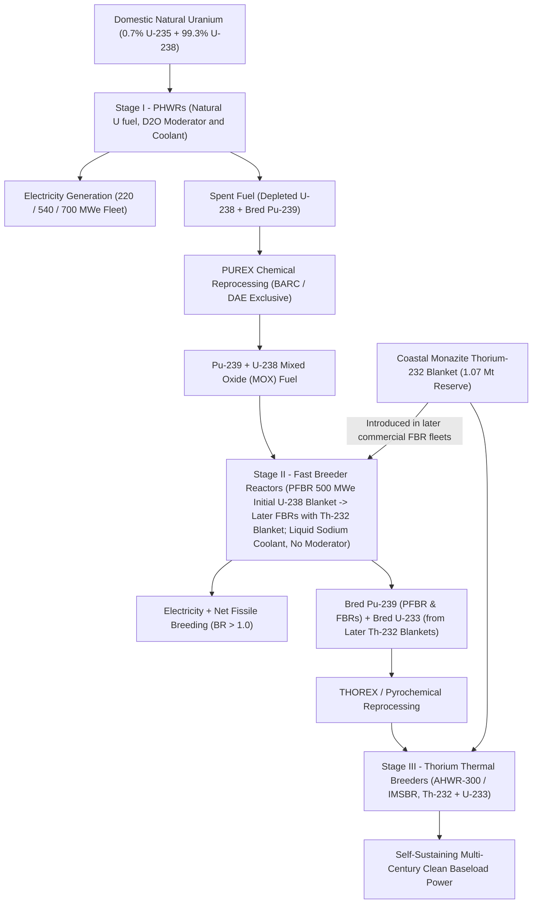

# Chapter 2 - Nuclear Physics, India's Three-Stage Closed Cycle, PFBR, SMRs & the SHANTI Act 2025

Civil nuclear power sits at the intersection of India's hardest energy trilemma: decarbonising a rapidly industrialising grid toward **Net Zero 2070**, securing 24×7 zero-carbon baseload alongside intermittent solar and wind, and overcoming an acute domestic scarcity of uranium. Each gigawatt of nuclear capacity averts roughly **5.4 million tonnes of $\text{CO}_2$-equivalent annually**—nearly six times the annual abatement of a gigawatt of solar—and since 1969 India's operating fleet has avoided over **851 million tonnes of $\text{CO}_2$-equivalent**.

Between March 2024 and late 2026, two inflection points redrew India's six-decade nuclear trajectory. Scientifically, the indigenous **500 MWe Prototype Fast Breeder Reactor (PFBR)** at Kalpakkam achieved **first criticality on 6 April 2026**, formally propelling India into Stage II of Homi Bhabha's closed fuel cycle. Legally, Parliament enacted the **SHANTI Act, 2025** (assented **20 December 2025**), repealing both the *Atomic Energy Act, 1962* and the *Civil Liability for Nuclear Damage Act, 2010* to break the state monopoly, grant statutory status to the **Atomic Energy Regulatory Board (AERB)**, and unlock a **100 GW by 2047** build-out.

---

## Core Nuclear Physics & India's Mineral Imperative

### Reactor Physics Refresher

* **Binding Energy & Energy Release:** Nuclear binding energy per nucleon ($B/A$) rises steeply for light nuclei and peaks near $^{56}\text{Fe}$ ($\approx 8.8\text{ MeV}$), then declines slowly toward heavy actinides ($\approx 7.6\text{ MeV}$ for $^{235}\text{U}$). Moving toward the iron peak releases mass-defect energy ($\Delta E = \Delta m c^2$) either by **fissioning** heavy nuclei ($\sim 200\text{ MeV}$ per $^{235}\text{U}$ fission) or **fusing** light nuclei ($\text{D} + \text{T} \to {}^4\text{He} + n + 17.6\text{ MeV}$).
* **Fissile vs. Fertile Isotopes:** **Fissile** nuclei ($^{235}\text{U}, {}^{239}\text{Pu}, {}^{233}\text{U}$) fission upon absorbing neutrons of *any* kinetic energy, including low-energy thermal neutrons ($\sim 0.025\text{ eV}$). **Fertile** nuclei ($^{238}\text{U}, {}^{232}\text{Th}$) do not sustain a chain reaction directly; instead, radiative neutron capture followed by two $\beta^-$ decays transmutes them into artificial fissile isotopes ($^{238}\text{U} \to {}^{239}\text{Pu}$ and $^{232}\text{Th} \to {}^{233}\text{U}$).
* **Thermal vs. Fast Neutron Spectra & Breeding Condition:** Thermal reactors insert a **moderator** (heavy water $\text{D}_2\text{O}$, light water $\text{H}_2\text{O}$, or graphite) to thermalise fission neutrons ($\sim 2\text{ MeV} \to 0.025\text{ eV}$), exploiting $^{235}\text{U}$'s high thermal fission cross-section. **Fast reactors** eliminate the moderator entirely so neutrons remain energetic ($\sim 0.1\text{–}1\text{ MeV}$): at fast energies, the average neutron yield per neutron absorbed in $^{239}\text{Pu}$ ($\eta$) rises sharply above $2.0$ ($\eta \approx 2.4\text{–}2.9$), leaving enough surplus neutrons (after $1$ sustains the chain reaction and parasitic losses are deducted) to **breed** more fissile fuel than consumed (Conversion/Breeding Ratio $> 1$).
* **Criticality, Delayed Neutrons & Control:** **Criticality** occurs when the effective neutron multiplication factor reaches exactly $k_{\text{eff}} = 1$—each fission triggers exactly one subsequent fission, initiating a self-sustaining chain reaction. Reactor control is physically possible only because **$<1\%$ of fission neutrons are delayed** ($\beta \approx 0.0065$ for $^{235}\text{U}$, dropping to a tighter $\beta \approx 0.0021$ for $^{239}\text{Pu}$ in fast breeders), stretching the effective neutron generation time from microseconds to seconds so **control rods** (boron carbide $\text{B}_4\text{C}$, cadmium, hafnium—high neutron capture cross-section) can regulate flux safely.
* **Fusion Lawson Criterion:** Overcoming electrostatic Coulomb repulsion between positively charged nuclei demands plasma temperatures of $\sim 100\text{–}150\text{ million }^\circ\text{C}$ ($\sim 10\text{–}15\text{ keV}$). Achieving sustained ignition requires the **Lawson triple product** of plasma density ($n$), ion temperature ($T$), and energy confinement time ($\tau_E$) to exceed $n T \tau_E \ge 3 \times 10^{21}\text{ keV}\cdot\text{s}\cdot\text{m}^{-3}$ for the easiest D–T reaction, where fusion gain $Q = P_{\text{fusion}} / P_{\text{input}} > 1$ denotes scientific breakeven ($Q \ge 10$ targeted in ITER).

### India's Uranium Scarcity vs. Monazite Thorium Imperative

India's entire closed-cycle nuclear architecture is dictated by crustal geology rather than ideological preference. According to the **Atomic Minerals Directorate for Exploration and Research (AMD)**, India possesses only **~1–2% of global uranium reserves**—totalling roughly **4.3 lakh tonnes of in-situ uranium ore** (low-grade deposits clustered in Jaduguda/Singhbhum in Jharkhand, Tummalapalle in Andhra Pradesh, Domiasiat in Meghalaya, and Rohil in Rajasthan). Running an open, once-through Light Water Reactor (LWR) cycle on domestic natural uranium would cap India's indigenous nuclear potential at barely ~10 GWe for 40 years and lock the country into permanent import vulnerability under Nuclear Suppliers Group (NSG) and IAEA safeguard conditions.

Conversely, India holds approximately **25% of the world's thorium reserves**—estimated by AMD at **~11.93 million tonnes of in-situ monazite** containing roughly **1.07 million tonnes of thorium** *(note: GSI also identifies ~8.5 lakh tonnes across mapped coastal/inland belts, supplemented by its July 2026 rare monazite discovery in Gundlupet, Chamarajanagar, Karnataka)*. Monazite occurs predominantly in **coastal beach-sand placers** (8–10% $\text{ThO}_2$ content) across **Andhra Pradesh (~31%)**, **Tamil Nadu (~20%, Manavalakurichi)**, **Odisha (~20%, Chatrapur)**, and **Kerala (~16%, Chavara)**, alongside inland placers in West Bengal and Jharkhand. Because natural $^{232}\text{Th}$ contains **zero naturally occurring fissile isotopes**, it cannot start a reactor on its own—forcing India to breed a massive fissile $^{239}\text{Pu}$ stockpile first to transmute $^{232}\text{Th}$ into fissile $^{233}\text{U}$.

---

## Homi Bhabha's Three-Stage Closed Nuclear Fuel Cycle

Conceived by **Dr. Homi J. Bhabha in 1954**, India's **closed nuclear fuel cycle** rejects the "once-through" disposal model (used by the United States) and instead treats spent nuclear fuel as a recoverable energy resource through sequential **reprocessing (PUREX / THOREX chemistry)** and **recycling**. Each stage manufactures the fissile inventory needed to launch the next, simultaneously shrinking long-lived high-level radiotoxic actinide waste by an order of magnitude.

### Stage I - Pressurised Heavy Water Reactors (PHWRs) & the 700 MWe Fleet

Stage I bypasses costly uranium enrichment altogether by coupling **natural uranium ($\text{UO}_2$, 0.71% $^{235}\text{U}$)** with **heavy water ($\text{D}_2\text{O}$)** acting simultaneously as **moderator and primary coolant**. Because deuterium possesses a vastly lower parasitic neutron-absorption cross-section than light hydrogen, PHWRs sustain criticality on unenriched natural uranium while offering superior **neutron economy**—converting $^{238}\text{U}$ into higher yields of $^{239}\text{Pu}$ per gigawatt-year than LWRs.

* **Operational Footprint (as of November 2026):** Operated by **Nuclear Power Corporation of India Limited (NPCIL)**, India's commercial grid fleet comprises **24 operational reactors across 7 sites totalling 8,780 MWe** *(excluding the permanently shut-down 100 MWe RAPS-1; legacy 2024–25 figures before RAPP-7 read 8,180 MWe)*, contributing **~2.8–3% of electricity generation** and recording a historic **56,681 million units** in FY 2024–25. Alongside PHWRs, Stage I includes imported **Light Water Reactors (LWRs)** as an "additionality" running on safeguarded Low-Enriched Uranium (LEU)—specifically Tarapur Units 1–2 (BWRs, under ageing-upgrade shutdown) and Russian **VVER-1000 PWRs** at Kudankulam (Units 1–2 operational; Units 3–6 under construction).
* **The Indigenous 700 MWe Generation III+ PHWR Fleet:** Scaling from earlier 220 MWe and 540 MWe units, NPCIL's standardised **700 MWe PHWR** introduces Gen III+ enhancements—including **partial boiling (~3% steam quality)** at coolant-channel outlets for higher thermal efficiency, **steel-lined double containment**, a **Passive Decay Heat Removal System (PDHRS)**, **Containment Spray Systems**, and **Cobalt Adjuster Rods** producing medical-grade $^{60}\text{Co}$ (~350 Ci/g) for cancer therapy.
  * *Kakrapar (Gujarat):* **KAPP-3** entered commercial operation in **June 2023**; **KAPP-4** attained criticality in December 2023 and entered commercial service in **March 2024**.
  * *Rawatbhata (Rajasthan):* **RAPP-7** attained criticality on **19 September 2024**, commenced commercial operation on **15 April 2025**, and reached full 700 MWe rated power on **10 February 2026**. **RAPP-8** commenced initial fuel loading (4,704 bundles across 392 coolant channels) in **September 2026** and received **AERB permission for First Approach to Criticality (FAC) on 19 November 2026** (notified via PIB on 20 November 2026), making it the **fourth unit** in India's indigenous 700 MWe PHWR series after KAPP-3, KAPP-4, and RAPP-7.
  * *Fleet-Mode Expansion:* Ten additional 700 MWe PHWRs sanctioned in bulk "fleet mode" (Kaiga-5/6, Gorakhpur Haryana GHAVP-1–4, Chutka-1/2 MP, and Mahi Banswara-1–4 Rajasthan—being executed via the **ASHVINI** NPCIL–NTPC joint venture) alongside AEC pre-project approval for ten further 700 MWe units anchor NPCIL's **22.5 GW by 2031–32** medium-term bridge.

### Stage II - Fast Breeder Reactors & the Kalpakkam PFBR Milestone (2026 Mains GS3 Hit)

Once Stage I spent fuel is reprocessed at BARC/DAE plants (Trombay, Tarapur, Kalpakkam) via the **PUREX** process, recovered $^{239}\text{Pu}$ is blended with depleted $^{238}\text{U}$ into **Mixed Oxide (MOX) fuel** ($\text{PuO}_2\text{–UO}_2$) to power Stage II **Fast Breeder Reactors (FBRs)**. India validated fast-reactor physics over four decades through its 40 MWth **Fast Breeder Test Reactor (FBTR)** at Kalpakkam (critical since 1985, operating on indigenous plutonium–uranium **mixed carbide** fuel).

* **Anatomy of the 500 MWe PFBR (Kalpakkam, Tamil Nadu):** Indigenously designed by the **Indira Gandhi Centre for Atomic Research (IGCAR)** and constructed/commissioned by **Bharatiya Nabhikiya Vidyut Nigam Limited (BHAVINI)**—with MOX fuel fabricated at BARC Tarapur and heavy steam-turbine equipment supplied by BHEL—the **500 MWe (1,253 MWth) PFBR** is a **pool-type, liquid-sodium-cooled fast breeder**.
  * *Why Liquid Sodium ($\sim 1,750\text{ tonnes}$)?* Sodium has a high atomic mass ($A = 23$, so minimal elastic moderation preserves fast neutrons), low neutron-capture cross-section, superb thermal conductivity, and a high boiling point ($883^\circ\text{C}$), allowing high-temperature steam generation ($493^\circ\text{C}$) at **near-atmospheric reactor pressure**—eliminating high-pressure loss-of-coolant blowdowns. Because sodium reacts violently with air and water, PFBR uses a **triple-loop architecture** (radioactive primary sodium pool → non-radioactive secondary sodium loop → steam generator water/steam loop) with argon cover gas and massive pool thermal inertia.
  * *Core & Blanket Physics:* A high-burnup ($\sim 100\text{ GWd/t}$) MOX core is surrounded radially and axially by a **depleted $^{238}\text{U}$ blanket** that captures escaping fast neutrons to breed fresh $^{239}\text{Pu}$ (Breeding Ratio $\approx 1.05$). Only in later commercial FBR fleets—once plutonium inventories expand sufficiently—will **$^{232}\text{Th}$ blankets** be introduced to breed $^{233}\text{U}$ for Stage III.
* **March 2024 to November 2026 Breakthrough Trajectory:**
  * *4 March 2024:* Commencement of **core loading** witnessed by the Prime Minister.
  * *6 April 2026:* Following sequential AERB clearances, PFBR attained **first criticality**—initiating a controlled, self-sustaining fast fission chain reaction and officially launching Stage II.
  * *Mid-to-Late 2026:* As reviewed by AEC Chairman Dr. A.K. Mohanty on **27 June 2026**, PFBR progressed through **low-power physics experiments** alongside BHEL's overhaul of the 500 MW tandem-compound Turbine Generator prior to power escalation and **grid synchronisation**. Once grid-connected, India becomes **only the second nation worldwide (after Russia's BN-600/BN-800)** to operate a commercial-scale fast breeder reactor. Pre-project approval has already been cleared for **two follow-on 500 MWe units (FBR 1 & 2)** of identical design.
* **FBR vs. Thermal Nuclear Reactor (Core Engineering Contrast):** Thermal reactors (PHWRs/LWRs) *require* a moderator, run on low-energy neutrons ($0.025\text{ eV}$), consume net fissile material (Conversion Ratio $< 1$, extracting $<1\%$ of natural uranium's energy), use pressurised water coolants, and possess larger delayed-neutron margins. Fast Breeder Reactors *omit* moderators, run on high-energy neutrons ($\sim 0.1\text{–}1\text{ MeV}$), produce *more* fissile fuel than they burn (Breeding Ratio $> 1$, unlocking $>60\text{–}70\%$ of natural uranium's energy), use liquid-metal (sodium) coolants at atmospheric pressure, and transmute long-lived transuranic waste.
* **The Doubling-Time Bottleneck:** Oxide MOX fuel suffers a relatively long **fissile doubling time (~18–22 years)**—too slow to rapidly build the plutonium base needed for a 50 GW FBR fleet before launching Stage III. To compress doubling time to **~8–10 years**, IGCAR is advancing **metallic U–Pu–Zr alloy fuel** coupled with **pyrochemical reprocessing** for future 600 MWe commercial FBRs.

### Stage III - Thorium Reactors, AHWR-300 & Molten Salt Breeder Reactors

Stage III transitions to a self-sustaining **$^{232}\text{Th}\text{–}^{233}\text{U}$ thermal breeder cycle** capable of sustaining hundreds of gigawatts for centuries. Why can thorium breed in a *thermal* spectrum whereas uranium requires a *fast* spectrum? Because $^{233}\text{U}$'s thermal neutron yield ($\eta \approx 2.29$) exceeds $2.0$ comfortably—unlike $^{235}\text{U}$ ($\eta \approx 2.07$) or $^{239}\text{Pu}$ ($\eta \approx 2.11$)—making thermal breeding feasible if parasitic neutron absorption is minimised.

* **KAMINI (Kalpakkam Mini Reactor):** Commissioned in 1996 (30 kWth, IGCAR/BARC), KAMINI remains the **world's only operating reactor fuelled exclusively by $^{233}\text{U}$** (bred from thorium irradiated in FBTR and separated via THOREX chemistry), deployed for neutron radiography and detector calibration.
* **300 MWe Advanced Heavy Water Reactor (AHWR-300):** Designed by **BARC** as a technology demonstrator to bypass decades of sequential delay, AHWR-300 is a vertical pressure-tube reactor using **heavy water ($\text{D}_2\text{O}$) as moderator**, **boiling light water ($\text{H}_2\text{O}$) circulating by natural convection as coolant**, and $(\text{Th–Pu})\text{MOX} / (\text{Th–}^{233}\text{U})$ driver fuel (with an export-oriented LEU–Th variant). It embeds Gen-IV passive safety—a **slightly negative void coefficient of reactivity**, 72-hour operator-free gravity-driven decay heat removal, and co-production of desalinated water.
* **Indian Molten Salt Breeder Reactor (IMSBR) & Accelerator-Driven Systems (ADS):** Because solid thorium fuel faces high-gamma-dose handling hazards from trace $^{232}\text{U}$ (decaying to hard 2.6 MeV gamma-emitting $^{208}\text{Tl}$) and high-burnup cladding wear, BARC is developing a **5 MWth IMSBR** prototype where fissile/fertile fluorides dissolve directly inside liquid **FLiBe / FLiNaK molten fluoride salt**—operating at atmospheric pressure with online fission-product stripping and a passive freeze-plug drain. Parallel R&D explores sub-critical **Accelerator-Driven Systems (ADS)** using a high-energy proton spallation source to drive thorium fission and incinerate minor actinides without criticality risk.
* **Realistic Timeline Honesty:** As DAE has repeatedly clarified in Parliament, large-scale commercial Stage III thorium deployment remains **3–4 decades after commercial FBR fleets with short doubling times**—placing full thorium commercialisation **post-2050**.

---

## Nuclear Energy Mission (100 GW by 2047) & India's SMR Architecture

Announced in the **Union Budget 2025–26** and backed by **customs-duty exemptions on nuclear plant input materials extended until 2035** in Budget 2026–27, the **Nuclear Energy Mission for Viksit Bharat** targets **100 GW of installed nuclear power by 2047**—a more than eleven-fold expansion from today's 8.78 GW.

* **Multi-Agency 100 GW Roadmap (Parliamentary Disclosure, July 2026):** Rather than burdening NPCIL's balance sheet alone, DAE's roadmap allocates **~54 GW to NPCIL** (indigenous 700 MWe PHWRs + large foreign-cooperation LWRs, reaching ~22.5 GW by 2031–32 and adding ~32 GW thereafter) and **~45–46 GW to Central/State PSUs, Joint Ventures, and private-sector operators** enabled by the SHANTI Act, 2025.
* **The ₹20,000 Crore SMR R&D Mission:** Budget 2025–26 earmarked **₹20,000 crore** for indigenous **Small Modular Reactor (SMR)** design, development, and demonstration, targeting **at least five operational indigenous SMRs by 2033**. Factory-fabricated, road-transportable, and equipped with passive safety and compact Emergency Planning Zones (EPZs), SMRs ($\le 300\text{ MWe}$) directly address India's two hardest industrial bottlenecks: **repurposing retiring brownfield coal-plant sites** (reusing existing grid substations, land, and water corridors) and supplying **24×7 captive clean power** to hard-to-abate steel, aluminium, cement, and hyperscale AI data centres.

### India's Four-Tier Indigenous Small & Micro Reactor Portfolio

1. **BSR-220 (Bharat Small Reactor — 220 MWe PHWR):** An upgraded, standardised iteration of NPCIL's time-tested **220 MWe Pressurised Heavy Water Reactor** using natural uranium. Because BSR-220 builds on decades of operational and AERB licensing familiarity, NPCIL floated a **Request for Proposal (RFP)** inviting private Indian industrial conglomerates (with formal expressions of interest from Reliance, Tata Power, Adani Power, JSW, Hindalco, and Jindal Steel) to fund captive BSR units while NPCIL/DAE provided fuel and operational oversight prior to SHANTI's full private-operator rollout.
2. **BSMR-200 (Bharat Small Modular Reactor — 200 MWe PWR):** A clean-sheet **Pressurised Water Reactor (Light Water)** designed by **BARC** (conceptual design completed March 2025; lead demonstration unit proposed at **Tarapur, Maharashtra**, 60–72 months post-sanction). Crucially, BSMR-200 uses **Slightly Enriched Uranium (SEU)** rather than **High-Assay Low-Enriched Uranium (HALEU, 5–20% $^{235}\text{U}$)**—insulating India from acute global HALEU enrichment monopolies dominated by Russia while aligning India's SMR stack with global PWR safety norms.
3. **SMR-55 (55 MWe Compact PWR):** A smaller modular light-water design developed by **BARC** (2 demonstration units planned, lead site Tarapur) engineered for **remote/off-grid industrial clusters**, island territories, and mid-scale captive facilities.
4. **BARC 5 MWth HTGCR (High-Temperature Gas-Cooled Micro-Reactor):** A helium-cooled, graphite-moderated high-temperature reactor (using rugged **TRISO** coated fuel particles) engineered specifically for **nuclear ("pink") hydrogen production** rather than grid electricity. Delivering process heat at **$\ge 650^\circ\text{C}$**, it couples with BARC-demonstrated **Copper–Chlorine (Cu–Cl)** and **Iodine–Sulphur (I–S) thermochemical water-splitting cycles** to generate zero-carbon hydrogen for steel reduction, fertilisers, and heavy transport.

---

## SHANTI Act 2025 and Statutory AERB

*(Primary Cross-Hub Anchor — Comprehensive 360° Legal, Constitutional, Regulatory, Economic & Strategic Analysis)*

For 63 years, India's civil nuclear landscape was governed by two statutes pulling against private capital: the **Atomic Energy Act, 1962 (AEA 1962)**, which confined nuclear power generation exclusively to the Central Government and majority-owned government companies (even after its 2015 amendment enabling PSU JVs), and the **Civil Liability for Nuclear Damage Act, 2010 (CLNDA 2010)**, whose statutory right of recourse against equipment suppliers (Section 17(b)) and open-ended tort exposure (Section 46) froze major foreign reactor deployments (Westinghouse AP1000, GE-Hitachi, EDF EPR) for fifteen years.

Introduced in the Lok Sabha on **15 December 2025** by MoS Dr. Jitendra Singh, passed by the Lok Sabha on **17 December** and the Rajya Sabha on **18 December**, and granted Presidential assent on **20 December 2025**, the **Sustainable Harnessing and Advancement of Nuclear Energy for Transforming India (SHANTI) Act, 2025 (Act No. 39 of 2025)** executes India's boldest nuclear legal overhaul since Independence. Its Section 91(1) **repeals and consolidates both AEA 1962 and CLNDA 2010** into a single unified statute—coming into force on dates notified by the Central Government (with DAE completing public consultation on **draft SHANTI Rules and Regulations** in August–September 2026).

### Pillar 1 - Ending State Generation Monopoly While Retaining Strategic Sovereign Chokepoints

* **Private & JV Licensing (Section 3 & Section 2(9)):** Ends the six-decade state monopoly by empowering the Central Government to license **Indian private companies, public-private joint ventures, and expressly permitted entities** to **build, own, operate, and decommission** civil nuclear power plants and non-power radiation facilities.
* **Domestic Incorporation Mandate & Foreign Equity (Dual-Standard FEMA Watchout):** Section 2(9) defines a "company" per Section 2(20) of the Companies Act, 2013 while **expressly excluding companies incorporated outside India**. Foreign technology vendors and investors must therefore participate through Indian-incorporated companies or joint ventures—for which the Atomic Energy Commission has cleared a phased policy framework permitting **up to 49% foreign equity strictly via the Government Approval Route** (never Automatic). *Crucial Legal Parity (as of November 2026):* While SHANTI legally enables Indian-incorporated JVs, under India's extant **Consolidated FDI Policy and FEMA Non-Debt Instruments (NDI) Rules**, **Atomic Energy formally remains on the Prohibited Sectors list for FDI** pending gazette notification of the corresponding DPIIT Press Note / FEMA NDI amendment.
* **Sovereign Fuel-Cycle Firewall (Activities Reserved Exclusively for the Centre):** To prevent nuclear proliferation, safeguard strategic deterrence, and preserve closed-cycle security, SHANTI retains **absolute Central Government / wholly owned PSU monopoly** over sensitive chokepoints:
  1. **Uranium enrichment and isotopic separation**;
  2. **Spent-fuel management and chemical reprocessing**;
  3. **High-level radioactive waste management**;
  4. **Heavy-water ($\text{D}_2\text{O}$) production**; and
  5. **Sensitive atomic mineral mining beyond permitted thresholds** (preserving state command over strategic monazite/uranium chains).
* **Unlocking Nuclear Patents (Amending Section 4, Patents Act 1970):** Under Section 20 of AEA 1962 read with Section 4 of the Patents Act 1970, *all* inventions relating to atomic energy were categorically unpatentable—suffocating Indian private R&D in SMRs, advanced alloys, medical isotopes, and radiation instrumentation. SHANTI **amends Section 4 of the Patents Act, 1970** to allow **patenting of peaceful civil nuclear innovations**, while preserving sovereign secrecy/control over sensitive strategic and weapons-adjacent technologies.

### Pillar 2 - Recalibrated Civil Nuclear Liability & CSC Alignment

SHANTI preserves the international bedrock of **no-fault (strict) liability** channelled directly to the plant operator—so victims need not prove negligence to claim compensation—while rewriting three provisions that had stalled both domestic SMRs and international cooperation:

* **Graded Operator Liability Caps (Second Schedule):** CLNDA 2010 imposed a rigid, flat **₹1,500 crore** operator cap on every reactor above 10 MWth—economically punishing small 55–200 MWe SMRs and research/transport facilities with the same insurance overhead as a 1,650 MWe gigawatt reactor. SHANTI replaces this with a **five-tier thermal-capacity-linked cap**:
  * **Above 3,600 MWth** *(large gigawatt reactors, roughly >1,000–1,200 MWe; publicly summarised alongside >500 MWe large-plant bands)*: **₹3,000 crore**
  * **Above 1,500 MWth up to 3,600 MWth**: **₹1,500 crore**
  * **Above 750 MWth up to 1,500 MWth**: **₹750 crore**
  * **Above 150 MWth up to 750 MWth** *(mid-sized SMRs)*: **₹300 crore**
  * **Up to 150 MWth** *(micro-reactors like 5 MWth HTGCR, non-reprocessing fuel-cycle units, and nuclear transport)*: **₹100 crore**
* **Total Liability Ceiling, Nuclear Liability Fund & CSC Consistency:** Total compensation per nuclear incident (Operator share + Central Government residual backstop) remains anchored at **300 million Special Drawing Rights (SDRs — approximately ₹3,600–3,900 crore** across DAE/CEA parliamentary notes and 2026 exchange rates), keeping India aligned with the **Convention on Supplementary Compensation for Nuclear Damage (CSC)** (ratified by India on 4 February 2016). Beyond the operator's graded cap (backed by mandatory insurance/financial security via the **India Nuclear Insurance Pool [INIP]**, though Central Government-owned installations remain exempt from mandatory upfront insurance), the Central Government assumes residual liability up to 300 million SDRs and is empowered to establish a dedicated **Nuclear Liability Fund**. Notably, Section 2(21) explicitly covers **environmental restoration costs and economic loss from impaired environment** (subject to Central Government notification) and extends territorial scope to transboundary nuclear damage in foreign territories under reciprocity/treaty frameworks. Limitation windows stand at **10 years for property damage** and **20 years for personal/bodily injury**.
* **Removal of Statutory Supplier Recourse (Omission of Legacy Sec 17(b)):** Under CLNDA's Section 17(b), an operator held an automatic statutory right to sue equipment suppliers if an accident resulted from patent or latent design/manufacturing defects or sub-standard services. SHANTI **eliminates Section 17(b)**. Under SHANTI's new recourse clause (**Clause 16**), an operator retains a right of recourse against a supplier in **only two narrow situations** (mirroring the global CSC Annex norm): (i) where **expressly provided in a written commercial contract**, or (ii) where an individual acted with **intent to cause nuclear damage**.
* **Exclusive Channelling (Omission of Legacy Sec 46):** CLNDA's Section 46 stated that its provisions were *"in addition to, and not in derogation of, any other law"*, leaving operators and suppliers exposed to unlimited concurrent lawsuits under Indian tort law, consumer law, environmental statutes, and criminal proceedings. SHANTI **omits Section 46** and bars ordinary civil courts, channelling all civil nuclear damage claims exclusively through the Act's statutory compensation mechanism (**Claims Commissioners** and, for major incidents, a **Nuclear Damage Claims Commission** under Section 56).

### Pillar 3 - Statutory AERB and Layered Regulatory Redressal

* **First Statutory Footing for AERB (Section 17):** Originally constituted on **15 November 1983 by an executive Presidential Order** under AEA 1962, the **Atomic Energy Regulatory Board (AERB)** had faced decades of criticism from the **CAG (2012 Audit Report)** and the **IAEA Integrated Regulatory Review Service (IRRS)** for lacking legislative independence—since it reported administratively to the Atomic Energy Commission (AEC), the very promotional agency operating NPCIL and BHAVINI. SHANTI **Section 17(1)** formally reconstitutes AERB as a **statutory regulatory body** empowered to frame safety codes, issue binding site/construction/operating licences, inspect private and public installations, and impose statutory penalties.
* **Composition & Tenure:** Comprises a **Chairperson, one whole-time member, and up to seven part-time members**, holding office for an initial term of **3 years**, extendable by up to **3 further years**.
* **Layered Dispute Redressal Stack (Distinct from Victim Claims):**
  * *Regulatory Appeals:* Parties aggrieved by an AERB or Central Government regulatory order may first seek expert review before the **Atomic Energy Redressal Advisory Council (AERAC)** (Sections 47–48, chaired by the **Chairperson of the Atomic Energy Commission**, exercising advisory/review powers rather than binding adjudication). Formal statutory appeals against regulatory orders and penalties lie with the **Appellate Tribunal for Electricity (APTEL)** (constituted under Section 110 of the Electricity Act, 2003), with final statutory appeal exclusively to the **Supreme Court**.
  * *Accident Compensation (Separate Track):* Must never be conflated with AERAC—victim compensation is adjudicated exclusively by **Claims Commissioners** or the **Nuclear Damage Claims Commission (Section 56)**.

### Pillar 4 - Constitutional, Safety & Accountability Critique (Live Supreme Court Review, Aug 2026)

Passed within three parliamentary days without referral to a Standing or Joint Parliamentary Committee, SHANTI triggered immediate constitutional and policy scrutiny. In **August 2026**, a **three-judge Supreme Court Bench headed by the Chief Justice of India issued notices to the Union Government and AERB** on writ petitions challenging key provisions of the Act (matter **pending adjudication as of November 2026**). Five structural tensions anchor Mains GS2/GS3 analysis:

1. **Article 21 & Constitutional Courts vs. Static Liability Caps:** Petitioners challenge whether Parliament's ₹100–3,000 crore operator caps and unindexed **300 million SDR (~₹3,600–3,900 crore)** ceiling—dwarfed by Fukushima's >$200 billion clean-up cost—can legally oust constitutional courts' power under **Articles 32 and 226** (and India's *M.C. Mehta* Absolute Liability & Polluter-Pays jurisprudence) to award just compensation to mass-disaster victims.
2. **Structural Conflict of Interest inside Statutory AERB (Section 17(4)):** Although AERB is now statutory, **Section 2(6)** defines *"Central Government"* under the Act as the **Department of Atomic Energy (DAE)**, and **Section 17(4)** vests selection of AERB's Chairperson and members in a committee constituted by the **Atomic Energy Commission (AEC)**—while the AEC Chairperson simultaneously chairs the review body (**AERAC**). Critics and SC petitioners argue that the promoter still appoints and reviews the regulator, falling short of the IAEA's *de facto* separation benchmark (and contrasting with the independent US Nuclear Regulatory Commission).
3. **Supplier Moral Hazard:** Historical nuclear disasters—Three Mile Island (control-room design flaws), Chernobyl (positive void coefficient), and Fukushima (GE Mark-I containment vulnerability)—all involved underlying **equipment or design defects**. Eliminating automatic Section 17(b) recourse shifts catastrophic engineering risk from deep-pocketed global vendors onto Indian taxpayers and operators unless operators negotiate strict contractual warranties and quality audits.
4. **Omission of Section 46 & Criminal/Tort Remedies:** Removing Section 46 insulates nuclear firms from Bhopal-style parallel litigation, yet critics warn that lacking explicit statutory criminal liability for gross safety negligence weakens deterrence.
5. **Transparency Deficit & RTI Restrictions:** SHANTI retains sweeping Union powers to restrict disclosure of nuclear-station information and preserves **Right to Information (RTI) Act, 2005 exemptions**—creating tension with Environmental Impact Assessment public-hearing norms and local social licence around new brownfield SMR sites.

### SHANTI Act 2025 vs. Legacy Laws Matrix

| Governance Dimension | Legacy Regime (*AEA 1962* + *CLNDA 2010*) | SHANTI Act, 2025 *(Act No. 39 of 2025; Assented Dec 20, 2025)* |
| :--- | :--- | :--- |
| **Statutory Structure** | Fragmented across two statutes (*Atomic Energy Act, 1962* & *CLNDA, 2010*) | **Single consolidated law** repealing both AEA 1962 & CLNDA 2010 (Sec 91(1)) |
| **Private & JV Participation** | Restricted solely to Central Govt & majority-owned Govt companies / PSU JVs (2015 amendment) | **Open to licensed Indian private companies & JVs** (Sec 3); excludes companies incorporated outside India (Sec 2(9)); phased up to 49% foreign equity (Govt Route) framework *(extant FEMA NDI / Consolidated FDI Prohibited List awaits gazette amendment as of Nov 2026)* |
| **Fuel-Cycle Sovereign Monopoly** | Entire nuclear cycle exclusively under Central Government | **Sensitive stages retained strictly with Centre:** enrichment, isotopic separation, spent-fuel reprocessing, high-level waste, heavy water |
| **Nuclear Patents** | Blanketed ban under Sec 20 AEA 1962 & Sec 4 Patents Act 1970 | **Amends Sec 4 Patents Act 1970** to allow **patents for peaceful civil nuclear inventions** |
| **Operator Liability Cap** | **Flat ₹1,500 crore** for all reactors $\ge 10\text{ MWth}$ (Sec 6(2) CLNDA) | **Graded 5-tier cap (Second Schedule):** ₹100 cr ($\le 150\text{ MWth}$/transport) → ₹300 cr → ₹750 cr → ₹1,500 cr → **₹3,000 cr** ($>3,600\text{ MWth}$) |
| **Total Incident Cap & Fund** | 300 million SDRs (~₹3,600–3,900 cr); Govt covers balance above ₹1,500 cr | **300 million SDRs retained** (~₹3,600–3,900 cr, CSC-aligned); Govt covers excess above graded cap + enables **Nuclear Liability Fund** |
| **Right of Recourse Against Suppliers** | **Automatic statutory recourse** under **Sec 17(b)** for patent/latent equipment defects or sub-standard services | **Sec 17(b) omitted:** recourse under **Clause 16** allowed *only* via **express written contract** or **individual intent to cause damage** |
| **Concurrent Tort / Other Laws** | **Sec 46 CLNDA** allowed remedies under *other laws* (tort, criminal, environmental) in addition to CLNDA | **Sec 46 omitted:** exclusive statutory channelling; ordinary civil courts barred |
| **Regulator (AERB) Status** | Non-statutory body created via **1983 Executive Order** reporting to AEC | **Statutory AERB (Sec 17):** Chairperson + 1 whole-time + up to 7 part-time members (3+3 yr tenure); *selection via AEC committee under SC scrutiny (Aug 2026)* |
| **Regulatory Dispute Forum** | No dedicated statutory appellate tribunal | **AERAC** (expert advisory review, chaired by AEC Chair) → **APTEL** (statutory appeal) → **Supreme Court** *(distinct from Claims Commission)* |

---

## Thermonuclear Fusion - ITER and India's Domestic Plasma Programme

While fission scales India's 2047 clean baseload, **controlled thermonuclear fusion**—fusing deuterium (extractable from seawater) and tritium (bred in-situ from lithium blankets via $^6\text{Li} + n \to {}^4\text{He} + \text{T}$)—offers virtually inexhaustible, meltdown-proof energy with zero long-lived actinide waste and zero greenhouse emissions.

### International Thermonuclear Experimental Reactor (ITER, Cadarache, France)

Launched under a 2006 treaty among **seven full members representing 35 nations**—the **European Union** (45% host share via Euratom), **India, China, Japan, Russia, South Korea, and the United States** (~9.1% share each)—ITER is the world's largest magnetic-confinement **tokamak** experiment. Crucially, **ITER is a scientific-engineering demonstrator, NOT a commercial electricity plant**: it will never connect a turbine to the grid, but aims to demonstrate a **burning plasma** generating **500 MW of fusion thermal power from 50 MW of heating input ($Q \ge 10$)** for 400–600 seconds.

* **2024 Revised Baseline & July 2026 Assembly Momentum:** Following COVID-19 disruptions and first-of-a-kind vacuum-vessel welding repairs, the ITER Council adopted a revised baseline in 2024 shifting schedules by ~4 years: **Start of Research Operation in 2034**, deuterium–deuterium plasma in **2035**, **full magnetic energy in 2036**, and **Deuterium–Tritium (D–T) burning-plasma operations from 2039**. Demonstrating regained execution speed, on **28–29 July 2026**, ITER lowered the **sixth of nine ~1,100-tonne vacuum-vessel sectors** into the tokamak pit—completing **two-thirds of core assembly six months ahead of schedule**, with the final sector projected by mid-2027.
* **India's 9 In-Kind Procurement Packages (`ITER-India`):** India joined ITER as a full seventh partner in **December 2005**, routing its ~9.1% (~10% hardware) contribution predominantly **in-kind** via **ITER-India** (a special project housed at the **Institute for Plasma Research [IPR], Gandhinagar**). By supplying ~90% in-kind hardware rather than cash, India acquires **100% shared access to all ITER intellectual property and operational data** while catapulting domestic industry into ultra-precision cryogenics and RF power engineering:
  1. **The Cryostat (ITER's Single Largest Component):** Designed by ITER-India and manufactured by **Larsen & Toubro (L&T, Hazira)**—a **3,850-tonne, 30 m diameter × 30 m high stainless-steel high-vacuum vessel** (the world's largest of its kind) encasing the entire superconducting tokamak at 4.5 K.
  2. **Cryolines & Cryodistribution System:** Over 10 km of multi-process vacuum-jacketed superconducting helium lines feeding 4.5 K liquid helium to magnets.
  3. **In-Wall Shielding (IWS):** ~9,000 precision boronated-steel shielding blocks fabricated from 70,000 plates shielding superconducting coils from 14.1 MeV D–T fusion neutrons.
  4. **Cooling Water & Heat Rejection System:** Managing gigawatt-scale pulsed thermal dissipation.
  5. **Ion Cyclotron Resonance Heating (ICRH) RF Sources:** 20 MW (30–50 MHz) high-power RF systems heating plasma ions.
  6. **Electron Cyclotron Resonance Heating (ECRH) Sources:** Two **1 MW, 170 GHz gyrotrons** (3,600 s pulse) for plasma start-up, current drive, and suppressing magnetohydrodynamic (MHD) instabilities.
  7. **Diagnostic Neutral Beam (DNB):** A 100 keV neutral hydrogen beam probing helium "ash" accumulation inside burning D–T plasmas.
  8. **High-Voltage Power Supplies** (for ICRH, ECRH, and DNB) and **Plasma Diagnostics** (X-ray crystal spectroscopy, ECE, optical spectrometers).
  9. **Tritium Breeding R&D:** Jointly with BARC and IGCAR, IPR leads India's **Lead–Lithium Cooled Ceramic Breeder (LLCB) Test Blanket Module (TBM)** to validate closed-loop tritium self-sufficiency inside ITER.

### Domestic Tokamak Ecosystem - IPR Gandhinagar

Coordinated by the **Institute for Plasma Research (IPR)** in Bhat, Gandhinagar (an autonomous DAE institute), India maintains an indigenous magnetic-confinement testbed parallel to ITER:

* **ADITYA & ADITYA-U:** Commissioned in **1989** as India's first medium-sized, room-temperature copper-coil tokamak and upgraded in **2017** to **ADITYA-U** (shaped divertor plasma configuration), it validates real-time plasma-disruption mitigation and runaway-electron control techniques directly relevant to ITER.
* **SST-1 (Steady-State Superconducting Tokamak-1):** One of the world's earliest **NbTi superconducting-magnet tokamaks** (upgraded in 2019), designed to test long-duration steady-state plasma discharges using lower-hybrid current drive (LHCD), ICRH, and ECRH.
* **Post-ITER Roadmap (SST-2 & Indian DEMO):** IPR's roadmap envisages a compact fusion pilot/neutron-source platform (**SST-2**, targeting ~100–300 MW fusion thermal output with tritium-breeding blanket integration) as the engineering bridge toward an electricity-generating **Indian DEMO** fusion demonstrator post-2040s, aligned with India's post-2050 deep decarbonisation horizon.

---

> [!warning] Prelims Traps & Atomic Distinctions
> 1. **SHANTI Act 2025 — Foreign Companies vs. Extant FEMA Prohibited-Sector Trap:** SHANTI **repeals BOTH AEA 1962 and CLNDA 2010** and opens nuclear plant operation to licensed Indian private companies and JVs, but **Section 2(9) expressly EXCLUDES companies incorporated outside India** from directly holding operating licences. While the AEC cleared a phased **up to 49% FDI (Government Route only)** framework for Indian-incorporated JVs, watch the dual-standard legal distinction: under India's extant **Consolidated FDI Policy and FEMA NDI Rules (as of November 2026)**, **Atomic Energy formally remains on the Prohibited Sectors list for FDI** until the DPIIT Press Note / FEMA NDI amendment is gazette-notified.
> 2. **SHANTI Act 2025 — Two Completely Distinct Bodies (AERAC vs. Claims Commission):** Do NOT confuse the **Atomic Energy Redressal Advisory Council (AERAC, Sec 47)**—an advisory review body chaired by the **AEC Chairperson** hearing appeals on *regulatory* orders before **APTEL**—with the **Nuclear Damage Claims Commission (Sec 56)**, which adjudicates *victim compensation* after a nuclear incident.
> 3. **SHANTI Liability & Recourse Inversion:** Operator caps are **graded by thermal power (MWth)** from **₹100 crore ($\le 150\text{ MWth}$)** up to **₹3,000 crore ($>3,600\text{ MWth}$)**, NOT a flat ₹1,500 crore; total incident liability remains **300 million SDRs (~₹3,600–3,900 cr)**. SHANTI **omits BOTH Sec 17(b)** (automatic supplier defect recourse) and **Sec 46** (parallel remedies under other laws), retaining supplier recourse *only* via **express written contract** or **intent to cause damage**.
> 4. **PFBR Criticality vs. Grid Synchronisation Trap:** Achieving **first criticality on 6 April 2026** means PFBR initiated a self-sustaining chain reaction—it did **NOT** mean full commercial electricity generation started on that date (low-power physics tests and BHEL TG overhauling follow prior to grid synchronisation). Also remember: PFBR uses **NO moderator**, uses **liquid sodium** as coolant (NOT heavy water), uses a **depleted $^{238}\text{U}$ blanket** in its initial configuration (NOT $^{232}\text{Th}$ yet), and is built by **BHAVINI** to an **IGCAR** design (NOT NPCIL!).
> 5. **BSR-220 vs. BSMR-200 Reactor Type Trap:** **BSR-220** is a **Pressurised Heavy Water Reactor (PHWR)** running on natural uranium; **BSMR-200** and **SMR-55** are **Pressurised Water Reactors (PWR / Light Water)** running on Slightly Enriched Uranium (SEU, NOT HALEU); and BARC's **5 MWth HTGCR** is helium-cooled for **hydrogen generation** (Cu–Cl / I–S cycles), NOT grid electricity.
> 6. **Thorium Physics Trap:** Thorium-232 is **fertile, NOT fissile**—it cannot sustain fission directly and must be transmuted into **fissile $^{233}\text{U}$**. Similarly, **AHWR-300** uses **heavy water as moderator** and **boiling light water as coolant** (unlike PHWRs which use heavy water for both).
> 7. **Uranium Enrichment for Power vs. Weapons Trap (Prelims 2023 Repeat Alert):** Commercial LWRs require only **~3–5% LEU** (and Indian PHWRs use **0.7% unenriched natural uranium**)—NOT 60%+ enrichment (which is near weapons-grade $\ge 90\%$ HEU).
> 8. **ITER Output & Schedule Trap:** ITER is a **magnetic-confinement tokamak** designed to demonstrate burning plasma ($Q \ge 10$, 500 MWth)—it will **NEVER produce commercial grid electricity**. India is a **full founding member** (since 2005/2006) delivering its largest physical component—the **3,850-tonne L&T Cryostat**. Under the 2024 baseline, **D–T fusion operations begin in 2039**.

---

## UPSC Interrogation Lens

### Verified UPSC Mains PYQs (2014–2026) & Prelims Anchors

* **Mains 2026 (GS3, Q6, 10M):** *"Distinguish between a Fast Breeder Reactor (FBR) and a thermal nuclear reactor. In the context of the first indigenously developed prototype FBR at Kalpakkam, explain the term 'criticality'. What are its implications for the clean energy future of our country?"*
* **Mains 2025 (GS3, 10M):** *"The fusion energy programme in India has steadily evolved over the past few decades. Mention India's contributions to the international fusion energy project – International Thermonuclear Experimental Reactor (ITER). What will be the implications of the success of this project for the future of global energy?"*
* **Mains 2018 (GS3, 15M):** *"With growing energy needs should India keep on expanding its nuclear energy programme? Discuss the facts and fears associated with nuclear energy."*
* **Mains 2017 (GS3, 10M):** *"What is the advantage of a fast breeder reactor programme in India?"*
* **Verified Prelims PYQ Focal Points:**
  * **Prelims 2023:** Statement-I/II trap testing whether electricity generation requires uranium enriched to at least 60% *(False — ~3–5% for LWRs, natural 0.7% for PHWRs)*.
  * **Prelims 2020:** Why only some Indian nuclear reactors are placed under **IAEA Safeguards** *(those operating on imported uranium under India's Separation Plan)*.
  * **Prelims 2018:** Implication of ratifying the **IAEA Additional Protocol** *(civilian nuclear reactors placed under IAEA safeguards)* & consequences of **NSG membership**.
  * **Prelims 2016:** Immediate advantage for India if **ITER** succeeds *(building fusion reactors for power generation — NOT using thorium directly)*.
  * **Prelims 2012:** Comparative advantages of **thorium over uranium** *(higher natural abundance, greater energy per unit mass of mined mineral, less harmful radiotoxic waste)*.
  * **Prelims 2011:** Primary function of **heavy water ($\text{D}_2\text{O}$)** in a nuclear reactor *(to slow down / moderate fast neutrons)*.

### Prelims Trap Signature

* **Coolant–Moderator Conflation:** Swapping **PHWR** ($\text{D}_2\text{O}$ moderator + $\text{D}_2\text{O}$ coolant), **AHWR-300** ($\text{D}_2\text{O}$ moderator + boiling $\text{H}_2\text{O}$ coolant), **BSMR-200 / PWR** ($\text{H}_2\text{O}$ moderator + $\text{H}_2\text{O}$ coolant), **PFBR** (no moderator + liquid sodium coolant), and **HTGCR** (graphite moderator + helium coolant).
* **Agency Ownership Swaps:** Attributing **PFBR** to NPCIL instead of **BHAVINI (built) / IGCAR (designed)**, attributing **ITER-India** to BARC instead of **IPR Gandhinagar**, or attributing **monazite exploration** to GSI alone instead of **AMD (DAE)**.
* **Statutory Nuances of SHANTI Act, 2025:** Turning "graded operator liability caps (₹100–3,000 cr)" into "unlimited operator liability", claiming SHANTI permits foreign companies incorporated abroad to directly operate Indian plants, or asserting SHANTI completely eliminated supplier recourse even when stipulated in written contracts.
* **Three-Stage Fuel-Cycle Short-Circuits:** Claiming Stage I PHWRs burn thorium commercially, claiming PFBR's initial core burns $^{233}\text{U}$ instead of **U–Pu MOX**, or claiming India's Stage III thorium fleet will deliver the bulk of the 100 GW target by 2047.

### Cross-Hub AIR-1 Provocations

1. **Investor Bankability vs. Constitutional Risk Socialisation (GS2 Polity × GS3 Nuclear Governance):** *In repealing CLNDA 2010 and enacting the SHANTI Act 2025, India removed automatic supplier recourse (Section 17(b)) and capped operator exposure at ₹100–3,000 crore to unlock private and foreign capital for its 100 GW (2047) clean-energy target—prompting a pending Supreme Court review on Article 21 compensation rights and AERB appointment independence. How should a developmental state reconcile investor predictability with absolute liability, polluter-pays accountability, and genuinely arms-length nuclear safety regulation?*
2. **Closed-Cycle Self-Reliance vs. Decarbonisation Urgency (GS3 Energy Security × Environment):** *With Kalpakkam's PFBR attaining first criticality in April 2026 yet commercial Stage III thorium remaining post-2050, India's 100 GW nuclear roadmap now hinges heavily on 700 MWe PHWRs, SEU-fuelled Light Water SMRs (BSMR-200), and foreign LWR partnerships—all requiring safeguarded uranium imports. Does the Nuclear Energy Mission signal a pragmatic hybridisation of Homi Bhabha's closed-cycle doctrine, and what geopolitical and spent-fuel governance trade-offs must India manage to prevent new external fuel dependencies?*

<!-- OBSIDIAN-WEB-START -->
---
### 🕸️ Neural Graph Connections
← [[1. National Science Policy, R&D Economics, ANRF, Vigyan Dhara & Global Mega-Science Consortia|Ch 1]] | 🧭 [[Science and Strategic Technology]] | [[3. Orbital Mechanics, Cryogenic–Methalox Propulsion & Indigenous Launch Vehicles|Ch 3]] →
<!-- OBSIDIAN-WEB-END -->
