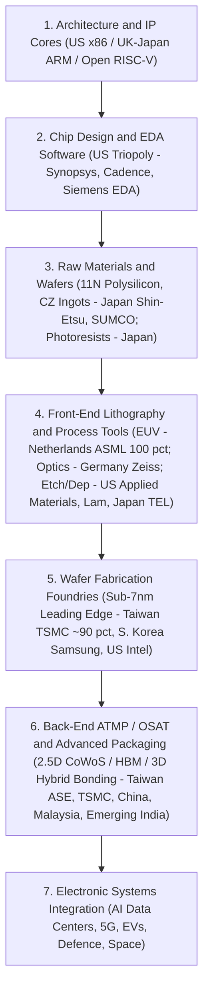

# Chapter 6 - Semiconductor Solid-State Physics, EUV Lithography, Chiplets and India Semiconductor Mission (ISM 2.0)

Semiconductors are the physical substrate of modern statecraft. Every strategic system—from AI training clusters and 5G base stations to AESA fighter radars and sovereign navigation payloads—reduces ultimately to switching currents across billions of nanoscale solid-state junctions. Unlike commodities determined by geological endowment, semiconductor dominance rests on an ultra-concentrated stack of quantum optics, precision materials chemistry, proprietary electronic design automation, and multi-billion-dollar fabrication ecosystems.

---

## Solid-State Physics Refresher and Post-5nm Transistor Scaling

### Bandgap Engineering, Doping and MOSFET Fundamentals

`[BRIEF REFRESHER]` Crystalline silicon ($E_g \approx 1.12\text{ eV}$ at $300\text{ K}$) sits between conductors ($E_g = 0$) and insulators ($E_g > 4\text{ eV}$), permitting exponential conductivity modulation via thermal excitation or external fields. Substitutional doping with pentavalent donors ($\text{P, As}$) yields electron-rich $n$-type silicon, while trivalent acceptors ($\text{B}$) yield hole-rich $p$-type silicon; their interface forms a rectifying $p$-$n$ junction governed by a built-in depletion potential. In a **Metal-Oxide-Semiconductor Field-Effect Transistor (MOSFET)**, vertical gate voltage $V_G$ across a dielectric oxide modulates an inversion channel between source and drain terminals, establishing the binary switching state.

### The Physics of Scaling Failure and the Node Naming Illusion

For four decades, transistor miniaturization obeyed **Dennard Scaling**: shrinking linear dimensions by factor $\kappa$ reduced gate capacitance, threshold voltage, and switching energy such that power density remained constant even as clock frequencies climbed. Dennard scaling collapsed around the $90\text{ nm}$–$65\text{ nm}$ era because threshold voltage $V_{\text{th}}$ could no longer scale down without triggering catastrophic subthreshold leakage current.

At channel lengths below $20\text{ nm}$, classical 1D electrostatic control breaks down under **Short-Channel Effects (SCEs)**:

- **Drain-Induced Barrier Lowering (DIBL):** Close proximity allows the drain's electric field to penetrate the source barrier, turning the transistor weakly "on" even when $V_G = 0$.
- **Gate Oxide Quantum Tunnelling:** Thinning $\text{SiO}_2$ below $\sim 1.2\text{ nm}$ (barely four atomic layers) permits direct Fowler–Nordheim and direct quantum tunnelling of electrons from gate to channel. Industry mitigated this at the $45\text{ nm}$ node by replacing $\text{SiO}_2$ ($\kappa \approx 3.9$) with **High-$\kappa$ dielectrics** like hafnium dioxide ($\text{HfO}_2$, $\kappa \approx 20\text{--}25$) paired with metal gates, preserving gate capacitance at greater physical thickness.
- **Boltzmann Tyranny (Subthreshold Swing Limit):** Thermionic emission over a potential barrier imposes a thermodynamic floor on switching steepness of $\ln(10)\frac{k_B T}{q} \approx 60\text{ mV/decade}$ at $300\text{ K}$, bounding minimum operating voltages around $0.6\text{--}0.7\text{ V}$.

A recurring technical misconception in policy debates is treating process-node labels ("7 nm", "3 nm", "2 nm") as literal gate lengths. Since roughly the $22\text{ nm}$ node, **node designations have become commercial marketing indices** denoting equivalent transistor density, power, and performance gains rather than any physical dimension on silicon—a modern "2 nm" device exhibits a physical gate length of $\sim 12\text{ nm}$ and contacted poly pitch near $45\text{ nm}$.

### Architectural Evolution - Planar MOSFET to FinFET to GAAFET Nanosheets

Suppressing short-channel leakage without stalling density scaling required progressively wrapping the gate electrode around the conducting channel to tighten electrostatic command:

- **2D Planar MOSFET (up to $28/20\text{ nm}$):** The gate sits strictly on top of a flat silicon channel (1-sided control). Below $22\text{ nm}$, subsurface leakage paths far from the top gate overwhelm switching efficiency.
- **3D FinFET ($22\text{ nm}$ down to $3\text{ nm}$):** Pioneered commercially by Intel ($22\text{ nm}$, 2011) and scaled by TSMC and Samsung, the channel is extruded vertically into a thin silicon "fin" surrounded on **three sides** by the gate. FinFETs dominated a decade of mobile and datacenter silicon, but below $3\text{ nm}$, fins become too narrow ($< 5\text{ nm}$) to avoid mobility degradation from surface roughness scattering, while discrete fin counts restrict drive-current tuning.
- **GAAFET / Nanosheet Transistors ($3\text{ nm}$–$2\text{ nm}$ and sub-2 nm):** **Gate-All-Around FETs** (branded **RibbonFET** by Intel, **MBCFET** by Samsung, and adopted by TSMC on its **N2** node which entered high-volume manufacturing in Q4 2025) stack horizontal silicon nanosheets completely enclosed on **all four sides** by gate oxide and metal. Eliminating the un-gated bottom leakage path restores near-ideal subthreshold slope, while continuously varying nanosheet width ($W_{\text{eff}}$) lets circuit designers tune high-drive logic versus low-leakage SRAM cells on the same die.
- **CFET Horizon (Sub-1 nm / Angstrom Era):** **Complementary FETs** will vertically stack the $n$-MOS and $p$-MOS GAA nanosheets atop one another, slashing standard-cell footprint by up to $40\text{--}50\%$ once monolithic 3D integration matures in the 2030s.

### Backside Power Delivery Networks (BSPDN)

Historically, both high-speed signal interconnects and thick power/ground distribution grids were stacked in $12\text{--}18$ copper metal layers *above* the transistors (Back-End-of-Line, BEOL). As transistor pitch shrinks, power current must snake downward through increasingly narrow, high-resistance vias, causing severe resistive voltage loss (**IR drop**) and parasitic capacitance coupling with adjacent signal lines.

**Backside Power Delivery Networks (BSPDN)** sever this coupling by flipping the wafer, thinning the silicon substrate to a few hundred nanometres, and routing clean power rails directly onto the wafer's underside via **nano-Through-Silicon Vias (nTSVs)** or direct backside contacts. Moving power underground frees front-side metal tracks exclusively for signal routing, cutting IR drop by up to $30\%$ and boosting effective logic density by $6\text{--}10\%$. Intel deployed BSPDN (**PowerVia**) commercially alongside RibbonFET on its **18A** node, while TSMC scheduled its **Super Power Rail** architecture for its **A16** node targeting high-current AI accelerators.

### Wide-Bandgap Compound Semiconductors - SiC and GaN

While silicon dominates digital CMOS logic, its narrow bandgap ($1.12\text{ eV}$) and modest critical electric breakdown field ($\sim 0.3\text{ MV/cm}$) render it inefficient under extreme voltages, temperatures, and gigahertz RF powers. **Wide-Bandgap (WBG) compound semiconductors**—principally **Silicon Carbide ($\text{SiC}$, Group IV–IV)** and **Gallium Nitride ($\text{GaN}$, Group III–V)**—overcome these ceilings:

- **Physics Advantage (Baliga's Figure of Merit):** Both $4\text{H-SiC}$ ($E_g \approx 3.26\text{ eV}$) and $\text{GaN}$ ($E_g \approx 3.4\text{ eV}$) exhibit critical breakdown fields roughly **10 times higher** than silicon ($\sim 3.0\text{--}3.3\text{ MV/cm}$). Because blocking a given breakdown voltage requires a drift layer inversely proportional to the breakdown field, WBG devices use drastically thinner, more heavily doped drift regions—slashing on-state resistance ($R_{\text{DS(on)}}$) and switching losses by an order of magnitude.
- **Silicon Carbide ($\text{SiC}$) Niche — High Voltage & Thermal Brute Force:** $\text{SiC}$ combines high breakdown voltage ($1,200\text{ V}$ to $> 3,300\text{ V}$) with exceptional thermal conductivity ($\sim 4.9\text{ W/cm}\cdot\text{K}$, over $3\times$ silicon). It is the material of choice for **$800\text{ V}$ electric-vehicle traction inverters** (extending EV range by $5\text{--}10\%$ while shrinking cooling systems), Vande Bharat / railway traction converters, solar grid inverters, datacenter power racks, and high-temperature aerospace/missile electronics.
- **Gallium Nitride ($\text{GaN}$) Niche — Ultra-Fast Switching, RF & Photonics:** A heterojunction of $\text{AlGaN/GaN}$ induces spontaneous and piezoelectric polarization, creating a **Two-Dimensional Electron Gas (2DEG)** with high electron mobility in **High-Electron-Mobility Transistors (HEMTs)**. $\text{GaN}$ excels at medium-voltage ($100\text{--}650\text{ V}$) megahertz switching (compact USB-C fast chargers, server PSUs) and **high-frequency RF power amplifiers**—powering 5G mmWave macro base stations and military **Active Electronically Scanned Array (AESA) radars** (such as DRDO's *Uttam* GaN AESA upgrade for LCA Tejas Mk-1A/Mk-2 and AMCA, doubling detection range over older GaAs T/R modules). Because $\text{GaN}$ possesses a *direct* bandgap (unlike indirect-bandgap silicon), it also underpins Nobel-winning **Blue LEDs (2014 Physics Nobel)** and emerging **Mini/Micro-LED** micro-displays.

---

## Global Semiconductor Value Chain and Strategic Chokepoints

No single country—not even the United States or China—is self-sufficient across the semiconductor stack. Instead, the $600+ billion global industry forms an acutely fragile relay race marked by extreme geographic and corporate monopolies at distinct physical bottlenecks.

### Fabless Design, ISA Geopolitics and the EDA Oligopoly

Modern chipmaking bifurcated in the late 1980s from vertically integrated **Integrated Device Manufacturers (IDMs)** (like Intel, Samsung, and Texas Instruments) into the **Fabless–Foundry model** pioneered by TSMC. Fabless titans (NVIDIA, Apple, Qualcomm, AMD, Broadcom) retain design IP and outsource capital-crushing fabrication to pure-play foundries. India hosts roughly **20% of the global semiconductor design workforce**, mostly in Bengaluru, Hyderabad, and Noida—yet historically operated as captive Global Capability Centres (GCCs) creating IP owned by Western multinationals.

At the base of processor design sits the **Instruction Set Architecture (ISA)**—the formal contract between hardware and software:

- **Proprietary ISAs:** **x86** (Intel/AMD duopoly, CISC heritage) dominates PCs and legacy servers; **ARM** (UK-headquartered, SoftBank-owned, RISC licensing model) dominates smartphones and energy-efficient edge/cloud silicon. Both entail steep royalties and expose sovereign users to foreign export-control revocations.
- **Open-Source RISC-V ISA:** Originating at UC Berkeley, **RISC-V** is a modular, royalty-free open standard governed by RISC-V International (headquartered in Switzerland for geopolitical neutrality). It eliminates licensing rents and allows custom hardware extensions for cryptography, AI matrix math, or aerospace telemetry.
- **India's Indigenous Microprocessor Trajectory:** Under MeitY's **Microprocessor Development Programme (MDP)** and the **Digital India RISC-V (DIR-V)** initiative (launched April 2022), India built a sovereign silicon stack:
  - **SHAKTI (IIT Madras, RISE Lab):** India's flagship open-source RISC-V processor family spanning ultra-low-power E-Class IoT cores to 64-bit C-Class and multi-core I-Class designs; taped out at both $180\text{ nm}$ (SCL Mohali) and $22\text{ nm}$ (Intel foundry).
  - **VEGA & THEJAS Series (C-DAC):** RISC-V cores powering indigenous **ARIES** development boards and **THEJAS** SoCs. **THEJAS32** (32-bit, fabricated at SilTerra Malaysia) and **THEJAS64** (64-bit single-core, fabricated at SCL Mohali) were the first two chips fabricated under DIR-V.
  - **DHRUV64 (C-DAC, launched December 15, 2025):** Built on the VEGA AS2161 RISC-V 64G out-of-order architecture, **DHRUV64** is **India's first homegrown 1.0 GHz, 64-bit dual-core microprocessor** and the **third chip fabricated under the DIR-V Programme**. Capable of booting full Linux operating systems, it targets 5G base stations, telecom routers, automotive controllers, industrial automation, and strategic systems, paving the pipeline for next-generation **DHANUSH** and **DHANUSH+** SoCs.
  - **AJIT (IIT Bombay) — Crucial ISA Distinction:** Frequently misclassified alongside RISC-V in casual commentary, **AJIT** (developed by IIT Bombay and fabricated at $180\text{ nm}$ at SCL Mohali) implements the open **SPARC-V8 (IEEE 1754)** architecture rather than RISC-V, targeting robotics, industrial automation, and NavIC receivers.
  - **VIKRAM (ISRO–SCL Mohali):** A space-grade, radiation-hardened 32-bit microprocessor fabricated at SCL for launch vehicle navigation, guidance, and flight control.

Above the ISA lies the industry's quietest chokepoint: **Electronic Design Automation (EDA)** software. Translating register-transfer-level (RTL) code into verified physical layouts of 100 billion transistors—checking timing closure, crosstalk, thermal hotspots, and optical proximity correction—is mathematically impossible without commercial EDA suites. Three US-controlled firms—**Synopsys**, **Cadence Design Systems**, and **Siemens EDA** (formerly Mentor Graphics, US-rooted R&D)—control over **75–80% of the global EDA market**, enabling Washington to choke off advanced chip design instantaneously via software licensing bans.

### Upstream Materials - 11N Polysilicon and Czochralski Ingot Growth

Ordinary beach sand ($\text{SiO}_2$) cannot become microelectronics. Producing a semiconductor wafer requires purifying silicon across a brutal thermodynamic cascade:

- **11N Purity Requirement:** High-purity quartz is carbothermically reduced in electric arc furnaces to **Metallurgical-Grade Silicon (MG-Si, ~98–99% pure)**. MG-Si reacts with $\text{HCl}$ to form trichlorosilane ($\text{SiHCl}_3$), which undergoes multi-stage fractional distillation and vapour decomposition (the **Siemens process**) to yield **Electronic-Grade Polysilicon (EG-Si) at 9N to 11N purity** ($99.999999999\%$ silicon—fewer than one foreign atom per hundred billion silicon atoms). Even solar-grade polysilicon (6N–7N) is orders of magnitude too contaminated for logic fabs.
- **Czochralski (CZ) Crystal Pulling:** EG-Si chunks are melted in an ultra-pure synthetic quartz crucible at $\sim 1,425^\circ\text{C}$ under inert argon. A precisely oriented monocrystalline seed crystal touches the melt and rotates slowly upward, pulling a dislocation-free cylindrical **single-crystal ingot (boule)** up to $300\text{ mm}$ ($12\text{ inch}$) in diameter. For ultra-high-voltage power devices demanding minimal oxygen impurities, crucible-free **Float-Zone (FZ)** refining is used instead.
- **Wafering & Chemical Oligopolies:** Boules are diamond-wire sliced, lapped, chemically etched, and mirror-polished to sub-nanometre flatness. Five firms—led by Japan's **Shin-Etsu** and **SUMCO**, alongside Taiwan's GlobalWafers, Germany's Siltronic, and South Korea's SK Siltron—supply over 85% of global silicon wafers. Japan similarly dominates extreme-purity **photoresists** (JSR, Tokyo Ohka Kogyo, Shin-Etsu) and anhydrous hydrogen fluoride etching chemicals.

### Photolithography Physics - DUV vs. 13.5 nm EUV vs. High-NA EUV

Photolithography transfers circuit patterns from a photomask (reticle) onto photosensitive resist coating the silicon wafer. Its minimum printable feature size (half-pitch resolution $R$) obeys the **Rayleigh Criterion**, while vertical focal tolerance obeys the **Depth of Focus (DOF)** relation:

$$R = k_1 \frac{\lambda}{\text{NA}}, \qquad \text{DOF} = k_2 \frac{\lambda}{\text{NA}^2}$$

Here $\lambda$ is light wavelength, $\text{NA} = n \sin\theta$ is the lens **Numerical Aperture** ($n$ being refractive index of the medium between final lens and wafer), and $k_1 \ge 0.25$ is a process factor limited by wave optics. Shrinking $R$ leaves engineers only three levers: reduce $k_1$ (computational lithography & multi-patterning), increase $\text{NA}$, or slash $\lambda$.

- **DUV Immersion Lithography ($\lambda = 193\text{ nm}$):** Argon Fluoride ($\text{ArF}$) excimer lasers emit deep ultraviolet light at $193\text{ nm}$. Placing ultra-pure water ($n \approx 1.44$) between the final objective lens and the wafer raised $\text{NA}$ to $1.35$, pushing single-exposure resolution down to $\sim 38\text{ nm}$. Extending $193\text{ nm}$ DUV to $7\text{ nm}$ or $5\text{ nm}$ requires **Self-Aligned Quadruple Patterning (SAQP)**—splitting one layer across four separate masks, exposures, and etches—which balloons cycle times, degrades overlay alignment, and craters wafer yields (as seen in SMIC's costly DUV-based $7\text{ nm}$ efforts under export controls).
- **ASML Low-NA EUV Lithography ($\lambda = 13.5\text{ nm}$, $\text{NA} = 0.33$):** Cutting wavelength by $14\times$ to $13.5\text{ nm}$ (soft X-ray border) collapses multi-patterning back into single exposures at $13\text{ nm}$ native resolution. **ASML (Netherlands)** holds a **100% global monopoly** on commercial EUV scanners (**TWINSCAN NXE** series, ~$180–200 million each), sustained by an irreplicable multinational sub-supply chain:
  - **Laser-Produced Plasma (LPP) Source:** Inside a high-vacuum chamber, a generator fires **50,000 microscopic molten tin ($\text{Sn}$) droplets per second**. A high-power **$\text{CO}_2$ drive laser** (built by Germany's **Trumpf**) strikes every flying droplet twice in mid-air: a pre-pulse flattens the droplet into a pancake target, and a main pulse vaporizes it into a $200,000\text{ K}$ plasma emitting $13.5\text{ nm}$ EUV photons.
  - **Reflective Bragg Mirrors (Why No Glass Lenses Exist):** Matter—including air and quartz glass—strongly absorbs $13.5\text{ nm}$ radiation. The entire optical path must run under near-vacuum using **reflective mirrors** engineered by Germany's **Carl Zeiss**. Each mirror comprises 40 alternating nanometre-scale bilayers of **Molybdenum and Silicon ($\text{Mo/Si}$)** acting as a distributed Bragg reflector, engineered smooth to atomic tolerances (scaled to Germany's width, the largest surface bump would be under $0.1\text{ mm}$). Even so, each mirror reflects only $\sim 70\%$ of incident EUV photons; across $\sim 10$ reflections from collector to wafer, less than $2\%$ of generated EUV energy reaches the photoresist, demanding massive wall-plug power ($> 1\text{ MW}$ per tool).
- **High-NA EUV Lithography ($\lambda = 13.5\text{ nm}$, $\text{NA} = 0.55$):** Pushing below $2\text{ nm}$ with Low-NA ($0.33$) EUV again forces expensive double-patterning. ASML's next-generation **TWINSCAN EXE:5000** and production-grade **EXE:5200B** ($>\$380\text{ million}$ per machine, 150 tonnes) boost numerical aperture to **$0.55\text{ NA}$**, shrinking native resolution from $13\text{ nm}$ to **$8\text{ nm}$**—printing features $1.7\times$ smaller and increasing transistor density $2.9\times$ in a single exposure. To avoid light grazing angles colliding with the reflective photomask, Zeiss designed **anamorphic optics** ($4\times$ demagnification along one axis, $8\times$ along the other), which halves the maximum exposure field size ($26 \times 16.5\text{ mm}$) and requires **reticle stitching** for giant AI GPUs. Industry adoption diverges sharply as of late 2026: **Intel** moved aggressively—surpassing one million High-NA wafers processed by September 2026 ahead of its **14A** node—whereas **TSMC** manufactures its $2\text{ nm}$ (N2) node using mature Low-NA EUV and targets High-NA volume deployment only toward 2030 once tool economics stabilize.

### Front-End Fab Unit Processes and Cleanroom Utilities

Lithography only defines a temporary polymer stencil; hundreds of cyclic wafer-processing steps build the actual 3D circuitry over 3–4 months:

- **Etching:** Wet isotropic chemical baths undercut nanoscale trenches; modern fabs rely on **Dry Plasma / Reactive Ion Etching (RIE)** and monolayer-precision **Atomic Layer Etching (ALE)** to carve vertical trenches with aspect ratios exceeding 60:1 in 3D NAND memory (dominated by US **Lam Research** and Japan's **Tokyo Electron**).
- **Thin-Film Deposition:** Adding conducting metals and insulating dielectrics uses **Physical Vapour Deposition (PVD/sputtering)**, **Chemical Vapour Deposition (CVD)**, and self-limiting **Atomic Layer Deposition (ALD)**—which deposits conformal films literally one atomic layer per precursor cycle inside intricate GAA nanosheet cavities (dominated by US **Applied Materials**, Lam Research, and Dutch **ASM International**).
- **Ion Implantation & Annealing:** Charged dopant beams ($\text{B}^+, \text{P}^+, \text{As}^+$) accelerated at kiloelectron-volt energies implant precise depth profiles into silicon, followed by millisecond laser/rapid thermal annealing to repair crystal lattice damage and activate dopants electrically.
- **Chemical-Mechanical Planarization (CMP) & Damascene Interconnects:** After each metal layer is electroplated (copper dual-damascene for low resistance; cobalt/ruthenium/molybdenum emerging at bottom-most local interconnects where copper electron-scattering resistivity spikes), rotary abrasive slurries polish the wafer dead-flat so the next lithography layer stays within nanometre depth-of-focus.
- **Extreme Utilities & Cleanroom Discipline:** A single $0.1\,\mu\text{m}$ dust mote acts like a boulder crushing a $2\text{ nm}$ circuit. Modern fabs operate **ISO Class-1 / Class-3 Cleanrooms** (at most 10 particles $\ge 0.1\,\mu\text{m}$ per cubic metre, maintained via continuous laminar HEPA/ULPA downflow). A single 50,000-wafer-per-month megafab consumes **10–30 million litres of Ultrapure Water (UPW) daily** (deionized to $18.2\text{ M}\Omega\cdot\text{cm}$ resistivity, chemically stripped of ions, bacteria, and dissolved organics for wafer rinsing), requires **zero-flicker grid power** (even a $20\text{ ms}$ voltage sag aborts active vacuum/plasma runs and scraps crores of rupees in work-in-progress wafers), and relies on continuous high-purity pipelines of **specialty gases** ($\text{NF}_3$ chamber cleaning, $\text{N}_2$, $\text{Ar}$, $\text{He}$, and excimer laser **Neon**).

### Back-End ATMP, OSAT and the Chiplet Advanced Packaging Revolution

Once front-end wafer fabrication completes, processed wafers undergo wafer-probe electrical testing and move to **Assembly, Testing, Marking, and Packaging (ATMP)**—or third-party **Outsourced Semiconductor Assembly and Test (OSAT)** vendors (led globally by Taiwan's ASE, US Amkor, and China's JCET). Traditional OSAT dices wafers into individual dies, attaches them to organic substrates via gold/copper **wire-bonding** or solder-bump **flip-chip**, encapsulates them in epoxy, and runs burn-in reliability tests.

However, at the AI frontier, back-end packaging has transformed from a low-margin commodity into the primary driver of performance scaling—a shift called **More-than-Moore** or **Heterogeneous Integration**:

- **The Reticle Limit & Yield Wall:** Lithography scanners cannot expose a single monolithic die larger than the optical reticle field ($\sim 858\text{ mm}^2$). Worse, wafer defects follow Poisson statistics ($Y \approx e^{-AD}$): doubling die area $A$ exponentially collapses functional yield, making colossal monolithic AI dies economically ruinous. Furthermore, analog I/O circuits and SRAM caches barely shrink below $5\text{ nm}$, wasting ultra-expensive leading-edge silicon area.
- **Disaggregation into Chiplets:** Instead of printing one monolithic chip, architects slice functions into modular **Chiplets**—fabricating compute cores on $3\text{ nm}/2\text{ nm}$ while fabricating I/O, SerDes, and power management on cheap, high-yield $6\text{ nm}/12\text{ nm}$ nodes—then re-assembling them inside one package via standardized die-to-die links (**UCIe — Universal Chiplet Interconnect Express**).
- **2.5D Packaging & CoWoS + HBM:** To defeat the **"Memory Wall"** (where AI GPU compute stalls waiting for off-package DRAM data), **2.5D advanced packaging**—epitomized by **TSMC's CoWoS (Chip-on-Wafer-on-Substrate)**—places multiple logic GPU chiplets side-by-side next to vertical stacks of **High Bandwidth Memory (HBM3e / HBM4)** on top of a shared passive **silicon interposer** (or silicon bridges like Intel's EMIB). Thousands of microscopic vertical **Through-Silicon Vias (TSVs)** and ultra-dense horizontal wires deliver multi-terabyte-per-second bandwidth at minimal energy per bit. Next-generation **glass core substrates** (flatter, thermally stabler, and supporting finer optical/electrical interconnects than organic PCB substrates) are now entering advanced packaging to build massive $120 \times 120\text{ mm}$ AI packages.
- **3D Stacking & Hybrid Bonding:** Rather than placing dies side-by-side, **3D packaging** (TSMC **SoIC**, Intel **Foveros Direct**) stacks active silicon dies vertically atop one another. Traditional solder micro-bumps hit physical bridging limits around $25\text{--}35\,\mu\text{m}$ pitch; **Direct Copper-to-Copper Hybrid Bonding** eliminates solder entirely, fusing flat dielectric oxide surfaces and direct copper pads at pitches below $9\,\mu\text{m}$ (scaling toward $1\,\mu\text{m}$)—expanding interconnect density by orders of magnitude, as already seen in AMD's 3D V-Cache and upcoming stacked AI accelerators.

---

## India Semiconductor Mission - From ISM 1.0 to Semicon 2.0

### Structural Bottlenecks and India's Strategic Positioning

India's domestic semiconductor consumption reached **$45\text{--}50\text{ billion}$ in 2024–25** and is projected to double to **$100\text{--}110\text{ billion}$ by 2030**. Yet until 2025, nearly 100% of India's commercial chips were imported, making electronics India's second-largest import bill after crude oil. Bridging this vulnerability has historically foundered on four structural barriers:

- **Capital Intensity & Long Payback Horizons:** A single leading-edge sub-5 nm fab costs **$15\text{--}25\text{ billion}$**, depreciates tools in 5 years, and demands sustained $80\%+$ utilization to break even—requiring sovereign risk-sharing that earlier Indian industrial policies lacked.
- **Historical Disruption Legacy:** India's first indigenous CMOS venture, the Semi-Conductor Laboratory (SCL) in Mohali (established 1983), was barely one generation behind global leaders when a devastating **1989 fire** gutted the cleanroom; nearly a decade of stalled reconstruction permanently severed India from the East Asian foundry boom.
- **Infrastructure & Ancillary Ecosystem Deficit:** Commercial fabs cannot survive on subsidized land alone; they require uninterrupted UPW pipelines, zero-flicker dedicated substations, hazardous-effluent treatment plants, and localized supply chains for ultra-pure gases, wet chemicals, photomasks, and precision quartzware.
- **Talent Asymmetry:** While India boasts over 125,000 VLSI front-end/verification engineers working for MNC design centres, it possessed negligible domestic manpower trained in wet-lab fab process engineering, yield metrology, vacuum equipment maintenance, and OSAT packaging operations.

Crucially, India's strategic sequencing under ISM rejected the vanity trap of chasing $2\text{ nm}$ EUV fabs on day one. Over **70% of global semiconductor unit demand**—spanning automotive ECUs, 5G/telecom hardware, power management ICs (PMICs), display drivers, industrial microcontrollers, and defence electronics—runs on **mature and specialty nodes ($28\text{ nm}$ to $180\text{ nm}$)** alongside **compound semiconductors ($\text{SiC}/\text{GaN}$)**. Anchoring first in **OSAT/ATMP** (faster $18\text{--}24\text{ month}$ gestation, lower capex, immediate export revenue), **mature 28–110 nm silicon logic**, and **WBG compound fabs** builds an anchor market that pulls upstream chemical, gas, and equipment suppliers (Applied Materials, Lam Research, Merck, Linde, Air Liquide, ASML) into India before scaling toward sub-10 nm nodes.

### ISM 1.0 Architecture and Financial Design

Approved by the Union Cabinet on **December 15, 2021** with a fiscal outlay of **₹76,000 crore**, the **Semicon India Programme** is executed by the **India Semiconductor Mission (ISM)**—an independent, dedicated business division housed within the **Digital India Corporation (DIC)** under the **Ministry of Electronics and Information Technology (MeitY)**.

In **September 2022**, MeitY removed tiered node-based subsidy slabs and harmonized fiscal support into a flat **50% pari-passu capital expenditure subsidy** across four verticals:

- **Silicon Semiconductor Fabs:** Uniform **50% of project cost** from the Centre across all technology nodes (replacing the initial 30%/40%/50% node ladder).
- **Display Fabs:** **50% of project cost** for AMOLED / TFT-LCD / Micro-LED display fabrication.
- **Compound Semiconductors, Silicon Photonics, Sensors, Discrete Fabs & ATMP/OSAT:** Raised from 30% to **50% of capital expenditure**. Combined with complementary **state-level subsidies of 20–25%** (pioneered by Gujarat, Assam, Odisha, and Uttar Pradesh), investors receive **70–75% effective capex coverage**, rendering India globally competitive against the US CHIPS Act (25% tax credit) and EU Chips Act.
- **Design Linked Incentive (DLI) & Chips to Startup (C2S):** Backed by a ₹1,000 crore outlay, DLI provides fabless Indian startups/MSMEs up to **50% reimbursement of eligible design expenditure (capped at ₹15 crore)** plus a **deployment-linked incentive of 4–6% of net sales over five years (capped at ₹30 crore)**. Operationalized through the **ChipIN Centre** at C-DAC Bengaluru (providing cloud-hosted Synopsys/Cadence/Siemens EDA suites at zero cost), by late 2026 DLI had granted EDA access to **105 startups** and direct fiscal backing to **24 chip design startups** (with 15 raising venture capital and 7 chips fabricated down to $12\text{ nm}$ nodes). Parallelly, the **Chips to Startup (C2S)** programme equipped **332 academic institutions** with industry EDA tools, training **70,000 students** and recording over **211 academic chip tape-outs**.

### Approved Indian ISM Manufacturing Portfolio (As of November 2026)

Under ISM 1.0 (Semicon 1.0), the Union Cabinet approved **12 manufacturing projects across 6 states** (Gujarat, Assam, Uttar Pradesh, Odisha, Punjab, and Andhra Pradesh) representing cumulative investments exceeding **₹1.64 lakh crore**. As of October–November 2026, **five projects—all backend ATMP/OSAT or discrete units—had commenced commercial production**, marking India's transition from policy announcements to commercial chip shipments, while India's first front-end silicon wafer fab remains scheduled for commissioning in 2028.

| # | Company / Joint Venture | Location (State) | Category & Technology Focus | Approved Investment | Rated Capacity | Approval Date & Status (Nov 2026) |
| :--- | :--- | :--- | :--- | :--- | :--- | :--- |
| 1 | **Micron Technology** (USA) | Sanand, Gujarat | **ATMP** — DRAM & NAND memory packaging and test | ₹22,516 crore | Phased multi-million chip ramp-up | Jun 2023 · **Commercial production started (Feb 2026)** |
| 2 | **Tata Electronics (TEPL) – PSMC** (Taiwan) | Dholera, Gujarat | **300 mm Silicon Fab** — $28\text{--}110\text{ nm}$ logic, PMIC, display drivers, MCUs (ASML tool pact signed May 2026) | ~₹91,000–91,526 crore | 50,000 wafer starts/month (WSPM) | Feb 2024 · Under construction (**1st silicon fab; target 2028**) |
| 3 | **Tata Semiconductor Assembly & Test (TSAT)** | Jagiroad, Morigaon, Assam | **Indigenous OSAT / ATMP** — Flip-chip, wire-bond, Integrated System-in-Package (ISIP) for auto, EV, telecom | ₹27,000–27,120 crore | 48 million chips/day | Feb 2024 · Under construction |
| 4 | **CG Semi** (CG Power – Renesas Japan – STARS Microelectronics Thailand) | Sanand, Gujarat | **OSAT** — Legacy, automotive, industrial, and consumer chip packaging | ~₹7,600 crore | 15 million chips/day | Feb 2024 · Pilot Aug 2025; **Commercial production (Jul 2026)** |
| 5 | **Kaynes Semicon Pvt. Ltd.** | Sanand, Gujarat | **OSAT** — Power modules, automotive, industrial, and consumer ICs | ₹3,307 crore | 6.33 million chips/day | Sep 2024 · **Commercial production started (Mar 2026)** |
| 6 | **India Chip Pvt. Ltd.** (HCL – Foxconn JV) | YEIDA, near Jewar Airport, Uttar Pradesh | **OSAT / ATMP** — Display Driver ICs (DDICs) for mobiles, laptops, autos, PCs | ₹3,700–3,706 crore | 20,000 wafers/month (36 million chips/month) | May 2025 · Under development |
| 7 | **SiCSem Pvt. Ltd.** (with Clas-SiC Wafer Fab, UK) | Info Valley, Bhubaneswar, Odisha | **Compound Fab + ATMP** — India's **1st commercial Silicon Carbide ($\text{SiC}$) fab** (EVs, missiles, rail, solar inverters) | ₹2,066–2,067 crore | 60,000 wafers/year + 96 million packaged units/year | Aug 2025 · Under development |
| 8 | **3D Glass Solutions Inc. (3DGS)** | Info Valley, Bhubaneswar, Odisha | **Advanced Packaging** — Vertically integrated **glass core interposers**, silicon bridges & **3D Heterogeneous Integration (3DHI)** for AI/HPC/defence | ₹1,943 crore | 69,600 glass panels + 50M assembled units + 13,200 3DHI modules/year | Aug 2025 · Groundbreaking Apr 2026 |
| 9 | **Continental Device India Pvt. Ltd. (CDIL)** | Mohali, Punjab | **Brownfield Discrete Fab / Expansion** — High-power $\text{Si}$ & $\text{SiC}$ MOSFETs, IGBTs, Schottky diodes | ₹117 crore | 158.38 million discrete units/year | Aug 2025 · **Commercial production active (2026)** |
| 10 | **Advanced System in Package Technologies (ASIP)** (with APACT, South Korea) | Andhra Pradesh | **OSAT / ATMP** — System-in-Package for mobiles, automotive, consumer electronics | ₹468–480 crore | 96 million units/year | Aug 2025 · Foundation stone Aug 2026 |
| 11 | **Crystal Matrix Limited (CML)** | Dholera, Gujarat | **Compound Fab + ATMP** — India's **1st commercial $\text{GaN}$ Mini/Micro-LED** display fab + 6-inch $\text{GaN}$ epitaxy foundry (TVs, XR glasses) | Combined ₹3,936 crore (with Suchi) | 72,000 sq. m panels + 24,000 RGB $\text{GaN}$ wafer sets/year | May 2026 · Approved |
| 12 | **Suchi Semicon Pvt. Ltd.** | Surat, Gujarat | **OSAT** — Discrete semiconductors, power electronics, analog ICs | Combined ₹3,936 crore (with CML) | 1,033.20 million chips/year | May 2026 · **Commercial production active (2026)** |

*Note on Non-ISM Units:* Beyond these 12 centrally approved ISM projects, India's first semiconductor OSAT unit established *outside* ISM—funded under MeitY's **SPECS** (Scheme for Promotion of Manufacturing of Electronic Components and Semiconductors)—was inaugurated at **Bhiwadi, Rajasthan** in May 2026. Similarly, state-level proposals such as the Adani–Tower Semiconductor fab pitch in Maharashtra are excluded from the central ISM count until Union Cabinet sanction.

### SCL Mohali Modernization - Sovereign Strategic Foundry

Transferred administratively from the **Department of Space (DoS)** to **MeitY**, the **Semi-Conductor Laboratory (SCL), Mohali (Punjab)** remains India's sole public-sector Integrated Device Manufacturer, operating a $200\text{ mm}$ ($8\text{-inch}$) wafer line at **$180\text{ nm}$ CMOS** alongside a $150\text{ mm}$ MEMS fabrication line. Its strategic pedigree is substantial: SCL fabricated the **VIKRAM** flight-control processor for ISRO launch vehicles, the lander camera chip on **Chandrayaan-3**, radiation-hardened ADCs aboard **Aditya-L1**, and indigenous microprocessors like SHAKTI, AJIT, and THEJAS64.

In **November 2025**, the Union Government announced a **₹4,500 crore modernization and expansion programme** over three years for SCL Mohali (earmarking ₹900 crore in the FY 2026–27 Union Budget), while formally assuring that **SCL will remain 100% government-owned and will not be privatized**. Executing upgrade packages alongside private/global technology partners (including Tata, Cyient Semiconductors, and Applied Materials), the upgrade targets massive wafer-throughput expansion, upgraded $8\text{-inch}$ CMOS maturity, and new **GaN-on-Silicon** capabilities. Crucially, SCL now serves as India's national **Multi-Project Wafer (MPW)** shared-run tape-out foundry, fabricating student and startup chips designed under C2S and DLI—having already delivered dozens of fabricated academic chips by late 2025–2026.

### Budget 2026-27 and ISM 2.0 (Semicon 2.0) - Ecosystem Deepening

With nearly the entire ₹76,000 crore ISM 1.0 corpus committed across 12 projects, the Union Budget 2026–27 (February 1, 2026) announced **India Semiconductor Mission 2.0 (ISM 2.0)** with an initial FY 2026–27 budgetary provision of ₹1,000 crore, pivoting India from *ecosystem creation* (subsidizing isolated plants) to *ecosystem deepening*. On **July 15, 2026**, the Union Cabinet formally approved **Semicon 2.0** with a massive total fiscal outlay of **₹1,27,500 crore**; notifications for all six pillars followed on **August 31, 2026**, and MeitY launched the **Semicon 2.0 Web Application Portal on November 6, 2026**.

Semicon 2.0 restructures national chip strategy around **six integrated pillars**:

- **Pillar 1 — Chip Design & Full-Stack Indian IP:** Designated by policymakers as the top strategic priority, moving India from captive MNC design outsourcing toward owning domestic SoC, ASIC, and RISC-V IP—including a MeitY-backed roadmap announced in November 2026 to develop an indigenous GPU architecture alongside commercializing SHAKTI and VEGA.
- **Pillar 2 — Machines and Materials (The Critical Upstream Plug):** ISM 1.0 lacked dedicated incentives for toolmakers and consumables. Semicon 2.0 explicitly incentivizes domestic R&D and manufacturing of **semiconductor capital equipment, ultra-pure specialty chemicals, industrial gases, wafers, and precision substrates** (offering capital support such as 30% capex incentives for semiconductor-grade raw materials).
- **Pillar 3 — Setting up More Fabs:** Scaling silicon, compound ($\text{SiC}/\text{GaN}$), discrete, and display fabs, backed by an aspirational long-term roadmap targeting advanced **$3\text{ nm}$ and $2\text{ nm}$ technology nodes** and global top-tier semiconductor status by 2035.
- **Pillar 4 — Strengthening ATMP / OSAT:** Shifting Indian packaging up the value curve from legacy wire-bonding into **2.5D/3D heterogeneous integration**, glass substrates, and co-packaged optics.
- **Pillar 5 — Frontier Research & Development:** Industry-led R&D centres collaborating with global labs (e.g., imec, Purdue University) on AI-native silicon and post-CMOS architectures.
- **Pillar 6 — Talent Development:** Expanding EDA-backed university skilling (building on the 332-institution C2S network) and fab-floor process engineering apprenticeships to counter global VLSI/process-engineer shortages.

Two companion interventions reinforce ISM 2.0's commercial viability. First, Union Budget 2026–27 nearly doubled the **Electronics Components Manufacturing Scheme (ECMS)**—originally launched in April 2025 at ₹22,919 crore—to **₹40,000 crore**, targeting passive components, multi-layer PCBs, camera modules, and enclosures so Indian fabs sell directly into local electronics assembly. Second, **Budget 2026–27 proposed a tax holiday till 2047** for foreign cloud firms serving global customers via Indian AI data centres, anchoring domestic hyperscale server demand. Geopolitically, India leverages **US–India iCET / TRUST**, the **Quad Semiconductor Supply Chain Resilience Initiative**, and its membership in the **Wassenaar Arrangement (since 2017)** to attract friend-shoring investments from Taiwanese, Japanese, Korean, Dutch, and American majors while navigating tightening US–China export controls.

> [!warning] Prelims Traps & Atomic Distinctions
> - **AJIT vs. RISC-V Trap:** **SHAKTI** (IIT Madras), **VEGA** (C-DAC), **THEJAS32/64** (C-DAC), and **DHRUV64** (C-DAC) use the open-source **RISC-V** ISA. **AJIT** (IIT Bombay) does **NOT** use RISC-V—it implements the open **SPARC-V8 (IEEE 1754)** ISA. **DHRUV64** (Dec 2025) is India's *first* homegrown 1.0 GHz, 64-bit dual-core microprocessor and the *third* chip fabricated under DIR-V (after THEJAS32 and THEJAS64).
> - **Commercial Production vs. First Silicon Fab Trap:** Five ISM 1.0 plants entered commercial production by October 2026 (Micron, Kaynes, CG Semi in Sanand; Suchi in Surat; CDIL in Mohali)—**all five are backend ATMP/OSAT or discrete units, NOT front-end silicon wafer fabs**. India's first commercial silicon wafer fab (**Tata–PSMC, Dholera**) targets commissioning in **2028**.
> - **Compound Fab vs. Silicon Fab & State-Location Traps:** India's first commercial **Silicon Carbide ($\text{SiC}$) compound fab** is **SiCSem** in **Bhubaneswar, Odisha** (with UK's Clas-SiC); its first commercial **$\text{GaN}$ Mini/Micro-LED compound fab** is **Crystal Matrix** in **Dholera, Gujarat**. **HCL–Foxconn (*India Chip*)** is located at **Jewar (YEIDA), Uttar Pradesh**—NOT Madhya Pradesh or Gujarat!
> - **EUV Optics Trap:** EUV ($13.5\text{ nm}$) scanners **cannot use refractive glass lenses** because glass and air absorb EUV light; they require **reflective Mo/Si Bragg mirrors** inside near-vacuum. **High-NA EUV** raises numerical aperture from $0.33$ to **$0.55$**, shrinking native single-exposure resolution from $13\text{ nm}$ to **$8\text{ nm}$**, while keeping the *same* $13.5\text{ nm}$ wavelength.
> - **Process Node vs. Physical Gate Length:** A "2 nm" or "3 nm" process node does **not** mean the transistor gate is physically $2\text{ nm}$ or $3\text{ nm}$ wide; it is an industry density-generation index.
> - **2.5D vs. 3D Packaging:** **CoWoS (2.5D)** places logic and HBM stacks *side-by-side* on a passive silicon interposer; **3D stacking (Hybrid Bonding)** stacks active logic/memory dies *vertically* atop one another with direct copper-to-copper bonds (zero solder micro-bumps).
> - **SCL Mohali Administrative & Ownership Trap:** SCL Mohali was transferred from the **Department of Space to MeitY**. Despite its ₹4,500 crore modernization with private technology vendors, the Centre explicitly confirmed it will **not be privatized**.
> - **ISM 1.0 vs. Semicon 2.0 Outlay:** **ISM 1.0 (2021)** carried a **₹76,000 crore** outlay; **Semicon 2.0 / ISM 2.0** (Cabinet-approved July 15, 2026) carries a **₹1,27,500 crore** outlay across 6 pillars (with ₹1,000 crore initial provision in Budget 2026–27).

---

## UPSC Interrogation Lens

### Verified UPSC Mains PYQs (2014-2026) and Prelims Anchors

- **Mains 2025 (GS Paper 3 — 15 Marks, 250 words):** *"India aims to become a semiconductor manufacturing hub. What are the challenges faced by the semiconductor industry in India? Mention the salient features of the India Semiconductor Mission."*
- **Mains 2021 (GS Paper 3 — 15 Marks, 250 words):** *"The Nobel Prize in Physics of 2014 was jointly awarded to Akasaki, Amano and Nakamura for the invention of Blue LEDs in 1990s. How has this invention impacted the everyday life of human beings?"* *(Directly anchored to wide-bandgap GaN semiconductor epitaxy).*
- **Prelims 2026 (Direct Location-Matching PYQ):** Asked candidates to identify the incorrectly matched semiconductor plant–state pair among CG Power–Renesas–STARS (Gujarat), Tata Semiconductor Assembly and Test (Assam), HCL–Foxconn Joint Venture India Chip Ltd. (mispaired with Madhya Pradesh instead of Uttar Pradesh), and SiCSem Pvt. Ltd. (Odisha).
- **Prelims 2026 (Direct Indigenous Processor PYQ):** Tested two statements on **DHRUV64**—whether it is the third chip fabricated under the DIR-V Programme and India's first homegrown 1.0 GHz, 64-bit dual-core microprocessor.
- **Prelims 2017 (Semiconductor Display Physics PYQ):** Tested advantages of **Organic Light Emitting Diodes (OLEDs)** over Liquid Crystal Displays (fabrication on flexible plastic substrates, roll-up clothing displays, transparent displays).

### Prelims Trap Signature

- **Geography & JV Pair Swaps:** UPSC explicitly scrambles ISM plant locations across Gujarat (Sanand/Dholera/Surat), Assam (Morigaon), UP (Jewar), Odisha (Bhubaneswar), Punjab (Mohali), and Andhra Pradesh—and tests whether a unit is a silicon fab, a compound fab ($\text{SiC}/\text{GaN}$), or an ATMP/OSAT plant.
- **ISA & Ministry Attribution Inversions:** Conflating MeitY's DIR-V/MDP/ISM programmes with DST or Department of Space (particularly for SCL Mohali, now under MeitY), or lumping IIT Bombay's SPARC-based AJIT with RISC-V processors.
- **Optical & Solid-State Physics Reversals:** Substituting refractive quartz lenses for reflective Bragg mirrors in EUV lithography, equating "2 nm node" with physical gate width, or swapping $\text{SiC}$ (ultra-high-voltage EV/rail inverters) with $\text{GaN}$ (high-frequency RF/AESA/Micro-LEDs).
- **Subsidy & Timeline Conflations:** Treating India's 2026 commercial OSAT chip shipments as domestic front-end silicon wafer fabrication, or confusing Budget 2026–27's ₹1,000 crore annual allocation with Semicon 2.0's ₹1,27,500 crore total Cabinet outlay.

### Cross-Hub AIR-1 Provocations

1. **GS3 Economy + GS2 IR + Geopolitics:** Given that ISM 1.0 and Semicon 2.0 commit over ₹2 lakh crore in public capital subsidies alongside state top-ups—yet remain dependent on US EDA software, Japanese photoresists/wafers, and Dutch EUV tools—critically evaluate whether fiscal subsidies alone can achieve "semiconductor sovereignty," or whether India's optimal grand strategy lies in cultivating asymmetric **"chokepoint indispensability"** across RISC-V IP, compound semiconductors, and advanced glass-substrate packaging.
2. **GS3 Environment + Infrastructure + Federalism:** A single 50,000-wafer-per-month semiconductor megafab requires 10–30 million litres of ultrapure water daily, zero-flicker baseload power, and perfluorinated greenhouse-gas ($\text{NF}_3/\text{SF}_6$) abatement. Analyse the hydro-ecological and grid-reliability trade-offs of clustering semiconductor fabs in water-stressed regions like Dholera and Sanand versus water-abundant eastern corridors like Assam and Odisha.

<!-- OBSIDIAN-WEB-START -->
---
### 🕸️ Neural Graph Connections
← [[5. The Space Economy, NavIC, Private OptoSAR (Mission Drishti 2026), Counter-Space & Debris|Ch 5]] | 🧭 [[Science and Strategic Technology]] | [[7. High-Performance Supercomputing, Quantum Mechanics, Qubits, PQC & Blockchain|Ch 7]] →
<!-- OBSIDIAN-WEB-END -->
