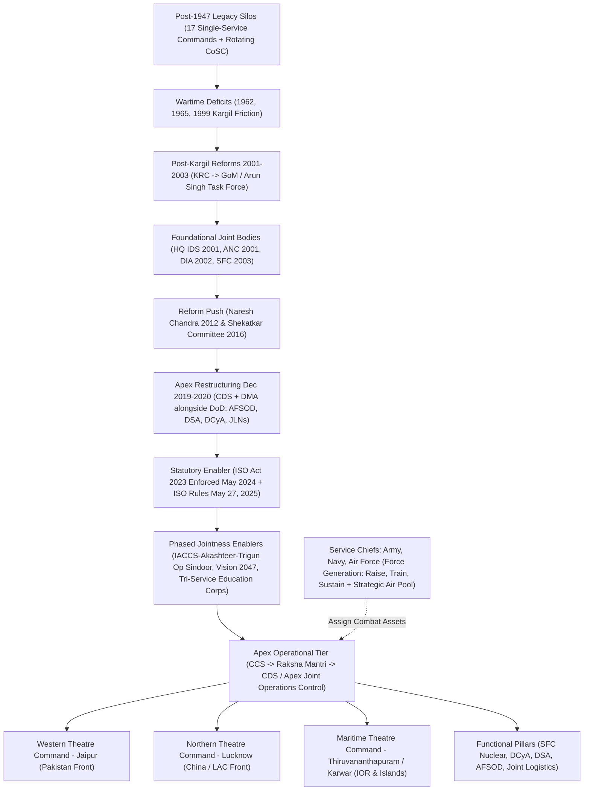

# Chapter 10 - Higher Defense Management, the ISO Act 2023/2025 Rules & Military Theaterisation

Warfare no longer respects the colour of uniforms. A modern military crisis compresses land manoeuvres, stand-off precision air strikes, maritime sea denial, space-based telemetry, electronic warfare, and cyber disruption into a single real-time kill chain—punishing militaries that fight through disconnected command silos.

Yet for over seven decades after Independence, India managed one of the world's largest standing militaries through an administrative design crafted to prevent coups rather than optimize multi-domain combat. India's multi-decade reform arc—from the post-Kargil awakening of 2001 to the creation of the **Chief of Defence Staff (CDS)** and **Department of Military Affairs (DMA)** in 2019–2020, the full operationalization of the **Inter-Services Organisations (ISO) Act** via the **May 27, 2025 Rules**, and the late-2026 push toward **Integrated Theatre Commands**—represents the most consequential structural overhaul of Indian national security since 1947.

---

## Historical Silos and the Higher Defense Reform Arc

### Post-1947 Structural Silos and Three Wartime Deficits

Independent India inherited Lord Ismay's 1947 Higher Defence Management framework—featuring the Defence Committee of the Cabinet, the Defence Minister's Committee, and a **Chiefs of Staff Committee (CoSC)** chaired on a rotating basis by the senior-most Service Chief. In 1955, the unified colonial appointment of Commander-in-Chief was abolished, rendering the Army, Navy, and Air Force Chiefs co-equal heads stationed structurally *outside* the Ministry of Defence (MoD) as "attached offices" mediated by generalist civil servants.

Because the rotating Chairman CoSC held dual charge concurrently with his own single-service command for brief tenures, the committee defaulted to **"lowest-common-denominator consensus."** Each service drafted autonomous war plans, maintained distinct logistics chains, pursued competing capital-acquisition wish lists, and guarded institutional turf. Three major post-Independence conflicts exposed the acute operational cost of fighting separately:

- **1962 Sino-Indian War:** Civil–military and inter-service integration collapsed simultaneously. Despite possessing combat-ready squadrons capable of disrupting Chinese logistics across Tibet, political and bureaucratic hesitation kept Indian offensive air power entirely out of the war. Simultaneously, poor Army–IAF coordination over unsuitable high-altitude dropping zones in NEFA (such as Longju and Tangdhar) squandered strenuous air-transport sorties—deficiencies subsequently dissected in the classified **Henderson Brooks–Bhagat Operational Review**.
- **1965 Indo-Pak War:** Pre-war joint operational planning was virtually absent. The IAF leadership was not briefed in advance on the Indian Army's timetable for its September 6 advance into the Lahore sector, while rigid Joint Army-Air Operations Centres (JAAOCs) left combat aircraft severely underutilized (roughly one sortie per aircraft daily against an available capacity of three). Meanwhile, the Indian Navy was kept largely outside war planning and restricted from aggressive maritime escalation without tri-service alignment. *(Although the 1971 Bangladesh Liberation War achieved decisive tri-service synergy, that success stemmed from Field Marshal Sam Manekshaw's personal rapport across Chiefs rather than durable institutions—a vulnerability exposed again during the 1987 IPKF Operation Pawan Jaffna University heli-drop disaster in Sri Lanka).*
- **1999 Kargil Conflict (*Operation Vijay* & *Operation Safed Sagar*):** Following Pakistani intrusions across the Line of Control, fragmented intelligence warning collided with severe Army–IAF acrimony at the highest echelons. Disagreements over escalation thresholds and high-altitude employment of armed helicopters delayed combat air support for nearly two weeks until Cabinet-level intervention forced alignment, while the Navy mounted its coercive blockade (*Operation Talwar*) through parallel single-service channels.

### The Four-Committee Reform Trajectory (1999–2016)

Stung by Kargil's intelligence and coordination failures, New Delhi initiated four landmark reviews over seventeen years that gradually constructed the blueprint for military jointness:

1. **Kargil Review Committee (KRC, 1999 — Chaired by K. Subrahmanyam):** Submitting its report in early 2000, the KRC diagnosed chronic stove-piping across intelligence agencies, civilian MoD bureaucracy, and the three Service Headquarters. Crucially, rather than designing institutional blueprints unilaterally, KRC recommended a thorough ministerial-level overhaul of India's entire national security architecture.
2. **Group of Ministers (GoM, 2001 — Chaired by L.K. Advani, supported by the Arun Singh Task Force on Management of Defence):** Examining the KRC report alongside four specialized task forces, the GoM's landmark report *Reforming the National Security System* (May 2001) recommended India's most comprehensive security restructuring. The Cabinet Committee on Security (CCS) accepted nearly all proposals, establishing:
   - **Headquarters Integrated Defence Staff (HQ IDS — raised October 1, 2001):** Tri-service secretariat under a three-star Chief of Integrated Defence Staff (CISC) to anchor joint planning, doctrine, procurement prioritization, and training.
   - **Defence Intelligence Agency (DIA — operational March 2002):** Tri-service strategic military intelligence fusion body under the CoSC.
   - **Andaman and Nicobar Command (ANC — October 2001, Port Blair):** India's **first and only geographical tri-service theatre command**, pooling Army, Navy, Air Force, and Coast Guard assets guarding the Malacca Strait approaches.
   - **Strategic Forces Command (SFC — January 2003):** India's **functional tri-service command** managing nuclear delivery assets as the operational arm of the Nuclear Command Authority (NCA).
   - *The Glaring Omission:* While Service HQs were cosmetically renamed *"Integrated Headquarters of MoD"* without genuine civil–military staffing integration, the GoM's centerpiece recommendation—appointing a **4-star Chief of Defence Staff (CDS)**—was shelved for 18 years due to lack of political consensus, civil-bureaucracy wariness over diluted oversight, and IAF apprehensions over Army dominance.
3. **Naresh Chandra Task Force (2012):** Auditing post-GoM compliance a decade later, the Task Force recognized entrenched political hesitation over a full CDS. It recommended a compromise **4-star Permanent Chairman of the Chiefs of Staff Committee (PC-CoSC)**, cross-posting military officers inside MoD civilian desks, and creating three functional tri-service commands for **Cyber, Space, and Special Operations**.
4. **Shekatkar Committee (2016 — Chaired by Lt Gen D.B. Shekatkar):** Mandated to optimize India's "teeth-to-tail" ratio and rebalance defense expenditure, the committee's administrative reforms (closing military farms, optimizing ordnance/signals/postal units, redeploying ~57,000 personnel) were quickly adopted. Equally consequential, it formally recommended appointing a **4-star CDS / Chief Military Adviser** and reorganizing India's 17 single-service commands into **three Integrated Theatre Commands (Northern, Western, and Southern/Maritime)**—laying the direct intellectual catalyst for the 2019 reforms.

---

## CDS, Department of Military Affairs and Tri-Service Institutional Architecture

### Dual-Hatted Mandate of the Chief of Defence Staff

Ending two decades of institutional deferral, the Prime Minister announced the CDS post on August 15, 2019. Following CCS approval on December 24, 2019, the government promulgated the **Fifty-Third Amendment to the Government of India (Allocation of Business) Rules, 1961**, creating the **Department of Military Affairs (DMA)**—the fifth department inside the Ministry of Defence alongside DoD, Defence Production (DDP), Defence R&D (DDR&D), and Ex-Servicemen Welfare (DESW)—operational from **January 1, 2020**.

General Bipin Rawat assumed charge as India's first CDS (January 2020 – December 2021), followed by General Anil Chauhan (September 2022 – May 30, 2026) and **General N. S. Raja Subramani** (appointed May 9, 2026 as India's third CDS). The CDS wears two distinct institutional hats:

1. **Permanent Chairman of the Chiefs of Staff Committee (PC-CoSC) & Principal Military Adviser:** Advises the *Raksha Mantri* as single-point military adviser on all **tri-service matters** (while the Army, Navy, and Air Force Chiefs retain direct advisory access on exclusively single-service issues). The CDS also serves as **Military Adviser to the Nuclear Command Authority**, member of the **Defence Acquisition Council (DAC)** (chaired by the Defence Minister), and member of the **Defence Planning Committee (DPC)** (chaired by the NSA).
2. **Secretary to the Government of India, Department of Military Affairs (DMA):** Embeds a serving four-star officer directly inside the Union Government's executive Secretariat for the first time since Independence, heading a hybrid civil–military department staffed by both uniformed officers and civil servants.

**Crucial Constitutional & Command Guardrails:** Designed to balance unity of purpose with democratic civil–military equilibrium, the CDS is a **four-star "first among equals"** rather than a five-star super-chief. Critically, the CDS **does NOT exercise operational military command over the three Service Chiefs** or single-service field formations; each Service Chief retains operational authority over their own force until theatre commands are legally stood up. The CDS directly administers *only* tri-service commands and agencies (HQ IDS, ANC, SFC, DCyA, DSA, AFSOD). To prevent post-retirement conflict of interest, a demitting CDS is barred from holding any government office and prohibited from private employment for five years without prior governmental sanction.

### DMA vs. Department of Defence - Functional Division and Friction

Under the amended Second Schedule to the Allocation of Business Rules, 1961, authority inside South Block is sharply partitioned between the CDS-led **DMA** and the civilian IAS Defence Secretary-led **Department of Defence (DoD)**:

- **Department of Military Affairs (CDS as Secretary):** Holds direct charge over the **Armed Forces of the Union** (Army, Navy, Air Force), Integrated Headquarters of MoD (Army, Navy, Air, and Defence Staff HQs), the **Territorial Army**, service-related works, **revenue/service-exclusive procurement (explicitly excluding capital acquisitions)**, promoting **jointness in procurement, training, and staffing**, promoting indigenous equipment adoption, and **facilitating the restructuring of military commands into Joint/Theatre Commands**.
- **Department of Defence (Defence Secretary as Secretary):** Retains sovereign stewardship over **"Defence of India"** policy, the overall **Defence Budget**, **Capital Acquisitions** (major weapons platforms and modernization contracts), parliamentary accountability, international defence cooperation, Border Roads Organisation (BRO), Indian Coast Guard, National Cadet Corps (NCC), and macro-coordination across all five MoD departments.

*Analytical Assessment:* This division intentionally preserves constitutional civilian control over national strategy and big-ticket defense finance. Yet defense analysts note an operational friction: divorcing **force restructuring and revenue operations (DMA)** from **capital acquisition budgets and macro defense policy (DoD)** creates dual-reporting friction where the CDS must drive tri-service capability integration without exercising executive authority over capital spending.

### Functional Tri-Service Agencies and Incremental Jointness Enablers

Parallel to apex MoD restructuring, India scaled functional tri-service agencies under HQ IDS—originally conceptualized as full commands by the Naresh Chandra Task Force—alongside practical bottom-up logistics and training integration:

- **Armed Forces Special Operations Division (AFSOD — raised 2019, Agra):** Unifies elite special-forces detachments drawn from the Army's Para (SF), Navy's MARCOS, and IAF's Garud Commandos under a Major General-rank commander for strategic counter-terrorism, hostage rescue, and out-of-area surgical contingencies—validated operationally through tri-service drills such as **Exercise *Desert Hunt 2025***.
- **Defence Space Agency (DSA — raised 2019, Bengaluru):** Integrates military satellite surveillance, space situational awareness, and counter-space protection (working with the Defence Space Research Agency [DSRO] and Space-Based Surveillance Phase III). Institutionalization advanced via the **Joint Military Space Doctrine** released at the Combined Commanders' Conference in September 2025.
- **Defence Cyber Agency (DCyA — raised 2019, New Delhi):** Tri-service military cyber-warfare arm executing the **Joint Doctrine for Cyberspace Operations** (June 2024; declassified August 7, 2025) and annual resilience exercises (*Cyber Suraksha*).
- **Joint Logistics Nodes (JLNs):** Sanctioned in 2020 and operationalized from **January 1, 2021** at **Mumbai, Guwahati, and Port Blair**, JLNs dismantle redundant single-service supply depots by pooling small-arms ammunition, rations, fuel, general stores, civil-hired transport, aviation spares, and engineering support under integrated tri-service inventory control—reducing financial wastage and accelerating surge mobilization.
- **2024–2025 Cultural & Infrastructure Fusion (*Year of Reforms*):** Declaring 2025 the **"Year of Reforms"**, MoD operationalized India's **first Tri-Service Common Defence Station at Mumbai (2024)**. At the **16th Combined Commanders' Conference (CCC-2025, Vijay Durg / Fort William, Kolkata, Sept 15–17, 2025)**, the armed forces unveiled **Indian Armed Forces Vision 2047**, approved merging single-service education wings into a unified **Tri-Services Education Corps**, sanctioned **three new Joint Military Stations**, expanded cross-service officer postings, and rolled out both the **Joint Doctrine for Amphibious Operations (Aug 2025)** and the **Joint Doctrine for Multi-Domain Operations (2025)**.

---

## Statutory Enabler - The ISO Act 2023 and ISO Rules 2025

### Solving the Seventy-Year Legal Bottleneck

For more than two decades after ANC and HQ IDS were created, jointness suffered from a crippling statutory flaw. Every Indian soldier, sailor, and airman remained legally governed strictly by three siloed statutes—the **Army Act, 1950**, **Navy Act, 1957**, and **Air Force Act, 1950**. Under these Acts, only officers belonging to the *same* service could exercise formal disciplinary or administrative command over personnel.

Consequently, when an Air Marshal commanded the Andaman & Nicobar Command or a Rear Admiral headed DCyA, they possessed zero legal authority to charge, try, or discipline an attached Army officer or soldier. Misconduct cases had to be remanded back to parent single-service formations, causing protracted delays, duplicated courts of inquiry, administrative friction, and compromised operational cohesion. Creating Integrated Theatre Commands without curing this legal defect was impossible.

### Statutory Mechanics and Subordinate Rules Chronology

Parliament resolved this foundational barrier through the **Inter-Services Organisations (Command, Control and Discipline) Act, 2023**—an enabling statute enacted across four crisp legal milestones:

1. **Parliamentary Passage & Assent:** Introduced in Lok Sabha on March 15, 2023; scrutinized and endorsed by the **Parliamentary Standing Committee on Defence** (chaired by Jual Oram, 39th Report, July 21, 2023); passed during the Monsoon Session 2023; received **Presidential Assent on August 15, 2023**.
2. **Enforcement of the Act:** Brought into force with effect from **May 10, 2024** (via Gazette Notification dated May 8, 2024).
3. **Notification of Designated ISOs:** Existing and qualifying tri-service establishments were formally notified via **Gazette Notification No. SRO 72 dated December 27, 2024**.
4. **Operationalization via Subordinate Rules:** Subordinate **Inter-Services Organisations (Command, Control and Discipline) Rules, 2025**, framed under **Section 11** of the Act, were notified by MoD to come into effect on **May 27, 2025**—rendering the Act **fully operational** nationwide.

**Core Statutory Provisions:**
- **Unified Cross-Service Command Without Amending Service Acts:** Rather than repealing or rewriting the Army Act 1950, Navy Act 1957, and Air Force Act 1950, the ISO Act preserves the unique substantive service conditions, customs, pay structures, and distinct penal definitions of each branch. Instead, it statutorily vests the **Commander-in-Chief (C-in-C)** (of a Joint Services Command), **Officer-in-Command (O-in-C)** (of an ISO), and **Commanding Officers** with full administrative and disciplinary powers over *all* attached service personnel irrespective of parent service—empowering them to apply each individual's parent Service Act seamlessly.
- **Existing ISOs & Statutory Gateway for Future Theatre Commands:** Automatically deems established tri-service formations (ANC, SFC, DSA, DCyA, AFSOD, National Defence Academy, National Defence College) as constituted under the Act, while empowering the Central Government to notify **new ISOs or Joint Services Commands** (directly enabling **Integrated Theatre Commands**) comprising personnel from **at least two of the three armed services**.
- **Wartime Extension to Auxiliary Forces:** Empowers the Central Government via official notification to apply the Act's disciplinary authority during military exigencies to **any other force raised and maintained in India** (such as Coast Guard, Assam Rifles, ITBP, or BSF elements placed under military operational control during conflict)—remaining inapplicable to non-military forces in routine peacetime.
- **Central Superintendence & Procedural Rules (May 27, 2025):** Vests superintendence in the Central Government with authority to issue binding directions on grounds of national security, general administration, or public interest. The **ISO Rules, 2025** codify standardized procedures for disciplinary inquiries, summary disposals, and cross-service administration—eliminating duplicated proceedings and accelerating justice. *(Note a critical oversight caveat flagged by the Parliamentary Standing Committee on Defence: because the Act does not stipulate fixed statutory timelines for concluding disciplinary cases, rigorous administrative monitoring remains essential to ensure expeditious disposal).*

---

## Military Theaterisation - Architecture, Inter-Service Debates and Late-2026 Status

### The Imperative of Consolidating 17 Single-Service Commands

India currently fields **17 single-service operational and functional commands**—**7 Army**, **7 Air Force**, and **3 Navy**—alongside **2 tri-service commands** (ANC and SFC). Strikingly, none of the Army, Navy, and Air Force regional commands share identical geographic boundaries or co-located headquarters: an Army corps confronting an incursion along the Line of Actual Control often relies on air support governed by an Air Command located in a different geographical alignment, forcing wartime crisis coordination back to New Delhi.

Strategic urgency sharpened dramatically after **China's 2016 PLA restructuring**, which dissolved seven Army-dominated military regions into **five integrated joint Theater Commands**—placing all Chinese ground forces, air assets, and operational rocket/electronic units confronting India across Ladakh to Arunachal Pradesh under a single **Western Theater Command**. Facing a collusive two-front China–Pakistan contingency across Himalayan altitudes and the Indian Ocean littoral, retaining fragmented Indian command chains invites severe decision-cycle paralysis.

### Proposed Integrated Theatre Architecture and Force Separation

Under the consensus blueprint refined between 2023 and 2026—and formally anchored inside Phase 1 of MoD's **Defence Forces Vision 2047** (March 10, 2026)—India plans to consolidate its 17 single-service operational commands into **three geographical Integrated Theatre Commands (ITCs)** complemented by functional strategic verticals:

- **Western Theatre Command (Proposed HQ: Jaipur):** Adversary-focused on Pakistan across the western land border, desert sector, Punjab plains, and Jammu & Kashmir / LoC.
- **Northern Theatre Command (Proposed HQ: Lucknow):** Adversary-focused on China across the entire Himalayan Line of Actual Control (LAC) spanning Ladakh, Himachal Pradesh, Uttarakhand, Sikkim, and Arunachal Pradesh.
- **Maritime Theatre Command (Proposed HQ: Thiruvananthapuram / Karwar):** Responsible for the Indian Ocean Region, coastal defense, island territories (absorbing operational alignment with ANC), amphibious projection, and sea-lane security *(note: while **Karwar** was an earlier favored naval base option, **Thiruvananthapuram** emerged as the frontrunner headquarters in 2025–2026 institutional blueprints)*.

**Separating "Force Generation" from "Force Application":** To reconcile theaterisation with institutional service identities, the emerging Indian architecture (articulated in May 2026 ahead of the Jaipur Joint Commanders' Conference) draws a clean functional division mirroring global best practice (such as the US Goldwater–Nichols Act of 1986):
- **Service Chiefs = Force Generation:** Chiefs of Army, Naval, and Air Staff focus on raising, training, equipping, maintaining, modernizing, and administering career cadres for their respective services.
- **Theatre Commanders & Apex Joint Ops = Force Application:** Four-star or senior three-star Theatre Commanders exercise unified operational warfighting authority over assigned land, sea, and air assets within their assigned theatres—reporting to the political executive through an empowered apex operational structure (CDS / proposed **Vice Chief of Defence Staff** and a **Joint Operations Control Centre**), supported by dedicated functional verticals for **Nuclear Deterrence (SFC)**, **Cyber (DCyA)**, **Space (DSA)**, **Special Operations (AFSOD)**, and **Joint Logistics / Training**. *(Earlier proposals for a fourth standalone Air Defence Command were shelved in favor of networked theatre air-defense integration).*

### Evolution of Jointness & Proposed Integrated Theater Commands

### Resolving Inter-Service Frictions and Post-Operation Sindoor Lessons

Why has theaterisation remained India's hardest military reform six years after creating the CDS? Three structural frictions—not petty bureaucratic turf wars—drove intense doctrinal debate through 2025–2026:

**1. IAF Asset Indivisibility and the Squadron Deficit:** Against an authorized benchmark of **42 combat fighter squadrons**, the Indian Air Force operates near **30–31 squadrons** in 2026. Air power theorists legitimately warn that permanently carving scarce multi-role fighters, Airborne Warning and Control Systems (AWACS), and mid-air refuellers into rigid geographic silos ("penny-packeting") destroys airpower's core strategic virtue: rapid swing capability across the subcontinent within hours. To resolve this impasse, India's revised framework embraces **"Centralised Command, Distributed Control, Decentralised Execution" (CC–DC–DE)**—retaining strategic high-value air assets (AWACS, refuellers, heavy strategic lift) under centralized apex/Air HQ allocation for instant cross-theatre surge rather than permanent geographic division.

**2. Cross-Service Promotion Parity and Command Architecture:** Shrinking 17 three-star C-in-C billets into three Theatre Commanders alters promotion pyramids across services, raising sensitive questions around Annual Confidential Report (ACR) objectivity across uniforms, service representation in top theatre slots, and protocol equivalence between Theatre Commanders and the three Service Chiefs. Institutionalizing mandatory cross-service staff postings, harmonized tri-service appraisal norms, and the **Tri-Services Education Corps** addresses cultural trust from the junior-officer level upward.

**3. Post-*Operation Sindoor* (May 2025) Air-Defense Synergy & Late-2026 Convergence:** The May 2025 precision strikes and subsequent four-day air-missile-drone clash with Pakistan during **Operation Sindoor** supplied India's first real-world combat audit of joint warfare:
- **Digital Jointness Triumph:** By networking the IAF's **Integrated Air Command and Control System (IACCS)** with the Indian Army's AI-enabled **Akashteer** air-defense network and the Indian Navy's **Trigun** maritime domain-awareness grid, Indian forces created a single unified real-time operational picture stretching from the Himalayas to the Arabian Sea—intercepting hostile drone and missile salvos seamlessly without fratricide.
- **The Phased-Jointness Debate (Aug 2025 – Oct 2026):** Speaking at the inaugural tri-service seminar ***Ran Samwad 2025*** (August 2025, Army War College) and in October 2026, then-Air Chief Marshal **A. P. Singh** cited *Operation Sindoor*'s centralized air-control victory to warn against rushing into foreign US/Chinese theatre templates. He advocated phased sequencing—first operationalizing a **Joint Planning and Coordination Centre (JPCC)** in New Delhi under the CDS and three Chiefs to mature multi-domain jointness before disrupting field command structures.
- **Late-2026 Status (November 2026):** Momentum shifted decisively toward institutional rollout across 2026 following the **Joint Commanders' Conference in Jaipur (May 7–8, 2026)** and a major top-brass alignment: **Gen N. S. Raja Subramani** assumed office as 3rd CDS (May/June 2026), while former CISC **Air Chief Marshal Ashutosh Dixit**—who had directly co-authored the theaterisation roadmap at HQ IDS—took charge as 29th Chief of the Air Staff on **October 31, 2026**. At the **ANI National Security Summit 3.0 (November 16, 2026)**, CDS Gen Subramani asserted that Integrated Theatre Commands are an **"operational imperative, not an administrative requirement"** targeted for concrete rollout ahead of late 2027, while CAS Air Chief Marshal Dixit dispelled perceptions of IAF obstruction by describing air power as **"the glue"** uniting jointness and theaterisation. *Epistemic Status:* As of late November 2026, while tri-service doctrinal alignment and legal enablers (ISO Act/Rules) are in place, formal **Cabinet Committee on Security (CCS) sanction** and physical stand-up orders for the three ITCs remain awaited.

---

> [!info] Mains Arsenal
> - **Key Primary Milestones & Statutory Anchors (2019–2026):**
>   - **DMA Creation:** 53rd Amendment to Allocation of Business Rules, 1961 (Dec 2019; operational Jan 1, 2020) — CDS as Secretary DMA + PC-CoSC.
>   - **ISO Legal Chain:** **ISO Act, 2023** (Assent Aug 15, 2023 → Enforced **May 10, 2024** → ISOs notified **SRO 72, Dec 27, 2024** → **ISO Rules effective May 27, 2025** under Sec 11).
>   - **Operational & Doctrinal Benchmarks:** **Operation Sindoor (May 2025)** real-time digital triad (**IACCS + Akashteer + Trigun**); **Joint Doctrines** (Cyberspace 2024/2025, Amphibious Aug 2025, Space Sept 2025, Multi-Domain 2025); **CCC-2025 Kolkata** (*Tri-Services Education Corps*, 3 Joint Military Stations, *Indian Armed Forces Vision 2047*); **JLNs** (Mumbai, Guwahati, Port Blair) & **1st Common Defence Station** (Mumbai, 2024).
>   - **Comparative Global Benchmarks:** **US Goldwater–Nichols Act (1986)** (legislated jointness over intense inter-service opposition by tying general-officer promotions to mandatory joint-duty tenures) and **China's 2016 PLA Theaterisation** (7 Military Regions → 5 Integrated Theater Commands, with Western Theater Command unifying all India-facing assets).
> - **Balanced Institutional Way Forward:**
>   1. **Craft an Indigenous, Phased Theaterisation Model:** Rather than mechanically copying US expeditionary combatant commands or Chinese party-military structures, institutionalize an India-specific phased transition pairing **digital C4ISR fusion (IACCS–Akashteer–Trigun)** and **Joint Planning Centres** with progressive stand-up of the Maritime, Western, and Northern Theatres.
>   2. **Protect Strategic Airpower Flexibility via Dynamic Asset Pooling:** Codify clear **CC–DC–DE** Standard Operating Procedures keeping strategic enablers (AWACS, refuellers, strategic lift) and swing fighter reserves centrally allocable across theatres while rapidly rebuilding IAF squadron strength.
>   3. **Align DMA–DoD Interface & Codify a National Security Strategy (NSS):** Harmonize capital acquisition authority (DoD) with integrated capability planning (DMA) through long-term Integrated Capability Development Plans (ICDP) anchored in a formal published NSS.
>   4. **Link Senior Promotions to Joint-Duty Mastery (Goldwater–Nichols Lesson):** Make cross-service command/staff tenures and joint-warfare credentials mandatory prerequisites for three-star and four-star selection, embedding "purple" military culture sustainably beyond top-down orders.

---

## UPSC Interrogation Lens

### Verified UPSC Mains PYQs (2014–2026) and Prelims Anchors

*Explicit PYQ Note:* Between 2014 and 2026, UPSC has **not yet asked a direct GS3 Mains question** exclusively on the Chief of Defence Staff (CDS), the ISO Act 2023/2025, or Military Theaterisation—making this unit an exceptionally high-probability Mains 2027 target given the May 2025 ISO Rules, Operation Sindoor jointness lessons, and late-2026 theaterisation momentum. Verified Mains and Prelims PYQ anchors spanning this institutional theme include:

- **2024 (Prelims — GS Paper I — Verified Direct Anchor):** *What are the duties of the Chief of Defence Staff (CDS) as Head of the Department of Military Affairs? (1) Permanent Chairman of Chiefs of Staff Committee; (2) Exercise military command over the three Service Chiefs; (3) Principal Military Advisor to Defence Minister on all tri-service matters.* *(Correct: 1 and 3 only — testing the exact boundary of CDS operational authority)*.
- **2023 (Mains — GS3 — Adjacent Security Architecture Anchor):** *What are the internal security challenges being faced by India? Give out the role of Central Intelligence and Investigative Agencies tasked to counter such threats.*
- **2020 (Mains — GS3 — Adjacent Multi-Force Coordination Anchor):** *Analyze internal security threats and transborder crimes along Myanmar, Bangladesh and Pakistan borders including Line of Control (LoC). Also discuss the role played by various security forces in this regard.*
- *(Historical Foundational Context — 2001 Mains GS):* *What were the major recommendations of the 'Group of Ministers' on the Indian National Security System?*

### Prelims Trap Signature

- **CDS Command Authority Trap (Directly Tested in Prelims 2024):** UPSC tests whether the CDS exercises *military command over the three Service Chiefs* (**FALSE**—the CDS is four-star "first among equals" exercising operational administration only over tri-service agencies/commands, while Service Chiefs retain command over their own forces).
- **DMA vs. DoD Procurement Inversion:** A classic elimination trap assigns **capital acquisitions** or the **overall Defence Budget** to the CDS-led **Department of Military Affairs (DMA)** (**FALSE**—DMA handles *revenue/service-exclusive procurement* **except capital acquisitions**, which remain with the civilian Defence Secretary's **Department of Defence [DoD]**).
- **ISO Act, 2023 Statutory Distortion:** Watch for false statements claiming the **ISO Act, 2023** *repealed or amended* the Army Act 1950, Navy Act 1957, and Air Force Act 1950 (**FALSE**—it is an enabling statute preserving existing service conditions while empowering C-in-C/O-in-C to apply parent Service Acts across services), or asserting it applies *only* to the three Armed Forces (**FALSE**—Central Government may notify extension to *other forces raised and maintained in India* during exigencies).
- **Existing Commands & Committee Attribution Swap:** Remember India currently has **17 single-service commands (7 Army, 7 Air Force, 3 Navy) + 2 tri-service commands**—where **ANC (2001)** is the sole *geographical* tri-service command and **SFC (2003)** is a *functional* nuclear command. Similarly, distinguish the **GoM (2001)** (recommended full **CDS**) from the **Naresh Chandra Task Force (2012)** (recommended compromise **Permanent Chairman CoSC**) and **Shekatkar Committee (2016)** (recommended **3 Integrated Theatre Commands** alongside teeth-to-tail reforms).

### Cross-Hub AIR-1 Provocations

1. **GS3 Defense Management × GS2 Civil–Military Governance:** *Splitting revenue operations and military restructuring under the CDS-headed Department of Military Affairs from capital acquisitions and macro defense policy under the civilian Department of Defence preserved constitutional civilian oversight—yet critics argue it fractures accountability for future warfighting. Can India transition cleanly to Integrated Theatre Commands without integrating the civilian bureaucracy and military headquarters into a single unified Ministry of Defence?*
2. **GS3 Multi-Domain Warfare × Defense Indigenization:** *Operation Sindoor validated real-time digital jointness through indigenous networked grids (IACCS, Akashteer, and Trigun) even before formal geographical theatre commands stood up. Evaluate whether India's optimal path to deterring a two-front threat lies in rapid organizational theaterisation, or in prioritizing network-centric C4ISR integration and rebuilding depleted combat-air and ISR inventories first.*

<!-- OBSIDIAN-WEB-START -->
---
### 🕸️ Neural Graph Connections
← [[9. Information Warfare, IT Rules 2026 & Online Radicalization|Ch 9]] | 🧭 [[National Security and Defense]] | [[11. Intelligence Grid, CAPFs, Police Reforms & BNS-BNSS Overhaul|Ch 11]] →
<!-- OBSIDIAN-WEB-END -->
