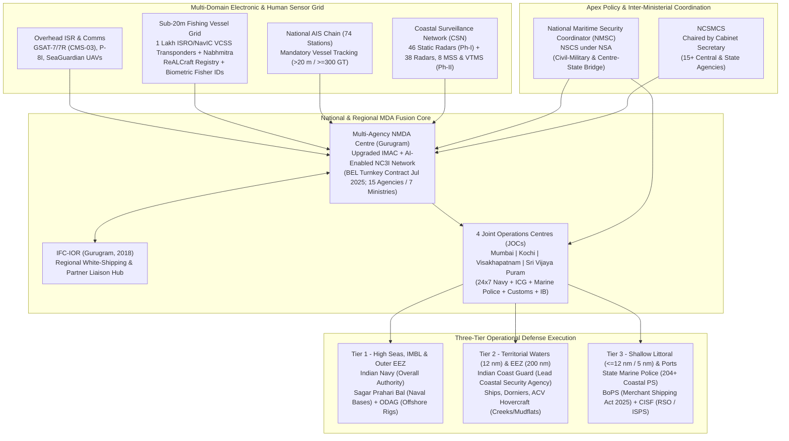

# Maritime & Coastal Security — Post-26/11 Three-Tier Defense, Island Fortresses & Anti-Piracy

India is a peninsular maritime economy whose economic prosperity and strategic survival depend on uninterrupted access to the Indian Ocean. Over **95% of India’s merchandise trade by volume** (~68–70% by value) and **80–85% of its crude oil and LNG imports** traverse Sea Lines of Communication (SLOCs) converging through congested chokepoints—the **Strait of Hormuz**, **Bab-el-Mandeb**, and the **Strait of Malacca**. Simultaneously, India’s maritime periphery is among the most complex security theaters globally, confronting state-sponsored maritime terrorism, transnational narco-dhows, grey-zone seabed sabotage, resurgent Somali piracy, and intensifying extra-regional naval presence.

Until November 2008, India treated coastal security as a peacetime customs-and-policing footnote divorced from blue-water naval warfare. The **26/11 Mumbai terror attacks** shattered that complacency, catalyzing a structural transformation across legal, technological, institutional, and geographic domains—culminating in **2024–2026** with the commissioning of **INS Jatayu**, the **AI-enabled National Maritime Domain Awareness (NMDA)** upgrade, the statutory **Bureau of Port Security (BoPS)**, end-to-end prosecutions under the **Maritime Anti-Piracy Act, 2022**, and the first pan-India **Sea Vigil-26** audit across India’s newly recalculated **11,098.81 km** coastline.

---

## Coastal Vulnerability Profile and the Post-2008 Three-Tier Overhaul

India’s littoral security baseline expanded dramatically following the **2025 official hydrographic recalculation**, which revised India’s coastline from the legacy 1970s benchmark of **7,516.6 km** to **11,098.81 km**—nearly **48% longer** once high-resolution cartography captured intricate creeks, estuaries, bays, and offshore features across **9 coastal States and 4 Union Territories**. Combined with **1,382 islands** and an **Exclusive Economic Zone (EEZ)** spanning **~2.02–2.37 million sq km** (depending on continental-shelf delineation baselines), this expanded littoral geometry directly stretches radar horizons, patrol-boat density, and coastal policing ratios. For the cartographic methodology and state-wise physiographic breakdown of this revision, see [[13. Subcontinental Physiography, Himalayas, Cratons & Coastline#Recalculated 11098 km Indian Coastline 2025|Recalculated 11,098.81 km Indian Coastline]].

### Critical Coastal Assets and Subsea Digital Exposure

This shoreline concentrates India’s economic and strategic nerve centers: **12–13 Major Ports** alongside **200+ Non-Major Ports** (governed by state maritime boards with historically uneven perimeter security), coastal nuclear power stations (Tarapur, Kalpakkam, Kudankulam), spaceports (Sriharikota), naval dockyards, and offshore hydrocarbon fields (**Mumbai High** and the **Krishna–Godavari Basin**).

An equally acute—and historically under-regulated—exposure lies on the seabed. Roughly **95–99% of India’s intercontinental internet traffic, financial settlements, and cloud connectivity** flows through **17–18 international subsea optical-fiber cables**. The **2024 Red Sea / Bab-el-Mandeb cable cuts** (where dragged anchors and Houthi conflict zones simultaneously disrupted four major systems) and **2025–2026 grey-zone seabed incidents** globally exposed four compounding vulnerabilities in India’s subsea architecture:
- **Extreme Spatial Clustering:** Landings concentrate in just five cities (**Mumbai, Chennai, Kochi, Tuticorin, Thiruvananthapuram**), with roughly fifteen systems making landfall along a narrow **6-km stretch of Mumbai’s Versova beach**—creating a single-point geophysical and kinetic failure risk.
- **Zero Sovereign Repair Fleet:** India possesses **no Indian-flagged deep-sea cable repair vessels**, forcing reliance on foreign ships stationed in Singapore, Dubai, or Europe and delaying deep-water restoration during regional conflicts.
- **Supply-Chain Oligopoly & Legal Gap:** Near-total dependence on foreign consortia for submarine optical repeaters, paired with the absence of formal **Critical National Infrastructure (CNI)** statutory corridors prohibiting trawler anchoring over shallow-shelf cables.
- **Emerging Resilience Pivot (2024–2026):** India joined the **40-member ITU–ICPC International Advisory Body for Submarine Cable Resilience (November 2024)**, while TRAI and telecom consortia initiated landing diversification toward **Visakhapatnam, Machilipatnam, and Digha** and evaluated **Distributed Acoustic Sensing (DAS)** along shore approaches.

### Anatomy of 26-11 and Coastal Defence vs. Coastal Security

The November 2008 Mumbai terror strike succeeded by exploiting an institutional **"seam"** between blue-water defense and near-shore policing. Ten Lashkar-e-Taiba operatives transited from Karachi, hijacked the Indian fishing trawler ***MV Kuber*** in the Arabian Sea to blend into dense coastal traffic (a classic **"Trojan Horse" dark-vessel tactic**), and motored undetected in inflatable dinghies to Mumbai’s Badhwar Park. No single agency owned end-to-end accountability across the transition from EEZ to shoreline.

Post-2008 Cabinet Committee on Security (CCS) directives instituted a crisp doctrinal distinction:
- **Coastal Security:** Everyday peacetime maritime policing—vessel registration, fisher verification, patrolling landing points, anti-smuggling, and countering illicit infiltration (primary domain of the **Indian Coast Guard** and **State Marine Police**).
- **Coastal Defence:** The overarching national-security umbrella subsuming coastal security alongside the **Indian Navy’s** operational defense of seaward approaches against military and asymmetric threats.

### The Three-Tier Maritime Defense Architecture

To eliminate jurisdictional blind spots, the CCS operationalized a layered **Three-Tier Coastal Security Grid** stretching from the open ocean to the beachhead:

- **Tier 1 — Outer Oceanic, High Seas, and EEZ Approaches (Indian Navy — Overall Authority):** Designated the **overall authority for maritime security**, including coastal and offshore defense. Naval Commanders-in-Chief were dual-hatted as **Commanders-in-Chief Coastal Defence**. Beyond patrolling the International Maritime Boundary Line (IMBL) and far-sea SLOCs, the Navy raised two specialized sub-structures:
  - ***Sagar Prahari Bal* (SPB):** Raised in **March 2009** (sanctioned at 1,000+ personnel and **80 Fast Interceptor Craft**) exclusively for force protection of naval bases, harbours, and adjacent coastal approaches—though **CAG audits** later flagged protracted delays in FIC maintenance, jetty infrastructure, and manpower provisioning.
  - **Offshore Defence Advisory Group (ODAG / FODAG):** Commanded by a Rear Admiral (*Flag Officer Offshore Defence Advisory Group*) to protect India’s **Offshore Development Areas (ODAs)**—chiefly ONGC’s western and eastern oil/gas platforms—using **23 Immediate Support Vessels (ISVs)** networked into a Mumbai Data Integration Centre.
- **Tier 2 — Territorial Waters (up to 12 nm) and EEZ (up to 200 nm) (Indian Coast Guard — Lead Agency for Coastal Security):** Constituted as an **Armed Force of the Union under the Ministry of Defence** (Coast Guard Act, 1978; motto *Vayam Rakshamah* — "We Protect"). In **February 2009**, ICG was designated the **authority responsible for coastal security in territorial waters** (including areas patrolled by Coastal Police) and the **lead agency for Centre–State coordination** in coastal security. Scaling toward a Vision 2030 target of **200 ships and 100 aircraft** (~152 ships / 78 aircraft by 2025–26), ICG strengthened littoral denial through indigenous **Air Cushion Vehicles (ACVs / hovercraft)** inducted in **2026**—crucial for policing shallow mudflats, creeks, and sandbanks in **Sir Creek** and the **Sundarbans** where displacement hulls run aground—alongside indigenous Pollution Control Vessels (*Samudra Pratap*).
- **Tier 3 — Shallow Littoral Waters (≤ 12 nm; effective baseline patrol ≤ 5 nm) and Port Perimeters:**
  - **State Marine / Coastal Police:** Strengthened via MHA’s **Coastal Security Scheme (CSS Phase I: 2005–2011; Phase II: 2011–2020)**, establishing over **204 coastal police stations**, interceptor boats, jetties, and check-posts. Despite two decades of central funding, State Marine Police remain the **weakest tier**: chronic boat non-operability (maintenance and spare-parts paralysis), reluctant land-police deputations lacking maritime seamanship, and porous oversight over **1,500+ unregulated fish landing centers**.
  - **Port Security Overhaul — CISF & the Statutory Bureau of Port Security (BoPS, 2025–2026):** Major Ports enforce the IMO’s **International Ship and Port Facility Security (ISPS) Code** primarily through the **Central Industrial Security Force (CISF)**, whereas over 200 Non-Major Ports historically relied on loosely vetted private security guards. Closing this gap, the Union Government initiated constitution of the **Bureau of Port Security (BoPS)** as a **statutory body under Section 13 of the Merchant Shipping Act, 2025**, functioning under the **Ministry of Ports, Shipping and Waterways (MoPSW)**. Modeled explicitly on the **Bureau of Civil Aviation Security (BCAS)** and headed by a Pay Level-15 IPS Director General (with DG Shipping holding charge during a one-year transition), BoPS consolidates regulatory oversight of vessels and ports, houses a **dedicated port cybersecurity division**, and pairs with **CISF designated as Recognised Security Organisation (RSO)** to audit port security plans and exclusively train and certify licensed private security guards (reviewed jointly by MHA and MoPSW in **December 2025 and July 2026**).

---

## Command Fusion, Electronic Surveillance Grid and Community Vigilance

Detecting a single hostile trawler amid **~2.5–3 lakh Indian fishing boats** and dense international merchant shipping requires replacing sporadic visual spotting with continuous, AI-assisted **Maritime Domain Awareness (MDA)**—defined by the IMO as the effective understanding of anything associated with the maritime domain that impacts security, safety, economy, or environment.

### Apex Institutional Coordination - NCSMCS, NMSC, and JOCs

- **National Committee for Strengthening Maritime and Coastal Security (NCSMCS):** Constituted post-26/11 under the chairmanship of the **Cabinet Secretary**, NCSMCS serves as India’s apex policy and review forum harmonizing defense, home affairs, shipping, fisheries, petroleum, customs, and coastal state governments. Operational follow-up flows through MHA’s Steering Committee (chaired by Secretary, Border Management) and State/District-level coordination committees.
- **National Maritime Security Coordinator (NMSC, 2022):** Long recommended by the 2001 GoM and post-26/11 reviews, the NMSC post was operationalized in **February 2022** inside the **National Security Council Secretariat (NSCS)**, reporting directly to the **National Security Advisor (NSA)**. The NMSC provides permanent, full-time synergy across civil–military and Centre–State maritime silos without usurping operational command. India’s inaugural NMSC, **Vice Admiral G. Ashok Kumar (Retd)** (2022–early 2025), was succeeded in **April 2025** by **Vice Admiral Biswajit Dasgupta (Retd)** (former FOC-in-C Eastern Naval Command).
- **Four Joint Operations Centres (JOCs):** Established by the Indian Navy at **Mumbai, Kochi, Visakhapatnam, and Sri Vijaya Puram (Port Blair)**, these 24×7 command hubs co-locate personnel from the Navy, ICG, State Marine Police, Customs, IB, and Port Authorities. Each JOC converts real-time radar and intelligence anomalies into immediate multi-agency interdictions along its coastal sector.

### Electronic Surveillance - CSN, NC3I, and the 2025 NMDA Leap

- **Coastal Surveillance Network (CSN Phase I & Phase II):** Executed by the **Indian Coast Guard** (with BEL), CSN forms India’s static electronic perimeter. **Phase I** commissioned **46 Static Sensor Stations** along mainland and island coasts integrating coastal surveillance radars, Automatic Identification System (AIS) receivers, day/night electro-optical cameras, and meteorological sensors. To eliminate dead zones across curved estuaries and remote islands, **CSN Phase II** adds **38 additional static radar stations**, **8 Mobile Surveillance Systems (MSS)**, and **Vessel Traffic Management System (VTMS)** integration across high-density energy corridors in the **Gulf of Kutch** and **Gulf of Khambhat**.
- **From NC3I / IMAC to the AI-Enabled NMDA Project (July 2025):** Approved in 2012 and inaugurated in **November 2014**, the **Information Management and Analysis Centre (IMAC)** at **Gurugram** functioned as the nerve center of the **National Command, Control, Communication and Intelligence (NC3I)** network linking 51 Navy and ICG nodes. Crucially, IMAC tracks non-military **"white shipping"** (fusing coastal radar feeds, AIS, global databases, and bilateral white-shipping agreements), while the **Information Fusion Centre – Indian Ocean Region (IFC-IOR)**—co-located at Gurugram since **December 2018**—hosts international liaison officers to share regional maritime incidents.
  - On **July 8, 2025**, the Indian Navy signed a turnkey contract with **Bharat Electronics Limited (BEL), Bengaluru** to implement the **National Maritime Domain Awareness (NMDA) Project**. Administered by the Navy, NMDA upgrades the legacy NC3I backbone with **AI-enabled anomaly-detection software** (flagging dark-ship spoofing, irregular loitering, or ship-to-ship mid-sea transfers) and elevates IMAC into a **Multi-Agency NMDA Centre** housing representatives from **15 national agencies across 7 ministries**. Complementing this digital hub, the Navy commissioned **INS Aravali** at Gurugram on **September 12, 2025** as a dedicated shore establishment supporting maritime information and communication centers, while ISRO’s heavy naval communication satellite **CMS-03 (GSAT-7R)** (launched November 2025) expanded secure blue-water bandwidth.

### Solving the Sub-20m "Dark Vessel" Blind Spot and Community Vigilance

Under IMO SOLAS norms and India’s **74-station National AIS (NAIS)** chain, mandatory AIS transponders cover merchant ships (**≥300 GT**) and larger vessels (**>20 meters**). That left roughly **2.5–3 lakh Indian sub-20m mechanized and motorized fishing boats** electronically invisible—creating a massive haystack concealing smugglers or maritime terrorists. India addresses this blind spot through three converged tools:
- **Vessel Communication and Support System (VCSS) — 1 Lakh ISRO/NavIC Transponders:** Launched on **August 30, 2024** at Palghar (Maharashtra) under the **Pradhan Mantri Matsya Sampada Yojana (PMMSY)** with an outlay of **₹364 crore** (60:40 Centre–State; 100% Central assistance for UTs). The scheme installs **1,00,000 indigenous ISRO Mobile Satellite Service (MSS) / NavIC-backed two-way transponders** free of cost on sub-20m fishing craft across 13 coastal states/UTs. Paired with ISRO’s ***Nabhmitra*** mobile app (whose wider adoption MHA directed in July 2026), the system transmits vessel positions into Navy/ICG coastal grids while giving fishers distress SOS alerts, cyclone warnings, Potential Fishing Zone (PFZ) advisories, and real-time IMBL-crossing alerts.
- **ReALCraft Registry and Biometric Fisher IDs:** Online vessel registration and color-coding via the **ReALCraft** (*Registration and Licensing of Fishing Craft*) portal covers **2.38–2.9 lakh+ fishing boats** (upgraded in November 2025 with digital Access Passes under new EEZ Deep-Sea Fishing Rules), paired with **QR-coded Biometric Marine Fisheries Identity Cards (MFID)** and regular ICG **Community Interaction Programmes (CIPs)** mobilizing coastal fishers as human sensors (*"eyes and ears"*).

### Operational Stress-Testing - Sea Vigil-26, TROPEX, and Sagar Kavach

Institutional diagrams degrade without adversarial validation. India conducts a tiered calendar of maritime readiness drills:
- **Exercise *Sea Vigil* (Biennial, Indian Navy Lead, Conceptualized 2018):** India’s largest pan-India Coastal Defence Exercise spanning the entire coastline, islands, and EEZ across 6 Union Ministries and 21+ agencies. The **5th edition — *Sea Vigil-26* (November 11–19, 2026)**—marked the **first nationwide coastal defense drill calibrated to India’s recalculated 11,098.81 km coastline**. Executed in two phases—**Phase 1: CDSRE (*Coastal Defence and Security Readiness Evaluation*, Nov 11–17)** deploying joint audit teams across ports, lighthouses, fish landing centers, and VAs/VPs, followed by **Phase 2: Tactical Sea Phase (Nov 18–19)** pitting simulated "Red Force" infiltrators/hijackers/drones against "Blue Force" defenders—*Sea Vigil* serves as the direct operational prelude to the Navy’s biennial theatre-level war game, **TROPEX**.
- **ICG Regional & Tactical Audits:** The Indian Coast Guard conducts biannual state-level **Sagar Kavach** exercises (validating coastal SOPs across Marine Police, Customs, and Port authorities) and monthly **Operation Sajag** drills conducting surprise at-sea credential checks on fishing vessels.

---

## Island Fortresses - Eastern and Western Strategic Chokepoints

India’s twin island archipelagos—the **Andaman & Nicobar Islands** in the Bay of Bengal and **Lakshadweep** in the Arabian Sea—function as **"unsinkable aircraft carriers"** projecting domain awareness, submarine detection, and rapid interdiction deep into the eastern and western Indian Ocean. Upgrading these outposts anchors India’s shift from regional maritime goodwill (SAGAR / MAHASAGAR diplomacy) toward hard **chokepoint deterrence**.

### Eastern Bastion - Andaman & Nicobar Command (ANC) and Galathea Bay

Positioned **~1,200–1,300 km** from the Indian mainland yet barely **40–100 nautical miles** from the northern funnel of the **Strait of Malacca** and directly astride the **Six Degree Channel (Great Channel)**, the **836-island Andaman & Nicobar archipelago** commands the maritime artery carrying **25–30% of global seaborne trade** and nearly **80% of China’s seaborne energy imports** (Beijing’s strategic **"Malacca Dilemma"**). Simultaneously, the northern tip (Landfall Island) lies less than 55 km south of Myanmar’s **Coco Islands**, long scrutinized for suspected Chinese electronic-intelligence upgrades.

- **Andaman & Nicobar Command (ANC):** Established in **2001** (per post-Kargil GoM recommendations) at **Sri Vijaya Puram** (Port Blair’s official name since September 2024), ANC remains India’s **first and only operational unified tri-service / quad-service theatre command** (integrating Army, Navy, Air Force, and Coast Guard). Underlining its regional reach, ANC hosted the **maiden BIMSTEC Maritime Security Exercise (October 30–November 3, 2026)** at Sri Vijaya Puram.
- **Tri-Service Air-Naval Infrastructure Spine:** Historically constrained by short runways and weak berthing, ANC has accelerated a north-to-south basing grid enabling sustained **P-8I Poseidon** maritime reconnaissance, fighter dispersal, and warship logistics: **INS Kohassa** (Shibpur/Diglipur, North Andaman), **INS Utkrosh** & **INS Jarawa** (Sri Vijaya Puram, equipped with Floating Docks FDN-1/FDN-2 and underwater harbour surveillance), **Car Nicobar AFS**, **INS Kardip** (Kamorta), and **INS Baaz** (Campbell Bay, Great Nicobar — undergoing runway extension from 3,000 ft toward 6,000–10,000 ft alongside a deep-water naval jetty).
- **Great Nicobar Island (GNI) Development Project & Galathea Bay (~₹81,000 Crore):** Implemented by **ANIIDCO** across 166.10 sq km in phased horizons (2025–2047), this mega-project fuses commercial sovereignty with military endurance. Its four pillars are: (i) an **International Container Transshipment Port (ICTP)** at **Galathea Bay** leveraging natural **>20-meter draft** (14.2–16 million TEU planned capacity, reducing Indian transshipment reliance on Colombo and Singapore); (ii) a **₹13,000 crore dual-use civil–military greenfield international airport**; (iii) a **450 MVA gas-and-solar power plant**; and (iv) a permanent coastal township creating the logistical base ANC lacked for two decades.
- **Strategic-Ecological Tension:** The project represents one of India’s sharpest public-policy dilemmas—pitting Malacca chokepoint deterrence against the diversion of **130.75 sq km of tropical rainforest**, nesting habitats of the **Giant Leatherback Turtle** at Galathea Bay, Zone-V megathrust seismic/tsunami vulnerability (which partially submerged Indira Point in 2004), disputed off-island compensatory afforestation in Haryana, and constitutional safeguards for indigenous **Shompen (PVTG)** and Nicobarese communities.

### Western Bastion - Lakshadweep Fortification and INS Jatayu (Minicoy)

In the Arabian Sea, the **36 coral islands of Lakshadweep** sit astride the **Eight Degree Channel** (separating Minicoy from the Maldives) and the **Nine Degree Channel** (separating Minicoy from the main Lakshadweep group)—the primary maritime highways linking the Suez Canal and Persian Gulf to Southeast Asia.

- **INS Jatayu (Minicoy Island — Commissioned March 6, 2024):** Upgrading a 1980s Naval Detachment into a full-fledged forward naval base under **Southern Naval Command**, **INS Jatayu** became India’s **second naval base in Lakshadweep** (joining **INS Dweeprakshak** at Kavaratti, commissioned in 2012). Located barely **~130 km north of the Maldives**—and commissioned amid India’s troop drawdown from Male and expanding Chinese research-vessel and naval excursions in the Western Indian Ocean—INS Jatayu extends persistent surveillance, anti-piracy reach, and interdiction over the **Makran–Arabian Sea narco-dhow corridor**, with planned dual-use airfield capability.
- **Bitra Island Acquisition (2025–2026 Expansion):** Reinforcing this western shield, the Government initiated defense acquisition of **Bitra Island** (July 2025)—Lakshadweep’s smallest inhabited island (Aminidivi subgroup, 261 nm from Kochi)—to host a third military surveillance node, while navigating fragile coral-atoll ecology and local land-governance sensitivities under Lakshadweep’s 2026 planning regulations.

---

## High-Seas Anti-Piracy - Maritime Anti-Piracy Act 2022 and Operation Sankalp

Blue-water maritime security demands not just kinetic ships on station, but a domestic **legal finish** capable of arresting, trying, and incarcerating transnational sea criminals apprehended hundreds of nautical miles from Indian shores.

### Filling the Legal Vacuum - The Maritime Anti-Piracy Act, 2022

Although the Indian Navy has maintained continuous anti-piracy patrols in the Gulf of Aden since **2008**, India lacked a dedicated municipal statute defining or penalizing high-seas piracy. Prosecutors relied awkwardly on general IPC robbery/attempted-murder clauses or the Suppression of Unlawful Acts (SUA) Act, 2002—provisions riddled with extraterritorial jurisdictional hurdles whenever foreign pirates attacked foreign-flagged merchant vessels beyond India’s 12-nm territorial waters.

Enacting India’s treaty obligations under **UNCLOS 1982 (Articles 100–107)** (ratified by India in 1995), Parliament passed the **Maritime Anti-Piracy Act, 2022 (Act No. 3 of 2023)**—assented on **January 31, 2023** and brought into force on **February 22, 2023**. Its core statutory architecture establishes:
- **Universal Jurisdiction and Precise Spatial Scope (Sections 1(3) & 2(1)(e)):** Applies to the **"high seas"**, which **Section 2(1)(e) explicitly defines to include India’s Exclusive Economic Zone (EEZ), the EEZ of any other State, and all waters beyond the jurisdiction of any State**. Thus, the statute governs all piracy **seaward of 12-nm territorial waters** regardless of offender or vessel nationality (while violent thefts *inside* 12-nm territorial waters remain governed by domestic criminal law as *"armed robbery at sea"* under IMO classification).
- **Offenses and Deterrent Penalties (Sections 3–5):** Criminalizes illegal violence, detention, or depredation for private ends by a private vessel/aircraft against another vessel/aircraft on the high seas, including voluntary operation of a pirate ship and financing/inciting piracy. Core penalties: **imprisonment for life and/or fine** for piracy (escalating to **death penalty or life imprisonment** if the act causes or attempts to cause death); up to **14 years** for organizing or directing others to commit piracy (Section 5); up to **10 years** for attempt, abetment, or conspiracy (Section 4); plus asset forfeiture.
- **Operational Powers and Designated Courts (Sections 6–8, 15):** Empowers authorized Indian Navy, Coast Guard, and notified Central/State officers to board suspect vessels, arrest pirates, and seize ships/property on the high seas (with good-faith legal protection under Section 15). Trials are fast-tracked before **Designated Sessions Courts** notified in consultation with High Court Chief Justices, backed by extradition and mutual legal assistance provisions (applicable on reciprocity even without a bilateral treaty).

### Operation Sankalp (2019-2026) - Multi-Threat Forward Deterrence

Launched on **June 19, 2019** to escort Indian-flagged crude and LPG tankers through the **Strait of Hormuz** and **Gulf of Oman** amid Persian Gulf tanker attacks, **Operation Sankalp** evolved dramatically across **2023–2026** into India’s largest sustained out-of-area maritime security mission.

Triggered by Iran-backed **Houthi anti-ship ballistic missile and one-way attack drone strikes** across the **Red Sea and Bab-el-Mandeb** (from November 2023 onward)—which diverted global container lines around the Cape of Good Hope—alongside a **resurgence of Somali piracy** exploiting stretched Western naval coalitions and **2026 Gulf of Oman/West Asia maritime escalations**, the Indian Navy maintained **10–20+ frontline guided-missile destroyers, stealth frigates, P-8I aircraft, and SeaGuardian UAVs** across the North/Central Arabian Sea, Gulf of Aden, and Horn of Africa approaches.

- **The *MV Ruen* Milestone (March 2024) — Completing the "Legal Finish":** In a **40-hour joint Navy–IAF operation (March 15–16, 2024)** nearly 1,400 nm from the Indian coast, **INS Kolkata** cornered the hijacked Maltese-flagged bulk carrier ***MV Ruen***—converted by Somali pirates into a high-seas mothership. An **IAF C-17** precision-airdropped **MARCOS commandos** and Combat Rubberised Raiding Craft into the Arabian Sea, compelling all **35 armed pirates** to surrender and rescuing 17 crew members without casualties. Delivering those 35 pirates to Mumbai Police for formal trial under the **Maritime Anti-Piracy Act, 2022** demonstrated India’s full *intercept-to-prosecution* sovereign chain.
- **Sustained First-Responder Posture (2024–2026):** Complementing *MV Ruen*, Operation Sankalp assets executed rapid hostage rescues aboard *MV Lila Norfolk*, firefighting aboard missile-struck *MV Marlin Luanda*, twin fishing-vessel rescues by *INS Sumitra* (*FV Iman* and Pakistani-crewed *Al Naeemi*), **2026** precautionary tanker escorts east of the Strait of Hormuz, and ongoing Gulf of Aden/Arabian Sea anti-piracy rescues (*INS Trikand* and 2026 Iranian-vessel rescues). Operating independently yet interoperating seamlessly with multinational frameworks—**Combined Maritime Forces (CMF / CTF-151)**, **Djibouti Code of Conduct (Jeddah Amendment)**, **ReCAAP**, and the **Quad Indo-Pacific Partnership for Maritime Domain Awareness (IPMDA)**—India has operationally validated its credentials as the Indian Ocean Region’s **First Responder and Net Security Provider**.

---

> [!map] Atlas & Visual Hook
> - **Littoral & Command Nodes:** Recalculated **11,098.81 km** coast across 9 States + 4 UTs (**1,382 islands**); 4 Naval **JOCs** at **Mumbai, Kochi, Visakhapatnam, Sri Vijaya Puram**; inland MDA brain at **Gurugram** (**IMAC / Multi-Agency NMDA Centre**, **IFC-IOR**, **INS Aravali**); CSN Phase-II **VTMS** corridors at **Gulf of Kutch** & **Gulf of Khambhat**; ACV hovercraft creek belts at **Sir Creek** (Gujarat) & **Sundarbans** (WB).
> - **Western IOR Chokepoints & Lakshadweep Shield:** **Strait of Hormuz** → **Gulf of Oman** → **Bab-el-Mandeb / Gulf of Aden** (*Operation Sankalp* theater) → **Arabian Sea SLOCs** straddling **Eight Degree Channel** (Maldives–Minicoy) & **Nine Degree Channel** (Minicoy–main Lakshadweep) guarded by **INS Jatayu** (Minicoy), **INS Dweeprakshak** (Kavaratti), and planned **Bitra Island** node.
> - **Eastern IOR Chokepoints & ANC Spine:** **Coco Islands** (Myanmar, north of Landfall Island) → **INS Kohassa** (Shibpur/Diglipur) → **INS Utkrosh / INS Jarawa** (Sri Vijaya Puram) → **Ten Degree Channel** (Little Andaman–Car Nicobar) → **INS Kardip** (Kamorta) → **INS Baaz** (Campbell Bay) & **Galathea Bay / Indira Point** (Great Nicobar) overlooking **Six Degree / Great Channel** (Great Nicobar–Sumatra) into the **Strait of Malacca**.
> - **Subsea Cable Concentration Points:** Primary landing clusters at **Mumbai (Versova)** and **Chennai**, secondary hubs at **Kochi, Tuticorin, Thiruvananthapuram**, with eastern diversification emerging toward **Visakhapatnam, Machilipatnam, and Digha**.

---

## UPSC Interrogation Lens

### Verified UPSC Mains PYQs (2014-2026) & Prelims Anchors

- **2025 (GS3, 15m):** *"Why is maritime security vital to protect India's sea trade? Discuss maritime and coastal security challenges and the way forward."*
- **2022 (GS3, 10m):** *"What are the maritime security challenges in India? Discuss the organisational, technical and procedural initiatives taken to improve the maritime security."*
- **Verified Prelims Focal Anchors:** Island-channel strategic geography (**2014 Prelims** — *"Which one of the following pairs of islands is separated from each other by the 'Ten Degree Channel'?"* → Andaman and Nicobar) and regional island physical environment (**2026 Prelims** — climate and dual-monsoon precipitation pattern of Andaman and Nicobar Islands).

### Prelims Trap Signature

- **Maritime Anti-Piracy Act, 2022 Spatial Trap:** Section 1(3) applies the Act to the *"high seas"*, but **Section 2(1)(e)** explicitly defines *"high seas"* to **include India’s EEZ, foreign EEZs, and all waters beyond national jurisdiction**—so statements claiming it applies *only beyond* the 200-nm EEZ are **false**.
- **Bureau of Port Security (BoPS) Statutory & Ministerial Trap:** BoPS (2025–26) is a **statutory body** created under **Section 13 of the Merchant Shipping Act, 2025** under the **Ministry of Ports, Shipping and Waterways (MoPSW)** (modeled on BCAS, headed by an IPS officer)—*not* an executive MHA directorate, even though MHA’s **CISF** acts as its Recognised Security Organisation (RSO).
- **Apex Maritime Governance Swaps:** **NCSMCS** is chaired by the **Cabinet Secretary**, whereas the **National Maritime Security Coordinator (NMSC)** operates inside the **NSCS** reporting to the **NSA**; similarly, **IMAC / Multi-Agency NMDA Centre** handles domestic multi-agency fusion (Indian Navy + BEL), while **IFC-IOR** (co-located at Gurugram) handles international regional partner liaison.
- **Island Channels & Base Attribution:** **Eight Degree Channel** separates Maldives and Minicoy; **Nine Degree Channel** separates Minicoy (**INS Jatayu**, 2024) from Kavaratti (**INS Dweeprakshak**, 2012); **Ten Degree Channel** separates Andaman and Nicobar; **Six Degree / Great Channel** separates Great Nicobar (**INS Baaz** / Galathea Bay) from Sumatra. Separately, **AIS** covers vessels >20 m, whereas sub-20 m fishing craft are tracked via **ISRO/NavIC VCSS transponders** and ***Nabhmitra***.

### Cross-Hub AIR-1 Provocations

1. **Seabed CNI & Digital Sovereignty (GS3 Cyber–Maritime Synthesis):** Given that roughly 95–99% of India’s external digital commerce traverses subsea optical-fiber cables heavily clustered along a 6-km Mumbai littoral strip—with zero Indian-flagged deep-sea repair vessels—how should India integrate seabed infrastructure into its post-2025 NMDA and Critical Information Infrastructure protection doctrines?
2. **Island Fortification vs. Ecological-Tribal Constitutionalism (GS2–GS3–GS4 Synthesis):** Evaluate the governance trade-off inherent in militarizing and commercializing remote archipelagos like Great Nicobar (Galathea Bay) and Bitra Island: can India secure hard Malacca and Arabian Sea chokepoint deterrence without diluting environmental jurisprudence and constitutional protections for PVTGs like the Shompen?

<!-- OBSIDIAN-WEB-START -->
---
### 🕸️ Neural Graph Connections
← [[5. Terrestrial Border Management, Counter-Drone Grids, Subterranean Threats & the Immigration Act 2025|Ch 5]] | 🧭 [[National Security and Defense]] | [[7. Transnational Organized Crime, Narco-Terror Corridors, PMLA Jurisprudence & the FATF Grid|Ch 7]] →
<!-- OBSIDIAN-WEB-END -->
