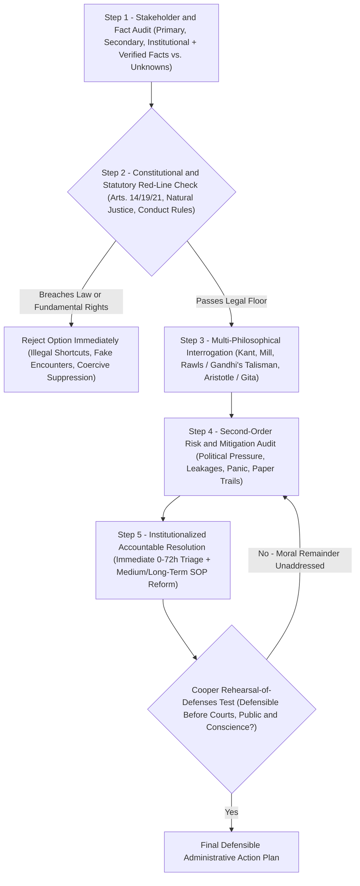

# Chapter 11 - Ethical Dilemmas in Public Administration, Case-Study Frameworks & Moral Decision-Making Models

Moral philosophy earns its institutional keep only at the moment of administrative decision—under incomplete facts, ticking clocks, competing legal duties, and political heat. This final chapter converts the conceptual apparatus of Chapters 1 through 10 into an execution engine calibrated simultaneously for **GS Paper 4 Section B (120 of 250 marks)** and **UPSC Prelims GS-I situational judgment MCQs**.

Weak answers treat administrative case studies as passive sermons reciting virtuous adjectives. Elite administrative reasoning treats every genuine dilemma as a **constrained constitutional optimization problem**: diagnosing the exact value collision, enforcing non-negotiable statutory red lines, interrogating competing options through orthogonal moral frameworks, and designing an institutional resolution that minimizes collateral harm while preventing recurrence.

---

## 1. Anatomy of a Genuine Ethical Dilemma - Right vs. Right vs. Moral Temptation

Precision begins with refusing to misdiagnose simple corruption as a philosophical crisis. Ethicist **Rushworth Kidder** (*How Good People Make Tough Choices*, 1995) draws a razor-sharp boundary separating **Moral Temptation** from a **Genuine Ethical Dilemma**:

- **Moral Temptation (*Right vs. Wrong*):** Occurs when an administrator knows what duty, law, and honesty require, yet feels lured by self-interest, fear, bribery, nepotism, or political favor. Suppressing viral outbreak fatality data to shield a minister’s image, tolerating a tout–subordinate CLU bribery ring out of fear of union backlash (UPSC Mains 2026, Q9), or burying a procurement fraud involving a superior’s relative to protect one’s posting is **not** a philosophical puzzle. The ethical verdict is unambiguous; the challenge is **moral courage** (*fortitude*) and smart institutional execution, not theoretical uncertainty.
- **Genuine Ethical Dilemma (*Right vs. Right*):** Emerges only when **two legitimate, deeply rooted moral or constitutional goods collide** under real-world scarcity such that honoring one necessarily compromises the other. Reopening a blockaded highway and restoring order in an ethnically fractured border district without compromising non-partisan administrative neutrality (UPSC Mains 2026, Q11), weighing national economic and strategic defence-export gains against ethical non-proliferation and human-development norms (UPSC Mains 2026, Q12), or enforcing biometric PDS checks to stop fiscal leakages while locking out elderly laborers with worn fingerprints (UPSC Mains 2026, Q10) pits genuine public values against each other.

Two further philosophical distinctions sharpen administrative clarity:

1. **Moral Remainders (*Tragic Dilemmas*):** Philosophers Bernard Williams and Martha Nussbaum observe that in genuine right-versus-right conflicts, choosing the *best justified* path does not erase the moral validity of the overridden claim. A residual **moral remainder** persists—imposing an affirmative administrative duty to compensate, mitigate suffering, explain transparently, and reform institutional design so the tragic trade-off narrows over time.
2. **Dissolving False Binaries:** Case studies frequently bait candidates into choosing between two crude extremes (*"shut down the biometric system completely"* vs. *"let manual laborers starve"*). High-scoring reasoning always probes for a **creative third way (*trilemma*)**—changing operational protocols so both core values survive inside constitutional constraints.

---

## 2. Rushworth Kidder’s Four Right-vs-Right Paradigms

Kidder demonstrated that virtually all genuine ethical dilemmas across public administration, medicine, law, and geopolitics collapse into **four foundational structural paradigms**:

### 1. Truth vs. Loyalty
Honesty, factual candor, statutory disclosure, and scientific integrity clash with personal fidelity to a mentor, team cohesion, organizational prestige, or obedience to superiors. When a Senior State Health Officer is pressured to suppress verified mortality figures during a rare viral outbreak to avert economic panic, a Vigilance Officer uncovers a mentor’s procurement scam, or district officials face intense community loyalties undermining functional neutrality during ethnic conflict (Mains 2026 Q11) or union pressure shielding a corrupt tout–clerk syndicate (Mains 2026 Q9), loyalty to individuals or factions collides directly with fiduciary truth owed to the public.

### 2. Individual vs. Community
The bodily autonomy, livelihood, property, or privacy rights of specific individuals or vulnerable minorities clash with aggregate utilitarian benefit for the wider city or nation. Clearing multi-generational artisan stalls for an arterial flyover, deploying crowd-biometric predictive policing over a marginalized low-income neighborhood to lower city crime rates (Mains 2026 Q8), imposing involuntary quarantine on infectious citizens during a pandemic, or removing community stray dogs from hospital premises exemplify this axis.

### 3. Short-Term vs. Long-Term
Immediate fiscal survival, electoral calm, rapid crisis containment, or quarterly project targets clash with intergenerational sustainability, ecological carrying capacity, institutional credibility, and long-horizon public trust. Choosing an immediate advance-cash weapons export order from a destabilizing state over a long-term joint R&D partnership with a peaceful developing nation (Mains 2026 Q12), approving unmitigated open-cast mining to boost district revenue today while destroying aquifers for decades (Mains 2025 Case Study), or chasing rapid AI data-center expansion at the cost of a 48% emissions spike (Mains 2024 Q7), sit squarely here.

### 4. Justice vs. Mercy
Impersonal, uniform application of formal rules, merit criteria, and deterrent sanctions (*Niti*) clashes with individualized compassion, contextual equity, forgiveness, and human dignity (*Nyaya* / *Karuna*). Rejecting a starving octogenarian’s ration entitlement because biometric authentication failed (Mains 2026 Q10) or enforcing demolition notices against flood-devastated informal dwellers without transitional shelter captures this core tension.

### Kidder’s Three Resolution Lenses
When no creative third way completely removes the collision, Kidder applies three classical philosophical filters to adjudicate priority:

- **Ends-Based Thinking (Consequentialism / Mill):** Select the course generating the greatest sustainable net welfare while minimizing irreversible harm.
- **Rule-Based Thinking (Deontology / Kant):** Follow the constitutional principle or duty you would will to become universal institutional law across every district in India.
- **Care-Based Thinking (Golden Rule / Ethics of Care / Gandhi’s Talisman):** Place yourself directly in the shoes of the most vulnerable affected citizen and ask whether the decision honors their irreducible human dignity.

---

## 3. Five Recurring Indian Administrative Conflict Matrices

Within Indian governance, Kidder’s universal archetypes crystallize repeatedly into **five recurring administrative conflict matrices** that dominate both GS4 Section B and Prelims situational ethics.

### Matrix 1 - Law / Rules vs. Conscience (*The Antigone Dilemma*)
In Sophocles’ tragedy *Antigone*, the heroine defies King Creon’s state decree barring her brother’s burial, appealing to unwritten moral law above positive statute. In a constitutional democracy, however, civil servants cannot treat personal moral intuition as superior to democratic statutes—otherwise uniform Rule of Law dissolves into arbitrary personal crusades.

Principled resolution splits this dilemma into **two rigorously distinct sub-cases**:

- **Unlawful Executive / Political Directives:** Where a superior demands an illegal act (rigging a tender, fabricating an inquiry, or suppressing a statutory health notification), conscience and **Constitutional Law stand on the same side**. In ***T.S.R. Subramanian v. Union of India* (2013)**, the Supreme Court explicitly directed that civil servants must **not act on verbal orders** of political executives; they must insist on written instructions or record oral directions contemporaneously in writing—a mandate reinforced across **AIS (Conduct) Rules, 1968 (Rule 3(3)(iii) & (iv))** and **CCS (Conduct) Rules, 1964 (Rule 3(2)(iii) & (iv))** (distinct from **AIS Rule 3(2B)**, which codifies the 2014 charter of positive constitutional and ethical commitments).
- **Harsh-but-Valid Statutes or Rigid SOPs:** Where a valid law produces unintended hardship on the ground, an ethical officer avoids both *blind rule-fetishism* (Hannah Arendt’s *Banality of Evil*) and *illegal vigilante defiance*. Instead, the officer invokes legitimate statutory discretion and hardship/relaxation clauses, documents the substantive injustice formally to higher authorities seeking policy amendment, and—only in the extreme threshold where official compliance requires betraying fundamental human dignity—seeks transfer or resigns openly.

### Matrix 2 - Efficiency vs. Equity and Due Process
Technocratic governance prizes speed, quantitative KPIs, fiscal economy, and automated scale. Yet constitutional administration binds efficiency strictly inside **Article 14 (non-arbitrariness)**, **Article 21 (substantive dignity)**, and the twin pillars of **Natural Justice**:

- ***Nemo judex in causa sua* (Rule Against Bias):** Established decisively in ***A.K. Kraipak v. Union of India* (1969)**, where the Supreme Court erased the artificial barrier between "quasi-judicial" and "administrative" acts—holding that any administrative officer harboring personal, pecuniary, or institutional bias must recuse from the decision.
- ***Audi alteram partem* (Fair Hearing):** Elevated in ***Maneka Gandhi v. Union of India* (1978)** into a substantive constitutional requirement that state action affecting liberty, livelihood, or reputation must be *"just, fair, and reasonable"*, affording notice and an opportunity to respond.

When an SP relies blindly on opaque AI predictive policing (Mains 2026 Q8) or a District Collector tolerates biometric PDS lockouts to hit zero-leakage KPIs (Mains 2026 Q10), *"efficiency"* silently commits **Type-II Exclusion Errors**. True administrative efficiency never cannibalizes equity; it pairs digital controls with transparent human fallback channels and independent fairness audits.

### Matrix 3 - Development / Infrastructure vs. Tribal & Ecological Displacement
Rapid industrialization, highways, mining, and urban transit generate vital public goods, yet disproportionately displace forest-dwelling Scheduled Tribes, artisanal heritage clusters, and fragile ecosystems (probed directly in **Mains 2026 Q1b** and **Mains 2025 Case Study**).

India’s statutory architecture supplies exact procedural red lines that transform top-down expropriation into **Development-with-Dignity**:

- **PESA Act, 1996 & Forest Rights Act (FRA), 2006:** Vest decisive governance and **Free, Prior, and Informed Consent (FPIC)** powers in the *Gram Sabha* across Scheduled Areas and forest lands—powerfully affirmed by the Supreme Court in ***Orissa Mining Corporation v. MoEF* (Niyamgiri Judgment, 2013)** upholding Dongria Kondh cultural and ecological sovereignty.
- **RFCTLARR Act, 2013:** Mandates independent **Social Impact Assessment (SIA)**, verified prior consent (**70% of affected families for PPP projects; 80% for private projects**), fair market-multiplier compensation, and substantive Rehabilitation & Resettlement (R&R) *prior* to physical dispossession.

Ethical urban or district design actively explores **engineering alternatives** (elevated realignments, heritage-integrated pedestrian corridors, community land-pooling equity stakes, and livelihood-first relocation) before treating displacement as inevitable.

### Matrix 4 - Transparency vs. National Security & Personal Privacy
Open government under the **RTI Act, 2005** counters corruption and sustains civic trust, yet indiscriminate disclosure can compromise live counter-terror operations, diplomatic intelligence (**RTI Section 8(1)(a)**), or citizens’ **Informational Privacy** (**RTI Section 8(1)(j)**, tightened into a broader personal-information bar by **Section 44(3) of the DPDP Act, 2023**).

Resolving this clash requires disciplined application of the **four-fold *K.S. Puttaswamy* (2017) Proportionality Test** (*Legality → Legitimate Aim → Necessity/Least-Intrusive Means → Balancing*) paired with **RTI Section 10 (Severability)** and **Section 8(2) (Public-Interest Override)**. Administrators must practice **granular disclosure**: releasing aggregate audit metrics, anonymized epidemiological counts, and redacted procurement rationales while strictly shielding personal identifiers and genuine tactical secrets—never abusing *"national security"* or *"privacy"* as a shield for administrative malpractice.

### Matrix 5 - Rule of Law vs. Populist Instant Justice
Viral outrage over heinous crimes or civic encroachments often fuels intense media and political pressure for immediate punitive spectacle—extrajudicial police *"encounters"* or punitive executive *"Bulldozer"* home demolitions.

Constitutional ethics is unequivocal: **procedural due process is not an obstacle to justice; it is the sole guarantee distinguishing state authority from mob vengeance**. Anchored in the Supreme Court’s **16-point *PUCL* (2014) encounter guidelines** and its **November 2024 pan-India Demolition Code** (15-day notice, personal hearing, reasoned order, appellate pause, videography, personal official accountability), an ethical administrator channels public anger into **fast-track forensic investigation, airtight chargesheets, witness protection, and lawful court prosecution**—never trading constitutional sanctity for fleeting populist applause.

### Kidder's 4 Right-vs-Right Dilemmas & Admin Conflict Matrix

| Kidder Paradigm | Core Indian Admin Conflict Matrix | Exact Value Collision | Non-Negotiable Constitutional / Statutory Red Line | Creative Third-Way Design Resolution | Verified 2024–2026 UPSC Case Anchor |
| :--- | :--- | :--- | :--- | :--- | :--- |
| **Truth vs. Loyalty** | Law/Conscience & Transparency vs. Political / Institutional Loyalty | Public right to accurate facts, functional neutrality & fiduciary probity vs. loyalty to superiors, colleagues, unions, or community factions | ***T.S.R. Subramanian* (2013)** written-order bar; **AIS Conduct Rules Rule 3(3)(iii)–(iv) & 3(2B)**; Whistleblower safeguards; zero falsification of official records | Digitize discretion into FIFO queues while routing corruption probes via written vigilance channels; deploy neutral central forces (CRPF) and transparent multi-community peace committees | **Mains 2026 Q9** (DC Seema dismantling CLU tout–subordinate bribery ring amid union pressure) & **Q11** (DM Rajan restoring functional neutrality in ethnically torn Rajapuram) |
| **Individual vs. Community** | Development/Infra vs. Displacement & Policing vs. Civil Liberties | Minority livelihoods, heritage, privacy & bodily autonomy vs. aggregate urban transit, security, or public health | **Arts. 14 & 21**; **PESA (1996)** & **FRA (2006) *Gram Sabha* FPIC** (*Niyamgiri* 2013); **RFCTLARR (2013)** SIA & 70%/80% consent; ***Puttaswamy* (2017)** | Technical redesign preserving heritage/livelihoods; participatory R&R making displaced communities co-beneficiaries; banning coercive policing based solely on opaque AI risk scores | **Mains 2026 Q8** (SP Ravi — AI predictive policing), **Q7** (Dr. Mansi — surgical consent) & **Q1b** (forest-community displacement) |
| **Short-Term vs. Long-Term** | Growth / Strategic Revenue vs. Ecological, Ethical & Rule-of-Law Sustainability | Immediate fiscal revenue, advance cash exports, or crowd-pleasing punitive shortcuts vs. intergenerational ecology, non-proliferation ethics & institutional legitimacy | **Art. 48A** & Public Trust Doctrine; **PUCL (2014)** encounter guidelines; **SC Demolition Code (Nov 2024)**; EIA, Precautionary Principle & responsible export controls | Prioritize sustainable long-term R&D partnerships and lawful EIA/remediation plans; answer public fury with fast-track forensic prosecution and transparent judicial trials rather than illegal shortcuts | **Mains 2026 Q12** (Ajit, DWS — short-term cash arms order vs. long-term R&D & ethical defence exports), **Mains 2025 Case Study** (unplanned mining vs. rural ecology) & **Mains 2024 Q7** (AI data-center GHG surge) |
| **Justice vs. Mercy** | Efficiency / Formal Rule Fidelity (*Niti*) vs. Substantive Equity (*Nyaya*) | Uniform anti-leakage controls, strict statutory eligibility, and fiscal discipline vs. preventing starvation and hardship for vulnerable citizens | **Art. 21 Right to Food & Dignity**; **Natural Justice** (*A.K. Kraipak* 1969; *Maneka Gandhi* 1978); **Gandhi’s Talisman** | Retain core digital transparency while activating documented **offline/manual fallback protocols** (iris/OTP/assisted verification + supervisory post-audit & rapid grievance redressal) | **Mains 2026 Q10** (DC Vikas — biometric PDS exclusion of manual laborers & elderly) |

---

## 4. Structured Decision-Making Architecture - Cooper, Potter Box & The 5-Step Protocol

Intuition alone fails under high cognitive load because stress triggers **System 1** biases—groupthink, status-quo inertia, or emotional reactivity. Three structured architectures bring deductive rigor to administrative ethics.

### Terry L. Cooper’s *Responsible Administrator* Model
Public-administration scholar **Terry L. Cooper** (*The Responsible Administrator*, 1982–2012) built the gold-standard behavioral framework for bureaucratic ethics around the dynamic interplay of **two complementary responsibilities**:

- **Objective Responsibility:** External, formal accountability imposed from outside—answerability to the Constitution, enacted statutes, legislative oversight, judicial review, and lawful hierarchical superiors.
- **Subjective Responsibility:** Internalized moral compass rooted in personal conscience, professional civil-service ethos, civic empathy, and loyalty to the public interest.

Ethical crises arise whenever Objective and Subjective responsibilities diverge—producing Cooper’s **three administrative conflict typologies**: **Authority Conflicts** (conflicting statutory or hierarchical commands), **Role Conflicts** (clashing obligations across official, professional, and private roles), and **Interest Conflicts** (private financial/familial benefit colliding with official fiduciary duty, requiring strict recusal).

Cooper’s highest tactical contribution for UPSC GS4 is his **Design Approach** paired with the **Rehearsal of Defenses**:

1. Reject fatalistic acceptance of narrow binary options; approach every ethical problem like a **design engineer** working within legal, fiscal, and time constraints to invent institutional workarounds protecting multiple values simultaneously.
2. Subject every candidate decision to the **Rehearsal of Defenses (Publicity Test)**: imagine defending your choice transparently—with all facts exposed—before a Parliamentary Committee, the Supreme Court, an investigative journalist, and the affected citizen’s family. Any option that collapses under daylight fails immediately.

### Ralph Potter’s *Potter Box* (1965)
Developed by Harvard ethicist **Ralph Potter**, the **Potter Box** organizes moral deliberation across **four iterative quadrants**—preventing administrators from jumping blindly from raw emotions to impulsive orders:

1. **Empirical Definition (Facts):** Audit concrete facts, applicable statutory provisions, financial/technical constraints, and verified harms—stripping away rumor, ideological labels, and political spin.
2. **Values:** Explicitly surface the competing values at stake (e.g., clinical autonomy vs. life-saving beneficence; fiscal probity vs. subsistence equity).
3. **Principles:** Appeal to universal normative standards (Aristotle’s Golden Mean, Kant’s Categorical Imperative, Mill’s Utility, Rawls’s Veil of Ignorance, Constitutional Morality) to rank competing claims.
4. **Loyalties:** Explicitly confront the ultimate question—*to whom do I owe supreme allegiance?* For an Indian civil servant, the **Constitutional Oath and the Citizenry** unconditionally outrank political patrons, corporate stakeholders, peer solidarity, or personal career comfort.

### The Five-Step Integrated Synthesis Protocol (GS4 Section B Execution Engine)
Synthesizing Kidder, Cooper, Potter, and Indian constitutional jurisprudence yields a unified **Five-Step Protocol** engineered to crack any 20-mark UPSC GS4 case study cleanly inside 14 minutes:

- **Step 1 — Stakeholder & Fact Audit:** Partition stakeholders cleanly into **Primary** (vulnerable citizens directly bearing harm/benefit), **Secondary** (subordinates, contractors, taxpayers, local ecology), and **Institutional** (Constitutional Rule of Law, democratic trust). Separate verified facts from unverified allegations so action begins with fact-finding rather than prejudice.
- **Step 2 — Constitutional & Statutory Red-Line Check:** Apply an immediate **veto gate**. Any course violating Articles 14/19/21, Natural Justice (*Nemo judex*, *Audi alteram partem*), *T.S.R. Subramanian* written-order safeguards, consent laws, or anti-corruption statutes is disqualified outright. *Ethical administration operates above the statutory floor, never beneath it.*
- **Step 3 — Multi-Philosophical Interrogation:** Cross-examine surviving options across four complementary lenses—**Kantian Deontology** (refusing to treat any citizen merely as statistical collateral), **Millian Consequentialism** (optimizing durable aggregate welfare while preventing severe harm), **Rawls’s Difference Principle / Gandhi’s Talisman** (prioritizing protection of the weakest affected person), and **Aristotelian *Phronesis* / Gita’s *Sthitaprajna*** (exercising proportionate judgment free from fear, favor, or partisan rage).
- **Step 4 — Second-Order Risk & Mitigation Audit:** Anticipate real-world administrative friction rather than writing fairy-tale endings. If refusing an illegal political directive, anticipate retaliation and mitigate via **written file notings, statutory backing, and formal escalation**. If opening manual PDS overrides to stop starvation, anticipate dealer leakage and mitigate via **time-bound exception registers, supervisory random audits, and village-level social audits**.
- **Step 5 — Institutionalized, Accountable Resolution:** Deliver a crisp **two-horizon action plan**: (a) **Immediate Triage (0–72 hours)** halting acute harm, securing natural justice, and restoring public confidence; followed by (b) **Structural Reform (Medium/Long-Term)** embedding SOP upgrades, grievance portals, training, and feedback loops so the organization outgrows crisis-by-crisis firefighting—verified finally via **Cooper’s Publicity / Rehearsal-of-Defenses Test**.

---

## 5. Cracking Prelims GS-I Situational Ethics & Administrative Judgment Under Ambiguity

Beginning with **UPSC CSE Prelims 2026**, GS Paper-I signaled a sharp structural shift toward testing **reasoning, spontaneous thinking, and administrative judgment under ambiguity**—introducing concise real-world situational decision-making caselets alongside classical conceptual questions. Cracking these MCQs under 45-second exam-hall pressure requires replacing vague moralizing with **six deterministic decision heuristics**:

1. **The Life-and-Dignity Priority Heuristic (Article 21 First):** Whenever a situational caselet pits urgent protection of human life, health, or basic survival (disaster evacuation, emergency medical triage, starving ration-card holders) against procedural paperwork or routine fiscal convenience, **always select immediate life-preserving action using lawful emergency discretion, followed immediately by transparent post-facto documentation**.
2. **The Preliminary Verification & Natural Justice Heuristic:** Facing an unverified complaint, viral social-media clip, anonymous corruption tip, or algorithmic security alert, **never select immediate punitive dismissal, demolition, or public shaming**. The constitutionally sound option consistently combines **interim protective neutrality** (safeguarding vulnerable complainants/evidence) + **rapid fact-finding inquiry** + **fair hearing (*audi alteram partem*)** before imposing penalties.
3. **The Conflict-of-Interest Recusal Reflex (*Nemo Judex*):** Whenever a relative, close friend, former employer, or personal financial interest intersects with a tender committee, recruitment panel, or disciplinary proceeding, eliminate both *"continue participating while promising to stay impartial"* and *"resign from public service."* The exact institutional standard is **formal written disclosure of interest + immediate recusal from all deliberation and voting**.
4. **The Written-Order & Internal-Channel Escalation Rule:** Confronted with an unlawful or improper oral request from an elected representative or senior officer, eliminate both *silent compliance* (Milgram’s agentic shift) and *impulsive leaking to media/social platforms as Step 1*. Select **courteous, objective citation of governing rules + polite insistence on written instructions (*T.S.R. Subramanian* / Conduct Rules) + exhausting internal statutory escalation (Chief Secretary, CVO, CVC, Lokpal)**.
5. **The Proportionality & Severability Heuristic:** When transparency collides with personal privacy, sensitive investigation integrity, or national security, eliminate both *"total opaque cover-up"* and *"unfiltered raw public dump."* Select **targeted redaction/anonymization (severability) + reasoned disclosure maximizing public-interest accountability without harming innocent individuals or operational security**.
6. **The Four-Extremes Elimination Filter:** In ambiguous Prelims administrative caselets, rapidly strike out any choice exhibiting four signature UPSC distractors:
   - **Illegal Shortcuts:** Fake encounters, unauthorized fund diversion, unconsented medical interventions, or suppressing statutory records.
   - **Administrative Paralysis / Buck-Passing:** *"Do nothing and await written clarification indefinitely"* while an active crisis worsens.
   - **Heroic Vigilantism:** Bypassing institutional hierarchy to stage public confrontations or leak confidential files directly to social media without attempting internal statutory remedies.
   - **Heartless Rule-Fetishism:** Mechanically hiding behind minor clerical rules while citizens suffer irreversible harm.

> [!warning] Prelims Situational Traps
> - **The "I Will Stay Objective" Conflict-of-Interest Trap:** Options claiming an officer may stay on a selection or procurement committee involving a relative *"so long as they judge strictly on merit"* are **always wrong** under *A.K. Kraipak* (1969)—the test is **reasonable likelihood / real apprehension of bias**, not proof of actual malice; **written disclosure and recusal** are mandatory.
> - **The Premature Media-Whistleblowing Trap:** Faced with internal corruption, choosing *"immediately leak confidential files to investigative journalists or social media"* is a classic UPSC distractor unless all statutory internal channels (Vigilance/CVO, CVC, Lokpal, Audit) are explicitly shown to be complicit and blocked; **exhausting statutory institutional channels first** is the primary ethical-legal duty.
> - **The Interim-Protection vs. Pre-Judgment Trap:** Do not confuse **temporary preventive measures** (transferring an accused supervisor off a complainant’s desk or issuing interim suspension *pending inquiry* to stop evidence tampering) with **final punishment without hearing**—the former protects inquiry fairness, whereas imposing final dismissal or demolition without *audi alteram partem* breaches Natural Justice.
> - **The Verbal-Order Obedience Trap:** Options advising an officer to *"carry out an unlawful oral directive from a minister immediately to preserve executive harmony and object later"* directly contradict ***T.S.R. Subramanian* (2013)** and **AIS/CCS Conduct Rules**; unlawful orders confer zero legal immunity.
> - **The False Binary Trap:** Whenever Option A sacrifices equity completely for efficiency and Option B abandons accountability completely for mercy, look sharply for Option C or D embedding a **layered design solution** (immediate humane relief + auditable exception tracking + systemic fix).

---

## UPSC Interrogation Lens

### 1. Verified UPSC Mains PYQs (2014–2026) & Prelims Anchors
- **CSE Mains 2026 (GS4, Case Study Q9 — DC Seema, Surinder Nagar):** Industrial expansion triggers a massive backlog of farmers' Change of Land Use (CLU) applications; a tout–subordinate bribery nexus selectively approves applications for bribes and intimidates honest collectorate staff—testing how to dismantle an entrenched extortion syndicate without halting routine administration or provoking labour-union backlash.
- **CSE Mains 2026 (GS4, Case Study Q11 — DM Rajan, Rajapuram):** Lethal ethnic violence erupts in a volatile border district between the Jhara and Biru communities over conflicting land claims, uneven resource allocation, and political representation; separate relief camps emerge, a vital highway is blockaded, inter-community rivalry compromises the functional neutrality of local administration and police, and a neighbouring country could exploit the unrest to spur insurgency—testing options (CRPF requisition, highway reopening, peace dialogue) to restore order while protecting the DM’s non-partisan image without compromising ethics.
- **CSE Mains 2026 (GS4, Case Study Q12 — Ajit, Head of Weapon Sales, Ministry of Defence Production):** Newly promoted Head of DWS can accept only one export purchase order for long-range artillery guns and missiles—choosing between **Country A** (non-aligned developing nation with a sound technological base seeking a long-term loan for self-defence against a troublesome neighbour and future R&D collaboration) and **Country B** (developing nation whose military spending encroaches on human development, hosts a superpower military base, belongs to an FTA-negotiating bloc, is a non-NPT nuclear-armed state supporting guerrilla forces abroad, and offers advance cash payment)—testing how to balance national economic and strategic interests with international ethical norms.
- **CSE Mains 2026 (GS4, Case Studies Q7, Q8 & Q10 — Cross-Chapter Applied Dilemmas):** Diagnostic-to-radical surgical consent (Q7), AI predictive policing bias feedback loops (Q8), and biometric PDS welfare exclusion vs. fiscal probity (Q10).
- **CSE Mains 2025 (GS4, Case Study Q11):** Subhash, an ethical officer confronting unplanned mining expansion threatening rural ecology, agricultural livelihoods, and tribal welfare amidst intense corporate and political pressure—testing *Short-Term vs. Long-Term* and sustainable administrative design.
- **CSE Mains 2024 (GS4, Case Study Q8):** Civil engineer Sneha discovers structural safety compromises in an under-construction bridge tied to political contractors and faces intimidation—testing institutional whistleblowing, public safety primacy, and moral courage.
- **CSE Mains 2023 (GS4, Case Study — Disaster & VIP Pressure):** District Magistrate managing severe flood relief while confronting scarce rescue resources and partisan/VIP interference—testing triage equity (*Justice vs. Mercy* / *Individual vs. Community*) and non-partisanship.
- **CSE Mains 2018 (GS4, Section A):** *"With regard to the morality of actions, one view is that means is of paramount importance and the other view is that the ends justify the means. Which view do you think is more appropriate? Justify your answer."* Alongside: *"Explain the process of resolving ethical dilemmas in Public Administration."*
- **Prelims GS-I 2026 Situational Judgment Anchor:** Marked UPSC’s decisive pivot toward testing real-world reasoning, proportionality, natural justice, and spontaneous administrative judgment under ambiguity in Prelims GS-I (building on earlier CSAT Decision-Making caselets).

### 2. Prelims Trap Signature
- ***A.K. Kraipak* (1969) & Natural Justice Applicability Trap:** Statements claiming Principles of Natural Justice (*Nemo judex*, *Audi alteram partem*) apply **only to courts and quasi-judicial tribunals** and *not* to administrative orders are **false**—since *A.K. Kraipak*, the Supreme Court has consistently applied Natural Justice to administrative decisions carrying civil consequences.
- ***T.S.R. Subramanian* (2013) Written-Order Trap:** Do not confuse *lawful* verbal administrative instructions in genuine emergencies (which are permitted provided they are confirmed/recorded in writing at the earliest opportunity under **AIS Conduct Rules Rule 3(3)(iii)–(iv)** and **CCS Conduct Rules Rule 3(2)(iii)–(iv)**) with *unlawful* oral directives—civil servants hold an affirmative statutory duty to insist on written confirmation and never execute illegal orders.
- **RFCTLARR Act, 2013 Consent-Threshold Trap:** UPSC loves swapping exact statutory acquisition consent percentages—mandatory prior consent is **70% of affected families for Public-Private Partnership (PPP) projects** and **80% for Private projects** (whereas purely public-purpose government projects do not carry that private/PPP consent threshold, though SIA and R&R norms apply unless exempted).
- **Kidder & Cooper Conceptual Inversion Trap:** Never conflate **Moral Temptation (*Right vs. Wrong*)** with a **Genuine Ethical Dilemma (*Right vs. Right*)**, nor invert **Terry Cooper’s Objective Responsibility** (external statutory/constitutional accountability) with **Subjective Responsibility** (internalized personal conscience and professional ethos).

### 3. Cross-Hub AIR-1 Provocations
- **GS2 × GS4 × Essay Synthesis:** If *T.S.R. Subramanian* (2013) empowers civil servants to insist on written directives yet frequent arbitrary transfers continue to discipline conscientious officers, can subjective moral courage (*Antigone*) ever sustain institutional integrity without structural civil-service tenure security—and where does legitimate bureaucratic dissent end before undermining elected democratic accountability?
- **GS2 × GS3 × GS4 Synthesis:** As India accelerates *Viksit Bharat 2047* infrastructure, mineral extraction, and AI-enabled welfare delivery (GS3), how can **Terry Cooper’s Design Approach** and **Amartya Sen’s *Niti* vs. *Nyaya*** reconcile execution velocity with *Gram Sabha* FPIC, Natural Justice, and zero-exclusion welfare guarantees so state capacity strengthens rather than cannibalizes constitutional trust?

<!-- OBSIDIAN-WEB-START -->
---
### 🕸️ Neural Graph Connections
← [[10. Applied & Frontier Ethics — Bioethics, Medical Consent, Eco-Ethics & AI Policing-Welfare|Ch 10]] | 🧭 [[Ethics and Moral Philosophy]]
<!-- OBSIDIAN-WEB-END -->
