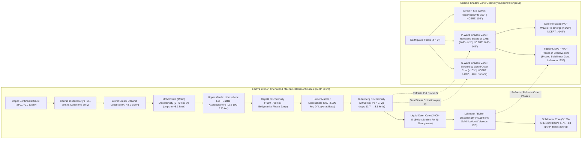

# Chapter 1 - Planetary Origin, Geological Time, Earth's Interior & Geomagnetic Dynamics

Earth is neither a static rock sphere nor a cooling cinder; it is a coupled heat engine, viscoelastic fluid shell, and self-exciting magnetohydrodynamic dynamo operating across eleven orders of magnitude in time. Decoding surface geography requires anchoring every landform, seismic zone, and climate shift to the planet's accretional chemistry, internal mechanical stratification, and electromagnetic shield.

---

## 1. Cosmogony, Planetary Assembly & Atmospheric Evolution

### The Angular Momentum Paradox & Failures of Classical Hypotheses
Any viable model of Solar System origin must resolve the **angular momentum paradox**: the Sun holds **99.86%** of the system's mass, yet the orbiting planets—dominated by Jupiter and Saturn—carry over **98%** of its total angular momentum. Classical hydrodynamical models collapsed against this single conservation constraint.

- **Kant–Laplace Nebular Hypothesis (1755 / 1796):** Proposed a collapsing, rotating solar nebula shedding equatorial gas rings that condensed into planets. Under strict conservation of angular momentum ($L = I\omega$), contraction should have spun the central Sun to near-breakup velocity while leaving the planets with negligible angular momentum; additionally, diffuse hot gas rings disperse thermally rather than self-gravitating into solitary planets.
- **Chamberlin–Moulton Planetesimal Hypothesis (1905):** A dualistic encounter model proposing that a passing star raised tidal bolts of solar plasma, which cooled into solid *planetesimals* that accreted into planets. In reality, stellar plasma torn from the Sun at $\sim 10^6\text{ K}$ expands explosively into vacuum instead of condensing, and interstellar stellar close-encounters are statistically vanishing.
- **Jeans–Jeffreys Tidal Hypothesis (1919 / 1929):** Refined the passing-star encounter into a spindle-shaped gaseous filament thick in the middle (explaining large Jovian planets) and tapered at both ends. It inherits the same fatal thermodynamic dissipation flaw and—as Henry Norris Russell and Lyman Spitzer demonstrated—cannot inject sufficient orbital angular momentum to place Jupiter and Neptune at 5–30 AU.

| Hypothesis (Proponents) | Class | Core Mechanism | Fatal Physical Flaw |
| :--- | :--- | :--- | :--- |
| **Nebular** (Kant 1755; Laplace 1796) | Monistic | Rotating nebula contracts and sheds concentric gas rings | Fails angular momentum partition; hot gas rings disperse rather than coalesce |
| **Planetesimal** (Chamberlin & Moulton 1905) | Dualistic | Passing star pulls solar bolts that cool into solid granules | Hot solar gas expands adiabatically; encounter probability $\approx 0$ |
| **Tidal** (Jeans 1919; Jeffreys 1929) | Dualistic | Passing star draws out a cigar-shaped gaseous filament | Cannot account for outer-planet angular momentum or prevent thermal blow-off |
| **Revised Nebular / Protoplanetary Disk & MHD** (Weizsäcker 1950 & Otto Schmidt 1943 [*NCERT "Revised Nebular"*]; Hannes Alfvén 1942 [*MHD*]; Modern) | Monistic / MHD *(note: Schmidt's interstellar-dust capture is strictly dualistic in history of science)* | Molecular cloud collapse + Alfvén/MRI magnetic braking + dust-cloud core/pebble accretion | Currently the standard paradigm; active refinements focus on migration timescales |

### Modern MHD Protoplanetary Disk & Frost Line Zonation
Modern astrophysics resolves the angular momentum paradox through **magnetohydrodynamics (MHD)**—pioneered conceptually by **Hannes Alfvén (1942)**—operating inside a dusty **Protoplanetary Disk** (~4.57 Ga). Inside the differentially rotating, weakly ionized accretion disk, **magnetorotational instability (MRI)** generates turbulent magnetic viscosity that transports angular momentum outward while allowing gas to spiral inward onto the protosun.

Simultaneously, magnetic field lines threading the young T-Tauri Sun couple to the inner disk and drive **bipolar jets and magnetized solar winds**, applying **magnetic braking** that strips the protosun of spin angular momentum. Planets then assemble bottom-up: micron-sized dust grains coagulate into kilometer-scale planetesimals, followed by rapid **pebble accretion** and runaway oligarchic growth.

Compositional architecture across the Solar System is governed by the **Frost Line (Snow Line)**—located roughly **2.7–3.0 AU** from the early Sun (between Mars and Jupiter), where disk temperatures dropped below ~150–170 K:

- **Inside the Frost Line (Terrestrial Planets — Mercury, Venus, Earth, Mars):** Volatile ices ($\text{H}_2\text{O}, \text{CH}_4, \text{NH}_3$) remained vaporized; only high-melting-point **refractory metals and silicates** ($\text{Fe, Ni, Mg-SiO}_x$) condensed. Low solid surface density restricted planetary growth to small, high-density ($3.9\text{–}5.5\text{ g/cm}^3$) rocky worlds unable to retain primordial $\text{H}_2/\text{He}$ against early solar extreme-UV photoevaporation.
- **Beyond the Frost Line (Jovian Giants):** Abundant water, ammonia, and methane ices multiplied solid mass density three- to fourfold, allowing massive proto-cores ($\sim 10\,M_\oplus$) to form rapidly *before* the solar nebula dissipated (~3–10 Myr). These cores crossed the runaway gas-accretion threshold, capturing colossal $\text{H}_2/\text{He}$ envelopes (**Gas Giants**: Jupiter, Saturn) or ice-rich mantles (**Ice Giants**: Uranus, Neptune).
- **Planetary Migration & Volatile Delivery:** Early inward–outward migration of Jupiter (the *Grand Tack* model) truncated Mars's growth and scattered water-bearing carbonaceous chondrites from beyond the Frost Line into the inner Solar System—a link directly investigated by NASA's **Juno mission** probing Jupiter's deep water abundance and dilute core.

### Theia Giant Impact, Iron Catastrophe & the Great Oxidation Event
Approximately **4.51 Ga** (within ~50–100 Myr of Solar System birth), proto-Earth suffered an oblique collision with a Mars-sized protoplanet designated **Theia**—termed the *"Big Splat"* in NCERT texts. Ejected mantle silicates formed a hot circumterrestrial debris disk that rapidly coalesced into the **Moon**, neatly explaining four anomalies: the Moon's low bulk density ($3.34\text{ g/cm}^3$) and tiny iron core, its severe volatile depletion, its near-identical oxygen-isotope ratio ($\Delta^{17}\text{O}$) to Earth's mantle, and Earth's rapid primordial rotation plus ~23.5° obliquity.

Accretional kinetic energy, the Theia impact, and intense decay of short-lived radionuclides ($^{26}\text{Al}$ with $t_{1/2} \approx 0.72\text{ Myr}$, $^{60}\text{Fe}$) heated Earth above the iron–nickel melting threshold (~1,800 K). Dense liquid $\text{Fe–Ni}$ alloys percolated downward in a runaway gravitational collapse known as the **Iron Catastrophe**, converting gravitational potential energy into enough heat to create a global **magma ocean** and permanently differentiating Earth into a metallic core, silicate mantle, and buoyant primordial crust.

Earth's atmosphere evolved across three geochemically distinct regimes rather than emerging oxygenated:

1. **Primary Atmosphere (Stripped):** A thin primordial $\text{H}_2/\text{He}$ envelope captured from the solar nebula was blown away by intense **T-Tauri solar winds** and extreme ultraviolet flux from the young Sun.
2. **Secondary Anoxic Degassing (~4.4–2.5 Ga):** Volcanic outgassing from the cooling mantle—supplemented by chondritic/cometary Late Veneer delivery—produced a dense, reducing/weakly neutral atmosphere dominated by $\text{H}_2\text{O}$ vapor, $\text{CO}_2$, $\text{N}_2$, $\text{CH}_4$, $\text{NH}_3$, and $\text{SO}_2$, with **virtually zero free molecular oxygen ($\text{O}_2$)**. As surface temperatures dropped below $100^\circ\text{C}$, steam condensed into torrential rains filling primordial ocean basins by ~4.4–4.0 Ga (evidenced by Jack Hills detrital zircons in Western Australia).
3. **Biological Oxygenation & the Great Oxidation Event (~2.45–2.32 Ga):** Marine **cyanobacteria** evolved oxygenic photosynthesis (~2.7–3.0 Ga), initially releasing $\text{O}_2$ that was chemically scrubbed by dissolved oceanic ferrous iron ($\text{Fe}^{2+}$) to precipitate vast **Banded Iron Formations (BIFs)**. Once oceanic iron sinks saturated, free $\text{O}_2$ flooded the atmosphere during the **Great Oxidation Event (GOE)**, oxidizing atmospheric methane ($\text{CH}_4 \to \text{CO}_2$), triggering the severe **Huronian global glaciation**, and assembling the stratospheric **ozone ($\text{O}_3$) shield** that eventually permitted terrestrial colonization.

---

## 2. Geological Time Scale, Meghalayan Age & the Anthropocene Debate

### Stratigraphic Hierarchy & Deep-Time Architecture
Earth's 4.54-billion-year archive is structured by the **International Commission on Stratigraphy (ICS)** under the **International Union of Geological Sciences (IUGS)**. Strictly speaking, geologists distinguish **geochronologic (time) units**—**Eon $\to$ Era $\to$ Period $\to$ Epoch $\to$ Age**—from their physical rock-stratum equivalents (**chronostratigraphic units**: Eonothem $\to$ Erathem $\to$ System $\to$ Series $\to$ Stage).

Boundary transitions are anchored globally not by arbitrary dates but by a physical reference horizon in a real rock, ice, or sediment section—a **Global Boundary Stratotype Section and Point (GSSP)**, colloquially termed a **"Golden Spike."** Nearly **88%** of Earth's history lies within the informal **Precambrian Supereon** (Hadean, Archean, and Proterozoic eons), before macroscopic skeletal life erupted at the base of the **Phanerozoic Eon (538.8 Ma)**.

| Eon | Era | Period | Epoch / Key Age | Start Age (approx.) | Defining Geophysical, Climatic & Evolutionary Benchmarks |
| :--- | :--- | :--- | :--- | :--- | :--- |
| **Hadean** | — | — | *(Informal)* | 4.54 Ga | Planetary accretion, Theia impact, Iron Catastrophe, magma ocean, oldest Jack Hills zircons (~4.4 Ga) |
| **Archean** | Eo- to Neoarchean | — | — | 4.03 Ga | Earliest continental cratons (Dharwar/Singhbhum nuclei), anoxic oceans, first prokaryotic/stromatolite life (~3.5–3.8 Ga) |
| **Proterozoic** | Paleo-, Meso-, Neoproterozoic | *(incl. Cryogenian, Ediacaran)* | — | 2.50 Ga | **Great Oxidation Event** (~2.4 Ga), BIFs, eukaryotic cells, supercontinents Columbia & Rodinia, "Snowball Earth" (Cryogenian), soft-bodied Ediacaran biota |
| **Phanerozoic** | **Paleozoic** | Cambrian – Ordovician – Silurian | — | 538.8 Ma | **Cambrian Explosion** (mineralized shells), jawless fish, first vascular land plants & arthropods (Silurian) |
| **Phanerozoic** | **Paleozoic** | Devonian – Carboniferous – Permian | — | 419.2 Ma | "Age of Fishes" & amphibians (Devonian); vast tropical swamp forests forming global/Gondwana **coal seams** (Carboniferous–Permian); assembly of **Pangaea**; **End-Permian "Great Dying"** (~252 Ma, ~90% marine extinction, Siberian Traps) |
| **Phanerozoic** | **Mesozoic** | Triassic – Jurassic – Cretaceous | — | 251.9 Ma | Breakup of Pangaea & Gondwanaland; rise of dinosaurs, early mammals & flowering plants (angiosperms); **Deccan Traps** flood volcanism (~66 Ma) & Chicxulub impact driving **K–Pg mass extinction** |
| **Phanerozoic** | **Cenozoic** | Paleogene & Neogene | Paleocene – Pliocene | 66.0 Ma | Radiation of mammals; **India–Eurasia collision (~55–50 Ma)** and Himalayan uplift; expansion of C4 grasslands & early hominins |
| **Phanerozoic** | **Cenozoic** | **Quaternary** | **Pleistocene** | 2.58 Ma | Milankovitch-paced glacial–interglacial cycles; emergence and global dispersal of *Homo sapiens* |
| **Phanerozoic** | **Cenozoic** | **Quaternary** | **Holocene:** Greenlandian / Northgrippian / **Meghalayan** | 11.7 ka / 8.2 ka / **4.2 ka** | Post-glacial climatic optimum; Neolithic agriculture; **Meghalayan Age** initiated by the 4.2 ka mega-drought (still the official current age as of 2026) |

### The Meghalayan Age (4.2 ka BP – Present) & Krem Mawmluh GSSP
In **June–July 2018**, the ICS and IUGS formally subdivided the Holocene Epoch (beginning 11,700 years BP) into three Ages/Stages: the Early Holocene **Greenlandian** (11.7 ka, marking end of the Younger Dryas cold snap), the Middle Holocene **Northgrippian** (8.2 ka, marking abrupt North Atlantic meltwater cooling), and the Late Holocene **Meghalayan** (beginning **4,200 years BP**, i.e., ~2250 BCE).

The Meghalayan holds two unique distinctions in Earth science: it is the **first formally ratified GSSP located in India**, and the first geological time boundary coinciding directly with a widespread climate-driven cultural disruption. Its Golden Spike is preserved inside a 308-mm calcite stalagmite (**speleothem KM-A**, archived at the Birbal Sahni Institute of Palaeosciences, Lucknow) collected from **Krem Mawmluh Cave** near Sohra (Cherrapunji), Meghalaya—carved along the Eocene Lakadong/Sylhet limestone contact.

High-resolution uranium-series dating and stable oxygen-isotope ($\delta^{18}\text{O}$) profiling of the stalagmite revealed a sharp positive isotopic excursion around **4.2 ka BP**, diagnostic of an abrupt, ~200-year collapse in Indian Summer Monsoon precipitation. Supported by a global auxiliary stratotype ice core from Mount Logan (Canada), this near-global **4.2 ka mega-drought** coincided with aridification and urban stress across the Mature Harappan (Indus) civilization, Akkadian Mesopotamia, Old Kingdom Egypt, and the Yangtze basin.

### March 2024 IUGS Rejection of the Anthropocene Epoch & 2026 Critiques
For fifteen years, the **Anthropocene Working Group (AWG)**—established under the ICS Subcommission on Quaternary Stratigraphy (SQS)—investigated whether human industrial transformation merited terminating the Holocene to establish a formal **Anthropocene Epoch**. In October 2023, the AWG submitted a formal proposal defining the **Anthropocene Series/Epoch** (and **Crawfordian Stage/Age**) starting precisely in **1952 CE**, anchored to a sharp spike in radioactive **plutonium ($^{239}\text{Pu}$)** fallout from thermonuclear weapons testing preserved in annual calcite varves at **Crawford Lake (Ontario, Canada)**.

In **March 2024** (ratified via joint IUGS–ICS statement on March 21/26, 2024), the IUGS officially **upheld the SQS vote rejecting the Anthropocene as a formal unit of the Geological Time Scale**. The scientific rationale behind the rejection was strictly stratigraphic, not climate-skeptical:

- **Diachronous vs. Synchronous Reality:** Formal chronostratigraphic epochs require a globally synchronous basal marker. Critics argued that fixing the onset at 1952 CE arbitrarily excluded millennia of planetary alteration—Neolithic deforestation, early rice-paddy methane emissions, the 16th-century Columbian biotic exchange, and the 18th-century coal-powered Industrial Revolution.
- **Timescale Asymmetry:** Most formal geological epochs span millions of years (even the Holocene spans 11,700 years); stratigraphers balked at codifying a formal epoch shorter than a single human lifetime (~72 years).
- **Epoch vs. "Geological Event" Paradigm:** Earth-system scientists increasingly characterize the Anthropocene as an ongoing, intensifying, **diachronous geological event**—stratigraphically analogous to the **Great Oxidation Event** or the **Great Ordovician Biodiversification Event**—which retains full analytical utility across Earth and social sciences without forcing a single Golden Spike.
- **2026 Stratigraphic Governance Critiques:** The controversy did not end in 2024. In **October 2026**, researchers at the **Max Planck Institute of Geoanthropology** (Schäfer, Renn, and Rosol) published a formal critique documenting alleged procedural and voting irregularities during the 2024 SQS ballot, demanding full archival disclosure and an independent procedural review by the IUGS. Formally, however, Earth remains in the **Meghalayan Age of the Holocene Epoch** as of late 2026.

---

## 3. Seismic Wave Propagation & Earth's Concentric Interior

### Direct vs. Indirect Geophysical Probes
Direct sampling barely scratches Earth's skin: the deepest borehole ever drilled—Russia's **Kola Superdeep Borehole**—reached **12.26 km** (0.19% of Earth's 6,371 km radius) before $180^\circ\text{C}$ temperatures and ductile rock flow halted drilling, while South African gold mines extend only ~3.5–4 km. Volcanic magmas and deep mantle **xenoliths** (carried rapidly upward in diamond-bearing kimberlite pipes) provide limited chemical snapshots down to ~200–400 km.

Mapping Earth's interior therefore relies on **indirect physical inversion**:

- **Moment of Inertia Constraint:** Satellite geodesy measures Earth's dimensionless moment of inertia factor as $I / (MR^2) \approx \mathbf{0.3307}$—substantially below a uniform-density sphere ($0.40$). Combined with a high bulk density ($5.51\text{ g/cm}^3$) versus crustal rock density ($\sim 2.7\text{–}3.0\text{ g/cm}^3$), this mathematically proves extreme **central mass concentration** (a dense metallic core).
- **Chondritic & Iron Meteorites:** Undifferentiated **carbonaceous chondrites** constrain bulk Earth elemental ratios, while **iron–nickel meteorites** represent shattered cores of differentiated planetesimals analogous to Earth's core.
- **Seismic Tomography & Geoneutrinos:** Teleseismic ray paths reconstruct 3D elastic-velocity structure down to the center of the inner core, while underground **geoneutrino detectors** directly count antineutrinos emitted by deep radioactive decay.

### Seismic Wave Mechanics (Elastic Continuum Physics)
Earthquake rupture radiates two classes of **Body Waves** through Earth's interior, whose phase velocities are fixed by the medium's bulk modulus ($K$), shear modulus ($\mu$), and density ($\rho$):

$$v_p = \sqrt{\frac{K + \frac{4}{3}\mu}{\rho}} \qquad \text{and} \qquad v_s = \sqrt{\frac{\mu}{\rho}}$$

Two foundational diagnostics follow directly from these relations:

1. **Velocity Hierarchy:** Because $K > 0$ and $\mu \ge 0$, compressional longitudinal **P-waves** always outrun transverse shear **S-waves** ($v_p / v_s \approx \sqrt{3} \approx 1.73$ in a standard Poisson solid where $K \approx \frac{5}{3}\mu$), arriving first on seismograms.
2. **Fluid Extinction:** Inviscid liquids cannot sustain elastic shear stress ($\mu = 0$). Consequently, **S-waves vanish completely** upon encountering a liquid layer ($v_s = 0$), while **P-waves continue propagating** via compressibility ($K$) but suffer an abrupt downward velocity drop as the $\frac{4}{3}\mu$ term disappears.

When body waves strike Earth's free surface, constructive interference generates **Surface Waves** trapped in the upper crust. Because surface waves spread cylindrically (amplitude decay $\propto r^{-1/2}$) rather than spherically ($\propto r^{-1}$) and exhibit **velocity dispersion** (longer wavelengths sample deeper, faster rock), they arrive last yet carry the highest destructive energy:

- **Love Waves (L-waves):** Purely horizontal transverse shear motion (SH) perpendicular to propagation; faster than Rayleigh waves; exist only where a lower-velocity crustal layer overlies a higher-velocity mantle; cause severe lateral shearing of building foundations.
- **Rayleigh Waves (R-waves):** Retrograde elliptical particle motion within the vertical plane of propagation (combining P and SV motion, analogous to ocean surface swells but spinning backward at the top of the ellipse); slowest seismic waves with the largest sustained ground-rolling amplitude.

### Non-Monotonic Velocity–Density Gradients & Seismic Shadow Zones
A common intuitive trap is assuming higher density $\rho$ at depth should slow seismic waves because $\rho$ sits in the denominator. Across most of Earth's mantle, however, **hydrostatic compression increases elastic stiffness ($K$ and $\mu$) much faster than $\rho$ increases**, causing both $v_p$ and $v_s$ to climb smoothly with depth and continuously refract curved seismic rays *convex downward* back toward the surface.

The deepest insights into Earth's internal physics come from four **non-monotonic anomalies** that break this smooth gradient:

1. **Low-Velocity Zone (LVZ, ~100–220 km):** Inside the upper asthenosphere, high temperature closely approaches the peridotite melting curve (solidus). Incipient **1–5% intergranular partial melt** (aided by trace water) drops the shear modulus $\mu$ sharply, slowing S-waves more dramatically than P-waves and mechanically decoupling lithospheric plates from the underlying mantle.
2. **Mantle Transition Zone (410 km & 660 km Discontinuities):** Sharp velocity jumps driven not by chemical changes but by **isochemical pressure-induced crystal phase transitions**—olivine ($\alpha$) $\to$ wadsleyite ($\beta$) at 410 km, $\to$ ringwoodite ($\gamma$) at 520 km, and endothermic breakdown into dense **bridgmanite + ferropericlase** at **660 km** (the Repetti/lower-mantle boundary), which acts as a partial buoyancy barrier to subducting slabs.
3. **D'' (D-Double-Prime) Layer (~2,700–2,900 km):** A thermally and chemically heterogeneous boundary layer sitting directly atop the Core–Mantle Boundary (CMB), characterized by the bridgmanite $\to$ post-perovskite phase transition, **Ultra-Low Velocity Zones (ULVZs)**, and two massive antipodal **Large Low-Shear-Velocity Provinces (LLSVPs)** beneath Africa and the central Pacific that anchor deep mantle plumes.
4. **Core–Mantle Boundary (Gutenberg Discontinuity, 2,900 km):** Density jumps precipitously from $\sim 5.5$ to $\sim 9.9\text{ g/cm}^3$ while $\mu$ collapses to zero in the liquid iron outer core. **$v_p$ plunges from ~13.7 km/s to ~8.1 km/s**, and **S-waves disappear entirely**.

This dramatic drop in $v_p$ at 2,900 km generates Earth's **Seismic Shadow Zones** via Snell's law: P-waves entering the slower outer core refract sharply *toward the normal*, leaving an angular shadow band completely devoid of direct P-waves, while S-waves are totally blocked beyond the grazing ray tangent to the outer core.

> **Dual-Standard Numeric Parity (Shadow Zones):** Modern global seismology (PREM / USGS) places the **P-wave shadow zone at $103^\circ\text{–}142^\circ$** and the **S-wave shadow zone at $>103^\circ$** (covering ~40% of Earth's surface). **NCERT Class XI** rounds these figures to **$105^\circ\text{–}145^\circ$ (P-wave)** and **$>105^\circ$ (S-wave)**. Both conventions appear across UPSC tests; treat $103^\circ\text{–}142^\circ$ as exact physical truth and $105^\circ\text{–}145^\circ$ as valid NCERT phrasing.

Crucially, the P-wave shadow zone is **not 100% silent**: weak, refracted and reflected high-velocity phases (`PKiKP` and `PKIKP`) arrive inside the $103^\circ\text{–}142^\circ$ band. Analyzing precisely these faint arrivals in **1936**, Danish seismologist **Inge Lehmann** proved that a **solid inner core** resides inside the liquid outer core (~5,150 km depth), bending and reflecting P-waves back into the shadow zone.

### Chemical vs. Mechanical Layering, Five Discontinuities & 2024–2025 Inner Core Dynamics
Geophysics partitions Earth using two non-identical lenses: **chemical composition** (crust, mantle, core—originally framed by Eduard Suess as SIAL, SIMA, NiFe) and **mechanical rheology** (brittle vs. ductile vs. fluid response to stress). Confusing the **Crust–Mantle (Moho)** chemical boundary with the **Lithosphere–Asthenosphere (LAB)** mechanical boundary is one of the most frequent conceptual errors in geography.

| Layer Lens | Sub-Layer | Depth Range | Approximate Density ($\text{g/cm}^3$) | Share of Earth's Volume / Mass | Dominant Composition & Rheological State |
| :--- | :--- | :--- | :--- | :--- | :--- |
| **Chemical** | **Crust** (Continental SIAL / Oceanic SIMA) | 0–35/70 km (Cont.); 0–5/10 km (Ocean) | 2.7 (Cont.) / 3.0 (Ocean) | ~1% Vol / <0.5% Mass | Granitic felsic silicates (Si–Al) on continents; basaltic mafic silicates (Si–Mg) under oceans |
| **Chemical** | **Mantle** (Upper & Lower) | Moho to 2,900 km | 3.3 – 5.5 | ~84% Vol / ~67.5% Mass | Ultramafic Mg–Fe silicates (olivine/peridotite upper; bridgmanite lower); solid yet convecting over Myr |
| **Chemical** | **Core** (Outer & Inner; NiFe) | 2,900 – 6,371 km | 9.9 – 13.1 | ~15% Vol / ~32% Mass | ~85% Fe, ~5% Ni + ~8–10% light elements (Si, O, S, C, H) required to match seismic density deficit |
| **Mechanical** | **Lithosphere** | 0 – ~100 km (up to ~250 km under cratons) | 2.7 – 3.4 | — | Rigid, brittle plate comprising **all of the Crust + uppermost solid lithospheric mantle** |
| **Mechanical** | **Asthenosphere** | ~100 – 400 km | 3.3 – 3.6 | — | Mechanically weak, ductile upper mantle (hosts LVZ); enables plate sliding & primary magma generation |
| **Mechanical** | **Mesosphere** | ~660 – 2,900 km | 4.4 – 5.5 | — | High-viscosity, stiff lower mantle solid despite extreme temperatures due to confining pressure |
| **Mechanical** | **Liquid Outer Core** | 2,900 – 5,150 km | 9.9 – 12.2 | — | Low-viscosity molten $\text{Fe–Ni}$ alloy; convective turbulence drives Earth's geodynamo |
| **Mechanical** | **Solid Inner Core** | 5,150 – 6,371 km | 12.8 – 13.1 | — | Solid HCP-crystalline $\text{Fe–Ni}$ (~330–360 GPa pressure pushes melting point above ~5,400–6,000 K) |

Earth's five canonical **seismic discontinuities** mark abrupt jumps in composition, phase, or state (remember the depth sequence downward via **C–M–R–G–L**):

1. **Conrad Discontinuity (~15–20 km):** Separates upper felsic (granitic) continental crust from lower mafic (gabbroic/basaltic) continental crust; discontinuous and absent beneath oceanic basins.
2. **Mohorovičić Discontinuity — Moho (~5–10 km oceanic; ~35–70 km continental):** Sharp chemical boundary between Crust and Mantle ($v_p$ jumps from ~6.5–7.0 to ~8.0–8.1 km/s).
3. **Repetti Discontinuity (~660–700 km):** Marks the boundary between Upper Mantle (Transition Zone) and Lower Mantle (ringwoodite $\to$ bridgmanite phase jump).
4. **Gutenberg (Wiechert–Gutenberg) Discontinuity (2,900 km):** Separates solid silicate Lower Mantle from liquid metallic Outer Core ($v_s \to 0$).
5. **Lehmann Discontinuity (~5,150 km) *(also termed the Bullen or Lehmann–Bullen Discontinuity)*:** Separates liquid Outer Core from solid crystalline Inner Core (note: international seismology and some Geography Optional texts reserve "Lehmann discontinuity" for the minor ~220 km upper-mantle boundary beneath continents and label the 5,150 km core boundary the **Bullen** or **Lehmann–Bullen Discontinuity**, whereas Indian UPSC textbooks standardly test Lehmann at 5,150 km).

**2024–2025 Inner Core Dynamics (Backtracking & Viscous Deformation):** Because the solid inner core is mechanically isolated inside a fluid shell, it can spin differentially relative to the mantle under competing outer-core electromagnetic torque and mantle gravitational coupling. In **June 2024** (*Nature*, Wang, Vidale et al.), analysis of 121 repeating earthquakes near the South Sandwich Islands (1991–2023) provided unambiguous evidence of **inner-core backtracking**: after decades of super-rotation, the inner core slowed around **2010** and began rotating slightly *slower* than Earth's mantle—appearing to reverse relative to the surface as part of a ~70-year oscillation.

A follow-up **February 2025** study (*Nature Geoscience*, Vidale et al.) uncovered an even more surprising anomaly in Yellowknife seismic array waveforms: **annual-to-decadal viscous deformation** along the shallow Inner Core Boundary (ICB) driven by outer-core convective turbulence. Rather than behaving as an immutable rigid ball, the outer rim of the solid inner core dynamically changes shape on human timescales—generating subtle millisecond fluctuations in Length of Day (LOD) (with active 2026 seismological debate continuing over the exact share attributable to differential rotation versus ICB surface deformation).

---

## 4. Isostasy, Glacial Rebound & the Geothermal Engine

### Classical & Flexural Isostasy
During the Great Trigonometrical Survey of India (1850s), Surveyor-General **George Everest** noticed that a plumb bob at **Kaliana** (near the Himalayan foothills) deflected toward the mountains by only **5.23 arcseconds** instead of the **15.88 arcseconds** predicted by Newtonian attraction from the visible Himalayan topography. This **mass deficit** beneath mountain ranges established **Isostasy**—the gravitational buoyancy equilibrium of Earth's lithosphere resting on the ductile asthenosphere.

Three progressively refined mechanical models explain how topography is compensated at depth:

| Isostatic Model | Physical Principle | Compensation Geometry | Primary Real-World Fit |
| :--- | :--- | :--- | :--- |
| **Airy's Hypothesis (1855)** | **Uniform crustal density** ($\rho_c$), **varying root thickness** (Archimedes iceberg buoyancy) | Higher mountains sink deeper roots into denser mantle ($r = h\,\frac{\rho_c}{\rho_m - \rho_c} \approx 4.5\,h$); no flat basal depth | **Young fold mountains (Himalayas, Andes)** where seismic Moho plunges to 65–75 km |
| **Pratt's Hypothesis (1859)** | **Varying crustal density**, **uniform basal depth** (*Level of Compensation*) | Inverse density–height relation ($\rho_1 h_1 = \rho_2 h_2$); taller columns are lighter, deeper basins are denser | **Continent vs. Ocean contrast** (lighter granite vs. denser basalt) & mid-ocean ridge thermal expansion |
| **Flexural Isostasy** (Vening Meinesz, 1931) | **Regional elastic plate bending** rather than frictionless local vertical columns | Lithosphere has finite flexural rigidity ($D$); localized loads bend the plate broadly, creating flanking moats & peripheral bulges | **Hawaiian volcanic chain moat** & **Indo-Gangetic Foreland Basin** flexed downward beneath Himalayan thrust sheets |

### Post-Glacial Rebound (GIA) & Climate-Driven Rotational Shifts
Because the asthenosphere and mantle behave as a high-viscosity Maxwell viscoelastic fluid ($\eta \sim 10^{21}\text{ Pa}\cdot\text{s}$), isostatic adjustment lags surface loading by millennia. Following the Last Glacial Maximum (~20 ka), melting of the 3-km-thick Laurentide (North America) and Fennoscandian ice sheets removed vast polar loads, triggering ongoing **Post-Glacial Rebound**—formally **Glacial Isostatic Adjustment (GIA)**.

Regions like Hudson Bay and the Gulf of Bothnia continue uplifting today at **~10 mm/yr**, while collapsed peripheral forebulges (e.g., the US Mid-Atlantic coast and southern North Sea) slowly subside—compounding local relative sea-level rise. Crucially, GIA drives deep viscous mantle inflow back toward the poles, shifting mass *closer* to Earth's spin axis, reducing Earth's moment of inertia ($I$), and **accelerating Earth's rotation** (shortening the Length of Day by **$-0.80 \pm 0.10\text{ ms/century}$**).

Contemporary anthropogenic warming is now actively reversing this rotational ledger. A landmark **July 2024 *PNAS* study** (Shahvandi, Adhikari, Soja et al.) demonstrated that accelerated melting of Greenland and Antarctic ice sheets transports gigatons of water mass from the poles toward the equator, increasing Earth's equatorial oblateness and moment of inertia ($I$):

- **Lengthening the Day:** By conservation of angular momentum ($L = I\omega$), pole-to-equator meltwater flux slowed Earth's spin—raising climate-induced LOD lengthening from $0.3\text{–}1.0\text{ ms/century}$ in the 20th century to **$1.33 \pm 0.03\text{ ms/century}$** since 2000. Under high-emission pathways, this rate could reach **$2.62 \pm 0.79\text{ ms/century}$** by 2100, **surpassing lunar tidal friction** ($\sim 2.3\text{ ms/century}$) as the single largest driver of secular LOD deceleration.
- **True Polar Wander (Axial Drift):** Asymmetric mass loss (Greenland ice melt plus massive continental groundwater depletion in Northwest India and western North America) shifts Earth's principal axis of inertia, nudging the geographic spin pole by several centimeters per year—forcing recalculations in high-precision GNSS, VLBI, and atomic timekeeping (UTC leap-second governance).

### Earth's Geothermal Engine & Internal Heat Budget
Earth continually vents **$47 \pm 2\text{ TW}$** (older borehole compilations: ~44 TW) of internal heat to space—averaging ~$87\text{ mW/m}^2$ globally, peaking sharply over young mid-oceanic ridges and plunging over cold Archean cratons. Though minuscule beside **173,000 TW** of intercepted solar insolation (0.03% of surface energy flux), this internal thermal engine exclusively powers mantle convection, plate tectonics, volcanism, and the geomagnetic dynamo.

Geochemical models and underground **geoneutrino detectors** (**KamLAND** in Japan and **Borexino** in Italy) partition this ~47 TW budget into two roughly comparable reservoirs:

1. **Radiogenic Heat (~20–24 TW; ~45–55%):** Generated by radioactive $\alpha/\beta$ decay of four long-lived isotopes—**$^{238}\text{U}$, $^{235}\text{U}$, $^{232}\text{Th}$, and $^{40}\text{K}$**—strongly partitioned as incompatible lithophile elements into the continental crust (~7–8 TW) and silicate mantle (~12–16 TW). Short-lived isotopes ($^{26}\text{Al}, ^{60}\text{Fe}$) decayed away within the first few million years and contribute zero heat today.
2. **Primordial & Core-Crystallization Heat (~20–27 TW; ~45–55%):** Comprises secular cooling of residual accretional/differentiation thermal energy plus heat extracted from the cooling core (~10–15 TW across the CMB). As Earth cools, the solid inner core slowly freezes outward (~0.5–1 mm/yr), releasing both **latent heat of crystallization** and **gravitational (compositional) potential energy** as light alloys (O, Si, S) are expelled into the buoyant outer core.

Earth's **geothermal gradient** is starkly non-linear. Across the rigid, **conduction-dominated** upper continental crust, temperature rises steeply at **$25\text{–}30^\circ\text{C/km}$**; across the **convection-dominated** mantle, efficient vertical heat advection flattens the gradient to an adiabatic slope of merely **$0.3\text{–}0.5^\circ\text{C/km}$**, before jumping steeply again across the conductive D'' thermal boundary layer at the CMB to reach ~4,000 K (CMB) and **~5,400–6,000 K** at Earth's center.

---

## 5. Geomagnetic Dynamo, Space Weather & Milankovitch Cycles

### Outer-Core MHD Geodynamo & Taylor Columns
Earth's magnetic field cannot arise from permanent ferromagnetism: crustal and deep core temperatures (4,000–6,000 K) vastly exceed iron's **Curie temperature (~770°C / 1,043 K)**, above which thermal agitation destroys spontaneous magnetic alignment. Instead, Earth runs a self-exciting **magnetohydrodynamic (MHD) geodynamo** inside its electrically conducting liquid outer core.

Thermal cooling and compositional buoyancy (light elements rejected by the freezing inner core) drive convective upwelling in the molten $\text{Fe–Ni}$ outer core. Because Earth rotates rapidly, the **Coriolis force** dominates over inertial forces (low Rossby number), organizing outer-core fluid motion via the **Taylor–Proudman theorem** into axially aligned, counter-rotating helical convective rolls parallel to Earth's spin axis called **Taylor columns**.

Motion of liquid metal across an existing seed magnetic field induces electrical currents ($\mathbf{J} = \sigma(\mathbf{E} + \mathbf{v} \times \mathbf{B})$); differential zonal shearing stretches poloidal field lines into strong east–west toroidal loops ($\omega$-effect), while helical upwelling inside Taylor columns twists toroidal loops back into poloidal dipole field lines ($\alpha$-effect). The resulting external field approximates a **geocentric axial dipole** tilted **~9.5°–11°** from Earth's geographic spin axis.

### Geomagnetic Elements & Secular Drift
At any surface location, Earth's magnetic vector $\mathbf{B}$ is specified by three parameters:

- **Magnetic Declination ($\delta$):** Horizontal angle between **True (Geographic) North** and **Magnetic North** (east or west). Contours of equal declination are **Isogonic Lines**; the zero-declination contour (where compass north matches true north) is the **Agonic Line**.
- **Magnetic Inclination / Dip ($I$):** Vertical angle between the magnetic field vector and the local horizontal plane. Contours of equal inclination are **Isoclinic Lines**. Dip equals **$0^\circ$** along the **Magnetic Equator (Aclinic Line)**—which cuts across southern India near **Thumba, Thiruvananthapuram**, the precise geophysical reason ISRO established the Thumba Equatorial Rocket Launching Station (TERLS, 1963) to study the intense **Equatorial Electrojet**—and reaches **$\pm 90^\circ$** at the magnetic dip poles.
- **Total Intensity ($B$):** Ranges from **~25,000 nT** near the magnetic equator to **~65,000 nT** near the magnetic poles (with a global average loss of ~9% over the past two centuries).

> **Polarity Convention Precision:** Because opposite magnetic poles attract, the pole inside Earth's Northern Hemisphere that attracts the north-seeking tip of a compass needle is physically a **magnetic south pole**—though geographers conventionally label that location the **North Magnetic Pole**. Driven by turbulent outer-core flux competition (a strengthening Siberian lobe versus a weakening Canadian lobe), the North Magnetic Pole has drifted rapidly across the Arctic Ocean from Canada toward **Siberia** at ~35–55 km/yr.

### Magnetosphere, Van Allen Radiation Belts & the South Atlantic Anomaly (SAA)
Extending tens of thousands of kilometers into space, Earth's geomagnetic field carves a protective cavity—the **Magnetosphere**—within the supersonic stream of magnetized solar plasma (**solar wind**, ~400–800 km/s). Dynamic solar-wind ram pressure compresses the dayside **magnetopause** to **~10 Earth radii ($R_E$)** behind a collisionless **bow shock**, while sweeping the nightside field into a stretched **magnetotail** extending beyond **100 $R_E$**.

Charged particles entering the magnetosphere execute helical gyro-motion along field lines, bouncing between northern and southern magnetic mirror points and drifting longitudinally (electrons eastward, protons westward) to form two concentric toroidal **Van Allen Radiation Belts**:

- **Inner Van Allen Belt (~1,000–6,000 km altitude):** Populated primarily by stable, ultra-energetic **protons** (tens to hundreds of MeV, mostly produced by Cosmic Ray Albedo Neutron Decay—CRAND) alongside energetic electrons.
- **Outer Van Allen Belt (~13,000–60,000 km altitude):** Dominated by relativistic **electrons** accelerated by magnetospheric wave–particle interactions; highly volatile during geomagnetic storms (which occasionally carve a transient third storage belt).

Directly above South America and the South Atlantic lies a pronounced dent in Earth's magnetic shield: the **South Atlantic Anomaly (SAA)**, where field intensity drops below **~22,000 nT**. Driven by **reverse magnetic flux patches** at the Core–Mantle Boundary beneath southern Africa and the South Atlantic (where field lines re-enter the core rather than exiting), the weakened field allows the inner Van Allen belt to dip down to **~200 km altitude**.

Low-Earth Orbit (LEO) spacecraft—including the ISS, Hubble Space Telescope, and Earth-observation satellites—suffer elevated ionizing radiation fluxes, Single Event Upsets (SEUs), and sensor glitches while transiting the SAA. Eleven-year observations from the European Space Agency's **Swarm satellite constellation** (published October 2025 / February 2026) confirmed that between **2014 and 2025**, the SAA expanded by an area nearly **half the size of continental Europe** (~0.9% of Earth's surface), migrating westward (~20 km/yr) and bifurcating into a **dual-cell structure** with accelerated weakening southwest of Africa. While geophysicists monitor this anomaly closely, current consensus treats the SAA as normal secular core-boundary variability—*not* proof of an imminent geomagnetic polarity reversal.

### Solar Flares vs. CMEs, Geomagnetic Storms & the May 2024 G5 Storm over Hanle
Space weather disturbances originate along the Sun's ~11-year magnetic sunspot cycle (currently peaking in **Solar Cycle 25**). Separating the electromagnetic flash from the plasma hammer prevents classic Prelims errors:

| Space Weather Phenomenon | Physical Nature | Transit Time to Earth (1 AU) | Primary Terrestrial & Technological Impact |
| :--- | :--- | :--- | :--- |
| **Solar Flare** | Intense burst of **electromagnetic radiation** (X-rays, EUV, NUV, radio) from abrupt coronal magnetic reconnection | **~8.3 minutes** (travels at speed of light $c$) | Immediate **dayside ionospheric D-layer ionization** $\to$ **HF shortwave radio blackouts** (R1–R5 NOAA scale); negligible direct ring-current geomagnetic storm |
| **Coronal Mass Ejection (CME)** | Multi-billion-ton cloud of **magnetized solar plasma** ($\text{H}^+, \text{He}^{2+}, e^-$ + embedded IMF) hurled from solar corona | **15 hours to 3–4 days** (~300–3,000 km/s) | Triggers severe **Geomagnetic Storms** (G1–G5 NOAA scale; $K_p$ 0–9) when embedded IMF turns **southward ($B_z < 0$)**, reconnecting with Earth's northward magnetopause |

When a southward-magnetized CME couples into Earth's magnetosphere, open field lines funnel massive energy into the polar ionosphere and equatorial ring current (quantified by negative excursions of the **$D_{st}$ index**). Key operational hazards include:

- **Power Grids & Pipelines:** Rapidly fluctuating ionospheric electrojets induce quasi-DC **Geomagnetically Induced Currents (GICs)** via Faraday's law ($\mathcal{E} = -d\Phi_B/dt$) inside long high-voltage transmission lines, saturating transformer cores and causing cascading blackouts (as in Quebec, March 1989).
- **Orbital Decay & Navigation:** Intense thermospheric Joule heating expands Earth's upper atmosphere outward into LEO, sharply increasing atmospheric drag on satellites (de-orbiting dozens of Starlink satellites during minor storms in Feb 2022 and shifting orbits in May 2024), while ionospheric plasma irregularities degrade **GNSS/GPS** precision and disrupt polar-route aviation HF communications.
- **What Solar Storms Do NOT Cause:** Geomagnetic storms deposit negligible mechanical momentum into Earth's solid lithosphere or oceans—they **cannot trigger tsunamis, earthquakes, widespread forest fires, or shift Earth's rotational axis**.

**Auroral Physics & the May 2024 G5 "Gannon Storm" over Ladakh:** Accelerated magnetospheric electrons spiraling down polar magnetic cusps collide with upper-atmospheric gases and excite electronic transitions. **Atomic oxygen** emits bright **green light (557.7 nm)** at ~100–150 km altitude and deep **crimson-red light (630.0 nm)** at higher, sparser altitudes (~200–400 km, where long-lived excited states radiate before collisional quenching); **molecular nitrogen ($\text{N}_2/\text{N}_2^+$)** emits violet, blue, and pink fringes below ~100 km.

Between **May 10 and 13, 2024**, a hyperactive sunspot complex (**NOAA Active Region 13664/13668**) unleashed X-class solar flares (up to X8.7) and a rare cannibalistic train of **six interacting CMEs** that merged en route to Earth. The impact triggered the first **G5 ("Extreme") geomagnetic storm** since October 2003 ($K_p = 9$, peak $D_{st} \approx -412\text{ nT}$)—widely dubbed the **Gannon Storm**.

Compressing Earth's magnetosphere pushed the auroral oval dramatically equatorward, illuminating **vivid red auroral arcs** across the night skies of **Hanle, Ladakh (~32.8°N)**—recorded continuously by all-sky cameras at the **Indian Astronomical Observatory (IAO)** operated by the Indian Institute of Astrophysics (IIA). Subsequent Indian primary-source analyses (PIB, July 2025 & July 2026; ISRO, February 2026) decoded how the six interacting CMEs shifted thermally mid-journey from heat-releasing to heat-absorbing expansion, while pairing **Aditya-L1** in-situ solar-wind/IMF telemetry (from Sun–Earth L1) with Indian Institute of Geomagnetism (IIG, Mumbai) ground stations to explain anomalous opposite-polarity **dawn-sector magnetic perturbations** recorded during both the **May 10 and October 10, 2024** storms.

### Aperiodic Polarity Reversals & Paleomagnetism
Unlike the Sun's quasi-periodic ~11-year polarity flip, Earth's geodynamo undergoes **stochastic, aperiodic polarity reversals**—swapping magnetic north and south completely over a transitional window of ~1,000–10,000 years during which dipole intensity temporarily drops by ~80–90%.

- **Reversal Cadence & Superchrons:** Over the past 20 Myr, reversals averaged roughly once every **200,000–300,000 years**; yet the dynamo can also lock into single polarity for tens of millions of years—most famously the **Cretaceous Normal Superchron (~121–83 Ma, ~37 Myr without a single flip)**.
- **Recent Benchmarks:** The last full polarity reversal was the **Brunhes–Matuyama reversal (~780 ka)** (entering our current *Brunhes Normal Chron*). A major short-lived **geomagnetic excursion**—the **Laschamp Excursion (~41–42 ka)**—saw dipole strength collapse to ~5–10% of normal for several centuries before rebounding without permanently flipping.
- **Paleomagnetic Archive:** When iron-bearing basaltic magma cools below the **Curie temperature** of magnetite (~580°C), iron-titanium oxides lock in the ambient geomagnetic declination and inclination as **Thermoremanent Magnetization (TRM)** (sediments preserve weaker **Detrital Remanent Magnetization, DRM**). Because dipole inclination directly encodes latitude ($\tan I = 2\tan\lambda$), paleomagnetic rocks allow reconstruction of **Apparent Polar Wander (APW)** paths and symmetric seafloor magnetic stripes—forming the quantitative bedrock of Plate Tectonics (Chapter 2).

### Milankovitch Cycles — Astronomical Pacemaker of Quaternary Climate
Serbian geophysicist **Milutin Milanković** demonstrated that gravitational perturbations from Jupiter, Saturn, Venus, and the Moon quasi-periodically alter three parameters of Earth's orbit and spin axis, redistributing incoming solar insolation across latitudes and seasons.

| Orbital Parameter | Physical Geometry | Range of Variation (Current Value) | Dominant Periodicity | Radiative & Paleoclimatic Control |
| :--- | :--- | :--- | :--- | :--- |
| **Eccentricity ($e$)** | Ellipticity (stretch) of Earth's orbit around the Sun | $0.000055 \text{ to } 0.0679$ (Current: **$0.0167$**, decreasing) | **~100 kyr** (95 & 125 kyr composite) & **~405 kyr** | **Only parameter altering annual total global insolation** (by a tiny ~0.2%); crucially **modulates precession amplitude** and paces Late Pleistocene glacial cycles |
| **Obliquity ($\varepsilon$)** | Axial tilt of Earth's spin axis relative to the ecliptic normal | **$22.1^\circ \text{ to } 24.5^\circ$** (Current: **$23.44^\circ$**, decreasing) | **~41 kyr** | Controls **seasonal contrast & high-latitude insolation**: *lower tilt* = cooler polar summers $\to$ winter snow survives summer melt $\to$ ice-sheet growth (paced Early Pleistocene glacials) |
| **Climatic Precession** | Wobble of spin axis (**axial ~25.7 kyr**) combined with orbital ellipse rotation (**apsidal ~112 kyr**) | Shifts season of perihelion / aphelion by $360^\circ$ (Current: perihelion in **early January**) | **~23 kyr** (19 & 23 kyr dual peaks) | Controls **hemispheric seasonal asymmetry** & low-latitude **monsoon strength** (e.g., Holocene *African Humid Period* / Green Sahara when perihelion aligned with NH summer) |

Two high-altitude physical principles prevent misconception about Milankovitch forcing:

1. **The 65°N Summer Insolation Trigger & Feedback Amplification:** Milankovitch variations barely alter *annual global* insolation, yet they shift **high-latitude Northern Hemisphere summer insolation (~65°N)** by up to 15–20%. Because most continental land capable of supporting grounded ice sheets sits in the Northern Hemisphere, cool boreal summers allow perennial snowpack to survive ablation; internal Earth-system **positive feedbacks**—principally **ice–albedo feedback** and Southern Ocean **$\text{CO}_2/\text{CH}_4$ drawdown**—then amplify modest orbital nudges into full global ice ages ($\Delta T \approx 4\text{–}6^\circ\text{C}$).
2. **Timescale Separation from Anthropogenic Warming:** Orbital cycles evolve over $10^4\text{–}10^5$ years—orders of magnitude too slow to explain rapid post-1850 warming. In fact, Earth's current declining obliquity ($23.44^\circ \to 22.1^\circ$) and January perihelion modestly favor long-term *cooling* of Northern Hemisphere summers, meaning contemporary warming is occurring *against* the gentle background orbital trend.

---

> [!warning] Prelims Traps & Atomic Distinctions
> - **Dual-Standard Shadow Zones:** Never panic over $103^\circ\text{–}142^\circ$ (PREM/USGS) versus $105^\circ\text{–}145^\circ$ (NCERT Class XI); the real trap is swapping the wave types—**S-wave shadow zone is vastly larger ($>103^\circ/105^\circ$, ~40% of Earth)** than the P-wave band, and the zone common to *both* is $103^\circ\text{–}142^\circ$ ($105^\circ\text{–}145^\circ$).
> - **Crust $\neq$ Lithosphere:** The **Moho** separates Crust from Mantle chemically, whereas the **Lithosphere** includes *both* the Crust and the uppermost rigid Mantle down to the ductile Asthenosphere (~100–250 km). Note also the **5,150 km Outer–Inner Core alias**: Indian UPSC texts label it the **Lehmann Discontinuity**, while international/Optional texts often term it the **Bullen (or Lehmann–Bullen) Discontinuity**.
> - **Why Earth Has a Magnetic Field:** Permanent iron ferromagnetism is **impossible** inside Earth's core because core temperatures exceed iron's **Curie point (~770°C)**; the field requires convective **MHD liquid outer-core currents** organized by Earth's rotation.
> - **Solar Flares vs. CMEs & Causal Traps:** Solar flares deliver electromagnetic radiation in ~8.3 minutes (HF radio blackouts); **CMEs** deliver magnetized plasma in 1–4 days (G1–G5 geomagnetic storms). Neither causes earthquakes, tsunamis, widespread forest fires, or shifts in Earth's rotational axis.
> - **GIA vs. Contemporary Polar Melt on Length of Day:** Post-Glacial Rebound (GIA) moves mantle mass *poleward*, **shortening** the day ($-0.80\text{ ms/cy}$); modern Greenland/Antarctic ice melt moves water *equatorward*, increasing moment of inertia and **lengthening** the day ($+1.33\text{ ms/cy}$ post-2000).
> - **Meghalayan vs. Anthropocene Status:** India's **Krem Mawmluh Cave** stalagmite is the formally ratified GSSP for the **Meghalayan Age** (Holocene, 4.2 ka BP). In **March 2024**, the IUGS formally **rejected** the Crawford Lake **Anthropocene Epoch** proposal—Earth officially remains in the Holocene/Meghalayan.
> - **Airy vs. Pratt Inversion Trap:** **Airy** = *uniform density*, varying root depth (best for Himalayas); **Pratt** = *varying density*, uniform depth of compensation (best for continent–ocean elevation contrast).
> - **Obliquity Trap:** *Lower* axial tilt ($22.1^\circ$) promotes **glacial advance** (cooler high-latitude summers fail to melt winter snow), whereas *higher* tilt ($24.5^\circ$) promotes **deglaciation** despite colder winters.
> - **Early Atmosphere Trap:** Earth's early secondary atmosphere (~4.0 Ga) was **anoxic** (rich in $\text{H}_2\text{O}, \text{CO}_2, \text{N}_2, \text{CH}_4, \text{NH}_3$; zero free $\text{O}_2$)—free oxygen arose only later via marine biological photosynthesis (GOE ~2.4 Ga).

> [!tip] Whole-UPSC Spillover
> - **GS3 — Space Tech & Critical Infrastructure Resilience:** **Aditya-L1** at Sun–Earth L1 (VELC, SUIT, ASPEX, MAG payloads) transforms India from a passive consumer to a frontline contributor in space-weather forecasting—vital for shielding NavIC satellites, polar-orbiting IRS fleets, and India's increasingly interconnected National Grid against G4–G5 GIC surges.
> - **GS1 — Ancient Indian History & Climate Archaeology:** The **4.2 ka Meghalayan mega-drought** recorded in Krem Mawmluh Cave provides the high-resolution paleoclimatic anchor explaining the late-phase aridification, eastward settlement shift toward the Ganga–Yamuna Doab, and gradual de-urbanization of the Mature Harappan Civilization.
> - **GS3 — Environment & Climate Diplomacy:** Separating slow **Milankovitch orbital forcing** ($10^4\text{–}10^5$ yr) from rapid anthropogenic radiative forcing counters climate-denialist tropes, while the **March 2024 IUGS Anthropocene rejection** illustrates the boundary between strict geological stratigraphy and normative environmental-policy framing.
> - **Essay — Deep Time & Planetary Agency:** The juxtaposition of the IUGS rejecting a 72-year "Anthropocene Epoch" alongside 2024 *PNAS* proof that human-driven ice melt is measurably altering Earth's rotational inertia and Length of Day offers a razor-sharp philosophical lens on humanity's transition from biological passenger to planetary-scale geophysical force.

---

## UPSC Interrogation Lens

### 1. Verified UPSC Mains PYQs (2014–2026) & Prelims Anchors
*Note: Chapter 1 is heavily Prelims-weighted; only one direct Mains GS1 PYQ (2017) targets planetary origin/evolution (with one adjacent 2018 deep-mantle prompt bridging into Chapter 2). Verified Prelims PYQs from 2018–2025 are therefore listed alongside.*

- **Mains GS1 (2017, 10 Marks, 150 words):** *"How does the Juno Mission of NASA help to understand the origin and evolution of the Earth?"*
- **Mains GS1 (2018, 10 Marks, 150 words — Bridge to Ch. 2):** *"Define mantle plume and explain its role in plate tectonics."*
- **Prelims GS1 (2025, Q33):** Three-statement assertion–reason testing whether **scientific studies show a shift in Earth's rotation and axis** (Statement I), contrasting **solar flares/CMEs bombarding the outermost atmosphere** (Statement II — true statement, *wrong* causal explanation) against **melting polar ice redistributing water mass toward the equator** (Statement III — true statement and *correct* explanation).
- **Prelims GS1 (2023, Q65):** Direct conceptual check on **seismograph arrival order (P before S waves)** and **longitudinal versus transverse particle vibration** of P- and S-waves.
- **Prelims GS1 (2022):** Seven-effect list testing **possible impacts of a major solar storm (solar flare/CME)** on Earth (GPS/navigation failure, power-grid damage, widespread auroras, satellite orbit disturbance, polar HF aviation blackout—eliminating equatorial tsunamis and global forest fires).
- **Prelims GS1 (2018, Q57):** Multi-statement check combining **geomagnetic polarity reversals every few hundred thousand years**, the **anoxic composition of Earth's early atmosphere** (>4,000 Ma), and **biological modification of the early atmosphere** by originating organisms.

### 2. Prelims Trap Signature
- **True Fact, Wrong Cause (2025 Pattern):** UPSC increasingly pairs two factually accurate geophysical headlines (e.g., May 2024 CMEs + July 2024 polar-melt LOD shift) and asks which one *causally explains* the assertion—testing true physical mechanism rather than news recall.
- **Mechanical vs. Chemical Boundary Conflation:** Statements asserting that tectonic plates consist *only* of the crust, that the asthenosphere is fully molten liquid, or that the Moho marks the base of the lithosphere.
- **Wave-Propagation & Shadow-Zone Inversion:** Swapping P- and S-wave media constraints, misstating the angular extent of the common shadow zone ($103^\circ\text{–}142^\circ$ / $105^\circ\text{–}145^\circ$), or claiming seismic velocity decreases monotonically with rising density.
- **Stratigraphic & Space-Weather Overreach:** Claiming the Anthropocene was formally ratified as a geological epoch in 2024, conflating solar flares (EM radiation) with CMEs (magnetized plasma), or attributing lithospheric/oceanic disasters (tsunamis, earthquakes) to geomagnetic storms.

### 3. Cross-Hub AIR-1 Provocations
1. *"If anthropogenic cryospheric melt is already measurably shifting Earth's Length of Day and rotational pole, evaluate why the International Union of Geological Sciences (2024) nevertheless declined to formalize the Anthropocene as a geological epoch—and examine what this tension reveals about scientific standards versus climate governance."*
2. *"As India scales up space-based positioning (NavIC), low-Earth-orbit remote sensing, and ultra-high-voltage interstate power grids during Solar Cycle 25, assess how indigenous space-weather monitoring (Aditya-L1 and ground geomagnetic observatories) bridges planetary physics with national economic and internal security."*

<!-- OBSIDIAN-WEB-START -->
---
### 🕸️ Neural Graph Connections
🧭 [[Geography]] | [[2. Plate Tectonics, Paleomagnetism, Diastrophism & Crustal Deformation|Ch 2]] →
<!-- OBSIDIAN-WEB-END -->
