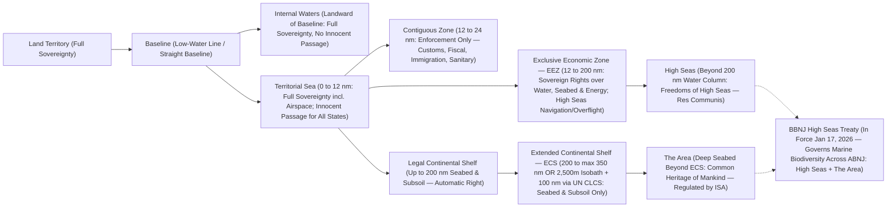

# 10. Ocean Floor Topography, Pelagic Stratification, Marine Sediments & UNCLOS Zonation

Oceans cover 70.8% of Earth's surface and store 97% of its water, yet treating them as homogeneous basins obscures the physics driving climate, marine productivity, and maritime geopolitics. Beneath the sea surface lies a lithosphere whose depth scales predictably with thermal age, overlaid by a density-stratified fluid column whose vertical barriers govern everything from cyclone intensification to hypoxic dead zones.

Equally decisive is the legal cartography superimposed on this physical relief. Through the 1982 United Nations Convention on the Law of the Sea (UNCLOS) and the **BBNJ High Seas Treaty** (in force since January 17, 2026), bathymetric boundaries—shelf breaks, sedimentary aprons, and 2,500-meter isobaths—translate directly into sovereign rights over hydrocarbons, deep-sea minerals, and pelagic biodiversity.

---

## 1. Ocean Floor Topography and the Bimodal Hypsographic Curve

### The Bimodal Hypsographic Curve and Lithospheric Physics

A **Hypsographic (Hypsometric) Curve** plots the cumulative percentage of Earth's surface area against elevation and bathymetric depth. Rather than forming a unimodal Gaussian bell centered on a single planetary mean, Earth's crustal elevation is sharply **bimodal**—exhibiting two distinct frequency peaks separated by roughly 4.5 km of vertical relief.

The first modal peak sits near **+100 m** (mean continental elevation **~+840 m**), and the second sits between **−4,000 m and −4,500 m** (mean oceanic depth **~−3,800 m**). This bimodality is a direct signature of **Airy isostasy** operating on two chemically distinct crustal types: thick, buoyant granitic/felsic continental crust (~35–40 km thick; $\rho \approx 2.7\text{ g/cm}^3$) versus thin, dense basaltic/mafic oceanic crust (~6–7 km thick; $\rho \approx 3.0\text{ g/cm}^3$).

Within ocean basins, bathymetry obeys conductive cooling physics. Newly erupted oceanic lithosphere at a Mid-Oceanic Ridge is hot, thermally expanded, and buoyant (crest depth ~2,500 m). As the plate spreads away, it cools, thickens, and densifies, subsiding roughly as the square root of lithospheric age ($d(t) \approx 2500 + 350\sqrt{t}\text{ m}$ for $t < 70\text{ Ma}$) before flattening across abyssal plains.

### Passive (Atlantic-Type) vs. Active (Pacific-Type) Continental Margins

Oceanic margins fall into two contrasting tectonic architectures that dictate shelf width, sediment thickness, hydrocarbon endowment, and earthquake hazard:

- **Passive (Atlantic-Type) Margins:** Formed along trailing plate edges created by continental rifting, far from active plate boundaries (eastern Americas, Western Europe, West Africa, and Peninsular India). They feature **wide continental shelves**, gentle slopes, massive hydrocarbon-bearing sedimentary prisms, well-developed **continental rises**, and low seismicity.
- **Active (Pacific-Type) Margins:** Coincide with convergent subduction zones or major transform boundaries (Andean South America, Japan, Kamchatka, Java–Sumatra). They exhibit **razor-thin or absent shelves**, precipitous slopes plunging directly into **oceanic trenches**, intense volcanism and Benioff seismicity, and **zero continental rise** because descending sediments are scraped into accretionary wedges or subducted into the mantle.

### The Four Major Divisions of Oceanic Relief

#### 1. Continental Shelf
The **Continental Shelf** is the submerged structural extension of the granitic continent, sloping imperceptibly seaward (average gradient $<1^\circ$, often $0.1^\circ$) until a sharp increase in gradient marks the **shelf break** at depths of **120–200 m** (global mean ~130 m). Accounting for **~7.5%–8.6%** of total ocean area, shelves average 70–80 km in width but display extreme tectonic variance.

- **Glacio-Eustatic Origin:** Most modern shelves were subaerially exposed coastal plains during Pleistocene glacial maxima (when global sea level stood ~120 m lower during the Last Glacial Maximum ~20 ka). Subaerial rivers, ice sheets, and waves planed and dissected these surfaces before Holocene deglaciation drowned them into shallow epicontinental seas.
- **Global Width Extremes:** Passive Arctic and Atlantic margins host expansive shelves—most notably the **Siberian Shelf** in the Arctic Ocean (world's widest, extending up to **1,500 km**), the **Grand Banks** (Newfoundland), the **North Sea**, and the **Sunda Shelf**. Conversely, active convergent margins such as the **Chilean–Peruvian coast** possess shelves narrower than 10–15 km.
- **Indian Shelf Asymmetry (High-Yield Prelims Anchor):** India's **Western Continental Shelf is substantially wider** than its Eastern Shelf—the exact inverse of its onshore coastal plains. Along the passive, faulted rifted margin of Gujarat and Maharashtra (Saurashtra–Mumbai High–Konkan), the shelf widens to **300–350 km** before tapering southward toward Kerala (~50–60 km). Along the Eastern Coast, despite broader deltaic coastal plains, the submerged shelf narrows to **30–50 km** off Tamil Nadu and Andhra Pradesh, widening marginally off the Ganga–Mahanadi mouths.
- **Economic Concentration:** Because shelves lie entirely inside the sunlit photic zone and receive continuous riverine nutrient flux plus benthic remineralization, they yield **over 90% of global marine fish catches** (Grand Banks, Dogger Bank, Sunda Shelf). Geologically, thick anaerobic organic muds trapped in passive-margin rift basins and ancient deltas make continental shelves the locus of **~30% of global crude oil and natural gas output** (Mumbai High, Cambay Offshore, Persian Gulf, North Sea, Gulf of Mexico, Brazil's Campos–Santos pre-salt basins).

#### 2. Continental Slope
Beginning abruptly at the shelf break, the **Continental Slope** plunges from ~200 m to **3,000–4,000 m** at gradients of **$2^\circ\text{–}5^\circ$** (locally exceeding $15^\circ\text{–}25^\circ$ on faulted or carbonate margins). Structurally, this is the true geological boundary where granitic continental crust thins and transitions into basaltic oceanic crust.

The signature geomorphic features of the continental slope are **Submarine Canyons**—deep, steep-walled, V-shaped gorges rivaling the Grand Canyon in vertical scale (e.g., **Monterey Canyon**, **Hudson Canyon**, **Congo Canyon**, **Indus Canyon**). While upper canyon heads may align with Pleistocene drowned river mouths, their abyssal extensions down to 3,000+ m cannot be carved by subaerial rivers.

Instead, they are scoured by **turbidity currents**—dense, sediment-charged gravity flows ($>1.1\text{ g/cm}^3$) triggered by earthquakes, storm-wave loading, or hyperpycnal river floods plunging down the slope at speeds up to 50–70 km/h. In the northern Bay of Bengal, the **Swatch of No Ground**—a massive 14 km wide, >1,200 m deep submarine canyon cutting diagonally across the shelf off the Ganga–Brahmaputra delta—acts as a direct tectonic-fluvial conveyor funneling Himalayan silt straight into the deep ocean.

#### 3. Continental Rise
At the base of the continental slope along **passive margins**, the gradient abruptly flattens ($0.1^\circ\text{–}1^\circ$), causing turbidity currents to decelerate and dump overlapping wedges of graded sediment (**deep-sea turbidite fans**). Coalesced laterally, these aprons construct the **Continental Rise**, bridging the slope to the abyssal plain between 3,000 and 4,500 m depth.

The Indian Ocean hosts Earth's two largest submarine depositional systems: the **Bengal Fan** (world's largest, stretching **>3,000 km** southward past Sri Lanka with Himalayan-derived sediment thicknesses exceeding **16–20 km** near its apex) and the **Indus Fan** in the Arabian Sea (second largest, >1,500 km long). Active Pacific margins lack continental rises because trench floors swallow outgoing sediment.

#### 4. Abyssal Plains and Abyssal Hills
Beyond the continental rise lie the **Abyssal Plains** (depths **3,000–6,000 m**)—Earth's flattest surfaces, with slopes under $1:1000$ ($<0.05^\circ$). Their extreme smoothness is not primordial; it results from thick sheets of fine-grained turbidites and pelagic oozes completely burying the rugged volcanic relief of the underlying oceanic crust.

Abyssal plains are extensive across the **Atlantic and Indian Oceans**, where passive margins deliver unobstructed continental sediment. In the **Pacific Ocean**, peripheral subduction trenches act as **sediment traps**, starving the ocean interior of terrigenous turbidites. Consequently, the Pacific floor is dominated by exposed **Abyssal Hills**—elongated volcanic and fault-bounded basaltic swells standing 100–1,000 m high, technically Earth's single most widespread geomorphic province.

### Minor, Tectonic and Hydrothermal Relief Features

#### Mid-Oceanic Ridges (MORs)
Winding **~65,000–75,000 km** across all ocean basins, the Mid-Oceanic Ridge system is Earth's longest continuous mountain chain, marking divergent plate boundaries where decompression melting of upwelling asthenosphere generates new basaltic crust. Rising 2–3 km above surrounding abyssal floors (crests ~2,500 m deep), MOR morphology varies systematically with spreading rate:

- **Slow-Spreading Ridges** (1–5 cm/yr; **Mid-Atlantic Ridge**, **Southwest Indian Ridge**, **Carlsberg Ridge**): Exhibit steep, rugged faulted flanks and a deep **axial rift valley** (1–2 km deep, 15–30 km wide) caused by episodic magma supply and tectonic stretching.
- **Fast-Spreading Ridges** (8–16 cm/yr; **East Pacific Rise**): Possess a continuous magma lens that produces a broad, smooth **axial high** lacking a deep central rift valley.

Because spherical plate rotation requires divergence arcs to step laterally, MORs are segmented every tens to hundreds of kilometers by **transform faults** (seismically active between offset ridge crests) and their inactive outward extensions, **fracture zones** (e.g., **Romanche Fracture Zone** in the Atlantic; **Owen Fracture Zone** separating Arabian and Indian plates). In the Indian Ocean, the **Central**, **Southwest**, and **Southeast Indian Ridges** converge in an inverted-Y geometry at the **Rodrigues Triple Junction**.

#### Hydrothermal Vents — Black Smokers, White Smokers and Chemosynthesis
Along fractured MOR axes, cold ($2^\circ\text{C}$) seawater percolates kilometers down through permeable basalt, approaches hot magma chambers, and superheats under intense hydrostatic pressure (~250–400 atm, suppressing phase boiling). This buoyant, acidic hydrothermal fluid leaches iron, copper, zinc, manganese, and sulfur from basalt before blasting back into freezing bottom water:

- **Black Smokers:** Vent directly over axial heat sources at **$350^\circ\text{–}400^\circ\text{C}$**. Upon meeting cold, alkaline bottom water, dissolved iron, copper, and zinc sulfides precipitate instantaneously as dark plumes and metallic sulfide chimneys (source of seafloor **Polymetallic Massive Sulphides**).
- **White Smokers:** Occur slightly cooler (**$200^\circ\text{–}300^\circ\text{C}$**) and further from axial magma lenses, precipitating lighter barium, calcium, and amorphous silica minerals. (Off-axis **Lost City-type alkaline vents** run even cooler at $40^\circ\text{–}90^\circ\text{C}$, driven by exothermic **serpentinization** of mantle peridotite that releases $\text{H}_2$ and $\text{CH}_4$—a prime candidate environment for the origin of life.)
- **Chemosynthetic Ecosystems:** Completely independent of solar photosynthesis, vent food webs rest on **chemolithoautotrophic bacteria and archaea** oxidizing $\text{H}_2\text{S}$ or $\text{CH}_4$ to fix inorganic carbon, sustaining endemic extremophiles (giant tube worms *Riftia*, vent crabs, blind shrimp).

#### Oceanic Trenches and Island Arcs
**Oceanic Trenches** are narrow, arcuate depressions plunging **6,000–11,000 m** (the **hadal zone**) where old, dense oceanic lithosphere bends downward into the mantle at subduction zones. Physically, they are marked by strong cross-sectional asymmetry (steeper arcward wall, gentler seaward plate wall), abnormally low geothermal heat flow, strong **negative free-air gravity anomalies** (mass deficit of the downwarped crust), and deep-focus **Wadati–Benioff seismicity**.

Trenches ring the **Pacific** (32 of ~57 major deeps: **Mariana Trench / Challenger Deep ~10,984 m**, Tonga–Kermadec, Kuril–Kamchatka, Japan, Peru–Chile), while remaining rare in the **Atlantic** (**Puerto Rico Trench ~8,376 m** and **South Sandwich Trench**) and **Indian Ocean** (**Sunda/Java Trench ~7,290–7,450 m**, bordering the Sumatra–Java–Andaman arc). Crucially, the deep **Diamantina Trench/Deep** (~7,079 m) off southwest Australia is a **tectonic fracture zone**, not a subduction trench.

Where oceanic lithosphere subducts beneath another oceanic plate, dehydration of the slab triggers partial melting of the overriding mantle wedge, constructing curved chains of volcanic **Island Arcs** (Aleutians, Mariana, Kuril, Japan, Andaman–Nicobar) often backed by extensional **Back-Arc Basins** (Sea of Japan, Andaman Sea, South China Sea).

#### Seamounts, Guyots and Aseismic Ridges
- **Seamounts:** Steep-sided, conical submarine volcanoes rising at least **1,000 m** above the surrounding seafloor without breaching the ocean surface. They act as topographic obstacles that induce localized upwelling, creating biodiversity oases across oligotrophic open oceans (e.g., **Afanasy Nikitin Seamount** in the Central Indian Basin).
- **Guyots (Tablemounts):** Flat-topped seamounts whose summits sit 200 to >1,500 m below sea level. They originated as volcanic islands above mid-ocean ridges or mantle hotspots, were beveled flat by subaerial wave erosion at sea level, and subsequently sank beneath the photic zone as the underlying oceanic plate cooled, thickened, and drifted away from the thermal swell (best preserved along the **Emperor–Hawaiian Seamount chain**—classic kinematic evidence for plate tectonics).
- **Aseismic Ridges:** Broad, volcanically inactive linear submarine ridges lacking axial rifts and spreading-center seismicity, typically representing mantle-plume hotspot tracks or sunken microcontinental slivers. Key Indian Ocean examples include the **Ninety East Ridge** (~5,000 km long, Earth's straightest aseismic ridge, traced to the Kerguelen hotspot) and the **Chagos–Laccadive Ridge** (Réunion hotspot track), alongside the **Walvis Ridge** in the South Atlantic.

---

## 2. Pelagic Stratification, Ocean Thermodynamics and Salinity Budgets

### Optical and Vertical Pelagic Zonation

Light attenuation in seawater is exponential and wavelength-selective: long-wavelength red and infrared photons are absorbed within the top 10–15 m, while blue-green light penetrates deepest in clear oligotrophic waters. This optical decay splits the ocean column into three foundational ecological tiers:

- **Epipelagic (Photic / Euphotic) Zone (0–200 m):** Receives $>1\%$ of incident solar radiation down to the **compensation depth** (where photosynthetic $\text{O}_2$ production equals respiratory consumption). Despite comprising <5% of ocean volume, it supports virtually all marine primary productivity.
- **Mesopelagic (Dysphotic / Twilight) Zone (200–1,000 m):** Faint blue light penetrates, insufficient for net photosynthesis. Dominated by bioluminescent organisms and Earth's largest daily animal migration (**diel vertical migration**)—notably **lanternfishes (Myctophids)**, highlighted in the **Ministry of Earth Sciences / CMLRE August 2026 Indian EEZ report** as a vast biomass driving the **biological carbon pump** by grazing at the surface at night and respiring/excreting carbon at mesopelagic depths by day.
- **Aphotic Zone (>1,000 m):** Pitch-black, high-pressure realm subdivided into the **Bathypelagic** (1,000–4,000 m), **Abyssopelagic** (4,000–6,000 m), and **Hadalpelagic** (>6,000 m inside trenches) zones. Life relies almost entirely on sinking organic detritus (**marine snow**) from the epipelagic layer or localized hydrothermal chemosynthesis.

### Ocean Temperature Budgets, SST Anomalies and the Thermocline

#### Surface Heat Inertia, Thermal Equator and Basin Asymmetries
Liquid water's high specific heat capacity ($\sim 4.18\text{ J/g}\cdot\text{K}$), transparency to shortwave radiation, turbulent vertical mixing, and evaporative heat loss give oceans immense thermal inertia compared to continental landmasses. Consequently, diurnal sea surface temperature (SST) swings rarely exceed $1^\circ\text{C}$, and annual ranges remain small—though higher in the **Northern Hemisphere** (mean SST **~19.4°C**) than the **Southern Hemisphere** (mean SST **~16.1°C**) due to the Northern Hemisphere's greater continental ratio and land-locked warm basins.

The oceanic **Thermal Equator** (zone of maximum annual SST) is displaced north of the geographic equator to **~5°N–10°N** by Northern Hemisphere landmass distribution and northward cross-equatorial ocean heat transport (driven by the Atlantic Meridional Overturning Circulation, AMOC). Across tropical basins, prevailing Trade Winds pile warm surface waters against **western boundaries**—creating the **Indo-Pacific Warm Pool** ($>28^\circ\text{–}29^\circ\text{C}$ year-round)—while exposing cold, upwelled water along **eastern margins** (Peru, Benguela, California, Canary). In mid-latitudes, this zonal gradient flips: westerlies and poleward warm boundary currents keep eastern margins (Northwestern Europe) markedly warmer than western margins (Labrador, Hokkaido).

Enclosed seas display latitude-dependent thermal anomalies. **Low-latitude enclosed seas** (**Red Sea ~$30^\circ\text{–}32^\circ\text{C}$**, **Persian Gulf up to $35^\circ\text{C}$**) run significantly hotter than open oceans at matching latitudes because surrounding deserts radiate sensible heat and restrict cold deep-water exchange. Conversely, **high-latitude enclosed seas** (**Baltic Sea, Hudson Bay**) freeze and run colder than adjacent open oceans heated by poleward warm drifts.

#### Sea Surface Temperature (SST) vs. Ocean Mean Temperature (OMT)
A critical physical distinction tested by UPSC Prelims (2020) separates **SST** from **Ocean Mean Temperature (OMT)**. SST measures only the upper skin of the sea (a few millimeters), making it vulnerable to short-term noise from cloud cover, wind squalls, and evaporation.

**OMT** integrates thermal energy across the upper ocean column down to the **$26^\circ\text{C}$ isotherm** (the thermodynamic threshold for deep atmospheric convection and cyclogenesis). Measured in the **Southwestern Indian Ocean during January–March** (where the mean $26^\circ\text{C}$ isotherm depth sits at **~59 m**, within a 50–100 m envelope—NOT 129 m), OMT captures bulk upper-ocean heat content, lifting Indian Summer Monsoon departure forecasting skill from ~60% (using SST) to ~80% (IITM Pune research).

#### Vertical Temperature Profile and Latitudinal Thermocline Shift
In tropical and subtropical oceans, the vertical temperature curve exhibits three distinct layers:

1. **Surface Mixed Layer (0–200 m):** Homogenized by wind stress and wave turbulence; nearly isothermal at $20^\circ\text{–}28^\circ\text{C}$.
2. **Thermocline (~200–1,000 m):** A sharp thermal transition zone ($\partial T/\partial z$ steep) where temperature plunges from $>20^\circ\text{C}$ down to $\sim 4^\circ\text{–}5^\circ\text{C}$, containing ~90% of the total vertical temperature drop.
3. **Deep Isothermal Layer (>1,000 m):** Uniformly frigid ($0^\circ\text{–}4^\circ\text{C}$) across all latitudes, accounting for ~80%–90% of global ocean volume; continuously replenished by dense polar water sinking in the North Atlantic and Southern Ocean.

Crucially, the thermocline is **not uniform across latitudes**:
- **Tropics & Subtropics:** A strong **permanent thermocline** persists year-round due to relentless surface insolation.
- **Mid-Latitudes ($35^\circ\text{–}60^\circ$):** A **seasonal thermocline** develops in the upper 100–200 m during summer heating, then breaks down during winter cooling and storm mixing to merge with a weaker permanent thermocline below.
- **Polar Latitudes ($>60^\circ$):** **No thermocline exists**. Surface water already approaches freezing ($-1.8^\circ\text{C}$ for 35 PSU seawater), creating a nearly isothermal column from surface to floor—often displaying a slight **temperature inversion** where sub-zero freshwater meltwater caps slightly warmer ($+1^\circ\text{ to }+2^\circ\text{C}$) saline Atlantic Intermediate Water beneath.

### Seawater Salinity, Dittmar's Law and Halocline Sign-Reversal

#### Chemical Composition and Dittmar's Law
**Salinity** is the total mass of dissolved inorganic solids per kilogram of seawater, expressed in parts per thousand ($\text{‰}$) or Practical Salinity Units (**PSU**; global open-ocean mean **~35 PSU**). Six conservative ions constitute >99% of dissolved salts: **Chloride ($\text{Cl}^-$, 55.0%)**, **Sodium ($\text{Na}^+$, 30.6%)**, **Sulfate ($\text{SO}_4^{2-}$, 7.7%)**, **Magnesium ($\text{Mg}^{2+}$, 3.7%)**, **Calcium ($\text{Ca}^{2+}$, 1.2%)**, and **Potassium ($\text{K}^+$, 1.1%)**. Expressed as textbook salt compounds, **$\text{NaCl}$ (~77.8%)** dominates, followed by **$\text{MgCl}_2$ (~10.9%)**, **$\text{MgSO}_4$ (~4.7%)**, and **$\text{CaSO}_4$ (~3.6%)**.

**Dittmar's Law (Principle of Constant Proportions)**—established during the *HMS Challenger* expedition (1872–1876)—states that while *total* salinity fluctuates geographically, the **relative ratios among the major dissolved ions remain strictly constant** throughout the open oceans. The physical reason is a timescale separation: ionic residence times ($\text{Cl}^- \approx 100\text{ Ma}$; $\text{Na}^+ \approx 68\text{ Ma}$) dwarf the global ocean thermohaline mixing time (~1,000–1,500 years), homogenizing relative chemistry completely. This allows oceanographers to compute total salinity directly from a single parameter (chlorinity or electrical conductivity). *(Non-conservative constituents—nitrates, phosphates, silicates, dissolved $\text{O}_2/\text{CO}_2$—violate Dittmar's Law because rapid biological uptake and respiration outpace ocean mixing.)*

#### Horizontal Distribution — The Bimodal $E - P$ Profile
Open-ocean surface salinity mirrors the global **Evaporation minus Precipitation ($E - P$)** budget rather than temperature alone:

- **Subtropical Maxima ($20^\circ\text{–}30^\circ\text{ N/S}$: 36–37.5 PSU):** Highest open-ocean salinities occur NOT at the equator, but beneath the arid, subsiding branches of the Hadley Cells (Horse Latitudes), where clear skies and dry Trade Winds maximize $E - P > 0$ (peaking at ~37.5 PSU in the North and South Atlantic subtropical gyres).
- **Equatorial Relative Minimum ($0^\circ\text{–}10^\circ$: 34–35 PSU):** Despite high solar heating, heavy ITCZ convective rainfall ($P > E$), persistent cloudiness, and massive tropical river plumes (Amazon, Congo) dilute surface waters.
- **High-Latitude Minima ($>60^\circ$: 32–34 PSU):** Low evaporation, frontal precipitation, polar river discharge, and summer sea-ice melt freshen surface waters. The localized exception is **winter sea-ice formation**: freezing excludes salt ions from the ice crystal lattice (**brine rejection**), producing ultra-dense, cold saline pockets that sink to drive global deep-water formation.
- **Inter-Basin Contrast:** The **Atlantic Ocean (~35.4–36 PSU)** is saltier than the **Pacific (~34.6 PSU)** because Trade Winds transport moisture westward across the low Isthmus of Panama from the Atlantic into the Pacific, while the tall Rockies/Andes block Pacific moisture from returning eastward.

#### Vertical Salinity and Latitudinal Halocline Sign-Reversal
Below ~1,000–1,500 m, deep-ocean salinity converges globally to a remarkably narrow band (**~34.7–35.0 PSU**). Because surface salinity swings sharply on either side of this deep baseline, the **halocline** (zone of rapid vertical salinity change between ~200 and 1,000 m) **reverses mathematical sign with latitude**:

- **Low & Subtropical Latitudes:** Evaporative surface waters (~36–37 PSU) are saltier than deep waters (~34.7 PSU), so salinity **decreases with depth** ($\partial S/\partial z < 0$; negative halocline).
- **High & Polar Latitudes:** Fresh, rain- and melt-diluted surface waters (~32–33 PSU) are fresher than deep waters (~34.8 PSU), so salinity **increases with depth** ($\partial S/\partial z > 0$; positive halocline). In the Arctic Ocean, this salt-stabilized **cold halocline layer** acts as an essential thermal shield preventing warmer underlying Atlantic water from melting the surface sea-ice cap from below.

### Pycnocline, Arabian Sea vs. Bay of Bengal Asymmetry and Marine Dead Zones

#### The Pycnocline and Stratification Physics
Seawater density $\rho(T, S, P)$ increases with decreasing temperature, increasing salinity, and increasing hydrostatic pressure (standard surface seawater $\approx 1.025\text{ g/cm}^3$). The vertical zone of steepest density increase (~200–1,000 m) is the **pycnocline**, which governs vertical fluid stability via the squared buoyancy (Brunt–Väisälä) frequency $N^2 = -(g/\rho_0)(\partial\rho/\partial z)$. A steep pycnocline acts as a mechanical barrier suppressing vertical turbulence, gas ventilation, and nutrient upwelling.

Because the thermal expansion coefficient of seawater drops sharply near $0^\circ\text{C}$, density control shifts cleanly across latitudes: **low- and mid-latitude pycnoclines are temperature-controlled** (tracking the thermocline), whereas **polar pycnoclines are salinity-controlled** (tracking the positive halocline).

#### Arabian Sea vs. Bay of Bengal — Stratification and the Cyclone Barrier Layer
Occupying identical tropical latitudes on opposite flanks of the Indian Peninsula, the Arabian Sea and Bay of Bengal exhibit sharply divergent hydrography that directly controls monsoon dynamics and tropical cyclogenesis:

- **Arabian Sea (High Salinity ~36–37 PSU):** Flanked by arid deserts (Arabia, Thar), experiencing intense dry-wind evaporation, receiving minimal river inflow (primarily Indus, Narmada, Tapi), and absorbing dense, hypersaline subsurface outflows from the **Red Sea** and **Persian Gulf**. Because surface density is high and salinity stratification is weak, strong southwest monsoon winds readily mix the upper column and drive vigorous coastal upwelling (Somalia, Oman, Kerala), bringing cool nutrient-rich water upward.
- **Bay of Bengal (Low Salinity ~30–33 PSU, dropping <25 PSU near delta heads):** Receives colossal monsoonal freshwater discharge from the Ganga, Brahmaputra, Irrawaddy, Godavari, Krishna, and Mahanadi alongside heavy direct rainfall. This buoyant freshwater cap creates a shallow **halocline** (~20–40 m) well above the deeper **thermocline** (~60–100 m).
- **The Cyclone Barrier Layer:** The sandwiched zone between the shallow salt-stratified mixed layer and the deeper thermocline is termed the **Barrier Layer** (nearly isothermal in temperature yet strongly stratified in salinity). When a tropical cyclone churns the Bay of Bengal, wind mixing cannot easily penetrate this salinity shield to entrain cold sub-thermocline water. Surface SSTs remain stubbornly above **$28^\circ\text{–}30^\circ\text{C}$**, continuously feeding latent heat into the vortex—explaining why the Bay of Bengal historically breeds **~4:1 more cyclones** than the Arabian Sea (even as rapid anthropogenic ocean warming in the Arabian Sea is now narrowing this historical gap).

#### Marine Dead Zones and Oxygen Minimum Zones (OMZs)
**Marine Dead Zones** are hypoxic water bodies where dissolved oxygen ($\text{DO}$) falls below **$2\text{ mg/L}$** ($<63\text{ }\mu\text{mol/L}$), causing mass mortality of sessile benthos and driving mobile nekton away. They form where two physical-biogeochemical triggers lock together:

1. **Eutrophication & Respiratory Demand:** Excess anthropogenic nitrogen and phosphorus runoff (fertilizers, untreated sewage) sparks explosive phytoplankton blooms. When blooms die and sink below the photic zone, aerobic heterotrophic bacteria consume massive quantities of $\text{O}_2$ decomposing the organic flux.
2. **Pycnocline Ventilation Cutoff:** Strong thermal warming and/or freshwater haloclines (e.g., Mississippi River plume in the **Northern Gulf of Mexico**, riverine dilution in the **Baltic Sea**, **Chesapeake Bay**, **East China Sea**) lock the bottom layer off from atmospheric oxygen replenishment.

Distinct from shallow coastal dead zones are naturally occurring mid-water **Oxygen Minimum Zones (OMZs)** at 200–1,000 m depth, fueled by high surface productivity coupled with sluggish subsurface ventilation. The **Arabian Sea** hosts the world's thickest and most intense pelagic OMZ (suboxic down to $\sim 1,200\text{ m}$), where anaerobic microbes switch from oxygen to nitrate respiration (**denitrification**), releasing potent greenhouse gas $\text{N}_2\text{O}$ and shrinking habitable pelagic volume. The **Bay of Bengal OMZ** sits on a fragile biochemical tipping point—retaining trace nanomolar $\text{O}_2$ concentrations that barely hold back runaway denitrification, a margin now threatened by warming-induced lower $\text{O}_2$ solubility and stronger upper-ocean stratification.

### Salinity Extremes and Enclosed Sea Stratification Matrix

| Water Body | Typical Surface Salinity ($\text{‰}$ / PSU) | Dominant Water Balance & Sill Control | Stratification & Ecological / Climatic Signature |
| :--- | :--- | :--- | :--- |
| **Lake Van** *(Turkey)* | **~330‰** *(highest major salt lake cited in NCERT)* | Endorheic volcanic soda lake; intense evaporation, zero outlet, alkaline carbonates ($\text{Na}_2\text{CO}_3$). | Extreme buoyancy; hosts rare endemic pearl mullet (*Alburnus tarichi*) near freshwater inlets. |
| **Dead Sea** *(Jordan–Israel–Palestine)* | **238‰** *(legacy NCERT)* / **~330–340‰** *(modern shrunken state)* | Endorheic rift graben (~430 m below sea level); hyper-arid $E \gg P$; Jordan River diversion accelerates salt precipitation. | Dual-standard exam parity required; virtually devoid of macroscopic life (halophilic archaea/bacteria only); $\text{MgCl}_2$-rich. |
| **Great Salt Lake** *(USA)* | **~220‰** *(varies 50–270‰ by arm)* | Endorheic remnant of glacial Lake Bonneville; shallow basin subject to rapid arid shrinkage. | Rail causeway splits hypersaline north arm from fresher river-fed south arm. |
| **Red Sea** | **37–41‰** | Hyper-arid desert rift; virtually zero precipitation, **zero perennial river inflow** *(Prelims 2024)*; shallow **Bab-el-Mandeb** sill restricts Indian Ocean exchange. | Warm, ultra-saline bottom outflow spills over sill into Gulf of Aden, elevating intermediate Arabian Sea salinity. |
| **Persian Gulf** | **39–41‰** | Shallow (<90 m) arid epicontinental sea; intense summer heating (>35°C) outstrips Tigris–Euphrates inflow; narrow **Strait of Hormuz**. | Feeds dense, hypersaline bottom outflow along the Oman margin into the Northern Arabian Sea. |
| **Mediterranean Sea** | **37–39‰** *(east > west)* | High $E > P + R$ (Nile damming at Aswan raised Eastern Med salinity); shallow **Strait of Gibraltar** sill (~300 m). | Anti-estuarine exchange: fresher Atlantic water enters at surface; dense **Mediterranean Outflow Water (MOW)** plunges along sill floor into Atlantic at ~1,000 m. |
| **Arabian Sea** | **~36–37‰** | Arid air mass, high evaporation, sparse rivers, plus Red Sea & Persian Gulf saline inflows. | Weak salinity stratification enables monsoon upwelling; hosts world's most intense mid-water **OMZ**. |
| **Bay of Bengal** | **~30–33‰** *(locally <25‰)* | Heavy monsoonal rainfall + massive Ganga–Brahmaputra–Irrawaddy–Peninsular runoff. | Shallow halocline creates **Barrier Layer**, suppressing cold-water upwelling and intensifying tropical cyclones. |
| **Black Sea** | **~17–18‰** *(surface)* / ~22‰ *(deep)* | Heavy river discharge (Danube, Dnieper, Don); narrow **Bosphorus** sill limits dense Mediterranean bottom inflow. | Extreme permanent halocline; **world's largest anoxic/euxinic ($\text{H}_2\text{S}$-rich) basin** below ~150–200 m (preserves ancient wooden shipwrecks). |
| **Baltic Sea** | **~3–15‰** *(brackish)* | High-latitude low evaporation + huge Scandinavian/Central European runoff; restricted **Danish Straits**. | Strong positive halocline; seasonally ice-bound; severe anthropogenic eutrophication and extensive benthic **Dead Zones**. |

---

## 3. Marine Sediments and the Carbonate Compensation Depth (CCD)

Marine sediments cloak almost the entire ocean floor—thinning to zero over newly erupted basalt at Mid-Oceanic Ridge crests and thickening progressively with crustal age to >15 km along passive continental margins. Modern marine geology classifies these deposits by source into four domains: **Terrigenous (Lithogenous)**, **Biogenous (Pelagic Oozes)**, **Hydrogenous (Authigenic)**, and **Cosmogenous** (extraterrestrial micrometeorites and microtektites, constituting $<1\%$ by mass).

### Terrigenous (Lithogenous) Deposits and Turbidites

Derived from mechanical and chemical weathering of continental rocks (primarily quartz and clay minerals), terrigenous sediments reach the ocean via rivers (~90% of mass flux), glacial calving (**ice-rafted debris**), and continental windstorms (**aeolian dust** from the Sahara, Thar, and Central Asian deserts).

Across shelves and slopes, hydrodynamic energy sorts terrigenous particles by grain size: nearshore **gravels and sands** grade seaward into **silts and continental muds** (classified classically by oxidation state and mineralogy into **Blue Mud**—iron sulfides in mildly reducing shelf environments; **Green Mud**—potassium-iron silicate *glauconite* on slow-deposition shelves; and **Red Mud**—oxidized ferric iron oxides delivered by tropical rivers like the Amazon and Yellow River).

Along passive margins, turbidity currents flush vast terrigenous volumes beyond the shelf edge onto continental rises and abyssal plains as graded beds (**turbidites**, characterized by upward-fining **Bouma sequences**). Crucially, while terrigenous sediments cover only ~25% of ocean floor *area*, they account for **~75% of total marine sediment volume** due to the enormous thickness of continental-margin prisms like the Bengal and Indus Fans.

### Biogenous Pelagic Oozes and the Carbonate Compensation Depth (CCD)

Pelagic sediments containing **$\ge 30\%$ skeletal microfossils** by weight are designated **Oozes**—split chemically into calcareous and siliceous branches with starkly different depth physics.

#### Calcareous Oozes ($\text{CaCO}_3$) and CCD Geochemistry
Formed from the sinking calcium carbonate shells of sunlit surface plankton, calcareous oozes blanket roughly **48% of the global seafloor**, occurring in two distinct mineral polymorphs:

- **Globigerina (Foraminiferal) & Coccolithophore Ooze:** Composed of **calcite** (the less soluble crystal form of $\text{CaCO}_3$). **Globigerina ooze** (protozoan foraminifera) is the single most abundant calcareous deposit, dominating mid-depth ridges and plateaus across the Atlantic and Indian Oceans.
- **Pteropod Ooze:** Composed of **aragonite** shells of pelagic sea butterflies (mollusks). Because aragonite is thermodynamically more soluble than calcite, pteropod ooze dissolves at much shallower depths (~2,000–3,000 m) and is restricted to tropical ridges, coral-margin flanks, and isolated warm seas (e.g., Red Sea, Bahamas).

Calcareous distribution is sharply truncated by the **Carbonate Compensation Depth (CCD)**—the bathymetric level at which the downward rain rate of $\text{CaCO}_3$ shells exactly equals their rate of chemical dissolution. Just 500–1,000 m above the CCD sits the **Lysocline**, where dissolution rates first accelerate visibly.

The controlling geochemistry is governed by cold deep water, rising hydrostatic pressure, and accumulated metabolic $\text{CO}_2$ along deep circulation paths:
$$\text{CO}_2 + \text{H}_2\text{O} + \text{CaCO}_3 \rightleftharpoons \text{Ca}^{2+} + 2\text{HCO}_3^-$$

Higher dissolved $\text{CO}_2$ and pressure shift this equilibrium right, converting solid shells into dissolved bicarbonate ions. Consequently, **the CCD is deeper in the Atlantic Ocean (~4,500–5,000 m)** than in the **Pacific Ocean (~4,000–4,500 m)**. Young North Atlantic Deep Water (NADW) sinks freshly ventilated with low $\text{CO}_2$ (less corrosive), whereas aged deep Pacific water has traveled for over a millennium accumulating respired $\text{CO}_2$ (more acidic, shoaling the CCD).

Because ocean floor depth increases as crust ages away from Mid-Oceanic Ridges, newly formed ridge flanks lie *above* the CCD and accumulate thick calcareous "snowcaps," whereas older, subsided abyssal plains plunge *below* the CCD where calcite vanishes completely. Anthropogenic $\text{CO}_2$ uptake (**ocean acidification**) is currently driving the lysocline and CCD upward, eroding seafloor carbonate buffers.

#### Siliceous Oozes ($\text{SiO}_2 \cdot n\text{H}_2\text{O}$) — No CCD Threshold
Composed of opaline silica tests from single-celled plankton, siliceous oozes cover **~14%–15% of the seafloor** in two biogeographic belts:

- **Diatom Ooze:** Microscopic photosynthetic algae dominating cold, nutrient-rich **high-latitude upwelling belts**—forming an unbroken circumpolar band across the **Southern Ocean** around Antarctica and along the **North Pacific** rim.
- **Radiolarian Ooze:** Protozoan zooplankton thriving in warm, nutrient-rich **equatorial upwelling zones**—primarily the **Equatorial Pacific** and parts of the eastern **Indian Ocean**.

Unlike calcium carbonate, **siliceous ooze has NO Carbonate Compensation Depth analog**. The entire ocean column is chemically undersaturated with respect to silica at all depths—in fact, opal dissolves fastest in *warmer surface waters*, not the frigid abyss. Siliceous oozes therefore accumulate successfully even below 4,500–5,000 m wherever high surface upwelling productivity supplies silica faster than water can dissolve it—and where the dissolution of faster-falling calcareous shells below the CCD prevents silica from being diluted out.

### Hydrogenous (Authigenic) Deposits and Abyssal Red Clay

- **Hydrogenous (Authigenic) Sediments:** Precipitate directly from dissolved ions in seawater via inorganic or microbially catalyzed chemical reactions. Prominent types include **Polymetallic (Ferromanganese) Nodules** (Mn, Fe, Ni, Cu, Co concretions accreting at ~1–10 mm per million years on oxidized abyssal plains below the CCD where terrigenous burial is negligible—notably the **Central Indian Ocean Basin** and Pacific **Clarion–Clipperton Zone**), **Cobalt-Rich Ferromanganese Crusts** on seamount flanks, **Polymetallic Sulphides** around hydrothermal smokers, continental-shelf **Phosphorites** under upwelling zones, and marine **Evaporites** (halite, gypsum) in desiccating basins. *(Deep-sea mineral extraction geopolitics and India's Deep Ocean Mission are detailed in Chapter 11.)*
- **Abyssal Red Clay (Pelagic Clay):** Covers **~38% of the global ocean floor**—dominating Earth's deepest, most nutrient-starved basins **below the CCD** (especially the vast **North Pacific Abyssal Plain**, >4,500 m). Composed of ultra-fine (<2 µm) terrestrial clay minerals transported by high-altitude winds (aeolian dust), altered volcanic ash, and insoluble biogenic residues, Red Clay accumulates at glacial speeds (**~1–3 mm per 1,000 years**). Its characteristic brick-red to chocolate hue reflects oxidized ferric iron ($\text{Fe}^{3+}$) formed during prolonged exposure to oxygenated bottom water before burial.

### Marine Sediments Classification and Depth-Control Matrix

| Sediment Class | Sub-Types & Dominant Mineralogy | Depth / CCD Control | Primary Oceanic Distribution | Economic / Paleoclimatic Value |
| :--- | :--- | :--- | :--- | :--- |
| **Terrigenous (Lithogenous)** | Continental gravels, sands, Blue/Green/Red muds, graded **Turbidites** (quartz, aluminosilicate clays). | Independent of CCD; controlled by continental proximity, shelf-slope canyons, and trench barriers. | Passive continental shelves, slopes, rises (**Bengal & Indus Fans**), Atlantic & Indian abyssal plains (~75% of sediment *volume*). | Major **offshore oil & gas** source/reservoir rocks; placer minerals (monazite, ilmenite) on inner shelves. |
| **Biogenous — Calcareous Ooze** | **Globigerina** (foraminifera, calcite), **Coccolithophore** (calcite), **Pteropod** (aragonite). | Strictly **above CCD** (~4,500–5,000 m Atlantic; ~4,000–4,500 m Pacific); Pteropod dissolves shallower (~2,000–3,000 m). | ~48% of seafloor; Mid-Oceanic Ridge flanks, oceanic plateaus, mid-depth Atlantic & Indian basins. | Premier **paleoclimate archive** ($\delta^{18}\text{O}$ isotopic thermometer in foraminifera reconstructs glacial cycles); chalk/limestone precursor. |
| **Biogenous — Siliceous Ooze** | **Diatom** (phytoplankton, opal $\text{SiO}_2$) & **Radiolarian** (zooplankton, opal $\text{SiO}_2$). | **No CCD**; survives at abyssal depths (>4,500 m) wherever high surface productivity outpaces dissolution. | ~15% of seafloor; **Diatom** in Antarctic Southern Ocean & N. Pacific; **Radiolarian** in Equatorial Pacific & E. Indian Ocean. | Diatomaceous earth (industrial filtration); indicator of paleoproductivity & past upwelling shifts. |
| **Hydrogenous (Authigenic)** | **Polymetallic Nodules** (Mn–Fe–Ni–Cu–Co), Co-crusts, hydrothermal **Polymetallic Sulphides**, Phosphorites. | Nodules thrive **below CCD** on slow-sedimentation abyssal floors; sulphides along MOR vents; phosphorites on shelves. | Central Indian Ocean Basin (CIOB), Pacific Clarion–Clipperton Zone, MOR axes, Peru/Namibia shelves. | Strategic **critical minerals** (battery metals: Co, Ni, Mn, Cu, REEs) & agricultural phosphate fertilizers. |
| **Abyssal Red Clay (Pelagic Clay)** | Ultra-fine (<2 µm) wind-blown aluminosilicate clays, volcanic ash, oxidized $\text{Fe}^{3+}$ oxides. | Dominates **below CCD** (>4,500 m) in oligotrophic interiors devoid of turbidites and upwelling oozes. | ~38% of seafloor; dominant across the deep **North Pacific** and central South Pacific basins. | Ultra-slow accumulation (~1–3 mm/kyr); enriched in **Rare Earth Elements & Yttrium (REY-rich muds)** near Minamitorishima (Japan). |

---

## 4. UNCLOS (1982), Extended Continental Shelf Claims and the BBNJ High Seas Regime (2026)

### Constitutional Architecture of UNCLOS (1982)

Adopted at Montego Bay on **December 10, 1982** and in force since **November 16, 1994**, the **United Nations Convention on the Law of the Sea (UNCLOS)** functions as the "Constitution for the Oceans," binding **172 parties** (171 states plus the European Union as of 2026). **India ratified UNCLOS on June 29, 1995**, complementing its pre-existing domestic statute, the *Territorial Waters, Continental Shelf, Exclusive Economic Zone and other Maritime Zones Act, 1976*.

Notably, the **United States has never ratified UNCLOS** (largely over Part XI seabed-mining objections), though Washington adheres to its navigational and zonal provisions as customary international law. UNCLOS established three permanent international organs:

1. **International Seabed Authority (ISA, Kingston, Jamaica):** Regulates mineral exploration and exploitation in international seabed areas ("The Area").
2. **International Tribunal for the Law of the Sea (ITLOS, Hamburg, Germany):** Adjudicates maritime boundary, vessel-arrest, and fisheries disputes (e.g., the 2014 Bangladesh–India maritime delimitation award under Annex VII arbitration).
3. **Commission on the Limits of the Continental Shelf (CLCS, New York):** A 21-member technical body of geologists, geophysicists, and hydrographers reviewing scientific submissions for Extended Continental Shelves beyond 200 nautical miles.

### UNCLOS Concentric Maritime Zones Diagram

### Spatial Mechanics and Legal Gradients of Maritime Zones

#### 1. Baselines and Internal Waters
All seaward maritime zones ($1\text{ nautical mile} = 1.852\text{ km}$) are measured outward from the **Baseline**:
- **Normal Baseline (Art. 5):** The low-water line along the coast marked on large-scale charts officially recognized by the coastal state.
- **Straight Baselines (Art. 7):** Permitted where coastlines are deeply indented, fringed by immediate coastal island chains (e.g., Norwegian fjords, parts of India's coasts), or rendered unstable by advancing deltas.
- **Archipelagic Baselines (Part IV):** Exclusively reserved for **Archipelagic States** wholly constituted by one or more archipelagos (Indonesia, Philippines, Fiji, Maldives). **Mainland states possessing outlying island chains**—such as India (Andaman & Nicobar, Lakshadweep) or Ecuador (Galápagos)—are **legally barred** from drawing archipelagic baselines around those islands.

Waters landward of the baseline constitute **Internal Waters** (ports, estuaries, bays, historic waters). The coastal state exercises absolute sovereignty identical to terrestrial land, with **no right of innocent passage** for foreign vessels (except where newly drawn straight baselines enclose waters previously open to international navigation).

#### 2. Territorial Sea (Up to 12 Nautical Miles)
Extending up to **12 nm** from the baseline, the **Territorial Sea** confers **full coastal-state sovereignty** over the **water column, seabed, subsoil, AND superjacent airspace**. Sovereignty here is qualified by one foundational maritime rule:

- **Right of Innocent Passage (Art. 17–19):** Ships of **all states—whether coastal or land-locked**—enjoy continuous and expeditious passage so long as it is not prejudicial to the peace, good order, or security of the coastal state (Prelims 2022).
- **Operational Constraints:** Military intelligence gathering, weapons exercises, fishing, or survey activity void innocence. **Submarines and underwater vehicles must navigate on the surface and show their flag** (Art. 20). Critically, **aircraft do NOT enjoy innocent passage over the territorial sea**—prior overflight consent is mandatory. *(Exception: in **straits used for international navigation** such as Malacca, Hormuz, or Bab-el-Mandeb, UNCLOS Part III replaces innocent passage with non-suspendable **Transit Passage**, which permits both overflight and submerged submarine transit.)*

#### 3. Contiguous Zone (12 to 24 Nautical Miles)
Stretching up to **24 nm** from the baseline (overlapping the innermost 12 nm of the EEZ), the **Contiguous Zone** grants **no sovereignty** and **no airspace control**. It confers strictly limited **enforcement jurisdiction** allowing the coastal state to prevent and punish infringements of four domestic statutory domains (**CFIS**): **Customs, Fiscal, Immigration, and Sanitary** laws committed within its land territory or territorial sea (Art. 33), plus jurisdiction over removing archaeological and historical objects from the seabed (Art. 303).

#### 4. Exclusive Economic Zone — EEZ (Up to 200 Nautical Miles)
Extending seaward beyond the Territorial Sea up to **200 nm** from the baseline, the EEZ is a *sui generis* functional zone balancing coastal resource rights with global maritime mobility:

- **Coastal State Rights:** **Sovereign rights** (legally distinct from full sovereignty) for exploring, exploiting, conserving, and managing both living and non-living natural resources of the **waters superjacent to the seabed, the seabed, and its subsoil**, plus economic activities such as offshore wind, wave, and current energy generation (Art. 56). The coastal state also exercises **jurisdiction** over artificial islands/installations, **Marine Scientific Research (MSR)**, and marine environmental protection.
- **Foreign State Freedoms:** All other states retain High Seas freedoms of **navigation, overflight, and laying submarine cables and pipelines** (Art. 58). *(Geopolitical friction point: India's 1995 UNCLOS declaration insists foreign naval exercises involving weapons/explosives inside India's EEZ require prior consent; the US rejects this reading and conducts Freedom of Navigation Operations [FONOPs], such as the April 2021 USS John Paul Jones transit off Lakshadweep.)*
- **India's EEZ — Dual-Standard Numeric Parity & 2025–26 Policy Architecture:** Legacy Fishery Survey of India and 1976 proclamation texts cite India's EEZ as **2.02 million sq km** (~0.86M sq km West Coast, ~0.56M sq km East Coast, ~0.60M sq km Andaman & Nicobar). Updated official GoI, **Ministry of Earth Sciences (MoES)**, and Indian Coast Guard surveys (cited in PIB releases of November 2025 and August 2026) report **2.37 million sq km** ("over 23 lakh sq km"—18th largest globally, ~72% of India's landmass). Anchoring this frontier alongside India's recalculated **11,098.81 km** coastline, GoI notified the *Rules for Sustainable Harnessing of Fisheries in the EEZ* in **November 2025** (prioritizing fishermen cooperatives/FFPOs for underutilized deep-sea tuna around A&N and Lakshadweep), followed in **August 2026** by MoES/CMLRE's landmark *National Report on Deep-Sea and Distant-Water Fishery Resources of the Indian EEZ* synthesizing four decades of *FORV Sagar Sampada* cruises.

#### 5. Legal Continental Shelf and Extended Continental Shelf (ECS — Art. 76)
UNCLOS divorces the **legal continental shelf** from narrow physical bathymetry. Every coastal state automatically owns seabed and subsoil rights out to **200 nm** even where the physical continental shelf is barely 10 km wide (e.g., Chile). Conversely, where the geological continental margin naturally prolongs beyond 200 nm, a state may claim an **Extended Continental Shelf (ECS)** by submitting geophysical and bathymetric evidence to the **CLCS**.

- **Outer-Limit Geometric Rules (Art. 76):** Measured seaward from the **Foot of the Continental Slope** (point of maximum change in gradient at the slope's base) using whichever formula is more favorable: the **Gardiner (Irish) sedimentary thickness rule** (where sediment thickness $\ge 1\%$ of shortest distance back to the Foot of Slope) or the **Hedberg distance rule** (Foot of Slope + 60 nm). This extension is capped by one of two absolute outer constraints: **350 nm from baselines** OR **100 nm seaward of the 2,500-meter isobath** (submarine ridges are restricted to the 350 nm cap, whereas natural continental elevations may invoke the 2,500 m + 100 nm constraint).
- **Vertical Split of Rights & Revenue Sharing:** An ECS confers sovereign rights **exclusively over the seabed and subsoil** (oil, gas, mineral deposits, and sedentary benthic organisms like corals, sponges, and oysters). The **superjacent water column beyond 200 nm remains High Seas**—the coastal state gets zero exclusive pelagic fishing rights there. Additionally, under **Article 82**, commercial hydrocarbon/mineral extraction from the ECS beyond 200 nm requires annual revenue-sharing contributions to the ISA beginning in Year 6 of production (1% rising to 7% by Year 12) for equitable distribution among developing and land-locked states.
- **India's April 2025 Central Arabian Sea ECS Split Claim (+10,000 sq km):** India lodged its initial partial ECS submission on **May 11, 2009** covering the Arabian Sea, Bay of Bengal, and western Andaman waters. After Pakistan objected in 2021 citing a ~100 nm overlap tied to the unresolved **Sir Creek** estuary dispute, the CLCS declined to consider India's entire Arabian Sea submission in **March 2023** (under CLCS rules barring review of disputed areas without neighbor consent), while permitting a modified resubmission. On **April 3, 2025**, India tactically **split its Western/Arabian Sea claim into two separate partial submissions**—quarantining the Pakistan-contested northern sector for future bilateral settlement while **expanding its uncontested Central Arabian Sea claim by nearly 10,000 sq km**. (A minor western overlap with Oman is non-blocking under a 2010 bilateral no-objection agreement pending final delimitation; eastern Bay of Bengal and Andaman claims remain slowed by overlapping filings from Myanmar and Sri Lanka over the thick Bengal Fan sediments.) According to NCPOR (Goa), full realization of India's EEZ plus ECS seabed claims could approach India's terrestrial area (~3.28 million sq km).

#### 6. High Seas and "The Area"
Beyond the outer limits of national jurisdiction, UNCLOS splits the ocean vertically into two distinct legal regimes:
- **The High Seas (Part VII):** The water column beyond 200 nm EEZs (~64% of global ocean surface and >90% of Earth's habitable biosphere by volume). Governed by *Res Communis* and the **Freedoms of the High Seas** (Art. 87: navigation, overflight, cables/pipelines, artificial islands, fishing, and scientific research), policed primarily via **flag-state jurisdiction** (with universal-jurisdiction exceptions for piracy, slave trade, and unauthorized broadcasting).
- **"The Area" (Part XI):** The deep seabed, ocean floor, and subsoil beyond the outer limits of national Continental Shelves/ECS. Declared the **"Common Heritage of Mankind"** (Art. 136): no state may claim sovereignty over it, and all mineral prospecting, exploration, and exploitation are managed exclusively by the **International Seabed Authority (ISA)** under Part XI and the 1994 Implementation Agreement.

### The BBNJ High Seas Treaty (In Force January 17, 2026) — Spatial Governance Scope

Historically, UNCLOS suffered a stark ecological blind spot: while mineral extraction on *The Area* seabed fell under the ISA and straddling fisheries under the 1995 UN Fish Stocks Agreement, marine biological diversity across **Areas Beyond National Jurisdiction (ABNJ)**—encompassing both the **High Seas water column** and **The Area seabed** (~two-thirds of the ocean surface)—remained without a unified legally binding conservation statute. The **Agreement under UNCLOS on the Conservation and Sustainable Use of Marine Biological Diversity of Areas Beyond National Jurisdiction (BBNJ Agreement / High Seas Treaty)**—adopted June 19, 2023 as UNCLOS's third implementing agreement—closed this spatial vacuum by entering into force on **January 17, 2026** (120 days after Morocco deposited the 60th ratification on September 19, 2025). Crossing **105 parties** (with 145 signatories) by late 2026, it convenes its inaugural **COP1 in New York from January 11 to 22, 2027**. Geometrically, BBNJ applies strictly to ABNJ and explicitly excludes Territorial Seas, EEZs, and coastal states' sovereign seabed rights on Extended Continental Shelves.

India signed the BBNJ Agreement on **September 25, 2024** with the **Ministry of Earth Sciences (MoES)** designated as the nodal implementing ministry. To establish the domestic statutory framework needed ahead of formal ratification, MoES released the draft **Biodiversity Beyond National Jurisdiction (BBNJ) Bill, 2026** for public consultation in mid-2026 (India remains a signatory pending ratification as of November 2026). Because India operates deep-sea exploration contracts in the Indian Ocean ABNJ and targets Vision 2047 Blue Economy expansion, BBNJ directly structures India's marine bioprospecting and high-seas conservation compliance. For the full multilateral diplomacy, the four treaty pillars (Marine Genetic Resources, Area-Based Management Tools/MPAs, EIAs, Capacity-Building), COP1 institutional rules, and climate-ocean architecture, see [[9. International Climate Architecture, COP31 Antalya & BBNJ#COP29 to COP31 Antalya and BBNJ High Seas Treaty|COP31 Antalya & BBNJ Treaty]].

---

> [!warning] Prelims Traps & Atomic Distinctions
> - **Indian Shelf vs. Coastal Plain Inversion:** India's **Eastern Coastal Plain** is wider than the Western Coastal Plain, yet its **Western Continental Shelf** (up to 300–350 km off Gujarat–Maharashtra) is markedly wider than its Eastern Continental Shelf (~30–50 km). Never invert onshore plains with offshore shelves.
> - **Geological vs. Legal Continental Shelf & ECS Water Column:** Every coastal state automatically gets a 200 nm legal continental shelf regardless of physical bathymetry. Conversely, an **Extended Continental Shelf (ECS, up to 350 nm / 2,500 m + 100 nm)** grants rights **strictly over seabed and subsoil**—the water column above it beyond 200 nm remains **High Seas** (no exclusive pelagic fishing rights).
> - **Territorial Sea vs. Airspace vs. Land-Locked States:** Ships of **land-locked states** enjoy the Right of Innocent Passage through Territorial Seas, **submarines must surface and display flags**, and **aircraft have NO innocent passage** over Territorial Seas (only **Transit Passage** over international straits). In the **Contiguous Zone (24 nm)**, enforcement applies ONLY to **CFIS** (Customs, Fiscal, Immigration, Sanitary)—not resources or airspace.
> - **Archipelagic Baselines Trap:** India CANNOT draw archipelagic baselines around Andaman & Nicobar or Lakshadweep; UNCLOS Part IV reserves that privilege exclusively for **Archipelagic States** wholly composed of islands (e.g., Indonesia, Philippines, Maldives).
> - **BBNJ Spatial Scope & India's Status (Nov 2026):** The BBNJ High Seas Treaty (in force **Jan 17, 2026**) governs **ABNJ only** (High Seas + The Area)—it does **NOT** cover coastal Territorial Seas or EEZs. India has **signed** (Sept 2024; MoES nodal ministry; draft BBNJ Bill 2026 floated) but has **not yet ratified** it as of Nov 2026.
> - **Salinity & Halocline Non-Monotonicity:** Open-ocean salinity peaks in the **subtropics ($20^\circ\text{–}30^\circ$)**, NOT at the equator. Vertically, the **halocline flips sign by latitude**: salinity *decreases* with depth in subtropics ($\partial S/\partial z < 0$) but *increases* with depth in high/polar latitudes ($\partial S/\partial z > 0$).
> - **CCD & Pelagic Ooze Traps:** **Siliceous oozes** (Diatom/Radiolarian) have **NO CCD** and persist past 5,000 m; **Calcareous oozes** dissolve below the CCD (**Atlantic CCD ~4,500–5,000 m is DEEPER than Pacific CCD ~4,000–4,500 m**); aragonitic **Pteropod ooze** dissolves much shallower (~2,000–3,000 m) than calcitic **Globigerina ooze**.
> - **Dual-Standard Numeric Parity & OMT:** Retain both **2.02 million sq km** (legacy FSI/1976) and **2.37 million sq km** (live MoES/PIB 2025–26) for India's EEZ; **238‰** (NCERT) vs. **~330–340‰** (modern shrunken) for Dead Sea salinity; and **~59 m** (NOT 129 m) for the Jan–Mar SW Indian Ocean $26^\circ\text{C}$ isotherm depth used in OMT.
> - **Trench vs. Fracture Zone:** The **Sunda (Java) Trench** is a true subduction trench in the Indian Ocean; the **Diamantina Deep** off SW Australia is a transform **fracture zone**, not a subduction trench.

> [!map] Atlas & Visual Hook
> - **Indian Ocean Bathymetry (Priority Mapping):** Trace **Swatch of No Ground** → **Bengal Fan** (>3,000 km south of Ganga–Brahmaputra mouth); **Indus Canyon** → **Indus Fan**; **Carlsberg Ridge** → **Central Indian Ridge** → **Rodrigues Triple Junction** (splitting into **SW Indian Ridge** and **SE Indian Ridge**); aseismic **Chagos–Laccadive Ridge** (west) and **Ninety East Ridge** (east); **Sunda/Java Trench**; **Afanasy Nikitin Seamount**; **Owen Fracture Zone**; and **Sir Creek** (Kutch–Sindh) leading into the **Central Arabian Sea ECS** sector.
> - **Global Bathymetry & Relief Anchors:** **Siberian Shelf** (widest passive shelf) vs. **Chile–Peru Shelf & Trench** (narrow active margin); **Mid-Atlantic Ridge** (slow-spreading axial rift, Romanche Fracture Zone) vs. **East Pacific Rise** (fast-spreading axial high); **Mariana Trench (Challenger Deep)**, **Tonga Trench**, **Puerto Rico Trench**, **South Sandwich Trench**; **Emperor–Hawaiian Seamount/Guyot chain**; **Monterey**, **Hudson**, and **Congo Submarine Canyons**.
> - **Salinity, Sills & Hypoxia Chokepoints:** Pin the sill-controlled water-exchange corridors—**Strait of Gibraltar** (Mediterranean), **Bab-el-Mandeb** (Red Sea), **Strait of Hormuz** (Persian Gulf), **Bosphorus** (Black Sea anoxic basin), **Danish Straits** (Baltic brackish sea)—plus **Lake Van**, **Dead Sea**, **Arabian Sea OMZ**, **Bay of Bengal Barrier Layer**, and **Northern Gulf of Mexico Dead Zone**.
> - **NCERT Visual Plates to Cross-Check:** Class XI *Fundamentals of Physical Geography* diagrams of (1) Continental Margin & Ocean Floor Profile, (2) Tropical vs. Polar Vertical Temperature/Thermocline Curves, and (3) Horizontal Latitudinal Salinity Distribution Curve.

---

## UPSC Interrogation Lens

### 1. Verified UPSC Mains PYQs (2014–2026) & Prelims Anchors

- **Mains GS1 (2025):** *"Give a geographical explanation of the distribution of off-shore oil reserves of the world. How are they different from the on-shore occurrences of oil reserves?"*
- **Mains GS1 (2019):** *"How do ocean currents and water masses differ in their impacts on marine life and the coastal environment? Give suitable examples."*
- **Mains GS1 (2018):** *"What are the consequences of spreading of 'Dead Zones' on marine ecosystems?"*
- **Mains GS1 (2017):** *"Account for variations in oceanic salinity and discuss its multi-dimensional effects."*
- **Verified Prelims Focal Anchors:**
  - **Prelims 2024:** Hydrographic causes of Red Sea hyper-salinity (negligible precipitation across all forms + zero riverine water inflow).
  - **Prelims 2022:** UNCLOS (1982) core provisions—12 nm Territorial Sea limit, Right of Innocent Passage for ships of both coastal and land-locked states, and 200 nm EEZ measured from baselines.
  - **Prelims 2020:** Ocean Mean Temperature (OMT) versus Sea Surface Temperature (SST)—depth of the $26^\circ\text{C}$ isotherm in the Southwestern Indian Ocean (~59 m vs. trap figure 129 m) and Jan–Mar OMT predictive capacity for Indian Summer Monsoon departures.

### 2. Prelims Trap Signature

- **Monotonic-Gradient Fallacy:** Assuming surface salinity peaks at the equator, decreases vertically with depth everywhere, or that a sharp thermocline exists across all latitudes (inverting the polar isothermal column and positive halocline).
- **Spatial Sovereignty Conflation:** Extending Territorial Sea sovereignty (airspace, full jurisdiction) outward into the Contiguous Zone, EEZ, or Extended Continental Shelf, or erroneously extending the BBNJ Treaty inside national EEZs.
- **Bathymetric-Geochemical Inversions:** Swapping Atlantic vs. Pacific CCD depths (forgetting deep-water $\text{CO}_2$ aging), assigning a CCD to siliceous oozes, or reversing India's western vs. eastern continental shelf widths.
- **Frozen-Text vs. Live-Data Ambush:** Failing dual-standard parity on shifting official Indian spatial metrics (EEZ 2.02M vs. 2.37M sq km; Dead Sea 238‰ vs. ~330–340‰) or misreading India's signatory-vs-ratified status on BBNJ as of late 2026.

### 3. Cross-Hub AIR-1 Provocations

1. *How does the geological asymmetry between India's passive western continental margin and the Himalayan-fed Bengal Fan simultaneously shape India's 2025 Extended Continental Shelf strategy at the UN CLCS, its offshore hydrocarbon geography, and the spatial prioritization of its 2025–26 deep-sea EEZ fisheries rules?*
2. *Contrast the vertical pycnocline mechanics of the Bay of Bengal's freshwater Barrier Layer with the Arabian Sea's Oxygen Minimum Zone, and evaluate how anthropogenically driven shoaling of the Carbonate Compensation Depth and ocean stratification compound ecological and disaster risks across the northern Indian Ocean.*

<!-- OBSIDIAN-WEB-START -->
---
### 🕸️ Neural Graph Connections
← [[9. The Indian Monsoon System, Ocean–Atmosphere Teleconnections & World Climates|Ch 9]] | 🧭 [[Geography]] | [[11. Ocean Hydrodynamics — Currents, Upwelling, AMOC, Tides, Coral Reefs & Deep-Sea Minerals|Ch 11]] →
<!-- OBSIDIAN-WEB-END -->
