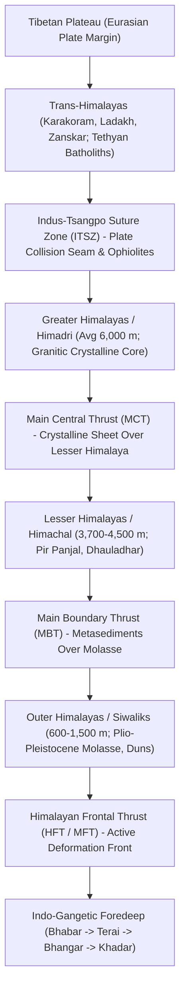

# Chapter 13 - Subcontinental Physiography — Geological Stratigraphy, Himalayas, Plains, Cratons & Recalculated Coasts

India's physiography is a living tectonic experiment forged by two diametrically opposed geological domains: an ultra-rigid, poly-orogenic **Peninsular Shield** welded together over 3.5 billion years ago, and the world's youngest, fastest-rising **Extra-Peninsular Himalayan collision belt**, stitched together by a massive Quaternary flexural foredeep.

Every river gradient, mineral metallogenic province, monsoon orographic barrier, landslide hazard, and coastal harbour across the subcontinent flows causally from this tri-partite structural architecture. Mastering its stratigraphy, thrust mechanics, cratonic sutures, and India's **April 2025 coastline recalculation** yields the highest return per page across Prelims mapping and GS1 Mains.

---

## 1. Tectonic Stratigraphy & T. H. Holland's Indian Rock Systems

Unlike standard European chronostratigraphy anchored on marine Paleozoic fossils, **Sir Thomas H. Holland** (Geological Survey of India) divided India's rock record into **four major eras**—**Archaean, Purana, Dravidian, and Aryan**—reflecting the Peninsula's unique history as an emergent Gondwanan craton largely spared marine transgression until the Carboniferous.

Geodynamically, the Indian Shield consists of **five ancient Archaean cratonic nuclei**—**Dharwar, Bastar, Singhbhum, Bundelkhand, and Aravalli–Bhilwara**—stitched along Proterozoic mobile belts, notably the **Central Indian Tectonic Zone (CITZ)** (Narmada–Son–Tapi axis), the **Aravalli–Delhi Fold Belt**, and the **Eastern Ghats Mobile Belt**. These ancient Precambrian sutures still act as zones of structural weakness controlling modern rift valleys, intracratonic earthquakes, and metallogeny.

### Geological Rock Systems Table

| Holland Era & Rock System | Geological Age & Tectonic Setting | Lithology & Diagnostic Characters | Primary Spatial Distribution | Economic & Strategic Significance |
| :--- | :--- | :--- | :--- | :--- |
| **1. Archaean Gneisses & Schists** *(Archaean Era)* | **$>2.5\text{ Ga}$** (Precambrian basement); solidification of primordial molten crust + intense plutonic metamorphism. | Azoic (completely unfossiliferous), thoroughly crystalline granites, gneisses (*Bundelkhand, Bengal, Nilgiri charnockite* gneisses), and foliated schists. | Two-thirds of Peninsular India—Karnataka, TN, AP, Odisha, Jharkhand, Rajasthan, Bundelkhand, plus crystalline core of the Greater Himalayas. | Forms India's foundational basement complex; hosts building granite, feldspar, mica pegmatites, and deeply seated gold–uranium anomalies. |
| **2. Dharwar System** *(Archaean Era)* | **$2.5\text{–}1.8\text{ Ga}$**; India's **oldest metamorphosed sedimentary rocks**, formed by erosion of Archaean gneisses and folded into narrow greenstone belts. | Azoic hornblende/chlorite schists, phyllites, quartzites, banded iron formations (BIFs), and crystalline limestones. | Dharwar–Bellary–Shimoga (Karnataka), Singhbhum–Bonai–Keonjhar (Jharkhand–Odisha), Balaghat–Bastar (MP–Chhattisgarh), Aravalli belt (Rajasthan). | **Most economically metalliferous rock system in India:** houses virtually all major reserves of high-grade iron ore, manganese, gold (Kolar/Hutti), copper, chromite, and lead–zinc. |
| **3. Cuddapah System** *(Purana Era)* | **$1.4\text{–}0.6\text{ Ga}$** (Proterozoic); deposited in crescent-shaped epicontinental basins after the **Eparchaean Unconformity**. | Unfossiliferous, mildly metamorphosed quartzites, slates, shales, sandstones, and limestones with intrusive basalt sills. | Cuddapah & Kurnool basins (Andhra Pradesh), southern Chhattisgarh (Raipur–Durg), Singhbhum, Delhi–Aravalli fringe. | Important reserves of cement-grade limestone, asbestos, barites, cobalt, nickel, jasper, and low-grade iron/manganese ores. |
| **4. Vindhyan System** *(Purana Era)* | **$1.3\text{–}0.6\text{ Ga}$** (Late Proterozoic); thick ($>4,000\text{ m}$) shallow-marine & fluvial sedimentary sequence largely undisturbed by folding. | Horizontally bedded red sandstones, shales, and limestones; **largely unfossiliferous** (except primitive Ediacaran stromatolites/microfossils) and **devoid of metalliferous minerals**. | Great crescent stretching ~$1,000\text{ km}$ from Sasaram (Bihar) via MP to Chittorgarh (Rajasthan); also Bhima (Karnataka) & Kurnool basins. | Premier **ornamental & architectural stone** (Red Fort, Sanchi Stupa, Fatehpur Sikri), high-purity limestone, glass sand, and kimberlite-hosted **diamond beds** (Panna in MP, Golconda in Telangana/AP). |
| **5. Gondwana System** *(Aryan Era; Dravidian Paleozoic is sparse in Peninsula)* | **Upper Carboniferous to Jurassic (~$300\text{–}150\text{ Ma}$)**; fluviatile & lacustrine burial of lush glossopteris forests inside faulted intracratonic **rift grabens**. | Alternating coarse sandstones, shales, and thick bituminous coal seams; rich in continental plant and amphibian/reptilian fossils. | Linear tectonic valleys: **Damodar** (Jharia, Raniganj), **Mahanadi** (Talcher, Ib), **Son–Narmada** (Singrauli), **Godavari–Wardha** (Singareni), **Satpura**. | Supplies **~98% of India's coal reserves** (bituminous & coking coal), alongside fireclay, ironstone shales, and coal-bed methane (CBM). |
| **6. Deccan Traps** *(Aryan Era)* | **Late Cretaceous–Early Paleocene (~$66\text{ Ma}$)**; massive **fissure flood basalt** volcanism as drifting India passed over the **Réunion Mantle Plume**. | Horizontal, step-like (*trappa* = Swedish stairs) tholeiitic basalt sheets up to $2,000\text{–}3,000\text{ m}$ thick near Mumbai, thinning eastward; intertrappean sedimentary beds. | ~5 lakh sq km across Maharashtra, Saurashtra/Kachchh (Gujarat), western MP (Malwa), northern Karnataka, parts of Telangana. | Weathers into moisture-retentive **Black (*Regur*) cotton soils**; yields road metal, zeolites, semi-precious agates, and deep sub-trappean oil/gas prospects (Saurashtra/Cambay). |
| **7. Tertiary System** *(Aryan Era)* | **Paleocene to Pliocene (~$66\text{–}2.6\text{ Ma}$)**; India–Eurasia continental collision, Tethys closure, Himalayan orogeny, and coastal marine transgressions. | Marine nummulitic limestones, marine-to-continental sandstones, clays, and Siwalik molasse conglomerates. | Entire Extra-Peninsular Himalayan arc, Assam–Arakan fold belt, Rajasthan–Kachchh shelf, and offshore western/eastern sedimentary basins. | Primary host of **India's petroleum & natural gas** (Mumbai High, Cambay, Assam–Arakan, KG-D6, Barmer), **Tertiary lignite/high-sulfur coal** (Neyveli, Makum, Kalakot), and evaporite gypsum/rock salt. |
| **8. Quaternary System** *(Aryan Era)* | **Pleistocene to Holocene ($2.6\text{ Ma}$–Present)**; Himalayan glacial-interglacial erosion filling the Indo-Gangetic foredeep + Kashmir intermontane lacustrine basin. | Unconsolidated fluvial sands, silts, clays (**Bhangar & Khadar**), coastal dunes, and elevated fluvio-lacustrine **Karewa** terraces. | Indo-Gangetic–Brahmaputra plains, coastal deltas, Thar aeolian sheets, **Kashmir Valley Karewas** (Jhelum basin). | Sustains India's agricultural breadbasket and massive alluvial aquifers; **Karewas** yield world-famous **Zafran (Kashmiri saffron)**, almonds, walnuts, and apples. |

---

## 2. The Extra-Peninsular Himalayan Arc & Purvanchal

### Geodynamic Geometry, Syntaxial Bends & Thrust Architecture
Stretching ~2,400 km from the Indus Gorge in the west to the Dihang (Brahmaputra) Gorge in the east, the Himalayas form a southward-convex arc that narrows from **~400 km in Kashmir** to **~150 km in Arunachal Pradesh**. Because continental collision shortened the narrower eastern sector more intensely, the **Eastern Himalayas rise abruptly** straight from the Brahmaputra plains without the wide step-like foothills characteristic of the west.

At both extremities, the Himalayan ranges execute sharp, hairpin southward **Syntaxial Bends**:
- **Western Syntaxis:** Anchored around **Nanga Parbat ($8,126\text{ m}$)** where the ranges swing abruptly southwest into the Hindu Kush, Sulaiman, and Kirthar ranges across the Indus gorge.
- **Eastern Syntaxis:** Anchored around **Namcha Barwa ($7,782\text{ m}$)** where the ranges bend sharply south into the **Purvanchal–Arakan Yoma** belt across the Yarlung Tsangpo–Siang gorge. Geodynamically, both syntaxes reflect the rigid northwestern (Aravalli–Sargodha ridge) and northeastern (Shillong–Mikir promontory) corners of the Indian cratonic indenter ploughing into ductile Asian crust.

Internally, the Himalayas consist of stacked, north-dipping crustal thrust sheets riding over a single basal shear surface—the **Main Himalayan Thrust (MHT)**—progressing southward in age as Indian crust underthrusts Tibet.

### Four Longitudinal Himalayan Zones
1. **Trans-Himalayas (Tibetan Himalayas):** Lying north of the **Indus–Tsangpo Suture Zone (ITSZ)**, these ranges represent pre-collisional Andean-type volcanic/granitic arcs formed as Neo-Tethys oceanic crust subducted beneath Eurasia. Key sub-ranges run NW–SE:
   - **Karakoram Range** (*Backbone of High Asia*): Houses **K2 / Godwin-Austen ($8,611\text{ m}$)**, Gasherbrum, Masherbrum, and the world's largest non-polar valley glacier cluster—**Siachen** (76 km, lying **north of Nubra Valley** between Karakoram and Saltoro ridges), Baltoro, Biafo, and Hispar.
   - **Ladakh Range:** Lies between the Indus and Shyok rivers, extending southeast into Tibet as the **Kailash Range** (Mt. Kailash, Mansarovar).
   - **Zanskar Range:** Separates the Indus valley from the Kashmir/Himachal basins; pierced by the Zanskar gorge and topped by Kamet ($7,756\text{ m}$).
2. **Greater Himalayas (*Himadri* / Inner Himalayas):** The innermost, highest, and most continuous crystalline spine (average elevation ~$6,000\text{ m}$, width ~25 km), composed of Archaean granite–gneiss cores flanked by metamorphosed Tethyan sediments. Folds are markedly **asymmetrical**—steep, precipitous southern escarpments facing the Indian plains versus gentler northern dip-slopes toward Tibet. Hosts almost all eight-thousanders and major Indian peaks: **Mt. Everest ($8,848.86\text{ m}$)**, **Kanchenjunga ($8,586\text{ m}$, highest peak in India on the Sikkim–Nepal border)**, **Nanga Parbat ($8,126\text{ m}$)**, **Nanda Devi ($7,816\text{ m}$, highest peak lying entirely within India, in Uttarakhand's Garhwal/Kumaon Himalaya)**, Kamet, and Namcha Barwa.
3. **Lesser Himalayas (*Himachal* / Middle Himalayas):** Lying between the **MCT** and **MBT** (width 60–80 km, altitude 3,700–4,500 m), composed of intensely folded, fractured, unfossiliferous slates, phyllites, and quartzites. Key discontinuous sub-ranges from west to east: **Pir Panjal** (longest & most important, J&K–HP), **Dhauladhar** (Himachal), **Mussoorie & Nag Tibba** (Uttarakhand), and **Mahabharat** (Nepal). Structural basins nested between *Himadri* and *Himachal* form fertile valleys—**Kashmir Valley** (lined by lacustrine **Karewa** deposits), **Kangra**, **Kullu**, and **Kathmandu**—while lush sub-alpine meadows on northern slopes are termed **Margs** in Kashmir (*Gulmarg, Sonamarg, Tanmarg*) and **Bugyals / Payars** in Uttarakhand.
4. **Outer Himalayas (*Siwaliks*):** The youngest, outermost foothills (altitude 600–1,500 m; width 50 km in Himachal narrowing to <15 km in Arunachal), built of poorly consolidated Plio-Pleistocene **molasse** (conglomerates, gravels, sands) washed down from the rising *Himadri–Himachal* ranges and subsequently folded by the advancing **Himalayan Frontal Thrust (HFT)**. Notably absent across an ~80–90 km gap between the **Teesta and Raidak rivers** in Sikkim–West Bengal, where heavy monsoon runoff eroded the soft foothills.
   - **Duns vs. Duars:** Temporary lakes ponded behind rising Siwalik ridges drained over time to leave flat, fertile longitudinal structural valleys called **Duns** in the west (*Dehra Dun, Kotli Dun, Patli Dun, Pinjore*) and alluvial piedmont floodplains called **Duars** (*Doors* to Bhutan/Tibet—prime tea-plantation terrain) in North Bengal–Assam.
   - **Chos:** Soft, deforested southern Siwalik slopes in Punjab (especially Hoshiarpur) and Himachal are deeply dissected by seasonal flash-flood torrent channels called **Chos**.

### Sidney Burrard's Regional Longitudinal Divisions
Based on antecedent river gorges slicing across the mountain chain, **Sir Sidney Burrard** divided the Himalayas west-to-east into four regional sectors:
- **Punjab / Kashmir & Himachal Himalayas ($560\text{ km}$, Indus to Sutlej):** Broadest section; includes Karakoram, Ladakh, Zanskar, Pir Panjal, Dhauladhar, Kashmir Valley *Karewas*, and salt lakes (Pangong Tso, Tso Moriri).
- **Kumaon Himalayas ($320\text{ km}$, Sutlej to Kali):** Spans Uttarakhand (Garhwal in the west, Kumaon in the east); home to Nanda Devi, Kamet, Badrinath, Kedarnath, Gangotri–Yamunotri glaciers, and tectonic lakes (*Tals*—Nainital, Bhimtal).
- **Nepal Himalayas ($800\text{ km}$, Kali to Teesta):** Tallest Himalayan sector hosting Everest, Kanchenjunga, Makalu, Dhaulagiri, and Annapurna.
- **Assam / Eastern Himalayas ($720\text{ km}$, Teesta to Dihang/Brahmaputra):** Narrowest, steepest, wettest, and most biodiverse sector; includes **Dafla, Miri, Abor, and Mishmi Hills** (west-to-east Arunachal Siwalik equivalents) culminating at Namcha Barwa.

### Purvanchal Hills (Eastern Hills & Indo-Burman Arc)
Beyond the Dihang Gorge, the Himalayan structural trend turns sharply south along the India–Myanmar plate-oblique convergence zone, forming lower ($1,000\text{–}3,800\text{ m}$), thickly forested sandstone–shale ridges:
- **Patkai Bum:** Forms the Arunachal Pradesh–Myanmar watershed boundary.
- **Naga Hills:** Forms the Nagaland–Myanmar divide, crowned by **Mount Saramati ($3,826\text{ m}$)**—the highest peak of the Purvanchal arc.
- **Barail Range:** A crucial transverse ridge trending SW–NE across southern Assam–Nagaland–Manipur, structurally separating the Brahmaputra and Barak river basins and linking the Naga Hills toward the Meghalaya Plateau.
- **Manipur Hills & Loktak Lake:** Encloses the intermontane Imphal Basin containing **Loktak Lake**, the largest freshwater lake in Northeast India, famous for floating heterogeneous organic mats of soil, vegetation, and peat called **Phumdis**—hosting **Keibul Lamjao National Park**, the world's only floating national park and last refuge of the endemic *Sangai* (brow-antlered deer).
- **Mizo (Lushai) Hills:** Composed of soft, unconsolidated Tertiary sediments known geologically as the **Molassis Basin**, crowned by **Phawngpui / Blue Mountain ($2,157\text{ m}$)**.
- **Critical Structural Distinction:** The **Meghalaya (Shillong) Plateau** (*Garo, Khasi, Jaintia Hills*) and **Karbi Anglong / Mikir Hills** are **NOT** part of the Himalayan or Purvanchal fold system—they are detached Precambrian blocks of the **Peninsular Indian Craton** separated from the Rajmahal Hills by the down-faulted **Malda Gap (Garo–Rajmahal Gap)** filled with Ganga–Brahmaputra alluvium.

---

## 3. Indo-Gangetic–Brahmaputra Alluvial Megabasin

Covering ~7 lakh sq km across northern India, the Great Plains occupy an active **flexural foredeep (geosyncline)** buckled downward by the tectonic load of the overthrusting Himalayan wedge. Geophysical surveys show an **asymmetric basement profile**: alluvial thickness reaches **$4,000\text{–}6,000\text{ m}$** immediately south of the Siwalik HFT (deepest beneath Bihar–UP) and feathers smoothly southward to $<100\text{ m}$ along the Peninsular Shield margin, interrupted internally by buried basement spurs such as the **Delhi–Haridwar Ridge** and the **Faizabad / Munger–Saharsa Ridges**.

### Longitudinal Geomorphological Sequence (North $\to$ South)
1. **Bhabar ($8\text{–}16\text{ km}$ wide):** Continuous, steep alluvial-fan apron of unsorted boulders, cobbles, and pebbles deposited abruptly where Himalayan torrents lose gradient exiting the Siwaliks. Extreme porosity causes small and medium streams to **disappear underground**—unsuitable for agriculture except deep-rooted timber trees.
2. **Terai ($15\text{–}30\text{ km}$ wide):** Flat, poorly drained zone immediately south of Bhabar where subterranean streams **re-emerge** as marshy springs along a shallow water table. Wider in the wetter eastern plains (UP–Bihar–Uttarakhand–Bengal) than in Punjab; historically malarial tall-grass jungle (Dudhwa, Kaziranga, Manas ecosystems), now largely cleared for intensive paddy, wheat, and sugarcane cultivation.
3. **Bhangar (Older Alluvium):** Elevated interfluve flood-free terraces (*Doabs*) standing $15\text{–}30\text{ m}$ above modern riverbeds, composed of darker, clayey Middle-to-Late Pleistocene deposits enriched with impure calcareous concretions called **Kankar**. In the upper Ganga–Yamuna Doab, wind-reworked sandy ridges atop Bhangar surfaces are termed **Bhur**; poorly drained saline patches form **Reh / Kallar**.
4. **Khadar (Newer Alluvium):** Low-lying, flood-prone valley belts renewed annually by fresh monsoon silt—lighter, sandier, maximally fertile, and termed **Bet** in Punjab. In the active Sundarbans delta, elevated sandy uplands form **Chars** (habitations) while waterlogged marsh depressions form **Beels**.

### Regional Subdivisions of the Great Plains
- **Rajasthan Plain:** Divided by the $25\text{ cm}$ isohyet into western **Marusthali** (Thar Desert ergs, shifting *Dhrian* dunes, seasonal saline *Playas/Ranns* such as Sambhar, Didwana, Pachpadra) and eastern semi-arid **Rajasthan Bagar** drained by the ephemeral **Luni River** (fertile tracts called *Rohi*).
- **Punjab–Haryana Plain:** Dominated by five fertile **Doabs** (interfluves between Indus tributaries, south-to-north: **Bist** [Beas–Sutlej], **Bari** [Beas–Ravi], **Rechna** [Ravi–Chenab], **Chaj** [Chenab–Jhelum], **Sindh Sagar** [Jhelum/Chenab–Indus]). The **Ghaggar–Hakra** dry paleochannel marks the water divide between the Indus and Ganga drainage systems near Ambala (~283 m).
- **Ganga Plain:** Divided into **Upper Ganga** (Ganga–Yamuna Doab, Rohilkhand), **Middle Ganga** (Awadh, Mithila/Bihar—notorious for avulsing rivers like the Kosi and Gandak leaving *Chaurs/Mauns* oxbow depressions), and **Lower Ganga** (North Bengal Duars, Rarh Plain, and the world's largest active delta, the **Sundarbans**).
- **Brahmaputra (Assam) Plain:** A narrow ($80\text{–}100\text{ km}$ wide, $720\text{ km}$ long) tectonic ramp valley squeezed between the Eastern Himalayas and the Shillong–Mikir block; extreme Himalayan sediment yield forces the Brahmaputra into a hyper-braided channel studded with riverine sandbars (*Chapories*) and **Majuli** (one of the world's largest inhabited river islands).

---

## 4. Peninsular Shield — Cratons, Rift Horsts & Coastal Ghats

Occupying ~16 lakh sq km as an inverted triangle rising $600\text{–}900\text{ m}$ above sea level, the **Peninsular Block** is India's oldest and largest physiographic unit. Contrary to legacy textbook oversimplifications describing it as completely aseismic, the Peninsula underwent repeated Mesozoic–Cenozoic **epeirogenic uplift, block faulting, rift subsidence, and western-margin tectonic submergence** (explicitly tested in **UPSC Prelims 2026 Q24**), while its east-flowing rivers cut broad, shallow, mature graded valleys rather than youthful Himalayan V-shaped gorges.

### The Aravalli Range — Relict Shield & 2025–26 Legal Geography
Stretching ~692–800 km NE–SW from **Palanpur (Gujarat)** across Rajasthan and Haryana to **Delhi Ridge (Raisina Hill)**, the **Aravallis** are among Earth's oldest Paleoproterozoic fold mountains (~$1.8\text{–}2.0\text{ Ga}$), now reduced to deeply denuded **residual horsts** crowned by **Guru Shikhar ($1,722\text{ m}$)** on Mount Abu.

Physiographically, the Aravallis perform three irreplaceable subcontinental functions: (i) acting as a **climatic and aeolian barrier** halting the eastward advance of Thar Desert sand into Haryana and the Ganga Plain; (ii) serving as a fractured hard-rock **aquifer recharge spine** feeding the Banas, Luni, and Sabarmati rivers; and (iii) orienting **parallel to the Arabian Sea SW Monsoon winds**, which is why western Rajasthan remains rain-starved while Mount Abu intercepts localized orographic rain.

**Live Conservation & Judicial Status (2025–2026):** Alongside the MoEFCC's **Aravalli Green Wall Project** (a $1,400\text{ km} \times 5\text{ km}$ restoration corridor spanning Gujarat, Rajasthan, Haryana, and Delhi), the legal delimitation of the Aravallis triggered major judicial scrutiny. On November 20, 2025, the Supreme Court initially accepted an MoEFCC committee's uniform definition tagging only landforms rising $\ge 100\text{ m}$ above local relief as "Aravalli Hills"; however, following severe scientific criticism that this elevation-only rule would strip protection from ~90% of low-relief residual Aravalli outcrops and open them to mining, a CJI-led bench took *suo motu* cognizance (*SMW(C) No. 10/2025*) on **December 29, 2025** and **stayed the 100-metre definition**, reinstating broader slope-based ecological protection pending fresh expert review.

### Central Highlands, Plateaus & Rift–Horst Architecture
- **Central Highlands:** North of the Narmada lie the basaltic **Malwa Plateau** (draining northward via Chambal, Betwa, and Ken into the Yamuna, incised along its northern edge into the Chambal ravines), the granitic **Bundelkhand** and **Baghelkhand** uplands, and the **Chotanagpur Plateau** (Jharkhand–Odisha–WB–Chhattisgarh)—India's mineral powerhouse characterized by elevated flat-topped lateritic lava mesas (**Pat lands**, e.g., Netarhat), radial drainage, and the coal-bearing **Damodar Rift** splitting the **Hazaribagh** and **Ranchi** plateaus (highest peak: **Parasnath**, $1,365\text{ m}$).
- **Vindhya–Satpura Horsts & Narmada–Tapi Rifts:** Straddling the ancient Precambrian **SONATA (Son–Narmada–Tapi) lineament**, central India exhibits textbook continental **horst–graben tectonics** from north to south: **Vindhyan Escarpment** (stepped block/scarp range continuing east as **Bhander** and **Kaimur** hills) $\to$ **Narmada Rift Graben** $\to$ **Satpura Horst** (running west-to-east as **Rajpipla, Gawilgarh, Mahadeo** [crowned by **Dhupgarh, $1,350\text{ m}$** near Pachmarhi], and **Maikal** hills culminating at the radial drainage node **Amarkantak, $1,048\text{ m}$**, which sits at the Vindhya–Satpura–Maikal junction—NOT the Sahyadri!) $\to$ **Tapi–Purna Rift Graben**.
- **Deccan Plateau:** South of the Satpura–Tapi line lies the tilted volcanic **Maharashtra Plateau** (crossed NW–SE by the **Satmala–Ajanta, Balaghat, and Harishchandra** ranges acting as watershed divides between Tapi, Godavari, Bhima, and Krishna), grading south into the **Karnataka Plateau**—sharply divided between **Malnad** (dissected, thickly forested western hill tract; Baba Budan Hills / Mullayanagiri) and **Maidan** (rolling eastern granitic plains)—the crystalline **Telangana Plateau**, and the rugged iron-rich **Dandakaranya** (Bastar) upland.

### Western Ghats (*Sahyadri*) vs. Eastern Ghats
- **Western Ghats (Fault Escarpment):** Extending ~1,600 km continuously from the Tapi Valley to Kanyakumari across **six Indian states** (**Gujarat, Maharashtra, Goa, Karnataka, Kerala, and Tamil Nadu**—a classic UPSC Prelims trap when falsely restricted to five states!), the Western Ghats are **NOT true fold mountains**. They represent the **upwarped western fault escarpment** of the Peninsular Block created when Madagascar (~$88\text{ Ma}$) and the Seychelles (~$66\text{ Ma}$) rifted away, tilting the Deccan block gently eastward.
  - Elevation **increases systematically from north to south**: **Kalsubai ($1,646\text{ m}$)** and **Mahabaleshwar** in basaltic Maharashtra $\to$ **Kudremukh ($1,892\text{ m}$)** and **Mullayanagiri ($1,930\text{ m}$)** in crystalline Karnataka $\to$ the **Nilgiri Mountain Knot** (**Doddabetta, $2,637\text{ m}$**, where Western and Eastern Ghats converge) $\to$ south of the Palghat Gap, the **Anaimalai Hills** holding Peninsular India's highest peak **Anaimudi ($2,695\text{ m}$, Kerala)**, flanked by the **Palani Hills** (NE) and **Cardamom / Agasthyamalai Hills** (south).
  - Four structural passes breach this wall (**Thalghat, Bhorghat, Palghat Gap, Shencottah Gap**), channeling rail–road corridors and moisture plumes into the Deccan interior. *(Pending Governance Status: MoEFCC's 7th draft Western Ghats Ecologically Sensitive Area [ESA] notification of July 2026 proposing $56,825.7\text{ sq km}$—down from the Kasturirangan HLWG's ~37% and Gadgil WGEEP's 100%—remains contested by states and unfinalized as of November 2026).*
- **Eastern Ghats (Dissected Residual Hills):** Extending discontinuously from Odisha to Tamil Nadu, the Eastern Ghats are ancient Proterozoic folded mobile-belt remnants heavily breached by the Mahanadi, Godavari, Krishna, and Cauvery rivers. Key hill chains north-to-south: **Maliya / Garhjat** (Odisha) $\to$ **Nallamala, Veliconda, Palkonda, Seshachalam** (Andhra Pradesh—tested in Prelims 2023 & 2026!) $\to$ **Javadi, Shevaroy, Panchaimalai, Sirumalai** (Tamil Nadu). The **Biligirirangan (BR) Hills** (Karnataka) and **Sathyamangalam** corridor form the vital ecological bridge linking the Eastern and Western Ghats.
  - **Dual-Standard Highest Peak Parity:** Legacy **NCERT textbooks** cite **Mahendragiri ($1,501\text{ m}$, Odisha)** as the highest peak of the Eastern Ghats (and UPSC Prelims 2017 treated it as standard); however, modern Survey of India / topographic mapping establishes **Jindhagada Peak ($1,690\text{ m}$)** (and neighboring **Arma Konda, $1,680\text{ m}$**) in Andhra Pradesh's Araku Valley as the true highest summit, with **Deomali ($1,672\text{ m}$)** highest in Odisha. Hold both benchmarks clearly.

---

## Recalculated 11098 km Indian Coastline 2025

In one of the most consequential cartographic revisions in post-Independence Indian geography, the **Ministry of Ports, Shipping and Waterways (MoPSW)**—via an official circular dated **April 29, 2025** (reaffirmed in Parliament by the Ministry of Earth Sciences on **December 4, 2025**)—formally promulgated India's recalculated coastline length as **11,098.81 km**, replacing the legacy **1970s Ministry of Home Affairs (MHA) figure of 7,516.60 km**—an upward revision of **+3,582.21 km (+47.66%)**.

### Physics & Cartographic Methodology — The Coastline Paradox
India did not acquire new landmass; instead, the 47.66% expansion is a textbook real-world manifestation of the **Coastline Paradox** (discovered empirically by **Lewis Fry Richardson** and formalized as fractal geometry by **Benoît Mandelbrot**, 1967). Because natural shorelines are self-similar irregular curves with fractal dimension $D > 1$, their measured perimeter scales inversely with ruler resolution:

$$L(\epsilon) \propto \epsilon^{1-D}$$

As measurement resolution sharpens ($\epsilon \to 0$), finer bays, tidal creeks, mudflats, and rocky headlands come into view, causing measured length to expand systematically:
- **1970s Legacy Baseline ($7,516.60\text{ km}$):** Computed manually using generalized straight-line approximations from small-scale paper maps at **`1:4,500,000` (or smaller)**, smoothing out intricate estuarine creeks and omitting hundreds of smaller offshore islands.
- **2025 Revised Baseline ($11,098.81\text{ km}$):** Following deliberations by the **Coastal Protection and Development Advisory Committee (CPDAC)** since 2010 and uniform **Terms of Reference (ToR)** finalized under the **National Security Council Secretariat (NSCS)** on **August 10, 2023**, the **National Hydrographic Office (NHO, Dehradun)** and **Survey of India (SoI)** recomputed the entire littoral using modern GIS software over high-resolution **`1:250,000` Electronic Navigation Charts (ENCs)** anchored on updated **High-Water Line (HWL)** data.
- **Offshore Islands Reconciliation & Decadal Review:** A parallel multi-agency island audit finalized India's offshore tally at **1,298 offshore islands/islets** (**1,059 islands + 239 islets**; totaling **1,389** including 91 inshore islands). Adding the peripheral HWL of every reconciled island expanded India's **Island Territories coastline** from $2,094.00\text{ km}$ to **$3,228.30\text{ km}$**, while the **Mainland coastline** expanded from $5,422.60\text{ km}$ to **$7,870.51\text{ km}$**. Under NSCS guidelines, the coastline will now undergo standardized **decadal re-verification every 10 years**.

### Recalculated Coastline Matrix (1970 Legacy vs. April 2025 Official Revision)

| State / Union Territory | Legacy 1970 MHA Length (km) | Revised April 2025 Length (km) | Absolute Change (km) | % Change | Rank Shift & Geomorphological Driver |
| :--- | :---: | :---: | :---: | :---: | :--- |
| **Andaman & Nicobar Islands (UT)** | 1,962.00 | **3,083.50** | +1,121.50 | +57.16% | **#1 Overall Entity in India**; jagged submerged-ridge archipelago with dense mangrove creeks & hundreds of newly resolved islets. |
| **Gujarat** | 1,214.70 | **2,340.62** | +1,125.92 | +92.69% | **#1 State (Largest absolute gain among states)**; deeply indented Sir Creek, Gulf of Kachchh & Gulf of Khambhat tidal inlets + offshore islands. |
| **Tamil Nadu** | 906.90 | **1,068.69** | +161.79 | +17.84% | **#2 State (Overtakes Andhra Pradesh!)**; finer resolution of Palk Bay, Gulf of Mannar coral islands (21 islands), Rameswaram & Cauvery estuaries. |
| **Andhra Pradesh** | 973.70 | **1,053.07** | +79.37 | +8.15% | **#3 State (Drops from #2 to #3)**; relatively smooth depositional coastal curve outside the Godavari–Krishna delta mouths. |
| **Maharashtra** | 652.60 | **877.97** | +225.37 | +34.53% | **#4 State**; ria-like submergent Konkan coast riddled with drowned river creeks (Thane, Vasai, Jaigad, Rajapur) & rocky headlands. |
| **West Bengal** | 157.50 | **721.02** | +563.52 | **+357.79%** | **#5 State (Highest % surge nationally; jumps above Kerala & Odisha!)**; labyrinthine tidal channels & islands of the Sundarbans delta captured at 1:250,000 scale. |
| **Kerala** | 569.70 | **600.15** | +30.45 | **+5.34%** | **#6 State (Smallest % increase among states)**; remarkably straight, wave-smoothed emergent Malabar sandy barrier coast. |
| **Odisha** | 476.40 | **574.71** | +98.31 | +20.64% | **#7 State**; Mahanadi–Brahmani–Baitarani (Bhitarkanika) deltaic creeks and Chilika lagoon openings. |
| **Karnataka** | 280.00 | **343.30** | +63.30 | +22.61% | **#8 State**; narrow Kanara rocky headlands, Karwar islands, and Sharavati–Netravati estuarine mouths. |
| **Goa** | 160.50* | **193.95** | —* | —* | **#9 State (Shortest among states)**; Mandovi–Zuari drowned estuaries (*1970 MHA figure of 160.50 km merged Goa with Daman & Diu*). |
| **Lakshadweep (UT)** | 132.00 | **144.80** | +12.80 | +9.70% | **#2 UT**; compact ring-shaped coral atoll perimeters showing low fractal expansion. |
| **Dadra & Nagar Haveli and Daman & Diu (UT)** | *(Included in Goa 1970)* | **54.38** | —* | —* | **#3 UT**; newly separated out in the 2025 MoPSW/SoI tabulation (Daman coast & Diu island). |
| **Puducherry (UT)** | 30.60 | **42.65** | +12.05 | +39.38% | **#4 UT (Shortest overall)**; four dispersed coastal enclaves (Puducherry, Karaikal, Yanam, Mahe). |
| **TOTAL INDIA** | **7,516.60** | **11,098.81** | **+3,582.21** | **+47.66%** | **Mainland: 7,870.51 km** (vs. legacy 5,422.60 km) · **Island Territories: 3,228.30 km** (vs. legacy 2,094.00 km). |

### Coastal Plains Geomorphology & Governance Implications
The recalculated numbers map cleanly onto India's asymmetric **coastal geomorphology**:
- **Western Coastal Plain (Submergent — Narrow, Indented, Estuarine):** Squeezed between the Western Ghats escarpment and the Arabian Sea (widest in Gujarat, narrowest in Karnataka/Konkan), the Konkan–Kanara segment is a **submergent faulted coastline** (historic submerged city of Dwarka, deep drowned creeks) producing natural deep-water harbours (**Mumbai, JNPT, Mormugao, Karwar, Mangalore**) and swift non-deltaic estuaries. Uniquely, the southern **Malabar Coast (Kerala)** displays **emergent** traits—longshore sandbars trapping parallel brackish backwaters called **Kayals** (*Vembanad, Ashtamudi*, hosting the Punnamada *Nehru Trophy Vallamkali*).
- **Eastern Coastal Plain (Emergent — Wide, Deltaic, Lagoonal):** Built by prograding deposition of peninsular rivers across **Utkal (Odisha), Northern Circars / Andhra, and Coromandel (TN)** plains onto a broad continental shelf extending up to $500\text{ km}$ offshore. Dominated by massive fertile deltas (Mahanadi, Godavari, Krishna, Cauvery) and barrier lagoons (**Chilika**—India's largest brackish lagoon; **Kolleru**—freshwater inter-deltaic lake between Godavari and Krishna; **Pulicat**—brackish lagoon straddling **Andhra Pradesh and Tamil Nadu** behind Sriharikota barrier island), leaving relatively few deep natural harbours outside Visakhapatnam (sheltered by Dolphin's Nose rock) and Paradip.
- **Strategic, Regulatory & Climate-Resilience Impacts:**
  1. **Zero Automatic CRZ Alteration (Critical Prelims Distinction):** As Parliament was explicitly informed on December 4, 2025, **the 11,098.81 km recalculation does NOT alter Coastal Regulation Zone (CRZ) boundaries**, because statutory CRZ zones are demarcated independently using 1:25,000 High Tide Line (HTL) maps prepared by the **National Centre for Sustainable Coastal Management (NCSCM, Chennai)**.
  2. **Maritime Security & Blue Economy Planning:** Precision HWL mapping of 1,298 offshore islands strengthens Indian Coast Guard coastal-radar coverage, port/fishing-harbour siting (serving 3,477 coastal fishing villages), and UNCLOS baseline verification.
  3. **Erosion & National Coastal Mission 2.0 (2026):** National Centre for Coastal Research (NCCR) shoreline tracking across India's mainland shows **~33.6% of the coast undergoing erosion** (highest in West Bengal ~60.5%, Puducherry, and Kerala), ~26.9% accreting, and ~39.6% stable—prompting MoEFCC's launch of **National Coastal Mission 2.0 (September 30, 2026; ₹767 crore Central Sector Scheme, 2025–26 to 2030–31)** anchored explicitly on the 11,098.81 km baseline.

---

## 5. India's Island Archipelagos & Great Nicobar Strategic Geography

India's oceanic periphery comprises two tectonically unrelated archipelagos governing the eastern and western approaches to the Indian Ocean:

### Andaman & Nicobar Islands (Subduction Accretionary Arc)
Lying in the Bay of Bengal ($6^\circ 45'\text{ N}$ to $13^\circ 41'\text{ N}$), the A&N archipelago comprises **572 islands/islets** in classical Census/NCERT usage (**836 islands/islets/rocks** in updated A&N Administration geographical counts, ~38 permanently inhabited), with its capital **Port Blair officially renamed Sri Vijaya Puram** (September 2024).

- **Tectonic Origin:** Emergent peaks of a submerged submarine continuation of Myanmar's **Arakan Yoma** Tertiary fold belt formed as the Indian oceanic plate subducts obliquely beneath the **Burmese Microplate** along the Sunda–Andaman Trench.
- **Key Channels & Peaks (North $\to$ South):** **Coco Channel** (separates India's Landfall Island from Myanmar's Coco Islands) $\to$ **North, Middle, and South Andaman** (highest peak of A&N: **Saddle Peak, $732\text{ m}$**, North Andaman) $\to$ **Duncan Passage** (separates South Andaman/Rutland from **Little Andaman**) $\to$ **Ten Degree Channel** (~150 km wide, separates the **Andaman** group from the **Nicobar** group) $\to$ **Car Nicobar** $\to$ **Sombrero Channel** $\to$ **Great Nicobar** (largest island of the Nicobar group, ~910 sq km; **Mount Thullier, $642\text{ m}$**; southern tip **Indira Point / Pygmalion Point** at $6^\circ 45'\text{ N}$, India's southernmost point, submerged partially during the 2004 Indian Ocean tsunami) $\to$ **Grand Channel / Six Degree Channel** (separates Great Nicobar from Sumatra, Indonesia—just ~90 nautical miles away).
- **Volcanic Arc — Barren vs. Narcondam:** Lying east of the main accretionary islands in the back-arc Andaman Sea sit India's only two volcanic islands:
  - **Barren Island:** Located ~138 km **northeast of Sri Vijaya Puram (Port Blair)**—**NOT** east of Great Nicobar (a famous UPSC Prelims 2018 trap!). It is **South Asia's only confirmed active stratovolcano**, erupting repeatedly since reawakening in 1991 (2005, 2017–23, March–May 2024, and most recently **July 2025 – January 2026**, including two widely reported eruptions on **September 13 and 20, 2025**).
  - **Narcondam Island:** Situated ~150 km northeast of Barren Island; classified as a **dormant volcano** and renowned as the sole habitat of the endemic **Narcondam Hornbill**.
- **Great Nicobar Strategic Geography & Mega-Project (2025–26 Status):** Positioned barely **~40 nautical miles north of the East–West international shipping corridor** feeding the Strait of Malacca, Great Nicobar commands the eastern chokepoint of the Indo-Pacific. Conceptualized by NITI Aayog and executed by ANIIDCO over **166.10 sq km**, the **Holistic Development of Great Nicobar Island** integrates four pillars (reaffirmed by PIB May 1, 2026):
  1. **International Container Transshipment Port (ICTP) at Galathea Bay:** $14.2\text{ MTEU}$ capacity leveraging a **natural water depth $>20\text{ m}$** to recapture Indian transshipment cargo currently routed via Colombo, Singapore, and Port Klang.
  2. **Dual-Use Greenfield International Airport** ($4,000$ peak-hour passengers, reinforcing naval air station **INS Baaz** at Campbell Bay).
  3. **450 MVA hybrid gas–solar power plant** and a **planned maritime township**.
  - **Geo-Ecological Tension:** The site sits in high-hazard Seismic Zone V (where 2004 megathrust subsidence reshaped the coastline), overlaps the UNESCO **Great Nicobar Biosphere Reserve** (adjacent to Campbell Bay and Galathea National Parks, prime nesting beach for Giant Leatherback Sea Turtles), and borders ancestral territories of the **Shompen** (Particularly Vulnerable Tribal Group) and **Nicobarese**. While GoI emphasizes 42 MoEFCC EIA/ICRZ compliance conditions, zero planned tribal displacement, and compensatory afforestation, ecological and legal scrutiny continues to make Great Nicobar a flagship GS1/GS3 balance-of-priorities case study.

### Lakshadweep Islands (Coral Atolls on Hotspot Ridge)
Scattered across the Arabian Sea ($8^\circ\text{ N}$ to $12^\circ\text{ N}$), **Lakshadweep** is India's smallest Union Territory (~$32\text{ sq km}$ across **36 coral islands**, 10 inhabited, capital **Kavaratti**). Unlike A&N's tectonic subduction ridge, Lakshadweep consists of **biogenic coral atolls, reefs, and submerged banks** capping the volcanic **Chagos–Laccadive Ridge** left behind as the Indian Plate drifted northward over the **Réunion Hotspot** (~$65\text{–}55\text{ Ma}$).

- **Sub-Groups & Channels (North $\to$ South):** **Amindivi Islands** (north) $\to$ **Eleven Degree Channel** $\to$ **Laccadive / Cannanore Islands** (middle; includes **Andrott** [largest island], Kavaratti, Agatti, and uninhabited bird sanctuary **Pitti**) $\to$ **Nine Degree Channel** $\to$ **Minicoy** (southernmost and second-largest island, culturally linked to Divehi-speaking Maldives) $\to$ **Eight Degree Channel** (separates Minicoy from the Maldives).
- **Physiographic Vulnerability:** Elevations rarely exceed $3\text{–}5\text{ m}$ above mean sea level, relying entirely on thin freshwater **Ghyben–Herzberg lenses** floating atop saline porewater—rendering the archipelago acutely vulnerable to sea-level rise, coral bleaching, and cyclone-induced storm surges.

---

## 6. Major Himalayan & Peninsular Mountain Passes Matrix

Mountain passes (*La* in Tibetan/Ladakhi; *Ghat* in Marathi/Peninsular languages) are low structural saddles or antecedent river wind-gaps that channel historical trade, pastoral transhumance, monsoon winds, and modern border logistics.

| Pass / Gap | State / UT & Mountain Range | Corridor Connected | Strategic, Hydrological & Engineering Significance |
| :--- | :--- | :--- | :--- |
| **Mintaka / Aghil / Karakoram Pass** | Ladakh (Trans-Himalaya — **Karakoram**) | Ladakh $\leftrightarrow$ Xinjiang (China) / Wakhan tri-junction | Ancient Silk Route arteries; **Karakoram Pass** ($5,540\text{ m}$) sits immediately east of Siachen & north of Daulat Beg Oldie (DBO). |
| **Khardung La & Umling La** | Ladakh (**Ladakh Range**) | Leh $\leftrightarrow$ Shyok–Nubra Valley (Khardung); Chisumle $\leftrightarrow$ Demchok (Umling) | **Khardung La** ($5,359\text{ m}$) supplies Siachen via Nubra; **Umling La** ($5,798\text{ m}$ / $19,024\text{ ft}$, built by BRO) is the world's highest motorable road pass along the LAC. |
| **Burzil Pass & Zoji La** | Ladakh / J&K (**Greater Himalayas / Zanskar**) | Srinagar $\leftrightarrow$ Gilgit (Burzil); Srinagar $\leftrightarrow$ Kargil–Leh (Zoji La) | **Zoji La** ($3,528\text{ m}$) is the lifeline to Ladakh; the under-construction **14.15 km Zoji La Tunnel** (Asia's longest bidirectional high-altitude tunnel) ensures all-weather connectivity. |
| **Pir Panjal & Banihal Pass** | Jammu & Kashmir (**Pir Panjal Range**) | Jammu $\leftrightarrow$ Srinagar (Kashmir Valley) | **Banihal Pass** ($2,832\text{ m}$) houses the historic **Jawahar Tunnel**, the **Pir Panjal Railway Tunnel** (USBRL), and the modern **Banihal–Qazigund Road Tunnel** (NH-44). |
| **Baralacha La** | Himachal Pradesh (**Zanskar / Greater Himalayas**) | Mandi/Lahaul $\leftrightarrow$ Leh (Ladakh) | High-altitude crossroads ($4,890\text{ m}$); hydrographic origin of **Chandra and Bhaga** streams uniting at Tandi to form the **Chenab**. |
| **Rohtang Pass (Atal Tunnel)** | Himachal Pradesh (**Pir Panjal Range**) | Kullu Valley $\leftrightarrow$ Lahaul–Spiti Valley | Bypassed by the **$9.02\text{ km}$ Atal Tunnel** (opened 2020, world's longest highway tunnel above $10,000\text{ ft}$), granting year-round access to Lahaul and the Leh axis. |
| **Shipki La** | Himachal Pradesh (**Zanskar / Greater Himalayas**) | Kinnaur (HP) $\leftrightarrow$ Tibet (China) | Antecedent entry gorge through which the **Sutlej River** enters India; historic India–China border trade post. |
| **Mana, Niti & Lipulekh Passes** | Uttarakhand (**Greater Himalayas — Kumaon/Garhwal**) | Uttarakhand $\leftrightarrow$ Tibet (China) | **Lipulekh** sits near the **India–Nepal–China tri-junction** (Kalapani), serving the traditional **Kailash–Mansarovar** pilgrimage route (now connected by BRO road from Dharchula). |
| **Nathu La & Jelep La** | Sikkim (**Greater Himalayas — Dongkya Range**) | Gangtok (Sikkim) $\leftrightarrow$ Chumbi Valley (Tibet) | **Nathu La** ($4,310\text{ m}$) is an active Sino-Indian trade & pilgrimage post; **Jelep La** passes through the Chumbi Valley linking Kalimpong to Lhasa. |
| **Bomdi La, Sela & Bum La** | Arunachal Pradesh (**Greater / Lesser Himalayas**) | Tezpur/Assam $\leftrightarrow$ Tawang $\leftrightarrow$ Lhasa (Tibet) | **Sela Pass** ($4,170\text{ m}$) is now bypassed by the **Sela Tunnel** (inaugurated March 2024, world's longest bi-lane tunnel above $13,000\text{ ft}$), giving year-round military access to Tawang near **Bum La** on the LAC. |
| **Diphu (Dipher) & Pangsau Pass** | Arunachal Pradesh (**Purvanchal / Patkai**) | Arunachal $\leftrightarrow$ Myanmar (Diphu near **India–China–Myanmar tri-junction**) | **Diphu Pass** lies on the McMahon Line eastern edge; **Pangsau Pass** carried the WWII **Stilwell (Ledo) Road** into Myanmar. |
| **Haldighati & Goram Ghat** | Rajasthan (**Aravalli Range**) | Mewar (Udaipur) $\leftrightarrow$ Marwar (Jodhpur/Pali) | Historic trans-Aravalli passes cutting weathered quartzitic ridges; western Aravalli wind-gaps (e.g., Sambhar gap) permit Thar sand drift toward the east. |
| **Thalghat (Kasara Ghat)** | Maharashtra (**Western Ghats**) | Mumbai $\leftrightarrow$ Nashik / Bhusaval / Kolkata | Major rail and highway ascent (NH-160 / Central Railway) climbing the Deccan basalt escarpment northeast of Mumbai. |
| **Bhorghat (Khandala Ghat)** | Maharashtra (**Western Ghats**) | Mumbai $\leftrightarrow$ Pune / Bengaluru / Chennai | Carries the Mumbai–Pune Expressway and Central Railway trunk line southeast across the Sahyadri wall. |
| **Palghat (Palakkad) Gap** | Kerala–Tamil Nadu (**Western Ghats** — between **Nilgiris** & **Anaimalai**) | Kochi/Palakkad $\leftrightarrow$ Coimbatore / Chennai | Low ($~300\text{ m}$), wide ($24\text{–}32\text{ km}$) structural shear-zone gap; funnels **SW Monsoon rain-clouds** into interior Coimbatore and carries the **Shoranur–Coimbatore** rail–road artery. |
| **Shencottah (Sengottai) Gap** | Kerala–Tamil Nadu (**Western Ghats** — between **Cardamom** & **Agasthyamalai** Hills) | Kollam / Thiruvananthapuram $\leftrightarrow$ Madurai | Southernmost major breach in the Sahyadri escarpment carrying rail and road connectivity across southern Travancore and Tirunelveli. |

---

> [!map] Atlas & Visual Hook
> - **Himalayan Thrusts & Ranges (North $\to$ South):** Trace four parallel bands across Ladakh–HP: **Karakoram** (K2, Siachen north of Nubra) $\to$ **Ladakh** $\to$ **Zanskar** $\to$ **Pir Panjal / Dhauladhar** $\to$ **Siwaliks**; mark the two hairpin **Syntaxial Bends** at **Nanga Parbat** (west) and **Namcha Barwa** (east), and locate the **Malda Gap** separating Rajmahal Hills from the **Garo–Khasi–Jaintia** Peninsular outlier.
> - **Major Passes West $\to$ East:** Sequence along the northern frontier: **Karakoram $\to$ Zoji La $\to$ Banihal $\to$ Baralacha La $\to$ Rohtang $\to$ Shipki La $\to$ Mana/Niti/Lipulekh $\to$ Nathu La/Jelep La $\to$ Bomdi La/Sela/Bum La $\to$ Diphu/Pangsau**.
> - **Peninsular Horsts, Rifts & Ghats Convergence:** Stack central India North $\to$ South: **Malwa $\to$ Vindhyas (Bhander–Kaimur) $\to$ Narmada Rift $\to$ Satpura (Rajpipla–Mahadeo–Maikal/Amarkantak) $\to$ Tapi Rift $\to$ Ajanta–Balaghat–Harishchandra**. Trace the Eastern Ghats hills North $\to$ South (**Mahendragiri $\to$ Nallamala $\to$ Veliconda $\to$ Palkonda $\to$ Seshachalam $\to$ Javadi $\to$ Shevaroy**) meeting the Western Ghats at **Nilgiris (Doddabetta)** and **Biligirirangan Hills**, followed southward by **Palghat Gap $\to$ Anaimalai (Anaimudi) $\to$ Cardamom Hills $\to$ Shencottah Gap**.
> - **Recalculated Coastline & Island Channels:** Mark the new top-5 coastal states (**Gujarat #1 $\to$ Tamil Nadu #2 $\to$ Andhra Pradesh #3 $\to$ Maharashtra #4 $\to$ West Bengal #5**); sequence Bay of Bengal channels North $\to$ South (**Coco $\to$ Duncan $\to$ 10° $\to$ Grand Channel**) with **Barren Island** (NE of Sri Vijaya Puram) and **Galathea Bay** (Great Nicobar); sequence Arabian Sea channels North $\to$ South (**11° $\to$ 9° [Minicoy] $\to$ 8° [Maldives]**).

---

## UPSC Interrogation Lens

### 1. Verified UPSC Mains PYQs (2014–2026) & Prelims Anchors
- **Mains 2025 (GS1, 10M):** *What are non-farm primary activities? How are these activities related to physiographic features in India? Discuss with suitable examples.*
- **Mains 2022 (GS1, 10M):** *Discuss the natural resource potential of the Deccan Trap.*
- **Mains 2021 (GS1, 10M):** *Differentiate the causes of landslides in the Himalayan region and Western Ghats.* *(Evolution of 2013 GS1: "Bring out the causes for more frequent occurrence of landslides in the Himalayas than in the Western Ghats" and "There is no formation of deltas by rivers of the Western Ghats. Why?")*
- **Mains 2014 (GS1, 10M):** *Why are the world's fold mountain systems located along the margins of continents? Bring out the association between the global distribution of Fold Mountains and the earthquakes and volcanoes.*
- **Verified Prelims Focal Anchors:** Peninsular Block tectonics—western coast submergence, Veliconda/Mahendragiri residual hills & absence of youthful V-shaped river valleys (**2026 Q24**); Rann of Kutch sea-level regression & Amarkantak/Biligirirangan/Seshachalam hill-junctions (**2023**); Namcha Barwa, Nanda Devi & Nokrek peak-range matching (**2022**); Siachen Glacier north of Nubra Valley (**2020**); Barren Island location & eruption history (**2018**); State spread of Himalayas, Western Ghats (6 states) & Pulicat Lake + Sathyamangalam Eastern–Western Ghats link (**2017**); Ten Degree Channel & Cardamom/Kaimur/Mahadeo/Mikir matching (**2014**).

### 2. Prelims Trap Signature
- **Post-2025 Coastline Rank & CRZ Inversion:** Assuming Andhra Pradesh still ranks #2 ahead of Tamil Nadu (Tamil Nadu overtook AP in the April 2025 revision: **1,068.69 vs. 1,053.07 km**), forgetting West Bengal's +358% Sundarbans jump above Kerala and Odisha, or assuming the 11,098.81 km recalculation automatically expands statutory CRZ jurisdiction (explicitly denied by MoES in Parliament).
- **Peninsular vs. Himalayan Physiographic Confusion:** Misclassifying the **Meghalaya/Karbi Anglong Plateau** as Himalayan (it is a Peninsular block across the Malda Gap), treating the **Western Ghats** as fold mountains spread over 5 states (fault escarpment across **6 states**), or pairing youthful **V-shaped gorges** with the mature Peninsular Block (Prelims 2026).
- **Hill-Junction & Island Coordinate Swaps:** Placing **Amarkantak** at the Vindhya–Sahyadri junction (it is Vindhya–Satpura–Maikal), assigning **Seshachalam** to the Western Ghats (Eastern Ghats, AP), putting **Barren Island** east of Great Nicobar (it is NE of Sri Vijaya Puram/Port Blair), or placing **Nokrek** in Sikkim (Garo Hills, Meghalaya).
- **Stratigraphic Resource & Peak Dual-Standard Traps:** Expecting metalliferous ores in the **Vindhyan** system (metallogeny belongs to **Dharwar**; Vindhyan yields building stone, limestone & diamonds), or confusing NCERT's Eastern Ghats highest peak (**Mahendragiri**, 1,501 m) with the modern topographic summit (**Jindhagada / Arma Konda**, 1,690 m).

### 3. Cross-Hub AIR-1 Provocations
1. **GS1–GS3 Geo-Legal Synthesis:** *How does the judicial tussle over defining the Aravalli Hills (100-metre local-relief threshold vs. slope-based ecological continuity) alongside the unresolved Western Ghats ESA notifications reveal a deeper structural tension between geomorphological criteria, critical-mineral extraction, and federal environmental governance?*
2. **GS1–GS2–GS3 Maritime-Strategic Synthesis:** *Examine how India's April 2025 coastline recalculation ($11,098.81\text{ km}$ across 1,298 offshore islands) and the Great Nicobar transshipment architecture reshape the intersection of Indo-Pacific maritime chokepoint leverage, coastal climate vulnerability, and island biodiversity safeguards.*

<!-- OBSIDIAN-WEB-START -->
---
### 🕸️ Neural Graph Connections
← [[12. Pedogenesis, Global & Indian Soil Taxonomies & Terrestrial Biomes|Ch 12]] | 🧭 [[Geography]] | [[14. Subcontinental Hydrology — Drainage Morphometry, River Basins, Aquifers & Interlinking|Ch 14]] →
<!-- OBSIDIAN-WEB-END -->
