# Chapter 2 — Plate Tectonics, Paleomagnetism, Diastrophism & Crustal Deformation

Earth's surface relief is the mechanical expression of mantle heat escaping through a segmented, rigid outer shell. Plate tectonics unifies continental drift, ocean-basin lifecycles, mountain building, volcanism, and seismicity into a single kinematic framework—explaining why continents persist for four billion years while no open-ocean floor survives past 200 million.

---

## 1. Evolution of Tectonic Theory — From Continental Drift to Plate Tectonics

### Alfred Wegener's Continental Drift Theory (1912)
German meteorologist **Alfred Wegener** challenged the fixist geological orthodoxy by proposing that all present continents once formed a unified Late Paleozoic supercontinent—**Pangaea** ("all earth")—encircled by a global mega-ocean, **Panthalassa** ("all water"). Around **~200 Ma** (Late Triassic–Early Jurassic), Pangaea fractured along the equatorial **Tethys Sea** into northern **Laurasia** (North America, Europe, Asia) and southern **Gondwanaland** (South America, Africa, Madagascar, India, Antarctica, Australia).

Wegener assembled five independent lines of cross-continental geological evidence—every single one remaining high-yield for UPSC Prelims:

- **Jigsaw Fit of Continental Margins:** Eastern South America and Western Africa interlock cleanly when matched along the submerged **continental shelf edge** (at the ~500-fathom / ~900–1,000 m isobath, quantified later by **Edward Bullard's 1965** computer reconstruction with $<1^\circ$ angular mismatch) rather than wave-eroded modern shorelines.
- **Matching Ancient Rock Belts & Orogenic Continuity:** Radiometric dating confirmed a **2,000-million-year-old** crystalline rock belt along the **Brazil coast** matching counterparts across **Western Africa**, alongside the trans-Atlantic continuity of the Caledonian–Appalachian mountain chain. Equally telling, the oldest marine sediments along South American and African Atlantic margins date only to the **Jurassic**—proving the South Atlantic did not exist earlier.
- **Permo-Carboniferous Tillite Deposits:** Thick glacial sedimentary rocks (**tillites**) of the Indian **Gondwana system** (such as the Talchir boulder beds) match contemporaneous glacial counterparts across **six Southern Hemisphere landmasses** (Africa, Falkland Islands, Madagascar, Antarctica, Australia, and India)—an impossibility unless these now-tropical and arid blocks once clustered over the South Pole.
- **Placer Gold Anomaly (Ghana–Brazil Match):** Rich alluvial **placer gold deposits** occur along the **Ghana coast** despite the total absence of local gold-bearing mother veins. Gold-bearing source quartz lodes lie on the **Brazil Plateau**, proving the Ghanaian placers washed off Brazil when both cratons stood juxtaposed.
- **Paleontological Distribution:** Identical terrestrial and freshwater fossils span wide oceans without any viable trans-oceanic dispersal route: ***Mesosaurus*** (a small shallow-brackish reptile restricted strictly to Southern Cape Province of South Africa and Iraver formations of Brazil), ***Glossopteris*** (a heavy-seeded Permian flora across all Gondwana continents), ***Lystrosaurus*** (India, Africa, Antarctica), and ***Cynognathus*** (South America, Africa).

**Why Geologists Initially Rejected Wegener:** Wegener correctly mapped *what* moved, but failed catastrophically on *how*. Treating rigid granitic continental blocks (**SIAL**) as rafts plowing directly through solid basaltic ocean floor (**SIMA**), he invoked two weak forces: a **pole-fleeing force** (*Polflucht*, linked to Earth's rotational equatorial bulge) and **lunar–solar tidal drag**. British geophysicist **Harold Jeffreys** proved both forces were roughly **$10^6$ times too weak**—tidal friction strong enough to shove continents would halt Earth's axial spin within a year.

### Arthur Holmes's Mantle Convection Bridge (1928–1931)
Scottish geologist **Arthur Holmes** supplied the missing thermal engine decades before ocean-floor data existed. Recognizing that radiogenic heat accumulates inside Earth's mantle, Holmes proposed slow, solid-state **mantle convection currents**:

- **Ascending Limbs:** Rising hot mantle plumes diverge beneath a supercontinent, exerting basal tensional drag that domes, stretches, and rifts the crust into a new ocean basin.
- **Descending Limbs:** Cooled, denser mantle sinks back downward, dragging flanking crustal slabs together to compress sediments into folded mountain chains.

### Seafloor Spreading (Hess & Dietz) & Paleomagnetic Confirmation
Post-WWII naval sonar bathymetry—synthesized into the first global ocean-floor physiographic map by **Marie Tharp and Bruce Heezen**—shattered the assumption of a flat, ancient abyssal floor. Survey ships discovered a continuous **65,000-km Mid-Oceanic Ridge (MOR)** network split by axial rift valleys, abyssal trenches along ocean rims, shockingly thin oceanic sediment cover, and zero open-ocean basalt older than **~180–200 Ma** (against ~4,000 Ma continental cratons).

In **1960–1962**, **Harry Hess** (and independently **Robert Dietz**, who coined the term) formulated **Seafloor Spreading**: upwelling mantle decompression generates basaltic magma along MOR crests, creating new oceanic crust that spreads symmetrically outward like a dual conveyor belt before sinking back into the mantle along deep **oceanic trenches** (subduction). Thus, continents do not plow through ocean floor—both ride passively atop a single moving shell.

Two decisive paleomagnetic discoveries converted seafloor spreading from clever hypothesis into quantitative fact:

1. **Vine–Matthews–Morley Symmetric Magnetic Striping (1963):** Magnetometer tows across the Reykjanes and Juan de Fuca ridges recorded **zebra-striped bands of alternating positive (normal) and negative (reversed) magnetic anomalies** running parallel to, and mirror-symmetric across, the ridge crest. As cooling ridge basalt passes below magnetite's **Curie temperature (~580°C)**, it locks in Earth's ambient geomagnetic polarity (Chapter 1); paired with radiometric polarity-reversal timescales, these stripes acted as a global tape recorder proving symmetric spreading rates ($1\text{–}16\text{ cm/yr}$) and the **systematic age gradient of oceanic crust** (zero age at MOR crests, progressively older toward continental margins).
2. **Apparent Polar Wander (APW) Paths:** Paleomagnetic inclinations ($\tan I = 2\tan\lambda$) from rocks of identical ages on North America and Europe initially pointed to two *different* ancient magnetic North Poles. Because Earth's geodynamo remains a single axial dipole, the poles could not have occupied two places simultaneously; once the Atlantic Ocean was closed back to Pangaea, the separate APW tracks collapsed onto a single path—mathematically proving that the continents drifted relative to the spin axis.

### Modern Plate Tectonics Synthesis (1965–1968)
Between 1965 and 1968, four pioneers forged seafloor spreading, paleomagnetism, and global seismicity into **Plate Tectonics**:

- **J. Tuzo Wilson (1965):** Introduced rigid lithospheric **"plates"** and identified **transform faults**—explaining why seismicity along MOR offsets occurs strictly *between* ridge crests and shows slip opposite to simple offset intuition.
- **Dan McKenzie & Robert Parker (1967):** Formulated spherical rigid-plate kinematics ("paving-stone theory"), applying **Euler's Fixed-Point Theorem** to describe every plate's motion as an angular rotation about a unique **Euler Pole**.
- **W. Jason Morgan (1968) & Xavier Le Pichon (1968):** Partitioned Earth's entire lithosphere into rigid plates and balanced global crustal creation against subduction into a closed quantitative velocity model.

Earth's **lithosphere** (crust + uppermost rigid mantle, ~70–250 km thick) moves smoothly across the mechanically weak, ductile **asthenosphere** as **seven major plates** and over a dozen **minor plates**:

- **Seven Major Plates:** **Pacific Plate** *(the only major plate composed almost exclusively of oceanic lithosphere)*, **North American**, **South American**, **Eurasian**, **African**, **Indo-Australian** *(increasingly treated as separate Indian and Australian plates separated by a diffuse equatorial deformation zone)*, and **Antarctic**.
- **Key Minor Plates (High-Yield Prelims Mapping):** **Cocos** (Central America – Pacific), **Nazca** (South America – Pacific), **Juan de Fuca** (NW North America – Pacific), **Caribbean**, **Scotia** (South America – Antarctica), **Arabian** (mostly Saudi landmass), **Philippine Sea** (Asiatic – Pacific), **Caroline** (between Philippine and Indian/Australian north of New Guinea), **Fuji** (NE of Australia), and the **Burma & Sunda microplates** framing India's eastern tectonic margin.

---

## 2. Driving Forces of Plate Motion & Deep Mantle Plumes

### Quantitative Force Balance — Why Slab-Pull Dominates
Early textbooks portrayed tectonic plates as passive rafts carried solely by viscous friction atop neat mantle convection rolls. Modern geodynamics replaces that simplistic picture with a **top-down boundary-force balance**—plates themselves act as the cold, dense upper thermal boundary layer of mantle convection:

- **Slab-Pull ($F_{\text{SP}}$, ~70–90% of net driving force):** As newly formed oceanic lithosphere moves away from a ridge and cools conductively over >30–50 Myr, it thickens until its average density exceeds the underlying hot asthenosphere ($\Delta\rho > 0$). Once subduction begins, metamorphic conversion of basaltic crust to ultra-dense **eclogite** ($\rho \approx 3.5\text{ g/cm}^3$) creates massive negative buoyancy that drags the trailing plate downward into the trench. This explains a striking empirical law: plates ringed by extensive subduction zones (**Pacific, Nazca, Cocos, Australian**) race at **6–11 cm/yr**, whereas subduction-poor plates (**African, Eurasian, Antarctic**) crawl at **1–3 cm/yr**.
- **Ridge-Push / Gravitational Sliding ($F_{\text{RP}}$, ~10–20%):** Hot, thermally buoyant MOR crests rise **2.5–3 km** above flanking abyssal plains; the resulting lateral topographic gradient pushes cooling lithosphere gravitationally downhill away from the ridge axis.
- **Trench Suction ($F_{\text{SU}}$) & Slab Rollback:** Old, cold, steep slabs sink faster vertically than plates converge horizontally, causing the trench hinge to migrate backward (*rollback*). This generates suction that pulls the overriding plate trenchward and stretches it into extensional **back-arc basins** (Sea of Japan, Mariana Trough, Andaman Sea).
- **Basal Mantle Drag ($F_{\text{BD}}$):** Shear tractions along the Lithosphere–Asthenosphere Boundary can assist fast flow or resist motion—especially beneath thick (~200–250 km) continental cratonic keels that anchor Africa and Eurasia.

**India's Cretaceous "Speed Record" (~15–20 cm/yr):** Between ~80 and 55 Ma, the Indian Plate sprinted northward at nearly double the velocity of any modern plate before braking to ~4–5 cm/yr upon colliding with Eurasia. Geodynamic modeling attributes this anomaly to a **double-subduction slab-pull engine** across the Neo-Tethys reinforced by **thermal lubrication from the Réunion mantle plume head (~66 Ma)**, which melted and sheared off the deep, drag-inducing lithospheric keel beneath western India.

### Deep Mantle Plumes & Hotspots
Roughly 90–95% of Earth's volcanism hugs plate boundaries, leaving a glaring anomaly: violent, long-lived **intraplate volcanism** erupting in the dead center of oceanic or continental interiors (Hawaii, Yellowstone, Réunion). Building on **J. Tuzo Wilson's (1963)** stationary hotspot concept, **W. Jason Morgan (1971)** proposed **Deep Mantle Plumes**—narrow, buoyant cylindrical jets of abnormally hot ($\Delta T \approx +200\text{–}300^\circ\text{C}$), solid-state creeping rock rising vertically from the thermal boundary layer atop the **D'' Core–Mantle Boundary (2,900 km)**, clustered preferentially along the margins of the two antipodal **African and Pacific LLSVPs** (Chapter 1).

A canonical mantle plume exhibits two structurally distinct phases:

1. **Bulbous Plume Head (diameter ~1,000 km):** When an ascending plume head flattens beneath the base of the lithosphere, rapid adiabatic decompression triggers colossal basaltic melting—erupting **Large Igneous Provinces (LIPs) / Continental Flood Basalts** (1–3 million $\text{km}^3$ of lava in ~1–2 Myr), thermally doming the crust, weakening cratonic lithosphere, and frequently catalyzing **supercontinent breakup**.
2. **Narrow Plume Tail (diameter ~100–200 km):** Following head emplacement, a slender vertical conduit persists for 50–100+ Myr. As an overlying tectonic plate drifts across this relatively stationary thermal blowtorch, the tail burns an **age-progressive chain of volcanic islands, seamounts, or calderas** whose orientation maps absolute plate velocity and direction.

**High-Yield Global & Indian Hotspot Tracks (with 2025 Afar Update):**

- **Hawaiian–Emperor Seamount Chain (Pacific Plate):** Active shield volcanism at Kīlauea, Mauna Loa, and submarine Kamaʻehuakanaloa (Lōʻihi) anchors the southeastern tip of a 6,000-km age-progressive chain stretching northwest to **Meiji Seamount (~82 Ma)**. The sharp **$60^\circ$ Hawaiian–Emperor Bend (~47 Ma)** records an abrupt reorganization of Pacific Plate motion combined with slow southward drift of the Hawaiian plume itself.
- **Réunion Plume & India's Tectonic Fingerprint:** Impact of the Réunion plume head at **~66 Ma** erupted the **Deccan Traps** across western Peninsular India (coinciding with the K–Pg mass extinction) and severed the Seychelles microcontinent from India. As India raced north, the plume tail built the **Chagos–Laccadive Ridge** (Lakshadweep, Maldives, Chagos), crossed the Central Indian Ridge, forged the **Mascarene Plateau**, and today feeds active Piton de la Fournaise on **Réunion Island**.
- **Kerguelen Plume & Eastern India:** Erupted the **Rajmahal–Sylhet Traps (~117 Ma)** during Early Cretaceous Gondwana breakup and subsequently inscribed the straight 5,000-km **Ninetyeast Ridge** across the Indian Ocean floor.
- **Afar Pulsing Superplume (June 2025 *Nature Geoscience* Breakthrough):** Geochemical analysis of >130 Quaternary volcanic rocks across the Red Sea, Gulf of Aden, and Main Ethiopian rifts (Watts et al., University of Southampton, June 2025, paired with May 2025 noble-gas data from the University of Glasgow) proved that a **single, asymmetric, chemically heterogeneous mantle plume** rising from the Core–Mantle Boundary is **pulsing rhythmically** beneath the **Afar Triple Junction** (where the Arabian, Nubian, and Somalian plates diverge). Faster-spreading rift arms channel faster, narrower mantle pulses—actively thinning East Africa's crust to ~15 km and driving the birth of Earth's next ocean basin.

---

## 3. Plate Boundary Kinematics & the Wilson Cycle

### Kinematics & Landforms Across Plate Margins
All lithospheric deformation concentrates along three kinematic boundary classes—**Divergent (Constructive)**, **Convergent (Destructive)**, and **Transform (Conservative)**—whose physical regimes, melt chemistry, and seismic depth signatures diverge sharply.

| Boundary Type & Sub-Type | Stress & Crustal Budget | Magma / Volcanism Regime | Seismic Depth & Fault Kinematics | Characteristic Landforms | Canonical Global & Indian Examples |
| :--- | :--- | :--- | :--- | :--- | :--- |
| **Divergent — Continental–Continental** | Horizontal tension; crustal thinning & rifting | Bimodal basalt–rhyolite decompression melts + alkaline carbonatites | Shallow (<30 km); **Normal faults** (Horst & Graben) | Triple junctions (**RRR**), rift valleys, linear rift lakes, failed aulacogens | **East African Rift System** (Tanganyika, Malawi, Erta Ale, Kilimanjaro); **Baikal Rift**; Rhine Graben |
| **Divergent — Oceanic–Oceanic** | Horizontal tension; **new oceanic crust created** | Dry peridotite decompression $\to$ low-silica **tholeiitic basalt** (effusive) | Shallow (<20–30 km); Normal faults along ridge crest | **Mid-Oceanic Ridges (MOR)**, axial rift valleys, pillow basalts, hydrothermal **black smokers** | **Mid-Atlantic Ridge** (~2.5 cm/yr, Iceland), **East Pacific Rise** (~10–16 cm/yr), Carlsberg & Central Indian Ridges |
| **Convergent — Oceanic–Oceanic** | Horizontal compression; older, denser oceanic slab subducts & destroyed | Hydrous slab dewatering $\to$ flux melting $\to$ **explosive andesitic–basaltic** arc volcanism | Shallow to **ultra-deep (0–700 km)** along **Wadati–Benioff Zone**; megathrust + slab faults | Deepest **oceanic trenches**, **volcanic island arcs**, accretionary prisms, extensional **back-arc basins** | **Mariana Trench & Arc**, **Indonesian & Philippine Archipelagos**, Japan, Kurils, Aleutians, Andaman–Nicobar Arc |
| **Convergent — Oceanic–Continental** | Horizontal compression; dense oceanic slab subducts beneath buoyant continent | Hydrous flux melting + crustal assimilation $\to$ explosive **andesitic–dacitic** stratovolcanoes & granitic batholiths | Shallow to **deep (0–700 km)** Wadati–Benioff megathrusts ($M_w > 9.0$) | Offshore trench, coastal **cordilleran fold mountains**, volcanic arcs, high plateaus (Altiplano) | **Andes & Peru–Chile Trench** (Nazca–South America); **Cascades** (Juan de Fuca–North America) |
| **Convergent — Continental–Continental** | Intense horizontal compression; buoyant continents resist deep subduction $\to$ crustal doubling (~70 km Moho) | **Virtually NO active arc volcanism** (slab breaks off / lacks fluid wedge; minor crustal anatectic leucogranites) | Intense **shallow-to-intermediate (0–150 km)** thrust & ramp seismicity | Towering **young fold mountains**, **ophiolite suture zones**, crustal nappes, flexed **foreland basins** | **Himalayas & Tibetan Plateau** (ITSZ suture, Indo-Gangetic foredeep), **Alps**, **Zagros Mountains** |
| **Transform — Oceanic & Continental** | Horizontal shear; **conservative** (zero net crust created or destroyed) | **Virtually NO volcanism** (except minor leaky transtensional segments) | **Shallow (<20–30 km)**, frequently destructive **strike-slip** earthquakes | Linear fault valleys, offset streams, sag ponds, pull-apart basins (Dead Sea), oceanic **fracture zones** | **San Andreas** (dextral), **Dead Sea** (sinistral), **North Anatolian**, **Alpine Fault** (NZ), **Sagaing Fault** (Myanmar) |

### Nuanced Geodynamics — Archipelagos, Slab Delamination & Supershear Transforms
Four high-yield geophysical mechanics elevate conceptual analysis far above textbook boilerplate:

1. **Why Indonesia & the Philippines Form Thousands of Islands (2014 Mains GS1):** Rather than a simple single-trench line, Southeast Asia sits at a **multi-plate convergent knot** where the **Indo-Australian, Eurasian (Sunda), Pacific, and Philippine Sea plates** collide obliquely. Dual-polarity subduction zones, rapid slab rollback opening marginal back-arc seas (Banda, Celebes, Sulu, South China), lateral strike-slip sliver faults (Great Sumatran & Philippine Faults), emergent accretionary non-volcanic outer arcs (Mentawai, Timor), and hundreds of submerged/emergent stratovolcanoes shatter the margin into **>17,000 Indonesian** and **>7,600 Philippine** islands.
2. **Indian Plate Delamination & Tearing beneath Tibet (2024–2025 Paradigm Shift):** Classical continent–continent models debated whether the Indian Plate smoothly **underplates** Tibet horizontally or **subducts** steeply into the deep mantle. Recent **3D S-wave receiver-function imaging** paired with Tibetan hot-spring **$^3\text{He}/^4\text{He}$ mantle-helium mapping** (Lin Liu, Danian Shi, Simon Klemperer et al., 2024–2025) revealed a dramatic third mechanism—**orogen-perpendicular slab tearing and lithospheric delamination** across ~90°–92°E (the Yadong–Gulu and Cona–Sangri rifts). West of 90°E, intact Indian lithosphere still underplates southern Tibet; east of 90°E, the dense lower Indian lithospheric mantle is **peeling away (delaminating) and sinking** into the asthenosphere while buoyant upper crust continues northward, injecting hot asthenosphere into the gap and reshaping Himalayan earthquake stress fields.
3. **Oceanic Transform Faults vs. Fracture Zones (Atomic Distinction):** Mid-oceanic ridges never form unbroken smooth arcs on a sphere; they step sideways across **transform faults**. Seismicity and opposite relative plate shear occur **strictly along the active transform segment *between* the two offset ridge axes**. Beyond the ridge crests, the long linear topographic scars extending across abyssal plains are **aseismic fracture zones**—fossil step scarps across which lithosphere on *both* sides belongs to the same plate and moves in the same direction at identical velocity.
4. **Live Continental Transform Mechanics — The March 28, 2025 Myanmar Sagaing Earthquake:** India's eastern tectonic margin transitions from Himalayan frontal thrusting into oblique dextral shear along Myanmar's 1,200-km **Sagaing Transform Fault**, separating the **Burma microplate** from the **Sunda Plate** (~20–23 mm/yr right-lateral slip). On **March 28, 2025**, a shallow (~10 km focus) **$M_w$ 7.7–7.8 supershear strike-slip earthquake** ruptured **~400–500 km** of the Sagaing Fault near Mandalay with up to **4.6–6 m** of horizontal surface offset—demonstrating how mature, straight continental transform faults generate supersonic shear-wave shocks capable of toppling resonant high-rises 1,000 km away (Bangkok) and transferring Coulomb stress onto the adjacent locked Rakhine–Bangladesh megathrust.

### The Wilson Cycle — Birth, Expansion & Death of Ocean Basins
Proposed by **J. Tuzo Wilson (1966)** to explain why the modern Atlantic Ocean opened nearly along the ancient Paleozoic **Iapetus Ocean** suture, the **Wilson Cycle** describes the cyclical assembly, rifting, opening, closure, and re-suturing of continents and ocean basins over **~300–500 million years**. Supercontinents act as thermal blankets over the convecting mantle, trapping internal heat until deep plumes swell beneath them, trigger triple-junction rifting (**two arms evolve into an ocean; the third fails into an inland sediment-filled trough called an *aulacogen***, such as West Africa's Benue Trough or India's Cambay–Narmada–Kutch rifts), and restart the cycle.

```mermaid
flowchart LR
    S1["1. Embryonic Stage: Continental Rifting (Thermal Doming, Plume Pulse, Triple Junctions, Horst-Graben — e.g., East African Rift)"]
    S2["2. Juvenile Stage: Narrow Linear Sea (Lithosphere Ruptures, Basaltic Seafloor Spreading Begins, Evaporite Basins — e.g., Red Sea & Gulf of Aden)"]
    S3["3. Mature Stage: Expanding Ocean Basin (Active MOR, Broad Abyssal Plains, Stable Passive Shelves — e.g., Atlantic & Indian Oceans)"]
    S4["4. Declining Stage: Subduction Dominates (Old Dense Ocean Floor Subducts Faster Than Spreading, Island Arcs & Trenches — e.g., Pacific Ocean)"]
    S5["5. Terminal Stage: Narrowing Remnant Sea (Active Collisional Margins, Micro-Plate Accretion, Sediment Uplift — e.g., Mediterranean Sea)"]
    S6["6. Suturing / Relic Scar: Continental Collision (Ocean Consumed, Ophiolite Suture, High Fold Mountains — e.g., Himalayas ITSZ & Urals)"]
    S7["Supercontinent Assembly & Thermal Insulation (~300–500 Myr Cycle: Columbia → Rodinia → Pangaea → Future Amasia/Pangaea Proxima)"]

    S1 -->|"Continued Extension"| S2
    S2 -->|"Seafloor Spreading"| S3
    S3 -->|"Aged Margin Subducts (>180 Ma)"| S4
    S4 -->|"Basin Shrinkage"| S5
    S5 -->|"Final Ocean Closure"| S6
    S6 -->|"Erosion & Cratonization"| S7
    S7 -. "Mantle Heat Trapping & Deep Plume Breakup" .-> S1
```

This single cycle directly governs the planetary geography tested in **UPSC Mains GS1 (2025)**: **Divergent seafloor spreading** expands ocean basins (Atlantic widening at ~2.5 cm/yr) while fragmenting continents; **Convergent subduction** shrinks aging oceans (Pacific contracting around the Ring of Fire) while expanding continents through **volcanic arc accretion and exotic terrane docking** (as along western North America); and **Continent–Continent collision** reduces surface area horizontally while doubling vertical crustal thickness into high plateaus and mountain chains.

---

## 4. Diastrophism & Crustal Deformation — Epeirogeny, Orogeny, Folds & Faults

### Diastrophism — Epeirogenic vs. Orogenic Movements
**Diastrophism** encompasses all slow, solid-state endogenic processes that move, elevate, warp, fold, or fracture Earth's crust over geological timescales (excluding rapid magmatic extrusion and transient seismic wave shaking). Diastrophic deformation splits cleanly into two contrasting styles:

| Dimension | Epeirogenic Movements ("Continent-Building") | Orogenic Movements ("Mountain-Building") |
| :--- | :--- | :--- |
| **Force Direction** | **Vertical (Radial)** — acting along Earth's radius (upward or downward) | **Horizontal (Tangential)** — acting parallel to Earth's surface (compression or tension) |
| **Spatial Footprint** | Broad, continental interiors / stable cratonic shields (hundreds to thousands of km wide) | Narrow, linear mobile belts along active plate margins |
| **Deformation Style** | Gentle regional warping, broad doming, or subsidence with **minimal rock folding** | Severe crustal shortening/extension: intense **folding, thrust faulting, nappes, regional metamorphism** |
| **Resulting Landforms** | **Emergence** (raised beaches, marine terraces, elevated plateaus — Colorado Plateau, Kathiawar coast) & **Submergence** (drowned forests near Mumbai, Rann of Kutch/Allah Bund shifts, ria coasts) | **Fold Mountains** (Himalayas, Alps, Andes), **Block Mountains & Rift Valleys** (Vosges, Satpura–Narmada) |

### Brittle vs. Ductile Rheology — Why Rocks Fold or Fault
Under identical tectonic stress, crustal rocks respond either by **ductile bending (folding)** or **brittle shear failure (faulting)** depending on four physical controls:

- **Temperature & Confining Pressure (Depth):** Shallow, cold upper crust (<10–15 km, above the **Brittle–Ductile Transition**) fractures abruptly into **faults**; deeper, warmer, high-confining-pressure crust deforms plastically into **folds**.
- **Strain Rate & Lithology:** Sudden stress spikes fracture rock, whereas slow geological creep over millions of years bends even rigid strata; thinly bedded sedimentary shales and limestones fold readily, whereas massive crystalline cratonic granite tends to shatter along faults.

### Architecture & Taxonomy of Folds (Compressional Ductile Deformation)
Horizontal compression buckles layered strata into wave-like undulations. Every fold consists of upward-arching **Anticlines** *(oldest strata exposed in the core)* and downward-troughing **Synclines** *(youngest strata preserved in the core)*, joined along **limbs** that curve maximally at the **hinge line** and are bisected symmetrically or obliquely by an **axial plane**.

- **Topographic Inversion of Relief:** In young landscapes, anticlines form ridges and synclines form valleys. Over prolonged denudation, however, tensional stretching along an anticline's convex crest opens dense fracture networks that accelerate fluvial erosion—carving out an **anticlinal valley** while the tightly compressed, erosion-resistant synclinal trough remains standing high as a **synclinal ridge** (classic across the Jura Mountains and parts of the Appalachians).

As horizontal compression intensifies and becomes one-sided, fold geometry progresses sequentially through seven textbook stages:

1. **Symmetrical Fold:** Vertical axial plane; both limbs dip away at identical angles under balanced bilateral compression.
2. **Asymmetrical Fold:** Inclined axial plane; one limb dips more steeply than the other due to unequal directional push.
3. **Monocline:** A single step-like flexure connecting horizontal strata at two different elevations—typically draped passively over a reactivated basement fault.
4. **Isoclinal Fold:** Intense compression squeezes both limbs nearly parallel, dipping in the exact same direction at identical angles.
5. **Overturned Fold:** Continued one-sided shear rotates the axial plane past vertical so that the steeper limb flips upside down—violating the Law of Superposition locally as **older beds lie structurally above younger beds**.
6. **Recumbent Fold:** Extreme horizontal compression pushes the axial plane nearly horizontal ($<10^\circ$), laying the entire fold flat upon its side.
7. **Nappe (Overthrust Fold):** When compression exceeds the tensile strength of a recumbent fold's overturned lower limb, the fold shears cleanly along a low-angle **thrust plane**, detaching and sliding an entire allochthonous rock sheet tens of kilometers over alien underlying strata. Nappes define the structural architecture of the **Swiss Alps** and the **Kashmir, Simla, and Garhwal Lesser Himalayas**.

Large regional fold complexes where a giant arch or trough carries dozens of smaller superimposed folds are termed **Anticlinoria** and **Synclinoria**; folds whose hinge axes tilt into the ground rather than running horizontal are **Plunging Folds** (producing diagnostic zig-zag outcrop belts after erosion).

### Architecture & Taxonomy of Faults (Brittle Shear Deformation)
A **fault** is a planar crustal fracture exhibiting measurable relative displacement of rock blocks along the **fault plane** (unlike a **joint**, which is a crack with zero shear displacement). Along any inclined fault plane, the block sitting structurally *above* the plane is the **Hanging Wall** (where a miner's lantern hangs) and the block resting *below* is the **Footwall** (where the miner stands); surface vertical offset exposes a cliff known as a **Fault Scarp**.

Following **E. M. Anderson's (1905) stress-regime classification**, four fundamental fault types map directly onto Earth's three tectonic regimes:

- **Normal Fault (Horizontal Extension / Tension):** Maximum principal stress ($\sigma_1$) is vertical (gravity); the **hanging wall moves downward** relative to the footwall along a steep dip ($\sim 60^\circ$), stretching and thinning the crust. Parallel sets of normal faults carve **Step Faults** (Rhine Valley) and **Half-Grabens** (asymmetric rift valleys controlled by one curved *listric* master fault, typical of East Africa).
- **Reverse Fault (Horizontal Compression):** $\sigma_1$ is horizontal; the **hanging wall is forced upward** over the footwall along a steep dip ($>45^\circ$), shortening and thickening the crust.
- **Thrust Fault (Low-Angle Reverse Fault):** A compressional reverse fault dipping gently **($<45^\circ$, frequently $10^\circ\text{–}30^\circ$)**, allowing vast older crustal sheets to override younger foreland strata. Earth's great Himalayan boundary faults—the **Main Central Thrust (MCT)**, **Main Boundary Thrust (MBT)**, and **Himalayan Frontal Thrust (HFT)**—are continental-scale thrusts.
- **Strike-Slip / Transcurrent Fault (Horizontal Shear):** Vertical or near-vertical fault plane where blocks grind horizontally past each other with negligible vertical throw. Standing on one side facing across the fault, if the opposite block shifts right it is **Right-Lateral (Dextral)** (*San Andreas, Sagaing, North Anatolian*); if left, **Left-Lateral (Sinistral)** (*Dead Sea Transform, Altyn Tagh*).

### Horst Block Mountains, Graben Rift Valleys & Fold Mountain Generations
Normal faulting under regional tension creates Earth's classic **Block Mountains (Horsts)**—flat-topped, steep-scarped uplifted crustal slabs—paired directly with down-dropped **Rift Valleys (Grabens)** (note that compressional *ramp valleys*, like the Assam Brahmaputra valley wedged between Himalayan and Shillong thrusts, can mimic rift troughs morphologically while originating from compression rather than tension!):

- **Classic Horst–Graben Pairs:** In Europe, the **Vosges Mountains (France)** and **Black Forest / Schwarzwald (Germany)** stand as twin block-mountain horsts flanking the down-dropped **Rhine Rift Valley (Graben)**; California's **Sierra Nevada** is a massive tilted fault-block horst bordering the Basin and Range extensional province; in Peninsular India, the **Satpura** and **Vindhya** horsts flank the twin **Narmada and Tapi Rift Valleys (Grabens)**.
- **Old vs. Young Fold Mountains (High-Yield Prelims Typology):**
  - **Precambrian & Paleozoic Old Fold Mountains** *(heavily denuded, rounded summits, low seismicity today)*: **Aravallis** (India — one of Earth's oldest Proterozoic fold belts), **Appalachians** (eastern North America — Alleghenian/Pangaea assembly), **Urals** (Russia — Europe–Asia boundary), and **Caledonian Highlands** (Scotland/Scandinavia).
  - **Cenozoic Young Fold Mountains** *(lofty, conical jagged peaks, active uplift, intense seismicity)*: **Himalayas** (India–Eurasia), **Alps** (Africa–Eurasia), **Andes** (Nazca–South America), and **Rockies** (Laramide flat-slab subduction of the Farallon Plate).

---

> [!map] Atlas & Visual Hook
> - **Major & Minor Plates (Pair with NCERT Class XI *Fundamentals of Physical Geography*, Ch. 4 World Plate Map):** Trace the **7 Major Plates** and locate every UPSC-tested minor plate precisely: **Juan de Fuca** (off Oregon/Washington), **Cocos** (west of Central America), **Nazca** (west of Peru–Chile), **Caribbean**, **Scotia** (sandwiched between South America and Antarctic Peninsula), **Arabian**, **Philippine Sea**, **Caroline** (north of New Guinea), **Fuji**, and the **Burma–Sunda** boundary along Myanmar and Andaman–Sumatra.
> - **Active Divergent & Triple-Junction Belt:** Map the **Afar Triple Junction** connecting the **Red Sea Rift**, **Gulf of Aden**, and **Main Ethiopian Rift**; follow the **East African Rift System** south where it splits around Lake Victoria into the **Western Branch** (deep rift lakes Albert, Edward, Kivu, Tanganyika, Malawi) and **Eastern/Gregory Branch** (volcanic alkaline lakes Turkana, Natron + Mount Kenya & Mount Kilimanjaro). Trace the **Mid-Atlantic Ridge** north through **Iceland** and the **Carlsberg–Central Indian–Southwest Indian Ridge** junction (**Rodrigues Triple Junction**).
> - **Circum-Pacific Trenches & Island Arcs:** Trace clockwise from **Peru–Chile Trench (Andes)** $\to$ **Middle America Trench** $\to$ **Aleutian Trench** $\to$ **Kuril–Kamchatka & Japan Trenches** $\to$ **Mariana Trench** $\to$ **Philippine Trench** $\to$ **Java/Sunda Trench** $\to$ **Tonga–Kermadec Trench**.
> - **Indian & Global Hotspot Trails:** Trace **Deccan Traps $\to$ Chagos–Laccadive Ridge $\to$ Mascarene Plateau $\to$ Réunion Island**; **Rajmahal Traps $\to$ Ninetyeast Ridge $\to$ Kerguelen**; and **Hawaii $\to$ Midway $\to$ Emperor Bend $\to$ Meiji Seamount**.
> - **Block vs. Fold Mountains & Continental Transforms:** Pinpoint **Vosges (France) – Rhine Graben – Black Forest (Germany)**, **Alps**, **Appalachians**, **Urals**, **Sierra Nevada**, and **Vindhya – Narmada – Satpura – Tapi**; trace the **San Andreas**, **Dead Sea Transform** (Gulf of Aqaba $\to$ Dead Sea $\to$ Jordan Valley), **North Anatolian Fault**, **Alpine Fault (South Island, NZ)**, and **Sagaing Fault (Mandalay–Naypyitaw–Andaman Sea)**.

---

## UPSC Interrogation Lens

### 1. Verified UPSC Mains PYQs (2014–2026) & Prelims Anchors
- **Mains GS1 (2025, 15 Marks, 250 words — Q16):** *"Discuss how the changes in shape and sizes of continents and ocean basins of the planet take place due to tectonic movements of the crustal masses."*
- **Mains GS1 (2020, 10 Marks, 150 words):** *"Discuss the geophysical characteristics of the Circum-Pacific zone."*
- **Mains GS1 (2018, 10 Marks, 150 words):** *"Define mantle plume and explain its role in plate tectonics."*
- **Mains GS1 (2014, 10 Marks, 150 words):** *"Why are the world's fold mountain systems located along the margins of continents? Bring out the association between the global distribution of fold mountains and earthquakes and volcanoes."*
- **Mains GS1 (2014, 10 Marks, 150 words):** *"Explain the formation of thousands of islands in the Indonesian and Philippines archipelagos."*
- **Prelims GS1 (2025):** Three-statement verification of **Wegener's Continental Drift evidence**—Brazil coast & West Africa ancient rock belt match, Ghana coastal gold deposits derived from the Brazil plateau, and Indian Gondwana sediments matching counterparts across six Southern Hemisphere landmasses.
- **Prelims GS1 (2024):** Four-row triplet matching **Region, Mountain Range, and Tectonic Mountain Type** testing Vosges (Europe / Block, swapped with Central Asia / Fold), Alps (Europe / Fold, swapped with Block), Appalachians (North America / Fold), and Andes (South America / Fold).

### 2. Prelims Trap Signature
- **Mountain Geography & Tectonic Class Swaps (2024 Pattern):** UPSC deliberately scrambles *both* continental location and fold-versus-block identity—never confuse European **Vosges/Black Forest** (Block) with European **Alps** (Young Fold) or North American **Appalachians** (Old Fold).
- **Continent–Continent Volcanism Fallacy:** Convergent margins do *not* universally host active volcanoes—**Continent–Continent collision zones (Himalayas, Alps)** experience intense crustal thickening and severe thrust seismicity yet lack active subduction arc volcanism.
- **Active Transform Fault vs. Fracture Zone Trap:** Along offset mid-oceanic ridges, earthquake-generating opposite shear is confined strictly *between* the two offset ridge crests; the extended oceanic **fracture zones** outside the ridge crests are tectonically inactive.
- **Wegener's Forces vs. Modern Plate Drivers:** Never credit Wegener with **mantle convection** or **slab-pull**—Wegener invoked *only* pole-fleeing and tidal forces (Holmes proposed convection in 1928–31; slab-pull emerged in modern plate tectonics). Similarly, watch minor-plate location swaps (e.g., swapping **Scotia** with **Caroline** or **Cocos** with **Nazca**).

### 3. Cross-Hub AIR-1 Provocations
1. *"Evaluate how recent geophysical discoveries of Indian lithospheric delamination beneath southern Tibet (2024–2025) and supershear rupture along Myanmar's Sagaing Fault (2025) compel a recalibration of seismic hazard zonation and critical infrastructure planning across the Himalayan arc and Northeast India."*
2. *"Explain how the interplay of deep mantle plumes and the Wilson Cycle not only dictated the physiographic evolution of Peninsular India (Deccan Traps, Western Ghats escarpment, Chagos–Laccadive Ridge) but also spatially pre-determined India's contemporary distribution of Gondwana coal basins, hydrocarbon-bearing passive margins, and black-soil agrarian belts."*

<!-- OBSIDIAN-WEB-START -->
---
### 🕸️ Neural Graph Connections
← [[1. Planetary Origin, Geological Time, Earth's Interior & Geomagnetic Dynamics|Ch 1]] | 🧭 [[Geography]] | [[3. Endogenic Volcanism, Plutonic Structures, Petrology & Seismotectonics|Ch 3]] →
<!-- OBSIDIAN-WEB-END -->
