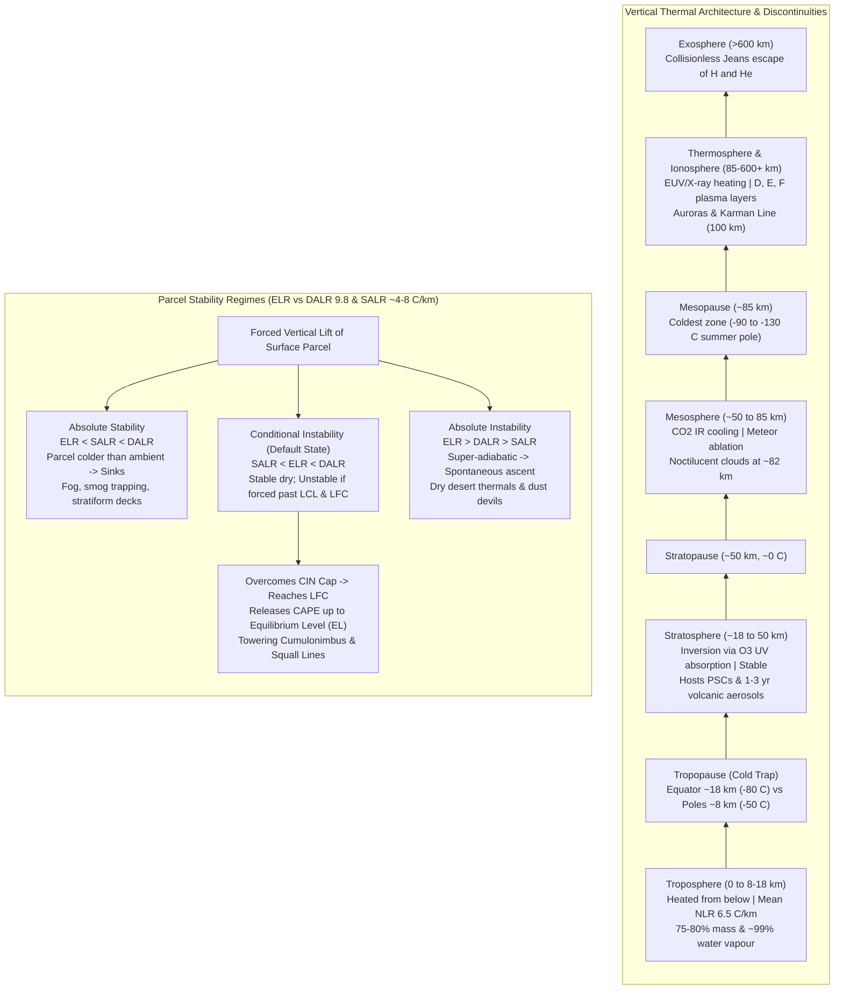

# Chapter 6 - Atmospheric Thermodynamics, Insolation, Lapse Rates & the Planetary Heat Budget

Earth's atmosphere operates not as a passive gaseous shell, but as a gravitationally bound, radiatively selective **planetary heat engine**. Driven by differential shortwave solar heating across latitudes and powered thermodynamically by the phase transitions of water, it continuously converts thermal potential into kinetic circulation while radiating infrared energy back to space.

Understanding weather, monsoonal energetics, urban heat stress, and geoengineering requires moving past static textbook averages to interrogate the **non-monotonic vertical gradients, spectral absorption windows, and spatial anomalies** that actually govern tropospheric physics and UPSC examination traps.

---

## 1. Atmospheric Composition and Vertical Thermal Stratification

### 1.1 Chemical Constituents and Dual-Standard Baselines

Dry air up to the turbopause is dominated by **permanent (well-mixed) gases**: molecular nitrogen ($\text{N}_2$, $78.08\%$), molecular oxygen ($\text{O}_2$, $20.95\%$), and argon ($\text{Ar}$, $0.93\%$), followed by trace noble gases ($\text{Ne}, \text{He}, \text{Kr}, \text{Xe}$). Because homonuclear diatomic molecules ($\text{N}_2, \text{O}_2$) and monatomic argon lack a permanent or vibrationally induced electric dipole moment, **$99.9\%$ of dry atmospheric mass is virtually transparent to terrestrial thermal infrared radiation**.

Planetary radiative thermodynamics is therefore hijacked by a tiny cohort of **variable greenhouse gases (GHGs)** possessing three or more atoms (or asymmetric bending/stretching vibrational modes) that strongly absorb longwave infrared photons:

- **Water Vapour ($\text{H}_2\text{O}$):** The atmosphere's primary condensable working fluid and most abundant natural GHG, varying from **$<1\%$ by volume in cold deserts and polar air to $\sim 4\%$ in warm, humid tropics**. Its concentration drops sharply both **with altitude** (over $90\%$ resides below $5\text{–}6\text{ km}$) and **from the equator toward the poles**. Because saturation vapour pressure scales exponentially with temperature via the Clausius–Clapeyron relation ($\sim 7\%\text{ per K}$), water vapour acts as an amplifying **climate feedback** rather than an independent long-lived forcing.
- **Carbon Dioxide ($\text{CO}_2$) — Dual-Standard Parity:** Legacy NCERT Class 11 lists $\text{CO}_2$ at **$0.036\%$ ($\sim 360\text{ ppm}$)**. Under live atmospheric monitoring, the **WMO Greenhouse Gas Bulletin (October 2026)** places the 2025 globally averaged surface concentration at **$426.8\text{ ppm}$ ($0.0427\%$)**—**$153\%$ of the 1750 pre-industrial baseline ($278\text{ ppm}$)**—while NOAA and Scripps recorded a seasonal peak of **$432.3\text{ ppm}$** at Mauna Loa in May 2026. Methane ($\text{CH}_4$) reached **$1,948\text{ ppb}$** ($+167\%$ above pre-industrial) and nitrous oxide ($\text{N}_2\text{O}$) hit **$339.1\text{ ppb}$** ($+26\%$) in 2025.
- **Ozone ($\text{O}_3$):** Exhibits a stark vertical duality. Roughly **$90\%$ resides in the stratosphere** ($15\text{–}35\text{ km}$, peaking at $20\text{–}25\text{ km}$), where Chapman-cycle photochemistry absorbs lethal solar UV-B and UV-C radiation; the remaining **$10\%$ in the troposphere** is a secondary photochemical pollutant and potent short-lived GHG absorbing directly inside the $9.6\ \mu\text{m}$ atmospheric window.

**Atmospheric Aerosols (Particulate Matter):** Suspended solid and liquid particulates—sea salt, desert mineral dust, volcanic sulphates, pollen, soot, and meteoric ash—serve as indispensable **hygroscopic Cloud Condensation Nuclei (CCN)** and Ice Nucleating Particles (INPs). Without them, homogeneous nucleation would require relative humidities exceeding $300\%\text{–}400\%$.

A crucial spatial anomaly frequently tested by UPSC governs **dust particle distribution**: aerosol dust concentrations are **higher in subtropical and temperate belts than in equatorial or polar regions**. Intense convective rainfall continuously scrubs dust out of the equatorial belt via wet deposition, while ice cover and weak surface winds suppress uplift at the poles; subtropical and mid-latitude arid continental interiors supply abundant particulates mobilized by **strong dry winds**.

Radiatively, aerosols split into two opposing camps. **Sulphate and nitrate aerosols** scatter incoming shortwave sunlight back to space (direct cooling) and brighten low clouds (indirect Twomey cooling), whereas **Black Carbon (soot)** absorbs solar radiation in-situ, heating mid-tropospheric air layers, darkening Himalayan snowpack albedo, and altering regional monsoonal stability.

### 1.2 Compositional Division - Homosphere vs. Heterosphere

Dividing the atmosphere by chemical mixing rather than temperature yields two concentric regimes separated by the **Turbopause ($\sim 80\text{–}100\text{ km}$)**:

- **Homosphere ($0\text{ to }\sim 80\text{–}90\text{ km}$):** Encompasses the troposphere, stratosphere, and mesosphere. Vigorous **turbulent eddy mixing** overwhelms gravitational settling, keeping relative proportions of permanent dry gases uniform and the mean molar mass effectively constant ($\approx 28.97\text{ g/mol}$).
- **Heterosphere (above $\sim 90\text{–}100\text{ km}$):** Air density drops so low that the molecular mean free path exceeds turbulent eddy scales. **Molecular diffusion** takes over, sorting each species by its individual hydrostatic scale height ($H_i = k_B T / m_i g$), creating four diffuse gravitational shells: **molecular nitrogen ($\text{N}_2$, $\sim 90\text{–}200\text{ km}$)**, **atomic oxygen ($\text{O}$, $\sim 200\text{–}1,100\text{ km}$)**, **helium ($\text{He}$, $\sim 1,100\text{–}3,500\text{ km}$)**, and **atomic hydrogen ($\text{H}$, $>3,500\text{ km}$)**.

### 1.3 Vertical Thermal Stratification (Non-Monotonic Temperature Profile)

Atmospheric temperature does not decline monotonically toward outer space. Instead, alternating localized radiative heat sources and infrared cooling sinks fold the vertical profile into four thermal spheres capped by isothermal pauses, overlaid by an electrically ionized plasma shell.

**Troposphere ($0\text{ to }8\text{–}18\text{ km}$; global mean $\sim 12\text{–}13\text{ km}$):** Containing roughly **$75\text{–}80\%$ of total atmospheric mass** and **$\sim 99\%$ of all water vapour and weather phenomena**, the troposphere is heated primarily **from below** by terrestrial longwave radiation, boundary-layer conduction, and convective latent heat release. Consequently, temperature falls with height at a global average **Normal Lapse Rate (NLR) of $6.5^\circ\text{C/km}$** ($1^\circ\text{C}$ per $165\text{ m}$ in NCERT).

The ceiling of this turbulent layer—the **Tropopause**—is strikingly asymmetric in both latitude and season. It bulges to **$\sim 16\text{–}18\text{ km}$ over the Equator** (and even higher over the summer Tibetan monsoon dome) while compressing to **$\sim 8\text{–}9\text{ km}$ over the Poles**. Two coupled physical mechanisms produce this wedge: **deep equatorial convection** transports heat vigorously to great heights, and hydrostatic thermal expansion stretches a warmer air column vertically ($dz \propto T$).

This geometry creates the **Tropical Cold-Point Paradox**: because the tropospheric lapse rate operates over twice the vertical thickness at the equator, the **equatorial tropopause ($\approx -80^\circ\text{C}$)** is dramatically *colder* than the **polar tropopause ($\approx -45^\circ\text{C}$ to $-55^\circ\text{C}$)**. This frigid equatorial ceiling acts as a planetary "cold trap," freeze-drying air ascending into the stratosphere and keeping the stratosphere bone-dry. Sharp altitude step-downs—**tropopause breaks**—around $30^\circ$ and $60^\circ$ latitude host the Subtropical and Polar Front Jet Streams.

**Stratosphere ($\text{Tropopause to }\sim 50\text{ km}$):** Starting with a nearly isothermal base above the tropopause, temperature **increases with altitude** up to $\sim 0^\circ\text{C}$ at the **Stratopause**. This global-scale temperature inversion is driven by exothermic **absorption of solar UV-B and UV-C ($200\text{–}310\text{ nm}$) by the Ozonosphere** ($\text{O}_3$ photolysis and recombination).

Because warmer, less dense air rests permanently atop colder air, the stratosphere possesses immense **static stability**, suppressing vertical convective clouds and granting jet aircraft smooth cruising altitudes above tropospheric weather. The flip side is long residence time: volcanic or geoengineered sulphate aerosols lofted above the tropopause lack rain-out scavenging and circulate globally for 1–3 years. Under extreme winter polar-vortex cooling ($<-78^\circ\text{C}$), rare **Polar Stratospheric Clouds (PSCs / nacreous clouds)** form here, providing ice/nitric-acid surfaces for heterogeneous reactions that liberate reactive chlorine radicals and carve out the Antarctic ozone hole.

**Mesosphere ($\sim 50\text{ to }80\text{–}85\text{ km}$):** Above the stratopause, ozone density collapses while $\text{CO}_2$ continues radiating thermal infrared energy efficiently into space. Temperature plunges steeply to the coldest temperatures in Earth's entire atmosphere at the **Mesopause ($\sim -90^\circ\text{C}$ to $-100^\circ\text{C}$)**.

Curiously, the **summer polar mesopause** is the coldest place on Earth (dipping near **$-130^\circ\text{C}$**)—far colder than the winter polar mesopause—because breaking atmospheric gravity waves drive a pole-to-pole mesospheric meridional overturning cell that forces strong **upwelling and adiabatic expansion** over the summer pole. Two signature phenomena define this layer: **meteor ablation** (ram-pressure compressional heating of incoming meteoroids around $75\text{–}100\text{ km}$) and **Noctilucent Clouds (Polar Mesospheric Clouds)**—electric-blue ice-crystal sheets at $\sim 82\text{ km}$ nucleated on meteoric smoke, whose increasing brightness and equatorward sightings serve as a sensitive upper-atmospheric fingerprint of anthropogenic methane oxidation and $\text{CO}_2$-induced upper-air cooling.

**Thermosphere ($\sim 85\text{ to }500\text{–}700\text{ km}$):** Direct absorption of high-energy **Extreme Ultraviolet (EUV) and soft X-ray** solar photons by sparse atomic oxygen and molecular nitrogen drives kinetic temperatures soaring from $500^\circ\text{C}$ at solar minimum to **$>1,500^\circ\text{C}$ at solar maximum**. Despite these extreme temperatures, an astronaut or spacecraft in shadow would not feel heat: ultra-low molecular number density yields negligible heat capacity and minimal collisional energy transfer—illustrating the sharp split between **kinetic temperature** ($\frac{3}{2}k_B T$) and **sensible heat flux**. The **Kármán Line ($100\text{ km}$)** and the International Space Station orbit ($\sim 400\text{ km}$) lie within this layer.

**Ionosphere ($\sim 60\text{ to }1,000\text{ km}$):** Overlapping the upper mesosphere, thermosphere, and inner exosphere, the ionosphere is defined electrically rather than thermally—a weakly ionized plasma sustained by solar EUV/X-ray photoionization and cosmic rays that governs radio wave propagation and space-weather disruptions:

- **D-Layer ($\sim 60\text{–}90\text{ km}$):** Ionized primarily by solar Lyman-$\alpha$ and hard X-rays; relatively dense neutral air causes frequent electron–neutral collisions, **absorbing lower-frequency AM radio waves** during daylight. Because recombination is fast, the **D-layer vanishes at night**, allowing AM broadcasts to reflect off higher layers for hundreds of kilometers.
- **E-Layer / Kennelly–Heaviside Layer ($\sim 90\text{–}150\text{ km}$):** Reflects medium-frequency radio waves; weakens sharply after sunset, though localized metallic-ion patches (*Sporadic-E*) persist.
- **F-Layer / Appleton Layer ($\sim 150\text{–}500\text{ km}$):** The densest and most persistent plasma zone. During daylight it splits into **F1** and **F2** sub-layers before merging into a single nocturnal F-layer, enabling **long-distance intercontinental shortwave (HF) skywave communication** day and night. Solar flares and coronal mass ejections disrupt this plasma, inducing radio blackouts and GNSS/NavIC phase scintillation.
- **Auroras (Aurora Borealis & Aurora Australis):** Charged solar-wind electrons and protons channeled down geomagnetic field lines into high-latitude auroral ovals collide with thermospheric atoms. De-excitation of **atomic oxygen** yields iconic **green ($557.7\text{ nm}$, $\sim 100\text{–}150\text{ km}$)** and high-altitude **red ($630.0\text{ nm}$, $>200\text{ km}$)** emissions, while ionized **molecular nitrogen** emits blue and crimson fringes. During extreme G5 geomagnetic storms (such as May 2024), auroral ovals expand equatorward enough to render red-dominated auroral arcs visible even at low geomagnetic latitudes like Hanle, Ladakh.

**Exosphere (above $\sim 500\text{–}700\text{ km}$ to $\sim 10,000\text{ km}$):** Beyond the **exobase**, the mean free path exceeds the local scale height. Gas particles follow collisionless ballistic trajectories; light **hydrogen and helium** atoms in the high-velocity tail of the Maxwell–Boltzmann distribution exceed Earth's escape velocity ($11.2\text{ km/s}$) and leak gradually into interplanetary space (**Jeans escape**).

---

## 2. Adiabatic Lapse Rates, Atmospheric Stability and Convective Potential

### 2.1 Environmental vs. Adiabatic Lapse Rates

Every weather system from morning radiation fog to Himalayan cloudbursts hinges on comparing two distinct vertical temperature gradients: the static thermal profile of the **ambient atmosphere** versus the dynamic thermodynamic cooling rate of a **displaced air parcel**.

- **Environmental Lapse Rate (ELR, $\Gamma_e = -\partial T/\partial z$):** The *actual* vertical temperature gradient of stationary surrounding air measured at a specific place and hour by a weather balloon (radiosonde). It fluctuates wildly with surface heating, air-mass advection, and nocturnal cooling; only its global tropospheric average equals the **Normal Lapse Rate ($6.5^\circ\text{C/km}$)**.
- **Dry Adiabatic Lapse Rate (DALR, $\Gamma_d$):** When an unsaturated air parcel rises without exchanging heat with its surroundings ($dq = 0$), it expands against falling ambient pressure, performing $P\,dV$ work at the expense of its internal thermal energy. Applying the First Law of Thermodynamics with hydrostatic balance ($dP = -\rho g\,dz$) fixes this cooling rate strictly at $\Gamma_d = g/c_p \approx \mathbf{9.8^\circ\text{C/km}}$ ($\sim 10^\circ\text{C/km}$). Crucially, **DALR is a thermodynamic constant** throughout the dry troposphere, unaffected by the parcel's starting temperature.
- **Saturated / Moist Adiabatic Lapse Rate (SALR / MALR, $\Gamma_s$):** Once a rising parcel cools to its dew point at the **Lifting Condensation Level (LCL)**, water vapour condenses into liquid droplets, releasing **latent heat of vaporization ($L_v \approx 2.5 \times 10^6\text{ J/kg}$)** directly inside the parcel. This internal heating partially offsets expansional cooling, slowing the temperature drop to an average of **$\sim 5\text{–}6^\circ\text{C/km}$**.

Unlike DALR, **SALR is strongly non-constant**. Because warm tropical air holds exponentially more moisture than frigid polar air, condensation releases massive latent heat in the equatorial boundary layer—pushing **SALR as low as $\sim 4^\circ\text{C/km}$** near tropical sea level. Conversely, in frigid polar air or the upper troposphere where saturation vapour pressure approaches zero, negligible latent heat is released and **SALR converges asymptotically toward DALR ($\sim 8\text{–}9^\circ\text{C/km}$)**.

In atmospheric dynamics, dry static stability is expressed compactly via **Potential Temperature ($\theta = T(P_0/P)^{R/c_p}$)**—the temperature a parcel would attain if compressed adiabatically to a reference pressure ($1,000\text{ hPa}$). Because $\theta$ is conserved during dry adiabatic displacement, a column is dry-statically stable whenever $\partial\theta/\partial z > 0$, neutral when $\partial\theta/\partial z = 0$, and dry-unstable whenever $\partial\theta/\partial z < 0$.

### 2.2 Four Atmospheric Stability Regimes

Testing whether a small upward nudge makes a parcel warmer (buoyant, $\rho_{\text{parcel}} < \rho_{\text{env}}$) or colder (negatively buoyant, $\rho_{\text{parcel}} > \rho_{\text{env}}$) than ambient air defines four stability regimes:

- **Absolute Stability ($\text{ELR} < \text{SALR} < \text{DALR}$):** Ambient temperature drops slower with height than even a condensing parcel cools (or increases with height in an inversion). Any displaced parcel—dry or saturated—ends up colder and denser than its environment and sinks back. Vertical cloud growth is suppressed, yielding clear skies or flat stratiform decks and trapping surface pollution.
- **Absolute Instability ($\text{ELR} > \text{DALR} > \text{SALR}$):** A super-adiabatic ambient profile where even an unsaturated parcel cooling at $9.8^\circ\text{C/km}$ stays warmer than the rapidly cooling air around it. Both dry and saturated parcels accelerate upward spontaneously. True absolute instability rarely spans deep atmospheric columns; it occurs mainly in shallow, intensely sun-baked boundary layers over hot deserts (generating dust devils and vigorous dry thermals over Rajasthan in May).
- **Conditional Instability ($\text{SALR} < \text{ELR} < \text{DALR}$):** The **climatological default of Earth's troposphere**, since the global mean NLR ($6.5^\circ\text{C/km}$) sits cleanly between SALR ($\sim 5^\circ\text{C/km}$) and DALR ($9.8^\circ\text{C/km}$). The column resists unsaturated vertical motion—requiring an external mechanical trigger (**orographic lift** along the Western Ghats or Himalayas, **frontal wedging**, or **sea-breeze/monsoon-trough convergence**)—to push air past the LCL until it crosses its **Level of Free Convection (LFC)**. Beyond the LFC, latent heat release makes the parcel spontaneously buoyant, triggering deep towering **cumulonimbus** convection.
- **Convective (Potential) Instability:** Occurs when an entire atmospheric layer featuring **warm, moisture-laden air at the base** capped by **dry air aloft** (e.g., moist Bay of Bengal southerlies undercut beneath dry north-westerly continental air over the pre-monsoon Indo-Gangetic Plain) is lifted bodily. The moist bottom saturates early and cools slowly at SALR, while the dry top keeps cooling rapidly at DALR—steepening the layer's ELR violently and igniting explosive **Nor'westers (*Kal Baisakhi*)** and severe squall lines.

### 2.3 CAPE and CIN - Quantifying Convective Violence

Meteorologists quantify conditional instability across an entire vertical sounding using two energy integrals measured in $\text{J/kg}$:

- **CAPE (Convective Available Potential Energy):** The total vertical integral of positive buoyancy energy available to a rising parcel between its **Level of Free Convection (LFC)** and the **Equilibrium Level (EL)** (typically near the tropopause, where anvil clouds spread laterally). Neglecting entrainment and water loading, CAPE bounds maximum thunderstorm updraft speed via $w_{\max} \approx \sqrt{2 \cdot \text{CAPE}}$. Values exceeding **$2,500\text{–}4,000\text{ J/kg}$** over the pre-monsoon Gangetic plains and warm Bay of Bengal fuel violent hailstorms, lightning bursts, and orographic cloudbursts.
- **CIN (Convective Inhibition):** The negative buoyancy energy barrier (typically a low-level stable layer or capping inversion) that an external lifting mechanism must overcome to force a parcel from the surface up to its LFC. Paradoxically, **moderate CIN amplifies storm severity**: acting like a pressure-cooker lid, it suppresses scattered early-afternoon showers while allowing solar heating and evaporation to load massive heat and moisture into the boundary layer until localized heating or convergence ruptures the cap explosively.

---

## 3. Solar Radiation, Spectral Scattering and the Planetary Heat Budget

### 3.1 Solar Constant, Geometry and Insolation Anomalies

The Sun radiates approximately as a $5,778\text{ K}$ blackbody with its Wien spectral peak near $0.5\ \mu\text{m}$ (blue-green visible light). Integrating across the solar spectrum yields **$\sim 43\text{–}44\%$ Visible ($0.4\text{–}0.7\ \mu\text{m}$)**, **$\sim 48\text{–}49\%$ Near-Infrared ($>0.7\ \mu\text{m}$)**, and **$\sim 7\text{–}8\%$ Ultraviolet ($<0.4\ \mu\text{m}$)**—refuting the frequent Prelims distractor claiming infrared accounts for two-thirds of insolation.

**Total Solar Irradiance (TSI / Solar Constant) — Dual-Standard Parity:** Measured perpendicular to the solar beam at the Top of the Atmosphere (TOA) at $1\text{ AU}$, modern **NASA SORCE/TSIS-1 satellite radiometry** establishes the solar constant at **$1,361\text{ W/m}^2$** (fluctuating by only $\sim 0.1\%$ over the 11-year solar cycle), compared to the legacy NCERT textbook figure of **$1.94\text{ cal/cm}^2/\text{min}$ ($\approx 1,353\text{ W/m}^2$)**. Because Earth intercepts sunlight across a circular cross-section ($\pi R^2$) while rotating to distribute it over a full sphere ($4\pi R^2$), the **global annual mean TOA insolation** is strictly $S_0/4 \approx \mathbf{340\text{ W/m}^2}$.

Four controls govern spatial insolation receipt: **solar zenith angle** (cosine projection spreading oblique beams over larger areas plus longer atmospheric attenuation paths), **daylight duration** (set by $23.5^\circ$ axial obliquity), **atmospheric transparency** (clouds, dust, water vapour), and **Earth–Sun orbital eccentricity** (Perihelion at $147\text{ million km}$ on January 3 delivers $\sim 6.7\%$ more solar flux than Aphelion at $152\text{ million km}$ on July 4—a minor effect completely masked in the Northern Hemisphere by continental-oceanic thermal contrast).

Two high-yield spatial anomalies contradict naïve intuition. First, **maximum annual *surface* insolation does not occur at the Equator**, where dense convective cloud cover reflects substantial shortwave flux; instead, it peaks over **cloud-free subtropical deserts ($\sim 20^\circ\text{–}30^\circ$ N and S)** like the Sahara and Arabia. Second, total annual TOA insolation received at the Equator is roughly **$2.4\text{–}2.5$ times** that at the Poles—**never 10 times**, a classic quantitative exaggeration tested in Prelims.

### 3.2 Atmospheric Optical Interactions - Scattering vs. Absorption

As shortwave solar photons traverse the atmosphere, particle diameter ($d$) relative to wavelength ($\lambda$) dictates three distinct scattering regimes:

- **Rayleigh Scattering ($d \ll \lambda$):** Performed by individual gas molecules ($\text{N}_2, \text{O}_2$). Scattering efficiency scales fiercely as **$\lambda^{-4}$**, deflecting short blue/violet wavelengths roughly 6–10 times more strongly than red light. This isotropic molecular scattering paints the clear daytime sky blue and leaves sunrises and sunsets crimson once oblique optical paths deplete shorter wavelengths.
- **Mie Scattering ($d \approx \lambda$):** Performed by aerosols, mineral dust, pollen, and smoke particulates. Weakly wavelength-dependent and strongly forward-peaked, Mie scattering bleaches skies into the **milky-white glare** characteristic of hazy subtropical summers and winter air-pollution domes over the Indo-Gangetic Plain.
- **Non-Selective Geometric Scattering ($d \gg \lambda$):** Performed by liquid cloud droplets ($10\text{–}20\ \mu\text{m}$) and ice crystals, scattering all visible wavelengths equally. Sunlit clouds therefore appear pure white from above, while optically thick cumulonimbus bases appear dark slate-grey because little transmitted light penetrates to the bottom.

### 3.3 Albedo Dynamics and Geoengineering (SRM) Trade-Offs

**Albedo ($\alpha$)** is the dimensionless ratio of reflected to incident shortwave solar radiation. Surface reflectivity spans nearly an order of magnitude: **fresh snow ($0.80\text{–}0.95$)** > **thick low stratocumulus clouds ($0.60\text{–}0.80$)** > **sea ice ($0.50\text{–}0.70$)** > **bright desert sand ($0.30\text{–}0.45$)** > **grasslands and croplands ($0.15\text{–}0.25$)** > **forest canopies ($0.08\text{–}0.15$)** > **dark asphalt/wet soil ($0.05\text{–}0.10$)** > **calm open ocean at high sun angles ($0.05\text{–}0.08$)**. Crucially, **water albedo is strongly angle-dependent**, surging past $0.40\text{–}0.60$ at grazing low-sun angles near the poles (Fresnel reflection).

**Planetary Albedo — Dual-Standard Parity & Post-2020 Darkening:** Legacy NCERT assigns Earth a planetary albedo of **$35\%$**, whereas modern **NASA CERES satellite radiometry** places Earth's mean albedo near **$29\%$ ($\sim 0.29$)**. More alarmingly, CERES and DSCOVR-EPIC observations reveal a **record post-2020 albedo drop** (falling to **$\sim 28.4\%\text{–}28.7\%$ by 2024–2025**), identified in *Science* (Goessling et al., 2025) as a major amplifier of the 2023–2025 global heat surge. This planetary darkening reflects shrinking polar sea ice, reduced low-level marine stratocumulus decks over warming oceans, and cleaner marine shipping fuels mandated by **IMO 2020** sulphur caps—which abruptly removed reflective ship-track sulphate aerosols.

**Cloud Radiative Asymmetry (*2022 Prelims Core Concept*):** Clouds exert a dual radiative tug-of-war—cooling via shortwave albedo reflection while warming via longwave greenhouse trapping—whose net sign flips by altitude:

- **Low, optically thick clouds (stratus, stratocumulus):** Possess very high shortwave albedo, while their warm cloud tops emit thermal infrared almost as strongly as the underlying surface → **dominant net COOLING**.
- **High, optically thin ice clouds (cirrus):** Transmit most incoming shortwave sunlight freely, yet their frigid cloud tops ($\sim -45^\circ\text{C}$ to $-60^\circ\text{C}$, reducing $\sigma T^4$ emission sharply) absorb and trap surface longwave radiation → **dominant net WARMING**.

**Solar Radiation Modification (SRM) & Albedo Geoengineering Trade-Offs:** Because anthropogenic greenhouse warming is rising faster than decarbonization, three planetary radiative interventions have entered scientific and diplomatic contention:

- **Stratospheric Aerosol Injection (SAI):** Mimicking explosive volcanic eruptions (like Mount Pinatubo, 1991) by spraying $\text{SO}_2$/sulphate or calcite aerosols into the stratosphere ($\sim 20\text{ km}$) to bounce back $1\text{–}2\%$ of sunlight. Major physical and governance hazards include **Termination Shock** (catastrophic rapid rebound warming if continuous multi-generational injection ever fails), heterogeneous stratospheric ozone loss, **weakening of the Indian and African summer monsoons** (via reduced land–ocean thermal contrast and suppressed global precipitation), zero remedy for **ocean acidification** (since $\text{CO}_2$ remains unmitigated), and unilateral geopolitical risk. Harvard formally abandoned its balloon-based **SCoPEx** experiment in 2024.
- **Marine Cloud Brightening (MCB):** Atomizing fine sea-salt aerosols into coastal marine stratocumulus clouds to increase droplet number density, shrinking droplet radii and boosting cloud albedo (**Twomey effect**). While Australian-funded trials continue over the Great Barrier Reef, the **Alameda City Council (California) unanimously halted** the University of Washington's outdoor USS Hornet sea-salt misting trial in May 2024 over transparency and governance failures. Crucially, June 2024 Scripps modelling warned that regional MCB off the US West Coast could teleconnect to **unintentionally warm Europe**.
- **Cirrus Cloud Thinning (CCT):** Technically *longwave* radiation management—seeding upper-tropospheric supersaturated air with efficient Ice Nucleating Particles (e.g., bismuth triiodide) to form fewer, heavier ice crystals that fall out faster, thinning warming cirrus decks so more terrestrial IR escapes to space. Its razor-thin margin of error is notorious: over-seeding generates *denser* cirrus clouds and accelerates warming.
- **Multilateral Deadlock:** At **UNEA-6 (Nairobi, February–March 2024)**, Switzerland was forced to withdraw its draft resolution for an SRM scientific assessment group after African nations and Global South coalitions pressed instead for a precautionary non-use mechanism to prevent normalizing unilateral planetary cooling.

### 3.4 Shortwave–Longwave Balance, Atmospheric Window & Earth's Energy Imbalance

At an average surface temperature of $\sim 288\text{ K}$ ($15^\circ\text{C}$), Earth emits thermal **longwave infrared radiation ($4\text{–}100\ \mu\text{m}$, peaking near $10\ \mu\text{m}$)**. Because the troposphere is relatively transparent to incoming solar shortwave but largely **opaque to outgoing terrestrial longwave**, it is **heated overwhelmingly from below**—not directly by sunlight. GHGs absorb upward terrestrial IR and re-emit isotropically both upward to space and downward to the surface (**atmospheric back-radiation**).

Without a greenhouse atmosphere, Earth's spherical-mean **effective radiating temperature** (from $\sigma T_e^4 = \frac{S_0}{4}(1 - \alpha)$) would be **$-18^\circ\text{C}$ ($255\text{ K}$)** instead of **$+15^\circ\text{C}$ ($288\text{ K}$)**—a **+$33^\circ\text{C}$ natural greenhouse buffer**. Critically, however, an airless Earth would **not** be below freezing *everywhere*: like the Moon, directly sunlit equatorial surfaces would superheat past $+100^\circ\text{C}$ while night-side surfaces plunged below $-150^\circ\text{C}$ (*2025 Prelims precision*).

**The Atmospheric Window ($8\text{–}12\ \mu\text{m}$):** Between the primary absorption bands of $\text{H}_2\text{O}$ and $\text{CO}_2$ lies a spectral transparency corridor allowing surface thermal IR to stream directly into space. Weather satellites exploit this band for cloud-top and land-surface thermometry, and passive daytime radiative-cooling coatings target it to dump building heat directly to deep space. Unfortunately, **synthetic halocarbons (CFCs, HFCs, $\text{SF}_6$), tropospheric ozone ($9.6\ \mu\text{m}$), and liquid cloud decks** absorb precisely inside this window—explaining why a single molecule of $\text{SF}_6$ or HFC traps thousands of times more heat than a molecule of $\text{CO}_2$.

**Planetary Heat Budget — Dual-Standard Numeric Parity:**

- **Legacy NCERT Equilibrium Budget (Normalized to 100 Incoming Units):**
  - **Reflected (Albedo): $35$ units** ($27$ from cloud tops + $6$ scattered by atmosphere + $2$ from snow/ice surfaces).
  - **Absorbed Shortwave: $65$ units** (**$14$ units** directly by the atmosphere + **$51$ units** by Earth's surface).
  - **Surface Outgoing ($51$ units):** **$17$ units** escape directly to space through the atmospheric window; **$34$ units** pass to the atmosphere ($6$ absorbed directly via radiation + **$9$ via sensible convection/turbulence** + **$19$ via latent heat of condensation**).
  - **Atmospheric Outgoing:** Radiates $14 + 34 = \mathbf{48\text{ units}}$ to space. Total outgoing ($17 + 48 = 65$) exactly balances absorbed shortwave ($65$).
- **Modern Satellite Radiometry (NASA CERES / IPCC AR6 Fluxes in $\text{W/m}^2$):**
  - **TOA Incoming Shortwave:** $\sim \mathbf{340\text{ W/m}^2}$; **Reflected:** $\sim \mathbf{99\text{–}100\text{ W/m}^2}$ ($\sim 29\%$ albedo); **Net Absorbed Shortwave:** $\sim \mathbf{240\text{ W/m}^2}$.
  - **Shortwave Partition Shift:** Modern observations show the **atmosphere absorbs $\sim 78\text{ W/m}^2$ ($\sim 23\%$)** of incoming solar flux (significantly higher than NCERT's legacy $14\%$, due to near-IR absorption by water vapour and absorbing aerosols), while the **surface absorbs $\sim 162\text{ W/m}^2$ ($\sim 48\%$)**.
  - **Surface Radiative–Turbulent Coupling:** The surface absorbs $162\text{ W/m}^2$ shortwave *plus* **$\sim 342\text{ W/m}^2$ downward longwave back-radiation** from GHGs and clouds ($\sim 504\text{ W/m}^2$ total). It sheds this energy via **$\sim 398\text{ W/m}^2$ upward longwave emission** ($\sim 40\text{ W/m}^2$ escaping straight through the atmospheric window), **$\sim 21\text{ W/m}^2$ Sensible Heat Flux ($H$)**, and **$\sim 84\text{ W/m}^2$ Latent Heat Flux ($LE$)**.

Note the global **Bowen Ratio ($B = H/LE$)** embedded in that flux budget: globally, **latent heat flux ($\sim 84\text{ W/m}^2$) outstrips sensible heat flux ($\sim 21\text{ W/m}^2$) by roughly 4:1 ($B \approx 0.25$)**, proving that evaporation–condensation—not dry convection—is Earth's primary vertical heat-transfer conveyor. Spatially, $B$ flips dramatically from **$<0.1$ over warm tropical oceans** (almost all energy enters evaporation) to **$>2\text{–}5$ over hyper-arid deserts** (Thar, Sahara), where dry surfaces convert nearly all absorbed sunlight into scorching sensible air heating.

**Earth's Energy Imbalance (EEI) — The Breakdown of Equilibrium:** Textbook budgets assume exact TOA balance, yet contemporary Earth is trapping significantly more energy than it radiates. NASA CERES satellite data and Argo float ocean heat inventories prove that **EEI more than doubled** from **$\sim 0.5\text{–}0.6\text{ W/m}^2$ (2001–2010)** to **$\sim 1.0\text{–}1.2\text{ W/m}^2$ (2015–2024)**—spiking near **$1.8\text{ W/m}^2$ in 2023** (Loeb et al., 2024; Mauritsen et al., *AGU Advances*, 2025). According to the **WMO State of the Global Climate (2025/2026)**, which introduced EEI as a headline global climate indicator, **over $91\%$ of this excess heat accumulates in the oceans**, driving steric sea-level rise and marine heatwaves.

### 3.5 Latitudinal Energy Imbalance and Poleward Heat Transport

Radiative balance holds approximately for the globe as a whole, but fails dramatically by latitude. Equatorward of **$\sim 38^\circ\text{–}40^\circ$ N and S**, annual absorbed solar shortwave exceeds outgoing terrestrial longwave (**net radiative surplus**); poleward of **$\sim 40^\circ$**, outgoing longwave exceeds absorbed shortwave (**net radiative deficit**).

The tropics neither boil continuously nor do the poles freeze toward absolute zero because atmospheric winds and oceanic currents continuously pump **$\sim 5\text{–}6\text{ petawatts}$** of heat poleward in each hemisphere, with total flux peaking precisely across the **$35^\circ\text{–}40^\circ$ zero-crossover latitudes**. Across the planet as a whole, the **atmosphere transports $\sim 70\text{–}80\%$** of poleward energy (via Hadley overturning, mid-latitude baroclinic cyclones, and massive poleward latent-heat/water-vapour advection), while the **oceans carry $\sim 20\text{–}30\%$**. Crucially, this dominance switches by latitude: **oceans carry the majority of poleward heat inside the deep tropics ($0^\circ\text{–}20^\circ$)** via wind-driven gyres and Western Boundary Currents (Gulf Stream, Kuroshio), before handing thermal transport off to **atmospheric storm tracks beyond $30^\circ$**.

---

## 4. Horizontal Isotherms, Temperature Inversions, Urban Heat Islands and Wet-Bulb Stress

### 4.1 Horizontal Temperature Distribution and Isotherm Geometry

Sea-level-reduced **isotherms** (lines joining equal temperatures) distort from smooth latitudinal parallels due to **continentality (land–ocean specific heat asymmetry)**, **ocean currents**, **prevailing winds**, and **elevation/aspect** (*adret* sun-facing vs. *ubac* shaded slopes).

Water possesses a specific heat capacity roughly **4–5 times higher** than dry soil or rock; moreover, solar radiation penetrates tens of meters into translucent water, turbulent mixing distributes heat through a deep ocean mixed layer, and evaporation siphons energy into latent heat. Land surfaces are opaque and non-convective, confining heating and cooling to a razor-thin soil skin—producing wide diurnal and annual thermal ranges over continental interiors (**continentality**).

This thermal inertia governs two premier UPSC Prelims traps:

- **Seasonal Contrast Asymmetry (*2023 Prelims*):** The **temperature contrast between continents and oceans is far greater in WINTER than in SUMMER**. During Northern Hemisphere winter (January), vast continental snowpacks and clear-sky radiative cooling plunge interior Siberia (Verkhoyansk, Oymyakon) and northern Canada to $-40^\circ\text{C}$ to $-50^\circ\text{C}$, while adjacent ice-free North Atlantic waters bathed by the warm North Atlantic Drift remain above $0^\circ\text{C}$—creating staggering $40^\circ\text{C}+$ zonal contrasts. In summer, oceanic moderation and continental convective mixing keep land–sea thermal gaps notably smaller.
- **Isotherm Bending Rules (*2025 Prelims*):** In **January (NH winter)**, because landmasses are sharply colder than oceans at the same latitude, isotherms **bend abruptly equatorward over continents** and **poleward over oceans** (most spectacularly over the Norwegian Sea and North Atlantic). In **July (NH summer)**, the geometry reverses cleanly: isotherms bend **poleward over hot landmasses** and **equatorward over cooler oceans**. In the Southern Hemisphere, where oceans occupy $\sim 81\%$ of surface area, isotherms stay nearly **zonal (parallel to latitudes)** year-round with gentle spacing.

**The Thermal Equator:** The global locus of highest mean surface temperatures does not coincide with the geographic equator ($0^\circ$). Its **annual mean axis lies near $5^\circ\text{–}8^\circ\text{ N}$**, migrating northward past **$20^\circ\text{ N}$** over the Sahara, Arabia, and north-western India in July while barely edging south of $0^\circ$ in January. This permanent northern offset stems from Northern Hemisphere landmass preponderance (heating rapidly in boreal summer) reinforced by northward cross-equatorial ocean heat transport via the Atlantic Meridional Overturning Circulation (AMOC).

### 4.2 Temperature Inversions - Physics, Four Archetypes and Airshed Consequences

A **Temperature Inversion** occurs whenever the normal tropospheric lapse rate reverses ($\partial T/\partial z > 0$), placing warmer, less dense air atop colder, denser air. Because any rising parcel cools adiabatically into warmer surroundings and is forced back downward, an inversion functions as an **impermeable thermodynamic cap**, arresting vertical convection, blocking convective rainfall, fostering dense fog/frost, and trapping surface emissions inside a shallow boundary layer.

Four distinct physical mechanisms generate inversions across Earth's surface and free troposphere:

- **1. Radiation (Surface / Ground) Inversion:** Forms on **long, calm, cloudless, dry winter nights**. Clear skies permit rapid terrestrial longwave escape through the atmospheric window; dry air minimizes downward GHG back-radiation; still air prevents turbulent mixing with warmer layers aloft; and snow cover (where present) reflects daytime sunlight while radiating efficiently at night. Shallow ($50\text{–}500\text{ m}$), it normally dissipates by late morning once solar heating restores surface convection.
  - *Indian Airshed Reality:* Across the **Indo-Gangetic Plain (Delhi–NCR, Punjab, Haryana, Uttar Pradesh, Bihar)** from November through January, persistent nocturnal radiation inversions collapse the planetary boundary layer height below $300\text{–}500\text{ m}$. Combined with slow anticyclonic winds and high moisture, this traps vehicular exhaust, biomass/stubble smoke, and industrial $\text{PM}_{2.5}$ into toxic winter **smog-fog episodes**.
- **2. Valley (Air-Drainage / Katabatic) Inversion:** On clear nights in hilly terrain, radiatively chilled, denser air along upper mountain ridges drains gravitationally downslope (**katabatic air drainage**) and pools in valley bottoms, displacing warmer air upward onto the mid-slopes.
  - *Agronomic & Settlement Geography:* Valley floors become killing **frost hollows** shrouded in dense morning radiation fog (e.g., Dehradun, Shimla, Kashmir valley floors), whereas intermediate slopes enjoy a frost-free **thermal belt**. This micro-climatic inversion directly dictates why **Brazilian coffee estates (*Fazendas*), Himachal Pradesh and Uttarakhand apple/peach orchards, Alpine vineyards, and traditional Himalayan settlements** cluster on mid-slopes rather than valley bottoms.
- **3. Subtropical Subsidence (Upper-Air / Trade-Wind) Inversion:** Large-scale sinking air in the descending limbs of the subtropical **Hadley Cells ($\sim 20^\circ\text{–}35^\circ$)** compresses and warms adiabatically at the DALR ($9.8^\circ\text{C/km}$), creating a persistent elevated warm lid hundreds of meters above a cool marine boundary layer. This semi-permanent inversion locks in coastal aridity and marine fog along western continental margins (Atacama, Namib, Baja California), fuels severe photochemical smog trapping over the Los Angeles basin, and forms the **western Arabian Sea trade-wind inversion** that suppresses deep convection over the western Indian Ocean until summer monsoonal air approaches the Western Ghats.
- **4. Frontal (Advection) Inversion:** Forms along mid-latitude **warm or cold fronts** when a warm, buoyant air mass glides upward over an undercutting wedge of dense cold air. Unlike calm, clear radiation inversions, frontal inversions are **tilted, elevated, often windy, and accompanied by stratiform precipitation**. When liquid raindrops falling from the above-freezing warm nose aloft enter a shallow sub-zero surface layer, they supercool and freeze instantaneously on contact with roads and power lines as hazardous **freezing rain (glaze)**.

### 4.3 Urban Heat Islands (UHIs) - Energetics, Types and Indian Metropolises

An **Urban Heat Island (UHI)** is a metropolitan micro-climatic anomaly wherein urbanized cores stay systematically warmer than surrounding vegetated rural hinterlands. It stems from four coupled perturbations to the surface energy budget:

- **Latent-to-Sensible Flux Reversal:** Replacing transpiring vegetation, soil moisture, and urban wetlands with impervious concrete and asphalt eliminates evaporative cooling (**latent heat sink**), redirecting absorbed solar radiation almost entirely into **sensible air heating** and substrate storage.
- **Low Albedo & High Thermal Admittance:** Dark bituminous roads, tar roofs, and masonry walls absorb more shortwave flux during the day and possess high thermal mass, storing vast heat reserves that radiate slowly outward as longwave infrared after sunset.
- **Urban Canyon Geometry:** Dense high-rise corridors reduce the **Sky View Factor (SVF)**—trapping outgoing terrestrial longwave photons via multiple wall-to-wall reflections while simultaneously creating aerodynamic drag that stalls cooling wind ventilation.
- **Anthropogenic Waste Heat:** Exhaust from air-conditioning compressors (creating a vicious positive feedback during heatwaves), vehicular internal combustion engines, and urban industry injects direct sensible heat directly into street canyons.

**Surface UHI (SUHI) vs. Canopy-Layer Atmospheric UHI:** UPSC precision separates two distinct phenomena. **Surface UHI** (skin temperature measured by thermal-IR satellites) peaks during **early afternoon** ($+5^\circ\text{C}$ to $+10^\circ\text{C}$). By contrast, **Canopy-Layer Atmospheric UHI** (ambient air temperature experienced by human bodies at $2\text{ m}$) peaks **3–5 hours after sunset on calm, clear nights** ($+2^\circ\text{C}$ to $+6^\circ\text{C}$), because rural surfaces cool rapidly while concrete heat banks continue radiating. Elevated **nocturnal minimum temperatures** are clinically deadlier than afternoon spikes, denying human cardiovascular systems overnight thermal recovery.

**The Semi-Arid Indian "Daytime Urban Cool Island" Nuance:** In arid and semi-arid Indian cities during dry pre-monsoon months (e.g., Ahmedabad, Jaipur, Jodhpur, dry-season Delhi), barren, parched rural soils around the city often exhibit *higher* daytime skin temperatures than irrigated urban parks and shaded street canyons, occasionally producing a weak **daytime Surface Urban Cool Island**. Yet even in these cities, **nighttime atmospheric UHI** stays sharply positive—and intensifies dangerously when urban moisture and calm skies trap heat. Mitigation operates directly on energy-budget physics: high-albedo **cool roofs** (scaled in Ahmedabad and Telangana heat action plans), **blue-green infrastructure** (urban lakes, Miyawaki pockets, and shaded tree corridors restoring latent cooling), permeable pavements, and wind-aligned **urban ventilation corridors**.

### 4.4 Wet-Bulb Temperature (WBT) and Human Thermal Survivability Limits

Dry-bulb air temperature alone severely misjudges physiological heat danger because human thermoregulation depends fundamentally on **evaporative cooling via sweat**. **Wet-Bulb Temperature ($T_w$)** is defined thermodynamically as the lowest temperature an air parcel can reach solely through **evaporation of water at constant pressure** (measured by a ventilated thermometer wrapped in a wet muslin wick). It always satisfies $T_{\text{dew}} \le T_w \le T_{\text{dry}}$, reaching equality with dry-bulb air temperature only at $100\%$ relative humidity.

**Physiological Threshold — Dual-Standard Scientific Parity:** The human body must hold core temperature near **$37^\circ\text{C}$** by maintaining skin temperature near **$35^\circ\text{C}$** so metabolic heat ($\sim 100\text{ W}$ at rest, $>400\text{ W}$ under outdoor labour) can flow down a thermal gradient to the skin and evaporate into ambient air.

- **Theoretical Upper Ceiling ($T_w = 35^\circ\text{C}$):** Established by **Sherwood & Huber (2010)**, beyond $35^\circ\text{C}$ wet-bulb temperature, ambient air cannot absorb evaporative heat from $35^\circ\text{C}$ skin; even healthy, hydrated, resting humans in full shade face fatal hyperthermia within roughly six hours.
- **Empirical Human Limit ($T_w \approx 30.5^\circ\text{C}\text{–}31^\circ\text{C}$):** Controlled physiological chamber trials (**PSU HEAT Project, Vecellio et al., 2022–2023**) overturned the assumption that $35^\circ\text{C}$ is survivable in real life, proving that **uncompensable core-temperature rise** begins around **$T_w \approx 30.5^\circ\text{C}\text{–}31^\circ\text{C}$** in warm-humid conditions even for young, healthy, lightly active adults—and drops even lower ($25^\circ\text{C}\text{–}28^\circ\text{C}$ wet-bulb) in hyper-hot dry air where human sweat glands saturate physiologically before evaporative limits are reached. For elderly citizens, infants, and outdoor construction/agricultural workers, clinical risk escalates well below $30^\circ\text{C}$.

**WBT vs. WBGT (Wet-Bulb Globe Temperature):** For outdoor labour and sports medicine, meteorologists deploy **WBGT**, a composite metric weighting wet-bulb temperature ($70\%$), solar-radiant black-globe temperature ($20\%$), and dry-bulb temperature ($10\%$). Field experiments by **IMD and IITM Pune (summer 2024; published 2026)** across urban and green campuses confirmed sharply elevated WBGT peaks between 1 PM and 3 PM in dense built-up cores, defining local extreme stress thresholds above $33^\circ\text{C}$ WBGT.

**India's Geographic Vulnerability & Policy Gap:** India's **irrigated Indo-Gangetic Plain** (where intense summer evapotranspiration injects moisture into $42^\circ\text{C}\text{–}46^\circ\text{C}$ continental air) and **humid coastal belts** (Odisha, Andhra Pradesh, Tamil Nadu, West Bengal, Konkan) sit among Earth's foremost wet-bulb hotspots. Standard **IMD Heat Wave criteria** remain anchored primarily to dry-bulb maxima—requiring $\ge 40^\circ\text{C}$ in plains, $\ge 37^\circ\text{C}$ on coasts, and $\ge 30^\circ\text{C}$ in hills with $+4.5^\circ\text{C}$ departures (or absolute $45^\circ\text{C}$ heat wave / $47^\circ\text{C}$ severe heat wave). Integrating humidity-weighted **Heat Index, WBT, and WBGT triggers** into IMD advisories and NDMA Heat Action Plans (HAPs) is therefore decisive for safeguarding India's outdoor workforce.

---

> [!warning] Prelims Traps & Atomic Distinctions
> - **Troposphere Cold-Point Paradox:** The tropopause is *higher* over the Equator ($\sim 18\text{ km}$) than the Poles ($\sim 8\text{ km}$), which makes the **equatorial tropopause ($\sim -80^\circ\text{C}$) strictly COLDER than the polar tropopause ($\sim -45^\circ\text{C}$ to $-55^\circ\text{C}$)**—never assume "Equator = warmer at all heights."
> - **Heating Direction & Bare-Earth Trap:** The troposphere is heated predominantly by **terrestrial longwave radiation from below**, not incoming solar shortwave. Without an atmosphere, Earth's *global average* temperature would be $-18^\circ\text{C}$, **NOT "below freezing everywhere"**—sunlit equatorial zones would bake past $+100^\circ\text{C}$ like the Moon.
> - **High Clouds vs. Low Clouds Sign Flip:** **High, thin cirrus clouds** transmit sunlight but trap longwave IR at cold tops → **net WARMING**; **low, thick stratocumulus clouds** reflect heavy sunlight while radiating warm IR → **net COOLING**. UPSC loves inverting both halves simultaneously.
> - **SALR Non-Constancy:** Unlike DALR (constant at $9.8^\circ\text{C/km}$), **SALR varies drastically with temperature**—lowest ($\sim 4^\circ\text{C/km}$) in warm, humid tropical air and approaching DALR ($\sim 8\text{–}9^\circ\text{C/km}$) in frigid polar/upper-tropospheric air.
> - **Dual-Standard Albedo & $\text{CO}_2$ Parity:** Know **NCERT planetary albedo = $35\%$** (and atmospheric SW absorption = $14\%$) alongside **NASA CERES = $\sim 29\%$** (and atmospheric SW absorption = $\sim 23\%$); similarly pair NCERT $\text{CO}_2$ ($0.036\%$) with WMO 2025/2026 live levels ($426.8\text{–}432\text{ ppm}$ / $\sim 0.043\%$).
> - **Dust & Water Vapour Latitudinal Opposites:** Water vapour peaks in the wet tropics and decreases toward poles and upward. Conversely, **dust particle concentration is highest in subtropical and temperate belts** (not the Equator) specifically because those zones experience **more dry winds** and less convective washout.
> - **Winter vs. Summer Land–Sea Contrast:** Continent–ocean temperature contrast is **greater in WINTER than in SUMMER**. In Northern Hemisphere January, isotherms bend **equatorward over cold continents** and **poleward over warm oceans**.
> - **Insolation Quantitative Traps:** Annual equatorial TOA insolation is **$\sim 2.4\text{–}2.5\times$ polar insolation** (not $10\times$), surface insolation peaks in **subtropical deserts** (not the cloudy Equator), and infrared constitutes **$\sim 48\text{–}49\%$** of sunlight (not two-thirds, and never part of the visible spectrum).
> - **Mesopause Seasonality:** The coldest region in Earth's entire atmosphere is the **SUMMER polar mesopause ($\sim -130^\circ\text{C}$)**—not the winter polar mesopause—due to gravity-wave-driven adiabatic upwelling.

---

> [!tip] Whole-UPSC Spillover
> - **GS3 (Disaster Management & Economic Productivity):** Crossing the empirical **$30.5^\circ\text{C}\text{–}31^\circ\text{C}$ wet-bulb limit** across the Indo-Gangetic Plain and coastal states directly threatens India's informal outdoor construction and agrarian labour force, drives nocturnal urban peak-power blackouts (UHI–AC feedback loop), and necessitates upgrading NDMA Heat Action Plans from dry-bulb maxima to **WBT/WBGT triggers** and parametric heat insurance.
> - **GS3 (Air Pollution Governance):** Shallow nocturnal **radiation inversions** over Delhi–NCR and the Indo-Gangetic airshed explain why point-source emission cuts inside city limits fail without regional **airshed-level coordination** under the Commission for Air Quality Management (CAQM).
> - **GS2 / International Relations (Geoengineering & Climate Security):** Because **Stratospheric Aerosol Injection (SAI)** could asymmetrically weaken the Indian Summer Monsoon while lacking multilateral consent—highlighted by the **UNEA-6 (2024) governance impasse**—unilateral solar geoengineering by a state or billionaire ("free-driver problem") constitutes an emerging non-traditional security threat for South Asia.
> - **GS3 (Science & Space Tech):** Ionospheric **D/E/F layer electron-density disturbances** during solar storms cause phase scintillation degrading **NavIC/GPS accuracy** and HF defence communications, while the **$8\text{–}12\ \mu\text{m}$ atmospheric window** underpins thermal-infrared Earth observation missions (such as the Indo-French **TRISHNA** satellite for agricultural water-stress and urban heat mapping).
> - **Essay:** *"The Thin Thermodynamic Corridor of Civilization"* — human prosperity rests inside a razor-thin radiative margin sustained by a $+33^\circ\text{C}$ natural greenhouse buffer, now threatened simultaneously by a $+1.2\text{ W/m}^2$ planetary energy imbalance and a $31^\circ\text{C}$ physiological wet-bulb wall.

---

## UPSC Interrogation Lens

### 1. Verified UPSC Mains PYQs (2014–2026) & Prelims Anchors

- **Mains GS1 (2024):** *"What are aurora australis and aurora borealis? How are these triggered?"*
- **Mains GS1 (2022):** *"The troposphere is a very significant atmosphere layer that determines weather processes. How?"*
- *(Foundational Pre-2014 GS1 Anchors: **2013 GS1** asked both "Bring out the causes for the formation of heat islands in the urban habitat of the world" and "What do you understand by the phenomenon of temperature inversion in meteorology? How does it affect the weather and the inhabitants of the place?")*
- **Verified Prelims PYQ Anchors (2019–2025):**
  - **2025:** Atmospheric dust concentrations in subtropical/temperate vs. equatorial/polar zones & dry winds; January Northern Hemisphere isotherm deflection over continents vs. oceans; Atmospheric heat-trapping role vs. the bare-Earth "below freezing everywhere" trap.
  - **2024:** Atmospheric heating by terrestrial longwave vs. incoming shortwave radiation; Greater equatorial tropospheric thickness driven by strong convectional currents; Water vapour altitude and polar distribution.
  - **2023:** Solar insolation spectral/latitudinal claims & lower-tropospheric infrared absorption by water vapour; Winter vs. summer continent–ocean temperature contrast and specific heat of water.
  - **2022:** Radiative forcing inversion between high clouds (net warming) and low clouds (net cooling).
  - **2019:** Cirrus cloud thinning and stratospheric sulphate aerosol injection for mitigating global warming.

### 2. Prelims Trap Signature

- **Sign & Direction Inversions:** Swapping high-cloud warming with low-cloud cooling, winter with summer land–ocean temperature contrasts, or equatorward with poleward January isotherm bends.
- **Absolute vs. Mean Conflation:** Turning Earth's $-18^\circ\text{C}$ *global average* bare-rock radiative temperature into "below freezing *everywhere* on Earth's surface", or conflating tropospheric thickness at the Equator with warmer tropopause temperatures.
- **Causal Statement-I / Statement-II Decoupling:** Presenting two individually true thermodynamic facts where Statement-II does *not* explain Statement-I—or inserting a single flipped modifier (e.g., subtropical belts having *"less* dry winds" instead of *more* dry winds) to invalidate Statement-II.
- **Legacy Textbook vs. Live Radiometry Gaps:** Testing classical qualitative physics straight from Class 11 NCERT (terrestrial heating, normal lapse rate, water vapour gradient) alongside contemporary climate interventions (cirrus thinning, sulphate injection, planetary albedo shifts).

### 3. Cross-Hub AIR-1 Provocations

1. **Thermodynamics Meets Geopolitics:** If post-2020 reductions in reflective marine shipping aerosols (IMO 2020) and declining low-cloud cover have accelerated Earth's Energy Imbalance past $1.2\text{ W/m}^2$, evaluate the strategic paradox confronting India: decarbonizing coal and particulate pollution improves domestic airshed health while simultaneously unmasking regional aerosol cooling over South Asia.
2. **Micro-Climate Meets Urban Governance:** Given that nocturnal Canopy-Layer Urban Heat Islands and empirical $31^\circ\text{C}$ wet-bulb limits threaten urban labour productivity far more acutely than dry-bulb afternoon maxima, how must India redesign municipal building codes, urban blue-green land-use zoning, and IMD–NDMA early-warning architecture?

<!-- OBSIDIAN-WEB-START -->
---
### 🕸️ Neural Graph Connections
← [[5. Aeolian, Glacial, Periglacial, Coastal Landforms & Polar Cryosphere Dynamics|Ch 5]] | 🧭 [[Geography]] | [[7. Planetary Circulation, Jet Streams, Rossby Waves & Regional Wind Systems|Ch 7]] →
<!-- OBSIDIAN-WEB-END -->
