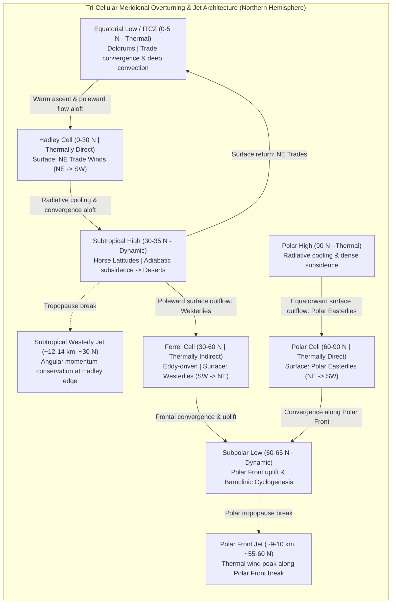

# Chapter 7 - Planetary Circulation, Jet Streams, Rossby Waves & Regional Wind Systems

Differential solar heating across latitudes generates horizontal pressure gradients, but Earth's rotation refuses to let air flow straight from hot tropics to cold poles. Instead, rotational dynamics, angular-momentum conservation, and boundary-layer friction fold planetary heat transport into three meridional overturning cells, undulating upper-air jet streams, and topographically carved regional wind systems.

Mastery of atmospheric fluid mechanics pays immediate dividends across both Prelims elimination traps and GS1 Mains—underscored by UPSC Mains 2026 directly interrogating the comparative thermodynamics and climatic impacts of the **Loo, Chinook, and Foehn** winds.

---

## 1. Atmospheric Fluid Dynamics and Balanced Wind Regimes

### 1.1 The Four Governing Forces

Horizontal wind trajectories are governed by the vector sum of four forces per unit mass in Earth's rotating reference frame:

- **Pressure Gradient Force (PGF):** Written as $\vec{F}_P = -\frac{1}{\rho}\nabla_H P$, it acts strictly perpendicular to isobars from **high pressure to low pressure**. PGF is the sole primary initiator of horizontal motion; tightly packed isobars signify steep gradients and gale-force winds, whereas wide spacing produces calm air.
- **Coriolis Force ($\vec{F}_C$):** An inertial deflection arising from Earth's eastward rotation ($\vec{a}_C = -2\vec{\Omega}\times\vec{v}$), with horizontal magnitude $F_C = (2\Omega \sin\phi)v = fv$, where $f$ is the Coriolis parameter. It scales linearly with **wind velocity ($v$)** and **$\sin\phi$**—making it **zero at the Equator ($\phi = 0^\circ$)** and **maximum at the Poles ($\phi = 90^\circ$)**. Because $\vec{F}_C$ acts strictly perpendicular to velocity, it performs **zero mechanical work** and alters only wind *direction*, never speed.
  - **Ferrel's Law:** Deflects moving fluids to the **right** of their path in the Northern Hemisphere and to the **left** in the Southern Hemisphere.
  - **Buys Ballot's Law:** Standing with your back to the wind in the Northern Hemisphere places **low pressure to your left** and high pressure to your right (exact opposite in the Southern Hemisphere).
- **Centrifugal Force ($v^2/R$):** Acts radially outward from the centre of curvature whenever air follows curved isobars (cyclones, anticyclones, and sharp Rossby troughs/ridges), introducing an asymmetry between cyclonic and anticyclonic wind speeds.
- **Boundary-Layer Friction ($\vec{F}_f$):** Confined largely to the **Planetary Boundary Layer (PBL, lowest $\sim 1\text{–}1.5\text{ km}$)**, deeper over rugged continents and forests than over smooth oceans. Opposing motion directly, friction slows wind speed $v$; lower $v$ shrinks the Coriolis force ($fv$) while PGF stays unchanged, forcing surface winds to turn **across isobars toward low pressure** at $20^\circ\text{–}40^\circ$ over land ($10^\circ\text{–}20^\circ$ over oceans). This cross-isobar inflow drives **surface convergence and ascent inside cyclones** and **surface divergence and subsidence inside anticyclones**.

### 1.2 Geostrophic vs. Gradient Wind Balance

**Geostrophic Wind ($v_g$):** Above the friction layer ($\ge 1.5\text{–}2\text{ km}$) along **straight, parallel isobars**, PGF and Coriolis lock into exact opposition ($f v_g = \frac{1}{\rho}\frac{\partial P}{\partial n}$). Air ceases crossing isobars and streams **parallel to the isobars** (low pressure on the left in the Northern Hemisphere). Geostrophic balance breaks down within $\sim 5^\circ$ of the Equator ($f \to 0$), where air flows nearly straight down-gradient into low-pressure troughs—preventing tropical cyclogenesis at the Equator.

**Gradient Wind (Curved Isobars) & Cyclonic–Anticyclonic Asymmetry:** Introducing curved flow brings Centrifugal Force ($v^2/R$) into three-way balance, creating a counter-intuitive speed split for the *exact same* pressure gradient:

- **Around a Cyclone (Low Pressure):** PGF pulls inward; both Coriolis and Centrifugal forces push outward ($\text{PGF} = f v + v^2/R$). Because outward centrifugal force assists Coriolis, required wind speed is **sub-geostrophic ($v_{\text{cyc}} < v_g$)**.
- **Around an Anticyclone (High Pressure):** Both PGF and Centrifugal force push outward; Coriolis alone pulls inward ($f v = \text{PGF} + v^2/R$). Coriolis must exceed PGF, forcing **super-geostrophic speeds ($v_{\text{anti}} > v_g$)** for an identical pressure gradient.

Why, then, do real-world storms unleash catastrophic winds around cyclones while anticyclonic cores remain calm? Solving the anticyclonic quadratic for $v$ reveals a **mathematical upper limit** on the pressure gradient ($|\nabla P|_{\max} \propto \rho f^2 R / 4$)—strong central high-pressure gradients physically cannot survive near an anticyclone's core and spread outward, whereas cyclonic pressure gradients can deepen without theoretical bound.

---

## 2. Planetary Pressure Belts and the Tri-Cellular Circulation Model

### 2.1 Why Hadley's Single-Cell Model Breaks Down

George Hadley (1735) envisioned one giant thermally driven loop per hemisphere—warm air rising at the Equator, flowing poleward aloft, sinking at the Poles, and returning along the surface. On a rotating Earth, however, conservation of angular momentum ($\Omega R^2 \cos^2\phi + u R \cos\phi = \text{const}$) accelerates poleward-moving equatorial air into physically unsustainable westerly speeds exceeding $130\text{ m/s}$ by $30^\circ$ latitude.

Long before reaching the poles, rotational shear and baroclinic instability shatter the single cell into **three meridional cells per hemisphere**—**Hadley, Ferrel, and Polar**—separated by **seven alternating pressure belts** whose genesis splits sharply between **thermal** and **dynamic** physics.

### 2.2 Seven Planetary Pressure Belts - Thermal vs. Dynamic Genesis

- **Equatorial Low Pressure Belt ($\sim 5^\circ\text{ N–}5^\circ\text{ S}$; ITCZ / Doldrums) — *Thermally Induced*:** Intense overhead insolation heats the surface, creating buoyant rising air and a planetary trough where Northern and Southern Trade Winds meet (**Inter-Tropical Convergence Zone, ITCZ**). Horizontal surface pressure gradients are weak—yielding calm, erratic winds dreaded by sailing ships (**Doldrums**)—while deep afternoon vertical convection delivers towering cumulonimbus rainstorms. Over Eurasia in boreal summer, intense continental heating drags the ITCZ far north to $20^\circ\text{–}25^\circ\text{ N}$ over the Indo-Gangetic Plain as the **Monsoon Trough**.
- **Subtropical High Pressure Belts ($\sim 30^\circ\text{–}35^\circ$ N & S; *Horse Latitudes*) — *Dynamically Induced*:** A perennial UPSC conceptual check: air at $30^\circ$ is *warm*, not cold, so this high pressure is **not thermal**. Upper-tropospheric air streaming poleward from the Equator radiates heat to space, accelerates eastward into the Subtropical Jet, piles up (converges) aloft near $30^\circ$, and **subsides mechanically**. Adiabatic compression during descent heats and dries the air, producing calm winds (**Horse Latitudes**), clear skies, peak ocean surface salinity, and Earth's **subtropical western-margin hot deserts** (Sahara, Arabia, Thar, Atacama, Namib, Sonora, Great Australian). In Northern Hemisphere summer, continental thermal lows break this belt into semi-permanent oceanic anticyclones (**Azores/Bermuda High** and **North Pacific High**; mirrored in the Southern Hemisphere by the **Mascarene High**).
- **Subpolar Low Pressure Belts ($\sim 60^\circ\text{–}65^\circ$ N & S) — *Dynamically Induced*:** Surface temperatures here are cold, yet dynamic convergence of warm moist **Westerlies** with frigid **Polar Easterlies** along the **Polar Front** forces buoyant warm air upward, spawning frequent baroclinic temperate cyclones. Over the unbroken Southern Ocean, this belt forms a deep circumpolar low-pressure ring; in Northern Hemisphere winter, intensely cold continental interiors (**Siberian High** and Canadian High) fragment it into two intense oceanic lows—the **Icelandic Low** and **Aleutian Low**.
- **Polar High Pressure Belts ($\sim 85^\circ\text{–}90^\circ$ N & S) — *Thermally Induced*:** Extreme net radiative heat loss chills the polar air column into dense, subsiding air with minimal absolute humidity—creating polar deserts across Antarctica and the high Arctic.

### 2.3 Anatomy of the Three Cells and Modern Tropical Widening

- **Hadley Cell ($0^\circ\text{–}30^\circ$):** **Thermally direct** (warm air ascends at the ITCZ, cool-dry air descends at $30^\circ$). Satellite observations since 1979 confirm **Hadley Cell Poleward Expansion ("Tropical Widening")** at $\sim 0.25^\circ\text{–}0.5^\circ$ latitude per decade, driven by greenhouse warming and Southern Hemisphere stratospheric ozone loss—slowly pushing subtropical arid belts poleward into the Mediterranean, southern Australia, and the US Southwest.
- **Ferrel Cell ($30^\circ\text{–}60^\circ$):** **Thermally indirect**—on zonal averages, air sinks in warm subtropics and rises near cooler $60^\circ$. It does *not* operate like a rigid mechanical conveyor belt; rather, the Ferrel Cell is the Eulerian statistical residual of migrating mid-latitude **baroclinic eddies (temperate cyclones and anticyclones)** that transfer heat and westerly momentum poleward between the Hadley and Polar engines.
- **Polar Cell ($60^\circ\text{–}90^\circ$):** **Thermally direct**, driven by radiative sinking over the poles and weak frontal ascent at $60^\circ$.

### 2.4 Planetary Surface Winds and Seasonal Migration

- **Trade Winds (Tropical Easterlies, $\sim 5^\circ\text{–}30^\circ$):** Outflow from Subtropical Highs toward the ITCZ, deflected by Coriolis into steady **North-East Trades (NH)** and **South-East Trades (SH)**. Because they blow east-to-west across tropical oceans, they pile warm surface waters against **western ocean margins** while driving cold coastal upwelling along eastern margins.
- **Westerlies ($\sim 35^\circ\text{–}60^\circ$):** Poleward outflow from Subtropical Highs toward Subpolar Lows—**South-Westerlies (NH)** and **North-Westerlies (SH)**. Blowing west-to-east across temperate oceans, they drive warm surface drifts toward **eastern ocean margins** (e.g., North Atlantic Drift moderating Western Europe). Between $40^\circ\text{ S}$ and $65^\circ\text{ S}$, near-total absence of continental barriers eliminates surface friction, allowing Southern Hemisphere Westerlies to roar uninterrupted as the **Roaring Forties ($40^\circ\text{ S}$), Furious Fifties ($50^\circ\text{ S}$), and Screaming Sixties ($60^\circ\text{ S}$)**.
- **Polar Easterlies ($\sim 60^\circ\text{–}90^\circ$):** Frigid, dry **North-Easterlies (NH)** and **South-Easterlies (SH)** spilling out of the Polar Highs toward the Polar Front.
- **Seasonal Migration ($5^\circ\text{–}10^\circ$):** Following the Sun's apparent zenith shift with a $\sim 1$-month thermal lag, all pressure and wind belts shift northward in boreal summer (June–July) and southward in austral summer (December–January). This migration directly creates **Mediterranean ($Cs$) dry-summer / wet-winter regimes** ($30^\circ\text{–}40^\circ$ western coasts shift from subsiding subtropical highs in summer to moist westerlies in winter), **Tropical Savanna ($Aw$) seasonality**, and **South Asian Monsoon cross-equatorial reversal** (SE trades cross $0^\circ$ and deflect right into SW monsoon westerlies).

---

## 3. Upper-Tropospheric Jet Streams, Rossby Waves and Atmospheric Rivers

### 3.1 Thermal Wind Physics and Jet Stream Mechanics

Why do winds accelerate into $200\text{–}400\text{ km/h}$ rivers precisely beneath the tropopause? Warm tropical air columns expand vertically compared to dense polar air columns, causing constant-pressure (isobaric) surfaces aloft to slope ever more steeply downward toward the poles with increasing altitude.

By the **Thermal Wind Relation** ($\frac{\partial \vec{v}_g}{\partial z} = \frac{g}{fT}(\hat{k}\times\nabla_H T)$), any poleward horizontal temperature drop forces westerly geostrophic winds to **increase steadily with height**. Wind speed peaks right beneath the **tropopause breaks** (around $9\text{–}14\text{ km}$), because the horizontal temperature gradient reverses sign across the stratosphere (where the equatorial tropopause at $-80^\circ\text{C}$ is colder than the polar tropopause at $-50^\circ\text{C}$), decelerating the jet above.

Jet streams are narrow ($100\text{–}500\text{ km}$ wide, $2\text{–}5\text{ km}$ thick), meandering upper-tropospheric ribbons occurring in **both Northern and Southern Hemispheres**. Because the equator-to-pole temperature contrast is steepest in winter, westerly jet streams are **stronger, lower, and shifted equatorward in winter**, weakening and retreating poleward in summer.

### 3.2 Baroclinic Instability, Rossby Waves and Omega-Block Heat Domes

In mid-latitudes, surfaces of constant pressure (isobars) intersect surfaces of constant temperature/density (isotherms)—a **baroclinic atmosphere** storing immense **Available Potential Energy (APE)**. When meridional temperature gradients cross a critical threshold, **baroclinic instability** releases this potential energy by buckling the westerly jet into giant planetary-scale meanders called **Rossby Waves** (wavelengths $3,000\text{–}6,000\text{ km}$, typically 3–6 waves encircling a hemisphere).

**The Rossby Restoring Force ($\beta$-Effect):** Rossby waves owe their existence to the conservation of **Absolute Vorticity ($\zeta + f = \text{constant}$)** on a rotating sphere, where planetary vorticity $f = 2\Omega\sin\phi$ increases poleward ($\beta = \partial f/\partial y > 0$). A jet parcel nudged poleward enters higher $f$, forcing its relative spin $\zeta$ to turn negative (clockwise/anticyclonic in NH), curving it back equatorward; overshooting into lower $f$ turns $\zeta$ positive (anticlockwise/cyclonic), curving it back poleward. Rossby waves always propagate **westward relative to the mean flow**, so when westward wave speed cancels eastward jet speed, the wave stalls completely (**stationary Rossby wave**).

Over 4–6 weeks, the mid-latitude jet oscillates through the **Index Cycle**:

- **High-Index (Zonal) Flow:** Steep north-south temperature gradient yields a tight, nearly straight west-to-east jet stream; frigid Arctic air stays locked at high latitudes while storms sweep rapidly eastward.
- **Low-Index (Meridional) Meanders:** Deep north-south troughs and ridges transport frigid polar air far into subtropics (severe cold waves) and warm subtropical air into Arctic latitudes.
- **Cut-Off Lows & Omega Blocking Highs (Heat Domes):** Extreme meandering pinches deep southward troughs completely off from the jet as stalled **Cut-Off Lows** (generating stationary multi-day deluges like Spain's October 2024 *DANA* cold-drop floods). Conversely, a massive northward ridge wedged between two flanking lows locks into a Greek-letter **$\Omega$ (Omega) Block**. Beneath this motionless upper-air anticyclone, persistent **adiabatic subsidence compression**, cloudless insolation, and dry-soil feedbacks trap scorching air in a **Heat Dome**. Recent benchmarks include the 2021 Pacific Northwest heat dome, the **June 2026 Western European Omega-block heat dome**—where France topped $44^\circ\text{C}$ and World Weather Attribution found identical Omega-block dynamics ran up to $+2.5^\circ\text{C}$ hotter than 1950–1987 baselines due to anthropogenic warming—and the **July–August 2026 Western US Heat Dome**.

*Scientific Consensus Note (Arctic Amplification & Waviness):* While Jennifer Francis and Stephen Vavrus proposed that rapid **Arctic Amplification** weakens the equator-to-pole temperature gradient and promotes wavier, slower Rossby jets, climate dynamists emphasize that observational trends vary sharply by season and region; active research highlights **Quasi-Resonant Amplification (QRA)** of synoptic wavenumbers 6–8 trapped inside double-jet waveguides as a robust driver of stalled summer heat domes.

### 3.3 The Four Signature Jet Streams

- **Polar Front Jet (PFJ — Permanent, $\sim 45^\circ\text{–}60^\circ$, $\sim 9\text{–}10\text{ km}$):** Driven by sharp baroclinic thermal contrast across the Polar Front. Highly irregular and meandering; its upper-level divergence zones trigger surface cyclogenesis (temperate cyclones) and steer mid-latitude storm tracks.
- **Subtropical Westerly Jet (STWJ — Permanent, $\sim 25^\circ\text{–}35^\circ$, $\sim 12\text{–}14\text{ km}$):** Driven primarily by **conservation of angular momentum** at the poleward upper rim of the Hadley Cell. More steady and zonal than the PFJ. **Indian Climatic Role:** In winter, the Tibetan massif bifurcates the STWJ; its southern branch over northern India ($\sim 25^\circ\text{ N}$) **steers Mediterranean Western Disturbances** bringing winter rain to the Punjab–Haryana wheat belt and snow to the western Himalayas, while maintaining dry winter subsidence. Its abrupt **northward shift north of Tibet in late May–early June** unlocks the onset of the Indian South-West Monsoon.
- **Tropical Easterly Jet (TEJ — Seasonal & Regional, $\sim 10^\circ\text{–}20^\circ\text{ N}$, $\sim 14\text{–}16\text{ km}$):** Blows **east-to-west** strictly during boreal summer (June–September) from Southeast Asia across peninsular India to East Africa. Identified by **P. Koteswaram (1958)**, it arises from the **reversed summer thermal gradient**—an intensely heated Tibetan Plateau ($500\text{ hPa}$ anticyclone) sitting north of a cooler Indian Ocean. Upper-air divergence beneath the TEJ energizes Bay of Bengal monsoon depressions; a weakened TEJ correlates directly with drought/break-monsoon spells.
- **Somali (Findlater) Low-Level Jet (LLJ — Seasonal & Low-Tropospheric, $\sim 1.5\text{ km}$ / $850\text{ hPa}$):** Crucially **not an upper-air jet**, this cross-equatorial monsoon conveyor intensifies May–September along the **East African Highlands** (acting as a western topographic wall, the atmospheric analogue of the Gulf Stream). Fed by the Southern Hemisphere **Mascarene High**, it shoots across the Equator off Somalia and splits across the Arabian Sea, hurling colossal moisture onto the Western Ghats while driving cold **Somali coastal upwelling**.

### 3.4 Polar Vortex Destabilization and Sudden Stratospheric Warming (SSW)

Careful terminology prevents a pervasive media confusion: Earth hosts two coupled polar vortices. The **Tropospheric Polar Vortex** is a year-round cold pool bounded by the meandering Polar Front Jet, whereas the **Stratospheric Polar Vortex (SPV)** is a winter-only cyclone of intense westerly winds ($15\text{–}50\text{ km}$ altitude) encircling the frigid, sunless polar night.

During winter, giant tropospheric planetary waves generated by Eurasian and North American mountain barriers (Himalayas, Rockies) and land–ocean heating contrasts propagate vertically upward into the stratosphere. When unusually potent wave bursts **break** inside the polar stratosphere, they deposit westward momentum, violently decelerating or **completely reversing the $10\text{ hPa}$ ($\sim 30\text{ km}$) polar stratospheric westerlies to easterlies**—defining a **Major Sudden Stratospheric Warming (SSW)**. Forced rapid subsidence over the pole adiabatically spikes stratospheric temperatures by **$30^\circ\text{–}50^\circ\text{C}$ within days**, either displacing the SPV off the pole or splitting it into two lobes.

Over the subsequent **2 to 6 weeks**, this upper-air reversal couples downward into the troposphere, pushing the Arctic Oscillation / North Atlantic Oscillation strongly negative and forcing the Polar Front Jet far south—sharply elevating the probability of severe Arctic cold outbreaks across Europe, North America, and East Asia (such as the 2018 "Beast from the East" and the 2021 Texas freeze). In **mid-November 2026**, the UK Met Office and ECMWF documented an **unusually early major SSW**—the earliest major winter reversal observed in the modern record—triggered by extreme late-October/November wave forcing that split and displaced the Arctic vortex. Major SSWs are **exceptionally rare in the Southern Hemisphere** (only one confirmed major event in September 2002, plus a minor event in 2019), because the Southern Ocean lacks massive mountain–continent contrasts capable of launching strong upward planetary waves.

### 3.5 Atmospheric Rivers (ARs)

**Atmospheric Rivers** are long ($>2,000\text{ km}$), narrow ($400\text{–}600\text{ km}$), **lower-tropospheric** ($<2\text{–}3\text{ km}$) filaments of extreme **Integrated Vapour Transport (IVT)** streaming poleward ahead of mid-latitude cold fronts (within the warm conveyor belt) or embedded inside monsoonal flows. Occupying less than $10\%$ of Earth's circumference, just 4–5 active ARs simultaneously transport **over $90\%$ of global meridional mid-latitude water vapour**, carrying moisture fluxes equivalent to **7.5–15 times the discharge of the Mississippi River**.

Along the North American Pacific coast, the **"Pineapple Express"** AR channels tropical moisture from Hawaii onto California, supplying **$30\text{–}50\%$ of the state's annual freshwater** while triggering catastrophic floods and landslides upon orographic uplift against the Sierra Nevada. Similarly, ARs supply up to $30\%$ of western European coastal rainfall.

Recent Indian Earth-system research has revolutionized understanding of South Asian and Polar ARs:

- **Indian Summer Monsoon Floods:** A landmark IIT Gandhinagar study (Mahto, Mishra et al., *Communications Earth & Environment*, 2023) established that **$\sim 65\%$ of landfalling summer-monsoon Atmospheric Rivers over India (1985–2020) triggered floods**, directly causing **7 of India's 10 deadliest monsoon flood disasters** (including Uttarakhand 2013 and Kerala 2018). Twin ARs likewise drove the catastrophic **August 2022 Pakistan mega-floods**.
- **Polar Cryosphere Disruption:** Indian scientists from **NCPOR (Goa) and IITM (Pune)** documented six intense Antarctic Atmospheric Rivers during July–August 2024 generating $>600\text{ kg m}^{-1}\text{ s}^{-1}$ moisture transport and $+19^\circ\text{C}$ atmospheric heatwaves, tearing open an unprecedented **$89,121\text{ km}^2$ winter open-ocean polynya in Breid Bay**.

---

## 4. Regional and Local Wind Systems

### 4.1 Diurnal Mesoscale Thermal Breezes

- **Sea Breeze (Day) vs. Land Breeze (Night):** Driven by coastal land–sea specific-heat asymmetry. By midday, rapid land heating forms a shallow coastal thermal low, drawing cool, humid marine air onshore (**Sea Breeze**, penetrating $20\text{–}50\text{ km}$ inland, moderating afternoon peaks in Mumbai/Chennai and sparking afternoon coastal thunderstorms). At night, faster radiative cooling over land establishes a shallow high, reversing airflow offshore (**Land Breeze**)—historically leveraged by Indian coastal fishermen launching boats before dawn and sailing home on afternoon sea breezes.
- **Valley Breeze (*Anabatic*, Day) vs. Mountain Breeze (*Katabatic*, Night):** Sunlit mountain ridges heat faster than free valley air at identical elevations; warm air glides upslope during the day (**Anabatic Valley Breeze**), frequently capping Himalayan summits with afternoon cumulus decks. After sunset, radiatively cooled dense air drains gravitationally downslope (**Katabatic Mountain Breeze**), pooling inside valley bottoms to create nocturnal **valley inversions** and frost pockets.

### 4.2 Physics of Warm Downslope Winds vs. Continental Advection *(2026 Mains GS1 Focus)*

UPSC Mains 2026 directly contrasted the **Loo, Chinook, and Foehn**—testing whether candidates grasp that *warm, dry local winds* arise from two completely distinct thermodynamic engines:

- **Orographic Adiabatic Warming (Chinook, Foehn, Zonda):** Moist synoptic air forced up the windward flank of a mountain chain cools initially at **DALR ($9.8^\circ\text{C/km}$)** to its LCL, then cools slowly at **SALR ($\sim 5^\circ\text{C/km}$)** while condensing rain/snow and injecting **latent heat** into the air parcel. Crossing the crest dehydrated, it plunges down the leeward slope warming rapidly along the full drop at **DALR ($9.8^\circ\text{C/km}$)**. *(Modern refinement: even with minimal windward precipitation, leeward isentropic drawdown of warmer upper-level potential-temperature air reinforces this warming.)* Temperatures surge **$15^\circ\text{–}25^\circ\text{C}$ within hours** during winter–spring, rapidly ablating snowpacks.
- **High-Pressure Plateau Outflow + Compression (Santa Ana, Berg):** Driven not by moist windward rain-out, but by high-pressure cold/dry interior desert air (Great Basin/Mojave or South African Highveld) accelerating downslope through mountain gaps toward coastal lows—warming adiabatically into desiccating wildfire winds.
- **Continental Thermal Advection (Loo):** Completely **non-orographic**. Driven in May–June by extreme solar baking of the arid Thar/Balochistan plains and a deep continental thermal low over north-west India, sweeping blazing $45^\circ\text{–}50^\circ\text{C}$ dust-laden westerlies directly across the flat Indo-Gangetic Plain. Unlike Chinook and Foehn—which deliver net agricultural relief in frozen winter landscapes (melting snow, extending grazing)—the Loo inflicts severe **pre-monsoon heatstroke mortality, soil desiccation, and grain shrivelling**.

### 4.3 Global Local Winds Matrix

| Category | Wind Name | Region & Physiographic Corridor | Thermal Nature & Driving Mechanism | Signature Climatic & Economic Impacts |
| :--- | :--- | :--- | :--- | :--- |
| **Warm Downslope** *(Orographic / Foehn-type)* | **Chinook** | Eastern leeward slopes of the **Rockies** (Alberta, Montana, US Great Plains) | Warm, dry winter–spring wind; leeward DALR adiabatic compression of Pacific westerlies | **"Snow Eater"** — rapidly melts/sublimates snow, exposes cattle ranch pastures, extends grazing; triggers avalanches, rapid snowmelt runoff, and chinook arch clouds |
| **Warm Downslope** | **Foehn (Föhn)** | Northern leeward valleys of the **Alps** (Switzerland, Austria, southern Germany) | Warm, dry, gusty autumn–spring wind; adiabatic descent across Alpine passes | Accelerates Alpine spring snowmelt, lengthens valley grazing/viticulture seasons; elevates avalanche, wildfire risk, and human physiological stress (*Föhnkrankheit*) |
| **Warm Downslope** | **Zonda** | Eastern leeward foothills of the **Andes** (Mendoza, San Juan — western Argentina) | Hot, intensely dry, dusty winter–spring downslope wind from Pacific air crossing high Andes | Rapidly melts Andean snowpack (feeding irrigated vineyards), but triggers severe dust storms, dehydration, and wildfire outbreaks |
| **Warm Downslope** *(Plateau Outflow)* | **Santa Ana** | **Southern California** (Great Basin/Mojave High descending through mountain passes to Pacific coast) | Hot, bone-dry ($<10\%$ RH), gale-force autumn–winter outflow compressed downslope | Not moist-windward driven; premier driver of catastrophic Southern California chaparral and wildland-urban wildfires |
| **Warm Downslope** *(Plateau Outflow)* | **Berg** | **South Africa** (interior Highveld plateau descending down the Great Escarpment to coasts) | Hot, dry winter offshore wind ahead of approaching coastal mid-latitude lows | Causes abrupt winter temperature spikes along Cape/Natal coasts, elevating dry-season fire hazards |
| **Hot Dry** *(Continental / Desert)* | **Loo** | **Indo-Gangetic Plains** & Pakistan (Rajasthan, Punjab, Haryana, Delhi, UP, Bihar) | Scorching ($45^\circ\text{–}50^\circ\text{C}$), dry, dust-laden May–June afternoon westerly advection; **non-orographic** | Severe heatwaves, lethal heatstroke, acute evapotranspiration and late-wheat shrivelling; minor positive effect accelerating summer mango ripening |
| **Hot Dry** *(Desert / Med)* | **Sirocco** | **Sahara → Mediterranean** (Tunisia, Sicily, southern Italy, Adriatic) | Hot, dusty southerly pulled ahead of eastward Mediterranean lows; turns warm & muggy over sea | Desiccates North African crops; picks up sea moisture and iron-rich Saharan dust to drop reddish **"Blood Rain"** across Sicily and Italy |
| **Hot Dry** *(Regional Cousins)* | **Khamsin** / **Gibli** / **Simoom** | **Khamsin:** Egypt/Levant; **Gibli:** Libya; **Simoom:** Sahara, Arabia, Syrian/Iraqi deserts | Scorching, dust-choked desert winds (Khamsin blows intermittently over ~50 spring days; Simoom = brief suffocating cyclonic blasts) | Extreme heat stress, crop scorching, choking sandstorms; Simoom ("Poison Wind") causes sudden lethal heatstroke in desert caravans |
| **Hot Dry** *(Trade Outflow)* | **Harmattan** | **West Africa / Gulf of Guinea** (Sahara southward into Nigeria, Ghana, Côte d'Ivoire; Nov–March) | Dry, cool-to-warm, fine-dust-laden **NE Trade Wind** outflow from winter Saharan High | Nicknamed **"The Doctor"** — replaces oppressive humid coastal air with crisp dryness; heavy dust haze disrupts aviation and irritates respiratory tracts |
| **Dust-Storm Outflow** *(Convective)* | **Haboob** | **Sudan / Sahel** (also US Southwest / Arizona, Thar Desert) | Towering wall of blinding dust driven by the **cold downdraft gust front (density current)** of collapsing thunderstorms | Distinct from synoptic desert winds: creates abrupt zero-visibility dust walls ($1\text{–}2\text{ km}$ high) and sharp sudden temperature drops |
| **Cold Dry** *(Funneled / Fall)* | **Mistral** | **Southern France** (funneled down the **Rhône Valley** into the Gulf of Lion / Mediterranean) | Fierce, freezing N/NW wind accelerated ($>100\text{ km/h}$) by Venturi channeling between Alps and Massif Central | Brings razor-clear blue Provençal skies but frost-damages orchards/vineyards—forcing farmers to build north-facing **cypress windbreaks** |
| **Cold Dry** *(Katabatic Fall)* | **Bora** | **Adriatic Coast** (Trieste in Italy, Croatia / Dalmatian coast; Dinaric Alps to Adriatic Sea) | Violent, icy NE **fall wind** spilling from frigid Balkan/Central European highs down steep coastal escarpments | Source air is so cold that it stays freezing despite adiabatic descent; capsizes Adriatic vessels and creates severe coastal chill |
| **Cold Dry** *(Polar Outbreak)* | **Blizzard** | **North American Great Plains & Canada**, Siberia, Antarctica | Violent Arctic/polar outbreak ($>56\text{ km/h}$ sustained winds, sub-zero chill, blowing snow whiteouts) | Aided in North America by the unbroken north–south meridian corridor east of the Rockies; paralyzes transport and causes livestock mortality |
| **Cold Dry** *(Steppe / Tundra)* | **Buran** *(Purga in Tundra)* | **Siberia, Kazakhstan, Russian Steppe** & Central Asia | Freezing winter NE gale laden with blinding blowing snow (summer variant can be hot/dusty) | Extreme wind-chill hazard across Eurasian steppes; disrupts transcontinental rail and steppe pastoralism |
| **Cold Dry** *(Polar Front)* | **Pampero** | **Pampas of Argentina & Uruguay** (sweeping NE from Patagonia) | Sharp, cold, dry S/SW **polar cold-front burst** behind passing Southern Hemisphere cyclones | Triggers violent frontal squall lines and thunder followed by abrupt temperature plunges and crisp, clear air |

---

> [!warning] Prelims Traps & Atomic Distinctions
> - **Coriolis Magnitude Symmetry:** Southern Hemisphere Westerlies are stronger than Northern Hemisphere Westerlies strictly because of **lower continental landmass friction**, **NOT because Coriolis force is stronger in the Southern Hemisphere** ($f = 2\Omega\sin\phi$ is identical at matching latitudes north and south).
> - **Dynamic vs. Thermal Pressure Belts:** **Subtropical Highs ($30^\circ$)** and **Subpolar Lows ($60^\circ$)** are **DYNAMICALLY induced** (subsidence/convergence), whereas **Equatorial Low ($0^\circ$)** and **Polar Highs ($90^\circ$)** are **THERMALLY induced**. Never call $30^\circ$ high pressure "thermal" or $60^\circ$ low pressure "warm."
> - **Jet Stream Hemisphere & Direction Traps:** Jet streams blow in **BOTH hemispheres** (not Northern Hemisphere only). Moreover, not all jets are westerly or upper-air: the **Tropical Easterly Jet (TEJ)** blows *east-to-west*, and the **Somali (Findlater) Jet** is a **low-level ($\sim 1.5\text{ km}$) cross-equatorial jet**, not an upper-tropospheric ribbon.
> - **Loo vs. Chinook/Foehn Genesis:** Never classify the **Loo** as a katabatic or orographic downslope wind—it is a purely **continental thermal-advection wind** over flat plains, whereas Chinook and Foehn are mountain-descending adiabatic winds.
> - **Sirocco Moisture Flip & Haboob Mechanism:** The **Sirocco** starts bone-dry over the Sahara yet arrives *humid/muggy* with "blood rain" in southern Italy after crossing the Mediterranean. The **Haboob** is a *thunderstorm cold-outflow density current*, not a hot synoptic desert breeze.
> - **Harmattan vs. Simoom:** Both originate in the Sahara, but **Harmattan** is the winter NE Trade Wind bringing welcome dry relief ("The Doctor") to humid West African coasts, whereas **Simoom** is a violent, suffocating, localized Saharan/Arabian dust blast.
> - **Gradient Wind Speed Paradox:** For an *equal* pressure gradient along curved isobars, **anticyclonic wind speed exceeds geostrophic speed (super-geostrophic)** while **cyclonic wind speed is lower (sub-geostrophic)**—because centrifugal force reinforces PGF in anticyclones but opposes PGF in cyclones.
> - **Trade Winds vs. Westerlies Ocean Thermal Split:** In the **tropics**, Trade Winds make **western ocean margins warmer** than eastern margins; in the **temperate zone**, Westerlies make **eastern ocean margins warmer** than western margins.

---

> [!map] Atlas & Visual Hook
> - **Mountain–Leeward Wind Pairs (Trace Windward → Leeward Direction):** **Rockies** (Pacific W → Alberta/Montana E = **Chinook**); **Alps** (Italy S → Switzerland/Austria N = **Foehn**); **Andes** (Chile W → Mendoza/Argentina E = **Zonda**); **Rhône Valley** between Massif Central & Alps (N → Gulf of Lion S = **Mistral**); **Dinaric Alps** (NE Balkans → Trieste/Croatia Adriatic SW = **Bora**); **Great Escarpment** (Highveld interior → Cape coast = **Berg**); **Great Basin → Cajon Pass → Los Angeles Basin** (**Santa Ana**).
> - **Saharan–Arabian–Indian Desert Arc:** Trace clockwise around the Sahara and West Asia — **Harmattan** (NE → Gulf of Guinea), **Gibli** (Libya), **Sirocco** (Tunisia → Sicily/Italy), **Khamsin** (Egypt/Levant), **Haboob** (Sudan/Khartoum), **Simoom** (Arabia/Syria), and eastward across Pakistan/Thar into the **Indo-Gangetic Plain** (**Loo**).
> - **Southern Hemisphere Unbroken Oceanic Corridor ($40^\circ\text{–}65^\circ\text{ S}$):** Locate **Cape Horn / Drake Passage**, **Cape of Good Hope**, **Tasmania**, and **New Zealand**—confirming why the **Roaring Forties, Furious Fifties, and Screaming Sixties** encircle Antarctica virtually unobstructed, and pinpoint **Patagonia → Pampas** (**Pampero**).
> - **Indian Monsoon Jet Geometry:** Map the **Tibetan Plateau** bifurcation of the winter **STWJ** (Mediterranean → Iran/Afghanistan → NW India Western Disturbances), the summer **TEJ** ($15^\circ\text{ N}$ Vietnam → Peninsular India → Horn of Africa), and the **Mascarene High → Madagascar → East African Highlands → Somali Coast → Western Ghats** track of the **Findlater Low-Level Jet**.
> - **Core NCERT & Conceptual Visuals to Sketch:** (1) Three-way vector balance diagrams for Geostrophic, Cyclonic Gradient, and Anticyclonic Gradient winds; (2) Cross-sectional mountain profile contrasting windward DALR/SALR cooling vs. leeward DALR adiabatic heating; (3) North-polar projection contrasting High-Index zonal jet vs. Low-Index **Omega Block** and split **Stratospheric Polar Vortex**.

---

## UPSC Interrogation Lens

### 1. Verified UPSC Mains PYQs (2014–2026) & Prelims Anchors

- **Mains GS1 (2026, Q14, 15 Marks):** *"Compare the Loo, Chinook and Foehn winds with respect to their regions of prevalence, their nature and climatic impacts."*
- **Mains GS1 (2023, 10 Marks):** *"Why is the South-West Monsoon called 'Purvaiya' (easterly) in Bhojpur Region? How has this directional seasonal wind system influenced the cultural ethos of the region?"*
- **Mains GS1 (2021, 15 Marks):** *"Briefly mention the alignment of major mountain ranges of the world and explain their impact on local weather conditions, with examples."*
- *(Foundational Pre-2014 Anchor: **2013 GS1** — "Major hot deserts in northern hemisphere are located between 20–30 degree north and on the western side of the continents. Why?")*
- **Verified Prelims PYQ Anchors:**
  - **2024:** Coriolis force properties — increases with wind velocity; maximum at the poles and absent at the equator.
  - **2021:** Planetary wind thermal effects on oceans — Trade winds warming western tropical ocean sections; Westerlies warming eastern temperate ocean sections.
  - **2020:** Jet streams occur in both hemispheres (debunking "Northern Hemisphere only" trap) alongside tropical cyclone eye structure.
  - *(Foundational 2011 Prelims: Why Southern Hemisphere Westerlies are stronger and more persistent — less landmass friction, not stronger Coriolis force.)*

### 2. Prelims Trap Signature

- **Genesis Swap (Thermal vs. Dynamic):** Mislabeling Subtropical Highs as cold/thermal or Subpolar Lows as warm/thermal instead of dynamically driven by Hadley subsidence and Polar Front convergence.
- **Hemispheric & Vertical Over-Generalization:** Restricting jet streams to the Northern Hemisphere, assuming all jets flow west-to-east (ignoring TEJ), or placing the Somali Findlater Jet in the upper troposphere.
- **Local Wind Matching & Mechanism Mix-ups:** Pairing warm adiabatic winds (Chinook, Foehn, Zonda) with non-orographic thermal winds (Loo), swapping cold Adriatic **Bora** with warm Alpine **Foehn**, or forgetting that **Sirocco** gathers moisture across the Mediterranean.
- **Coriolis Fallacies:** Claiming Coriolis force accelerates wind speed (it never changes magnitude), varies between Northern and Southern Hemispheres at equal latitudes, or initiates airflow (PGF initiates; Coriolis only deflects).

### 3. Cross-Hub AIR-1 Provocations

1. **Upper-Air Dynamics Meets Indian Food & Disaster Security:** With IIT Gandhinagar attributing nearly $70\%$ of India's severe monsoon floods to landfalling **Atmospheric Rivers** and mid-latitude **Omega blocks / early SSW events** increasingly perturbing Eurasian Rossby waves, examine how sub-seasonal upper-tropospheric wave forecasting (under Mission Mausam and BFS) must be integrated into India's reservoir operation rules and Himalayan flood-warning protocols.
2. **Hadley Widening Meets Agrarian Geopolitics:** If anthropogenic warming and stratospheric changes continue driving poleward **Hadley Cell expansion**—shifting subtropical dry zones toward the Mediterranean, Central Asia, and north-western India—analyze the cascading geopolitical implications for transboundary river basins, global wheat trade corridors, and climate-induced migration across the Afro-Eurasian dry belt.

<!-- OBSIDIAN-WEB-START -->
---
### 🕸️ Neural Graph Connections
← [[6. Atmospheric Thermodynamics, Insolation, Lapse Rates & the Planetary Heat Budget|Ch 6]] | 🧭 [[Geography]] | [[8. Atmospheric Moisture, Precipitation Physics, Air Masses, Fronts & Cyclonic Systems|Ch 8]] →
<!-- OBSIDIAN-WEB-END -->
