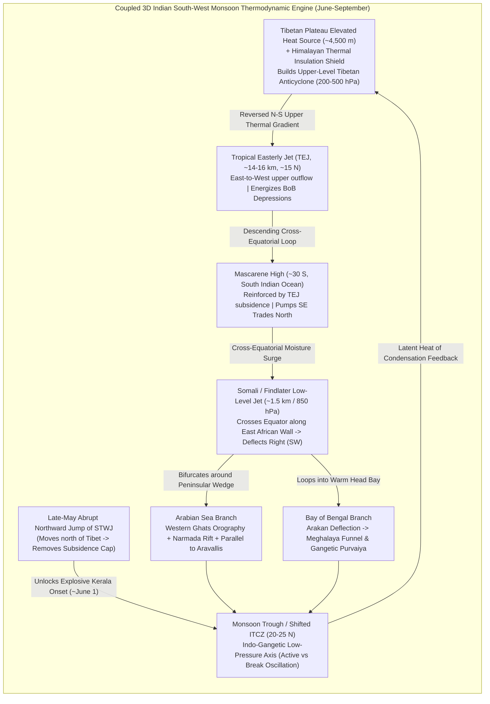

# Chapter 9 - The Indian Monsoon System, Ocean–Atmosphere Teleconnections & World Climates

The Indian Monsoon—from Arabic *Mausim* ("season")—is Earth's most energetic coupled ocean–atmosphere seasonal wind reversal, delivering roughly **$75\%$ of India's annual freshwater** inside a four-month window and underwriting the food security of over half of humanity.

Far from a giant coastal sea breeze, it operates as a three-dimensional planetary heat pump linking the **Tibetan Plateau**, cross-equatorial **Mascarene–Somali winds**, upper-air jet streams, and trans-oceanic dipoles across the Pacific, Indian, and Atlantic basins—culminating in 2026's stark demonstration of an unbuffered El Niño deficit and India's leap to $6\text{ km}$ numerical weather forecasting.

---

## 1. Evolution of Indian Monsoon Mechanics

### 1.1 From Halley's Thermal Breeze to Flohn's Dynamic ITCZ

- **Halley's Classical Thermal Concept (1686):** Modelled the monsoon purely as a continental-scale **land–sea breeze**. Intense summer insolation heats the Asian landmass faster than the Indian Ocean, creating a continental thermal low over north-west India that pulls moist oceanic air onshore (SW Monsoon) and reverses offshore during winter radiative cooling (NE Monsoon).
  - *Physical Failures:* Cannot explain why peak continental heat in **May** fails to trigger rains (onset waits abruptly until **~June 1** over Kerala), why the onset arrives as an explosive **"Burst,"** why rainfall stalls during **Monsoon Breaks** despite uninterrupted summer insolation, or why other equally scorching subtropical landmasses (Sahara, interior Australia) lack comparable mega-monsoons.
- **Flohn's Dynamic ITCZ Migration Concept (1951):** Replaced static thermal breezes with the seasonal meridional migration of planetary pressure belts. As the overhead Sun shifts north, the **Inter-Tropical Convergence Zone (ITCZ)** migrates up to **$20^\circ\text{–}25^\circ\text{ N}$** across the Indo-Gangetic Plain (**Monsoon Trough**), pulling Southern Hemisphere South-East Trade Winds across the Equator where Coriolis deflection bends them right into **South-West Monsoon** winds.
  - *Residual Gap:* Still confined to lower-tropospheric mechanics; unable to account for sudden onset triggers or upper-level steering of monsoon depressions.

### 1.2 Modern MONEX (1979) Three-Dimensional Upper-Air Architecture

Following the Indo-Soviet **MONEX (Monsoon Experiment, 1979)** and modern satellite reanalysis, the Indian Summer Monsoon is understood as a synchronized 3D coupled engine driven by four interlocking cogs:

1. **Tibetan Plateau Elevated Heat Source ($\sim 4,500\text{ m}$, $>2\text{ million km}^2$):** Rising halfway through the troposphere, the plateau absorbs intense solar radiation directly at mid-tropospheric levels—heating the overlying air via sensible flux and deep convective latent heat to build a massive, warm-core **Tibetan Anticyclone** aloft ($200\text{–}500\text{ hPa}$). Complementing this furnace, modern thermodynamic work (Boos & Kuang, *Nature*, 2010) proves the **Himalayas also act as a mechanical thermal shield**, insulating the moist Indo-Gangetic air mass from dry, cold Central Asian extratropical intrusions so sub-cloud moist static energy climbs sky-high.
   - *Eurasian Snow Cover Inverse Link:* Heavy winter–spring snow across Eurasia and Tibet raises surface albedo and consumes spring insolation in melting latent heat—delaying plateau warming and correlating inversely with subsequent Indian summer monsoon rainfall.
2. **Abrupt Northward Jump of the Subtropical Westerly Jet (STWJ):** Throughout winter and May, the Himalayan massif splits the STWJ; its southern branch streams across northern India ($\sim 25^\circ\text{ N}$), sustaining upper-air convergence and surface subsidence that caps monsoon onset. In late May/early June, rapid Eurasian heating snaps the entire STWJ **abruptly north of the Tibetan Plateau**—instantly lifting the thermodynamic lid and unleashing the explosive **"Burst of the Monsoon"** over Kerala.
3. **Koteswaram's Tropical Easterly Jet (TEJ, 1958):** Outflow from the southern rim of the heated Tibetan Anticyclone accelerates westward at **$14\text{–}16\text{ km}$ ($100\text{–}150\text{ hPa}$)** along $\sim 10^\circ\text{–}15^\circ\text{ N}$ from Vietnam across peninsular India to East Africa—driven by the reversed summer thermal gradient (hot Tibet north of a cooler Indian Ocean). Upper-level divergence beneath the TEJ energizes Bay of Bengal monsoon depressions, while its descending branch sinks onto the southern Indian Ocean.
4. **Mascarene High & Cross-Equatorial Somali (Findlater) Low-Level Jet:** High pressure anchored near the Mascarene Islands ($\sim 25^\circ\text{–}35^\circ\text{ S}$)—intensified by descending TEJ air—pumps South-East Trades northward along the topographic wall of the **East African Highlands**. Crossing the Equator off Somalia at **$\sim 1.5\text{ km}$ ($850\text{ hPa}$)**, Coriolis deflection snaps this airstream into the moisture-packed **Somali (Findlater) Low-Level Jet**, hurling Arabian Sea vapour straight onto the Western Ghats while driving cold Somali coastal upwelling.

---

## 2. Four-Season Indian Climate Anatomy

The India Meteorological Department (IMD) partitions India's annual climatic cycle into four distinct seasons governed by shifting solar zenith, jet streams, and orography.

### 2.1 Cold Weather Season (Winter - Mid-November/December to February)

Clear skies, crisp dry northerly continental breezes, and wide diurnal ranges prevail across northern India, where the **January $18^\circ\text{C}$ mean isotherm** running roughly along the Tropic of Cancer separates the frost-free tropical south from the cool subtropical north.

**Mediterranean Western Disturbances (WDs):** Extratropical cyclones originating over the Mediterranean, Black, and Caspian Seas are carried eastward across Iran, Afghanistan, and Pakistan into north-western India by the **southern branch of the Subtropical Westerly Jet (STWJ)**. Though contributing a small fraction of annual totals, WDs are agronomically priceless—delivering winter rain critical to **Rabi wheat and mustard** across Punjab, Haryana, and western UP while recharging **western Himalayan glaciers and snowpacks** (and increasingly sparking late-spring hailstorms and rain-on-snow flash floods under climate warming).

### 2.2 Hot Weather Season (Pre-Monsoon Summer - March to May)

Northward solar migration bakes interior plains ($42^\circ\text{–}48^\circ\text{C}$), spawning scorching **Loo** winds across the Indo-Gangetic belt and deepening the Thar–Balochistan thermal low. Where hot, dry continental air collides with moist marine inflows along the coast and eastern plains, intense localized **pre-monsoon convective storms** erupt:

- **Nor'westers / *Kal Baisakhi*** (West Bengal, Jharkhand, Bihar, Odisha): Violent evening convective squalls ("Calamity of the month of Baisakh") crucial for **jute, Aus paddy, and Bengal tea**.
- ***Bordoisila*** (Assam): Assamese equivalent of Nor'westers, invigorating spring **Assam tea flushes**.
- **Mango Showers** (Kerala, coastal Karnataka, Konkan): Pre-monsoon thunder-showers hastening early **mango ripening**.
- **Blossom / Cherry Blossom Showers** (Karnataka & Kerala hills): Vital convective showers triggering **coffee blossom** opening.

### 2.3 South-West Monsoon Season (Advancing Monsoon - June to September)

**Dual-Standard LPA Parity & IMD Categories:** Against IMD's updated **1971–2020 Long Period Average (LPA) of $87\text{ cm}$ ($868.6\text{ mm}$)** (revised downward from the legacy 1961–2010 LPA of **$88\text{ cm}$**), IMD defines all-India seasonal rainfall as **Normal ($96\text{–}104\%$ of LPA)**, Below Normal ($90\text{–}95\%$), **Deficient ($<90\%$)**, Above Normal ($105\text{–}110\%$), and Excess ($>110\%$).

Upon striking Peninsular India's triangular wedge, the SW monsoon splits cleanly into two branches:

- **Arabian Sea Branch (Larger Moisture Volume):** Fractures into three sub-currents—(1) strikes the **Western Ghats** orthogonally, unleashing $250\text{–}400\text{ cm}$ orographic rain on windward Konkan/Malabar while carving an abrupt **Deccan rain-shadow** ($<60\text{ cm}$ over Solapur, Vidarbha, Rayalaseema); (2) tunnels inland along the **Narmada and Tapi rift valleys** into Central India and Chotanagpur; (3) brushes Saurashtra–Kutch and streams **parallel to the Aravalli Range**, failing to trigger orographic lift over the **Thar Desert** (compounded by dry subsiding upper air from Iran/Arabia) before uniting with the Bay branch in Punjab and Himachal.
- **Bay of Bengal Branch:** Deflected north-westward by Myanmar's **Arakan Yoma** hills into West Bengal and Bangladesh, splitting into (1) the **Meghalaya funnel**, where moist air trapped inside the Garo–Khasi–Jaintia bowl dumps world-record rain at **Mawsynram ($\sim 11,872\text{ mm}$)** and **Cherrapunji** (leaving Shillong on the northern lee side in a crisp rain-shadow), and (2) the **Indo-Gangetic easterly branch (*Purvaiya*)**, steered westward along the Himalayan foothills. This westward trajectory explains two classic Prelims laws: **northern plains rainfall declines steadily East-to-West** (Kolkata $\sim 160\text{ cm}$ → Patna $\sim 120\text{ cm}$ → Delhi $\sim 65\text{ cm}$ → Bikaner $<25\text{ cm}$), and **monsoon duration shrinks South-to-North**.
- **Why Tamil Nadu Stays Dry in SW Monsoon:** It sits simultaneously inside the **Western Ghats rain-shadow** for the Arabian Sea branch and runs **parallel to the Bay of Bengal branch**.

**Monsoon Trough, Monsoon Depressions & Active/Break Cycles:** The **Monsoon Trough**—an elongated low-pressure axis running from Ganganagar (Rajasthan) to the Head Bay of Bengal—oscillates north–south intraseasonally. During an **Active Phase**, the trough sits across central India, guiding **Monsoon Depressions** (synoptic lows spinning up over the Head Bay of Bengal and marching WNW across Odisha–Chhattisgarh–MP–Rajasthan) that contribute **$40\text{–}50\%$ of Core Monsoon Zone rain**. When the trough jumps abruptly **north to the Himalayan foothills**, rains halt across central/peninsular India for 1–2 weeks (**Break in Monsoon**), while triggering torrential cloudbursts and floods across **Uttarakhand, Assam, and northern Bihar** (and paradoxically reviving convective rain over Tamil Nadu). Separately, **west-coast dry breaks** occur when Arabian Sea winds blow parallel rather than perpendicular to the Konkan–Gujarat coast.

### 2.4 Retreating / North-East Monsoon Season (Post-Monsoon - October to December)

As solar heating retreats south, the Monsoon Trough weakens and withdraws progressively from north-west India (mid-September) to the southern peninsula (early December). Across northern and central India, clear post-rain skies baking damp, waterlogged soils create oppressive, muggy **"October Heat."**

Reversing into continental **North-Easterlies**, these winds remain dry over mainland India—**except** over the warm **Bay of Bengal**, where they absorb moisture and strike the **Coromandel Coast**, supplying **$\sim 48\text{–}60\%$ of Tamil Nadu's annual rainfall** (plus coastal Andhra Pradesh, Rayalaseema, Puducherry, and southern Kerala) alongside intense post-monsoon cyclones. Notably—tested directly in **UPSC Prelims 2026 (Q23)**—the **Andaman and Nicobar Islands** experience a **humid, tropical coastal climate** receiving rainfall from **both the South-West and North-East monsoons**, with **maximum precipitation stretching from May to December** (not December to May).

---

## 3. Ocean–Atmosphere Teleconnections and the 2026 Monsoon Shock

Indian monsoon variability rarely obeys local land–sea contrast alone; it is modulated continuously by coupled tropical and extratropical ocean–atmosphere oscillations spanning intraseasonal (weeks) to multidecadal (decades) scales.

### 3.1 ENSO, Atlantic Niño, IOD, EQUINOO, MJO and PDO Matrix

| Oscillation / Mode | Timescale & Basin | Core Ocean–Atmosphere Mechanism & Diagnostic Index | Direct Impact on Indian Monsoon & Key Benchmarks |
| :--- | :--- | :--- | :--- |
| **Canonical El Niño** *(ENSO Warm Phase)* | **2–7 years** *(Irregular)*; Central–Eastern Equatorial Pacific | Pacific Trade Winds weaken/reverse; warm water surges east to Peru (halting Humboldt upwelling); **Walker Circulation breaks down**, shifting dry subsidence over Indonesia/India. **Indices:** **ONI** (Niño 3.4 SST $\ge +0.5^\circ\text{C}$); **Negative SOI** (Tahiti $-$ Darwin pressure $<0$) | **Strongly Suppresses Monsoon:** Coincides with **$\sim 60\%$ of India's severe droughts** (2002, 2009, 2015, 2023, and **2026**). *Risk, not absolute destiny:* can be offset by +IOD or +EQUINOO |
| **El Niño Modoki** *(Central Pacific / Dateline El Niño)* | **2–7 years**; Central Equatorial Pacific *(Ashok et al., 2007)* | Peak SST warming locks in **Central Pacific** flanked by cooler water on *both* east and west margins; splits Walker Cell into **two anomalous cells** with intense sinking centered directly over India | **Often Harsher Indian Droughts** than Eastern Pacific El Niño (e.g., 2002, 2004, 2009), driving deep deficits across central and north-west India |
| **La Niña** *(ENSO Cold Phase)* | **2–7 years**; Equatorial Pacific | Hyper-charged Trade Winds pile warm water deep in Western Pacific; intensified Walker ascent over Indo-Pacific. **Indices:** ONI $\le -0.5^\circ\text{C}$; **Positive SOI** | **Enhances Monsoon:** Promotes above-normal rainfall, extended withdrawals, and flood risk (e.g., 2020–2022 triple-dip La Niña; brief weak La Niña Sept 2025–Feb 2026) |
| **Atlantic Niño / Niña** *(Atlantic Zonal Mode, AZM)* | **Interannual** *(peaks Jun–Aug)*; Eastern Equatorial Atlantic (Gulf of Guinea) | Atlantic counterpart of ENSO. Warm eastern Atlantic (**Atlantic Niño**) fires an eastward atmospheric Kelvin wave driving subsidence over India; cool phase (**Atlantic Niña**) strengthens monsoon convergence | **Inverse Coupling:** **Atlantic Niño weakens** the Indian monsoon (even in ENSO-neutral years); **Atlantic Niña boosts** monsoon inflow and can **partially cushion El Niño drying** |
| **Indian Ocean Dipole (IOD)** | **Interannual** *(peaks Aug–Nov)*; Strictly **Indian Ocean** *(Saji et al., 1999)* | SST gradient between **Western Pole (Arabian Sea)** minus **Eastern Pole (SE Indian Ocean south of Sumatra/Java)** — tracked by **Dipole Mode Index (DMI)**. **+IOD:** Warm West / Cool East; **−IOD:** Cool West / Warm East | **+IOD Boosts Monsoon & Offsets El Niño** (classic rescues: **1997, 2019**; brings drought to Australia & floods to East Africa). **−IOD suppresses** monsoon & compounds El Niño droughts |
| **EQUINOO** *(Equatorial Indian Ocean Oscillation)* | **Interannual / Seasonal**; Equatorial Indian Ocean *(Sulochana Gadgil et al., 2004)* | **Atmospheric cloud/wind counterpart of IOD**; tracked by **EQWIN index** (zonal surface wind anomaly). **+EQUINOO:** Enhanced convection over Western Equatorial Indian Ocean & suppressed convection over East | **Positive EQUINOO strongly favours** Indian monsoon rainfall and can rescue monsoon totals during weak El Niño years even when purely oceanic IOD SST signals lag |
| **Madden–Julian Oscillation (MJO)** | **30–60 days** *(Intraseasonal)*; Global Tropics | **Eastward-propagating** planetary envelope of deep enhanced convection paired with a trailing suppressed dry zone cycling across 8 RMM longitudinal phases (unlike stationary ENSO/IOD dipoles) | **Paces Active/Break Cycles:** Active MJO crossing **Indian Ocean (Phases 2–4)** triggers **monsoon onset bursts, active spells & BoB cyclogenesis**; suppressed phase locks in **Monsoon Breaks** |
| **Pacific Decadal Oscillation (PDO)** | **20–30 years** *(Multidecadal)*; North Pacific ($>20^\circ\text{ N}$) | Long-lived "horseshoe" North Pacific SST switch between Warm (+PDO: warm eastern coast, cool central N. Pacific) and Cool (−PDO) regimes | **Modulates ENSO–Monsoon Link:** **+PDO amplifies El Niño droughts** and mutes La Niña gains; **−PDO bolsters La Niña** and provides a multi-decadal monsoon tailwind |

### 3.2 Live 2026 Monsoon & Teleconnection Case Study (IMD Ground-Truth)

The **2026 South-West Monsoon** delivered a textbook empirical demonstration of coupled Pacific–Indian Ocean teleconnections. Following a brief, weak La Niña from September 2025 to February 2026, equatorial Pacific waters crossed the El Niño threshold by May–June 2026 and surged into a **strong-to-very-strong El Niño** (Niño 3.4 anomaly hitting **$\sim +2.0^\circ\text{C}$ by September 2026**, projected by IMD's MMCFS to persist through January–March 2027).

Crucially, despite early April expectations of a late-season Positive IOD, the **Indian Ocean Dipole stayed stubbornly NEUTRAL** across the entire June–September 2026 season—stripping India of any Indian Ocean moisture buffer. According to **IMD's official season-closing report (30 September 2026)**, all-India 2026 monsoon rainfall plunged to **$87\%$ of LPA ($759.4\text{ mm}$ against the $87\text{ cm}$ LPA)**—officially **Deficient** (the 4th lowest since 2001 and 13th lowest since 1901)—while **East and North-East India collapsed to $74\%$ of LPA ($1,017.1\text{ mm}$, the lowest recorded since 1901)**.

---

## 4. Modern Indian Weather Forecasting Architecture (2024–2026)

India's monsoon prediction architecture has evolved from Gilbert Walker's early 20th-century statistical regressions to dynamical coupled forecasting under **Monsoon Mission (launched 2012)**—which operationalized the **Monsoon Mission Climate Forecast System (MMCFS)** alongside $12\text{ km}$ global models (GFS and NCUM, 2018)—and now into hyper-granular Earth-system forecasting:

- **Mission Mausam:** Approved by the Union Cabinet on **11 September 2024** with an initial outlay of **₹2,000 crore over two years (2024–26)** and formally launched by the Prime Minister on **14 January 2025** on **IMD's 150th Foundation Day** (alongside the **IMD Vision-2047** roadmap) to build a "Weather-ready and Climate-smart" nation. Spearheaded jointly by three Ministry of Earth Sciences (MoES) pillars—**IMD (New Delhi)**, **IITM (Pune)**, and **NCMRWF (Noida)**—its physical expansion targets **50 additional Doppler Weather Radars (DWRs)**, 10 wind profilers, denser Automatic Weather Stations (AWS), **INSAT-3DS** satellite assimilation, a first-of-its-kind **convective cloud chamber at IITM Pune**, hybrid **AI/ML Physics-Informed Neural Networks**, and an automated **GIS-based Decision Support System (DSS)** for impact-based warnings.
- **Bharat Forecasting System (BharatFS / BFS):** Made operational in **May 2025** by MoES and IITM Pune as the world's highest-resolution operational global Numerical Weather Prediction (NWP) model. Upgrading India's legacy **$12\text{ km}$** global grids to a razor-sharp **$6\text{ km}$ horizontal resolution** built on an indigenous **Triangular Cubic Octahedral (TCo) grid**, BharatFS delivers localized **block-level and panchayat-cluster forecasts**, markedly improving extreme-rainfall, monsoon depression, and localized convective storm lead times.
- **Supercomputing Backbone (*Arka* & *Arunika*):** Real-time execution of $6\text{ km}$ global ensembles is powered by two new High-Performance Computing (HPC) supercomputers—**Arka** (hosted at **IITM Pune**) and **Arunika** (hosted at **NCMRWF Noida**)—quadrupling MoES total compute capacity from **$6.8\text{ PetaFLOPS}$** (legacy *Pratyush* & *Mihir*) to **$28\text{ PetaFLOPS}$** in 2025.

---

## 5. Global Climate Classifications - Köppen, Indian Sub-Types and Genetic Contrasts

### 5.1 Köppen's Empirical Classification (Global Framework)

Developed by German-Russian botanist-climatologist **Wladimir Köppen** (1900; refined 1918, 1936 with Rudolf Geiger), the **Köppen–Geiger scheme** empirically matches natural vegetation biomes to monthly and annual **temperature and precipitation thresholds** using a compact three-letter code (*1st Capital* = major group; *2nd lowercase* = seasonal rainfall [`f` no dry season, `m` monsoon, `w` dry winter, `s` dry summer]; *3rd lowercase* = thermal severity [`a` hot summer, `b` warm summer, `c` cool summer, `d` bitterly cold winter, `g` Ganges pre-monsoon hot peak, `h` hot dry, `k` cold dry]):

- **Group A — Tropical Humid Climates** *(Coldest month mean $\ge 18^\circ\text{C}$; frost-free)*:
  - **`Af` (Tropical Rainforest / Equatorial):** Year-round rain (driest month $\ge 6\text{ cm}$), daily afternoon convectional thunderstorms, negligible annual temperature range (Amazon, Congo, Indonesia, Singapore).
  - **`Am` (Tropical Monsoon):** Intense wet summer + brief dry winter compensated by high annual totals (Western Ghats, Andaman & Nicobar, coastal Myanmar).
  - **`Aw` (Tropical Wet & Dry / Savanna):** Pronounced winter dry season (`w`), tall grasslands and scattered deciduous trees (African Sudan Savanna, Brazilian *Campos*, Venezuelan *Llanos*, Peninsular India). Rare variant **`As`** features a *dry summer and wet winter* (Coromandel Coast).
- **Group B — Dry Climates** *(Sole major group defined by **Evaporation > Precipitation**, NOT temperature)*:
  - Split into **`BW` (True Desert, *Wüste*)** and **`BS` (Semi-Arid Steppe)**, further subdivided at $18^\circ\text{C}$ annual mean into hot low-latitude **`BWh / BSh`** (Sahara, Arabia, Thar, Sahel) and cold mid-latitude continental **`BWk / BSk`** (Gobi, Patagonia, Central Asian Steppe—classic nomadic pastoral realm).
- **Group C — Warm Temperate / Mesothermal Climates** *(Coldest month between $-3^\circ\text{C}$ and $+18^\circ\text{C}$; warmest $>10^\circ\text{C}$)*:
  - **`Cfa` (Humid Subtropical / China Type):** Eastern continental margins ($25^\circ\text{–}40^\circ$), hot humid summers, rain all year via trade/monsoon inflow and winter cyclones (SE China, SE USA, Pampas).
  - **`Cs` (Mediterranean — `Csa/Csb`):** Western continental margins ($30^\circ\text{–}40^\circ$), **dry summers (subtropical high subsidence) and wet winters (migrated westerlies)**; sclerophyllous olive/citrus/viticulture belt (Mediterranean Basin, California, Central Chile, SW Cape, SW Australia).
  - **`Cfb` (Marine West Coast / British Type):** Western margins ($40^\circ\text{–}65^\circ$), year-round westerly cyclonic rain, mild ice-free winters buffered by warm currents (UK, NW Europe, US Pacific NW, New Zealand).
  - **`Cw` (Subtropical Dry Winter):** Monsoon-governed subtropical plains (Indo-Gangetic Plain `Cwg`, northern China).
- **Group D — Cold Snow-Forest / Microthermal Climates** *(Coldest month $<-3^\circ\text{C}$; warmest $>10^\circ\text{C}$ — **found EXCLUSIVELY in the Northern Hemisphere**, because the Southern Hemisphere lacks broad continental expanses between $45^\circ\text{–}70^\circ\text{ S}$!)*:
  - **`Df` (Humid Continental & Subarctic Taiga `Dfc/Dfd`):** Coniferous boreal forests, severe snowy winters, world's largest annual thermal ranges (Siberia/Verkhoyansk, Canada, Arunachal Pradesh `Dfc`).
  - **`Dw` (Dry-Winter Continental):** Dominated by bitter Siberian winter anticyclones (Manchuria, eastern Siberia).
- **Group E — Polar Climates** *(Warmest month $<10^\circ\text{C}$ — ecological tree-line barrier)*:
  - **`ET` (Tundra):** Warmest month $0^\circ\text{–}10^\circ\text{C}$; permafrost, lichens, sedges (Arctic fringe, high Himalayan slopes).
  - **`EF` (Ice Cap):** All months $<0^\circ\text{C}$; permanent ice sheets (Greenland, Antarctica).
- **Group H — Highland Climates:** Added subsequently for rugged mountain belts (Himalayas, Andes, Rockies, Ethiopian Highlands) where steep altitudinal lapse rates compress tropical-to-polar zones vertically over short horizontal distances.

### 5.2 Köppen's Nine Indian Climate Zones Table *(NCERT Class 11 Parity + Modern Refinement)*

| Köppen Code | Descriptive Climate Type | Defining Criteria / Thermal–Rainfall Signature | Exact Indian Geographic Spread | Prelims Distinction & Dual-Standard Note |
| :--- | :--- | :--- | :--- | :--- |
| **`Amw`** | **Monsoon with short dry winter** | Coldest month $\ge 18^\circ\text{C}$; intense SW monsoon deluge ($>250\text{ cm}$), brief winter dry spell (`w`) | **West Coast south of Goa** (Malabar/Konkan coast, Kerala, coastal Karnataka) & **Andaman–Nicobar** | Classic evergreen rainforest belt; distinct from `Aw` because dry-season deficit is too brief to starve rainforests |
| **`As`** | **Monsoon with dry summer** | Coldest month $\ge 18^\circ\text{C}$; **dry summer (`s`)** + peak rainfall in Oct–Dec NE Monsoon | **Coromandel Coast of Tamil Nadu** (and adjoining southern coastal Andhra Pradesh) | **Unique global rarity** (`As` almost nonexistent elsewhere); dry in SW Monsoon (rain-shadow + parallel winds) |
| **`Aw`** | **Tropical Savanna** | Coldest month $\ge 18^\circ\text{C}$; distinct hot wet summer & prolonged dry winter (`w`) | **Most of Peninsular Plateau south of Tropic of Cancer** (Maharashtra plateau, Telangana, MP, Odisha, Jharkhand, interior Karnataka) | Largest tropical zone in India; deciduous teak/sal forests & rainfed cotton/millet core |
| **`BShw`** | **Semi-Arid Steppe** | Evaporation $>$ Precipitation; hot annual mean ($>18^\circ\text{C}$, `h`), summer-concentrated scanty rain (`w`) | **Two disjunct pockets:** (1) **NW Gujarat, eastern Rajasthan & SW Punjab–Haryana**; (2) **Western Ghats Rain-Shadow** (interior Maharashtra, Karnataka, Andhra) | Watch out for **BOTH** locations—Prelims loves testing the Peninsular rain-shadow `BShw` strip! |
| **`BWhw`** | **Hot Desert** | Extreme moisture deficit ($<25\text{ cm}$ rain), scorching summer maxima, sparse thorny xerophytes | **Extreme Western Rajasthan** (Thar / Marusthali — Jaisalmer, Barmer, Bikaner) | Note NCERT's `w` suffix indicating slight summer concentration of sparse rain |
| **`Cwg`** | **Monsoon with dry winter (Ganges Type)** | Coldest month $<18^\circ\text{C}$; dry winter (`w`); **`g` = hottest temperature occurs BEFORE summer solstice (May–June)** before monsoon clouds cool July | **Most of Northern Plains** (Ganga Plain, eastern Rajasthan, northern MP, Assam valley, most of NE India) | **`g` ("Ganges")** is a signature Prelims trap—meaning maximum heat peaks in May–June, *not* July–August! |
| **`Dfc`** | **Cold Humid Winter with Short Cool Summer** | Coldest month $<-3^\circ\text{C}$; year-round moisture (`f`); brief cool summer (`c`) | **Arunachal Pradesh** (and higher eastern Sikkim) | Only `D`-group snow-forest climate mapped in India under NCERT's 9-zone scheme |
| **`Et`** | **Tundra Type** | Warmest month between $0^\circ\text{C}$ and $10^\circ\text{C}$; alpine meadows (*Bugyals*) above tree line | **Mountainous Uttarakhand** (high Himalayan altitudes) | NCERT separates Uttarakhand (`Et`) distinctly from J&K/HP (`E`) |
| **`E`** | **Polar / Highland Snow Type** | Warmest month $<10^\circ\text{C}$ (perpetual snow/glacier peaks $<0^\circ\text{C}$) | **Jammu & Kashmir, Ladakh, and Himachal Pradesh** (per NCERT Class 11) | **Dual-Standard Parity:** NCERT maps all of J&K–Ladakh as `E`, whereas high-resolution **modern Köppen–Geiger** maps classify rain-shadow **Ladakh valley as Cold Desert (`BWk`)** |

### 5.3 Brief Conceptual Contrast - Thornthwaite and Trewartha

- **C.W. Thornthwaite (1931 / 1948 — Water-Balance & PET Approach):** Critiqued Köppen for treating raw rainfall uniformly regardless of evaporative demand ($50\text{ cm}$ of rain sustains dense boreal forest in cold Siberia but produces barren desert in hot Rajasthan). Thornthwaite anchored climate boundaries in **Potential Evapotranspiration (PET)**—the water loss from a fully vegetated surface with unlimited soil moisture—computing a **Moisture Index ($I_m$)** and **Thermal Efficiency ($TE$)**. Though ecologically superior for agronomy and drought modelling, complex empirical PET equations limit global field usability.
- **Glenn T. Trewartha (1954 / 1968 — Genetic–Empirical Hybrid):** Reformed Köppen's overly broad mid-latitude `C` group by linking boundaries explicitly to **air-mass source regions and Polar Front genetics**. He split Köppen's `C` cleanly into **Subtropical (`C`, 8+ months $>10^\circ\text{C}$)** and **Temperate (`D`, 4–7 months $>10^\circ\text{C}$)**, bumped Boreal to `E` and Polar to `F`, and preserved empirical simplicity—producing a more realistic **7-zone Indian climatic map** widely used alongside Köppen in Indian geography.

---

> [!warning] Prelims Traps & Atomic Distinctions
> - **IOD Ocean-Basin Trap (*2017 Prelims*):** The Indian Ocean Dipole is the SST difference between the **Western Indian Ocean (Arabian Sea)** and the **Eastern Indian Ocean (south of Sumatra/Java)**—**NEVER the Eastern Pacific Ocean**!
> - **El Niño vs. Modoki vs. Positive IOD:** **El Niño Modoki** warms the *Central* Equatorial Pacific (often inflicting *worse* Indian droughts than Eastern Pacific El Niño). A **Positive IOD** (*warm west, cool east*) enhances Indian monsoon rainfall and can **offset El Niño** (1997, 2019); a **Neutral IOD** leaves El Niño unbuffered (as in 2026's $87\%$ LPA deficit).
> - **Atlantic Niño Sign Inversion:** Just like Pacific El Niño, a warm **Atlantic Niño** suppresses the Indian summer monsoon, whereas a cool **Atlantic Niña** strengthens monsoon convergence and can partially offset El Niño drying.
> - **Andaman & Nicobar Rainfall Window (*2026 Prelims*):** Andaman & Nicobar receives rain from **BOTH SW and NE monsoons**, with **maximum precipitation between May and December**—**NOT** December to May!
> - **MJO vs. ENSO/IOD Propagation:** ENSO and IOD are **stationary basin dipoles**, whereas the **Madden–Julian Oscillation (MJO)** is an **eastward-moving 30–60 day planetary wave** of wet/dry convection pacing Active and Break monsoon cycles.
> - **Köppen Letter Traps:** (1) **Group `B`** is the *only* Köppen major group defined by **moisture deficit ($E > P$)** rather than temperature; (2) **Group `D`** exists **exclusively in the Northern Hemisphere**; (3) **`Cwg`**'s letter **`g`** ("Ganges") signifies that **hottest temperatures occur *before* the summer solstice (May–June)**; (4) **`As`** (dry summer, wet winter) applies to the **Coromandel / Tamil Nadu Coast**; (5) **`BShw`** covers *both* semi-arid Rajasthan/Gujarat **and** the **Western Ghats Peninsular rain-shadow**.
> - **Break in Monsoon Flood Paradox:** A "Break in Monsoon" causes dry drought spells over central/peninsular India while simultaneously triggering **catastrophic heavy rainfall and floods along the Himalayan foothills, Assam, and Bihar** (because the Monsoon Trough migrates right onto the mountains!).
> - **BharatFS & Mission Mausam Facts:** **BharatFS** (operational May 2025) runs at **$6\text{ km}$** global resolution (not 12 km), powered by **Arka (IITM Pune)** and **Arunika (NCMRWF Noida)** (28 PetaFLOPS), under **Mission Mausam** (Cabinet approved Sept 2024, ₹2,000 crore, PM launched Jan 14, 2025 on IMD's 150th Foundation Day).

---

> [!map] Atlas & Visual Hook
> - **Monsoon Branch & Orography Map (India):** Trace both limbs cleanly — **Arabian Sea Branch** slamming **Western Ghats** (Malabar/Konkan windward → Solapur/Vidarbha rain-shadow), funneling up **Narmada–Tapi rifts**, and running parallel along **Aravallis** (Thar rain failure); **Bay of Bengal Branch** deflecting off **Arakan Yoma** → **Garo–Khasi–Jaintia funnel** (Mawsynram/Cherrapunji wet vs. Shillong dry lee) → westward **Purvaiya** track along **Ganga Plain** (Kolkata → Patna → Delhi → Bikaner); **Coromandel Coast** catching Oct–Dec **NE Monsoon**; **Andaman & Nicobar** straddling $6^\circ\text{–}14^\circ\text{ N}$ receiving May–Dec dual-monsoon rain.
> - **Ocean–Atmosphere Dipole Boxes (World Oceans):** Pinpoint **Niño 3.4 ($5^\circ\text{ N–}5^\circ\text{ S}, 170^\circ\text{–}120^\circ\text{ W}$)**, **Tahiti** (Central Pacific) vs. **Darwin** (N. Australia) for SOI; **Western IOD Box (Arabian Sea/Somalia)** vs. **Eastern IOD Box (south of Sumatra–Java)**; **Mascarene High ($25^\circ\text{–}35^\circ\text{ S}$ east of Madagascar)**; and **Gulf of Guinea** for **Atlantic Niño**.
> - **Global Köppen Benchmarks:** Map the **five Mediterranean (`Cs`) western-margin enclaves** ($30^\circ\text{–}40^\circ$: Med Basin, Central California, Central Chile, Cape Town/SW South Africa, Perth–Adelaide/SW Australia), the **Northern-Hemisphere-only `D` Boreal Taiga belt** (Alaska–Canada–Scandinavia–Siberia), and India's **9 NCERT Köppen provinces** (`Amw`, `As`, `Aw`, `BShw` [2 pockets], `BWhw`, `Cwg`, `Dfc`, `Et`, `E`).
> - **Key Visual Sketches:** (1) Normal Walker Cell vs. El Niño Walker Breakdown vs. Split El Niño Modoki Double-Cell; (2) Active Monsoon Trough (Central India) vs. Break Monsoon Trough (Himalayan Foothills).

---

## UPSC Interrogation Lens

### 1. Verified UPSC Mains PYQs (2014–2026) & Prelims Anchors

- **Mains GS1 (2023, 10 Marks):** *"Why is the South-West Monsoon called 'Purvaiya' (easterly) in Bhojpur Region? How has this directional seasonal wind system influenced the cultural ethos of the region?"*
- **Mains GS1 (2017, 15 Marks):** *"What characteristics can be assigned to monsoon climate that succeeds in feeding more than 50 percent of the world population residing in Monsoon Asia?"*
- **Mains GS1 (2015, 12.5 Marks):** *"How far do you agree that the behaviour of the Indian monsoon has been changing due to humanizing landscapes? Discuss."*
- **Verified Prelims PYQ Anchors:**
  - **2026 (GS1 Q23):** Climate of **Andaman and Nicobar Islands** — humid tropical coastal climate, rainfall from both SW and NE monsoons, maximum precipitation May–December (trap: reversed to Dec–May).
  - **2017:** **Indian Ocean Dipole (IOD)** — SST contrast strictly within Western vs. Eastern Indian Ocean (trap: Eastern Pacific Ocean); IOD modulating El Niño's impact on Indian monsoon.
  - **2015:** Equatorial rainforest (`Af`) identification via uniform heat and daily afternoon convectional thunderstorms.
  - **2014:** Seasonal reversal of winds as the defining hallmark of the **Monsoon climate**.
  - *(Foundational 2012–2013 Prelims: Monsoon duration declines south-to-north and northern plains rainfall declines east-to-west; Central Asian Steppe `BSk` characterized by extreme climate, scanty rain, nomadic pastoralism.)*

### 2. Prelims Trap Signature

- **Cross-Basin Dipole Swaps:** Linking IOD to the Eastern Pacific instead of the Eastern Indian Ocean, or confusing the atmospheric **EQUINOO** index with purely oceanic SST dipoles.
- **Temporal & Directional Inversions:** Flipping Andaman & Nicobar's wet window to December–May, claiming Indian monsoon rainfall increases east-to-west in the Ganga Plains, or asserting that Monsoon Breaks leave the Himalayas dry.
- **Köppen Code Traps:** Forgetting that Group `B` is precipitation-defined (not temperature-defined), assuming Group `D` occurs in the Southern Hemisphere, misreading `Cwg`'s pre-solstice `g` peak, or missing the Peninsular rain-shadow pocket of `BShw`.
- **Deterministic Teleconnection Overstatement:** Treating El Niño as an automatic 100% guarantee of Indian drought while ignoring neutralizing cushions (+IOD, +EQUINOO, Atlantic Niña)—or conversely assuming IOD always activates during El Niño (disproved starkly by 2026's neutral IOD).

### 3. Cross-Hub AIR-1 Provocations

1. **Teleconnections Meet Macroeconomic Resilience:** Given that India's **2026 South-West Monsoon plunged to $87\%$ of LPA** (with East & North-East India hitting a 125-year low of $74\%$) under an unbuffered strong El Niño and neutral IOD, evaluate how granular **$6\text{ km}$ BharatFS** panchayat-level forecasts under **Mission Mausam** must be coupled with Kharif crop-diversification, reservoir buffer management, and RBI food-inflation targeting to decouple Indian GDP from ENSO shocks.
2. **Anthropogenic Landscape Change Meets Monsoon Thermodynamics:** Building on UPSC's 2015 Mains inquiry into "humanizing landscapes," analyze how intensive Indo-Gangetic groundwater irrigation, urban concrete heat domes, and regional black-carbon aerosol loading interact with global ocean warming to turn India's monsoon from gentle sustained wet spells into erratic dry breaks punctuated by extreme localized cloudbursts.

<!-- OBSIDIAN-WEB-START -->
---
### 🕸️ Neural Graph Connections
← [[8. Atmospheric Moisture, Precipitation Physics, Air Masses, Fronts & Cyclonic Systems|Ch 8]] | 🧭 [[Geography]] | [[10. Ocean Floor Topography, Pelagic Stratification, Marine Sediments & UNCLOS Zonation|Ch 10]] →
<!-- OBSIDIAN-WEB-END -->
