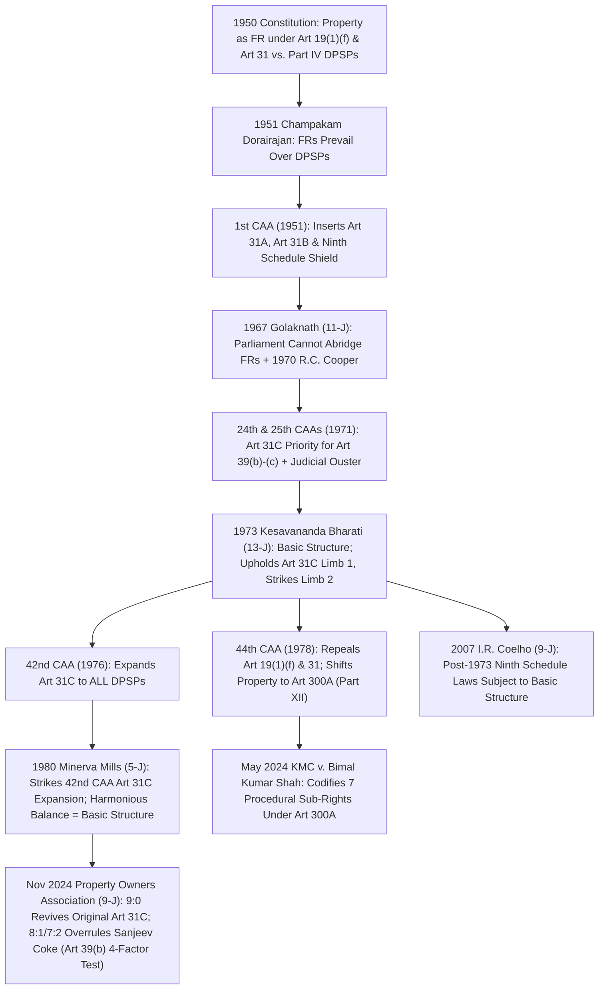

# Directive Principles (DPSPs), Fundamental Duties & the Property–Socialism Dialectic (Articles 31–51A, 300A)

If Part III constructs the architecture of **political democracy**, Part IV encodes the mandate of **social and economic democracy**. Dr. B.R. Ambedkar described the Directive Principles of State Policy (DPSPs) as a *"novel feature"* of the Constitution—deliberately non-justiciable in courtrooms, yet binding on every legislature and executive as an electoral and moral compass.

No other part of the Constitution has triggered more consequential constitutional amendments or larger Constitution Benches than the collision between **Part IV's redistributive directives** and the **Right to Property**. Spanning seventy-five years—from *Champakam Dorairajan* (1951) to the 9-Judge recalibration in ***Property Owners Association v. State of Maharashtra* (November 2024)** and the codification of seven procedural property sub-rights in ***Kolkata Municipal Corporation v. Bimal Kumar Shah* (May 2024)**—this dialectic traces India's entire economic evolution from post-colonial land reform to constitutionalized mixed-market governance.

---

## 1. Directive Principles of State Policy (Part IV, Articles 36–51)

### Constitutional Lineage & Legal Status (Articles 36–37)

The framers drew the Directive Principles from **Article 45 of the Irish Constitution of 1937** (itself inspired by the 1931 Spanish Republican Constitution), reinforced by two domestic antecedents: the **Sapru Committee Report (1945)**, which first proposed splitting citizen rights into justiciable and non-justiciable categories, and the **Instrument of Instructions** issued to the Governor-General and Governors under the **Government of India Act, 1935**. As Ambedkar clarified in the Constituent Assembly, DPSPs function as an Instrument of Instructions addressed not to colonial appointees, but to democratic legislatures and executives.

- **Article 36 — Definition of "The State":** Expressly imports the four-tiered meaning of "the State" from **Article 12** (Union, States, local authorities, and other State instrumentalities).
- **Article 37 — The Dual Legal Mandate:** Establishes two seemingly paradoxical propositions in a single sentence:
  1. **Non-Justiciability:** The provisions in Part IV *"shall not be enforceable by any court"*—no citizen can move a writ of *Mandamus* compelling Parliament or a State to enact a Uniform Civil Code or guarantee living wages, nor can a statute be struck down solely for contravening a DPSP.
  2. **Governance Primacy:** The principles therein are *"nevertheless **fundamental in the governance of the country** and it shall be the **duty of the State** to apply these principles in making laws."*

Despite non-justiciability, DPSPs exercise immense **indirect judicial force**: courts routinely rely upon Part IV to determine whether legislative curbs on Article 19 freedoms qualify as **"reasonable restrictions" in the public interest** (*State of Bombay v. F.N. Balsara*, 1951 upholding prohibition via Art 47; *Mirzapur Moti Kureshi*, 2005 via Art 48), and have read core directives (free legal aid, livelihood, environment, primary education) directly into enforceable **Article 21** guarantees.

### Ideological Architecture - Socialistic, Gandhian & Liberal-Intellectual Directives

The Constitution itself **contains no internal classification** of Directive Principles. Constitutional scholars categorize Articles 38–51 into three overlapping ideological streams reflecting the ideological compromises of the Constituent Assembly:

- **Socialistic Principles (Economic Democracy & Welfare State):** Anchor India's welfare-state ideal (*tested in UPSC Prelims 2015 & 2020*). They comprise **Article 38** (welfare social order; **Art 38(2)** added by the **44th CAA, 1978** directing the State to minimize inequalities in income, status, facilities, and opportunities), **Article 39(a)–(f)** (adequate livelihood, equitable distribution of material resources [39(b)], preventing concentration of wealth [39(c) — *UPSC Prelims 2021*], equal pay for equal work [39(d)], worker/child health [39(e)], and healthy childhood development [**39(f)** amended by **42nd CAA, 1976**]), **Article 39A** *(42nd CAA: equal justice and free legal aid)*, **Article 41** (right to work, education, and public assistance in unemployment, old age, sickness, and disablement), **Article 42** (just and humane conditions of work and maternity relief), **Article 43** (living wage and decent standard of life), **Article 43A** *(42nd CAA: workers' participation in industrial management)*, and the nutritional limb of **Article 47**.
- **Gandhian Principles (Decentralized Reconstruction & Moral Economy):** Reflect Mahatma Gandhi's rural-reconstruction blueprint: **Article 40** (organizing village panchayats as units of self-government—operationalized via the 73rd CAA), **Article 43** (promoting cottage industries on an individual or co-operative basis in rural areas), **Article 43B** *(97th CAA, 2011: promoting voluntary formation, autonomous functioning, democratic control, and professional management of co-operative societies)*, **Article 46** (promoting educational and economic interests of SCs, STs, and weaker sections), **Article 47** (prohibition of intoxicating drinks and drugs injurious to health), and the agrarian-preservation limb of **Article 48**.
  - **Landmark Cattle-Slaughter Shift — *State of Gujarat v. Mirzapur Moti Kureshi Kassab Jamat* (2005, 7-Judge Bench, 6:1):** Overruling *Mohd. Hanif Qureshi* (1958)—which had allowed slaughter of aged, non-milch cattle—the 7-Judge Bench upheld Gujarat's **total ban on the slaughter of bulls and bullocks of all ages**. Reading **Article 48** harmoniously with **Article 48A** and Fundamental Duty **Article 51A(g)** (*compassion for living creatures*), the Court held that a statutory ban implementing a Directive Principle constitutes a reasonable restriction in the general public interest under Article 19(6), even amounting to total prohibition where agrarian utility (dung/manure/biogas) persists.
- **Liberal-Intellectual Principles (Modern Constitutionalism & Rule of Law):** Comprise **Article 44** (Uniform Civil Code), **Article 45** *(substituted by **86th CAA, 2002**: early childhood care and education for all children until age 6)*, **Article 48** (organizing agriculture and animal husbandry on modern and scientific lines), **Article 48A** *(42nd CAA: protecting and improving the environment, forests, and wildlife)*, **Article 49** (protecting monuments and places of national importance—wording updated by **7th CAA, 1956**), **Article 50** (separating the judiciary from the executive in public services—operationalized via CrPC 1973/BNSS 2023; *tested in UPSC Prelims 2020 & 2025*), and **Article 51** (promoting international peace and security, just relations between nations, respect for international law and treaty obligations, and settlement of international disputes by arbitration).

*Directives Outside Part IV (Atomic Prelims Anchor):* Three equally non-justiciable constitutional directives sit outside Part IV—**Article 335** (considering SC/ST service claims consistently with efficiency of administration), **Article 350A** (mother-tongue primary instruction for linguistic minorities), and **Article 351** (promoting and developing Hindi).

### Article 44 - Uniform Civil Code (UCC) & the Uttarakhand Experiment (2024–2026)

Article 44 directs: *"The State shall endeavour to secure for the citizens a uniform civil code throughout the territory of India."* While India possesses uniform **criminal and commercial codes** (BNS, BNSS, Contract Act, Transfer of Property Act), **family/personal laws** governing marriage, divorce, maintenance, inheritance, and adoption remain fragmented across religious and customary lines—creating persistent tension between **gender equality (Arts 14–15)** and **religious/cultural pluralism (Arts 25–29)**.

- **Judicial Exhortations:** Across four decades, the Supreme Court repeatedly lamented legislative inertia—beginning with ***Mohd. Ahmed Khan v. Shah Bano Begum* (1985)** (extending secular Section 125 CrPC maintenance to divorced Muslim women and regretting that Article 44 remained a *"dead letter"*), ***Sarla Mudgal v. UoI* (1995)** (invalidating second marriage via religious conversion and urging a UCC—later clarified as non-binding *obiter* in *Lily Thomas*, 2000), ***John Vallamattom* (2003)**, ***Shayara Bano* (2017)** (striking down instant triple talaq), and ***Jose Paulo Coutinho* (2019)** (praising Goa's Portuguese Civil Code of 1867 as a *"shining example,"* though noting Goa retains limited community-specific carve-outs).
- **21st Law Commission of India (Consultation Paper, Aug 2018 — Justice B.S. Chauhan):** Adopted a nuanced pluralist stance, declaring a single Uniform Civil Code **"neither necessary nor desirable at this stage."** Instead, it recommended **"codification and reform from within"**—eliminating discriminatory provisions inside Hindu, Muslim, Christian, and Parsi laws (e.g., abolishing HUF tax anomalies, equalizing inheritance, banning polygamy/nikah halala) so cultural diversity survives without sacrificing women's equality. *(The 22nd Law Commission initiated fresh public consultations in June 2023 without releasing a final report.)*
- **The Uttarakhand UCC Act, 2024 (Implemented Jan 27, 2025) & 2026 Trajectory:** Invoking **Concurrent List, Entry 5** (*marriage, divorce, wills, intestacy, succession*) based on the **Justice Ranjana Prakash Desai Committee** report, Uttarakhand enacted the **Uniform Civil Code, Uttarakhand, 2024**, obtaining **Presidential assent under Article 254(2)** (enabling State provisions to prevail over central personal statutes within Uttarakhand). Enforced on **January 27, 2025** alongside the **UCC Rules, 2025**, Uttarakhand became the **first State in post-independence India** to operationalize a UCC.
  - *Core Features:* Standardizes marriage age (21 men / 18 women); prohibits polygamy, *halala*, *iddat*, and extrajudicial divorce; equalizes divorce grounds and intestate property shares for sons, daughters, and widows across religions; mandates online registration of marriages **and live-in relationships** (conferring legitimacy and maintenance rights on children of live-in unions, paired with penalties for non-registration); and **expressly exempts Scheduled Tribes** (Art 342 / Art 366(25)) and Part XXI-protected customary communities.
  - *Active Constitutional Friction (2025–2026):* Writ petitions challenging mandatory **live-in relationship registration** as infringing **Article 21 informational and decisional privacy (*Puttaswamy*)**, alongside Article 25 religious-freedom and Article 14 tribal-exemption challenges, remain actively heard before the **Uttarakhand High Court** in 2026. Marking its first anniversary on **January 27, 2026**, the State promulgated the **UCC (Amendment) Ordinance, 2026** (under Art 213) refining registration, data-privacy, and procedural/penal provisions. *(Critics also note a federal paradox: state-by-state "UCCs" with diverging rules risk replacing religious fragmentation with territorial fragmentation.)*

### Welfare State (Part IV) vs. Populist Freebies

Part IV expressly commands a **Welfare State** (Arts 38, 39, 41, 47)—requiring public expenditure on nutrition, education, healthcare, and social security to build human capability. However, competitive electoral promises of unconditional cash handouts, free appliances, and across-the-board power subsidies have sharpened a constitutional conflict between **Part IV welfare** and **fiscal sustainability** (Art 266(3) / Art 282 *"public purpose"*).

In ***S. Subramaniam Balaji v. State of Tamil Nadu* (2013)**, a 2-Judge Bench held that election manifesto promises of free goods (colour TVs, laptops, mixers) do **not** constitute a **"corrupt practice"** under Section 123 of the Representation of the People Act, 1951—reasoning that Section 123 targets individual candidate bribery, whereas manifestos represent collective party policies aligned with DPSPs—while directing the ECI to frame transparency guidelines for manifestos.

Reopening this consensus, petitions led by ***Ashwini Kumar Upadhyay v. Union of India* (2022–2026)** were referred to a **3-Judge Bench** to reconsider *Balaji* amid mounting State revenue deficits flagged by the RBI and Finance Commission. In **January–February 2026**, a Bench headed by **CJI Surya Kant** drew a sharp constitutional demarcation—distinguishing **"investing State largesse in targeted public welfare schemes"** (health, education, food security empowering marginalized citizens) from **indiscriminate pre-poll cash/freebie distribution** resembling fiscal *"appeasement"* that erodes capital expenditure and work incentives. While the legal reconsideration of *Balaji* remains pending, the constitutional consensus favors **mandatory fiscal-impact disclosures in manifestos** and FRBM debt discipline over judicial micromanagement of legislative budgets.

---

## 2. The 75-Year FR–DPSP–Property Constitutional Battle (1950–2024)

Originally, the right to property sat doubly fortified inside Part III—as **Article 19(1)(f)** (right to acquire, hold, and dispose of property for citizens) and **Article 31** (compulsory acquisition strictly for public purpose with compensation for all persons). When post-independence States enacted **zamindari abolition and land-ceiling laws** to implement Articles 39(b) and 39(c), judicial enforcement of property rights sparked a seven-decade constitutional struggle between Parliament and the Supreme Court.

### Chronological Doctrinal Arc

1. **FR Primacy — *State of Madras v. Champakam Dorairajan* (1951, 7-Judge):** Striking down communal seat quotas defended under Article 46, the Court ruled that **Fundamental Rights prevail over DPSPs**; Part IV cannot override Part III and must *"run as a subsidiary"* to it.
2. **1st Amendment (1951) — Articles 31A, 31B & the Ninth Schedule:** To shield land-reform statutes invalidated by High Courts (*Kameshwar Singh*), Parliament inserted **Article 31A** (immunizing agrarian estate-acquisition laws from Arts 14 and 19) and **Article 31B read with the Ninth Schedule** (granting retrospective blanket immunity from *all* Part III challenges to listed Acts—expanding from 13 land statutes in 1951 to 284 diverse laws today). The **4th CAA (1955)** and **17th CAA (1964)** subsequently made the *"adequacy of compensation"* non-justiciable after *Bela Banerjee* (1954) and widened "estate."
3. **Freeze & Reassertion — *Golaknath* (1967) & *R.C. Cooper* (1970):** In ***I.C. Golaknath v. State of Punjab* (1967, 11-Judge, 6:5)**, the Court barred Parliament from amending *any* Fundamental Right under Article 368. Three years later, in ***R.C. Cooper* (Bank Nationalisation, 1970, 11-Judge)**, the Court struck down bank-nationalization compensation as illusory despite the 4th Amendment.
4. **25th Amendment (1971) — Birth of Article 31C:** Following the 24th CAA (restoring plenary amendment power), Parliament enacted the **25th CAA**, substituting "compensation" with **"amount"** in Article 31(2) and inserting **Article 31C** with two explosive limbs:
   - *First Limb:* No law giving effect to **Articles 39(b) or 39(c)** shall be void for violating **Articles 14, 19, or 31**.
   - *Second Limb (Ouster Clause):* No law containing a legislative declaration that it implements Articles 39(b)/(c) **"shall be called in question in any court"** on the ground that it does not give effect to such policy.
5. **Basic Structure Compromise — *Kesavananda Bharati* (April 24, 1973, 13-Judge, 7:6):** Overruling *Golaknath*, the Court declared Fundamental Rights and DPSPs together form the **"conscience of the Constitution."** Crucially, it **upheld the First Limb of Article 31C** (accepting limited DPSP primacy for Arts 39(b)/(c)), **but struck down the Second Limb** because barring courts from verifying a genuine nexus violated **Judicial Review (Basic Structure)**.
6. **Emergency Overreach & Harmonious Reset — 42nd CAA (1976) → *Minerva Mills* (1980):** Section 4 of the **42nd CAA** expanded Article 31C to subordinate Articles 14 and 19 to **ALL Directive Principles** in Part IV. In ***Minerva Mills v. Union of India* (1980, 5-Judge)**, the Court struck down Section 4 of the 42nd CAA as destroying the Basic Structure. CJI Y.V. Chandrachud crystallized India's enduring **Doctrine of Harmonious Construction**: *"The Indian Constitution is founded on the bedrock of the balance between Part III and Part IV. To give absolute primacy to one over the other is to disturb the harmony of the Constitution. They are like two wheels of a chariot."* *(One year later, Waman Rao [1981] and later the 9-Judge I.R. Coelho [2007] verdict subjected all post-April 24, 1973 Ninth Schedule insertions to Basic Structure review.)*

### Shift to Article 300A & the Seven Procedural Sub-Rights (May 2024)

To end chronic property litigation, the **44th Constitutional Amendment Act, 1978** (Janata Government) **repealed Articles 19(1)(f) and 31** from Part III and inserted **Article 300A** in **Part XII (Chapter IV)**: *"No person shall be deprived of his property save by authority of law."*
- **Legal Status (*UPSC Prelims 2021*):** Property ceased to be a Fundamental Right (so no direct Article 32 writ lies solely for property deprivation), becoming a **constitutional and legal right available to ALL persons** (citizens and foreigners alike), enforceable via **Article 226** High Court writs. *(Two narrow property relics still survive inside Part III: **Article 30(1A)** ensuring fair acquisition compensation for Minority Educational Institutions, and the **Second Proviso to Article 31A(1)** guaranteeing market-value compensation when acquiring land under personal cultivation within statutory ceiling limits.)*
- **Substantive Revival of Article 300A:** Refusing to let Article 300A become an empty executive shell, the Supreme Court gradually elevated property into a **constitutional and human right** (*K.T. Plantation*, 2011 — reading public purpose and fair compensation into Art 300A; *Vidya Devi v. State of HP*, 2020 — holding a welfare State cannot invoke **adverse possession** to confiscate a citizen's land without law).
- ***Kolkata Municipal Corporation v. Bimal Kumar Shah* (May 16, 2024, `2024 INSC 435`, Justices P.S. Narasimha & Aravind Kumar):** Setting aside KMC's unilateral takeover of private land under Section 352 of the KMC Act, 1980, the Supreme Court held that *"authority of law"* under Article 300A demands a just, fair, and reasonable statutory procedure incorporating **seven foundational procedural sub-rights**—absence of which renders an expropriatory law unconstitutional:
  1. **Right to Notice:** State's duty to formally inform the owner of its intention to acquire.
  2. **Right to be Heard:** Meaningful opportunity to lodge objections against acquisition.
  3. **Right to a Reasoned Decision:** Duty to record and communicate reasons justifying acquisition.
  4. **Duty to Acquire Only for Public Purpose:** Demonstrable public purpose validating compulsory taking.
  5. **Right of Restitution or Fair Compensation:** Meaningful compensation and rehabilitation.
  6. **Right to an Efficient and Expeditious Process:** Completion within prescribed statutory timelines.
  7. **Right of Conclusion:** Final, transparent closure of proceedings leading to lawful vesting.

### FR–DPSP–Property Evolution Flowchart (Mermaid)

---

## 3. Landmark 9-Judge Reset - *Property Owners Association v. State of Maharashtra* (Nov 5, 2024)

Triggered by three-decade-old challenges to **Chapter VIII-A of the Maharashtra Housing and Area Development Act, 1976 (MHADA Act)** (inserted in 1986 to empower State acquisition of dilapidated pre-1940 "cessed" private buildings in Mumbai upon 70% tenant consent, paying 100 times monthly rent), a **9-Judge Constitution Bench** delivered a watershed economic-constitutionalism verdict on **November 5, 2024 (`2024 INSC 835`)**.

### Bench Architecture & Exact Vote Breakdown

Three judgments were authored across the nine judges:
- **7-Judge Majority Opinion:** Authored by **CJI D.Y. Chandrachud** (for himself and Justices Hrishikesh Roy, J.B. Pardiwala, Manoj Misra, Rajesh Bindal, Satish Chandra Sharma, and A.G. Masih).
- **Separate Concurring / Partially Concurring Opinion:** **Justice B.V. Nagarathna** (fully concurring on Art 31C revival and agreeing that not *all* private property is covered under Art 39(b), while differing on CJI Chandrachud's four-factor framework and sharply critiquing judicial remarks castigating past judges like Justice V.R. Krishna Iyer).
- **Dissenting Opinion on Art 39(b):** **Justice Sudhanshu Dhulia** (concurring on Art 31C revival, but dissenting on Art 39(b) to defend the broader egalitarian *Ranganatha Reddy*/*Sanjeev Coke* reading).

### Two Historic Holdings

**Holding 1 — Unamended Article 31C Survives (Unanimous 9:0):**
Appellants led by Fali S. Nariman had argued that once *Minerva Mills* (1980) struck down Section 4 of the 42nd Amendment (which had substituted Art 31C), Article 31C vanished completely because the "doctrine of revival" should not apply to constitutional amendments. All **nine judges unanimously rejected this plea**: where Parliament attempts a textual *substitution* rather than a bare repeal, invalidating the unconstitutional substitution automatically **reinstates the pre-existing text**. Consequently, **original Article 31C as upheld in *Kesavananda Bharati*** remains alive in the Constitution—shielding genuine **Article 39(b) and 39(c)** legislation from **Articles 14 and 19** challenges (while keeping the second-limb judicial-review bar permanently void).

**Holding 2 — Recalibrating Article 39(b) "Material Resources of the Community" (8:1 Rejecting Blanket Inclusion; 7:2 on the Four-Factor Test):**
For forty years, State expropriation laws relied on Justice V.R. Krishna Iyer's sweeping declaration in ***State of Karnataka v. Ranganatha Reddy* (1977)**—later adopted by a 5-Judge Bench in ***Sanjeev Coke Manufacturing Co. v. Bharat Coking Coal Ltd.* (1983)** and echoed in a single-sentence remark in *Mafatlal Industries* (1997)—that *"all resources, public and private, are material resources of the community"* under Article 39(b).

The 9-Judge Bench dismantled this orthodoxy on four decisive grounds:
1. **Precedential Error Corrected:** In *Ranganatha Reddy* (1977), Justice Krishna Iyer spoke strictly for a **3-judge minority**—the 4-judge majority had expressly distanced itself from his Article 39(b) view. Hence, the co-equal 5-Judge Bench in ***Sanjeev Coke* (1983) erred** in treating a minority view as binding law (**overruling *Sanjeev Coke*** and declaring *Mafatlal*'s line non-binding *obiter*).
2. **Not All Private Property Qualifies:** While *"material resources of the community"* **may theoretically encompass certain privately owned resources**, **NOT every private property** qualifies merely because it is material or useful.
3. **Context-Specific Four-Factor Test (+ Public Trust Aid):** The 7-Judge majority ruled that whether a privately owned resource falls within Article 39(b) must be tested contextually across **four non-exhaustive factors**:
   - **Nature of the resource** and its inherent characteristics;
   - **Impact of the resource on the well-being of the community**;
   - **Scarcity** of the resource; and
   - **Consequences of concentration** of such a resource in private hands.
   *(The **Public Trust Doctrine**—M.C. Mehta v. Kamal Nath [1997]—serves as an interpretive aid, naturally sweeping in privately owned forests, ponds, fragile ecology, mineral reserves, or spectrum, while excluding ordinary personal chattels or non-scarce private buildings.)*
4. **Constitutional Economic Openness & Scope of "Distribution":** Invoking B.R. Ambedkar's Constituent Assembly rejection of K.T. Shah's amendment locking India into a rigid socialist state, CJI Chandrachud affirmed that the Constitution does **not** tether India to a single economic dogma (Soviet socialism or laissez-faire capitalism), leaving economic policy to democratic evolution from planned economy to post-1991 liberalization. Simultaneously, the Court confirmed **"distribution"** carries a wide meaning—spanning nationalization, equitable allocation, or regulated public-private dispersal serving the common good. *(The specific validity of MHADA Chapter VIII-A was remitted to a regular Bench applying these new standards.)*

---

## 4. Fundamental Duties (Part IVA, Article 51A)

### Genesis, Swaran Singh Committee & the 86th Amendment

The original Constitution of 1950 deliberately omitted Fundamental Duties—excepting citizens' implicit obedience to law—following Western liberal charters like the US Bill of Rights (among major liberal democracies, only **Japan** explicitly embeds citizens' duties). Inspired directly by the **Constitution of the former USSR**, Fundamental Duties were inserted during the Internal Emergency via the **42nd Constitutional Amendment Act, 1976** (adding **Part IVA** and **Article 51A** with **10 original duties**) based on the **Sardar Swaran Singh Committee (1976)**. Later, the **86th Constitutional Amendment Act, 2002** added the **11th Fundamental Duty under Article 51A(k)** (duty of parents/guardians to provide educational opportunities to children aged 6–14 years).

**Key Swaran Singh Recommendations REJECTED by Parliament (High-Yield Prelims Anchor):**
Although the Committee recommended **8 Fundamental Duties** (Parliament broadened them to 10), Parliament consciously rejected three controversial Swaran Singh proposals:
1. Incorporating a Fundamental Duty to **pay taxes**.
2. Empowering Parliament to prescribe **direct criminal penalties/punishments** for non-compliance with Fundamental Duties.
3. Immunizing any penalty law enforcing Fundamental Duties from **judicial review on the ground of violating Fundamental Rights**.

### Scope, Verma Committee (1999) & Judicial Interpretive Weight

- **Citizens ONLY & Non-Justiciable:** Unlike DPSPs (which bind "the State") and universal FRs (like Arts 14/21), Fundamental Duties apply **exclusively to citizens of India**—never to foreign nationals. Like Part IV, Part IVA is **non-justiciable**: no writ of *Mandamus* can directly enforce Article 51A against an individual citizen (*UPSC Prelims 2017*).
- **Justice J.S. Verma Committee (1999) — Statutory Operationalization:** Constituted to operationalize civic awareness of Fundamental Duties, the Verma Committee documented that several duties are already **indirectly enforceable through ordinary parliamentary statutes**:
  - *Prevention of Insults to National Honour Act, 1971* → enforces **Art 51A(a)** (National Flag & Anthem).
  - *Unlawful Activities (Prevention) Act, 1967* → enforces **Art 51A(c)** (sovereignty, unity, integrity).
  - *BNS Section 196 (ex-IPC 153A)*, *Representation of the People Act, 1951 (Sec 123)* & *PCR Act, 1955* → enforce **Art 51A(e)** (common brotherhood, communal harmony, dignity of women).
  - *Wildlife (Protection) Act, 1972* & *Forest (Conservation) Act, 1980* → enforce **Art 51A(g)** (environment & wildlife).
  - *Prevention of Damage to Public Property Act, 1984* → enforces **Art 51A(i)** (safeguarding public property).
  *(The Supreme Court in **Ranganath Mishra v. Union of India [2003]** endorsed the Verma Committee's recommendations, holding Fundamental Duties should be cultivated through both legal awareness and social sanctions.)*
- **Interpretive Weight in Constitutional Adjudication:**
  - ***AIIMS Students' Union v. AIIMS* (2001):** Striking down an excessive 33% institutional PG quota at AIIMS as arbitrary under Article 14, the Supreme Court held that Fundamental Duties carry the **same constitutional prefix "Fundamental"** as Part III. Even though not directly writ-enforceable, Article 51A serves as a **vital interpretive guide** for testing reasonableness and moulding relief—invoking **Art 51A(h)** (scientific temper) and **Art 51A(j)** (striving toward excellence) and declaring that *"the duty of every citizen of India is the collective duty of the State."*
  - ***M.C. Mehta v. UoI* (1988):** Invoked **Art 51A(g)** to direct compulsory environmental education across schools and universities.
  - ***Mirzapur Moti Kureshi* (2005):** Read **Art 51A(g)** (*compassion for living creatures*) alongside Art 48 to sustain total cattle-slaughter bans under Art 19(6).
  - ***Shyam Narayan Chouksey v. UoI* (2018):** Modified an earlier interim mandate to hold that playing the National Anthem before films in cinema halls is optional, while reaffirming that whenever played, citizens owe respectful observance under **Art 51A(a)** (harmonized with *Bijoe Emanuel*, 1986).

---

### DPSP & Fundamental Duties Matrix

| Article / Clause | Ideological Stream / Amendment Origin | Bare-Constitution Mandate | Statutory Implementation / Landmark Judicial Anchor |
| :--- | :--- | :--- | :--- |
| **Part A — Directive Principles of State Policy (Part IV, Articles 36–51 — Non-Justiciable, Binds "The State")** | | | |
| **Art 36 & Art 37** | Structural Definitions (Original) | Art 36 imports Art 12 "State"; Art 37 declares Part IV non-justiciable yet **fundamental in governance** and State's law-making duty. | *Champakam* (1951) → *Kesavananda* (1973) → *Minerva Mills* (1980 — harmonious balance = Basic Structure). |
| **Art 38(1) & 38(2)** | Socialistic; **38(2) added by 44th CAA (1978)** | Secure social order with social, economic, political justice (38(1)); **minimize inequalities in income, status, facilities, opportunities** (38(2)). | Anchors India's **Welfare State** ideal (UPSC Prelims 2015 & 2020); NFSA 2013; MGNREGA 2005. |
| **Art 39(a)–(f)** | Socialistic; **39(f) amended by 42nd CAA (1976)** | (a) Adequate livelihood; (b) **equitable distribution of material resources**; (c) **no concentration of wealth**; (d) equal pay for equal work; (e) worker/child health; (f) healthy childhood development & protection against exploitation. | **39(b)–(c) shielded by original Art 31C** (*Property Owners Association*, Nov 2024 9-J); Equal Remuneration Act 1976; *Randhir Singh* (1982); UPSC Prelims 2021 (39(c)). |
| **Art 39A** | Socialistic; **Added by 42nd CAA (1976)** | Promote **equal justice** and provide **free legal aid** so no citizen is denied justice by economic/other disabilities. | Legal Services Authorities Act, 1987 (NALSA & Lok Adalats); read into Art 21 (*Hussainara Khatoon*, 1979). |
| **Art 40** | Gandhian (Original) | Organize **village panchayats** and endow them with powers/authority as units of self-government. | **73rd CAA, 1992** (Part IX & Eleventh Schedule). |
| **Art 41** | Socialistic (Original) | Within economic capacity, secure right to **work, education, and public assistance** in unemployment, old age, sickness, and disablement. | MGNREGA 2005; NSAP old-age pensions; RPwD Act, 2016. |
| **Art 42** | Socialistic (Original) | Make provision for **just and humane conditions of work** and **maternity relief**. | Maternity Benefit Act, 1961 (26-week paid leave via 2017 Amendment); OSH Code, 2020. |
| **Art 43** | Socialistic + Gandhian (Original) | Secure **living wage**, decent standard of life, and promote **cottage industries** in rural areas. | Minimum Wages Act 1948 / Code on Wages 2019; KVIC Act, 1956. |
| **Art 43A** | Socialistic; **Added by 42nd CAA (1976)** | Secure **participation of workers in management** of industrial undertakings. | Works Committees / Industrial Relations Code, 2020. |
| **Art 43B** | Gandhian; **Added by 97th CAA (2011)** | Promote **voluntary formation, autonomous functioning, democratic control, and professional management of co-operative societies**. | *Rajendra N. Shah* (2021) preserved Art 43B & Art 19(1)(c) while severing Part IXB for State co-ops. |
| **Art 44** | Liberal-Intellectual (Original) | Endeavour to secure a **Uniform Civil Code (UCC)** throughout Indian territory. | *Shah Bano* (1985); 21st Law Commission (2018); **Uttarakhand UCC Act, 2024** (enforced Jan 27, 2025 + Jan 2026 Ordinance). |
| **Art 45** | Liberal-Intellectual; **Substituted by 86th CAA (2002)** | Provide **early childhood care and education (ECCE)** for all children until they complete the age of **six years**. | ICDS / Anganwadi framework; NEP 2020 foundational stage *(ages 6–14 shifted to FR Art 21A)*. |
| **Art 46** | Gandhian (Original) | Promote **educational and economic interests of SCs, STs, and weaker sections**; protect from social injustice & exploitation. | SC/ST PoA Act 1989; **103rd CAA EWS quota** upheld partly via Art 46 (*Janhit Abhiyan*, 2022). |
| **Art 47** | Socialistic + Gandhian (Original) | Raise level of nutrition, standard of living, and public health; **prohibit intoxicating drinks and drugs** (except medicinal). | *F.N. Balsara* (1951); NFSA 2013; State prohibition laws (Bihar, Gujarat). |
| **Art 48** | Liberal + Gandhian (Original) | Organize agriculture/animal husbandry on modern scientific lines; preserve breeds and **prohibit slaughter of cows, calves, and milch/draught cattle**. | ***Mirzapur Moti Kureshi* (2005, 7-J)** upholding total ban on bull/bullock slaughter via Art 48 & Art 51A(g). |
| **Art 48A** | Liberal-Intellectual; **Added by 42nd CAA (1976)** | Protect and improve the **environment** and safeguard **forests and wildlife**. | Environment (Protection) Act 1986; Forest Conservation Act 1980; *M.K. Ranjitsinh* (2024). |
| **Art 49** | Liberal-Intellectual *(7th CAA wording update)* | Protect **monuments, places, and objects** of artistic/historic interest declared of national importance. | AMASR Act, 1958 (ASI). |
| **Art 50** | Liberal-Intellectual (Original) | Separate the **judiciary from the executive** in public services of the State. | CrPC 1973 / BNSS 2023 (Judicial vs. Executive Magistrates); *UPSC Prelims 2020 & 2025*. |
| **Art 51** | Liberal-Intellectual (Original) | Promote **international peace & security**, just relations, respect for **international law/treaties**, and **arbitration** of international disputes. | *Vishaka* (1997) reading CEDAW conventions harmoniously with domestic FRs; UN peacekeeping. |
| **Part B — Fundamental Duties (Part IVA, Article 51A — Non-Justiciable, Binds Citizens ONLY)** | | | |
| **Art 51A(a)** | **42nd CAA (1976)** | Abide by the Constitution and respect its ideals, institutions, the **National Flag**, and the **National Anthem**. | *Prevention of Insults to National Honour Act, 1971*; *Bijoe Emanuel* (1986); *Shyam Narayan Chouksey* (2018). |
| **Art 51A(b)** | **42nd CAA (1976)** | Cherish and follow the **noble ideals** that inspired the national struggle for freedom. | Civic/constitutional pedagogy (*Verma Committee*, 1999). |
| **Art 51A(c)** | **42nd CAA (1976)** | Uphold and protect the **sovereignty, unity, and integrity of India**. | *UAPA, 1967*; *BNS Section 152* (challenged 2025–26). |
| **Art 51A(d)** | **42nd CAA (1976)** | **Defend the country** and render national service when called upon to do so. | Harmonizes with **Art 23(2)** compulsory public service. |
| **Art 51A(e)** | **42nd CAA (1976)** | Promote **harmony and common brotherhood** transcending religious/linguistic/regional diversities; **renounce practices derogatory to dignity of women**. | *BNS Sec 196*; *RPA 1951 Sec 123(3)*; *Dowry Prohibition / Domestic Violence Acts*. |
| **Art 51A(f)** | **42nd CAA (1976)** | Value and preserve the **rich heritage of our composite culture**. | *UPSC Prelims 2025 (Q55)*; heritage conservation laws. |
| **Art 51A(g)** | **42nd CAA (1976)** | Protect and improve the **natural environment** (forests, lakes, rivers, wildlife) and have **compassion for living creatures**. | *Wildlife Protection Act 1972*; *M.C. Mehta* (1988); *Mirzapur Moti Kureshi* (2005). |
| **Art 51A(h)** | **42nd CAA (1976)** | Develop **scientific temper, humanism, and the spirit of inquiry and reform**. | *AIIMS Students' Union* (2001) curbing arbitrary institutional quotas. |
| **Art 51A(i)** | **42nd CAA (1976)** | Safeguard **public property** and **abjure violence**. | *Prevention of Damage to Public Property Act, 1984*; *In Re: Destruction of Public & Private Properties* (2009). |
| **Art 51A(j)** | **42nd CAA (1976)** | Strive towards **excellence** in all spheres of individual and collective activity. | *Balaji Raghavan* (1996 — National Awards); *AIIMS Students' Union* (2001). |
| **Art 51A(k)** | **Added by 86th CAA (2002)** | Parent or guardian to provide **opportunities for education** to child/ward aged **6 to 14 years**. | Mirrors **Art 21A** (FR) & RTE Act, 2009. |

---

> [!warning] Prelims Traps & Atomic Distinctions
> - **Four Amendments That Added/Modified DPSPs (Memorize Cold!):**
>   - **42nd CAA (1976):** Added **39A, 43A, 48A** and modified **39(f)** *(exact count: 3 new Articles + 1 modified clause = 4 changes)*.
>   - **44th CAA (1978):** Added **38(2)** (minimizing inequalities in income, status, facilities, opportunities).
>   - **86th CAA (2002):** Changed **Article 45** subject-matter to ECCE for children **below 6 years** (and added FR **21A** + FD **51A(k)**).
>   - **97th CAA (2011):** Added **43B** (co-operative societies). *(Plus minor 7th CAA 1956 wording tweak in Art 49.)*
> - **Article 31C Survival Trap (*Property Owners Association*, Nov 2024):** Do **NOT** fall for statements claiming *Minerva Mills* or *Property Owners Association* deleted Article 31C! **All 9 judges unanimously held that original Article 31C survives**—shielding laws implementing **Articles 39(b) and 39(c)** (not all DPSPs) from Arts 14 and 19 challenges, without the struck-down judicial-review ouster clause.
> - **Article 39(b) Absoluteness Trap:** In *Property Owners Association* (Nov 2024), the SC did **NOT** hold that private property can *never* be a "material resource of the community"—it held that **some** private property *can* qualify (depending on nature, community impact, scarcity, and private concentration), while **NOT all** private property qualifies automatically (overruling *Sanjeev Coke* 1983).
> - **Right to Property (Art 300A) Beneficiaries Trap (UPSC Prelims 2021):** Post-44th CAA, Article 300A is a constitutional/legal right available to **"any person"** (citizens AND foreigners)—**NOT** to citizens only! Moreover, two narrow FR property guarantees still survive inside Part III (**Art 30(1A)** and **Second Proviso to Art 31A(1)**).
> - **DPSP vs. Fundamental Duties Confusion Traps:**
>   - *"Protect monuments of national importance"* = **DPSP (Art 49)**, whereas *"value and preserve rich heritage of composite culture"* = **Fundamental Duty (Art 51A(f))** *(UPSC Prelims 2025!)*.
>   - *"Protect and improve environment & wildlife"* appears in **BOTH** DPSP (**Art 48A**, State duty) and Fundamental Duties (**Art 51A(g)**, citizen duty — adding *"lakes, rivers"* and *"compassion for living creatures"*!).
>   - *"Promote cottage industries"* (Art 43) and *"separate judiciary from executive"* (Art 50) are **DPSPs**, NOT Fundamental Duties; conversely, *"scientific temper"* (51A(h)), *"safeguard public property"* (51A(i)), and *"sovereignty, unity and integrity"* (51A(c)) are **Fundamental Duties**, NOT DPSPs!
> - **Swaran Singh Committee Traps:** Neither **"duty to pay taxes"** nor **voting in elections** nor **family planning** is a Fundamental Duty in Article 51A! Also remember Fundamental Duties apply **to citizens ONLY** and **cannot be directly enforced via writs**.

---

## UPSC Interrogation Lens

### 1. Verified UPSC Mains PYQs (2014–2026) & Prelims Anchors

*(Note: Direct standalone Mains GS2 prompts on DPSPs and Fundamental Duties appear sparingly—most high-frequency examination falls in Prelims, while Mains tests applied constitutional intersections such as Article 44 UCC and Ninth Schedule judicial review.)*

**Verified Mains PYQs (GS Paper 2):**
- **2016 GS2 (12.5 Marks):** *What was held in the Coelho case? In this context, can you say that judicial review is of key importance amongst the basic features of the Constitution?*
- **2015 GS2 (12.5 Marks):** *Discuss the possible factors that inhibit India from enacting for its citizen a uniform civil code as provided for in the Directive Principles of State Policy.*

**Verified Prelims PYQ Focal Points (2015–2025):**
- **2025 Prelims (Q55):** Three-pair constitutional placement check across Parts III, IV, and IV-A: **Article 50** (Separation of Judiciary from Executive → DPSP), **Article 51A(f)** (Valuing and preserving rich heritage of composite culture → Fundamental Duties), and **Article 24** (Prohibition of child employment below 14 in factories → Fundamental Rights).
- **2021 Prelims:** Two direct questions — (i) Identifying **Directive Principles of State Policy (Art 39(c))** as violated by **concentration of wealth**; (ii) Exact constitutional status of the **Right to Property (Art 300A)** as a **legal right available to any person** (not citizens only).
- **2020 Prelims:** Three direct questions — (i) **Part IV (DPSPs)** declaring the ideal of a **Welfare State** (echoing **2015 Prelims**); (ii) **Separation of judiciary from executive** enjoined by a **DPSP (Art 50)**; (iii) Dual legal nature of Part IV under **Article 37** (non-enforceable by courts, yet fundamental in law-making).
- **2017 Prelims:** Testing non-justiciability of **Fundamental Duties** (absence of direct constitutional legislative/writ enforcement mechanism) and locating *"uphold and protect sovereignty, unity and integrity of India"* in **Article 51A(c)**.

### 2. Prelims Trap Signature

- **Cross-Part Clause Swapping:** Mixing nearly identical phrasing across Part IV and Part IV-A—especially **Art 48A vs. Art 51A(g)** (environment), **Art 49 vs. Art 51A(f)** (monuments vs. composite heritage), and **Art 45 vs. Art 21A vs. Art 51A(k)** (below-6 ECCE vs. 6–14 elementary schooling).
- **Phantom Fundamental Duties Insertion:** Slipping plausible civic virtues—**paying taxes**, **compulsory voting**, **population control**, or **respecting parents**—into Article 51A lists (none exist in Part IVA).
- **Amendment Attribution Swaps:** Confusing **42nd CAA** additions (39A, 43A, 48A, 39(f) + 10 FDs) with **44th CAA** (38(2) + Art 300A), **86th CAA** (Art 45 age-shift + 51A(k)), or **97th CAA** (Art 43B).
- **Overstatement of *Property Owners Association* (2024):** Falsely claiming the 9-Judge Bench either **struck down Article 31C** (false—9:0 revived original Art 31C) or held **private property can never fall under Art 39(b)** (false—context-specific 4-factor test applies).

### 3. Cross-Hub AIR-1 Provocations

1. **Polity × Economy (GS2/GS3):** By overruling *Sanjeev Coke* and restoring a calibrated four-factor threshold for Article 39(b) in *Property Owners Association* (2024) alongside codifying seven procedural sub-rights under Article 300A in *Bimal Kumar Shah* (2024), has the Supreme Court forged a constitutional architecture better suited to private capital formation and infrastructure land acquisition without abandoning social-justice redistribution?
2. **Polity × Federalism × Society (GS1/GS2):** As Uttarakhand operationalizes the first post-independence State Uniform Civil Code under Concurrent List Entry 5—exempting Scheduled Tribes while facing Article 21 privacy challenges over live-in registration—does sub-national UCC enactment fulfill Article 44's integrative vision or fracture India's legal uniformity into asymmetric state family regimes?

<!-- OBSIDIAN-WEB-START -->
---
### 🕸️ Neural Graph Connections
← [[5. Fundamental Rights III — Exploitation, Freedom of Faith, Minorities, Writs & Martial Law (Articles 23–35)|Ch 5]] | 🧭 [[Polity and Constitutional Law]] | [[7. Union & State Executives — President, Vice-President, PM, Council of Ministers & Governor Assent Reset|Ch 7]] →
<!-- OBSIDIAN-WEB-END -->
