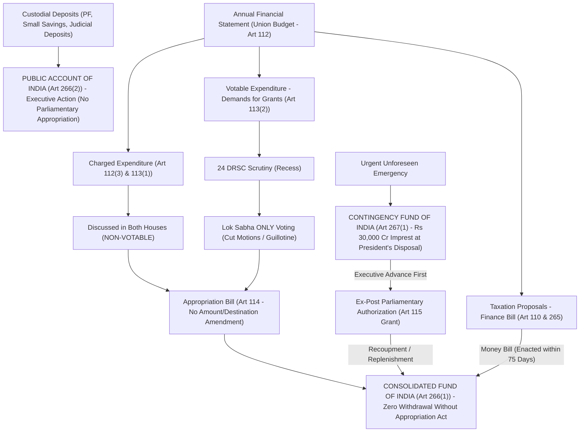

# Chapter 8 — Union & State Legislatures I — Bicameralism, Legislative Procedures, Money Bills & Budgetary Architecture

A parliamentary democracy survives on two mechanical foundations: **bicameral deliberation** (ensuring transient majorities do not overwhelm federal consensus) and **legislative control over the public purse** (ensuring the executive spends and taxes strictly under sovereign mandate). Part V, Chapter II (**Articles 79–122**) and Part VI, Chapter III (**Articles 168–212**) translate these principles into exact procedural gears.

Yet modern Indian constitutional practice exposes acute stress along both axes. On the representational front, the **April 17, 2026 defeat of the Constitution (131st Amendment) Bill** revealed how India’s 50-year constituency freeze has collided head-on with women’s representation and North–South federal equity. On the fiscal–procedural front, the **August 2026 Money Bill routing of the Supreme Court Judges Strength Bill**—while the 7-Judge *Rojer Mathew* reference remains pending—and the routine **guillotining** of Demands for Grants underscore how executive majoritarianism tests the constitutional limits of bicameralism.

---

## Bicameral Architecture — Union Parliament & State Legislatures (Articles 79–84, 168–171, 197)

Under **Article 79**, Parliament consists of **three integral organs**: the **President**, the **Council of States (Rajya Sabha)**, and the **House of the People (Lok Sabha)**. Although the President is not a member of either House and does not attend debates, no parliamentary Bill becomes law without Presidential assent—mirroring the British *"Crown-in-Parliament"* model rather than the American presidential separation of branches.

Parallel architecture operates in the States under **Article 168**: every State Legislature comprises the **Governor** and either **one House** (unicameral Legislative Assembly / *Vidhan Sabha*) or **two Houses** (adding a Legislative Council / *Vidhan Parishad*). As of November 2026, only **six of 28 States** operate bicameral legislatures—**Andhra Pradesh, Bihar, Karnataka, Maharashtra, Telangana, and Uttar Pradesh**—and no Union Territory possesses a Legislative Council.

### The Rajya Sabha — Asymmetric Federalism & Continuing Authority (Article 80 & Fourth Schedule)

The Rajya Sabha embodies India’s federal principle—yet intentionally rejects American equal state representation. Under the **Fourth Schedule**, seats are allocated to States and Union Territories **roughly in proportion to population** (e.g., Uttar Pradesh holds 31 seats while Sikkim, Goa, and several northeastern states hold 1 each), creating **asymmetric federal bicameralism**.

- **Composition (Article 80):** Constitutional ceiling is **250 members**—up to **238 elected** representatives of States and Union Territories (presently only Delhi, Puducherry, and Jammu & Kashmir have RS representation) plus **12 nominated by the President** for special knowledge or practical experience in **four enumerated fields**: *Literature, Science, Art, and Social Service*. Actual current strength stands at **245** (225 States + 8 UTs [3 Delhi, 1 Puducherry, 4 J&K] + 12 Nominated).
- **Election & Tenure (Articles 80(4), 83(1), 84):** Elected indirectly by **elected MLAs** via Proportional Representation by Single Transferable Vote (**PR-STV**). Minimum age is **30 years**. The Rajya Sabha is a **continuing permanent chamber** never subject to dissolution; **one-third of its members retire every two years**. Crucially, the **six-year tenure** of an RS member is **NOT fixed by the Constitution**—it is prescribed by Parliament under the **Representation of the People Act (RPA), 1951**.
- **The *Kuldip Nayar* Reset (2006):** In ***Kuldip Nayar v. Union of India* (2006, 5-Judge Constitution Bench)**, the Supreme Court upheld two sweeping 2003 amendments to the RPA, 1951: (i) **abolishing the State domicile/residence requirement**, allowing any registered parliamentary voter anywhere in India to contest an RS seat from any State; and (ii) replacing secret ballot with an **Open Ballot** system (requiring party MLAs to show their marked ballot to the party’s authorized agent to curb cross-voting and money power). *(Subsequently, in **Shailesh Manubhai Parmar v. ECI* (2018), the Court struck down the NOTA option in Rajya Sabha polls as incompatible with PR-STV and encouraging defection.)*
- **Exclusive Federal Powers of the Rajya Sabha:** While subordinate on financial votes and executive confidence, the Upper House holds **four exclusive constitutional levers** unavailable to the Lok Sabha:
  1. **Article 249:** Authorizing Parliament—by a resolution supported by **two-thirds of members present and voting**—to legislate on a **State List** subject in the *"national interest"* (valid for up to one year per resolution).
  2. **Article 312:** Authorizing Parliament—by **two-thirds present and voting**—to create a new **All-India Service** (including an All-India Judicial Service) common to the Union and the States.
  3. **Article 67(b):** Exclusive power to **initiate removal of the Vice-President** by an **Effective Majority** (subsequently agreed to by Lok Sabha by Simple Majority).
  4. **Emergency Continuity (Provisos to Articles 352(4), 356(3), 360(2)):** If the Lok Sabha is dissolved when a National, State, or Financial Emergency proclamation is issued or due for renewal, the Rajya Sabha alone approves and sustains it until 30 days after the reconstituted Lok Sabha’s first sitting.

### Lok Sabha — Direct Mandate, 104th & 106th CAAs & the April 2026 Defeat of the 131st Amendment Bill

The Lok Sabha represents the direct sovereign electorate via **Universal Adult Suffrage** (**Article 326**; voting age reduced from 21 to 18 by the **61st CAA, 1988**) and the **First-Past-The-Post (FPTP)** electoral system. Minimum qualifying age is **25 years**, and its normal term is **five years** (**Article 83(2)**), extendable during a **National Emergency (Art 352)** by parliamentary law for **one year at a time** (never exceeding six months after the Emergency ceases).

- **Sanctioned Strength & the 104th CAA (2019):** Originally capped at **552** (530 States + 20 UTs + 2 nominated Anglo-Indians under Article 331), the **104th Constitutional Amendment Act, 2019** (effective January 25, 2020) extended **SC/ST legislative reservations** (**Article 334**) for ten more years (until January 25, 2030) while **discontinuing the two Anglo-Indian nominations** in Lok Sabha (**Art 331**) and State Assemblies (**Art 333**). The constitutional maximum therefore stands at **550** (530 States + 20 UTs), with current actual elected strength at **543** (524 States + 19 UTs).
- **106th CAA, 2023 (*Nari Shakti Vandan Adhiniyam*, introduced as 128th Amendment Bill, 2023):** Enacted in September 2023 after three decades of lapsed attempts, it inserted **Articles 330A** (Lok Sabha), **332A** (State Assemblies), and **334A** (commencement, sunset, and rotation), and amended **Article 239AA** (NCT Delhi Assembly). It mandates reserving **as nearly as may be one-third (33%)** of all directly elected seats for women—including a **one-third horizontal sub-quota *within* SC and ST reserved seats**. Crucially, it **does NOT apply to the Rajya Sabha or State Legislative Councils** and contains **no separate OBC sub-quota**.
- **April 16, 2026 Gazette Commencement vs. Article 334A Lock-In:** On **April 16, 2026**, the Union Law Ministry formally notified that the **106th CAA, 2023 came into force** under Section 1(2) of the Act. Yet the reservation remains **inoperative in the 18th Lok Sabha** because **Article 334A** ties actual implementation to a **delimitation exercise carried out after publication of the first Census taken *after* the Act’s commencement** (valid for **15 years** from commencement of operation, extendable by Parliament, with reserved seats rotating after each subsequent delimitation).
- **The Historic Defeat of the Constitution (131st Amendment) Bill (April 16–17, 2026):** On **April 16, 2026**, during a specially convened parliamentary session, Law Minister Arjun Ram Meghwal introduced a **three-bill package**—the **Constitution (131st Amendment) Bill, 2026**, the **Delimitation Bill, 2026**, and the **Union Territories Laws (Amendment) Bill, 2026**—aimed at operationalizing women’s reservation by the **2029 general elections**. The 131st Amendment Bill sought to:
  1. Lift the **50-year inter-state representational freeze** (frozen to the **1971 Census** by the 42nd CAA, 1976 and extended until the first Census post-2026 by the 84th CAA, 2001) and empower Parliament by ordinary law to designate the Census base (with the paired Delimitation Bill selecting the **2011 Census**);
  2. Expand the **Lok Sabha maximum ceiling from 550 to 850 seats** (up to **815 from States** and **35 from Union Territories**).
  3. On **April 17, 2026**, put to division under **Article 368(2)**, the Bill secured **298 Ayes against 230 Noes** (528 voting), falling **54 votes short** of the mandatory two-thirds present-and-voting special majority (**352 votes**). Marking the **first defeat of a Constitutional Amendment Bill in Lok Sabha during PM Narendra Modi’s tenure**, the vote collapsed the entire three-bill package—exposing how India’s **North–South demographic federalism divide** (Southern states opposing seat-share dilution that penalizes successful population stabilization) has turned a temporary 1976 freeze into a structurally entrenched lock-in.

### State Legislative Councils — Optional Creation & Subordinate Design (Articles 169, 171 & 197)

Unlike the constitutionally permanent Rajya Sabha, a **State Legislative Council (*Vidhan Parishad*)** is an **optional, destructible, and procedurally weak** second chamber:

- **Asymmetric Creation or Abolition (Article 169):** Requires a two-step federal mechanism—first, the **State Legislative Assembly** must pass a resolution by a **Special Majority** (majority of total membership + **two-thirds of members present and voting**); second, **Parliament** may then enact a law creating or abolishing the Council by a **Simple Majority**. **Article 169(3)** explicitly states that such a parliamentary Act is **NOT deemed a Constitutional Amendment under Article 368**. Crucially, an Assembly resolution is merely an enabling precondition—**Parliament is not bound to act** (leaving Assembly resolutions from West Bengal, Odisha, Rajasthan, and Assam unimplemented for years).
- **Heterogeneous Five-Part Composition (Article 171):** Total strength cannot exceed **one-third of the State Assembly’s total strength** and cannot be **less than 40 members**. Five-sixths are indirectly elected via PR-STV and one-sixth nominated: **1/3rd** by local bodies (municipalities, district boards, etc.); **1/3rd** by State MLAs (from outside the Assembly); **1/12th** by resident **Graduates** of three years' standing; **1/12th** by **Teachers** of three years' standing (secondary level or above); and **1/6th nominated by the Governor** from five fields—*Literature, Science, Art, **Co-operative Movement**, and Social Service* (note the fifth field, **Co-operative Movement**, absent from Rajya Sabha nominations). MLCs must be at least **30 years old**, serve staggered **6-year terms** (1/3rd retiring biennially), and do **not** vote in Presidential, Vice-Presidential, or Rajya Sabha elections.
- **The Four-Month Delay Cap (Article 197):** Unlike the Rajya Sabha, a Legislative Council **cannot force a deadlock or Joint Sitting** on an Ordinary Bill. If an Assembly-passed Ordinary Bill is rejected, unacceptably amended, or kept pending for **three months** on its first visit, the Assembly may pass it a second time; if the Council rejects it, suggests unacceptable amendments, or fails to pass it within **one month** of second receipt, the Bill is **deemed passed by both Houses** in the Assembly’s version—capping total delaying power at **four months (3 + 1)**. Conversely, a Bill *originating* in the Council dies permanently if rejected by the Assembly.

---

## Sessions, Prorogation, Dissolution, Bill-Lapsing & Joint Sittings (Articles 85–87, 100, 107–108)

### Summoning, Special Address & Procedural Terminations

Under **Article 85(1)** (State: **Art 174(1)**), the President summons each House to meet at such time and place as they think fit, subject to one ironclad constraint: **not more than six months shall intervene** between the last sitting of one session and the first sitting of the next—guaranteeing at least two sessions per year (parliamentary convention holds three: **Budget**, **Monsoon**, and **Winter**). **Quorum** under **Article 100(3)** is **one-tenth of total membership** (including the Presiding Officer); for a State Legislature (**Art 189(3)**), it is **10 members or one-tenth of total membership, whichever is greater**.

Distinguish **Article 86** (President’s *discretionary* right to address either or both Houses or send messages) from **Article 87** (President’s **mandatory Special Address** to both Houses assembled together at the **first session after every general election** to the Lok Sabha and at the **first session of each calendar year**, setting out government policy; State equivalent: **Art 176**). Debated via a **Motion of Thanks**, defeat of the Motion in Lok Sabha signifies loss of majority and forces the Cabinet to resign.

Four procedural breaks are perpetually tested for Prelims precision:

- **Adjournment:** Suspends work in a **sitting** for hours, days, or weeks; ordered by the **Presiding Officer**; leaves the session, pending Bills, and notices intact.
- **Adjournment *Sine Die*:** Terminates a sitting for an **indefinite period** without naming a date for reassembly; ordered by the **Presiding Officer** (who retains power to reconvene the House before formal prorogation).
- **Prorogation (Article 85(2)(a)):** Terminates the entire **session**; ordered by the **President** (on Cabinet advice). Under **Article 107(3)**, **prorogation NEVER lapses any pending Bill**—though pending motions, questions, and notices (other than notices of intention to introduce a Bill) lapse and must be renewed in the next session.
- **Dissolution (Article 85(2)(b)):** Irrevocably ends the life of the **Lok Sabha** (or State Assembly); ordered by the **President/Governor** (permanent Upper Houses never dissolve).

### Exact Bill-Lapsing Rules on Lok Sabha Dissolution (Articles 107(4)–(5) & 108(5))

Rather than memorizing disconnected lists, apply one **first-principles touchstone**: *a Bill lapses upon dissolution of the Lok Sabha if—and only if—it sits inside the dissolved Lok Sabha OR relies on a live Lok Sabha’s passage that remains incomplete in the Rajya Sabha.*

- **Bills That LAPSE (3 Cases):**
  1. A Bill **originated in Lok Sabha** and **pending in Lok Sabha**;
  2. A Bill **originated in Rajya Sabha**, passed by Rajya Sabha, and **pending in Lok Sabha** (**Art 107(5)**);
  3. A Bill **passed by Lok Sabha** and **pending in Rajya Sabha** (**Art 107(5)**).
- **Bills That DO NOT LAPSE (4 Cases):**
  1. A Bill **originated in Rajya Sabha** and **still pending in Rajya Sabha** without ever being passed by Lok Sabha (**Art 107(4)**);
  2. A Bill **passed by both Houses** and **awaiting Presidential assent**;
  3. A Bill **passed by both Houses** and **returned by the President for reconsideration** under Article 111;
  4. A Bill regarding which the **President has notified intention to summon a Joint Sitting** *prior* to dissolution of the Lok Sabha (**Article 108(5)**—directly tested in UPSC Prelims 2024!). *(Note: Pending assurances under examination by the Committee on Government Assurances also survive dissolution.)*

### Ordinary Legislation & Article 108 Joint Sittings

An Ordinary Bill passes through **three readings** in each House (First Reading: leave to introduce & Gazette publication; Second Reading: general discussion, optional reference to a Select/Joint/Standing Committee, and clause-by-clause consideration; Third Reading: final acceptance or rejection vote).

To resolve bicameral deadlocks without granting the unelected Upper House an absolute veto, **Article 108** (adapted from the Australian Constitution) empowers the **President** to summon a **Joint Sitting** of both Houses whenever any of **three deadlock triggers** occurs on an **Ordinary Bill** or a **Financial Bill (Category I or II)**:

1. The Bill passed by one House is **rejected** by the other House;
2. The Houses have **finally disagreed** on proposed amendments; or
3. **More than six months** have elapsed from the date of receipt of the Bill by the other House without its passage (excluding any period during which the receiving House is prorogued or adjourned for more than four consecutive days).

**Strict Structural Exclusions:** A Joint Sitting **CANNOT be summoned** for: (a) **Money Bills** (where Lok Sabha holds overriding power under Article 109); (b) **Constitutional Amendment Bills** (Article 368 requires passage by each House *separately* by Special Majority); or (c) **State Legislatures** (where Article 197 caps Council delay at four months).

**Presiding Hierarchy & Numerical Tilt (Article 118(4)):** A Joint Sitting is governed by the **Rules of Procedure of the Lok Sabha** (not Rajya Sabha), requires a quorum of **one-tenth of combined total membership**, and passes Bills by a **Simple Majority** of combined members present and voting—handing structural dominance to the 543-member Lok Sabha over the 245-member Rajya Sabha. It is presided over sequentially by: **Lok Sabha Speaker** → **Lok Sabha Deputy Speaker** → **Rajya Sabha Deputy Chairman** → any member chosen by those present. Crucially, the **Chairman of the Rajya Sabha (Vice-President) NEVER presides** over a Joint Sitting because they are not a member of either House. Only amendments causing final disagreement or necessitated by delay may be moved. Since 1950, **only three Joint Sittings** have ever occurred: **(1) Dowry Prohibition Bill, 1960/1961**; **(2) Banking Service Commission (Repeal) Bill, 1977/1978**; and **(3) Prevention of Terrorism Bill (POTA), 2002**.

---

## Money Bills vs. Financial Bills (Articles 109–110, 117) & the 2026 Certification Controversy

Understanding Indian legislative finance requires separating **three constitutionally distinct classes of financial legislation**—and decoding the **terminological trap** surrounding the annual *"Finance Bill"*:

### Statutory Anatomy — Articles 110 & 117

1. **Money Bill (Articles 109 & 110):** The narrowest, most privileged category. Under **Article 110(1)**, a Bill is a Money Bill **if it contains ONLY provisions** dealing with all or any of **six enumerated subjects**—(a) imposition, abolition, remission, alteration, or regulation of any tax; (b) regulation of Union borrowing or financial guarantees; (c) custody of the Consolidated Fund (CFI) or Contingency Fund (CF), and payment into or withdrawal therefrom; (d) appropriation of moneys out of the CFI; (e) declaring expenditure charged on the CFI or increasing such amount; (f) receipt of money on account of the CFI or Public Account of India, custody/issue thereof, or audit of Union/State accounts—plus **(g) any matter incidental** to items (a)–(f).
   - **Article 110(2) Exclusions (Classic Prelims Trap):** A Bill is **NOT** a Money Bill merely because it provides for: (i) **fines or pecuniary penalties**; (ii) **fees for licences or services rendered**; or (iii) **any tax imposed/altered by a local authority or body for local purposes**.
   - **Special Passage (Article 109):** Introduced **only in Lok Sabha**, **only by a Minister** (never a Private Member), and **only with prior Presidential recommendation** (**Art 117(1)**). Transmitted to Rajya Sabha bearing the **Speaker’s signed certificate** (**Art 110(4)**). Rajya Sabha **cannot amend or reject** it—it may only return non-binding recommendations within **14 days** (if unreturned after 14 days, it is deemed passed in Lok Sabha’s form; Lok Sabha is completely free to accept or reject any recommendation). **No Joint Sitting** applies, and the **President cannot return** it for reconsideration (**Art 111 Proviso**). *(Note: The annual **Finance Bill** introduced with the Union Budget under LS Rule 219 enacts taxation proposals and is certified as a **Money Bill** under Art 110(1)(a), required to be passed within **75 days** under the Provisional Collection of Taxes Act, 2023—do not confuse this annual "Finance Bill" with "Financial Bills" under Art 117!)*
2. **Financial Bill Category I (Article 117(1)):** Contains **any Article 110(1) matter PLUS additional general non-financial legislative provisions** (e.g., a Bill creating a new statutory regulator alongside a tax provision). It resembles a Money Bill in **exactly two initial gates**: (i) introduced **only in Lok Sabha**, and (ii) **only with prior Presidential recommendation**. Once introduced, it behaves **identically to an Ordinary Bill**—Rajya Sabha has full power to amend or reject it, **Article 108 Joint Sitting applies**, the President may return it for reconsideration, and no Speaker certification is required.
3. **Financial Bill Category II (Article 117(3)):** Contains provisions involving **expenditure from the Consolidated Fund of India**, **WITHOUT** including any core matter listed in Article 110(1)(a)–(f) (e.g., an institutional Bill creating new judicial or administrative posts whose salaries will be met from the CFI). It is governed **entirely as an Ordinary Bill** (originates in **either House**, full Rajya Sabha parity, Joint Sitting applicable), subject to **one single constitutional check**: neither House may **pass** it unless the President has recommended its **consideration** (recommendation is required at the **consideration stage**, NOT at introduction!).

### Speaker Certification Finality, *Puttaswamy II* vs. *Rojer Mathew* & the August 2026 SC Judges Bill Flashpoint

Under **Article 110(3)**, *"If any question arises whether a Bill is a Money Bill or not, the decision of the Speaker of the House of the People thereon shall be final."* Paired with **Article 122(1)** (shielding parliamentary proceedings from judicial scrutiny for *"irregularity of procedure"*), early judicial precedents (*Mohd. Saeed Siddiqui*, 2014; *Yogendra Kumar Jaiswal*, 2016) treated Speaker certification as virtually immune from review.

That deference fractured once the Union Government began using **Article 110(1)(g)** (*"incidental matters"*) to route landmark non-financial statutes—including the **Aadhaar Act, 2016**, **Part XIV of the Finance Act, 2017** (restructuring 19 tribunals and amending FCRA/PMLA statutes), and the **Supreme Court (Number of Judges) Amendment Acts of 2019 and 2026**—past an opposition-controlled or skeptical Rajya Sabha:

- ***Justice K.S. Puttaswamy (Retd.) v. Union of India* (*Puttaswamy II / Aadhaar*, 2018, 5-Judge Bench):** Crucially broke *Siddiqui*'s immunity rule by affirming that **Speaker certification under Article 110(3) IS subject to judicial review** for gross illegality or constitutional violation. On merits, however, the 4:1 majority (Justice A.K. Sikri) upheld Aadhaar’s Money Bill status using a broad *"pith and substance"* reading anchored on Section 7 subsidies drawn from the CFI. In a blistering lone dissent, **Justice D.Y. Chandrachud** stressed that Article 110(1) uses the restrictive word **"only"**—condemning the bypassing of the Rajya Sabha as a **"fraud on the Constitution"** and a **"subterfuge"** that degrades federal bicameralism.
- ***Rojer Mathew v. South Indian Bank Ltd.* (November 13, 2019, 5-Judge Bench):** Reviewing the tribunal overhaul enacted through the Finance Act, 2017, a co-equal 5-Judge Constitution Bench openly **doubted the correctness of the *Puttaswamy II* majority**, noting it had failed to define the rigorous constitutional test governing **"only"** (Art 110(1)) and **"incidental"** (Art 110(1)(g)). The Bench accordingly **referred the entire Money Bill certification question to a 7-Judge Constitution Bench**—a reference that **remains pending unheard as of November 2026** (leaving challenges to Aadhaar, Finance Act 2017 tribunal provisions, and PMLA Money Bill amendments in constitutional limbo).
- **The August 2026 Money Bill Controversy (*Supreme Court (Number of Judges) Amendment Bill, 2026*):** Amid this seven-year judicial pendency, the Union Government introduced the **Supreme Court (Number of Judges) Amendment Bill, 2026** in Lok Sabha on **July 20, 2026** (replacing its **May 16, 2026 Ordinance**) to amend the 1956 Act and expand sanctioned SC strength from **34 to 38 judges** (37 + CJI) to tackle 92,101+ pending cases. Repeating its 2019 precedent, the Bill was certified and passed as a **Money Bill**—clearing Lok Sabha by voice vote without debate on **August 3, 2026** and returned by Rajya Sabha on **August 5, 2026**—relying on estimated CFI expenditure of ~₹10.57 crore recurring and ₹3.47 crore non-recurring for four judges, staff, and residences. Constitutional jurists flagged a glaring **structural conflation**: altering the institutional composition of the Supreme Court under **Article 124(1)** is an administrative–judicial reform whose consequential CFI expenditure is the **textbook definition of a Financial Bill Category II under Article 117(3)**—not a Money Bill containing *only* Article 110(1) matters. Treating every expenditure-triggering statute as an Art 110(1)(g) Money Bill threatens to erase Category II Financial Bills and render the Rajya Sabha constitutionally redundant.

---

## Ordinary vs. Money vs. Financial I & II vs. CAA Bills Matrix

| Structural Parameter | Ordinary Bill (Art 107) | Money Bill (Art 109–110) | Financial Bill Cat. I (Art 117(1)) | Financial Bill Cat. II (Art 117(3)) | Constitutional Amendment Bill (Art 368) |
| :--- | :--- | :--- | :--- | :--- | :--- |
| **Core Content** | Any non-financial, non-CAA legislative matter | **ONLY** matters enumerated in **Art 110(1)(a)–(g)** | Art 110(1) financial matter **PLUS** general non-financial clauses | General clauses involving **expenditure from CFI** (no Art 110(1) tax/borrowing clause) | Amending, adding, varying, or repealing any constitutional provision |
| **House of Introduction** | **Either House** (LS or RS) | **Lok Sabha ONLY** | **Lok Sabha ONLY** | **Either House** (LS or RS) | **Either House** (LS or RS); **NOT** in State Legislatures |
| **Who Can Introduce** | Minister or Private Member | **Minister ONLY** (Government Bill) | Minister or Private Member (with Presidential recommendation) | Minister or Private Member | Minister or Private Member |
| **Prior Presidential Recommendation** | **Not required** (except Art 3, Art 304(b) Bills) | **Mandatory** before introduction (Art 117(1)) | **Mandatory** before introduction (Art 117(1)) | **NOT required for introduction**; mandatory before **consideration/passing** | **NOT required** |
| **Speaker Certification** | Not required | **Mandatory & "final"** (Art 110(3)–(4)); limited judicial review (*Puttaswamy II* / 7-Judge pending) | Not required | Not required | Not required |
| **Voting Majority** | Simple Majority | Simple Majority | Simple Majority | Simple Majority | **Special Majority** (majority of total membership + **2/3rd present & voting**) + 50% State ratification if federal (Proviso to Art 368(2)) |
| **Rajya Sabha Powers** | **Equal to LS** (may amend or reject) | **Severely restricted:** cannot reject or amend; non-binding recommendations within **14 days** | **Equal to LS** after introduction (may amend or reject) | **Equal to LS** (may amend or reject) | **Fully equal to LS** (must pass separately; RS can block) |
| **Joint Sitting (Art 108)** | **Applicable** | **NOT applicable** | **Applicable** | **Applicable** | **NOT applicable** |
| **Presidential Assent Options** | Assent, withhold, or **return once** (Art 111) | Assent or withhold; **CANNOT return** for reconsideration | Assent, withhold, or **return once** (Art 111) | Assent, withhold, or **return once** (Art 111) | **Mandatory assent** ("shall give his assent" — **24th CAA, 1971**); zero veto |
| **State Legislature Counterpart** | **Art 196–197:** Council delay capped at **4 months (3+1)**; no Joint Sitting | **Art 198–199:** Assembly only; Council gets **14 days**; Speaker certifies | **Art 207(1):** Assembly only + Governor recommendation; Council equal thereafter (4-mo cap) | **Art 207(3):** Either House; Governor recommendation for consideration | **No State initiation** (only ratification role under Art 368(2) Proviso) |

---

## Parliamentary Budgetary Architecture (Articles 112–117)

The word **"Budget"** never appears in the Constitution of India. **Article 112** designates it the **"Annual Financial Statement" (AFS)**—a statement of estimated receipts and expenditure of the Government of India for each financial year (April 1–March 31) that the President causes to be laid before both Houses of Parliament (conventionally presented in Lok Sabha on **February 1** since 2017, when the Railway Budget was merged into the General Budget). Every Union Budget presents **three fiscal snapshots**: Actuals of the preceding year ($t-2$), Revised Estimates of the current year ($t-1$), and Budget Estimates for the upcoming year ($t$).

### Constitutional Pillars — Charged vs. Voted Expenditure (Articles 112–113)

Article 112(2) mandates distinguishing **Revenue Expenditure** from **Capital Expenditure**, while **Articles 112(3) and 113** establish the foundational constitutional bifurcation protecting judicial and watchdog autonomy:

1. **Expenditure "Charged" upon the Consolidated Fund of India (Non-Votable, Discussable):** Under **Article 113(1)**, charged items **cannot be submitted to the vote of Parliament**, though either House may freely **discuss** them. This insulates constitutional offices from majoritarian financial coercion. Enumerated items under **Article 112(3)** include:
   - Emoluments and allowances of the **President** and office expenses;
   - Salaries and allowances of the **RS Chairman, Deputy Chairman, LS Speaker, and Deputy Speaker**;
   - **Debt charges** for which the Government of India is liable (interest, sinking fund, redemption, and loan-raising costs);
   - **Salaries, allowances, and pensions of Supreme Court Judges**;
   - **Pensions ONLY of High Court Judges** (**Article 112(3)(d)(iii)**) — *high-frequency Prelims trap: High Court Judges’ **salaries and allowances** are charged on the **Consolidated Fund of the concerned State** (**Art 202(3)(d)**), whereas their **pensions** are charged on the **Consolidated Fund of India**!*
   - Salary, allowances, and pension of the **CAG** and the Chairman/Members of the **UPSC** (**Art 322**), plus administrative expenses of the SC, CAG, and UPSC offices;
   - Sums required to satisfy any judgment, decree, or award of any court or arbitral tribunal; and any other expenditure declared charged by the Constitution or parliamentary law.
2. **Expenditure "Made" from the Consolidated Fund of India (Votable Demands for Grants):** Submitted exclusively to the **Lok Sabha** as ministry-wise **Demands for Grants** (**Article 113(2)**). While the Rajya Sabha debates the AFS, it **cannot vote on Demands for Grants**. Under **Article 113(3)**, **no Demand for a Grant can be made except on the recommendation of the President** (meaning private MPs cannot propose new spending). The Lok Sabha may **assent, refuse, or reduce** any Demand, but **cannot increase** a Demand or alter its destination.

### The Six Enactment Stages, Cut Motions & Guillotine

1. **Presentation:** Finance Minister delivers the Budget Speech in Lok Sabha and lays the AFS in Rajya Sabha (no discussion on Budget Day).
2. **General Discussion:** Conducted in both Houses over 3–4 days on broad fiscal policy; no motions or voting occur.
3. **Scrutiny by 24 Departmentally Related Standing Committees (DRSCs):** Houses adjourn for 3–4 weeks while 24 joint parliamentary committees examine individual ministry Demands for Grants and submit detailed, non-binding reports.
4. **Voting on Demands for Grants (Lok Sabha Only) & Cut Motions:** During ministry-wise voting, MPs may move **three specialized Cut Motions** to scrutinize expenditure—because budgetary defeat destroys fiscal confidence, **passage of any Cut Motion in Lok Sabha forces the Council of Ministers to resign**:
   - **Policy Cut Motion:** Moves *"that the amount of the demand be reduced to **Re. 1**"*—signifies total disapproval of the policy underlying the Demand and permits advocating an alternative policy.
   - **Economy Cut Motion:** Moves *"that the amount of the demand be reduced by a **specified amount**"* (lump sum or omitting a specific item)—flags potential fiscal savings.
   - **Token Cut Motion:** Moves *"that the amount of the demand be reduced by **Rs. 100**"*—ventilates a **specific grievance** falling squarely within Union executive responsibility.
   - **Guillotine:** At the expiry of allotted discussion time on the final day, the Speaker puts all remaining undiscussed Demands for Grants to vote together in one sweep. In recent parliamentary sessions, **over 75–85% of total Union Demands for Grants** have routinely been **guillotined** without floor debate—turning legislative control over the purse into an executive formality.
5. **Passing of the Appropriation Bill (Article 114):** Voting Demands for Grants does *not* legally authorize withdrawing funds. **Articles 114(3) and 266(3)** enforce absolute fiscal legality: **no money can be withdrawn from the Consolidated Fund except under an Appropriation Act**. The Appropriation Bill bundles both **Voted Grants** and **Charged Expenditure**; under **Article 114(2)**, **no amendment can be moved** in either House that varies the amount or alters the destination of any grant or charged item.
6. **Passing of the Finance Bill:** Gives statutory effect to revenue/taxation proposals under **Article 265** (*"No tax shall be levied or collected except by authority of law"*). Certified as a Money Bill; unlike the Appropriation Bill, **amendments seeking to reduce or abolish a tax can be moved** (increasing/imposing taxes requires Presidential recommendation). Must be enacted within **75 days** of introduction.

### Extraordinary & Supplementary Grants (Articles 115–116)

Because rigid annual estimates cannot anticipate every mid-year fiscal shock, the Constitution authorizes **six special grants** (all governed by the same Lok Sabha voting and Appropriation Act discipline as the main Budget):

- **Supplementary Grant (Article 115(1)(a)):** Granted when funds authorized by the annual Appropriation Act for a specific service during the current financial year prove **insufficient**.
- **Additional Grant (Article 115(1)(a)):** Granted during the current financial year for unforeseen expenditure on a **new service** not contemplated in the original Budget.
- **Excess Grant (Article 115(1)(b)):** Granted when actual spending on a service **exceeds** the voted allocation for a financial year. Voted by Lok Sabha **after** the financial year closes—and **only after scrutiny and recommendation by the Public Accounts Committee (PAC)** examining the CAG’s audit report.
- **Vote on Account (Article 116(1)(a)):** An advance lump-sum grant (conventionally covering **two months**, i.e., one-sixth of annual estimates) enabling the government to fund routine administration until full Budget enactment. While advancing Budget Day to February 1 in 2017 largely eliminated routine Votes on Account in normal years (since the full Budget passes before April 1), it remains vital during **general election years** (as an *Interim Budget / Vote on Account*, e.g., February 2024).
- **Vote of Credit (Article 116(1)(b)):** A parliamentary *"blank cheque"* granted for an unexpected demand upon India’s resources whose magnitude or indefinite character precludes normal budgetary itemization (e.g., sudden military conflict).
- **Exceptional Grant (Article 116(1)(c)):** Granted for a special purpose forming **no part of the current service** of any financial year.
- **Token Grant (Re-appropriation Mechanism):** Distinct from a *Token Cut*! Submitted for a **nominal sum of Re. 1** when expenditure on a **new service** can be financed entirely by **re-appropriating** savings from one sub-head to another within an already approved grant—securing parliamentary consent for the new service without net extra outflow from the CFI.

---

## The Three Constitutional Funds (Articles 266 & 267)

The Constitution segregates all public moneys of the Union (and identically for every State) into **three strictly walled constitutional accounts**, differentiated by ownership and legislative authorization rules:

1. **Consolidated Fund of India (Article 266(1)):** The sovereign fiscal treasury. **Inflows:** All revenues received by the Government of India (tax and non-tax), all loans raised via treasury bills, market borrowings, or external debt, and all moneys received in repayment of loans. **Outflows:** **Strictly zero withdrawal** without parliamentary authorization via an **Appropriation Act** (**Articles 114(3) & 266(3)**).
2. **Public Account of India (Article 266(2)):** A fiduciary/custodial reservoir holding all other public moneys received by or on behalf of the Government—**provident fund deposits, small savings (PPF, NSC), judicial deposits, departmental deposits, and remittances**. Because the Union acts merely as a **banker/trustee** obligated to return these moneys to rightful depositors, withdrawals occur strictly by **executive action** without requiring parliamentary appropriation (though fully subject to CAG audit).
3. **Contingency Fund of India (Article 267(1)):** An emergency **imprest fund** authorized by the Constitution and created by Parliament under the **Contingency Fund of India Act, 1950** (the Constitution does **not** fix its corpus). Held at the **disposal of the President**—administered operationally by the **Finance Secretary (Department of Economic Affairs)** on the President’s behalf (with **40%** of the corpus placed at the disposal of the Expenditure Secretary under 2021–22 norms, and releases beyond 40% requiring joint DEA + Expenditure Secretary approval)—it enables urgent executive advances for unforeseen emergencies (e.g., disasters) *pending* parliamentary authorization. **Dual-Standard Corpus Parity:** While legacy textbooks still quote **₹500 crore** (set in 2005), the **Finance Act, 2021** permanently raised the Contingency Fund corpus to **₹30,000 crore**—confirmed unchanged at **₹30,000 crore** in the Ministry of Finance’s *Key to the Budget Documents 2026–2027*. Every executive advance must subsequently receive **ex-post parliamentary approval** (via Supplementary/Additional Grant) to recoup an equivalent sum from the Consolidated Fund and restore the imprest corpus intact.

### Budget & Three Funds Flowchart (Mermaid)

---

> [!warning] Prelims Traps & Atomic Distinctions
> - **Rajya Sabha & State Council Precision Swaps:** The **6-year tenure** of Rajya Sabha MPs is fixed by the **RPA, 1951**, *not* the Constitution. Rajya Sabha nominations cover **4 fields** (Literature, Science, Art, Social Service); Governor nominations to State Legislative Councils (**Art 171(5)**) add a **5th field: Co-operative Movement**. Creating/abolishing a State Legislative Council (**Art 169**) requires **Special Majority in the State Assembly** followed by **Simple Majority in Parliament** (explicitly **outside Article 368**). Currently **only 6 States** have Councils (AP, Bihar, Karnataka, Maharashtra, Telangana, UP).
> - **106th CAA & April 2026 131st Amendment Traps:** The **106th CAA (2023)** came into force via Gazette notification on **April 16, 2026**, yet remains **inoperative** due to **Article 334A** (requiring post-commencement Census + delimitation); it reserves 1/3rd seats in **Lok Sabha, State Assemblies, and Delhi Assembly ONLY** (NOT Rajya Sabha or Legislative Councils; no OBC sub-quota). The **Constitution (131st Amendment) Bill, 2026** (proposing 850 LS seats & 2011 Census delimitation) **failed** in Lok Sabha on **April 17, 2026** (298 vs. 230, short of the 352 two-thirds threshold).
> - **Bill-Lapsing & Joint Sitting Traps (Tested Prelims 2024):** **Prorogation** *never* lapses any pending Bill (**Art 107(3)**). On Lok Sabha **dissolution**, a Bill originated & pending solely in Rajya Sabha does **NOT** lapse, and a Bill notified for an **Art 108 Joint Sitting** before dissolution does **NOT** lapse (**Art 108(5)**)—whereas a Bill passed by LS and pending in RS **DOES lapse**. The **Vice-President (RS Chairman) NEVER presides** over a Joint Sitting (**Art 118(4)**). Joint Sittings **never** apply to Money Bills, Constitutional Amendment Bills, or State Legislatures.
> - **Money Bill vs. Finance Bill vs. Financial Bills (Tested Prelims 2023 & 2024):** Fines, penalties, licence/service fees, and local-body taxes are **excluded** from Money Bills (**Art 110(2)**). A **Financial Bill Category I (Art 117(1))** requires LS introduction + prior Presidential recommendation, *then* behaves like an Ordinary Bill (RS can reject/amend; Joint Sitting applies). A **Financial Bill Category II (Art 117(3))** can originate in **either House** without prior recommendation, needing Presidential recommendation only at the **consideration/passing stage**. The annual Budget **Finance Bill** is a **Money Bill (Art 110(1)(a))**, distinct from Art 117 Financial Bills.
> - **High Court Salary vs. Pension Split & Budget Traps:** High Court Judges’ **salaries/allowances** are charged on the **State Consolidated Fund (Art 202(3)(d))**, whereas their **pensions** are charged on the **Consolidated Fund of India (Art 112(3)(d)(iii))**. Charged expenditure **CAN be discussed** in Parliament (only *voting* is barred). **Rajya Sabha CAN discuss** the Annual Financial Statement (Budget), though it **cannot vote** on Demands for Grants (tested Prelims 2015). **Excess Grants (Art 115)** require prior **PAC** vetting; **Token Grant** = Re. 1 for re-appropriation to a new service (do not confuse with **Token Cut** = Rs. 100 reduction for a specific grievance!).
> - **Three Constitutional Funds Traps:** The Constitution does **NOT** fix the corpus of the Contingency Fund (currently **₹30,000 crore** via Finance Act 2021, *not* legacy ₹500 crore), and it is held on the President’s behalf by the **Finance Secretary (DEA)**—*not* the Cabinet Secretary. Withdrawals from the **Public Account of India (Art 266(2))** require **no parliamentary appropriation**, whereas withdrawals from the **Contingency Fund (Art 267)** require **ex-post** parliamentary approval and recoupment from the CFI.

---

## UPSC Interrogation Lens

### 1. Verified UPSC Mains PYQs (2014–2026) & Prelims Anchors

- **2026 GS2 (10 Marks):** *"“Women as a class neither belong to a minority group nor are they regarded as forming a backward class.” In the light of this statement, discuss the evolution of women’s reservation from local bodies to Parliament."*
- **2021 GS2 (15 Marks):** *"Explain the constitutional provisions under which Legislative Councils are established. Review the working and current status of Legislative Councils with suitable illustrations."*
- **2020 GS2 (10 Marks):** *"Rajya Sabha has been transformed from a ‘useless stepney tyre’ to the most useful supporting organ in past few decades. Highlight the factors as well as the areas in which this transformation could be visible."*
- **2017 GS2 (15 Marks):** *"The Indian Constitution has provisions for holding a joint session of the two houses of the Parliament. Enumerate the occasions when this would normally happen and also the occasions when it cannot, with reasons thereof."*
- **Verified Prelims Focal Anchors (2015–2024 Cluster):** Repeatedly interrogated four mechanical nodes—**(i) Prelims 2024:** exact Bill-Lapsing matrix on Lok Sabha dissolution (specifically testing the Art 108(5) Joint Sitting survival exception); **(ii) Prelims 2024:** Money Bill procedure under Art 109 (LS-only introduction, RS non-binding recommendations); **(iii) Prelims 2023:** Finance Bill vs. Money Bill vs. Financial Bills (RS amendment powers and Joint Sitting availability); and **(iv) Prelims 2015:** Rajya Sabha’s right to *discuss* the Annual Financial Statement despite lacking power to vote on Demands for Grants or amend Money Bills.

### 2. Prelims Trap Signature

- **Financial Bill Category II Recommendation Timing Swap:** UPSC frequently asserts that *both* Category I (Art 117(1)) and Category II (Art 117(3)) Financial Bills require prior Presidential recommendation *for introduction* and can originate *only in Lok Sabha*—False: Category II can be introduced in **either House** without prior recommendation, requiring Presidential recommendation solely before **consideration/passing**.
- **Joint Sitting Presiding & Applicability Inversions:** Watch for distractors stating that the **Vice-President** presides over a Joint Sitting in the Speaker’s absence (False—never presides; sequence jumps to LS Deputy Speaker → RS Deputy Chairman), that a Joint Sitting resolves deadlocks on **Constitutional Amendment Bills** (False), or that **State Legislatures** resolve Assembly–Council deadlocks via a Joint Sitting (False—Art 197 four-month cap).
- **Charged Expenditure & Budget Terminology Traps:** Expect inversions asserting that Charged Expenditure *cannot be discussed* in Parliament (False—discussed freely, only non-votable), that **High Court Judges’ salaries** are charged on the Consolidated Fund of India (False—State Consolidated Fund; only *pensions* are charged on CFI), or that **Appropriation Bills** can be amended to vary grant amounts (False—barred by Art 114(2)).
- **Contingency Fund vs. Public Account Confusion:** Classic traps claim that Contingency Fund withdrawals require *no parliamentary approval at any stage* (False—mandatory *ex-post* approval and CFI recoupment), or conversely that Public Account outflows require a parliamentary Appropriation Act (False—pure executive action).

### 3. Cross-Hub AIR-1 Provocations

1. **Functional Unamendability & Representational Federalism (GS2 Polity × GS1 Demography):** The April 17, 2026 defeat of the **Constitution (131st Amendment) Bill** revealed that a temporary 1976 population freeze has hardened into a politically unamendable federal bargain—pitting democratic proportionality (*one person, one vote, one value*) against demographic equity for low-fertility Southern states, while trapping the **106th CAA Women’s Reservation** in limbo. Design a constitutional formula—combining Lok Sabha weighting, an empowered equal-representation Rajya Sabha, or delinking Article 334A from delimitation—that reconciles gender justice with federal trust ahead of Census 2027.
2. **Bicameral Erosion by Stealth (GS2 × Constitutional Law):** Between the **August 2026 Money Bill routing** of the Supreme Court Judges Strength Bill, the seven-year pendency of the 7-Judge ***Rojer Mathew* reference**, and the routine **guillotining** of over three-quarters of Union Demands for Grants, has Parliament’s twin constitutional checks—federal bicameralism and financial accountability—been reduced to formal theatre? Evaluate whether judicial review of Speaker certification under Article 110(3) can restore bicameral integrity without violating Article 122 separation of powers.

<!-- OBSIDIAN-WEB-START -->
---
### 🕸️ Neural Graph Connections
← [[7. Union & State Executives — President, Vice-President, PM, Council of Ministers & Governor Assent Reset|Ch 7]] | 🧭 [[Polity and Constitutional Law]] | [[9. Union & State Legislatures II — Presiding Officers, Devices, Privileges, Committees & Anti-Defection|Ch 9]] →
<!-- OBSIDIAN-WEB-END -->
