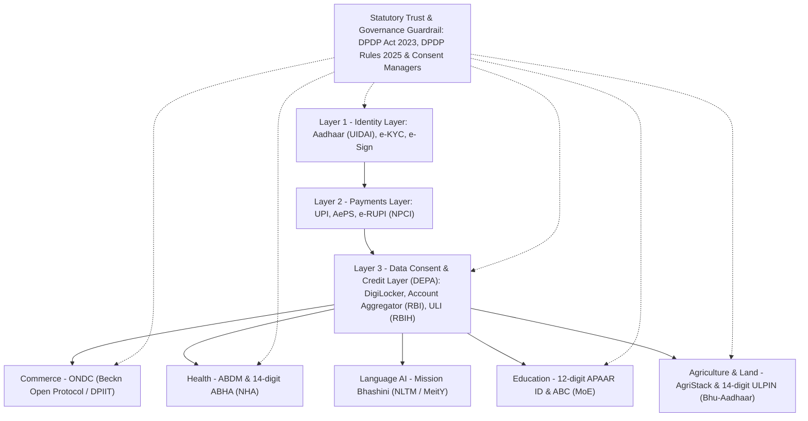

# Chapter 5 - Digital Governance, Digital Public Infrastructure (DPI) & the DPDP Regulatory Architecture

## The DPI Paradigm - From Siloed E-Governance to the India Stack

India's digital state evolved across three distinct institutional epochs. First, the **National e-Governance Plan (NeGP, 2006)** computerized legacy departmental workflows across 31 Mission Mode Projects—digitizing paper registries without breaking administrative silos. Second, **Digital India (2015)** expanded physical connectivity (BharatNet), Common Service Centres (5.16+ lakh CSCs), and front-end citizen portals, lifting India to **97th out of 193 nations** in the **UN E-Government Survey 2024** (up from 105th in 2022).

Third—and globally distinctive—is the **Digital Public Infrastructure (DPI) paradigm**, championed during India's 2023 G20 Presidency as a third way between Silicon Valley's private walled-garden monopolies and China's state-owned digital conglomerates. Instead of building closed government apps, the state funds **minimalist, open-source, interoperable digital rails** governed by open Application Programming Interfaces (APIs) and open protocols. Private startups, banks, and ministries then compete freely atop those shared public rails, collapsing customer-acquisition costs and preventing vendor lock-in.

### The Three Core Layers of the India Stack

1. **Identity Layer (Presence-less Verification):** Anchored by **Aadhaar** (12-digit unique resident identifier issued by the statutory **UIDAI** under the Aadhaar Act, 2016), paired with **e-KYC** (paperless identity verification) and **e-Sign** (legally valid digital signatures under the IT Act, 2000). Legally, Aadhaar certifies **residence, never citizenship or domicile**. In ***Justice K.S. Puttaswamy (II) v. UoI* (2018)**, a five-judge Constitution Bench upheld mandatory Aadhaar under **Section 7** strictly for welfare subsidies funded out of the Consolidated Fund of India, while striking down **Section 57** (barring private corporations from mandating Aadhaar by contract) and capping authentication metadata storage at **six months** (not five years).
2. **Payments Layer (Cashless Interoperability):**
   - **Unified Payments Interface (UPI):** Built by the **National Payments Corporation of India (NPCI)**—a non-profit umbrella entity created by RBI and the Indian Banks' Association—enabling instant, zero-MDR, bank-to-bank transfers via virtual payment addresses. Crucially, UPI is a **real-time payment rail** settling across commercial bank accounts (distinct from the RBI's **e-Rupee CBDC**, which is a direct sovereign central-bank liability akin to digital cash). By 2025–26, UPI Global Merchant Acceptance expanded to select outlets across Bhutan, France, Mauritius, Nepal, Singapore, Sri Lanka, and the UAE.
   - **Aadhaar-enabled Payment System (AePS):** Allows basic interoperable banking (cash withdrawal, balance inquiry, micro-remittance) at rural micro-ATMs run by Business Correspondents using only an Aadhaar number and biometric authentication—bridging regions without bank branches or smartphones.
   - **e-RUPI:** An NPCI-developed, **person-specific and purpose-specific** prepaid digital voucher delivered via SMS string or QR code. Because it redeems directly at designated merchants (e.g., vaccines, maternal health, fertilizer subsidies) without requiring a bank account, card, or internet banking app, it enforces **leak-proof targeted spending**.
3. **Data Consent & Empowerment Layer (DEPA):** Operationalizes **Data Empowerment and Protection Architecture (DEPA)**—turning citizens from passive data subjects into active controllers who share verified data via machine-readable consent artifacts:
   - **DigiLocker:** MeitY's open-source digital document wallet issuing authentic electronic records (driving licences, CBSE marksheets, PAN) directly from source registries, legally equivalent to original physical documents under Rule 9A of the IT (Preservation and Retention of Information by Intermediaries) Rules. In October 2026, MeitY initiated conversational multilingual AI assistants atop DigiLocker.
   - **Account Aggregator (AA) Framework:** Governed by **RBI's NBFC-AA Master Directions (2016)**, AAs act as regulated, **data-blind consent managers** transferring encrypted financial data (bank statements, GST filings, insurance, pension, mutual funds) between **Financial Information Providers (FIPs)** and **Financial Information Users (FIUs)** solely on granular user consent. AAs are legally barred from reading, storing, or monetizing underlying user data.
   - **Unified Lending Interface (ULI):** Developed by the **Reserve Bank Innovation Hub (RBIH)** as a **"Public Tech Platform for Frictionless Credit."** Acting as the lending counterpart to UPI, ULI provides standardized plug-and-play APIs connecting lenders to authenticated non-traditional data—state digitized land records, milk-pouring dairy cooperative histories, satellite imagery, and Account Aggregator flows—slashing credit-underwriting turnaround times for rural farmers and MSMEs.

### Sectoral Open Ecosystems Built on DPI Principles

- **Open Network for Digital Commerce (ONDC):** Incorporated in December 2021 as a Section 8 non-profit under **DPIIT (Ministry of Commerce and Industry)** running on the open-source **Beckn protocol**. ONDC is neither an e-commerce app nor a state marketplace; it unbundles buyer apps, seller apps, and logistics providers into an interoperable network designed to break platform duopolies and onboard *kirana* stores, artisans, and FPOs without prohibitive commission lock-in.
- **Ayushman Bharat Digital Mission (ABDM) & ABHA:** Implemented by the **National Health Authority (NHA)** to create an interoperable national digital health ecosystem anchored by a voluntary **14-digit ABHA (Ayushman Bharat Health Account)** number, linked to the **Health Facility Registry (HFR)**, **Healthcare Professionals Registry (HPR)**, and Unified Health Interface (UHI) for consent-based longitudinal health records.
- **Mission Bhashini:** Launched in 2022 under MeitY's **National Language Translation Mission (NLTM)** as a public digital platform for Indian language AI. Supporting voice interfaces across all **22 Scheduled languages** and text across 36 languages (crossing 4 billion inferences by late 2026), Bhashini dismantles the English literacy barrier—powering voice-enabled UPI, citizen grievance bots, and rural governance tools like **SabhaSaar** (which transcribes and summarizes Gram Sabha meetings automatically).
- **APAAR ID:** The **Automated Permanent Academic Account Registry** ("One Nation, One Student ID"), envisioned under **NEP 2020** by the Ministry of Education. A **12-digit** lifelong student identifier (26.35 crore+ verified IDs generated by July 2026) linked to Aadhaar, DigiLocker, and the **Academic Bank of Credits (ABC)** to allow seamless credit portability and curb fake degrees.
- **AgriStack:** Developed by the Ministry of Agriculture & Farmers Welfare under the Digital Agriculture Mission, comprising three core federated registries: a **Farmers' Registry** (issuing Aadhaar-like **Farmer IDs**), **Geo-referenced Village Maps**, and seasonal **Digital Crop Surveys**—enabling precision credit via ULI, targeted crop insurance, and QR-verified fertilizer booking.

### India Stack & Open Ecosystems Architecture Diagram

---

## Direct Benefit Transfer, JAM Trinity & PFMS SNA-SPARSH

### Just-in-Time Fiscal Plumbing & Leakage Reduction

Operationalized from January 1, 2013, **Direct Benefit Transfer (DBT)** leverages the **JAM Trinity**—**Jan Dhan** zero-balance bank accounts (39.98+ crore RuPay cards issued), **Aadhaar** biometric deduplication, and **Mobile** connectivity (85.5% of Indian households owning at least one smartphone; 125.87 crore wireless subscribers as of December 2025)—to route subsidies directly into beneficiary accounts rather than cascading cash through multi-tier bureaucratic intermediaries. By **January 2026**, cumulative DBT disbursements crossed **₹49.09 lakh crore** (surpassing ₹50 lakh crore across FY 2025–26) across more than 300 central schemes, with **PIB reporting cumulative estimated savings of ₹3.48 lakh crore** through removal of duplicate and ghost records in LPG (PAHAL), PDS, and rural wage programmes.

Behind the beneficiary-facing JAM layer lies India's restructured sovereign treasury plumbing—the **Public Financial Management System (PFMS)** overseen by the Controller General of Accounts (Department of Expenditure, Ministry of Finance). Historically, Centrally Sponsored Scheme (CSS) grants sat idle for months across thousands of commercial bank accounts ("float"), inflating central borrowing costs while starving last-mile projects. To eliminate this float, the Ministry of Finance rolled out the **Single Nodal Account (SNA)** model (2021) and subsequently upgraded it to **SNA-SPARSH** (**Single Nodal Account – Samyochit Pranali Ekikrit Shighra Hastantaran**).

**SNA-SPARSH** integrates **PFMS**, **State Financial Management Information Systems (State FMIS)**, the **Reserve Bank of India's e-Kuber** core banking platform, and **NPCI** to operationalize **Just-in-Time (JIT)** fund releases. Instead of parking advance central tranches in state commercial banks, funds remain inside the Consolidated Fund until an implementing agency generates an authenticated payment voucher—at which point both Central and State shares are drawn instantaneously from RBI e-Kuber straight to the vendor or beneficiary, creating an end-to-end real-time audit trail.

### Street-Level Exclusion Errors - "Welfare Disentitlement by Design"

While DBT dramatically reduced **inclusion errors** (ghosts and intermediaries—Type II errors), field audits by social scientists (Jean Drèze, Reetika Khera, LibTech India) and Comptroller & Auditor General reviews expose severe **exclusion errors** (denying eligible poor citizens—Type I errors) when rigid digital gatekeeping collides with rural vulnerability:

- **Biometric & Connectivity Fragility:** Manual labourers, senior citizens, and leprosy patients suffer worn fingerprints; iris scanners remain scarce at rural Fair Price Shops (FPS). In remote **Fifth Schedule tribal districts** lacking reliable telecom towers or electricity, failed e-PoS authentication routinely forces desperate villagers into "pain of authentication" trips across rocky terrain—leading to **silent exclusion** when ration dealers refuse manual overrides despite the Supreme Court's explicit *Puttaswamy II* directive that no genuine beneficiary be denied entitlements solely due to Aadhaar failure.
- **Aadhaar-Based Payment System (ABPS) Friction:** Unlike account-number transfers, ABPS routes money purely via the beneficiary's Aadhaar number to whichever bank account was **most recently seeded** on the NPCI mapper. Workers routinely lose track of payments silently diverted into dormant Airtel Payments Bank or rural wallets opened during SIM verification, while minor spelling mismatches between Job Cards, Aadhaar, and bank ledgers trigger automated payment rejections. A **LibTech India (2024–25) assessment in Jharkhand** highlighted that even as household MGNREGA registrations rose by 5.2%, households actually securing work fell by 7.4% amid ABPS bottlenecks and mass job-card deletions.
- **The "Savings" Accounting Ambiguity:** Independent public-finance researchers caution that official DBT "savings" figures largely count **removed beneficiary entries** without disaggregating fraudulent ghosts from genuine poor households purged during hasty Aadhaar-seeding drives. True governance resilience therefore demands mandatory **offline fallback protocols**, local human-assisted grievance desks, and decoupling identity deduplication from real-time biometric gatekeeping.

---

## DPDP Act 2023 and 2025 Rules

Enacted six years after the nine-judge Supreme Court Constitution Bench declared privacy an intrinsic Fundamental Right under Article 21 in ***Justice K.S. Puttaswamy (I) v. UoI* (2017)**, the **Digital Personal Data Protection (DPDP) Act, 2023** (assented **August 11, 2023**) and its operational **DPDP Rules, 2025** (notified **November 13, 2025** via Gazette Notification **G.S.R. 846(E)**, comprising 23 Rules and 7 Schedules) establish India's first comprehensive statutory data protection regime. Replacing Section 43A of the IT Act, 2000 and the 2011 Sensitive Personal Data Rules, the law adopts a minimalist, principle-based "SARAL" drafting style while deferring critical mechanics to executive rulemaking.

### Core Statutory Architecture & Actors

- **Territorial & Material Scope (Section 3):** Applies to **digital personal data** processed within India (whether collected digitally or digitized from offline paper) and **extraterritorially** to foreign entities profiling or offering goods/services to individuals in India. It **exempts** offline non-digitized data, personal/domestic processing, and **publicly available personal data** made public either by the individual or under a legal obligation (a major carve-out enabling public web-scraping unless checked by sector rules).
- **Data Principal vs. Data Fiduciary vs. Data Processor:**
  - **Data Principal:** The individual to whom personal data relates (including parents/lawful guardians for children under 18 or persons with disabilities). Holds statutory **Rights** (Sections 11–14: access to data summary & sharing list, correction/updating/erasure, grievance redressal within **90 days** under Rule 14, and **Right to Nominate** another person upon death or incapacity) paired—unusually in global privacy law—with **Statutory Duties** (Section 15: not impersonating another, not filing false or frivolous complaints, punishable up to **₹10,000**).
  - **Data Fiduciary:** Any entity (private company, startup, or **State instrumentality**) determining the purpose and means of processing. Must process data only on **free, specific, informed, unconditional, and unambiguous consent** preceded by an itemized **Rule 3 Notice** (available in English or any of the **22 Eighth Schedule languages**), with consent withdrawal made **as easy as giving consent**—or under **Section 7 "Certain Legitimate Uses"** (voluntary sharing for a specified purpose, State delivery of subsidies/licences/certificates, sovereign functions, medical emergencies, disaster response, and employment management).
  - **Significant Data Fiduciary (SDF — Section 10 & Rule 13):** High-risk entities notified by the Central Government based on data volume, sensitivity, risk to Data Principals, electoral democracy, or national security. SDFs face heightened compliance: appointing an **India-based Data Protection Officer (DPO)** accountable to the Board of Directors, commissioning an **annual Data Protection Impact Assessment (DPIA)** and independent data audit every 12 months, verifying that **algorithmic software** poses no risk to Data Principal rights, and adhering to **specified domestic data localisation** directives recommended by a Central Government committee.
- **Consent Managers (Section 6(9) & Rule 4 — Live Phase 2):** Interoperable, DPBI-registered intermediaries serving as a single dashboard through which citizens give, review, manage, and withdraw consent across disparate apps. Under **Rule 4 and the First Schedule**, a Consent Manager must be an **Indian-incorporated company** with a minimum **₹2 crore net worth**, independently certified platform interoperability, strict conflict-of-interest bars, and **data-blind architecture** (prohibited from reading the underlying personal data being shared).
- **Children's Data Protection (Section 9 & Rules 10–12):** Defines a child uniformly as anyone **under 18 years**. Requires **verifiable parental consent** (via reliable age/identity tokens such as DigiLocker or existing verified details) before processing, and bans tracking, behavioural monitoring, and targeted advertising aimed at children—subject to **Fourth Schedule exemptions** (Rule 12) for essential healthcare, clinical establishments, educational institutions, creches, and real-time location safety tracking.
- **Security Safeguards, Zero-Threshold Breach Reporting & Data Retention (Rules 6–8):**
  - **Rule 6 Security Baseline:** Mandates encryption/obfuscation/tokenisation, access controls, tamper-proof logging, resilient backups, processor contract clauses, and **mandatory minimum 1-year retention** of personal data, traffic data, and processing logs (Rule 8(3)) for audit/enforcement.
  - **Rule 7 Two-Tier Breach Reporting (No Materiality Threshold):** Unlike the EU GDPR's "risk to rights" filter, *every* personal data breach must be notified **without delay** to affected Data Principals and to the DPBI, followed by a detailed root-cause and mitigation report to the DPBI within **72 hours** of awareness.
  - **Rule 8 & Third Schedule Inactivity Erasure:** Large **e-commerce entities** and **social media intermediaries** (≥ **2 crore** registered Indian users) and **online gaming intermediaries** (≥ **50 lakh** registered users) must erase inactive user data after **3 years** of non-engagement, after issuing at least **48 hours' prior warning**.
- **Cross-Border Data Flows — Negative-List (Blacklist) Model (Section 16):** Reversing earlier 2018–2019 hard data-localisation drafts, the DPDP Act permits free cross-border data transfers to all countries **except** those explicitly restricted by Central Government notification (negative-list/blacklist model)—while preserving stricter sectoral localisation rules (e.g., RBI's 2018 payment-data localisation mandate and Rule 13 SDF restrictions).
- **Enforcement & Penalty Architecture — DPBI and TDSAT:** Established by Notification **G.S.R. 844(E)** on November 13, 2025 (headquartered in NCR), the **Data Protection Board of India (DPBI)** is strictly an **adjudicatory, digital-by-design office**—it does **not** frame subordinate regulations (unlike SEBI or TRAI; rulemaking stays wholly with MeitY). After inquiry, the DPBI imposes civil monetary penalties across **seven statutory tiers** (zero criminal imprisonment):
  - Up to **₹250 crore:** Failure to maintain reasonable security safeguards preventing a data breach (Sec 8(5)).
  - Up to **₹200 crore:** Failure to notify a data breach to DPBI / affected Data Principals (Sec 8(6)); OR breach of children's data duties (Sec 9).
  - Up to **₹150 crore:** Breach of Significant Data Fiduciary obligations (Sec 10).
  - Up to **₹50 crore:** Residuary breach of any other statutory provision or Rule.
  - Up to **₹10,000:** Breach of Data Principal duties (Sec 15); plus penalties up to the original breach ceiling for violating a voluntary undertaking (Sec 32).
  - Appeals against DPBI orders lie within **60 days** before **TDSAT** (Section 29) and thereafter to the Supreme Court; civil courts are barred (Section 39). All penalties flow into the **Consolidated Fund of India** (Section 34)—creating **no statutory right to financial compensation** for aggrieved victims.

### DPDP 3-Phase Rollout & Exemptions Matrix

| Dimension / Phase | Commencement Date & Legal Basis | Operative Scope & Key Institutional Mechanics | Critical Governance & Compliance Tension |
| :--- | :--- | :--- | :--- |
| **Phase 1 - Institutional Setup** | **November 13, 2025** *(G.S.R. 844(E) & 846(E); Sec 1, 2, 18–26, 35, 38, 39, 44(1), 44(3); Rules 1, 2, 17–21)* | Notifies DPDP Rules 2025; formally establishes **DPBI** in NCR; operationalizes definitions, good-faith bar, overriding effect, and **RTI Act Sec 8(1)(j) amendment (Sec 44(3))**. | RTI personal-info amendment took effect immediately on Day 1, whereas substantive fiduciary penalties waited 18 months; delays in publicly announcing DPBI Chairperson/Members raised early readiness flags. |
| **Phase 2 - Consent Ecosystem (LIVE)** | **November 13, 2026** *(12 months; Sec 6(9), 27(1)(d); Rule 4 & First Schedule)* | Opens **Consent Manager registration** (MeitY launched `dpbi.gov.in` portal on **Nov 14, 2026**). Requires Indian company, **₹2 crore** minimum net worth, certified interoperable platform, conflict-of-interest firewalls. | Commercial viability of data-blind Consent Managers remains untested before Data Fiduciaries are legally forced to integrate with them six months later. |
| **Phase 3 - Full Substantive Enforcement** | **May 13, 2027** *(18 months; Sec 3–17, 27–34; Rules 3, 5–16, 22–23)* | Activates Rule 3 notices, verifiable parental consent, Rule 6 safeguards, Rule 7 **72-hr** zero-threshold breach reporting, Rule 8 **3-yr** erasure, Rule 13 SDF audits, Sec 16 cross-border rules, and **₹250 cr** penalties. | Steep compliance costs for MSMEs/startups alongside dual-compliance overlap with CCPA E-Commerce Dark Pattern Rules (effective Jan 1, 2027) and RBI/SEBI cybersecurity mandates. |
| **State & Statutory Exemptions** | **Sec 17(1), 17(2)(a), 17(4)–(5) & Sec 36** *(Substantive operation May 2027; Sec 44(3) active Nov 2025)* | **Sec 17(1):** Judicial, regulatory, loan-default, M&A, offence-prevention carve-outs. **Sec 17(2)(a):** Blanket Central Govt notification exempting **any State instrumentality** from the *entire Act* on sovereignty, security, public order. **Sec 17(4)–(5):** Indefinite state data retention for research/archiving. **Sec 36:** Centre may summon *any* information from DPBI, fiduciaries, or intermediaries. | **Constitutional & Security Flashpoint:** Lacks *Puttaswamy* necessity, proportionality, time-limit, or judicial-review guardrails; creates stark state–private surveillance asymmetry. |

### 360-Degree Multi-Lens Assessment - Constitutional, Economic, Security & Ethical Tensions

- **Constitutional Lens (*Puttaswamy* Proportionality & Press Freedom):** The 2017 *Puttaswamy* verdict established a strict four-pronged test for state privacy intrusion: **legality**, **legitimate state aim**, **proportionality (least intrusive means)**, and **procedural safeguards**. Critics and constitutional petitioners argue that **Section 17(2)(a)** fails the third and fourth prongs by allowing unreviewable, indefinite executive exemptions for intelligence and state agencies. Equally contentious are three features now facing **active Supreme Court constitutional scrutiny** (including notices issued on **October 27, 2026** on the **Digital News Publishers Association [DNPA]** petition alongside transparency challenges):
  1. **Omission of Journalism Exemption:** Unlike the Justice B.N. Srikrishna Committee (2018) and the 2019 PDP Bill, the 2023 Act grants **no express exemption for journalistic processing**, exposing investigative reporters to takedown demands under erasure rights and threatening confidential sources via **Section 36** executive summons—pitting Article 21 privacy directly against Article 19(1)(a) press freedom.
  2. **RTI Act Dilution (Section 44(3)):** By amending Section 8(1)(j) of the RTI Act, 2005 to exempt all "personal information" categorically—deleting both the **larger public-interest override** and the proviso that information open to Parliament cannot be denied to citizens—the Act risks shielding public-servant assets, procurement beneficiaries, and audit trails behind privacy claims. *(For complete transparency jurisprudence, see Chapter 2.)*
  3. **Executive Control Over DPBI:** Under Sections 19–21 and Rules 17(1)–(2), the Search-cum-Selection Committee is executive-dominated, Members serve short **two-year** renewable terms, and MeitY retains all rule-making and blocking powers (Section 37)—raising separation-of-powers concerns analogous to tribunal-independence verdicts.
- **Economic & Global Trade Lens:** Adopting the **negative-list** cross-border transfer model spares India's $250B+ IT-BPM and Global Capability Centre (GCC) sectors from EU-style adequacy paralysis while lowering compliance friction relative to the GDPR. However, the absence of statutory **Right to Data Portability** (critical for competition against Big Tech lock-in), blanket **zero-threshold breach notifications** (risking alert fatigue), and broad state exemptions under Section 17(2)(a) complicate India's bid for **EU GDPR adequacy status**, forcing Indian exporters to rely on costly Standard Contractual Clauses.
- **Security & Surveillance Lens:** Mandating encryption, tokenisation, and 72-hour breach disclosure will markedly upgrade private-sector cyber hygiene across India's hospital, FinTech, and retail ecosystems. Paradoxically, **Rule 8(3)'s compulsory one-year log and personal-data retention floor** forces fiduciaries to retain sensitive metadata longer than necessary for business purposes—widening breach attack surfaces while expanding state investigatory visibility.
- **Ethical & Citizen-Agency Lens:** Two deep normative asymmetries persist. First, routing all penalties to the **Consolidated Fund of India** without any victim-compensation fund leaves breached citizens bearing identity-theft losses alone while penalizing citizens up to ₹10,000 for "frivolous" complaints under Section 15. Second, in a society marked by low digital literacy and coercive "take-it-or-leave-it" app notices, pure notice-and-consent models risk devolving into **consent theatre** unless paired tightly with dark-pattern enforcement (such as the **CCPA Dark Patterns Guidelines, 2023** and the **Consumer Protection [E-Commerce] Amendment Rules, 2026** requiring annual dark-pattern self-audits from January 1, 2027).

---

## Emerging Digital Governance Laws & Techno-Legal Frontiers

### Promotion and Regulation of Online Gaming Act, 2025 (Enforced May 1, 2026)

Passed by Parliament in August 2025 (assented **August 22, 2025** as Act No. 32 of 2025) and brought into force alongside the **Online Gaming Rules, 2026** on **May 1, 2026**, the **Promotion and Regulation of Online Gaming Act, 2025** marks a sharp regulatory pivot from light-touch Self-Regulatory Bodies (under the 2023 IT Rules amendments) to outright prohibition of real-money wagering.

- **Tripartite Statutory Classification:**
  1. **E-Sports:** Formally recognized as a legitimate competitive digital sport, promoted through guidelines and institutional frameworks under the Ministry of Youth Affairs and Sports.
  2. **Online Social Games:** Skill-based entertainment, educational, or social games without monetary stakes—encouraged for domestic creative-economy growth.
  3. **Online Money Games (Blanket Prohibition):** Comprehensively bans offering, operating, advertising, or facilitating financial transactions for any online game involving monetary stakes or expectation of financial return—**deliberately erasing the legacy judicial distinction between "games of skill" (rummy, fantasy sports, poker) and "games of chance"** laid down in *K.R. Lakshmanan* (1996) and *Satyanarayana* (1968).
- **Enforcement & Institutional Teeth:** Constitutes the **Online Gaming Authority of India (OGAI)** as a statutory attached office under **MeitY** to classify titles, register permitted games, maintain a public prohibited list, and adjudicate grievances. Banks and payment intermediaries are legally barred from processing prohibited gaming flows; CERT-In / IT Act blocking powers apply to offshore apps. Offences under key provisions are **cognizable and non-bailable**: operating or facilitating payments attracts up to **3 years' imprisonment and/or ₹1 crore fine** (repeat offences: mandatory minimum 3 years up to 5 years and ₹1–2 crore fine); advertising attracts up to **2 years and/or ₹50 lakh fine**.
- **Pending Constitutional & Federal Adjudication:** Industry petitioners (*Head Digital Works v. UoI*, heard by a three-judge Supreme Court bench in late 2026) have challenged the Act on two foundational grounds—first, **federal legislative competence** (contending that "Betting and Gambling" belongs exclusively to the **State List, Entry 34** under the doctrine of pith and substance); second, **Article 19(1)(g) proportionality** (arguing that age gates, deposit caps, and KYC limits were less restrictive alternatives than destroying legitimate skill-gaming enterprises). Final adjudication remains pending as of November 2026.

### MeitY Draft DEPA for AI Training (October 2026) & Techno-Legal AI Governance

Unlike the European Union's horizontal, risk-tiered **EU AI Act**, India has adopted a **pro-innovation, techno-legal governance strategy**. Anchored by the **₹10,371.92 crore IndiaAI Mission** (approved March 2024) and **MeitY's India AI Governance Guidelines (November 2025)**, India currently eschews a standalone rigid AI statute in favour of targeted enforcement through existing laws (DPDP Act, IT Act, BNS, Competition Act), voluntary industry standards, a federated **AI Incidents Database**, and architectural "guardrails-in-code."

A flagship expression of this techno-legal model is the **Draft Handbook on Data Empowerment and Protection Architecture (DEPA) for AI Training**, unveiled by **MeitY on October 31, 2026** (developed with iSPIRT Foundation as a **draft discussion framework**, not an enacted statute). While first-generation DEPA (Account Aggregator) solved consent-based sharing for *individual inference*, AI model training requires massive institutional datasets held by hospitals, banks, and public agencies currently locked behind privacy, IP, and commercial confidentiality walls. **DEPA for AI Training** breaks this gridlock through three pillars:
- **Custody-Preserving Architecture:** Connects **Training Data Providers (TDPs)** and **Training Data Consumers (TDCs)** via governed **Data Exchange Platforms**—bringing the AI training compute to the data inside **confidential computing clean rooms** so institutions never surrender raw copies.
- **Enforceable Digital Contracts & Privacy-Enhancing Technologies (PETs):** Pairs machine-readable electronic usage contracts with **differential privacy**, preventing trained models from memorizing or leaking individual patient or borrower records.
- **End-to-End Data Provenance:** Embeds auditable lineage tracking the origin, permissions, and usage constraints of training data across model lifecycles—positioning India to build sovereign, multilingual public-interest AI while respecting DPDP boundaries.

In **public service delivery**, AI tools—from **IGMS 2.0** grievance root-cause analytics on CPGRAMS and **Bhashini/SabhaSaar** vernacular panchayat minutes to predictive tax-evasion flags—promise immense state capacity gains. Yet deploying opaque algorithms for **welfare eligibility scoring, fraud blacklisting, or policing** introduces severe **administrative-law hazards**: biased training sets reproduce historical caste, gender, or regional exclusion, while "black-box" automated rejections violate the natural-justice rule of ***audi alteram partem*** (right to know reasons and contest adverse state action). Algorithmic public administration therefore demands mandatory **algorithmic impact audits**, human-in-the-loop appeal overrides, and explainable decision logs.

### Blockchain Land Titling, ULPIN (Bhu-Aadhaar) & DILRMP 3.0

Poorly maintained, fragmented land records generate nearly two-thirds of Indian civil litigation and trap rural property as Hernando de Soto's **"dead capital."** Under the **Digital India Land Records Modernization Programme (DILRMP)**—a 100% Central Sector Scheme run by the Department of Land Resources (Ministry of Rural Development)—India has computerized Records of Rights (RoRs) across over 97% of villages, deployed the **National Generic Document Registration System (NGDRS)**, and launched **NAKSHA** (drone-assisted urban land-parcel mapping).

Its spatial cornerstone is **ULPIN (Unique Land Parcel Identification Number)**, dubbed **"Bhu-Aadhaar"**: a **14-digit alphanumeric geo-referenced identifier** anchored to latitude–longitude parcel coordinates (complying with international ECCMA and Open Geospatial Consortium standards), assigned to over **40.58 crore land parcels** by mid-2026. In **September 2026**, DoLR unveiled operational guidelines for **DILRMP 3.0 (2026–2031)** to pivot from static digitized files toward an integrated GIS-enabled **"Land Stack"** linking cadastral maps, paperless Sub-Registrar Offices, bank mortgage verification, and the **Revenue Court Case Management System (RCCMS)**—while states like Maharashtra explore **blockchain/Distributed Ledger Technology (DLT)** audit trails and Real-World Asset tokenisation (proposed DELTA framework).

Crucially for governance realism, **ULPIN and blockchain alone cannot cure land disputes**. India operates under the **Registration Act, 1908** on a system of **presumptive titling** (registration records a transaction *deed*, not state-guaranteed ownership). Placing an inaccurate or disputed legacy record onto an immutable blockchain merely immortalizes error ("garbage in, immutable garbage out"). True tenure security requires coupling digital Land Stacks with ground-truthed physical resurveys, accessible revenue-court dispute disposal, and statutory transition toward **conclusive titling** (Torrens-style state-indemnified title guarantees).

### Platform Governance & Synthetic Media Accountability

Beyond data privacy and gaming, digital governance increasingly confronts **synthetic media, deepfakes, and algorithmic disinformation**—which directly weaponize public trust during elections, communal flashpoints, and financial scams ("digital arrest" frauds). From a governance standpoint, regulating intermediary platforms tests the delicate boundary between **safe-harbour immunity** (essential for open digital innovation under Section 79 of the IT Act, 2000), citizen protection against non-consensual synthetic impersonation, and avoiding executive censorship that chills legitimate satire or dissent. For the detailed statutory provisions, takedown timelines, watermarking mandates, and security architecture governing synthetic media and platform compliance, see [[9. Information Warfare, IT Rules 2026 & Online Radicalization#IT Rules 2021 to 2026 Synthetic Media Overhaul|IT Rules 2026 (Deepfakes/SGI)]].

---

> [!warning] Prelims Traps & Atomic Distinctions
> - **DPDP Rules 2025 — 3-Phase Date Precision:** Notified **November 13, 2025** (Phase 1: DPBI setup + **RTI Sec 8(1)(j) amendment live immediately!**); **November 13, 2026** (Phase 2: **Rule 4 Consent Manager registration** live — Indian company, **₹2 crore** net worth); **May 13, 2027** (Phase 3: full Data Fiduciary duties, 72-hr breach reporting, SDF audits, ₹250 cr penalties).
> - **DPBI Mandate & Appeal Trap:** The **Data Protection Board of India (DPBI)** is **NOT** a rule-making regulator (MeitY frames all rules); it is purely an **adjudicatory digital office**. Appeals lie to **TDSAT** (within 60 days), NOT NCLAT or High Courts directly. Penalties go strictly to the **Consolidated Fund of India**—**zero victim compensation** is provided under the Act.
> - **DPDP Zero-Threshold Breach vs. 3-Year Erasure Trap:** Breach notification has **no materiality threshold** (must notify DPBI & affected individuals *without delay*, plus detailed DPBI report within **72 hours**). The **3-year inactivity erasure** rule applies to e-commerce & social media with **≥2 crore** Indian users and online gaming intermediaries with **≥50 lakh** users (with **48 hours'** prior notice).
> - **Cross-Border Transfer Trap:** DPDP Act 2023 uses a **negative-list (blacklist)** model (free transfer everywhere *unless* notified restricted by GoI)—**not** a whitelist model and **not** blanket localization (though SDFs may face specified localisation under Rule 13, and RBI payment rules still apply).
> - **Data Principal Duties Penalty:** Uniquely, DPDP Section 15 imposes statutory duties on **individuals** (Data Principals) with penalties up to **₹10,000** for false/frivolous complaints or impersonation.
> - **DPI Number-Digit & Agency Distinctions:** **Aadhaar** = **12-digit** (UIDAI; residence proof, *not* citizenship; authentication metadata capped at **6 months** by SC); **APAAR ID** = **12-digit** (MoE / NEP 2020); **ABHA ID** = **14-digit** (NHA / ABDM); **ULPIN (Bhu-Aadhaar)** = **14-digit alphanumeric** (DoLR / DILRMP; parcel ID, *not* conclusive ownership title).
> - **Account Aggregator & ONDC Traps (Prelims 2026 Verified):** **Account Aggregators (NBFC-AA, RBI)** are **data-blind** conduits—they **cannot read, store, or sell** user financial data. **ONDC** (DPIIT, Section 8 non-profit, Beckn protocol) enables open network interoperability—it does **NOT** let the government control all commerce, replace private players, or mandate UPI exclusively.
> - **UPI vs. Digital Rupee (CBDC) Trap (Prelims 2026 Verified):** UPI settles across commercial bank accounts (commercial bank deposit liability), whereas **Digital Rupee (e-Rupee)** is a **direct sovereign liability of the RBI** akin to paper currency.
> - **Online Gaming Act, 2025 Trap:** Bans **ALL** online real-money games **regardless of skill or chance** (eliminating the legacy skill-game exception for monetary stakes), while promoting e-sports and non-money social games; **OGAI** is an attached office of **MeitY**.
> - **Situational Algorithmic Natural-Justice Trap:** In Prelims situational ethics/governance questions where an automated welfare algorithm flags and suspends a poor family's ration/pension due to an Aadhaar-seeding mismatch without prior notice or hearing, the constitutionally compliant administrative principle is **human-in-the-loop verification, offline entitlement fallback (*Puttaswamy II*), and reasoned notice (*audi alteram partem*)**—never blindly deferring to automated flags as infallible.

---

> [!info] Mains Arsenal
> - **Core Frameworks & Analytical Concepts:** **DPI "Third Way"** (open public protocols + private market innovation vs. Big Tech walled gardens or state monopolies); **Type I (Exclusion) vs. Type II (Inclusion) Welfare Errors** ("welfare disentitlement by design"); **Techno-Legal Governance** (embedding privacy, provenance, and consent in code rather than solely ex-post litigation); **Consent Theatre** vs. substantive informational self-determination.
> - **High-Impact Primary Data Points (2025–2026 Verified):**
>   - **UN E-Government Survey 2024:** India ranked **97/193** (up from 105th in 2022) — illustrating the paradox of world-leading DPI rails alongside uneven sub-national digital capacity.
>   - **DBT & JAM Scale:** Cumulative DBT transfers **>₹49.09 lakh crore** (Jan 2026 PIB) / **₹50+ lakh crore**; estimated cumulative leakage savings **₹3.48 lakh crore**; **85.5%** households with smartphones; **125.87 cr** wireless subscribers (Dec 2025).
>   - **DPI Rollout Scale:** **40.58 crore+** land parcels mapped with **ULPIN** (Aug 2026); **26.35 crore+** **APAAR IDs** (July 2026); **Bhashini** spanning **22 Scheduled voice languages** & 4B+ inferences; **IndiaAI Mission** outlay **₹10,371.92 crore**.
>   - **Street-Level Counter-Evidence:** **LibTech India (2024–25)** Jharkhand MGNREGA audit showing employment contraction (-7.4% households) amid ABPS friction & silent job-card deletions despite rising registrations.
> - **Landmark Jurisprudence & Committees:**
>   - ***Justice K.S. Puttaswamy (I) v. UoI* (2017):** Privacy as Art 21 Fundamental Right; 4-part proportionality test (legality, legitimate aim, least intrusive means, procedural safeguards).
>   - ***Justice K.S. Puttaswamy (II) v. UoI* (2018):** Upheld Aadhaar Sec 7 for Consolidated Fund welfare; struck down Sec 57 private contracts; 6-month metadata cap; **no genuine beneficiary to be excluded due to authentication failure**.
>   - **Justice B.N. Srikrishna Committee (2018):** Recommended independent statutory DPA, explicit journalistic exemption, and parliamentary/judicial oversight over state surveillance—benchmarks against which DPDP 2023 is audited.
>   - **Pending SC Constitutional Scrutiny (2026):** Notices on DPDP Act (**DNPA petition, Oct 27, 2026** — press freedom, RTI Sec 44(3), Sec 17(2)(a), DPBI independence) and Online Gaming Act 2025 (***Head Digital Works v. UoI*** — Entry 34 State List federalism & Art 19(1)(g) proportionality).
> - **Structured Way Forward ("Human-Centric & Rights-Anchored Digital State"):**
>   1. **Privacy & Democratic Guardrails:** Narrow DPDP Sec 17(2)(a) state exemptions with sunset clauses and judicial/parliamentary oversight; restore a balanced public-interest test in RTI Sec 8(1)(j); carve out Press Council-guided journalistic safeguards; insulate DPBI appointments from executive monopoly.
>   2. **Zero-Exclusion Welfare Architecture:** Mandate legally enforceable **offline overrides** (register-based verification/OTP/local officer attestation) across PDS and rural employment, paired with automated SMS alerts in local languages before any ABPS account remapping or job-card deletion.
>   3. **User-Centric Design Over Back-End Bias:** Integrate **Bhashini** voice navigation, WCAG accessibility standards, and **5.16L+ CSC** assisted delivery to prevent digital literacy gaps from crystallizing into second-class citizenship.
>   4. **Conclusive Land & Auditable AI Stacks:** Pair **DILRMP 3.0 / ULPIN** with statutory conclusive-titling reforms, and bind public-sector AI tools (under **DEPA for AI Training** and IndiaAI) to mandatory algorithmic bias audits and explainable citizen-appeal mechanisms.

---

## UPSC Interrogation Lens

### Verified UPSC Mains PYQs (2014–2026) & Prelims Anchors

- **Mains 2026 (GS2, 15M):** *"Transparency and accountability in governance are not about controlling corruption but about creating the trust of stakeholders in the policy process by following the Rule of Law and Participatory Governance." Comment.* *(Directly engages e-governance, DBT traceability, and the RTI–DPDP Sec 44(3) trust tension.)*
- **Mains 2025 (GS2, 10M):** *"e-governance projects have a built-in bias towards technology and back-end integration than user-centric designs. Examine."*
- **Mains 2023 (GS2, 10M):** *"e-governance, as a critical tool of governance, has ushered in effectiveness, transparency and accountability in governments. What inadequacies hamper the enhancement of these features?"*
- **Mains 2022 (GS2, 10M):** *"Reforming the government delivery system through the Direct Benefit Transfer Scheme is a progressive step, but it has its limitations too. Comment."*
- **Mains 2021 (GS2, 10M):** *"Has digital illiteracy, particularly in rural areas, coupled with lack of Information and Communication Technology (ICT) accessibility hindered socio-economic development? Examine with justification."*
- **Verified Prelims Focal Anchors:** **2026** (ONDC objective — breaking platform dominance via network interoperability; UPI real-time bank payment rail vs. Digital Rupee sovereign RBI liability); **2025** (UPI Global international merchant acceptance countries); **2022** (Open-source digital platforms — Aarogya Setu, CoWIN, DigiLocker, DIKSHA); **2020** (Aadhaar verdict rules — 6-month metadata cap, Sec 57 strike-down barring private contracts, Sec 7 Consolidated Fund welfare mandate); **2018** (BHIM/UPI three-factor authentication mechanics).

### Prelims Trap Signature

- **Statutory Rule-Making vs. Adjudication Confusion:** UPSC frequently tests whether a digital agency frames regulations—remember **DPBI** is purely *adjudicatory* (MeitY frames rules), **OGAI** is an attached statutory office of MeitY, and **ONDC** is a *Section 8 non-profit* under DPIIT (not a statutory regulator).
- **Phase-Date & Threshold Swaps in DPDP 2025 Rules:** Watch for swapped numbers—**₹2 crore** net worth for Consent Managers (live **Nov 13, 2026**), **72 hours** for detailed breach report to DPBI (zero materiality threshold!), **3-year** inactivity erasure (≥2 cr e-commerce/social media; ≥50L gaming) with **48-hour** prior notice, **₹250 crore** max security fine, **₹10,000** Data Principal duty fine, and **May 13, 2027** for full enforcement.
- **Data-Blind vs. Data-Storing Intermediaries:** Both **Account Aggregators (NBFC-AA)** and **DPDP Consent Managers** are legally **data-blind** conduits—eliminate any statement claiming they aggregate, analyze, or sell user data to lenders/advertisers.
- **Draft Framework vs. Enacted Law:** Clearly separate enacted, live statutes (**DPDP Act 2023 / Rules 2025**, **Online Gaming Act 2025 / Rules 2026**) from non-statutory policy frameworks (**MeitY Oct 2026 Draft DEPA for AI Training Handbook**, **India AI Governance Guidelines Nov 2025**, **DILRMP 3.0 operational guidelines**).

### Cross-Hub AIR-1 Provocations

1. **GS2 Governance × GS3 Security & Economy:** *India exports its Digital Public Infrastructure as an open, democratic model to the Global South—yet domestically, Section 17(2)(a) and Section 44(3) of the DPDP Act insulate the state from the very privacy and transparency discipline imposed on private platforms. Can "trust-based DPI" sustain global legitimacy without symmetrical accountability over state data processing?*
2. **GS2 Social Justice × GS4 Ethics:** *When an automated welfare rail eliminates ₹3.48 lakh crore in fiscal leakage while silently excluding even 1–2% of vulnerable tribal or elderly households through biometric or ABPS failure, how should a constitutional administrator resolve the utilitarian efficiency vs. Rawlsian "difference principle" trade-off?*

<!-- OBSIDIAN-WEB-START -->
---
### 🕸️ Neural Graph Connections
← [[4. The Regulatory State & Independent Regulatory Agencies (IRAs)|Ch 4]] | 🧭 [[Governance and Public Admin]] | [[6. The Non-State Arena — Civil Society, NGOs, Pressure Groups, SHGs & the Cooperative Overhaul|Ch 6]] →
<!-- OBSIDIAN-WEB-END -->
