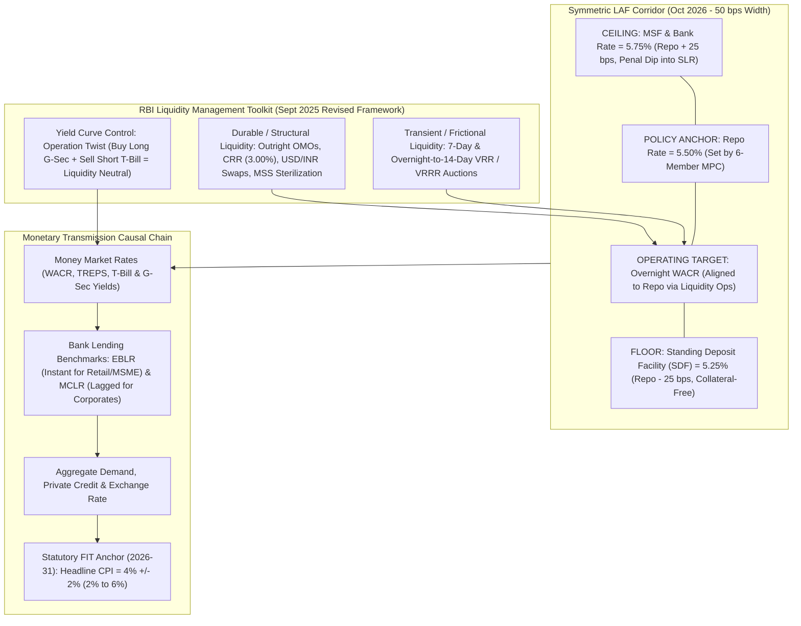

# Monetary Policy Architecture, Central Banking, Money Supply & Liquidity Frameworks

A modern central bank does not govern an economy by commanding credit volumes; it steers expectations and short-term liquidity prices across an intricate web of sovereign debt, interbank reserves, and household psychology. Because every quantitative tool alters bank balance sheets through opposing sign conventions—price versus quantity, transient versus durable liquidity, collateralized versus collateral-free absorption—this chapter forms the single densest conceptual trap zone in UPSC Prelims. Mastering it requires thinking in exact first-principles causal chains: tracing every rupee from the Reserve Bank of India's balance sheet through the money multiplier and Liquidity Adjustment Facility (LAF) corridor straight to retail lending rates and headline inflation.

---

## 1. Central Banking Governance, Autonomy and the Economic Capital Framework

### Statutory Genesis and Institutional Architecture - RBI Act, 1934

Established on **April 1, 1935** under the **Reserve Bank of India Act, 1934** following recommendations of the **Royal Commission on Indian Currency and Finance (Hilton Young Commission, 1926)**, the RBI initially operated as a private shareholders' bank before being **nationalized on January 1, 1949** under the RBI (Transfer to Public Ownership) Act, 1948. Its central office moved permanently from Calcutta to Mumbai in 1937.

The RBI's statutory mandate rests on its amended Preamble (updated via the Finance Act, 2016): regulating the issue of bank notes, keeping reserves to secure monetary stability, operating India's currency and credit system, and **maintaining price stability while keeping in mind the objective of growth**. Its governance vests in a **21-member Central Board of Directors** appointed by the Central Government:

- **Official Directors (5):** The **Governor** and up to **four Deputy Governors** (statutory ceiling under Sec 8; tenure up to 5 years, conventionally 3 years and eligible for reappointment).
- **Non-Official Directors (16):** Ten Directors nominated across diverse fields (4-year tenure), **two Government officials** (typically DEA and DFS Secretaries—non-voting at Board meetings), and **four Directors** representing the four Local Boards (Mumbai, Kolkata, Chennai, New Delhi).

**Core Functions & Currency Nuance:** Under **Section 22**, RBI holds the sole authority to issue bank notes of all denominations from ₹2 upward (capped statutorily at ₹10,000), backed since 1956 by the **Minimum Reserve System (MRS)**—requiring a minimum reserve of **₹200 crore** (at least **₹115 crore** in gold bullion/coin and the balance in foreign securities, replacing the legacy proportional reserve system). Conversely, **₹1 notes and all coins** are issued by the **Ministry of Finance** under the Coinage Act, 2011 (with ₹1 notes signed by the Finance Secretary), though circulated exclusively through the RBI. Beyond currency, RBI serves as Banker and Debt Manager to the Union and State Governments (Sec 20/21/21A), Bankers' Bank and **Lender of Last Resort (LoLR)** (providing emergency liquidity strictly to solvent banks facing temporary illiquidity—*never* lending to private trade/industry or monetizing regular government budgets), Custodian of Forex Reserves, and Regulator of Banking, NBFCs, and Payment Systems.

### Operational Autonomy vs. Section 7 Directions

Central bank independence exists along two distinct dimensions: **Goal Independence** (setting the inflation target—which in India belongs to the Union Government in consultation with RBI) and **Instrument Independence** (choosing interest rates and liquidity operations to hit that target—which belongs autonomously to the MPC and RBI).

The statutory fault line between sovereign democratic accountability and central bank autonomy resides in **Section 7(1) of the RBI Act, 1934**. It empowers the Central Government, *"after consultation with the Governor of the Bank,"* to issue **"such directions to the Bank as it may, from time to time, consider necessary in the public interest."** Once issued, such directions are legally binding, and **Section 7(2)** vests general superintendence in the Central Board subject to them. While Section 7 was invoked as a formal consultation threat in late 2018 over NBFC liquidity, Prompt Corrective Action (PCA) norms, and capital reserves, **no formal binding written directive under Section 7(1) has ever been executed in independent India**—preserving an unwritten institutional norm of consultative autonomy.

### The Economic Capital Framework (ECF) and Record Surplus Transfers (2019–2026)

Under **Section 47 of the RBI Act, 1934**, after making statutory provisions for bad debts, depreciation, and contingencies, the RBI must transfer **100% of its residual net profit** to the Central Government. Because the RBI earns massive income from interest on domestic G-Secs, yields on foreign currency assets, liquidity operations, and **realized foreign-exchange gains** (when it sells USD acquired historically at lower INR rates), the central political-economy question is: *how much capital must the RBI retain to safeguard financial stability before paying a dividend to the Union Budget?*

Following recommendations of the **Expert Committee to Review the Extant Economic Capital Framework (chaired by Dr. Bimal Jalan)**—adopted by RBI's Central Board in **August 2019**—the RBI's **Economic Capital** is cleanly bifurcated into two non-interchangeable buckets:

1. **Revaluation Balances (Strictly Non-Distributable):** Unrealized mark-to-market accounting gains arising from currency depreciation, gold price spikes, and bond-yield swings—housed primarily in the **Currency and Gold Revaluation Account (CGRA)** and Investment Revaluation Accounts (IRA). Because unrealized paper gains can reverse violently, they **can never be distributed to the Government**, serving exclusively as a buffer against **Market Risk**.
2. **Realized Equity (Available Capital Buffer):** Built from actual retained earnings—comprising RBI's Capital, Reserve Fund, Asset Development Fund (ADF), and primarily the **Contingency Fund (CF)**. Within Realized Equity sits the **Contingent Risk Buffer (CRB)**—India's "rainy-day" shield against **Monetary and Financial Stability Risks, Credit Risk, and Operational Risk** as Lender of Last Resort.

**May 2025 Five-Year ECF Review & FY 2025–26 Accounts (Verified May 2026):**
- **Widened CRB Band:** While the original August 2019 Jalan ECF fixed the **CRB range at `5.5% to 6.5%`** of RBI's balance sheet (within total Economic Capital of `20.8%–25.4%`), the RBI completed its first mandatory five-year internal review in **May 2025**, expanding the **CRB tolerance band to `4.5% to 7.5%` (`6.0% ± 1.5%`)** of the balance sheet while incorporating off-balance-sheet and minor-currency exposures into market-risk calibration.
- **Record Fiscal Dividends:** As RBI's balance sheet swelled 20.6% to **₹91.97 lakh crore** as of March 31, 2026 (70.9% foreign/gold assets, 29.1% domestic assets), gross income surged 26.4% on elevated global yields and active forex sales. After raising CRB to the 7.5% ceiling in FY 2024–25 (transferring **₹2.69 lakh crore**), the Central Board at its 623rd meeting (**May 22, 2026**) provisioned **₹1,09,379.64 crore** to maintain CRB at **6.5%** and approved an all-time record surplus transfer of **₹2,86,588.46 crore (~₹2.87 lakh crore)** for **FY 2025–26**.
- **Macro-Governance Tension:** Multi-lakh-crore RBI transfers directly cushion the Union Government's fiscal consolidation path as non-tax revenue (bypassing the divisible tax pool shared with States—raising subtle fiscal-federalism questions) while creating a latent **incentive hazard**: relying on cyclical forex-sale windfalls to balance the Union Budget could subtly pressure exchange-rate management.

---

## 2. Money Supply Architecture, Velocity and the Money Multiplier

### Fiat Money, Legal Tender, and High-Powered Money

Modern Indian currency is **fiat money**—lacking intrinsic commodity value, backed solely by sovereign legal authority and RBI's balance-sheet assets (G-Secs, forex reserves, gold). **Legal Tender** is money a creditor cannot legally refuse in settlement of a debt: RBI banknotes and coins of ₹1 and above (up to ₹1,000 for coins under the Coinage Act, 2011) are legal tender, whereas cheques, bank drafts, credit cards, and UPI transfers are **fiduciary / optional money** (commercial bank liabilities or payment rails, not legal tender).

At the base of the monetary pyramid sits **Reserve Money ($M_0$)**—also called **High-Powered Money** or the **Monetary Base**. It represents the **direct monetary liability of the Central Bank (and Government coins)** held by the public and commercial banks:

$$M_0 = C + R = \text{Currency in Circulation} + \text{Bankers' Deposits with RBI} + \text{Other Deposits with RBI}$$

From the **sources side** of RBI's balance sheet, $M_0$ expands whenever the RBI increases **Net RBI Credit to Government** (buying G-Secs via OMOs), **Net Foreign Exchange Assets** (buying dollars in the forex market), or **RBI Credit to Banks/Commercial Sector**, and contracts when RBI absorbs funds via reverse repos/SDF or sells dollars/bonds.

### Money Aggregates Matrix (M0–M4)

To distinguish immediately spendable purchasing power from broader liquidity stores, the RBI publishes both the **Legacy Monetary Aggregates ($M_0$–$M_4$)** (introduced by the Second Working Group, 1977—heavily tested in NCERT/UPSC Prelims) and the **New Monetary & Liquidity Aggregates ($NM_1$–$NM_3, L_1$–$L_3$)** (recommended by the **Dr. Y.V. Reddy Third Working Group, 1998**, which adopted residency criteria and excluded non-depository post office deposits from monetary aggregates):

| Aggregate | Formal Composition / Formula | Issuing Institutions Included | Liquidity Rank | Prelims & Analytical Significance |
| :--- | :--- | :--- | :--- | :--- |
| **$M_0$** *(Reserve / High-Powered Money)* | $\text{Currency in Circulation} + \text{Bankers' Deposits with RBI} + \text{Other Deposits with RBI}$ | RBI + GoI (coins/₹1) | Monetary Base | Direct central-bank liability; **foundation** multiplied by commercial banks into $M_3$ |
| **$M_1$** *(Narrow Money)* | $\text{Currency with the Public (CU)} + \text{Demand Deposits with Banks (DD)} + \text{Other Deposits with RBI (OD)}$ | RBI + Banking System | **Highest** (`Most Liquid`) | Pure transaction medium; excludes inter-bank deposits & bank cash-in-vault (avoids double counting) |
| **$M_2$** *(Narrow Money)* | $M_1 + \text{Savings Deposits with Post Office Savings Banks}$ | Banks + Post Office | 2nd Most Liquid | Captures small household semi-liquid postal savings |
| **$M_3$** *(Broad Money — Aggregate Monetary Resources)* | $M_1 + \text{Net Time Deposits with the Banking System (TD)}$ | RBI + Banking System | 3rd (`Benchmark`) | **Primary policy gauge of aggregate money supply** ($M_3 = m \times M_0$); includes FDs/RDs |
| **$M_4$** *(Broadest Legacy Money)* | $M_3 + \text{All Deposits with Post Office Savings Organizations}$ *(excluding National Savings Certificates — NSC)* | Banks + Post Office | **Lowest** (`Least Liquid`) | Broadest legacy definition; **strictly excludes NSCs** |
| **$NM_1$ / $NM_2$ / $NM_3$** *(New Monetary — Reddy WG 1998)* | $NM_1 = M_1$; $NM_2 = NM_1 + \text{Short-term Time Deposits } (\le 1\text{ yr})$; $NM_3 = NM_2 + \text{Long-term Time Deposits } (>1\text{ yr}) + \text{Call/Term Borrowings from Non-Depository FIs}$ | Domestic Banking System *(Residency-based; excludes FCNR-B)* | Graded | Aligns with IMF residency norms; drops Post Office deposits from money into $L_1$ |
| **$L_1$ / $L_2$ / $L_3$** *(Liquidity Aggregates)* | $L_1 = NM_3 + \text{All Post Office Deposits (excl. NSC)}$; $L_2 = L_1 + \text{Term Deposits/Borrowings/CDs of Term-Lending FIs}$; $L_3 = L_2 + \text{Public Deposits of NBFCs}$ | Banks + Post Office + FIs + NBFCs | Broadest Financial Liquidity | Tracks shadow-banking (NBFC) & FI funding outside the narrow banking perimeter |

**Key Accounting Nuances:** *"Currency with the Public"* ($CU$) equals total Currency in Circulation *minus* cash held in commercial bank vaults (which sits inside bank reserves $R$). *"Net Demand/Time Deposits"* excludes inter-bank deposits (since Bank A's deposit in Bank B is not spending power of the non-bank public). *"Other Deposits with RBI"* ($OD$) covers deposits of quasi-government bodies (NABARD, EXIM Bank) and foreign central banks/IMF, explicitly excluding Government of India and commercial bank balances.

### Velocity of Money and Money Multiplier Mechanics

In Irving Fisher's **Quantity Theory of Money (Equation of Exchange)**—$M \cdot V = P \cdot Y$—**Velocity of Money ($V = \frac{\text{Nominal GDP}}{M_3}$)** measures the average number of times a unit of currency changes hands to purchase final goods and services in a year. If nominal output is fixed at full capacity and $V$ is stable, excessive money supply ($M$) expansion spills directly into price inflation ($P$). During acute crises (e.g., 2020 lockdowns), precautionary cash hoarding collapses $V$, explaining why aggressive central bank liquidity injections can temporarily fail to ignite inflation.

Commercial banks create money endogenously through **fractional-reserve credit creation**. Every rupee of Reserve Money ($M_0$) gets amplified into Broad Money ($M_3$) via the **Money Multiplier ($m$)**:

$$m = \frac{M_3}{M_0} = \frac{CU + D}{CU + R} = \frac{1 + c}{c + r}$$

where:
- **$c = \frac{CU}{D}$ (Currency-to-Deposit Ratio):** Captures public preference for physical cash relative to bank deposits (driven by banking habits, UPI/digital adoption, festive cash demand, and informal-sector size).
- **$r = \frac{R}{D} = r_{\text{CRR}} + r_{\text{excess}}$ (Reserve-to-Deposit Ratio):** Comprises statutory reserves mandated by RBI (**CRR**) plus **excess reserves** voluntarily parked by risk-averse banks (e.g., in RBI's SDF window).

**Exact Comparative Statics (High-Yield Prelims Mechanics):**
Taking partial derivatives of $m = \frac{1 + c}{c + r}$ (noting $r < 1$ always):
1. **Rise in Banking Habit / UPI Adoption ($\downarrow c$):** $\frac{\partial m}{\partial c} = \frac{r - 1}{(c + r)^2} < 0$. When citizens keep less idle cash and deposit more into banks ($c$ falls), banks recycle more funds into loans—**raising the Money Multiplier ($m$)** and expanding $M_3$ without RBI printing a single extra rupee! *(Exact Prelims 2019 & 2021 anchor.)*
2. **Cut in CRR or Fall in Excess Reserves ($\downarrow r$):** $\frac{\partial m}{\partial r} = -\frac{1 + c}{(c + r)^2} < 0$. Lowering CRR releases idle reserves into lendable funds, **raising $m$** and expanding $M_3$. Conversely, raising CRR or SLR shrinks lendable funds and **lowers $m$**.
3. **ATM Cash Withdrawal Paradox (Immediate vs. Multi-Round Effect):** If a depositor withdraws ₹1,00,000 in cash from her Demand Deposit Account, **$CU$ increases by ₹1,00,000 and $DD$ decreases by ₹1,00,000**. Because $M_1 = CU + DD + OD$, the **immediate (first-round) impact on aggregate money supply is ZERO (unchanged)**! *(Exact Prelims 2020 anchor.)* Over subsequent credit rounds, however, higher $c$ reduces bank reserves and dampens the multiplier $m$.

---

## 3. Evolution of Monetary Policy Frameworks and Flexible Inflation Targeting

### From Monetary Targeting to Flexible Inflation Targeting (1985–2016)

India's monetary policy anchor evolved across three distinct institutional regimes as financial markets deepened and velocity destabilized:

1. **Monetary Targeting with Feedback (1985–1998):** Adopted following the **Sukhamoy Chakravarty Committee (1985)**, the RBI set annual growth targets for **Broad Money ($M_3$)** as its intermediate nominal anchor to restrain inflation around an "acceptable" 4%. Post-1991 financial deregulation, capital inflows, and innovation destabilized money demand and velocity ($V$), breaking the tight $M_3$–inflation link.
2. **Multiple Indicator Approach (1998–2015):** Pioneered under Governor **Bimal Jalan**, the RBI tracked a broad dashboard of quantity and price variables—interest rates, credit growth, fiscal balance, exchange rate, trade flows, and WPI/CPI inflation—without binding commitment to a single numerical anchor. While flexible, the regime lacked transparent accountability, allowing double-digit retail CPI inflation (9–11%) to persist during 2009–2013 and unanchoring household inflation expectations.
3. **Flexible Inflation Targeting — FIT (2016–Present):** Acting on the **Expert Committee to Revise and Strengthen the Monetary Policy Framework (chaired by Dr. Urjit Patel, January 2014)**, the Government signed a Monetary Policy Framework Agreement with RBI (Feb 2015) and institutionalized FIT via the **Finance Act, 2016**, inserting **Sections 45ZA to 45ZO** into the **RBI Act, 1934**.

### Statutory Architecture of the Monetary Policy Committee (MPC)

- **Composition & Voting (Sec 45ZB–45ZI):** A **6-member statutory committee** chaired *ex-officio* by the **RBI Governor**. Three members are RBI internals (**Governor**, **Deputy Governor in charge of Monetary Policy**, and **one RBI Officer** nominated by the Central Board); three are **external experts** appointed by the Central Government (via a Cabinet Secretary-led Search-cum-Selection Committee) for a **4-year non-renewable term**. Decisions pass by majority vote (`one member, one vote`), with the **Governor exercising a second/casting vote** solely in case of a tie (no veto power!). **Quorum is 4 members** (including the Governor, or in absence, the Monetary Policy Deputy Governor). The MPC must meet at least **4 times a year** (conventionally bi-monthly, 6 times annually) and publish voting records and minutes on the **14th day** after each meeting.
- **Mandate & Target (Sec 45ZA):** The Central Government, in consultation with RBI, notifies the inflation target once every **five years**. The operational anchor is **4% Headline CPI-Combined (All-India)** with a symmetric tolerance band of **±2 percentage points (`2% to 6%`)**. The framework is deliberately **"flexible"**—mandating price stability *while keeping in mind the objective of growth*—and strictly restricts the MPC's statutory remit to fixing the **Policy Repo Rate** (setting CRR, SLR, liquidity instruments, and macroprudential norms remains strictly the RBI's executive domain, *not* the MPC's!).
- **Accountability Trigger (Sec 45ZN):** The RBI is deemed to have **"failed"** to meet the inflation target if average Headline CPI remains **above 6% or below 2% for three consecutive quarters**. Upon breach, RBI must submit a statutory written report to the Central Government detailing: (i) reasons for failure, (ii) remedial actions proposed, and (iii) the estimated timeline to return to target. *(Triggered only once since inception—in November 2022 after Q1–Q3 2022 breaches triggered by Ukraine-war commodity shocks.)*

### March 2026 Second Statutory Five-Year Review (2026–2031) and Live Policy Cycle

Ahead of the March 2026 expiry of the 2021–26 mandate, the RBI circulated a 2025 discussion paper interrogating three structural debates: (a) whether to switch from **Headline CPI** to **Core CPI** (excluding volatile food and fuel, which respond sluggishly to interest rates), (b) whether India's optimal threshold inflation should shift above 4%, and (c) whether the ±2% band remained appropriate. Empirical research reaffirmed that India's growth-maximizing **threshold inflation sits near ~3.98%** (with growth contracting sharply beyond 6%) and that because food accounts for a massive share of lower-income household baskets, targeting core inflation alone would destroy credibility and allow food shocks to bleed into wage-price spirals.

Consequently, on **March 25, 2026**, the Department of Economic Affairs issued a Gazette Notification under **Section 45ZA** retaining the **4% Headline CPI-Combined target with the ±2% (2%–6%) tolerance band** for a third consecutive five-year cycle: **April 1, 2026 to March 31, 2031**.

**Live Policy Calibration (Late 2026 Ground Truth):** After cutting the Policy Repo Rate by **125 bps** across 2025 (`6.50% → 5.25%`) alongside a four-tranche **CRR cut from 4.00% to 3.00%** (Sept–Nov 2025) to support growth, the 63rd MPC meeting chaired by **Governor Sanjay Malhotra (October 5–7, 2026)** responded to West Asia geopolitical re-escalation, Brent crude surging past $100/barrel, and CPI rising to 4.82% by voting **unanimously (6–0)** to **hike the Policy Repo Rate by 25 bps to 5.50%** (India's first hike since February 2023) and shifting the stance (4–2 vote) from *neutral* to ***"calibrated tightening"*** (signaling rate cuts are off the table; future moves are either pause or hike).

---

## 4. Monetary Instruments, Revised Liquidity Architecture and Digital Currency

### Quantitative Instruments - Direct Reserve Ratios vs. Indirect Rate Tools

Quantitative tools govern the aggregate volume and price of system-wide liquidity:

- **Cash Reserve Ratio (CRR — Sec 42, RBI Act 1934):** The fraction of **Net Demand and Time Liabilities (NDTL)** that Scheduled Commercial Banks must maintain **strictly as cash balances with the RBI** (currently **3.00%**, with a **90% daily minimum maintenance** requirement over the reporting fortnight). Banks earn **zero interest** on CRR. Since the 2006 RBI Act amendment, CRR has **no statutory floor or ceiling** (`0% to 100%` legally possible). A CRR hike immediately drains durable liquidity without altering bank bond holdings; a CRR cut permanently injects zero-cost lendable funds.
- **Statutory Liquidity Ratio (SLR — Sec 24, Banking Regulation Act 1949):** The fraction of NDTL banks must maintain **with themselves** in safe, liquid assets—cash, gold, or **unencumbered SLR-eligible Government Securities** (currently **18.00%**; statutory ceiling **40%**, floor removed in 2007). Unlike CRR, SLR assets **earn market coupon yields** for banks while acting as a prudential solvency cushion and captive buyer base for sovereign borrowing.
- **Policy Repo Rate (`5.50%`):** The benchmark interest rate at which the RBI lends short-term funds to banks against eligible G-Sec collateral under a **Repurchase Agreement** (banks sell G-Secs to RBI and agree to repurchase them later at a predetermined price). Crucially, banks **cannot** pledge securities held inside their mandatory SLR quota for normal Repo; they must pledge **excess SLR securities**.
- **Fixed Reverse Repo Rate (`3.35%`):** Historically the floor of the LAF corridor where RBI borrowed funds from banks *by providing G-Sec collateral*. Unchanged since May 2020, it is **no longer the operative floor**—retained solely at RBI's discretion for specialized absorption.
- **Standing Deposit Facility (SDF — `5.25%` = Repo − 25 bps):** Recommended by the Urjit Patel Committee, enabled via **Section 17(1A) of the RBI Act (Finance Act 2018)**, and operationalized in **April 2022** as the **new operative floor of the LAF corridor**. SDF empowers the RBI to absorb **unlimited overnight surplus liquidity from banks WITHOUT transferring G-Sec collateral**. Removing the collateral constraint liberated RBI from balance-sheet G-Sec shortages during massive liquidity surges (e.g., demonetization or forex inflow waves), while SDF balances qualify for SLR but *not* CRR.
- **Marginal Standing Facility (MSF — `5.75%` = Repo + 25 bps):** Introduced in May 2011 as an overnight emergency penal borrowing window and the **operative ceiling of the LAF corridor**. Unlike regular Repo, MSF allows banks facing acute interbank dry-ups to **dip into their statutory SLR portfolio up to 2% of NDTL** (temporarily raised to 3% during COVID) to borrow from RBI at a 25 bps penalty above Repo.
- **Bank Rate (`5.75%` — Sec 49, RBI Act 1934):** Statutorily the standard rate at which RBI buys or rediscounts bills of exchange or commercial papers. Since February 2012, the Bank Rate has been **realigned automatically with the MSF rate (`Repo + 25 bps`)**, serving functionally as the **penal rate** levied on banks defaulting on CRR/SLR maintenance (`Bank Rate + 3%` first day, `+ 5%` thereafter) rather than an active policy-signaling tool.

### Qualitative and Macroprudential Instruments

When aggregate inflation is benign yet credit bubbles form in specific asset classes (e.g., unsecured personal loans, credit cards, real estate), raising the Policy Repo Rate is too blunt—it crushes productive manufacturing alongside speculative borrowing. The RBI instead deploys targeted **Qualitative / Macroprudential Tools**:
- **Differential Risk Weights:** Raising capital-adequacy risk weights on risky credit buckets forces banks to set aside more equity per rupee lent without moving the Repo Rate (e.g., RBI's November 2023 risk-weight hike from 100% to 125% on unsecured consumer credit and bank lending to higher-rated NBFCs, subsequently calibrated on microfinance loans in Feb 2025).
- **Loan-to-Value (LTV) Ratios & Margin Requirements:** Capping maximum loan amounts as a percentage of collateral value (housing/gold loans) or raising borrower down-payments to curb commodity hoarding.
- **Selective Credit Controls, Credit Rationing & Moral Suasion:** Direct supervisory directives (under Sec 21/35A of the Banking Regulation Act) or consultative persuasion steering bank portfolios away from speculative excess.

### The LAF Corridor and RBI's September 2025 Revised Liquidity Management Framework

Monetary policy succeeds only if the Policy Repo Rate announced by the MPC anchors actual overnight market borrowing costs. The RBI's **Operating Target** is the **overnight Weighted Average Call Money Rate (WACR)**—the uncollateralized interbank lending rate.

To keep WACR tightly aligned to the Policy Repo Rate, the RBI operates a **Symmetric LAF Corridor** of **±25 bps (`50 bps` total width)**: banks will never lend overnight to peers *below* the **SDF floor (`5.25%`)** when they can park cash risk-free with RBI at 5.25%, nor will they borrow *above* the **MSF ceiling (`5.75%`)** when they can borrow directly from RBI at 5.75%.

Following recommendations of the **Internal Working Group (IWG) to Review the Liquidity Management Framework (chaired by Deputy Governor Dr. Poonam Gupta, July 2025)**, the RBI notified its **Revised Liquidity Management Framework on September 30, 2025**:
- **Operating Target & Corridor Retained:** Overnight **WACR** remains the operating target inside the symmetric **±25 bps SDF–Repo–MSF corridor** (while RBI tracks collateralized overnight rates like TREPS and market repo for smooth transmission).
- **End of 14-Day Main Operation — Shift to Flexible 7-Day VRR/VRRR:** Discontinued the rigid 14-day Variable Rate Repo/Reverse Repo as the fixed "main operation." Transient/frictional liquidity (driven by GST/advance tax outflows or festival currency demand) is now managed primarily via **7-day VRR/VRRR** and flexible-tenor VRR/VRRR auctions (**overnight up to 14 days**) with **at least one day's advance notice** to curb market volatility.
- **Broadened Access:** **Standalone Primary Dealers (SPDs)** were granted full access to all RBI liquidity facilities, while the **90% daily CRR maintenance norm** was retained.

**Durable (Structural) Liquidity Toolkit:** Whereas VRR/VRRR/SDF/MSF manage *transient* daily friction, persistent liquidity deficits or surpluses (caused by currency leakage or capital flows) require **durable liquidity instruments**:
1. **Open Market Operations (OMO):** Outright *permanent* purchase of G-Secs by RBI injects durable reserve money ($M_0 \uparrow$); outright sale permanently drains reserve money ($M_0 \downarrow$).
2. **Operation Twist:** Simultaneous OMO **purchase of long-term G-Secs** and **sale of equal-value short-term Treasury Bills**. Total liquidity impact is **zero (liquidity-neutral)**, yet higher demand pushes long-term bond prices *up* and **long-term yields *down***—flattening the yield curve to lower corporate/mortgage borrowing costs without fueling excess liquidity.
3. **LTRO / TLTRO (Long-Term Repo Operations):** 1-to-3-year repo auctions at the prevailing Policy Repo Rate (introduced 2020) lowering banks' medium-term cost of funds; **Targeted LTRO (TLTRO)** mandates deploying those funds strictly into corporate bonds, CPs, or stressed sectors.
4. **Market Stabilisation Scheme (MSS — 2004):** Designed to **sterilize** sustained foreign capital inflows when RBI buys dollars (which otherwise prints rupees and stokes inflation). Under MSS, the Government issues special short-dated T-bills/dated securities *exclusively for liquidity absorption*—proceeds are **locked in a segregated MSS account with RBI** and **cannot** be spent to finance the Union Budget! **Critical Prelims trap:** The **interest cost on MSS bonds is borne by the Central Government**, not the RBI.
5. **USD/INR Buy–Sell Forex Swaps:** RBI buys US dollars spot from banks (injecting durable rupees into the system) and simultaneously signs a forward contract to sell dollars back after 1–3 years. Unlike outright OMO, swaps manage durable rupee liquidity without distorting domestic G-Sec supply or permanently altering RBI's net forex position.

### Monetary Policy Transmission - From BPLR to EBLR

Cutting or hiking the Policy Repo Rate matters only to the extent commercial banks pass rate changes onto borrowers—a process called **Monetary Policy Transmission**. Historically, Indian transmission suffered severe **asymmetric lag**: banks hiked lending rates instantly when Repo rose, but delayed cutting rates when Repo fell because retail fixed deposits carry fixed multi-year coupons and compete with administered Government Small Savings Schemes (PPF, Sukanya Samriddhi).

The RBI progressively tightened bank loan pricing across four generations:
1. **BPLR (Benchmark Prime Lending Rate, 2003):** Opaque, discretionary; banks routinely lent *below* BPLR to top corporates while overcharging retail borrowers.
2. **Base Rate (July 2010):** Transparent floor tied to banks' *average* cost of funds; banned sub-Base-Rate lending, yet average funding costs adjusted too slowly to marginal Repo shifts.
3. **MCLR (Marginal Cost of Funds-Based Lending Rate, April 2016):** Replaced average cost with *marginal* (incremental) cost of funds + negative carry on CRR + operating cost + tenor premium. Improved speed marginally, yet remained an *internal* bank-calculated metric subject to discretionary spread manipulation and long reset cycles.
4. **EBLR (External Benchmark Linked Lending Rate, October 1, 2019):** Mandated all floating-rate **personal/retail loans (home, auto) and MSME loans** be pegged directly to an objective *external* benchmark—(i) **RBI Policy Repo Rate**, (ii) 3-month or 6-month GoI T-Bill yield, or (iii) any other FBIL benchmark—with mandatory interest reset **at least once every three months**. Over 60% of floating-rate bank loans are now EBLR-linked, delivering **near-instantaneous, symmetric pass-through** (e.g., when MPC hiked Repo 25 bps on October 7, 2026, EBLR home-loan EMIs adjusted automatically on the next reset cycle—whereas corporate MCLR loans and existing term-deposit rates adjust with a 2-to-4-quarter lag).

### Central Bank Digital Currency (e₹) and Project Nexus

#### The Digital Rupee (e₹) - Sovereign Money vs. Payment Rails
Enabled by the **Finance Act, 2022** amending **Section 2(aiv) of the RBI Act, 1934** to expand *"bank note"* to encompass digital form, India's **Central Bank Digital Currency (CBDC / e₹)** is **legal tender issued directly by the RBI in digital form**—identical to physical banknotes in every economic attribute: sovereign **liability on the RBI's balance sheet**, issued in the same denominations as currency notes/coins, **non-interest-bearing** (preventing bank disintermediation and deposit runs), convertible **1:1 at par** with cash and commercial bank deposits, and **not inherently insured against inflation**.

**The Fundamental Conceptual Distinction (Prelims 2026 & Mains 2026 Core):** *UPI moves money; the Digital Rupee **is** money.* A UPI transaction is a messaging and settlement rail transferring **commercial bank liabilities** (deposits sitting in Bank A to Bank B), involving interbank clearing and settlement risk. An e₹ transaction transfers a **direct central-bank liability** instantaneously peer-to-peer with immediate settlement finality—zero bank credit risk and no mandatory bank account once wallet-enabled.

India operates a two-tier intermediated model (RBI mints and issues e₹; commercial banks and—since 2024–25—eligible **non-bank Payment System Operators (PSOs)** distribute retail wallets) across two pilot streams:
- **e₹-Wholesale (e₹-W, launched Nov 1, 2022):** Restricted to banks and (expanded in 2024–25) **4 Standalone Primary Dealers (SPDs)** for interbank secondary-market G-Sec settlement and call-money operations—slashing clearing collateral and settlement risk. Because e₹-W settles intraday without sitting as idle overnight stock, its year-end circulation value stood at **Nil** as on March 31, 2026. During FY 2025–26, RBI launched its **Unified Markets Interface (UMI)**—a multi-layer tokenization platform piloting tokenized **Certificates of Deposit (CDs)** settled directly in **e₹-W**.
- **e₹-Retail (e₹-R, launched Dec 1, 2022):** Token-based digital cash for P2P and P2M payments, fully **interoperable with UPI QR codes** and discoverable via BHIM.
  *The 2026 Circulation Paradox (RBI Annual Report, May 29, 2026):* Value of **e₹-R in circulation stood at ₹771.66 crore** on March 31, 2026—**falling ~24%** from **₹1,016.46 crore** a year earlier (and tiny against ₹41.25 lakh crore of total physical notes). Because zero-fee UPI already delivers frictionless retail payments *while leaving funds in interest-earning savings accounts*, households lack incentive to hold non-interest-bearing e₹ for routine spending. Consequently, RBI pivoted strategically from scale chase to **unique structural use cases** that UPI cannot replicate:
  1. **Programmable Money:** Purpose-bound and time-bound DBT transfers—during FY 2025–26, pilots in **Gujarat, Puducherry, and Chandigarh** credited PDS food subsidies in programmable e₹ redeemable *exclusively* for eligible ration items at authorized Fair Price Shops, alongside KCC tenant-farmer loans, carbon-credit farmer payouts, and user-to-user programmability.
  2. **Offline Resilience:** Both **proximity-based (NFC)** and **non-proximity-based (SMS)** offline e₹-R pilots enabling digital legal-tender payments in zero-connectivity rural/disaster zones.

#### Project Nexus - Multilateral Cross-Border Instant Payments
Cross-border remittances remain plagued by slow, expensive correspondent banking (SWIFT rails averaging 6%+ global fees). Building individual bilateral payment links (like India's UPI–PayNow link with Singapore, or NPCI International's Nov 2025 UPI integration pact with the Eurosystem's TIPS) scales quadratically: connecting $n$ countries bilaterally requires $n(n-1)/2$ separate legal and technical bridges.

**Project Nexus**—conceptualized by the **Bank for International Settlements (BIS) Innovation Hub (Singapore)**—solves this via a **multilateral hub-and-spoke architecture**, enabling each country's domestic Fast Payment System (FPS) to plug *once* into a single standardized Nexus gateway to transact instantly with every other member. **Founding members (5):** **India (RBI — UPI)**, **Malaysia (DuitNow)**, **Philippines (InstaPay)**, **Singapore (PayNow)**, and **Thailand (PromptPay)** (with Indonesia as observer). Following completion of the Phase-3 blueprint (June 2024), the founding central banks formally incorporated **Nexus Global Payments (NGP)** in **Singapore in April 2025** as a not-for-profit operating entity to govern and build the live system (targeting operational rollout across 2026–2027, potentially linking 1.7 billion residents).

**Atomic Distinction — Project Nexus vs. Project mBridge:** Do **not** conflate the two BIS initiatives! **Project Nexus** interlinks domestic **retail Fast Payment Systems (UPI/PayNow)**—it does *not* require CBDCs, and **India is a founding member**. **Project mBridge** is a **wholesale multi-CBDC** settlement platform (China PBOC, HKMA, Thailand, UAE, Saudi Arabia; BIS withdrew in late 2024)—**India is NOT a participant in mBridge**, though RBI has separately proposed BRICS CBDC interoperability discussions and bilateral digital-asset MoUs with MAS (Singapore) and CBUAE (UAE).

---

> [!warning] Prelims Traps & Atomic Distinctions
> - **MPC Mandate Boundary Trap:** The Monetary Policy Committee sets **ONLY the Policy Repo Rate** (and by mechanical ±25 bps linkage, SDF and MSF). **CRR, SLR, OMO, VRR/VRRR, risk weights, and Bank Rate penal rules** are set independently by the **RBI**, *not* the MPC! Nor does the Union Finance Minister chair or sit on the MPC (RBI Governor chairs; casting vote only on a tie, no veto).
> - **Directional Comparative Statics Matrix (Zero-Error Rule):**
>   - **To curb Inflation (Hawkish / Tightening):** RBI **hikes** Repo, SDF, MSF, CRR, SLR, and **SELLS** G-Secs via OMO (drains cash → bond supply rises → **bond prices FALL** → **bond yields RISE**).
>   - **To boost Growth (Dovish / Expansionary):** RBI **cuts** Repo, SDF, MSF, CRR, SLR, and **BUYS** G-Secs via OMO (injects cash → bond demand rises → **bond prices RISE** → **bond yields FALL**). *(Never increase MSF during expansionary policy — Prelims 2020 trap!)*
> - **ATM Cash Withdrawal vs. Banking Habit Trap (Prelims 2019/2020/2021):** Withdrawing ₹1 lakh cash from a Demand Deposit shifts funds from $DD$ to $CU$, leaving aggregate money supply **immediately unchanged** ($M_1 = CU + DD + OD$). Over time, higher *banking habit* lowers $c = CU/D$ and **increases the Money Multiplier ($m$)**; higher CRR or SLR **decreases $m$**.
> - **SDF vs. Fixed Reverse Repo vs. MSF:**
>   - **SDF (`5.25%`):** Operative LAF **floor**, **collateral-free** liquidity absorption, counts toward SLR (not CRR).
>   - **Fixed Reverse Repo (`3.35%`):** Legacy **collateralized** absorption; no longer the LAF floor since April 2022.
>   - **MSF (`5.75%`):** Operative LAF **ceiling**, overnight penal borrowing allowing banks to dip into **SLR quota (up to 2% NDTL)**; Bank Rate equals MSF.
> - **Revised Liquidity Framework Trap (Sept 2025 Update):** Do not mark *"14-day VRR/VRRR is RBI's main liquidity operation"* as current truth! Effective September 30, 2025 (Dr. Poonam Gupta IWG), RBI **discontinued 14-day VRR/VRRR as the main operation**, switching to **7-day VRR/VRRR** and flexible overnight-to-14-day tenors while retaining **WACR** as operating target.
> - **Sterilization, MSS & Revaluation Reserves:** Forex **sterilization** is an Open Market Operation (Prelims 2023). Under **MSS (2004)**, funds raised cannot finance the fiscal deficit, and the **Central Government bears the interest cost**. Under RBI's **ECF (revised May 2025, CRB band 4.5%–7.5%)**, unrealized **CGRA revaluation gains are strictly non-distributable**.
> - **Digital Rupee (e₹) Atomic Traps (Prelims 2023, 2024, 2026):** e₹ is a **direct sovereign liability of RBI** (unlike UPI, which transfers commercial bank liabilities), freely convertible 1:1 with cash and deposits, programmable (expiry/purpose conditions), capable of bypassing USD/SWIFT cross-border, **non-interest-bearing**, and **NOT insured against inflation by design**.
> - **RBI Lender of Last Resort & NBFC LAF Trap (Prelims 2021 & 2023):** RBI as LoLR provides temporary liquidity strictly to **solvent commercial banks**—*not* to private trade/industry bodies or to finance routine budgetary deficits. Regular **NBFCs do NOT have direct access to RBI's LAF window** (only scheduled banks and Standalone Primary Dealers do).
> - **Post Office NSC Exclusion:** $M_4$ and $L_1$ include all Post Office savings deposits **STRICTLY EXCLUDING National Savings Certificates (NSC)**.

---

## UPSC Interrogation Lens

### Verified UPSC Mains PYQs (2014–2026) & Prelims Anchors

- **GS3 2026 (10M):** *What do you mean by Digital Rupee? In this context, explain the working and progress of India's Central Bank Digital Currency (CBDC).*
- **GS3 2024 (10M):** *What are the causes of persistent high food inflation in India? Comment on the effectiveness of the monetary policy of the RBI to control this type of inflation.*
- **Prelims Dominance Note & Verified Focal Anchors (2014–2026):** Because monetary mechanics test exact directional logic and statutory boundaries, this unit yields substantially more Prelims questions than standalone Mains essays. Verified Prelims focal points include: UPI vs. CBDC balance-sheet liability (*Prelims 2026*); sources of RBI income (*Prelims 2025*); Digital Rupee features—sovereign liability, 1:1 convertibility, non-insurance against inflation (*Prelims 2024*); CBDC programmability & bypassing USD/SWIFT, Sterilization as OMO, and NBFCs barred from direct LAF access (*Prelims 2023*); RBI's OMO bond-selling under high inflation & dollar-selling under rupee depreciation (*Prelims 2022*); RBI as Lender of Last Resort & Money Multiplier rising with banking habit (*Prelims 2021*); immediate invariance of money supply upon ATM cash withdrawal & expansionary policy tool elimination (*Prelims 2020*); Money Multiplier determinants (*Prelims 2019*); Monetary Policy Committee composition & mandate (*Prelims 2017*); Bank Rate hike signaling tight monetary policy & Quantitative policy tools (*Prelims 2015*).

### Prelims Trap Signature

1. **Tool–Direction Inversion:** Slipping a contractionary action (*"increase MSF"* or *"RBI buys G-Secs when inflation is too high"*) into a list of anti-inflation or expansionary actions to test mechanistic sign discipline.
2. **Authority Attribution Swap:** Crediting the **MPC** with setting CRR/SLR, attributing **₹1 notes/coins** issuance to RBI instead of the Ministry of Finance, or placing the Finance Minister as MPC Chairperson.
3. **Balance-Sheet & Legal-Tender Conflation:** Portraying UPI balances as RBI liabilities, claiming e₹ is inflation-insured or interest-bearing, or assuming unrealized CGRA forex revaluation gains can be transferred as RBI surplus dividends.
4. **First-Round vs. Multi-Round Money Illusion:** Confusing the **immediate zero-sum substitution** of a cash withdrawal ($DD \to CU$) with its longer-run reduction of the Money Multiplier ($c \uparrow \implies m \downarrow$), or equating CRR cuts with an automatic reduction in the Policy Repo Rate.

### Cross-Hub AIR-1 Provocations

1. **Monetary Autonomy × Fiscal Federalism (GS2 + GS3):** *When RBI transfers record multi-lakh-crore surpluses under the revised May 2025 Economic Capital Framework—credited solely as non-tax Union revenue outside the Finance Commission's divisible tax pool—how does central-bank dividend windfall alter vertical fiscal equity and the risk of covert fiscal dominance?*
2. **Monetary Transmission × Supply-Side Structural Inflation (GS3 + Essay):** *With the March 2026 five-year review reaffirming Headline CPI (4% ± 2%) through 2031 despite climate-induced food shocks and geopolitical crude spikes, where does Flexible Inflation Targeting's credibility end and fiscal/agrarian supply-chain reform begin?*

<!-- OBSIDIAN-WEB-START -->
---
### 🕸️ Neural Graph Connections
← [[2. Developmental State, Five-Year Plans & 1991 Reforms|Ch 2]] | 🧭 [[Economy]] | [[4. Banking Resilience, Basel III, RBI 2026 Expected Credit Loss (ECL) & the IBC Resolution Ecosystem|Ch 4]] →
<!-- OBSIDIAN-WEB-END -->
