```mermaid
flowchart TD
    subgraph BASEL["Track A - Basel III Capital Stack & Forward-Looking Resilience (India Norms)"]
        CET["CET-1 Capital: Min 5.5% RWA (+ Quarterly Profits Included, June 2026)"]
        CCB["Capital Conservation Buffer (CCB): +2.5% CET-1 (= 8.0% CET-1 + CCB)"]
        AT1["AT-1 Perpetual Bonds: Up to 1.5% (Going-Concern PONV Loss Absorption)"]
        T2["Tier-2 Capital: Up to 2.0% (Gone-Concern Liquidation Cushion)"]
        TOTAL["Total India Minimum CRAR + CCB = 11.5% (+ D-SIB CET-1: SBI 0.8%, HDFC 0.4%, ICICI 0.2%)"]
        LIQ["Liquidity & Leverage Guards: LCR >= 100% (30-Day) | NSFR >= 100% (1-Yr) | Leverage >= 3.5% (4% D-SIB)"]
        ECL["RBI April 27, 2026 ECL Directions (Effective Apr 1, 2027): Stage 1 (12-Mo ECL) -> Stage 2 SICR (Lifetime ECL) -> Stage 3 Default"]
        CET --> CCB --> AT1 --> T2 --> TOTAL
        TOTAL --> LIQ --> ECL
    end

    subgraph IBC["Track B - IBC 2016 Corporate Insolvency Resolution Process (CIRP)"]
        DEF["Payment Default >= Rs 1 Crore (Sec 7 FC / Sec 9 OC / Sec 10 CD)"]
        NCLT["NCLT Admission -> Sec 14 Moratorium + IRP Replaces Board (Creditor-in-Control)"]
        COC["Committee of Creditors (Unrelated Financial Creditors) + Sec 29A Anti-Backdoor Filter"]
        VOTE["Resolution Plan Approval: >= 66% CoC Vote (Sec 12: 180+90 Days, 330-Day Outer Cap)"]
        WITHDRAW["Sec 12A Withdrawal Allowed Only with >= 90% CoC Approval"]
        REVIVE["Going-Concern Revival (Commercial Wisdom of CoC - Essar Steel Verdict)"]
        LIQ_W["Liquidation Waterfall (Sec 53): 1. CIRP Cost -> 2. Workmen 24m + Secured Creditors -> 3. Employees 12m -> 4. Unsecured FC -> 5. Govt/Crown Dues -> 6. Operational -> 7. Equity"]
        DEF --> NCLT --> COC --> VOTE
        COC -.-> WITHDRAW
        VOTE -->|"Approved"| REVIVE
        VOTE -->|"Rejected / Time Lapsed"| LIQ_W
    end
```

# Chapter 4 - Banking Resilience, Basel III, RBI 2026 Expected Credit Loss (ECL) & the IBC Resolution Ecosystem

Commercial banks sit on an inherent structural fault line: they convert liquid, short-term public deposits into illiquid, long-term loans across an asymmetric information landscape. When risk underwriting breaks down, bank insolvencies propagate instantaneously into macroeconomic contractions. Over the past decade, India engineered a historic balance-sheet clean-up—slashing Scheduled Commercial Bank Gross Non-Performing Assets from an existential 11.2% (FY18) to a multi-decadal low of **2.2% (FY26)**—and is now pivoting from backward-looking crisis repair to forward-looking systemic resilience via **RBI's April 2026 Expected Credit Loss (ECL) Directions**, tighter **Basel III leverage/liquidity guards**, the **Banking Laws (Amendment) Act, 2025**, and a maturing **Insolvency and Bankruptcy Code (IBC) ecosystem**.

---

## 1. Banking Taxonomy, Governance Reforms and the 2025–2026 Legislative Shift

### Institutional Taxonomy - Scheduled, Differentiated, and Cooperative Tiers

Under **Section 42(6) of the Reserve Bank of India Act, 1934**, banks listed in the **Second Schedule** are classified as **Scheduled Banks**—requiring paid-up capital and reserves of at least ₹5 lakh and compliance with RBI depositor-safety standards. Scheduled status unlocks access to RBI's Liquidity Adjustment Facility (LAF), clearinghouse membership, and statutory CRR maintenance.

- **Public Sector Banks (PSBs):** Commercial banks where the Union Government holds a majority equity stake ($\ge 51\%$). Following three waves of consolidation (2017–2020), India operates **12 PSBs** (led by SBI, Punjab National Bank, Bank of Baroda, and Canara Bank), accounting for roughly ~55% of banking assets.
- **Private Sector & Foreign Banks:** Private banks (Old-generation regional banks + post-1991 New-generation banks like HDFC, ICICI, Axis, Kotak) drive ~40%+ of credit growth with superior digital unit economics. Foreign banks operate either via branches or as locally incorporated **Wholly Owned Subsidiaries (WOS)** enjoying near-national treatment in branch expansion.
- **Regional Rural Banks (RRBs):** Established via the **RRB Act, 1976** (recommended by the **Narasimham Working Group, 1975**) to combine cooperative rural reach with commercial professionalism. Ownership is fixed statutorily at **50% Union Government : 15% State Government : 35% Sponsor Bank**, with a steep **75% Priority Sector Lending (PSL)** target and **9% minimum CRAR**. Under the Ministry of Finance's **"One State–One RRB"** fourth-phase consolidation effective **May 1, 2025**, 26 RRBs across 11 states were amalgamated, streamlining India's RRB network from **43 to 28 RRBs** (spanning 700 districts) to build scale and technology parity.
- **Differentiated Banks (Nachiket Mor Committee, 2014):** Licensed on tap by RBI to deepen financial inclusion without triggering full universal-bank risk:
  - **Small Finance Banks (SFBs):** Full-service micro-lenders accepting deposits and advancing small-ticket credit; require **₹300 crore** minimum paid-up voting equity capital / net worth under the **RBI (Small Finance Banks – Licensing) Guidelines, 2025 (November 28, 2025)** (*Dual-Standard Parity:* raised from **₹200 crore** under the Dec 2019 on-tap norms and ₹100 crore in 2014, following P.K. Mohanty IWG recommendations; transitioning UCBs require **₹150 crore** initial net worth to be raised to ₹300 crore within 5 years, while on-tap minimum capital for new Universal Banks was similarly raised from ₹500 crore to **₹1,000 crore**), maintain **15% minimum CRAR**, must route at least **50% of loan portfolios into tickets $\le ₹25$ lakh**, and face an enhanced **PSL target** (*Dual-Standard Parity:* legacy **75%** target, calibrated downward by RBI to **60% effective FY 2025–26** to ease portfolio concentration). Eligible high-performing SFBs (net worth $\ge ₹1,000$ crore, 5-year track record, GNPA $\le 3\%$, NNPA $\le 1\%$) can transition to Universal Banks—marked by **AU Small Finance Bank** receiving RBI's first in-principle universal-bank nod in **August 2025**.
  - **Payments Banks:** Narrow-banking transaction vehicles allowed to accept **demand deposits capped at ₹2 lakh per customer** (raised from ₹1 lakh in 2021) and issue ATM/debit cards and remittances, but **strictly barred from lending or issuing credit cards**. To insulate depositors from credit risk, they must maintain **15% CRAR** and park at least **75% of demand deposit balances in SLR-eligible Government Securities** ($\le 1$-year maturity) and up to 25% in commercial bank deposits.
- **Cooperative Banks (Urban & Rural):** Structured on mutual *"one member, one vote"* principles across **Urban Cooperative Banks (UCBs)** and three-tier **Rural Cooperatives** (State Cooperative Banks → District Central Cooperative Banks → Primary Agricultural Credit Societies — **PACS**). Large cooperative banks were first brought under the **Banking Regulation Act, 1949 via a 1966 amendment**, creating chronic **"dual control"** between State Registrars of Cooperative Societies (governance/management) and RBI (banking supervision). Following the 2019 PMC Bank collapse, the **Banking Regulation (Amendment) Act, 2020** empowered RBI to supersede cooperative bank boards, regulate management qualifications, approve equity/preference share issuance, and reconstruct failing UCBs without forced moratoriums—while **NABARD** supervises Rural Cooperative Banks and **PACS remain outside BR Act / RBI banking regulation**. Alongside the **August 2026 Monetary Policy** (following a January 13, 2026 discussion paper), RBI announced the resumption of **"On-Tap" licensing for UCBs** after a 22-year freeze since 2004, proposing stringent conversion entry thresholds for large credit cooperative societies (**₹300 crore** minimum capital/net worth, **₹10,000 crore** deposit base, $\ge 12\%$ CRAR, $\le 3\%$ NNPA, and $\ge 10$-year track record).

### PSB Governance Reforms - From P.J. Nayak to the Budget 2026–27 Committee

Because public ownership created a persistent principal–agent distortion—weak boards, short CEO tenures, political lending pressure, and CVC/CAG oversight chilling commercial risk-taking—reforms targeted structural autonomy across four milestones:

1. **P.J. Nayak Committee (2014):** Recommended repealing Bank Nationalisation Acts, transferring GoI's PSB shares into an autonomous **Bank Investment Company (BIC)**, cutting government ownership below 50%, and establishing an independent **Banks Board Bureau (BBB)** to professionalize top appointments.
2. **Indradhanush 7-Point Plan (2015):** Structured PSB turnaround around **ABCDEFG**—*Appointments* (separating MD/CEO and Non-Executive Chairman), *Bank Board Bureau* (operationalized April 2016; upgraded in **July 2022** into the broader **Financial Services Institutions Bureau — FSIB**, recommending directors across PSBs, public insurers, and DFIs), *Capitalisation*, *De-stressing*, *Empowerment*, *Framework of Accountability* (EASE reforms), and *Governance Reforms*.
3. **Mega PSB Consolidation (2017–2020):** Merging SBI's five associate banks + Bharatiya Mahila Bank (2017), Dena & Vijaya Bank into Bank of Baroda (2019), and ten PSBs into four anchor banks (**April 1, 2020**), pruning **27 PSBs down to 12 stronger national lenders** with lower funding costs and broader treasury reach.
4. **Banking Laws (Amendment) Act, 2025:** Passed by Parliament in April 2025 (Presidential assent **April 15, 2025**; phased enforcement effective **August 1 and November 1, 2025**), amending five foundational banking statutes (RBI Act 1934, BR Act 1949, SBI Act 1955, and Banking Companies Acquisition Acts 1970/1980):
   - **Expanded Nomination Rights (effective Nov 1, 2025):** Depositors may nominate **up to four persons** (either *simultaneously* with explicit percentage shares or *successively* for deposit accounts; strictly *successively* for safe-deposit lockers and safe custody).
   - **Updated "Substantial Interest" Threshold:** Raised the 1968-era corporate directorship threshold from **₹5 lakh to ₹2 crore**, reflecting modern capital scales.
   - **Cooperative Governance Alignment:** Extended maximum tenure of cooperative bank directors (excluding Chairman/whole-time directors) from **8 years to 10 years** (aligning with the 97th Constitutional Amendment) and allowed Central Cooperative Bank directors to serve on State Cooperative Bank boards.
   - **Operational & Investor Hygiene:** Shifted statutory CRR/SLR **reporting fortnights** from alternate Fridays to the **1st–15th and 16th–end of every month**; authorized PSBs to transfer unclaimed shares, bond interest, and redemption proceeds (unclaimed for 7+ years) to the **Investor Education and Protection Fund (IEPF)**; and empowered PSBs to independently fix statutory auditor remuneration.
5. **Budget 2026–27 High-Level Committee on Banking for Viksit Bharat:** Announced by the Finance Minister on **February 1, 2026** and formally constituted on **October 30, 2026** (6-month tenure), this high-powered committee is chaired by **Suresh N. Patel** (former Central Vigilance Commissioner), with members **Shirish Chandra Murmu** (RBI Deputy Governor), **N.S. Vishwanathan** (former RBI Deputy Governor), **Padmaja Chunduru** (former MD & CEO, Indian Bank), and Joint Secretary (Banking, DFS) as Member Secretary. It is tasked with comprehensively reviewing India's banking architecture for the next stage of economic transformation—addressing global scale (building Indian banks into the global Top 20), expanding India's credit-to-GDP ratio (~56% vs. >150% in East Asian peers), evaluating next-phase PSB consolidation/privatization and long-term capital needs of banks/DFIs/NBFCs, reviewing the **Priority Sector Lending (PSL)** framework and **Lead Bank Scheme**, lowering the cost of capital, framing an **AI/cybersecurity roadmap**, harmonizing NBFC/fintech supervision, and safeguarding depositor protection.

---

## 2. Asset Quality, NPAs and the April 2026 RBI Expected Credit Loss (ECL) Overhaul

### NPA Mechanics, Early Warning (SMA), and Balance-Sheet Clean-Up

A bank loan turns into a **Non-Performing Asset (NPA)** when principal or interest remains overdue for **more than 90 days** (for **agricultural loans**, the norm tracks harvest cycles: overdue for **two crop seasons** for short-duration crops and **one crop season** for long-duration crops). Prior to the 90-day cliff, RBI mandates early-stress tagging via **Special Mention Accounts (SMA)**: **SMA-0** (overdue 1–30 days), **SMA-1** (31–60 days), and **SMA-2** (61–90 days), triggering mandatory Inter-Creditor Agreements (ICA) for large exposures ($\ge ₹1,500$ crore) under RBI's June 7, 2019 Prudential Framework.

Once tagged NPA, assets age across three deterioration buckets: **Sub-standard** ($\le 12$ months as NPA), **Doubtful** ($>12$ months as Sub-standard), and **Loss Asset** (identified as uncollectible—requiring 100% provisioning/write-off). **Gross NPA (GNPA)** captures total impaired advances, whereas **Net NPA (NNPA)** subtracts loan-loss provisions ($\text{NNPA} = \text{GNPA} - \text{Provisions}$). The **Provisioning Coverage Ratio (PCR)** ($\text{Provisions} / \text{GNPA}$) gauges how heavily a bank has already buffered itself against expected credit loss.

**From Twin & Four Balance Sheet Crises to Twin Balance Sheet Advantage:** Excessive 2008–14 infrastructure lending by PSBs collided with stalled clearances and global commodity deflation to generate the **Twin Balance Sheet (TBS) Crisis**—overleveraged infrastructure corporates unable to service debt coupled with crippled PSBs whose GNPAs surged to **11.2% in March 2018**. After the September 2018 IL&FS default froze wholesale debt markets, economists Arvind Subramanian and Josh Felman diagnosed a **Four Balance Sheet Problem** (adding stressed **NBFCs** and **real estate developers**).

India unwound this crisis through the **4Rs Strategy** (*Recognition, Resolution, Recapitalisation, Reforms*):
- **Asset Quality Review (AQR, 2015–16):** RBI forced banks to stop disguised *"evergreening"* (issuing fresh loans to repay old interest) and recognize true bad loans transparently on balance sheets.
- **Prompt Corrective Action (PCA):** RBI's supervisory tripwire placing fragile banks under lending, branch-expansion, and dividend curbs whenever they breach Risk Thresholds on **Capital (CRAR / CET-1)**, **Asset Quality (NNPA $\ge 6\%$)**, or **Leverage Ratio** *(note: RBI's November 2021 revision dropped Return on Assets [ROA] as a PCA trigger and extended PCA to NBFCs)*.
- **Recapitalisation & IBC:** Over ₹3.1 lakh crore of sovereign equity (via Recapitalisation Bonds) paired with IBC promoter-ouster discipline transformed the landscape into today's **Twin Balance Sheet Advantage**—with SCB **GNPA plunging to 2.2%** and **NNPA to ~0.5%** (Sept 2025 / FY26) alongside system CRAR exceeding 17% and healthy corporate deleveraging.

### The April 27, 2026 RBI Final ECL Directions - Replacing Incurred Loss with Forward-Looking IFRS-9

Under India's legacy **Income Recognition, Asset Classification and Provisioning (IRACP)** regime, banks operated an **incurred-loss model**—holding minimal standard provisions (`0.25%–1%`) until a borrower actually crossed 90 days past due. Economically, incurred-loss accounting is dangerously **pro-cyclical ("too little, too late")**: during credit booms, banks under-provision and book illusory profits; during recessions, sudden NPA cliffs trigger massive provisioning hits that wipe out capital and choke fresh credit precisely when the economy needs it most.

To close this structural flaw, on **April 27, 2026**, the RBI issued its landmark **Final Expected Credit Loss (ECL) Directions**, mandated to take effect from **April 1, 2027** for all Scheduled Commercial Banks (excluding SFBs, Payments Banks, RRBs, and AIFIs initially), paired with a **four-year transitional glide path until March 31, 2031** allowing banks to phase any one-time transitional CET-1 capital hit smoothly into regulatory capital.

**Core Mathematical Architecture (IFRS-9 / Ind-AS 109 Aligned):** Banks must calculate forward-looking, probability-weighted provisions using macroeconomic forecasts across every credit exposure:

$$\text{ECL} = \sum_t \frac{\text{PD}_t \times \text{LGD}_t \times \text{EAD}_t}{(1 + \text{EIR})^t}$$

where **PD** = Probability of Default (likelihood of borrower default), **LGD** = Loss Given Default (percentage of exposure unrecovered after collateral liquidation), **EAD** = Exposure at Default (outstanding balance plus undrawn credit-line drawdown), and **EIR** = Effective Interest Rate.

Assets are dynamically partitioned into **Three Risk Stages**:
1. **Stage 1 (Performing / No Significant Credit Deterioration — typically 0–30 DPD):** Banks provision for **12-Month Expected Credit Loss** (losses expected from default events occurring within the next 12 months); interest is recognized on *gross* carrying value.
2. **Stage 2 (Underperforming / Significant Increase in Credit Risk — SICR, typically >30 DPD, rating downgrade, or distress restructuring):** Even though the borrower has *not yet defaulted*, crossing SICR forces an immediate jump to **Lifetime Expected Credit Loss** provisioning—compelling banks to build buffers early while distress is still manageable.
3. **Stage 3 (Credit-Impaired / Defaulted — >90 DPD):** Full **Lifetime ECL** provisioning; interest income can be recognized strictly on the **net carrying amount** (gross loan minus ECL allowance).

**RBI's Prudential Backstop Floors & Macro-Behavioral Shift:** To prevent banks from gaming internal PD/LGD models with overly optimistic macro assumptions, RBI imposed **mandatory prudential provisioning floors** across stages (e.g., **5% regulatory floor on Stage 2** exposures and calibrated floors across Stage 1 asset buckets, including specific higher coverage on under-construction infrastructure/CRE projects). While the one-time cumulative transitional hit to system CET-1 before phase-in is estimated at up to **~170 bps gross (~120 bps net after existing contingency buffers)**—concentrated in PSBs transitioning Stage 2 accounts to Lifetime ECL—the four-year glide path spreads this comfortably into an **annualized impact of ~25–40 bps per year** given record bank profitability. Structurally, ECL fundamentally rewires bank behavior: credit pricing becomes risk-sensitive *ex-ante*, disguised restructuring loses its accounting shield, and capital allocation shifts structurally toward transparent, well-collateralized borrowers.

---

## 3. Basel III Capital, Liquidity Buffers, D-SIBs and Deposit Insurance

### The Basel III Regulatory Architecture - India's Gold-Plated Standards

Formulated by the **Basel Committee on Banking Supervision (BCBS)** housed at the **Bank for International Settlements (BIS, Basel)**, international banking accords progressed from **Basel I (1988)** (credit risk, 8% CRAR) and **Basel II (2004)** (Three Pillars: Minimum Capital, Supervisory Review, Market Discipline + market & operational risks) to **Basel III (2010)**—engineered after the 2008 Global Financial Crisis exposed thin common equity, excessive off-balance-sheet leverage, and wholesale liquidity runs.

At the core sits the **Capital to Risk-Weighted Assets Ratio (CRAR / CAR)**, which ensures a bank's loss-absorbing capital scales proportionately with the riskiness of its assets (e.g., sovereign G-Secs carry **0% risk weight**, residential mortgages 35%–50%, unsecured consumer loans **125%**):

$$\text{CRAR} = \frac{\text{Tier-1 Capital (CET-1 + AT-1)} + \text{Tier-2 Capital}}{\text{Risk-Weighted Assets (Credit + Market + Operational Risk)}}$$

**Dual-Standard Parity (Global BCBS Floor vs. Stricter RBI Indian Norms):**

- **Minimum CET-1 (Common Equity Tier-1):** Pure paid-up common equity + retained earnings/disclosed reserves (highest-quality **going-concern capital** absorbing losses first while the bank operates). **Global BCBS = 4.5% | RBI India = 5.5%** *(note: in **June 2026**, RBI revised norms permitting commercial banks, SFBs, and Payments Banks to recognize **quarterly profits directly inside CET-1** for CRAR computation)*.
- **Additional Tier-1 (AT-1) Bonds (up to 1.5% of RWA):** **Perpetual** (no maturity date, zero put option for investors; issuer holds a call option after 5 years subject to RBI nod), unsecured, non-cumulative debt paying discretionary coupons. Crucially, AT-1 bonds carry **Point of Non-Viability (PONV)** and CET-1 trigger clauses permitting permanent **principal write-down or equity conversion** while the bank remains a going concern.
  *Landmark Legal Precedent (October 15, 2026 Supreme Court Verdict):* When Yes Bank was rescued in March 2020, its Administrator permanently wrote down **₹8,415 crore of AT-1 bonds** to zero. On **October 15, 2026**, the Supreme Court dismissed appeals and upheld the Bombay High Court's ruling setting aside the write-down—holding strictly on procedural ultra-vires grounds that because the final Government-notified Reconstruction Scheme *omitted* the draft scheme's write-down clause, the Administrator lacked legal authority to execute it *(status as of Nov 2026: RBI and Yes Bank filed review petitions on November 13, 2026, followed by the Union Government filing a formal review petition on November 17, 2026; the Court did NOT hold AT-1 bonds risk-free, reaffirming lawful statutory competence governs loss absorption)*.
- **Minimum Tier-1 Capital (`CET-1 + AT-1`):** **Global BCBS = 6.0% | RBI India = 7.0%**.
- **Tier-2 Capital (Gone-Concern Capital — up to 2.0%):** Subordinated term debt ($\ge 5$ years), general loan-loss provisions, and revaluation reserves (discounted 55%). Absorbs losses strictly during **liquidation/insolvency**.
- **Minimum Total CRAR (excl. buffers):** **Global BCBS = 8.0% | RBI India = 9.0%** (and **15.0%** for SFBs and Payments Banks!).
- **Capital Conservation Buffer (CCB — 2.5% in CET-1):** Mandatory cushion accumulated in normal years to absorb downturn losses; breaching CCB automatically restricts dividends, share buybacks, and executive bonuses. Total **Minimum CRAR + CCB = 10.5% (Global) vs. 11.5% (India)**.
- **Countercyclical Capital Buffer (CCyB — 0% to 2.5% in CET-1):** Dynamic macroprudential brake activated by RBI when the system-wide credit-to-GDP gap signals overheating bubbles, and released in downturns (**currently 0% in India**).
- **Basel III Leverage Ratio (Revised RBI Framework, Oct 2026 — effective April 1, 2027):** A simple **non-risk-weighted backstop** ($\frac{\text{Tier-1 Capital}}{\text{Total On + Off-Balance-Sheet Exposure}}$) blocking banks from masking massive leverage via low risk weights. **Global BCBS = 3.0% | RBI India = 3.5%** for normal banks and **4.0% for D-SIBs** (RBI's Oct 2026 revision harmonized derivatives and securities-financing exposure computation ahead of April 2027).

### Basel III Liquidity Guards, D-SIBs, and Deposit Insurance (DICGC)

Because solvent banks can still collapse within days if depositors flee simultaneously, Basel III introduced two binding liquidity ratios:
1. **Liquidity Coverage Ratio (LCR $\ge 100\%$):** Ensures banks hold sufficient unencumbered **High-Quality Liquid Assets (HQLA)** (cash, excess CRR, excess SLR + FALLCR carve-out) to survive a **30-calendar-day acute liquidity run**: $\text{LCR} = \frac{\text{HQLA}}{\text{Total Net Cash Outflows (30 days)}} \ge 100\%$. Recognizing that smartphone/internet banking accelerates bank runs (as witnessed in Silicon Valley Bank, 2023), RBI issued updated guidelines (April 2025, **effective April 1, 2026**) adding a **+2.5% run-off factor** on retail deposits enabled with Internet and Mobile Banking (IMB).
2. **Net Stable Funding Ratio (NSFR $\ge 100\%$):** Guards against structural **1-year Asset–Liability Mismatch (ALM)**—barring banks from funding 15-year infrastructure loans with overnight wholesale borrowings: $\text{NSFR} = \frac{\text{Available Stable Funding (ASF)}}{\text{Required Stable Funding (RSF)}} \ge 100\%$.

**Domestic Systemically Important Banks (D-SIBs — "Too Big to Fail"):** Identified annually by RBI based on size, interconnectedness, substitutability, and complexity, D-SIBs face mandatory extra CET-1 surcharges to internalize systemic failure risk. Under RBI's **December 2025 list** (operative through 2026), India maintains **three D-SIBs**: **State Bank of India** (Bucket 4 → **+0.80% CET-1**), **HDFC Bank** (Bucket 2 → **+0.40% CET-1**), and **ICICI Bank** (Bucket 1 → **+0.20% CET-1**).

**Deposit Insurance and Credit Guarantee Corporation (DICGC):** A wholly owned RBI subsidiary under the **DICGC Act, 1961**, insuring principal plus accrued interest up to **₹5 lakh per depositor per bank** (*in the same right and capacity*; raised from ₹1 lakh in Feb 2020) across all commercial banks, foreign bank branches, RRBs, SFBs, Payments Banks, and insured Cooperative Banks—**strictly excluding Primary Agricultural Credit Societies (PACS) and NBFCs**. Crucially, the **DICGC (Amendment) Act, 2021** closed the painful gap where depositors waited years for liquidation: DICGC must now pay insured claims **within 90 days** of RBI placing a distressed bank under moratorium or All-Inclusive Directions (AID). Insurance premiums are paid **entirely by banks** (never deducted from depositors), with RBI initiating a shift from flat-rate premiums (12 paise per ₹100 deposits) toward **risk-based differential deposit insurance pricing** in 2025–26 to reward prudent banks.

---

---

## 4. Debt Resolution Regimes, IBC 2016 and the Bad Bank Ecosystem

### Legacy Fragmentation - DRTs and SARFAESI Act, 2002

Prior to 2016, corporate insolvency resolution suffered under overlapping forums (**SICA 1985 / BIFR**, Company Law Board, High Courts) anchored in a flawed **Debtor-in-Possession** paradigm where defaulting promoters retained factory control while stalling courts for years (average resolution: 4.3 years; recovery: <26%). Two statutory tools improved secured debt recovery without fixing enterprise revival:

- **Debt Recovery Tribunals (DRTs — RDDBFI Act, 1993):** Dedicated quasi-judicial tribunals (appellate **DRAT**) created on Narasimham-I recommendations to expedite bank debt suits (minimum threshold raised to **₹20 lakh** in 2018), yet quickly choked by chronic docket backlogs.
- **SARFAESI Act, 2002** *(Securitisation and Reconstruction of Financial Assets and Enforcement of Security Interest Act)*: Enacted on Narasimham-II recommendations, empowering **secured creditors** (banks, specified NBFCs, HFCs) to seize and auction collateral **without court intervention** after issuing a 60-day statutory default notice. It simultaneously created **Asset Reconstruction Companies (ARCs)** and **CERSAI** (Central Registry of Securitisation Asset Reconstruction and Security Interest) to prevent multiple mortgages on the same property. **Critical Statutory Exclusions:** SARFAESI **does NOT apply to agricultural land**, **unsecured creditors**, or loans below ₹1 lakh / where residual dues are under 20% of principal + interest.

### Insolvency and Bankruptcy Code (IBC), 2016 - Architecture and Jurisprudence

Enacted on recommendations of the **T.K. Viswanathan Bankruptcy Law Reforms Committee (BLRC, 2015)**, the **IBC, 2016** replaced fragmented recovery laws with a unified, time-bound, **Creditor-in-Control** economic code designed primarily to **rescue viable companies as going concerns** (preserving jobs and productive assets) while swiftly liquidating unviable ones before enterprise value decays.

**Four Institutional Pillars:**
1. **IBBI (Insolvency and Bankruptcy Board of India):** Statutory regulator framing regulations and overseeing Insolvency Professionals, IP Agencies, and Information Utilities.
2. **Information Utilities (IUs — e.g., NeSL, National E-Governance Services Ltd):** Authenticated electronic repositories storing verified debt/default records to eliminate factual disputes at admission.
3. **Insolvency Professionals (IPs / IRP / RP):** Regulated licensed practitioners who strip management power from the suspended board and operate the Corporate Debtor (CD) as a going concern during CIRP.
4. **Adjudicating Authorities:** **National Company Law Tribunal (NCLT)** (appellate **NCLAT** → Supreme Court) for companies and LLPs; **DRT** (appellate **DRAT**) for individuals and partnership firms (including personal guarantors to corporate debtors).

**Core Statutory Levers:**
- **Default Trigger & Initiation:** Minimum default raised permanently from ₹1 lakh to **₹1 crore** (March 2020) to shield MSMEs. Initiated by **Financial Creditors (Sec 7)** (banks/bondholders), **Operational Creditors (Sec 9)** (trade suppliers/employees/tax authorities—subject to no pre-existing dispute), or the **Corporate Debtor itself (Sec 10)**.
- **Moratorium (Sec 14):** Halts all lawsuits, collateral auctions, and asset stripping upon admission, preserving asset integrity as a going concern.
- **Committee of Creditors (CoC — Sec 21):** Consists solely of **unrelated Financial Creditors** (voting share proportional to debt owed); operational creditors may attend (if dues $\ge 10\%$ of total debt) but hold **zero voting rights**. Resolution plan approval requires **66% CoC voting share** (cut from 75% in 2018); **Section 12A** allows post-admission withdrawal strictly with **90% CoC approval**.
- **Section 12 (Statutory Clock):** CIRP must conclude within **180 days** (one-time 90-day extension) with an outer limit of **330 days** including legal proceedings.
- **Section 29A (Anti-Backdoor Promoter Bar):** Inserted in November 2017 to halt moral hazard—disqualifies **willful defaulters**, promoters of accounts classified NPA for $\ge 1$ year (unless overdue amounts are cleared), convicted offenders, and their **connected/related parties** from submitting resolution bids to reacquire their own company at massive haircuts *(partial exemption granted to MSME promoters under Sec 240A unless willful defaulters)*.
- **Section 53 (Liquidation Waterfall Priority):** Dramatically **subordinated Crown/Government dues** below financial creditors to deepen corporate bond and credit markets: (1) Insolvency/Liquidation costs → (2) **Workmen's dues (24 months) + Secured creditors relinquishing security (*pari passu*)** → (3) Non-workmen employee wages (12 months) → (4) Unsecured financial creditors → (5) **Central/State Government dues (2 years)** + remaining unpaid secured creditor balance → (6) Remaining debts (Operational Creditors) → (7) Preference shareholders → (8) Equity shareholders.

**Five Landmark Supreme Court Judgments Defining IBC:**
1. ***Swiss Ribbons Pvt. Ltd. v. Union of India (2019):*** Upheld the constitutional validity of IBC in full; ruled that differentiating Financial Creditors (who evaluate project viability) from Operational Creditors (who seek invoice settlement) satisfies Article 14, validated Sec 29A as non-arbitrary, and affirmed IBC is an **economic revival code**, not a debt-recovery tool.
2. ***Committee of Creditors of Essar Steel India Ltd. v. Satish Kumar Gupta (2019):*** Institutionalized the **Supremacy of the CoC's Commercial Wisdom**—barring NCLT/NCLAT from second-guessing commercial hair-cuts or distribution shares; clarified secured and operational creditors merit *equitable* (not *equal*) treatment; and struck down the word *"mandatorily"* before the 330-day limit to accommodate extraordinary judicial delays.
3. ***Vidarbha Industries Power Ltd. v. Axis Bank Ltd. (2022):*** Held that the word *"may"* in Section 7(5)(a) vests NCLT with **discretionary power** to defer admission of a Financial Creditor's plea even after debt and default are proven (e.g., awaiting favorable regulatory awards)—criticized for undermining IBC's objective bright-line admission rule.
4. ***State Tax Officer v. Rainbow Papers Ltd. (2022):*** Held that statutory tax dues carrying a "first charge" under the Gujarat VAT Act qualify the State as a **"Secured Creditor"** under Section 53—threatening to elevate Crown tax claims above unsecured banks and reverse IBC's waterfall philosophy (partially narrowed in *Paschimanchal Vidyut Vitran Nigam 2023*).
5. ***Kalyani Transco v. Bhushan Power & Steel Ltd. (May 2025 → Reversed Sept 26, 2025):*** After an initial May 2025 bench controversially ordered BPSL's liquidation over implementation delays in JSW Steel's already-completed ₹19,700 crore takeover—rattling global investor faith in IBC finality—a **three-judge Supreme Court review bench (September 26, 2025)** recalled and reversed the liquidation order, upholding JSW Steel's resolution plan and reaffirming the **sanctity of implemented CoC commercial wisdom**.

### Specialized Tracks, 2025–2026 IBC Reforms and the Bad Bank (NARCL–IDRCL)

- **PPIRP (Pre-Packaged Insolvency Resolution Process, 2021):** Fast-track hybrid (**Debtor-in-Possession with Creditor-in-Control**) exclusively for **MSMEs** (minimum default **₹10 lakh**; **90 + 30 = 120-day** timeline; base plan pre-negotiated with 66% FCs followed by a Swiss Challenge auction). Adoption remained tepid (~15 cases) due to lender fear of vigilance scrutiny over pre-negotiated haircuts.
- **Cross-Border Insolvency, Group Insolvency & the Insolvency and Bankruptcy Code (Amendment) Act, 2026 (Act No. 6 of 2026):** Sections 234–235 of IBC historically relied on unnotified bilateral treaties, leaving multinational corporate failures (e.g., Jet Airways, Videocon) dependent on ad hoc judicial comity. Following the Insolvency Law Committee's recommendation to adopt the **UNCITRAL Model Law on Cross-Border Insolvency (1997)** (anchoring jurisdiction on **Centre of Main Interests — COMI**) and the Baijayant Panda Parliamentary Select Committee report (December 17, 2025), Parliament passed the **IBC (Amendment) Bill, 2025** (Lok Sabha March 30, 2026; Rajya Sabha April 1, 2026), receiving Presidential Assent on **April 6, 2026** as the **IBC (Amendment) Act, 2026 (Act No. 6 of 2026)**—with core substantive provisions enforced effective **May 26, 2026** (while the dedicated chapters on CIIRP, Group Insolvency, and Cross-Border Insolvency await separate phased commencement notification). Its landmark statutory overhauls directly resolve judicial and procedural bottlenecks: (i) legislatively **overriding *Vidarbha*** by mandating strict **14-day NCLT admission** upon proven debt and default; (ii) **reversing *Rainbow Papers*** by clarifying **Section 3(31) ("security interest")** arises strictly from an agreement/arrangement between parties—excluding statutory Crown-tax "first charges" created merely by operation of law from secured-creditor parity under Sec 53; (iii) inserting an out-of-court fast track—**Creditor-Initiated Insolvency Resolution Process (CIIRP, Chapter IV-A)**—allowing notified financial creditors holding $\ge 51\%$ of financial debt to initiate a **150 + 45-day** resolution under debtor-in-possession management supervised by a Resolution Professional; (iv) codifying statutory architectures for voluntary **Group Insolvency (Chapter V-A)** and **Cross-Border Insolvency**; and (v) **abolishing the legacy Fast-Track CIRP (FIRP)** for small companies, imposing a strict **180 + 90-day** liquidation completion timeline, and barring secured creditors realizing assets outside liquidation (and asset sales) from transferring assets to **Section 29A-ineligible** persons.
- **Ten-Year Empirical Scorecard (IBBI 2026):** Cumulative creditor realizations crossed **₹4+ lakh crore** across ~1,300+ resolved firms—averaging **~32–33% of admitted claims** (often misquoted as "67% haircut"), which crucially represents **>165% of liquidation value** and ~85% of fair enterprise value. Even larger is IBC's **behavioral deterrence dividend**: over **28,000+ cases involving ₹10+ lakh crore** were settled *before admission* as promoters feared losing control permanently. Yet severe friction persists: average CIRP completion exceeds **~700 days** (over double the 330-day statutory goal) due to NCLT bench vacancies and tactical interlocutory litigation.
- **The Twin Bad Bank Architecture — NARCL & IDRCL (2021–2026):** Engineered to aggregate fragmented legacy bad loans ($\ge ₹500$ crore) across multi-bank consortia:
  - **NARCL (National Asset Reconstruction Company Ltd):** Public-sector-led ARC (**51% PSU Banks + 49% Private Banks/FIs**) acquiring stressed assets on a **15:85 consideration split** (**15% cash upfront + 85% Security Receipts — SRs**). To bridge market skepticism, GoI extended a **5-year Sovereign Guarantee of ₹30,600 crore** solely covering shortfalls between SR face value and realized recovery.
  - **IDRCL (India Debt Resolution Company Ltd):** Operational asset-management firm (**51% Private Banks/FIs + 49% PSU Banks**) acting as exclusive resolution agent for NARCL—pairing sovereign-backed balance-sheet aggregation with private turnaround expertise. By FY 2025–26, NARCL acquired roughly **₹1.5–1.6 lakh crore** in stressed corporate debt (including SREI and Jaiprakash Associates); as the 5-year sovereign guarantee approaches its late-2026 sunset, NARCL is pivoting toward non-guaranteed acquisitions and secondary ARC deals in a dramatically cleaner credit market.

---

> [!warning] Prelims Traps & Atomic Distinctions
> - **CAR / CRAR Authority & India vs. Global Parity (Prelims 2018 Core):** CRAR is mandated by the **central bank/regulator (RBI)**—*never* decided independently by each individual bank! India gold-plates Basel III: **CET-1 = 5.5%** (vs. 4.5% global), **CRAR = 9.0%** (vs. 8.0% global), **CRAR + CCB = 11.5%** (vs. 10.5% global), and **Leverage Ratio = 3.5% / 4.0% D-SIBs** (vs. 3.0% global). Furthermore, **SFBs and Payments Banks face 15% minimum CRAR** (higher than universal SCBs' 9%!), while **RRBs hold 9%**.
> - **AT-1 Bonds Atomic Precision:** AT-1 bonds are **perpetual** (no maturity date, **no put option** for investors, discretionary coupons, issuer call option only with RBI nod) and constitute **going-concern Tier-1 capital**—distinct from **CET-1** (pure equity) and **Tier-2** (gone-concern liquidation debt). The October 15, 2026 Supreme Court *Yes Bank* verdict set aside the ₹8,415 cr write-down strictly because the Administrator lacked legal authority under the final omitted scheme—it did **not** make AT-1 bonds risk-free!
> - **Differentiated Banks Sign Traps (Prelims 2016 & 2017):** **Payments Banks** accept deposits up to **₹2 lakh** and **cannot lend or issue credit cards** (75% demand deposits locked in G-Secs). **Small Finance Banks** lend primarily to small businesses/marginal farmers (50% loans $\le ₹25$ lakh; PSL revised from 75% to **60% from FY26**; minimum capital raised from ₹200 cr to **₹300 crore** under RBI's Nov 2025 SFB Licensing Guidelines, with ₹150 cr $\to$ ₹300 cr in 5 years for transitioning UCBs).
> - **Cooperative Banks & DICGC Exclusions (Prelims 2021):** **Urban Cooperative Banks (UCBs)** are regulated by **RBI** (brought under BR Act 1949 via the **1966 amendment**, strengthened in 2020; On-Tap UCB licensing resumed in **August 2026** after a 22-year freeze)—*not* by State local boards—and **can** issue equity and preference shares with RBI nod. **DICGC** covers up to **₹5 lakh** (payable within **90 days** of moratorium; premium paid **solely by banks**) across commercial/coop banks, but **strictly excludes PACS and NBFCs**.
> - **RBI April 2026 ECL Directions Scope:** Effective **April 1, 2027** (4-year capital glide path to March 2031); shifts **Stage 2 (SICR, >30 DPD without default)** immediately from 12-month ECL to **Lifetime ECL** provisioning! Initially excludes SFBs, Payments Banks, RRBs, and AIFIs.
> - **SARFAESI vs. IBC Exclusions:** **SARFAESI Act, 2002** applies strictly to **secured creditors** and **explicitly excludes agricultural land**. Under **IBC 2016**, **Operational Creditors** can trigger CIRP (Sec 9) but hold **zero voting rights** on the CoC; **Sec 53** places Government/Crown tax dues **below** secured and unsecured financial creditors (a principle disturbed by *Rainbow Papers 2022* and legislatively restored via the **IBC (Amendment) Act, 2026** clarifying Sec 3(31) security interest; the 2026 Act also omitted legacy **FIRP** and barred Sec 29A-ineligible buyers from outside-liquidation secured asset sales).
> - **NARCL vs. IDRCL Ownership Flip:** **NARCL (acquirer)** is **51% Public Sector** (PSU banks); **IDRCL (resolution manager)** is **51% Private Sector**! Do not reverse the 51:49 ownership split, and remember the ₹30,600 crore GoI backing is a **5-year conditional guarantee on Security Receipts (85%)**, not an upfront cash equity infusion.
> - **Banking Laws (Amendment) Act, 2025 Atomic Facts:** Permits up to **4 nominees** (simultaneous or successive for deposits; **strictly successive for lockers**); lifts "substantial interest" from ₹5 lakh to **₹2 crore**; extends cooperative bank director tenure from 8 to **10 years**; shifts CRR/SLR reporting fortnights to **1st–15th and 16th–end of month**.

> [!info] Mains Arsenal
> - **Balance-Sheet Transformation Data (GS3):** Quote India's pivot from the **Twin/Four Balance Sheet Crisis** (SCB GNPA peak **11.2% in FY18**) to the **Twin Balance Sheet Advantage** (**GNPA 2.2%, NNPA ~0.5%** in Sept 2025 / FY26, CRAR > 17%), backed by the **4Rs Strategy** (AQR, PCA, ₹3.1+ lakh cr recapitalization, IBC).
> - **2025–2026 Structural Reforms Portfolio:** Deploy four fresh primary milestones: (i) **RBI Final ECL Directions (April 27, 2026; effective April 1, 2027)** replacing pro-cyclical incurred-loss IRACP with forward-looking 3-stage IFRS-9 ($\text{PD} \times \text{LGD} \times \text{EAD}$) + prudential floors; (ii) **Banking Laws (Amendment) Act, 2025** (4 nominees, cooperative tenure alignment, IEPF transfer); (iii) **'One State–One RRB' consolidation (May 1, 2025: 43 → 28 RRBs)** and **August 2026 UCB On-Tap licensing resumption**; and (iv) **High-Level Committee on Banking for Viksit Bharat** (constituted **Oct 30, 2026** under former CVC **Suresh N. Patel**) reviewing global scale, PSL/Lead Bank architecture, cost of capital, and AI/cybersecurity to deepen credit-to-GDP (~56%).
> - **Basel III & Judicial Governance Synthesis:** Cite RBI's stricter-than-BCBS capital stack (**11.5% CRAR + CCB**, **3 D-SIBs: SBI/HDFC/ICICI**, **April 2026 digital-deposit LCR run-off +2.5%**, **Oct 2026 Revised Leverage Ratio Framework effective April 2027**), alongside the **Oct 15, 2026 Supreme Court *Yes Bank AT-1* ruling** (under Nov 2026 review by RBI, Yes Bank, and Union Government)—illustrating that financial stability requires both loss-absorbing instruments *and* airtight statutory procedure.
> - **IBC 10-Year Scorecard & Amendment Act, 2026:** Cite **₹4+ lakh crore** realized across ~1,300+ resolutions (**>165% of liquidation value**, rebutting the misleading "67% haircut" critique against inflated claim face values) + **28,000+ pre-admission settlements (₹10+ lakh crore)** proving behavioral deterrence; pair transparently with bottlenecks (**~700-day avg CIRP**, NCLT vacancies, *Vidarbha* & *Rainbow Papers* distortions, low PPIRP uptake, missing cross-border framework) and the enacted **IBC (Amendment) Act, 2026 (Act No. 6 of 2026; core norms enforced May 26, 2026)** (mandatory 14-day admission, Sec 3(31) Crown-dues clarification, CIIRP, Group & UNCITRAL Cross-Border Insolvency, abolition of legacy FIRP) plus the **Sept 2025 SC *Bhushan Power (BPSL)* reversal** restoring resolution finality.

---

## UPSC Interrogation Lens

### Verified UPSC Mains PYQs (2014–2026) & Prelims Anchors

- **Mains PYQ Audit Note (2014–2026):** Direct standalone UPSC Mains GS-III questions exclusively targeting Basel III capital ratios, NPA accounting, or the IBC have been remarkably sparse across 2014–2026—with banking appearing largely through financial-inclusion frames (**GS3 2016** on PMJDY bringing the unbanked into institutional finance; **GS3 2022** on inclusive growth and financial inclusion; **GS3 2026** on financial inclusion and RBI's FI-Index). Consequently, banking architecture carries **massive recurring weight in Prelims** while the **April 2026 ECL Directions**, **IBC (Amendment) Act, 2026**, and the **Suresh N. Patel Banking for Viksit Bharat Committee** stand out as high-probability unasked **Mains 2027** frontiers.
- **Verified Prelims Focal Anchors (2014–2025):**
  - **Banks Board Bureau (BBB)** — RBI Governor is *not* Chairman; recommends PSB heads and helps formulate capital-raising strategies (*Prelims 2022* & *2019*).
  - **Urban Cooperative Banks (UCBs)** — regulated by RBI (not state local boards), empowered to issue equity/preference shares, brought under BR Act 1949 via 1966 amendment (*Prelims 2021*).
  - **District Central Cooperative Banks (DCCBs)** vs. commercial banks in rural agricultural credit share (*Prelims 2020*).
  - **Inter-Creditor Agreement (ICA)** rationale for time-bound stressed-asset resolution (*Prelims 2019*).
  - **Capital Adequacy Ratio (CAR)** — buffer against loan losses mandated by RBI, *not* decided individually by banks (*Prelims 2018*).
  - **Small Finance Banks (SFBs)** mandate — credit to small business units and small/marginal farmers (*Prelims 2017*).
  - **Payments Banks** — eligible promoters, **prohibition on credit cards and lending**; **Core Banking Solutions (CBS)** (*Prelims 2016*).
  - **Basel III Accord** core objective — strengthening banking resilience against financial/economic stress and risk management (*Prelims 2015*).

### Prelims Trap Signature

1. **Global vs. Indian Basel Parameter Swap:** Presenting the BCBS global floor (`4.5% CET-1 / 8% CRAR / 10.5% with CCB / 3% Leverage`) as India's mandatory RBI norm (which is strictly higher at `5.5% / 9% / 11.5% / 3.5%–4%`), or asserting that *individual banks* decide their own CAR.
2. **Tier-1 vs. Tier-2 & AT-1 Bond Inversion:** Treating AT-1 bonds as redeemable fixed-maturity instruments carrying an investor put option, confusing AT-1 with CET-1 equity, or reversing *going-concern* (Tier-1) and *gone-concern* (Tier-2) loss absorption.
3. **Institutional Exclusion & Ownership Flip:** Including PACS or NBFCs inside DICGC deposit insurance, allowing agricultural land attachment under SARFAESI, giving Operational Creditors voting seats on the IBC CoC, or flipping NARCL (51% public) and IDRCL (51% private) ownership.
4. **ECL Stage & NPA Timing Trap:** Claiming banks provision Lifetime ECL only after a 90-day NPA default under RBI's April 2026 ECL Directions (false—**Stage 2 SICR** triggers Lifetime ECL well before 90-day default!), or applying the 90-day NPA rule uniformly to seasonal agricultural loans.

### Cross-Hub AIR-1 Provocations

1. **Banking Prudential Accounting × Infrastructure Capex Financing (GS3):** *Will RBI's April 2026 Expected Credit Loss (ECL) framework—by imposing Lifetime ECL and prudential floors on Stage 2 restructured exposures—inadvertently deter commercial banks from long-gestation private infrastructure and MSME lending, accelerating India's structural need for deep corporate bond markets and specialized DFIs?*
2. **Economic Resolution Finality × Judicial Review (GS2 + GS3):** *Comparing the Supreme Court's October 2026 Yes Bank AT-1 verdict with its September 2025 reversal in Bhushan Power & Steel (BPSL) and the statutory override of Vidarbha/Rainbow Papers via the IBC (Amendment) Act, 2026, where should the institutional boundary sit between judicial protection of statutory rights and the economic finality required for sovereign banking and insolvency credibility?*

<!-- OBSIDIAN-WEB-START -->
---
### 🕸️ Neural Graph Connections
← [[3. Monetary Policy Architecture, Central Banking, Money Supply & Liquidity Frameworks|Ch 3]] | 🧭 [[Economy]] | [[5. Fiscal Architecture, Income-Tax Act 2025, Next-Gen GST 2.0 & Public Debt Sustainability|Ch 5]] →
<!-- OBSIDIAN-WEB-END -->
