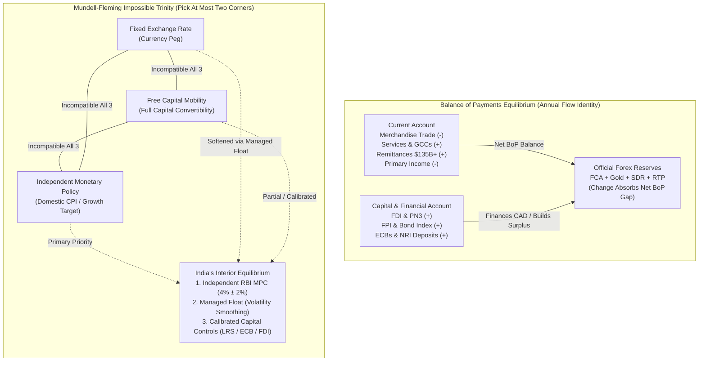

# Chapter 8 - External Sector, Balance of Payments, Currency Trilemma & India's 2025–2026 FTA Wave

The external sector is the membrane connecting a domestic macroeconomy to global trade, capital flows, and geopolitical shocks. For India, 2025–2026 has rewritten both halves of this external equation: on the financial side, a resilient **$185B–$200B+ services surplus**, world-leading **$135 billion+ diaspora remittances**, and **$680B–$725B+ forex reserves** kept the Current Account Deficit remarkably contained despite volatile global yields; on the commercial side, facing WTO paralysis, EU carbon border tariffs (**CBAM**), and US tariff shocks, India unleashed its most consequential bilateral **FTA wave** in history—operationalizing **four** major pacts across 2025–2026 (**EFTA TEPA [Oct 1, 2025]**, **India–Oman CEPA [June 1, 2026]**, **India–UK CETA [July 15, 2026]**, and **India–New Zealand FTA [Oct 20, 2026]**), alongside concluding the landmark **India–EU FTA (Jan 2026; signing scheduled Dec 2026)** and the **India–US Interim Framework (Feb 2026)**.

---

## Balance of Payments, Twin Deficits & Foreign Exchange Reserves

### Double-Entry BoP Accounting - Current Account vs. Capital/Financial Account

The **Balance of Payments (BoP)** is a systematic double-entry accounting record of all economic transactions between **residents** of a country and the **rest of the world** during a specified period. Maintain strict **stock vs. flow** precision: BoP is a **flow statement** (like a quarterly or annual cash-flow sheet), whereas **Foreign Exchange Reserves** and the **International Investment Position (IIP)** are **stock snapshots** measured on a specific date. Every foreign-exchange inflow is booked as a **credit (+)** and every outflow as a **debit (−)**, obeying the fundamental accounting identity:

$$\text{Current Account} + \text{Capital \& Financial Account} + \text{Errors \& Omissions} + \Delta \text{Official Reserves} = 0$$

Under the **IMF BPM6 (Balance of Payments Manual, 6th Edition)** framework adopted by RBI, cross-border flows divide into two primary ledgers (with RBI's headline presentation grouping the narrow BPM6 Capital Account—debt forgiveness and non-produced IP transfers—and the Financial Account jointly under "Capital Account"):

1. **Current Account (Non-Reversible Real Flows):** Captures transactions that leave no future cross-border repayment claim or asset ownership change:
   - **Merchandise Trade (Visibles):** Export minus import of physical goods. India runs a chronic structural merchandise trade deficit (~$280B–$330B annually) anchored in inelastic imports of crude petroleum, gold, coking coal, electronic components, and capital machinery.
   - **Services Trade & Global Capability Centres (GCCs):** India's decisive macroeconomic shock absorber. Driven by IT/ITeS, engineering R&D, consulting, financial services, and **1,700+ multinational GCCs**, India generates a massive net **services trade surplus (~$185B–$200B+ in FY25–26)** that offsets well over half of the merchandise deficit.
   - **Secondary Income (Private Remittances — $125B–$135B+):** Unrequited personal transfers sent home by the Indian diaspora without a quid pro quo. India remains the **world's #1 remittance recipient** by a wide margin, surging to **$135.46 billion in FY 2024–25** (RBI BoP / 6th Remittance Survey, 2025). Structurally, remittances have pivoted up the skill ladder: **advanced economies now lead**—with the **United States (~27.7%)**, UK (~10.8%), and Singapore (~6.6%) collectively overtaking traditional Gulf corridors led by the **UAE (~19.2%)** and Saudi Arabia (~6.7%).
   - **Primary Income (Net Investment Income):** Always a **net outflow** for India, recording dividends, branch profits, reinvested earnings, and interest paid to foreign FDI, FPI, and ECB investors minus interest earned on RBI's forex reserves and Indian outbound FDI.

2. **Capital & Financial Account (Asset–Liability Ownership Claims):** Records transactions that create or extinguish cross-border financial assets and liabilities—financing the Current Account Deficit (or absorbing a surplus):
   - **Foreign Direct Investment (FDI) & Press Note 3 (2020) / Press Note 2 (2026):** Long-term, **non-debt-creating**, sticky equity investment involving **≥10% voting equity** or lasting management control (distinguished from portfolio flows per the Mayaram Committee). In April 2020, **Press Note 3 (PN3)** amended FDI policy to mandate prior **Government-route approval** for investments by any entity or beneficial owner situated in a country sharing a **land border with India** (China, Pakistan, Bangladesh, Nepal, Bhutan, Myanmar, Afghanistan), curbing opportunistic pandemic takeovers. Calibrating industrial supply-chain needs, DPIIT issued **Press Note No. 2 (2026 Series) on March 15, 2026**—operationalized via the **FEMA (Non-Debt Instruments) Amendment Rules effective May 1, 2026**—which anchors the definition of **"beneficial owner"** to **Section 2(1)(fa) of the PMLA, 2002** (applied at the investing-entity level), restores the **Automatic Route for non-controlling stakes up to 10% aggregate beneficial ownership** from land-border neighbours (while retaining prior scrutiny above 10% and across sensitive/strategic sectors), and establishes a **60-day fast-track Government approval window** for majority-Indian JVs/investments in specified critical manufacturing sectors (**capital goods, electronic capital goods, electronic components, polysilicon, and ingot-wafer manufacturing**, alongside advanced battery components and rare-earth permanent magnets/processing under DPIIT's May 4, 2026 SOP).
   - **Foreign Portfolio Investment (FPI):** Liquid, short-horizon equity or debt investments (**<10% stake** without managerial control), colloquially termed *"hot money"* due to rapid reversal risk during US Federal Reserve tightening or global geopolitical shocks—though partially stabilized since 2024–26 by passive global EM sovereign bond-index inflows.
   - **External Commercial Borrowings (ECBs):** Commercial foreign loans raised by Indian corporates and infrastructure entities from overseas banks, export credit agencies, or bond markets. Unlike FDI, ECBs are **debt-creating** and expose unhedged borrowers to severe **currency mismatch risk** whenever the rupee depreciates (raising rupee debt-servicing costs). In **February 2026**, RBI overhauled its ECB Master Directions—raising the unified automatic borrowing ceiling to **$1 billion or 300% of Net Worth** (whichever is higher, replacing the legacy $750 million cap), standardizing the **Minimum Average Maturity Period (MAMP) at 3 years** (1–3 years for manufacturing up to $150M), and abolishing rigid all-in-cost spread ceilings in favour of arm's-length market pricing.
   - **NRI Deposits (`NRE` vs. `NRO` vs. `FCNR-B`):** Banking capital inflows carrying distinct currency, tax, and repatriation boundaries:
     - **NRE (*Non-Resident External*):** Rupee-denominated savings/term accounts funded strictly by *foreign* earnings; **freely repatriable** (principal + interest); interest is **tax-free** in India; exchange-rate risk rests on the **depositor**.
     - **NRO (*Non-Resident Ordinary*):** Rupee-denominated accounts holding *Indian-sourced* income (rent, dividends, pensions); interest is **taxable** (subject to TDS); repatriation is capped at **$1 million per financial year** after tax clearance.
     - **FCNR(B) (*Foreign Currency Non-Resident — Bank*):** Term deposits (1–5 years) maintained in **freely convertible foreign currencies** (USD, EUR, GBP, JPY, AUD, CAD); freely repatriable and **tax-free**; Crucially, **exchange-rate risk rests on the Indian bank** (not the depositor), which must hedge or swap the liability.

### Current Account Deficit (CAD) & the Twin Deficits Hypothesis

From fundamental national-income accounting ($Y = C + I + G + X - M = C + S + T$), rearranging yields the **Twin Deficits Identity**:

$$(S - I) + (T - G) = (X - M) \equiv \text{Current Account Balance}$$

When the government runs a large **Fiscal Deficit** ($T - G < 0$) and private domestic savings fail to exceed private investment ($S - I$) sufficiently to finance it, total domestic absorption ($C + I + G$) exceeds domestic output ($Y$). That excess demand spills directly into imports, widening the **Current Account Deficit (CAD)**—the **Twin Deficits Hypothesis**. During 2012–13 ("Fragile Five" episode), India's twin deficits (Fiscal Deficit ~4.9%, CAD ~4.8%) triggered capital flight and rupee collapse. Conversely, during **FY 2024–26**, India held its CAD remarkably benign (**~0.6%–1.3% of GDP**) because steady fiscal consolidation paired with the booming Services + Remittances surplus insulated the Current Account from elevated oil and gold imports.

### Foreign Exchange Reserves - Four IMF/RBI Components

India's Foreign Exchange Reserves (hovering between **$680 billion and ~$725 billion+** across 2026, providing ~11+ months of merchandise import cover) are held by RBI as a macroeconomic crisis buffer across **exactly four official components**:

1. **Foreign Currency Assets (FCA — ~80%+ share):** Multi-currency liquid sovereign securities (US Treasuries, Eurozone/Japanese/UK bonds) and central-bank deposits, reported in US dollar equivalents. Consequently, FCA fluctuates not merely from RBI dollar buying/selling, but also from **cross-currency valuation effects** whenever the Euro, Yen, or Pound moves against the US Dollar.
2. **Gold Reserves (~14%–17% share by 2026):** Physical gold bullion (>880+ metric tonnes, increasingly repatriated into domestic RBI vaults from London) serving as a geopolitical and dollar-debasement hedge; its rising share reflects both sustained RBI accumulation and soaring global bullion prices.
3. **Special Drawing Rights (SDRs):** An international reserve asset allocated by the **IMF** to member nations in proportion to quotas. SDR is **not a currency** and cannot be used to buy goods directly; it is a **potential claim on the freely usable currencies** of IMF members, valued daily against a **five-currency basket**: **US Dollar, Euro, Chinese Renminbi (CNY), Japanese Yen, and British Pound**.
4. **Reserve Tranche Position (RTP) with the IMF:** The liquid reserve slice of India's IMF quota (quota minus IMF's holdings of INR), drawable **unconditionally on demand without IMF policy conditionalities** during liquidity needs.

---

## Exchange Rate Mechanics, Currency Trilemma & Convertibility Architecture

### NEER vs. REER, Depreciation vs. Devaluation & the J-Curve

An exchange rate is the relative price of two currencies. Distinguish immediately between **market-driven shifts** under floating/managed-float regimes (**Depreciation** = INR weakens, e.g., ₹84 → ₹88/$; **Appreciation** = INR strengthens) and **official administrative resets** under fixed/pegged regimes (**Devaluation** = deliberate sovereign lowering of peg, e.g., June 1966 & July 1991; **Revaluation** = official raising of peg).

Because bilateral INR/USD rates hide movements against the Euro, Yuan, and Yen, RBI monitors multilateral trade-weighted indices (**6-currency** and **40-currency** baskets, base `2015–16 = 100`):
- **NEER (*Nominal Effective Exchange Rate*):** Trade-weighted geometric average of nominal bilateral INR exchange rates. A **rise in NEER** indicates **nominal appreciation** of the rupee against trading partners.
- **REER (*Real Effective Exchange Rate*):** Adjusts NEER for relative inflation differentials between India and its trading partners:

$$\text{REER} = \text{NEER} \times \frac{P_{\text{domestic}}}{P_{\text{foreign}}}$$

- **The Competitiveness Trap:** A **rise in REER above 100** signals **real appreciation / overvaluation**—meaning Indian exports grow more expensive in real terms, causing a **loss (NOT improvement) in trade competitiveness** while making imports artificially cheaper. Critically, even if the nominal INR/USD rate stays completely frozen (`NEER` flat), persistently **higher domestic inflation ($P_{\text{domestic}} > P_{\text{foreign}}$)** drives **REER upward**, silently eroding export competitiveness and widening the NEER–REER divergence.

**Does Rupee Depreciation Automatically Shrink the Trade Deficit?** Not necessarily—two dynamic conditions govern the outcome:
1. **Marshall–Lerner Condition:** Currency depreciation improves the Trade Balance **only if the sum of the absolute price elasticities of export demand and import demand exceeds unity**: **$|\varepsilon_X| + |\varepsilon_M| > 1$**. In India, because crude oil, fertilizers, defence hardware, and semiconductor components exhibit **highly inelastic import demand ($|\varepsilon_M| \ll 1$)**, rupee depreciation immediately inflates the rupee oil bill while offering slower volume relief unless manufactured exports are price-elastic and supply-unconstrained.
2. **The J-Curve Effect:** Even when Marshall–Lerner holds in the medium run, currency depreciation **initially worsens the trade balance** in the short run (1–2 quarters). Existing import/export contracts are locked in fixed physical volumes, so the immediate **price effect** (imports suddenly cost more in domestic currency) dominates; only after 3–6 quarters do buyers switch suppliers so the **volume effect** (rising export volumes, falling import volumes) lifts the trade balance into surplus, tracing the letter **"J"**.

### BoP Accounting & the Mundell–Fleming Impossible Trinity (Mermaid)

### Managed Float, Sterilized Intervention & the Impossible Trinity

Under the **Mundell–Fleming Impossible Trinity (Trilemma)**, no sovereign can simultaneously maintain **(i) a Fixed Exchange Rate**, **(ii) Complete Free Capital Mobility**, and **(iii) an Independent Monetary Policy**. If capital moves freely and the rupee is rigidly pegged to the US Dollar, RBI must mirror every US Federal Reserve interest-rate hike instantly—surrendering domestic inflation and growth management.

India deliberately occupies an **interior equilibrium**: prioritizing **Independent Monetary Policy** (RBI MPC targeting 4% ± 2% headline CPI), operating a **Managed Float ("Dirty Float")** without defending any pre-announced exchange-rate level, and retaining **calibrated capital controls**. When foreign inflows surge and threaten sharp rupee appreciation, RBI buys dollars in spot/forward FX markets—which injects domestic rupees into banking liquidity ($M_0 \uparrow$). To prevent those newly created rupees from sparking domestic inflation, RBI conducts **sterilized FX intervention**, simultaneously absorbing the excess rupees through Open Market Operation (OMO) bond sales, VRRR auctions, or Market Stabilisation Scheme (MSS) bills. Conversely, during rapid rupee depreciation (such as US yield spikes or oil shocks), RBI sells dollars (draining domestic rupee liquidity) purely to smooth disorderly volatility.

### Convertibility, FEMA 1999, 2026 NDI Rules & SRVA Rupee Internationalization

- **Current Account vs. Capital Account Convertibility (Tarapore I & II):** Currency convertibility denotes the legal freedom to convert domestic rupees into foreign currencies at market rates. India achieved **full Current Account Convertibility in August 1994** by accepting **IMF Article VIII** obligations (permitting free FX conversion for trade, travel, education, and remittances). On the Capital Account, India maintains **partial/calibrated convertibility**—substantially open for non-residents (FDI, FPI, FAR G-Secs) while bounded for residents. Both **S.S. Tarapore Committees**—**Tarapore I (1997)** and **Tarapore II (2006)**—cautioned against hasty full Capital Account Convertibility (vindicated by the 1997 Asian Financial Crisis), prescribing strict **macroeconomic signposts** first: fiscal deficit ≤3%–3.5% of GDP, low inflation (3%–5%), commercial bank Gross NPAs <5%, lower CRR, and robust forex reserve cover.
- **FEMA, 1999 & the 2026 NDI Rules Review (PROI Equity Access):** Effective June 1, 2000, the ***Foreign Exchange Management Act (FEMA), 1999*** replaced the draconian *FERA, 1973*, recasting foreign-exchange offences from criminal imprisonment into civil compounding and penalties while shifting policy from scarce-dollar *conservation* to orderly *facilitation*. Under FEMA's *Non-Debt Instruments (NDI) Rules, 2019*, **Union Budget 2026–27** initiated a comprehensive statutory modernization alongside a major equity liberalization: **Persons Resident Outside India (PROIs)** can now invest directly in listed Indian equities via the **Portfolio Investment Scheme (PIS)**, with the **individual PROI limit doubled from 5% to 10%** of a company's paid-up equity and the **aggregate PROI investment cap raised from 10% to 24%**—widening direct global diaspora and non-resident capital access.
- **Liberalised Remittance Scheme (LRS):** Launched in 2004 under FEMA, LRS permits **resident individuals** (including minors, **excluding corporates, HUFs, partnership firms, and trusts**) to freely remit up to **$250,000 per financial year** for permissible current and capital account transactions (overseas education, medical treatment, travel, gifts, overseas equity/real estate—barring speculative margin trading, lotteries, or FATF non-cooperative jurisdictions). Union Budget 2026–27 lowered LRS TCS on overseas education and medical remittances from 5% to 2%.
- **SRVA & Rupee Internationalization:** Initiated by RBI in **July 2022** to insulate Indian trade from dollar sanctions, SWIFT bottlenecks, and dollar hedging spreads, the **Special Rupee Vostro Account (SRVA)** mechanism allows foreign correspondent banks to open INR accounts with Indian Authorised Dealer (AD) banks to invoice and settle merchandise and services directly in rupees (expanding past 120+ accounts across ~25–30 partner nations including Russia, UAE, Singapore, Mauritius, Malaysia, and Sri Lanka). Initial uptake stalled on bilateral trade imbalances (partners like Russia accumulated trapped surplus rupees). Across **2025–2026**, RBI broke this logjam by **(i)** scrapping prior RBI approval for AD banks to open SRVAs, **(ii)** expanding permitted investments for surplus SRVA balances beyond G-Secs/T-Bills into **corporate Non-Convertible Debentures (NCDs) and Commercial Papers**, and **(iii)** scaling bilateral Local Currency Settlement (LCS) agreements (UAE, Indonesia, Maldives, Mauritius) alongside cross-border UPI linkages.

---

## Foreign Trade Policy 2023, the 2025–2026 FTA Wave, CBAM & CAROTAR

### Foreign Trade Policy (FTP) 2023 & Budget 2026–27 Export Facilitation

Effective **April 1, 2023** and administered by the **Directorate General of Foreign Trade (DGFT)** (*Ministry of Commerce & Industry*), **FTP 2023** abandoned India's traditional rigid five-year expiry model in favour of a **dynamic, open-ended policy** updated continuously to target **$2 trillion in combined merchandise and services exports by 2030**. Its operational engine rests on six core instruments:

- **RoDTEP (*Remission of Duties and Taxes on Exported Products*):** Launched January 2021 to replace the WTO-challenged MEIS export subsidy. Fully **WTO-compliant** because it does not grant a net subsidy—instead, it refunds **embedded, unrebated central, state, and local taxes** (electricity duty, mandi tax, stamp duty, VAT/excise on fuel used in freight/power) that sit outside GST ITC and Duty Drawback, issued as transferable electronic duty-credit scrips (extended across 2026–27 including AA, EOU, and SEZ exporters).
- **Advance Authorisation (AA) Scheme:** Permits duty-free import of physical raw materials/inputs strictly incorporated into exported goods under an **actual-user** obligation, subject to minimum value addition (generally 15%) and stipulated export discharge.
- **EPCG (*Export Promotion Capital Goods*) Scheme:** Allows zero-customs-duty import of capital machinery for pre-production, production, and post-production, requiring the exporter to achieve an export obligation of **6 times the duty saved within 6 years** (FTP 2023 exempted green-tech products and dairy from maintaining past average export levels).
- **Districts as Export Hubs (DEH):** Decentralizes export infrastructure beyond coastal metros by pairing DGFT with State/District Export Promotion Committees to build District Export Action Plans around GI-tagged crafts and **ODOP (*One District One Product*)** clusters.
- **SCOMET (*Special Chemicals, Organisms, Materials, Equipment and Technologies*):** India's dual-use strategic export-control regime harmonized with multilateral non-proliferation blocs (**Wassenaar Arrangement, Australia Group, MTCR**), streamlined under FTP 2023 via general authorizations to speed aerospace, defence, drone, and semiconductor component exports.
- **E-Commerce Export Hubs (ECEHs) & Budget 2026–27 Courier Cap Removal:** FTP 2023 established dedicated **E-Commerce Export Hubs** (bonded warehousing, streamlined customs clearance, and simplified returns) to scale cross-border e-commerce exports toward $200B–$300B by 2030. **Union Budget 2026–27** delivered a landmark MSME and artisan unlock by **completely abolishing the ₹10 lakh per-consignment value cap on courier exports** (previously doubled from ₹5 lakh to ₹10 lakh under FTP 2023), paired with technology-enabled handling of rejected/returned overseas parcels.

### Multilateral Paralysis & the Strategic Logic of the 2025–2026 FTA Wave

Historically, India leaned on the **World Trade Organization (WTO)** to protect multilateral non-discrimination (MFN) and developing-country Special and Differential Treatment. However, the freeze of the WTO Appellate Body since 2019, recurring stalemates over public stockholding for food security and fisheries subsidies across **MC13 (Abu Dhabi, 2024)** and **MC14 (Yaoundé, March 2026)**, and the surge of unilateral industrial subsidies and carbon border tariffs have hollowed out multilateral trade enforcement. For the detailed agricultural subsidy rules, Amber/Green Box disputes, and MC13–MC14 negotiation architecture, cross-refer directly to [[10. WTO Agreement on Agriculture & MC13-MC14 Deadlocks#WTO MC13 and MC14 Yaounde Deadlocks|WTO MC14 Yaounde Deadlocks]].

Faced with a fragmented global trading order—and seeking to avoid repeating the asymmetric trade deficits triggered by legacy ASEAN/Japan/Korea FTAs while declining China-dominated RCEP (2019)—India pivoted decisively toward **balanced, high-standard bilateral and plurilateral FTAs** with complementary, capital-rich economies. The macroeconomic strategy rests on four pillars: **(i)** securing **zero-duty access for labour-intensive Indian exports** (textiles, apparel, leather, gems, marine, engineering) to capture **China+1** relocation, **(ii)** binding **foreign capital and technology inflows** (as in EFTA's $100B FDI pledge), **(iii)** unlocking **Mode 4 services mobility** and social-security exemptions for Indian professionals, and **(iv)** maintaining **red-line exclusions on sensitive dairy and staple farm sectors** to protect rural livelihoods.

### Master Comparison Matrix - India's 2025–2026 FTA Wave

| Agreement & Partners | Status & Timeline *(Verified Nov 2026)* | Tariff & Goods Market Access | Capital, Services & Mobility Clauses | Strategic Macro Stakes & Sensitivities |
| :--- | :--- | :--- | :--- | :--- |
| **1. India–EFTA TEPA** *(Switzerland, Norway, Iceland, Liechtenstein)* | Signed Mar 10, 2024; **In Force Oct 1, 2025** | EFTA cuts tariffs on ~99.6% of Indian exports; India phases down duties (7–10 yrs) on Swiss watches, pharma, machinery, chocolates; **excludes dairy, soya, coal, effective gold duty** | World's **first FTA with binding investment/job pledge**: **$100B FDI over 15 yrs** ($50B in 10 yrs + $50B in 5 yrs) + **1 million direct jobs**, backed by **tariff snap-back/rebalancing clause** | Anchors European precision-tech capital; sets a legally enforceable FDI template for future trade pacts |
| **2. India–Oman CEPA** | Signed Dec 18, 2025 *(Muscat)*; **In Force June 1, 2026** | Oman grants **zero duty on 98.08% of tariff lines** (~99.38% of Indian exports); India offers phased/TRQ cuts on ~77.79% of lines (petrochemicals, urea, aluminium); **protects dairy, tea, coffee, gold** | Landmark **100% Indian FDI in Omani services**; raises intra-corporate transferee (ICT) quota from 20% to **50%** with 4-year stays | India's 2nd Gulf CEPA (after UAE); strategic transshipment gateway to West Asia & East Africa; secures fertilizer/energy inputs |
| **3. India–New Zealand FTA** | Concluded Dec 22, 2025; **Signed Apr 27, 2026** *(New Delhi)*; **In Force Oct 20, 2026** | **100% zero-duty access** for Indian exports into NZ; calibrated/TRQ access into India for apples, kiwifruit, manuka honey, wine; **strict total exclusion of Indian dairy** | **$20B NZ investment commitment over 15 yrs**; **5,000 skilled temporary employment visas** + extended STEM/PhD post-study work rights | Proves India can strike deep Oceania trade deals without conceding domestic dairy sovereignty |
| **4. India–EU FTA** *(27-Nation EU Bloc)* | **Negotiations Concluded Jan 27, 2026** *(formal **signing scheduled Dec 2026** in Brussels; ratification 2027)* | Cuts/eliminates tariffs on **>96%–99% of traded value** over transition phases: zero-duty EU entry for Indian textiles, apparel, leather, gems, chemicals; phased **TRQs for EU luxury autos** (gradually toward 10%), wines & spirits; **shields Indian dairy, cereals, poultry** | Deep IT/digital/professional services mobility + structured technical mechanism on **EU CBAM equivalence** & carbon-market coordination (CCTS) | Spans ~25% of global GDP (~2B consumers); vital export hedge against US tariff volatility and Chinese competition |
| **5. India–US Interim Trade Framework** *(toward BTA / Mission 500)* | **Joint Framework Announced Feb 6–7, 2026** *(under recalibration post-Feb 20, 2026 US SC tariff ruling)* | Lowered US baseline reciprocal tariff on India from 2025 peaks (up to 50%) to **18%** with **0% exemptions** (generic pharma, diamonds/gems, aircraft parts); India eases tariffs on US industrial goods, tree nuts, DDGS, sorghum, soybean oil, wine | Indicatively anchors ~$500B Indian purchases of US energy, aircraft, GPUs/tech & coking coal over 5 yrs; digital trade & supply-chain alignment | De-escalated acute 2025 trade shock; **live caveat:** Feb 20, 2026 US Supreme Court (*Learning Resources*) struck down IEEPA tariffs, keeping final BTA legal text under active renegotiation |
| **6. India–UK CETA** | Signed July 24, 2025 *(DCC signed Feb 10, 2026)*; **In Force July 15, 2026** | **Duty-free access on ~99% of Indian export lines** (apparel, textiles, footwear, leather, marine, gems, pharma); India cuts Scotch whisky (`150% → 75% → 40%` by Yr 10), EVs/luxury cars (TRQ), medical devices; **excludes dairy, apples, edible oils**; introduces **Origin Self-Certification** *(authenticated via CBIC ICEGATE **URN**)* | **Double Contribution Convention (Social Security Agreement)** exempting seconded Indian professionals **(up to 5 years / 60 months)** from dual UK National Insurance; financial services & central procurement access | Eliminates Indian exporters' tariff handicap vs. Bangladesh/Vietnam in UK apparel; slashes IT firms' payroll costs |

### Defensive Trade Guardrails - EU CBAM & CAROTAR, 2020

- **EU Carbon Border Adjustment Mechanism (CBAM):** After a transitional emissions-reporting phase (October 2023 – December 2025), **EU CBAM entered its definitive financial regime on January 1, 2026** (requiring EU importers to purchase and surrender CBAM certificates—priced dynamically to **EU-ETS** carbon allowances, with first financial surrender in 2027 covering 2026 embedded emissions). CBAM targets **six carbon-intensive sectors**: **Iron & Steel, Aluminium, Cement, Fertilizers, Electricity, and Hydrogen**. Because ~20%–27% of Indian steel and aluminium exports ship to Europe and rely heavily on coal-fired blast furnaces, CBAM imposes an effective carbon tariff equivalent to **~20%–35%**, eroding traditional tariff concessions and colliding with the UNFCCC **CBDR-RC** principle. India's three-track response deploys **(i)** its domestic **Carbon Credit Trading Scheme (CCTS)** (keeping carbon-price revenues inside India as deductible domestic carbon payments rather than forfeiting them to Brussels), **(ii)** green-steel and green-hydrogen PLI decarbonization, and **(iii)** carbon-verification equivalence mechanisms negotiated under the January 2026 India–EU FTA.
- **CAROTAR, 2020 (*Customs Administration of Rules of Origin under Trade Agreements Rules, 2020*):** Issued under **Section 28DA of the Customs Act, 1962** to halt **FTA circumvention and third-country dumping**—where non-FTA exporters (notably China) routed finished goods through ASEAN ports using thin local packaging and lax Certificates of Origin to claim zero-duty ASEAN–India FTA access. CAROTAR flips enforcement rigor by placing mandatory **statutory due diligence on the Indian importer** to verify substantive **Rules of Origin (RoO)** criteria—specifically **Change in Tariff Heading (CTH)** and **Regional Value Content (RVC)** (typically ≥35% genuine originating value addition)—empowering Indian Customs to suspend preferential duties, demand bank guarantees, and disallow tariff preferences upon verification default.

---

> [!warning] Prelims Traps & Atomic Distinctions
> - **NEER vs. REER Competitiveness Inversion:** A **rise in NEER** means nominal rupee appreciation. A **rise in REER** means **real rupee overvaluation**, which **reduces (NOT improves) export trade competitiveness**! Moreover, if domestic inflation outpaces foreign inflation while nominal exchange rates remain steady, **REER rises and diverges upward from NEER**.
> - **Devaluation & ECB Currency Risk:** Rupee devaluation or depreciation **increases (NOT decreases)** the rupee repayment burden and currency risk on unhedged foreign-currency External Commercial Borrowings (ECBs)—and improves the trade balance **only if** the **Marshall–Lerner condition ($|\varepsilon_X| + |\varepsilon_M| > 1$)** holds (and only *after* an initial short-run **J-Curve** deterioration).
> - **Forex Reserves Exact Quartet & SDR Myth:** RBI Forex Reserves comprise exactly **FCA, Gold, SDRs, and RTP with the IMF**. An **SDR is NOT a currency** (it is an IMF reserve claim valued against a 5-currency basket that includes the **Chinese Renminbi**), and **Reserve Tranche Position (RTP)** is drawable unconditionally without IMF conditionalities.
> - **NRI Account Risk & Tax Boundaries:** In **FCNR(B)** deposits, **exchange-rate risk is borne by the Indian bank** (foreign-currency denominated, tax-free, freely repatriable). In **NRE** accounts, exchange-rate risk rests on the **depositor** (rupee-denominated, tax-free, freely repatriable). In **NRO** accounts (Indian-sourced income), interest is **taxable** and repatriation is capped at **$1 million/FY**.
> - **LRS & PROI Eligibility Traps:** RBI's **$250,000/FY Liberalised Remittance Scheme (LRS)** is strictly for **resident individuals** (NOT corporates, HUFs, partnership firms, or trusts). Under **Budget 2026–27's NDI Rules review**, **PROIs** (Persons Resident Outside India) gained expanded direct PIS equity limits: **individual cap `5% → 10%`**, **aggregate cap `10% → 24%`**.
> - **Press Note 3 (2020) vs. Press Note 2 (March 2026) Calibration:** Press Note 3 applies to countries sharing a **land border** with India (not strictly China alone!). Under **DPIIT Press Note No. 2 (2026 Series)** (March 15, 2026; FEMA NDI Amendment Rules effective **May 1, 2026**), "beneficial owner" is anchored to **PMLA Section 2(1)(fa)** (investing-entity level), non-controlling stakes up to **10% aggregate beneficial ownership** from land-border neighbours qualify for the **Automatic Route**, and a **60-day fast-track Government approval window** applies to priority manufacturing JVs (*capital goods, electronic components, polysilicon, ingot-wafers, advanced battery components, and rare-earth permanent magnets*).
> - **Remittances & BoP Direction:** India's remittances (~$135B+ in FY25) sit in the **Current Account (Secondary Income)**—*never* the Capital Account! And by 2025, **advanced economies (led by the US at ~27.7%)** surpassed Gulf countries as India's top remittance source.
> - **FTP 2023 & Budget 2026–27 Export Rules:** FTP 2023 has **no fixed 5-year sunset**; **RoDTEP** refunds unrebated embedded domestic taxes (making it WTO-compliant, unlike MEIS); and **Budget 2026–27 completely removed the ₹10 lakh value cap on courier exports**.
> - **2025–2026 FTA Status & Clause Precision (Verified Nov 2026):** **Four** pacts from the 2025–2026 wave are now **IN FORCE**—**EFTA TEPA (Oct 1, 2025)**, **India–Oman CEPA (June 1, 2026)**, **India–UK CETA (July 15, 2026)**, and **India–New Zealand FTA (Oct 20, 2026; signed Apr 27, 2026)**—while the **India–EU FTA (concluded Jan 27, 2026)** is scheduled for **formal signing in December 2026**, and the **India–US Interim Framework (Feb 2026)** remains under active recalibration post-Feb 20, 2026 US SC IEEPA tariff ruling. Under **India–UK CETA**, the finalized **DCC social-security exemption runs for 5 years (60 months)** (upgraded from earlier 3-year talks), and Rules of Origin use **exporter/producer Origin Self-Certification** authenticated via CBIC's **ICEGATE URN** rather than chamber-issued CoOs.
> - **EU CBAM Sectors & Trigger Date:** CBAM's **definitive levy phase began January 1, 2026** (not 2023, which was the transitional reporting start) covering exactly **6 sectors**: *Iron & Steel, Aluminium, Cement, Fertilizers, Electricity, and Hydrogen* (note: **textiles, pharmaceuticals, and refined petroleum are NOT in the initial CBAM 6**!).
> - **CAROTAR Burden of Proof:** Under **CAROTAR 2020** (Customs Act Sec 28DA), the legal burden to verify **Rules of Origin** sits on the **Indian importer**—not solely on the foreign exporting authority.

---

## UPSC Interrogation Lens

### Verified UPSC Mains PYQs (2014–2026) & Prelims Anchors

- **Mains 2025 (GS3, 10M):** *"What are the challenges before the Indian economy when the world is moving away from free trade and multilateralism to protectionism and bilateralism? How can these challenges be met?"*
- **Mains 2018 (GS3, 15M):** *"How would the recent phenomena of protectionism and currency manipulations in world trade affect macroeconomic stability of India?"*
- **Mains 2017 (GS3, 10M):** *"Account for the failure of manufacturing sector in achieving the goal of labour-intensive exports rather than capital-intensive exports. Suggest measures for more labour-intensive rather than capital-intensive exports."*
- **Mains 2016 (GS3, 12.5M):** *"Justify the need for FDI for the development of the Indian economy. Why is there gap between MOUs signed and actual FDIs? Suggest remedial steps to be taken for increasing actual FDIs in India."*
- **Verified Prelims Anchors (2014–2026):**
  - **Prelims 2026:** **Hilton-Young Commission (1926) Rupee–Sterling Exchange Rate** (rationale behind the British Government adopting an artificially high `1s 6d` ratio—aiding the flow of remittances/"Home Charges" from India and maintaining India's creditworthiness).
  - **Prelims 2022 (Q1):** **NEER vs. REER** (rising NEER = INR appreciation; rising REER = *loss* of trade competitiveness; higher relative domestic inflation widens NEER–REER divergence).
  - **Prelims 2022 (Q2):** **RBI FX & Global Rate Transmission** (RBI sells dollars during rapid INR depreciation; buys dollars if US/EU rates fall; sells G-Secs during high inflation).
  - **Prelims 2022 (Q3):** **Devaluation & ECB Risk** (domestic currency devaluation *increases* currency risk on ECBs).
  - **Prelims 2021:** **Effects of Currency Devaluation** (boosts export competitiveness while lowering foreign currency value of domestic money; does not automatically guarantee trade-balance improvement).
  - **Prelims 2020 (2 Qs):** **Reserve Tranche Position** (IMF member credit system) and **FDI** (predominantly non-debt-creating capital flow).

### Prelims Trap Signature

- **Current vs. Capital Account Misclassification:** Placing **Remittances** or **Interest/Dividend payments (Primary Income)** in the Capital Account instead of the Current Account, or misclassifying **NRI Deposits** and **ECBs** as Current Account inflows.
- **REER & Devaluation Sign Flips:** Equating a higher REER with stronger export competitiveness, assuming devaluation reduces foreign-debt risk, or forgetting that RBI *sells* dollars to cushion rapid depreciation and *buys* dollars to stem sharp appreciation.
- **Trilemma & Convertibility Absolutism:** Claiming India maintains full Capital Account Convertibility, or claiming RBI defends a fixed INR/USD target band.
- **2025–2026 Trade & CBAM Precision Traps:** Mixing up *signed / concluded / in-force* statuses across EFTA, Oman, UK, NZ, EU, and US deals (four are now **in force** as of Nov 2026); citing the outdated 3-year UK social-security exemption instead of **5 years**; adding non-CBAM goods (like textiles or pharma) to EU CBAM's 6-sector list; or asserting that India conceded domestic dairy access under the NZ, UK, or EU FTAs.

### Cross-Hub AIR-1 Provocations

1. **GS3 Economy (External Sector) × GS2 IR (Geo-Economics):** *India's 2025–2026 FTA wave—combining EFTA's binding $100B FDI snap-back clause, UK 5-year social-security exemptions, and EU CBAM equivalence talks—redefines trade policy as an instrument of industrial strategy; can bilateralism and local-currency SRVA settlement genuinely insulate India from US tariff unpredictability and dollar weaponization without sacrificing multilateral trade rules?*
2. **GS3 Economy (Macro Trilemma) × Ecology (Climate Finance):** *With the EU CBAM definitive phase active from January 2026 taxing coal-intensive steel and aluminium imports while India scales global bond-index inflows and PROI equity integration, examine how India can align its domestic Carbon Credit Trading Scheme (CCTS) and managed-float monetary policy to prevent "green protectionism" from widening its structural merchandise trade deficit.*

<!-- OBSIDIAN-WEB-START -->
---
### 🕸️ Neural Graph Connections
← [[7. Capital Markets, Global Bond Inclusion, Shadow Banking (NBFCs), Insurance Act 2025 & Pensions|Ch 7]] | 🧭 [[Economy]] | [[9. Physical & Digital Infrastructure, PPP Financing, Logistics & the Power Sector Quagmire|Ch 9]] →
<!-- OBSIDIAN-WEB-END -->
