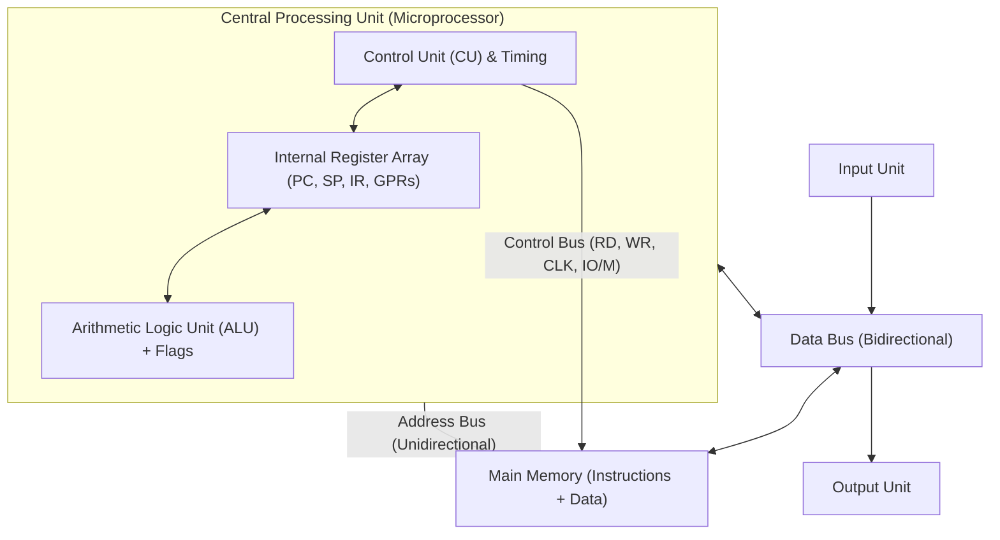
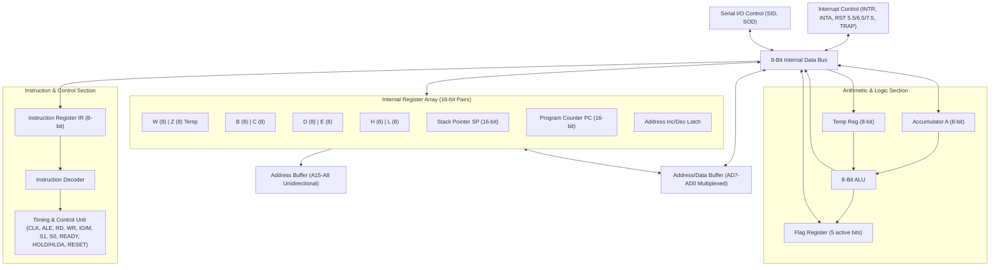

# Chapter 4: Fundamentals of Microprocessors (Intel 8085) & Digital Computers

## 1. Fundamentals of Digital Computers

### 1.1 Von Neumann vs. Harvard Architecture and System Buses

Early electronic calculators required physical rewiring of plugboards whenever a new task arose. John von Neumann's 1945 **stored-program architecture** eliminated fixed hardware programming by placing **both executable program instructions and numerical data inside the same read/write main memory**, fetched sequentially as binary words by a central processor.

A stored-program digital computer consists of **five core functional units** linked by three system buses:
1. **Input Unit:** Translates external physical/human data into binary words placed onto the system data bus (keyboards, ADCs, sensors).
2. **Memory Unit:** Stores binary instruction opcodes and operands at uniquely numbered addresses.
3. **Arithmetic Logic Unit (ALU):** Performs binary arithmetic (addition, subtraction, increment) and bitwise logic (AND, OR, XOR, shift, compare), updating status flags.
4. **Control Unit (CU):** Decodes fetched instruction opcodes and broadcasts synchronized timing and control pulses directing every data transfer across the machine. Together, **ALU + CU + Internal Registers = Central Processing Unit (CPU)**—which, when integrated onto a single monolithic silicon die, is a **Microprocessor ($\mu\text{P}$)**.
5. **Output Unit:** Converts processed binary words back into human-readable or actuator signals (displays, DACs, relays).



#### The Three System Buses

- **Address Bus (Unidirectional, CPU $\to$ Memory/I/O):** Carries the binary address selecting exactly one memory byte or I/O port. A $k$-bit address bus uniquely accesses **$2^k$ locations** (e.g., $k = 16 \implies 2^{16} = 65{,}536\text{ B} = 64\text{ KB}$).
- **Data Bus (Bidirectional, CPU $\leftrightarrow$ Memory/I/O):** Transports instruction opcodes and data words; its width defines the processor's native **word length** (8-bit in Intel 8085, 64-bit in modern CPUs).
- **Control Bus (Individual Timing & Status Lines):** Coordinates bus direction and synchronization (Memory/I/O Read $\overline{RD}$, Write $\overline{WR}$, Clock, Reset, Interrupts, DMA handshake).

#### Von Neumann vs. Harvard Architecture

| Architectural Attribute | Von Neumann (Princeton) Architecture | Harvard Architecture |
| :--- | :--- | :--- |
| **Memory Organization** | **Single unified memory** stores both instructions and data | **Physically separate** Program Memory and Data Memory |
| **Bus System** | Single shared Address Bus and single shared Data Bus | Two independent Address Buses and two independent Data Buses |
| **Simultaneous Access** | Impossible — suffers the **Von Neumann Bottleneck** (cannot fetch next instruction while reading/writing data) | **Simultaneous** instruction fetch and data read/write in one clock cycle |
| **Hardware Complexity & Cost** | Lower pin count, simpler memory allocation, flexible RAM split | Higher bus complexity, fixed code/data memory partition |
| **Primary Deployment** | General-purpose microprocessors (Intel 8085, x86 main RAM) | Digital Signal Processors (DSPs), real-time microcontrollers (AVR, PIC); modern CPUs use **Modified Harvard** (split L1 I-Cache / D-Cache over unified main RAM) |

---

### 1.2 Instruction Fetch-Decode-Execute Cycle and Timing Hierarchy

Every microprocessor executes programs through an unceasing three-phase **Instruction Cycle**:
1. **Fetch Phase:** The CPU places the 16-bit address held in the **Program Counter (`PC`)** onto the Address Bus and asserts Memory Read ($\overline{RD} = 0$). Memory places the opcode byte onto the Data Bus; the CPU latches it into the **Instruction Register (`IR`)** and increments `PC` to point to the next byte.
2. **Decode Phase:** The **Instruction Decoder** translates the binary opcode inside `IR` into a sequence of internal control micro-signals.
3. **Execute Phase:** The Timing & Control Unit coordinates operand fetches (if multi-byte), ALU computations, flag updates, and result write-backs to registers, memory, or I/O ports.

In the Intel 8085, execution timing nests across three strict levels:
- **T-State:** One period of the internal system clock ($T = 1/f_{\text{clk}}$; e.g., $f_{\text{clk}} = 3\text{ MHz} \implies T = 333.3\text{ ns}$).
- **Machine Cycle (MC):** One basic external bus transaction spanning **3 to 6 T-states** (Opcode Fetch = **4T** or 6T; Memory Read = **3T**; Memory Write = **3T**; I/O Read/Write = **3T**).
- **Instruction Cycle (IC):** Complete execution of one instruction, requiring **1 to 5 Machine Cycles** (4 to 18 T-states).

---

### 1.3 Semiconductor Memory Hierarchy - SRAM, DRAM, ROM, and Flash

Because fast transistor latches cost far more silicon area and power per bit than dense capacitive or floating-gate cells, digital computers arrange storage in a **Memory Hierarchy** trading speed against capacity and cost—exploiting temporal and spatial locality so average access time approaches that of the fastest tier:

$$\text{CPU Registers}\;(\sim 0.3\text{ ns}) \;\longrightarrow\; \text{L1/L2/L3 Cache (SRAM)}\;(\sim 1\text{–}10\text{ ns}) \;\longrightarrow\; \text{Main Memory (DRAM)}\;(\sim 50\text{ ns}) \;\longrightarrow\; \text{Secondary Storage (Flash SSD / Disk)}\;(\mu\text{s–ms})$$

#### Volatile RAM — Static RAM (SRAM) vs. Dynamic RAM (DRAM)

Both lose stored data when power is removed, yet their bit-cell physics differ fundamentally:

| Property | Static RAM (SRAM) | Dynamic RAM (DRAM) |
| :--- | :--- | :--- |
| **Bit-Cell Hardware** | **6-Transistor (6T)** CMOS cross-coupled bistable flip-flop latch | **1-Transistor + 1-Capacitor (1T–1C)** MOS switch charging a tiny capacitor ($\sim 30\text{ fF}$) |
| **Data Retention** | Holds state indefinitely as long as $V_{DD}$ is applied | Capacitor leaks charge through subthreshold/junction leakage within milliseconds |
| **Refresh Requirement** | **None** | **Mandatory periodic refresh** (every $\sim 64\text{ ms}$) plus rewrite after destructive reads |
| **Access Speed** | Ultra-fast ($\sim 1\text{–}5\text{ ns}$) | Slower ($\sim 30\text{–}60\text{ ns}$) due to capacitor charge sensing & row/column multiplexing |
| **Bit Density & Cost** | Low density, large die area, high cost per GB | **Ultra-high density** ($4\text{–}6\times$ denser), low cost per GB |
| **Primary Role** | **CPU L1/L2/L3 Cache** and microcontroller scratchpad | **Main System RAM** (DDR4/DDR5) |

#### Non-Volatile Semiconductor Memory (ROM Family)

Retains firmware and boot code permanently without power:
- **Mask ROM:** Bit pattern hardwired permanently during silicon mask lithography (zero field reprogrammability; cheapest in millions of units).
- **PROM (Programmable ROM):** Field-programmed **once** by selectively blowing microscopic nichrome/polysilicon fuses with high current pulses.
- **EPROM (Erasable PROM):** Stores charge on an insulated **floating-gate MOSFET** (raising $V_T$); erased **globally** by exposing the quartz-windowed die to strong ultraviolet (UV) light for $\sim 15\text{–}20\text{ min}$.
- **EEPROM (Electrically Erasable PROM):** Uses thin tunnel oxide for **Fowler–Nordheim quantum tunneling**, allowing electrical erasure and reprogramming **one byte at a time** in-circuit (slower, limited to $\sim 10^5\text{–}10^6$ write cycles).
- **Flash Memory (NOR & NAND Flash):** Dense floating-gate/charge-trap evolution of EEPROM that erases electrically in **large multi-kilobyte blocks/pages** rather than single bytes—powering BIOS/UEFI chips (NOR Flash, random-access) and high-capacity SSDs/USB drives (NAND Flash, block-access).

---

### 1.4 Input-Output Interfacing - Memory-Mapped vs. Peripheral-Mapped Schemes

A microprocessor communicates with external keyboards, ADCs, displays, and printers using either of two hardware address-decoding conventions:

| Feature | Memory-Mapped I/O | I/O-Mapped (Isolated / Peripheral-Mapped) I/O |
| :--- | :--- | :--- |
| **Address Width (in 8085)** | **16-bit** address (shares the $64\text{ KB}$ memory address space) | **8-bit** port address (separate **$256$ input + $256$ output** ports, `00H–FFH`) |
| **Control Signals Used** | $\overline{MEMR}, \overline{MEMW}$ ($IO/\overline{M} = 0$) | $\overline{IOR}, \overline{IOW}$ ($IO/\overline{M} = 1$) |
| **Permitted Instructions** | **Any memory instruction** (`LDA, STA, MOV r,M, ADD M, CMP M`) works directly on I/O ports! | Restricted strictly to **`IN port`** and **`OUT port`** (data moves **only via Accumulator `A`**) |
| **Available RAM/ROM Space** | Reduced by the addresses carved out for I/O ports | Full **$64\text{ KB}$** memory space remains 100% untouched |
| **Address Decoder Hardware** | Requires full 16-bit address decoding (more gates) | Requires simpler, cheaper 8-bit address decoding |

---

## 2. Intel 8085 Microprocessor Architecture

### 2.1 System Buses, AD0-AD7 Multiplexing, and Control-Status Signals

The **Intel 8085A** is an 8-bit NMOS microprocessor housed in a **40-pin Dual In-line Package (DIP)** running on a single $+5\text{ V}$ supply. An internal clock generator connects to an external quartz crystal across pins **$X_1, X_2$** and **divides the crystal frequency internally by 2** (e.g., a $6.0\text{ MHz}$ crystal drives the CPU internally at $f_{\text{clk}} = 3.0\text{ MHz}$, $T = 0.333\text{ }\mu\text{s}$).



#### Multiplexed Bus ($AD_0\text{–}AD_7$) and `ALE` Hardware Demultiplexing

A 16-bit address bus plus an 8-bit data bus normally demands $24$ pins. To squeeze all buses, power, clock, interrupts, and DMA signals into 40 pins, Intel kept the upper address byte permanently on dedicated unidirectional lines **$A_8\text{–}A_{15}$** ($8$ pins) and **time-multiplexed** the lower address byte ($A_0\text{–}A_7$) together with the bidirectional 8-bit data bus ($D_0\text{–}D_7$) onto **$AD_0\text{–}AD_7$**:
1. During **$T_1$** of every machine cycle, the 8085 outputs $A_0\text{–}A_7$ on $AD_0\text{–}AD_7$ and simultaneously drives **`ALE` (Address Latch Enable) HIGH**.
2. An external 8-bit transparent D-latch (e.g., **74LS373**) latches $A_0\text{–}A_7$ on the **falling edge of `ALE`**, holding the complete 16-bit address steady on external memory chips throughout $T_2, T_3, T_4$.
3. During **$T_2\text{–}T_3$**, `ALE` stays LOW and $AD_0\text{–}AD_7$ switches seamlessly to act as the bidirectional **Data Bus $D_0\text{–}D_7$**.

#### Control, Status, and Externally Initiated Signals

Three status outputs (**$IO/\overline{M}, S_1, S_0$**) paired with active-LOW read/write strobes (**$\overline{RD}, \overline{WR}$**) uniquely broadcast every bus transaction:

| Machine Cycle | $IO/\overline{M}$ | $S_1$ | $S_0$ | Active Control Strobe |
| :--- | :---: | :---: | :---: | :--- |
| **Opcode Fetch** | `0` (Memory) | `1` | `1` | $\overline{RD} = 0$ (4T or 6T) |
| **Memory Read** | `0` (Memory) | `1` | `0` | $\overline{RD} = 0$ (3T) |
| **Memory Write** | `0` (Memory) | `0` | `1` | $\overline{WR} = 0$ (3T) |
| **I/O Read** | `1` (I/O) | `1` | `0` | $\overline{RD} = 0$ (3T) |
| **I/O Write** | `1` (I/O) | `0` | `1` | $\overline{WR} = 0$ (3T) |
| **Interrupt Acknowledge** | `1` (I/O) | `1` | `1` | $\overline{INTA} = 0$ |
| **Halt (`HLT`)** | High-$Z$ | `0` | `0` | Address/Data buses tri-stated |

- **External Synchronization & DMA Pins:** **`READY`** (active-HIGH; pulling LOW inserts Wait states $T_W$ for slow memory); **`HOLD` / `HLDA`** (Direct Memory Access handshake: external DMA controller asserts `HOLD`, 8085 floats its buses and acknowledges via `HLDA`); **`RESET IN`** (active-LOW clears `PC = 0000H`, disables interrupts, and asserts **`RESET OUT`** to reset peripherals); **`SID` / `SOD`** (1-bit Serial Input/Output Data lines controlled via `RIM`/`SIM`).

---

### 2.2 Internal Registers - Accumulator, General Purpose, SP, and PC

The 8085 exposes **six 8-bit general-purpose registers**, one **8-bit Accumulator**, one **8-bit Flag Register**, and **two 16-bit pointer registers** to the assembly programmer (plus two hidden internal 8-bit scratchpads **`W, Z`** used exclusively by microcode during `CALL`, `LDA`, and `XCHG`):

1. **Accumulator (`A`, 8-bit):** Primary workhorse register wired directly to one ALU input. Almost every arithmetic, logical, rotate, and `IN`/`OUT` instruction automatically uses `A` as a source operand and writes the result back into `A`. Combined with the Flag register `F`, it forms the 16-bit **Program Status Word (`PSW`)**.
2. **General-Purpose Registers (`B, C, D, E, H, L`, six 8-bit registers):** Store temporary 8-bit operands and loop counters, or pair up cleanly as three **16-bit register pairs**: **`BC`**, **`DE`**, and **`HL`** (first letter holds the high byte). Pair **`HL`** serves as the CPU's default **Memory Pointer (`M`)**, where symbol `M` always denotes the byte stored at memory address `[HL]`.
3. **Program Counter (`PC`, 16-bit):** Holds the 16-bit address of the **next instruction byte to be fetched** from memory. Auto-increments by 1 after every fetched byte, resets to `0000H` upon `RESET IN`, and is overwritten non-sequentially by `JMP`, `CALL`, `RET`, `PCHL`, or hardware interrupts.
4. **Stack Pointer (`SP`, 16-bit):** Holds the 16-bit address of the **Top of Stack (TOS)** inside R/W RAM—a **LIFO (Last-In, First-Out)** memory buffer used to save return addresses during subroutines/interrupts and preserve registers (`PUSH`/`POP`). In the 8085, **the stack grows downward toward lower memory addresses**:
   - **`PUSH rp`** (pre-decrement): `SP ← SP - 1`, `[SP] ← high byte`, `SP ← SP - 1`, `[SP] ← low byte`.
   - **`POP rp`** (post-increment): `low byte ← [SP]`, `SP ← SP + 1`, `high byte ← [SP]`, `SP ← SP + 1`.
5. **Instruction Register (`IR`, 8-bit) & Instruction Decoder:** Temporarily latches each fetched 8-bit opcode (inaccessible to programmer) while the Decoder deciphers it for the Timing & Control Unit.

---

### 2.3 Exact Bit-Level Map of the 8-Bit Flag Register

Five independent flip-flops inside the 8-bit **Flag Register (`F`)** automatically record the outcome of ALU arithmetic and logical operations to steer conditional branching (`JZ`, `JC`, `JM`, `JPE`, etc.). Its exact bit layout is non-negotiable:

| Bit Position | **$D_7$** | **$D_6$** | $D_5$ | **$D_4$** | $D_3$ | **$D_2$** | $D_1$ | **$D_0$** |
| :--- | :---: | :---: | :---: | :---: | :---: | :---: | :---: | :---: |
| **Flag Symbol** | **`S`** | **`Z`** | $\times$ | **`AC`** | $\times$ | **`P`** | $\times$ | **`CY`** |
| **Full Name** | Sign | Zero | Unused | Auxiliary Carry | Unused | Parity | Unused | Carry |

- **`S` (Sign Flag, $D_7$):** Mirrors bit $D_7$ (MSB) of the 8-bit ALU result. `S = 1` indicates a negative number (in signed 2's complement); `S = 0` indicates positive/zero.
- **`Z` (Zero Flag, $D_6$):** Set to `1` if the entire 8-bit ALU result equals `00H`; cleared to `0` if non-zero.
- **`AC` (Auxiliary Carry Flag, $D_4$):** Set to `1` when a carry propagates out of bit $D_3$ into bit $D_4$ (lower nibble overflow). **Used internally ONLY by the `DAA` (Decimal Adjust Accumulator) instruction for BCD arithmetic**—the 8085 has *no* conditional jump instruction testing `AC`!
- **`P` (Parity Flag, $D_2$):** Set to `1` if the 8-bit result contains an **EVEN** number of `1` bits (note: `00H` has zero `1`s $\implies$ **even parity, `P = 1`**!); cleared to `0` for an odd number of `1`s.
- **`CY` (Carry Flag, $D_0$):** Set to `1` when an addition generates a carry-out from $D_7$, or when a subtraction/comparison requires a borrow into $D_7$; cleared to `0` by logical `ANA`, `ORA`, `XRA`.

> [!example]- Worked Archetype 4.1: Exact Bit-Level Flag Register Trace Across `ADD`, `INR`, and `CMP`
> **Problem:** Determine the Accumulator contents and the exact 8-bit Flag Register value (setting unused bits $D_5, D_3, D_1 = 0$) after each independent operation: (a) `A = 9BH`, `B = 65H`, execute `ADD B`; (b) `A = FFH`, `CY = 0`, execute `INR A`; (c) `A = 4AH`, `B = 72H`, execute `CMP B`.
>
> **Solution:**
> 1. **Case (a) — `ADD B` (`9BH + 65H`):**
>    ```
>      9BH = 1001 1011
>    + 65H = 0110 0101
>    ------------------
>     100H = 1 0000 0000  (Carry out of D3 -> AC = 1; Carry out of D7 -> CY = 1)
>    ```
>    - `A = 00H`. Flags: `S = 0` ($D_7 = 0$), `Z = 1` (`00H`), `AC = 1`, `P = 1` (zero `1`s = even parity!), `CY = 1`.
>    - Flag byte (`S Z 0 AC 0 P 0 CY`): `0101 0101_2 = 55H`.
>
> 2. **Case (b) — `INR A` (`FFH + 01H`, initial `CY = 0`):**
>    - `FFH + 01H = 00H` (wrap-around); lower nibble `1111 + 0001 = 1 0000` sets `AC = 1`.
>    - `S = 0`, `Z = 1`, `AC = 1`, `P = 1`, and **`CY` REMAINS `0`** because **`INR` NEVER affects the Carry flag!**
>    - Flag byte: `0101 0100_2 = 54H`.
>
> 3. **Case (c) — `CMP B` (`4AH - 72H`):**
>    - `CMP B` computes `A - B` internally via 2's complement addition without modifying `A` (so **`A` stays `4AH`**!).
>    - 2's complement of `72H` (`0111 0010`) is `8EH` (`1000 1110`):
>      `0100 1010 + 1000 1110 = 1101 1000` (`D8H`), with carry out of $D_3$ (`AC = 1`) and no carry out of $D_7$ (meaning borrow occurred $\implies$ **`CY = 1`**).
>    - Internal difference `D8H` (`1101 1000`) has $D_7 = 1 \implies S = 1$, non-zero $\implies Z = 0$, four `1`s $\implies P = 1$, `AC = 1`, `CY = 1`.
>    - Flag byte: `1001 0101_2 = 95H` (specifically `CY = 1, Z = 0` confirms unsigned `A < B`).
>
> $$\boxed{\text{(a) } A = \text{00H},\; F = \text{55H}; \quad \text{(b) } A = \text{00H},\; F = \text{54H}\;(\text{CY unchanged!}); \quad \text{(c) } A = \text{4AH},\; F = \text{95H}}$$

---

## 3. Interrupts, Addressing Modes, and 8085 Assembly Programming

### 3.1 Hardware and Software Interrupts - Priorities and Vector Addresses

An **interrupt** is an asynchronous signal alerting the CPU to suspend its current main program, automatically push the current `PC` onto the Stack, jump to a dedicated **Interrupt Service Routine (ISR)**, and resume the interrupted program cleanly via `RET`. Interrupts avoid wasteful CPU busy-polling of slow peripherals.

Interrupts are classified along **two orthogonal axes**:
- **Vectored vs. Non-Vectored:** A **vectored** interrupt forces `PC` directly to a fixed, hardware-wired memory address (`Vector Address = 8 × n` in hex); a **non-vectored** interrupt (`INTR`) requires external hardware (like an 8259A controller) to place an `RST n` or 3-byte `CALL addr` instruction onto the Data Bus during the CPU's $\overline{INTA}$ acknowledge cycle.
- **Maskable vs. Non-Maskable:** **Maskable** interrupts can be globally disabled via `DI` (enabled via `EI`) or selectively masked via `SIM`; a **Non-Maskable** interrupt (`TRAP`) cannot be ignored under any software state—reserved strictly for catastrophic events like imminent power failure!

#### Complete Intel 8085 Hardware Interrupt Specification Table

| Interrupt Pin | Priority | Vectored? | Exact Vector Address | Maskable? | Trigger Sensitivity |
| :--- | :---: | :---: | :---: | :---: | :--- |
| **`TRAP`** *(RST 4.5)* | **1 (Highest)** | Yes | **`0024H`** | **Non-Maskable** | **Both Rising-Edge AND High-Level** (prevents false noise triggers!) |
| **`RST 7.5`** | 2 | Yes | **`003CH`** | Maskable (`EI` + `SIM`) | **Rising-Edge** triggered (latched in internal D-FF; reset by `SIM` bit $D_4$) |
| **`RST 6.5`** | 3 | Yes | **`0034H`** | Maskable (`EI` + `SIM`) | **High-Level** sensitive |
| **`RST 5.5`** | 4 | Yes | **`002CH`** | Maskable (`EI` + `SIM`) | **High-Level** sensitive |
| **`INTR`** | 5 (Lowest) | **Non-Vectored** | External hardware supplies `RST n` / `CALL` | Maskable (`EI`/`DI`) | **High-Level** sensitive |

- **Software Interrupts (`RST 0` through `RST 7`):** Eight 1-byte executable instructions inserted deliberately into code (for breakpoints or OS system calls) that push `PC` and jump to `0000H, 0008H, 0010H, 0018H, 0020H, 0028H, 0030H, 0038H` respectively.
- **Interrupt Control (`EI`, `DI`, `SIM`, `RIM`):** Servicing any hardware interrupt automatically clears the internal Interrupt Enable flip-flop (`DI`) to prevent uncontrolled nesting; the ISR must execute **`EI`** before **`RET`** to re-enable maskable interrupts. Executing **`SIM`** (Set Interrupt Mask) interprets the Accumulator bits as `[D7:SOD | D6:SDE | D5:× | D4:R7.5 | D3:MSE | D2:M7.5 | D1:M6.5 | D0:M5.5]`: setting `MSE = 1` activates masks where `1 = Masked (disabled)` and `0 = Unmasked (enabled)`. **`RIM`** (Read Interrupt Mask) reads pending/masked status and serial pin `SID` into `A`.

---

### 3.2 Five Addressing Modes of the Intel 8085

The **addressing mode** defines how an instruction locates its operand(s). The Intel 8085 supports exactly **five addressing modes**:

| Addressing Mode | Mechanism (Where Is the Operand?) | Canonical 8085 Examples | Instruction Size |
| :--- | :--- | :--- | :---: |
| **1. Immediate** | 8-bit or 16-bit data literal is embedded directly inside the instruction bytes | `MVI A, 32H`, `ADI 05H`, `LXI H, 2050H` | 2 or 3 bytes |
| **2. Register** | Operand resides inside a specified internal CPU register | `MOV B, A`, `ADD C`, `INR D`, `XRA A` | 1 byte |
| **3. Direct** | Full 16-bit memory address (or 8-bit I/O port) is explicitly written in the instruction | `LDA 2050H`, `STA 3000H`, `LHLD 2500H`, `IN 01H` | 3 bytes (2 for I/O) |
| **4. Register Indirect** | 16-bit memory address of operand is stored inside a register pair (`HL`, `BC`, or `DE`) | `MOV A, M` (`[HL]`), `LDAX B` (`[BC]`), `STAX D` (`[DE]`), `ADD M` | 1 byte |
| **5. Implied (Inherent)** | Operand is implicitly fixed by the opcode itself (usually `A`, `CY`, or `HL`) | `CMA`, `RLC`, `RAL`, `DAA`, `STC`, `XCHG`, `PCHL`, `HLT` | 1 byte |

---

### 3.3 Instruction Set Taxonomy and Flag-Affect Rules

All 74 instruction types (246 opcodes) of the Intel 8085 fall into **five functional groups**. Mastering each instruction's exact **flag behavior** is critical for bug-free assembly traces:

1. **Data Transfer Group (*ZERO flags affected!*):**
   - `MOV r1, r2` (e.g., **`MOV B, A`** copies `A` into `B` without altering `A` or flags), `MVI r, d8`, `LXI rp, d16`.
   - `LDA addr` / `STA addr` (direct load/store of `A`); **`LDAX B`** / `LDAX D` (loads `A` indirectly from memory location pointed to by `BC` or `DE`); `STAX B/D`; `LHLD`/`SHLD` (loads/stores 16-bit `HL` from/to consecutive bytes `addr` and `addr+1` in Little-Endian order: `L ← [addr]`, `H ← [addr+1]`); `XCHG` swaps `HL ↔ DE`.

2. **Arithmetic Group:**
   - `ADD r/M`, `ADI d8`, **`ADC r/M`** (e.g., **`ADC C`** computes `A ← A + C + CY`, essential for multi-byte addition; modifies **all 5 flags**!), `SUB/SBB/SUI/SBI` (all 5 flags).
   - **`INR r/M` / `DCR r/M`:** Adds/subtracts 1 to an 8-bit register or memory byte; modifies `S, Z, AC, P`, **DOES NOT AFFECT `CY`!**
   - **`INX rp` / `DCX rp`:** Adds/subtracts 1 to a 16-bit register pair (`BC, DE, HL, SP`); **AFFECTS ZERO FLAGS!**
   - **`DAD rp`:** 16-bit addition `HL ← HL + rp`; affects **ONLY `CY`**!
   - **`DAA`:** Adjusts binary sum in `A` back to valid 2-digit BCD using `AC` and `CY` (adds `06H` if lower nibble $> 9$ or `AC=1`; adds `60H` if upper nibble $> 9$ or `CY=1`).

3. **Logical & Rotate Group:**
   - `ANA/ANI` (bitwise AND; sets `AC = 1`, clears `CY = 0`), `ORA/ORI` (bitwise OR; clears `AC = 0, CY = 0`), `XRA/XRI` (bitwise XOR; clears `AC = 0, CY = 0`). Notably, **`XRA A`** computes `A ⊕ A = 00H`—the fastest 1-byte way to clear Accumulator and `CY` (`Z = 1, P = 1, S = 0, CY = 0, AC = 0`)!
   - `CMP r/M` / `CPI d8`: Computes `A - operand` **without altering `A`**, updating all 5 flags (`A < op ⇒ CY=1, Z=0`; `A == op ⇒ CY=0, Z=1`; `A > op ⇒ CY=0, Z=0`).
   - `RLC` / `RRC` (8-bit rotate copying MSB/LSB into `CY`); `RAL` / `RAR` (9-bit rotate **through** `CY`); all four rotates affect **ONLY `CY`**. `CMA` complements `A` (**no flags**!); `STC` sets `CY = 1`; `CMC` complements `CY`.

4. **Branching Group (*No flags affected!*):**
   - Unconditional `JMP addr` and 8 conditional jumps (`JZ/JNZ`, `JC/JNC`, `JP/JM`, `JPE/JPO`); `CALL addr` / `RET` (and 8 conditional variants); `RST 0–7`; **`PCHL`** (loads `PC ← HL`, executing an indirect jump to the 16-bit address computed in `HL`!).

5. **Stack, I/O & Machine Control Group:**
   - `PUSH rp / PSW`, `POP rp / PSW` (`POP PSW` overwrites **all flags** from stack!), `XTHL` (swaps `HL` with Top of Stack), `SPHL` (`SP ← HL`), `IN port`, `OUT port`, `EI`, `DI`, `SIM`, `RIM`, `NOP` (4T), `HLT` (5T, stops CPU until Reset or unmasked Interrupt).

---

### 3.4 Tracing Classic 8085 Assembly Routines and Delay Loops

In UPSC Mains, clean 8085 assembly answers always specify **memory addresses**, **register initialization**, **loop termination conditions**, and a **column-by-column execution trace**.

> [!example]- Worked Archetype 4.2: 8-Bit Addition with Carry Saved to Consecutive Memory Locations
> **Problem:** Write and trace an 8085 assembly program to add two unsigned 8-bit numbers stored at `2501H` (`9CH`) and `2502H` (`85H`), storing the 8-bit Sum at `2503H` and the Carry (`00H` or `01H`) at `2504H`.
>
> **Assembly Program & Step-by-Step Trace:**
>
> | Label | Mnemonic | Comment | Register & Flag State After Execution |
> | :--- | :--- | :--- | :--- |
> | `START:` | `LXI H, 2501H` | Point `HL` to 1st operand | `HL = 2501H` |
> | | `MVI C, 00H` | Clear carry register `C` | `C = 00H` |
> | | `MOV A, M` | Load 1st byte into `A` | `A = 9CH` |
> | | `INX H` | Point `HL` to 2nd operand | `HL = 2502H` (flags unchanged) |
> | | `ADD M` | `A ← 9CH + 85H` ($156 + 133 = 289$) | `A = 21H`, **`CY = 1`**, `AC = 1, P = 1, S = 0, Z = 0` |
> | | `JNC STORE` | Skip carry increment if `CY = 0` | Not taken (`CY = 1`) |
> | | `INR C` | Record carry overflow | `C = 01H` (`CY` remains `1`) |
> | `STORE:` | `INX H` | Point `HL` to sum destination | `HL = 2503H` |
> | | `MOV M, A` | Store 8-bit Sum | `[2503H] ← 21H` |
> | | `INX H` | Point `HL` to carry destination | `HL = 2504H` |
> | | `MOV M, C` | Store Carry byte | `[2504H] ← 01H` |
> | | `HLT` | Halt processor | Final 16-bit sum $= \text{0121H} = 289_{10}$ |
>
> $$\boxed{[2503\text{H}] = 21\text{H (Sum)}, \qquad [2504\text{H}] = 01\text{H (Carry)} \quad (9\text{CH} + 85\text{H} = 0121\text{H})}$$

> [!example]- Worked Archetype 4.3: Finding the Largest Byte in an Array & Block Data Transfer
> **Problem:** (a) Write an 8085 routine to find the **largest** unsigned byte in an array whose count $N$ is stored at `2500H` and elements begin at `2501H`, storing the maximum at `2600H`. Trace it for `N = 04H` and array `[3AH, 7FH, 21H, 92H]`. (b) Write a compact routine to copy a 10-byte block from `2500H–2509H` to `2600H–2609H`.
>
> **Part (a) — Find Maximum in Array (Note: replacing `JNC SKIP` with `JC SKIP` finds the Minimum!):**
>
> | Label | Mnemonic | Comment | Trace Snapshot (`[3AH, 7FH, 21H, 92H]`) |
> | :--- | :--- | :--- | :--- |
> | | `LXI H, 2500H` | Point `HL` to array size $N$ | `HL = 2500H` |
> | | `MOV C, M` | Load element count $N$ into `C` | `C = 04H` |
> | | `INX H` | Point to 1st array element | `HL = 2501H` |
> | | `MOV A, M` | Initialize running max `A ← [2501H]` | `A = 3AH` |
> | | `DCR C` | Remaining comparisons $= N - 1$ | `C = 03H`, `Z = 0` |
> | | `JZ DONE` | Guard single-element ($N=1$) array | Not taken |
> | `LOOP:` | `INX H` | Advance to next array byte | Iter 1: `2502H` (`7FH`); Iter 2: `2503H` (`21H`); Iter 3: `2504H` (`92H`) |
> | | `CMP M` | Test `A - [HL]` (keeps `A` intact!) | Iter 1: `3A<7F` (`CY=1`); Iter 2: `7F>21` (`CY=0`); Iter 3: `7F<92` (`CY=1`) |
> | | `JNC SKIP` | If `A >= [HL]`, keep current `A` | Iter 1: no; Iter 2: **taken**; Iter 3: no |
> | | `MOV A, M` | Update max `A ← [HL]` | Iter 1: `A ← 7FH`; Iter 3: `A ← 92H` |
> | `SKIP:` | `DCR C` | Decrement comparison count | `C`: `02H → 01H → 00H (Z=1)` |
> | | `JNZ LOOP` | Continue while `C ≠ 0` | Exits after Iter 3 |
> | `DONE:` | `STA 2600H` | Save final maximum to `2600H` | `[2600H] ← 92H` |
> | | `HLT` | Stop execution | Halted |
>
> **Part (b) — 10-Byte Block Transfer (`2500H → 2600H`):**
>
> | Label | Mnemonic | Comment | Register State |
> | :--- | :--- | :--- | :--- |
> | | `LXI H, 2500H` | Initialize source pointer `HL` | `HL = 2500H` |
> | | `LXI D, 2600H` | Initialize destination pointer `DE` | `DE = 2600H` |
> | | `MVI C, 0AH` | Byte counter $10_{10} = \text{0AH}$ | `C = 0AH` |
> | `NEXT:` | `MOV A, M` | Fetch source byte via `HL` | `A ← [HL]` |
> | | `STAX D` | Store byte to destination via `DE` | `[DE] ← A` |
> | | `INX H` | Advance source address | `HL ← HL + 1` |
> | | `INX D` | Advance destination address | `DE ← DE + 1` |
> | | `DCR C` | Decrement byte count | Sets `Z = 1` on 10th byte |
> | | `JNZ NEXT` | Repeat until `C = 00H` | Loops 10 times cleanly |
> | | `HLT` | Stop execution | Transfer complete |
>
> $$\boxed{\text{(a) Max} = [2600\text{H}] = 92\text{H}; \qquad \text{(b) 10 bytes transferred via } \texttt{HL} \text{ and } \texttt{DE} \text{ indirect pointers}}$$

> [!example]- Worked Archetype 4.4: Precision 16-Bit Software Time-Delay Loop Design (T-State Exactness)
> **Problem:** An Intel 8085 operates with an internal clock frequency $f_{\text{clk}} = 2.0\text{ MHz}$ ($T = 0.50\text{ }\mu\text{s}$). Write a 16-bit register-pair software delay loop using `BC` and calculate the exact hexadecimal count $N$ to load into `BC` for a **$10.0\text{ ms}$** delay. Explain why `MOV A, B` followed by `ORA C` is mandatory inside the loop.
>
> **Solution:**
> 1. **16-Bit Delay Routine & Exact T-State Count:**
>
> | Label | Mnemonic | T-States | Purpose |
> | :--- | :--- | :---: | :--- |
> | | `LXI B, N` | `10 T` | Load 16-bit delay count $N$ into `BC` |
> | `DELAY:` | `DCX B` | `6 T` | Decrement `BC` (**NOTE: `DCX` modifies ZERO flags!**) |
> | | `MOV A, B` | `4 T` | Copy high byte `B` into `A` |
> | | `ORA C` | `4 T` | Compute `B OR C`: sets **`Z = 1` IF AND ONLY IF `B = 00H` AND `C = 00H`!** |
> | | `JNZ DELAY` | `10 T` (taken) / `7 T` (fall-through) | Loop until `BC = 0000H` |
>
> 2. **Why `MOV A, B` + `ORA C` Is Mandatory:** Because 16-bit `DCX B` does **not** update the Zero flag `Z`, following `DCX B` directly with `JNZ DELAY` would read a stale `Z` bit and cause an infinite loop or immediate exit! OR-ing `B` with `C` sets `Z = 1` cleanly only when all 16 bits of `BC` reach zero.
>
> 3. **Exact Calculation of Hex Count $N$:**
>    - Each taken loop iteration costs $6 + 4 + 4 + 10 = 24\text{ T-states}$; the final non-taken iteration saves $3\text{ T-states}$ ($7\text{ T}$ vs. $10\text{ T}$).
>    - Total T-states: $T_{\text{total}} = 10 + 24 N - 3 = 24 N + 7$.
>    - Required T-states for $t_d = 10.0\text{ ms}$ at $T = 0.50\text{ }\mu\text{s}$:
>      $$T_{\text{req}} = \frac{10.0 \times 10^{-3}\text{ s}}{0.50 \times 10^{-6}\text{ s}} = 20{,}000\text{ T-states}$$
>    - Solve for $N$:
>      $$24 N + 7 = 20{,}000 \implies N = \frac{19{,}993}{24} = 833.04 \approx 833_{10}$$
>    - Convert $833_{10}$ to Hexadecimal: $833 = 3(256) + 4(16) + 1 = \mathbf{0341H}$.
>    - *Verification:* $T_{\text{actual}} = 24(833) + 7 = 19{,}999\text{ T-states} \implies t_d = 19{,}999 \times 0.50\text{ }\mu\text{s} = 9.9995\text{ ms}$ ($0.005\%$ accuracy!).
>
> $$\boxed{N = 833_{10} = \texttt{0341H} \quad (\texttt{LXI B, 0341H} \implies t_d = 9.9995\text{ ms})}$$

---

## 4. High-Yield Traps and Exam-Hall Diagram Blueprints

> [!warning] Derivation, Sign & Unit-Conversion Traps
> 1. **The Deadly `INR` / `DCR` and `INX` / `DCX` Flag Traps:**
>    - `INR r` and `DCR r` affect `S, Z, AC, P` — they **DO NOT AFFECT the Carry flag (`CY`)**!
>    - `INX rp` and `DCX rp` affect **ZERO FLAGS** (not even `Z`!) — never follow `DCX B` directly with `JNZ` without `MOV A, B` + `ORA C`!
> 2. **Flag Register Bit-Position Scrambling:** Memorize exact bit indices **`D7:S | D6:Z | D5:× | D4:AC | D3:× | D2:P | D1:× | D0:CY`**. Swapping `P` ($D_2$) and `AC` ($D_4$) or putting `CY` at $D_7$ invalidates any hex Flag-Register answer. Remember also that `00H` has **Even Parity (`P = 1`)**!
> 3. **Interrupt Vector Address & Mask-Bit Polarity:** Remember `Vector = 8 × n` in hex (`TRAP = 0024H`, `RST 5.5 = 002CH`, `RST 6.5 = 0034H`, `RST 7.5 = 003CH`)—never confuse decimal `36, 44, 52, 60` with hex! And in `SIM`, setting mask bit **`M = 1` DISABLES** the interrupt (`0` enables it!).
> 4. **8085 Internal Clock Frequency Divide-by-2:** A $6\text{ MHz}$ crystal across $X_1, X_2$ yields an internal operating clock of **$3\text{ MHz}$** ($T = 0.333\text{ }\mu\text{s}$), NOT $6\text{ MHz}$! Always verify whether a problem specifies *crystal frequency* or *operating clock frequency*.
> 5. **Stack Pointer Pre-Decrement vs. Post-Increment:** The 8085 stack grows **downward**: `PUSH` decrements `SP` **before** writing (high byte at `SP - 1`, low byte at `SP - 2`), while `POP` reads **before** incrementing (low byte from `SP`, high byte from `SP + 1`).
> 6. **`CMP` Preserves Accumulator:** `CMP r/M` performs `A - operand` purely to set flags (`CY=1` if `A < operand`) and **never overwrites `A`** (unlike `SUB`).
> 7. **Logical Instructions Clear `CY` (and `ANA` Sets `AC = 1`):** `ANA`, `ORA`, and `XRA` always reset `CY = 0`; uniquely in the 8085, `ANA`/`ANI` sets `AC = 1`, whereas `ORA`/`XRA` clears `AC = 0`.
> 8. **Little-Endian 16-Bit Storage:** Multi-byte instructions like `LXI H, 2501H` store the **low byte (`01H`)** at the lower address and the **high byte (`25H`)** at the next higher address.

> [!info] Exam-Hall Hand-Drawing Diagram Specs
> 1. **Von Neumann Digital Computer Block Diagram (UPSC 2018 / 2026):** Draw clean horizontal boxes for `Input Unit` (left), large dashed `CPU` box (center, subdivided cleanly into `Control Unit`, `ALU`, and `Internal Registers`), `Output Unit` (right), and `Main Memory` (bottom), explicitly drawing a **unidirectional** Address Bus arrow, **bidirectional** Data Bus double-arrow, and **Control Bus** lines (`RD`, `WR`, `CLK`).
> 2. **Intel 8085 Functional Architecture Diagram (UPSC 2019 / 2025 — Ultra-High-Yield 15-Marker!):** Draw one thick horizontal **`8-Bit Internal Data Bus`** rail across the upper center. Hang five cleanly aligned blocks off it:
>    - Top-left: `Interrupt Control` (showing all 5 pins `INTR, INTA, RST 5.5, 6.5, 7.5, TRAP`) & `Serial I/O` (`SID, SOD`).
>    - Middle-left: `Accumulator (8)`, `Temp Reg (8)`, `Flag Flip-Flops (5)` feeding into the V-shaped `ALU (8)` returning to the internal bus.
>    - Bottom-left: `Instruction Register (8)` $\to$ `Instruction Decoder` $\to$ `Timing & Control Unit` (listing `X1, X2, CLK OUT, ALE, S0, S1, IO/M, RD, WR, READY, HOLD, HLDA, RESET IN/OUT`).
>    - Middle-right: Stacked `Register Array` (`W|Z`, `B|C`, `D|E`, `H|L`, `SP (16)`, `PC (16)` + `Inc/Dec Address Latch`).
>    - Bottom-right: `Address Buffer (A15–A8)` (unidirectional out) and `Address/Data Buffer (AD7–AD0)` (bidirectional).
> 3. **AD0–AD7 Demultiplexing Circuit with 74LS373 Latch:** Sketch the 8085 outputting `A15–A8` straight to the upper bus and `AD7–AD0` branching simultaneously to the `D0–D7` data bus AND into the inputs of an `8-Bit Latch (74LS373)` clocked by `ALE`, whose outputs provide the latched lower address `A7–A0`.
> 4. **8-Bit Flag Register Strip:** Draw an exact 8-box horizontal register labeled `D7` down to `D0` on top and `S | Z | × | AC | × | P | × | CY` inside—takes 15 seconds and guarantees full step marks!

---

## UPSC Interrogation Lens

### Verified UPSC CSE Physics Optional PYQs (2000-2026)

1. **UPSC CSE 2026 (Paper II, Q8(a)):** *"Explain the working of a microprocessor and draw the architectural block diagram of a simple microprocessor. Explain the function of each block."*
2. **UPSC CSE 2025 (Paper II, 15 Marks):** *"Give the block diagram of 8085 microprocessor and explain the functions of each block."*
3. **UPSC CSE 2023 (Paper II, 15 Marks):** *"What are interrupts in 8085 microprocessor? Explain the types of interrupts in 8085 microprocessor."*
4. **UPSC CSE 2022 (Paper II, 15 Marks):** *"Describe the functions of the following blocks in a microprocessor: (i) ALU, (ii) Accumulator, (iii) Flag register, (iv) Program counter, (v) Stack pointer."*
5. **UPSC CSE 2019 (Paper II, 15 Marks):** *"Draw a well labelled block diagram of 8085 microprocessor. Explain the functions of Accumulator, Program counter, Stack pointer, Instruction decoder and Interrupt control."*
6. **UPSC CSE 2018 (Paper II, 10 Marks):** *"Draw the block diagram of a digital computer and explain the functions of each unit."*
7. **UPSC CSE 2016 (Paper II, 15 Marks):** *"Discuss the different types of semiconductor memory in digital electronics. How is a static RAM different from a dynamic RAM?"*
8. **UPSC CSE 2015 (Paper II, 10 Marks):** *"Explain the following instructions in 8085 microprocessor: (i) `MOV B, A`, (ii) `LDAX B`, (iii) `ADC C`, (iv) `XRA A`, (v) `PCHL`."*

### Examiner Step-Marking and Numerical Trap Signature

- **Block Diagram Questions Carry Recurring 15-Mark Bonanzas (2018, 2019, 2022, 2025, 2026):** Half the score hinges on drawing a **crisp, direction-accurate bus architecture**—specifically showing **unidirectional** `A15–A8`, **bidirectional** `AD7–AD0` with `ALE`, the 8-bit internal data bus connecting `ALU`, `Flags`, `IR/Decoder`, and the `Register Array`, and writing explicit bit widths (`8-bit` vs. `16-bit`) on every single register.
- **Interrupt Answers Must Deliver All Four Attributes:** On 8085 interrupt questions (like 2023), top-scoring scripts always present the complete 5-row summary table capturing **(i) exact priority order (`TRAP > RST 7.5 > 6.5 > 5.5 > INTR`), (ii) maskability, (iii) exact hex vector addresses (`0024H, 003CH, 0034H, 002CH`), and (iv) triggering mode** (edge + level for `TRAP`, edge for `RST 7.5`, level for the rest), plus a brief note on `RST 0–7` software interrupts.
- **Instruction Explanations Need Addressing Mode + Byte Length + Flag Impact:** When explaining instructions like `LDAX B`, `ADC C`, `XRA A`, or `PCHL` (2015 PYQ), state four razor points per instruction: *(1) Symbolic RTL action (e.g., `A ← [[BC]]`), (2) Addressing mode (Register Indirect), (3) Size in bytes (1 byte), and (4) Exact flag effect* (`LDAX B` & `PCHL`: none; `ADC C`: all 5; `XRA A`: clears `A, CY, AC, S` and sets `Z = 1, P = 1`).
- **SRAM vs. DRAM Must Anchor in Transistor Physics:** Generic IT answers lose marks in Physics Optional; explicitly contrast the **6T CMOS bistable latch** (no refresh, cache) against the **1T–1C leaking MOS capacitor** (periodic refresh, destructive read, main RAM) and floating-gate tunneling in EEPROM/Flash.

### Unseen Conceptual and Analytical Twists

1. **Multiplexed Bus Interfacing & Address Space Decoding:** An Intel 8085 microprocessor interfaces with a $4\text{ KB}$ EPROM chip mapped starting at `0000H` and a $2\text{ KB}$ SRAM chip mapped starting at `8000H`. Determine the exact address-line ranges (`A0–A15`) connected to each chip's internal address pins, write the exact hex start and end addresses of both chips, and design the minimal active-LOW chip-select ($\overline{CS}$) combinational logic using a 3-to-8 decoder plus `IO/M` so zero foldback mirroring occurs.
2. **Subroutine Stack Trace & Interrupt Masking Calculation:** An 8085 running with `SP = 2800H` fetches a `CALL 2050H` instruction stored starting at address `2010H`. Simultaneously, the programmer wishes to unmask `RST 7.5` and `RST 5.5`, mask `RST 6.5`, and clear any pending `RST 7.5` latch via `SIM`. Determine: (a) the exact 16-bit return address pushed onto the stack and the exact byte stored at `27FFH` and `27FEH`, and (b) the exact 8-bit hex value that must be loaded into the Accumulator before executing `SIM`.